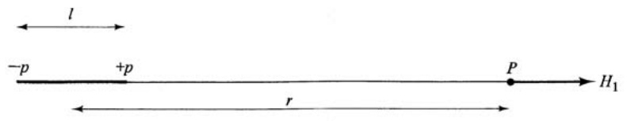
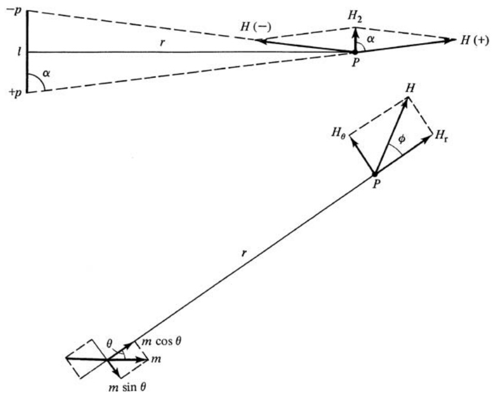
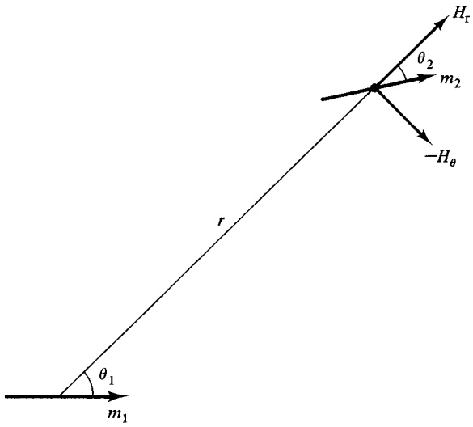

# DIPOLE FIELDS AND ENERGIES

We consider a magnet, or dipole, consisting of two point poles of strength p, interpolar distance l, and magnetic moment $m = pl.$

The field $H_{1}$ of the magnet at a point P distant r from the magnet center and in line with the magnet (Fig. A1.1a) is given by, from Equation 1.3,

$$
H _ {1} = \frac {p}{[ r - (l / 2) ] ^ {2}} - \frac {p}{[ r + (l / 2) ] ^ {2}} = \frac {2 p r l}{[ r ^ {2} - (l ^ {2} / 4) ] ^ {2}}.
$$

If r is large compared to l, this expression becomes

$$
H _ {1} = \frac {2 p l}{r ^ {3}} = \frac {2 m}{r ^ {3}}.\tag{A.1}
$$

Similarly, the field $H_{2}$ at a point P abreast of the magnet center (Fig. A1.1b) is the sum of the two fields H(+) and $H(-)$ , equal in magnitude:

$$
\begin{array}{l} H _ {2} = 2 H (+) \cos \alpha \\ = 2 \left[ \frac {p}{r ^ {2} + (l ^ {2} / 4)} \right] \left[ \frac {l / 2}{\{r ^ {2} + (l ^ {2} / 4) \} ^ {1 / 2}} \right] \\ = \frac {p l}{[ r ^ {2} + (l ^ {2} / 4) ] ^ {3 / 2}}. \end{array}
$$

<small>Introduction to Magnetic Materials, Second Edition. By B. D. Cullity and C. D. Graham Copyright # 2009 the Institute of Electrical and Electronics Engineers, Inc.</small>

(a)

Fig. A1.1 Fields of dipoles.

(c)

If r is large compared to l, this expression becomes

$$
H _ {2} = \frac {p l}{r ^ {3}} = \frac {m}{r ^ {3}}.\tag{A.2}
$$

In Fig. A1.1c we wish to know the field $H$ at P, where the line from P to the magnet makes an angle $\theta$ with the magnet axis. The moment of the magnet can be resolved into components parallel and normal to the line to P, so that

$$
H _ {\mathrm{r}} = \frac {2 (m \cos \theta)}{r ^ {3}},\tag{A.3}
$$

$$
H _ {\theta} = \frac {m \sin \theta}{r ^ {3}},\tag{A.4}
$$

$$
\begin{array}{c} H = (H _ {\mathrm{r}} ^ {2} + H _ {\theta} ^ {2}) ^ {1 / 2} \\ = \frac {m}{r ^ {3}} (3 \cos^ {2} \theta + 1) ^ {1 / 2}. \end{array}\tag{A.5}
$$

Fig. A1.2 Interacting dipoles.

The resultant field $H$ is inclined at an angle $(\theta + \phi)$  to the magnet axis, where

$$
\tan \phi = \frac {H _ {\theta}}{H _ {\mathrm{r}}} = \frac {\tan \theta}{2}.
$$

We now want an expression for the mutual potential energy of two magnets. Figure A1.2 shows two magnets of moment $m_{1}$ and $m_{2}$ at a distance r apart and making angles $\theta_{1}$ and $\theta_{2}$ with the line joining them. The field at $m_{2}$ , parallel to $m_{2}$ and due to $m_{1}$ , is

$$
H _ {\mathrm{p}} = H _ {\mathrm{r}} \cos \theta_ {2} - H _ {\theta} \cos (9 0 ^ {\circ} - \theta_ {2}).
$$

The potential energy of $m_{2}$ in the field of $m_{1}$ is, from Equation 1.5,

$$
E _ {\mathrm{p}} = - m _ {2} (H _ {\mathrm{r}} \cos \theta_ {2} - H _ {\theta} \sin \theta_ {2}).
$$

Combining this with Equations A.3 and A.4 gives

$$
E _ {\mathrm{p}} = - \frac {m _ {1} m _ {2}}{r ^ {3}} (2 \cos \theta_ {1} \cos \theta_ {2} - \sin \theta_ {1} \sin \theta_ {2})\tag{A.6}
$$

$$
= \frac {m _ {1} m _ {2}}{r ^ {3}} [ \cos (\theta_ {1} - \theta_ {2}) - 3 \cos \theta_ {1} \cos \theta_ {2} ].\tag{A.7}
$$

Similarly, it can be shown that the potential energy of $m_{1}$ in the field of $m_{2}$ is given by the same expression. Thus $E_{p}$ is the mutual potential energy of the two dipoles. It is also called the dipole – dipole energy or the interaction energy between the two dipoles. It is fundamentally a magnetostatic energy.

## DATA ON FERROMAGNETIC ELEMENTS

TABLE A2.1 Data on the Ferromagnetic Elements

<table><tr><td rowspan="2">Element</td><td colspan="3">20°C</td><td colspan="4">0K</td></tr><tr><td> $\sigma_s$  (emu/g)</td><td> $M_s$  (emu/cm3)</td><td>4π $M_s$  (G)</td><td> $\sigma_0$  (emu/g)</td><td> $μ_H$  ( $μ_\beta$ )</td><td> $T_c$ , °C</td><td> $σ_s/σ_0$ </td></tr><tr><td>Fe</td><td>218.0</td><td>1,714</td><td>21,580</td><td>221.9</td><td>2.219</td><td>770</td><td>0.982</td></tr><tr><td>Co</td><td>161</td><td>1,422</td><td>17,900</td><td>162.5</td><td>1.715</td><td>1131</td><td>0.991</td></tr><tr><td>Ni</td><td>54.39</td><td>484.1</td><td>6,084</td><td>57.50</td><td>0.604</td><td>358</td><td>0.946</td></tr></table>

TABLE A2.2 Relative Saturation Magnetization

<table><tr><td rowspan="2"> $T/T_c$ </td><td colspan="3"> $\sigma_s/\sigma_0$ </td></tr><tr><td>Fe</td><td>Co, Ni</td><td> $J = \frac{1}{2}$  (theory)</td></tr><tr><td>0</td><td>1</td><td>1</td><td>1</td></tr><tr><td>0.1</td><td>0.996</td><td> $0.996^a$ </td><td>1.000</td></tr><tr><td>0.2</td><td>0.99</td><td>0.99</td><td>1.000</td></tr><tr><td>0.3</td><td>0.975</td><td>0.98</td><td>0.997</td></tr><tr><td>0.4</td><td>0.95</td><td>0.96</td><td>0.983</td></tr><tr><td>0.5</td><td>0.93</td><td>0.94</td><td>0.958</td></tr><tr><td>0.6</td><td>0.90</td><td>0.90</td><td>0.907</td></tr><tr><td>0.7</td><td>0.85</td><td>0.83</td><td>0.829</td></tr><tr><td>0.8</td><td>0.77</td><td>0.73</td><td>0.710</td></tr><tr><td>0.85</td><td>0.70</td><td>0.66</td><td>0.630</td></tr><tr><td>0.9</td><td>0.61</td><td>0.56</td><td>0.525</td></tr><tr><td>0.95</td><td>0.46</td><td>0.40</td><td>0.380</td></tr><tr><td>1.0</td><td>0</td><td>0</td><td>0</td></tr></table>

From American Institute of Physics Handbook, 2nd ed. (New York: McGraw-Hill, 1963). aValue for Ni only.

## CONVERSION OF UNITS

Note: Table A3.1 gives the conversion factors in the form of the ratio of the cgs unit to the SI unit. So to convert from the SI to the cgs unit, multiply the SI value by the value of the ratio. To convert a cgs unit to SI, multiply the cgs value by the reciprocal of the ratio.

TABLE A3.1

| Quantity | Symbol | Conversion |
| --- | --- | --- |
| Field | H | $\frac{\text{Oe}}{\text{A} \cdot \text{m}^{-1}} = \frac{10^{3}}{4\pi} = 79.6$ |
| Flux | Φ | $\frac{\text{Mx}}{\text{Wb}} = \frac{\text{Mx}}{\text{V} \cdot \text{s}} = 10^{-8}$ |
| Flux density | B | $\frac{\text{G}}{\text{T}} = \frac{\text{G}}{\text{Wb} \cdot \text{m}^{-2}} = 10^{-4}$ |
| Magnetic moment | m | $\frac{\text{emu}}{\text{A} \cdot \text{m}^{2}} = \frac{\text{erg} \cdot \text{Oe}^{-1}}{\text{A} \cdot \text{m}^{2}} = \frac{10\text{A} \cdot \text{cm}^{2}}{\text{A} \cdot \text{m}^{2}} = \frac{\text{emu}}{\text{J} \cdot \text{T}^{-1}} = 10^{-3}$ |
| Magnetization per unit volume | M | $\frac{\text{emu} \cdot \text{cm}^{-3}}{\text{A} \cdot \text{m}^{-1}} = \frac{(\text{erg} \cdot \text{Oe}^{-1}) \cdot \text{cm}^{-3}}{\text{A} \cdot \text{m}^{-1}} = 10^{3}$ |
| Magnetization per unit mass | σ | $\frac{\text{emu} \cdot \text{g}^{-1}}{(\text{A} \cdot \text{m}^{2}) \cdot \text{kg}^{-1}} = \frac{(\text{erg} \cdot \text{Oe}^{-1}) \cdot \text{g}^{-1}}{(\text{A} \cdot \text{m}^{2}) \cdot \text{kg}^{-1}} = 1$ |
| Magnetic polarization | J | $\frac{\text{emu} \cdot \text{cm}^{-3}}{\text{T}} = \frac{(\text{erg} \cdot \text{Oe}^{-1}) \cdot \text{cm}^{-3}}{\text{T}} = 10^{3}\mu_{0} = 4\pi \cdot 10^{-4}$ |
| Volume susceptibility | $\chi_V$ | $\frac{(\text{emu} \cdot \text{Oe}^{-1}) \cdot \text{cm}^{-3}}{(\text{A} \cdot \text{m}^{2}) \cdot (\text{A} \cdot \text{m}^{-1})^{-1} \cdot \text{m}^{-3}} = 4\pi$ |
| Mass susceptibility | χM | $\frac{(\text{emu} \cdot \text{Oe}^{-1}) \cdot \text{g}^{-1}}{(\text{A} \cdot \text{m}^{2}) \cdot (\text{A} \cdot \text{m}^{-1})^{-1} \cdot \text{kg}^{-1}} = 4\pi \cdot 10^{-3}$ |
| Permeability | μ = B/H | $\frac{\text{G} \cdot \text{Oe}^{-1}}{\text{T} \cdot (\text{A} \cdot \text{m}^{-1})^{-1}} = \mu_{0} = 4\pi \cdot 10^{-7}$ |
| Relative permeability (SI) | μr | $\frac{\mu_{\text{SI}}}{\mu_{0}} = \mu_{\text{r}} = \mu_{\text{cgs}}$ |
| Energy density | W | $\frac{\text{erg} \cdot \text{cm}^{-3}}{\text{J} \cdot \text{m}^{-3}} = 0.1$ |
| Demagnetizing factor | N | $\frac{\text{N}_{\text{cgs}}}{\text{N}_{\text{SI}}} = 4\pi$ |
| Energy product | (BH) | $\frac{\text{G} \cdot \text{Oe}}{\text{T} \cdot (\text{A} \cdot \text{m}^{-1})} = \frac{\text{G} \cdot \text{Oe}}{\text{J} \cdot \text{m}^{-3}} = 4\pi \cdot 10^{1} = 126$$\frac{\text{MG} \cdot \text{Oe}}{\text{kJ} \cdot \text{m}^{-3}} = 4\pi \cdot 10^{-2} = 0.126$ |

## PHYSICAL CONSTANTS

| Planck's constant | $h = 6.62 \times 10^{-27}$ erg sec |
| --- | --- |
| Boltzmann's constant | $k = 1.38 \times 10^{-16}$ erg/K$= 0.862 \times 10^{-4}$ eV/K |
| Avogadro's number | $N = 6.02 \times 10^{23}/g$ mol |
| Gas constant | $R = 1.99$ cal/kg mol $= 8.32 \times 10^{7}$ ergs/kg mol |
| Velocity of light | $c = 3.00 \times 10^{10}$ cm/sec |
| Charge on the electron | $e = 4.80 \times 10^{-10}$ esu |
|  | $\frac{e}{c} = 1.60 \times 10^{-20}$ emu |
| Mass of electron | $m = 9.11 \times 10^{-28}$ g |
| Bohr magneton | $\mu_{\text{B}} = 0.927 \times 10^{-20}$ erg/Oe |
