# DEFINITIONS AND UNITS

## 1.1 INTRODUCTION

The story of magnetism begins with a mineral called magnetite $(Fe_{3}O_{4})$ , the first magnetic material known to man. Its early history is obscure, but its power of attracting iron was certainly known 2500 years ago. Magnetite is widely distributed. In the ancient world the most plentiful deposits occurred in the district of Magnesia, in what is now modern Turkey, and our word magnet is derived from a similar Greek word, said to come from the name of this district. It was also known to the Greeks that a piece of iron would itself become magnetic if it were touched, or, better, rubbed with magnetite.

Later on, but at an unknown date, it was found that a properly shaped piece of magnetite, if supported so as to float on water, would turn until it pointed approximately north and south. So would a pivoted iron needle, if previously rubbed with magnetite. Thus was the mariner’s compass born. This north-pointing property of magnetite accounts for the old English word lodestone for this substance; it means “waystone,” because it points the way.

The first truly scientific study of magnetism was made by the Englishman William Gilbert (1540 – 1603), who published his classic book On the Magnet in 1600. He experimented with lodestones and iron magnets, formed a clear picture of the Earth’s magnetic field, and cleared away many superstitions that had clouded the subject. For more than a century and a half after Gilbert, no discoveries of any fundamental importance were made, although there were many practical improvements in the manufacture of magnets. Thus, in the eighteenth century, compound steel magnets were made, composed of many magnetized steel strips fastened together, which could lift 28 times their own weight of iron. This is all the more remarkable when we realize that there was only one way of making magnets at that time: the iron or steel had to be rubbed with a lodestone, or with another magnet which in turn had been rubbed with a lodestone. There was no other way until the first electromagnet was made in 1825, following the great discovery made in 1820 by Hans Christian Oersted (1775–1851) that an electric current produces a magnetic field. Research on magnetic materials can be said to date from the invention of the electromagnet, which made available much more powerful fields than those produced by lodestones, or magnets made from them.

In this book we shall consider basic magnetic quantities and the units in which they are expressed, ways of making magnetic measurements, theories of magnetism, magnetic behavior of materials, and, finally, the properties of commercially important magnetic materials. The study of this subject is complicated by the existence of two different systems of units: the SI (International System) or mks, and the cgs (electromagnetic or emu) systems. The SI system, currently taught in all physics courses, is standard for scientific work throughout the world. It has not, however, been enthusiastically accepted by workers in magnetism. Although both systems describe the same physical reality, they start from somewhat different ways of visualizing that reality. As a consequence, converting from one system to the other sometimes involves more than multiplication by a simple numerical factor. In addition, the designers of the SI system left open the possibility of expressing some magnetic quantities in more than one way, which has not helped in speeding its adoption.

The SI system has a clear advantage when electrical and magnetic behavior must be considered together, as when dealing with electric currents generated inside a material by magnetic effects (eddy currents). Combining electromagnetic and electrostatic cgs units gets very messy, whereas using SI it is straightforward.

At present (early twenty-first century), the SI system is widely used in Europe, especially for soft magnetic materials (i.e., materials other than permanent magnets). In the USA and Japan, the cgs–emu system is still used by the majority of research workers, although the use of SI is slowly increasing. Both systems are found in reference works, research papers, materials and instrument specifications, so this book will use both sets of units. In Chapter 1, the basic equations of each system will be developed sequentially; in subsequent chapters the two systems will be used in parallel. However, not every equation or numerical value will be duplicated; the aim is to provide conversions in cases where they are not obvious or where they are needed for clarity.

Many of the equations in this introductory chapter and the next are stated without proof because their derivations can be found in most physics textbooks.

## 1.2 THE cgs–emu SYSTEM OF UNITS

## 1.2.1 Magnetic Poles

Almost everyone as a child has played with magnets and felt the mysterious forces of attraction and repulsion between them. These forces appear to originate in regions called poles, located near the ends of the magnet. The end of a pivoted bar magnet which points approximately toward the north geographic pole of the Earth is called the northseeking pole, or, more briefly, the north pole. Since unlike poles attract, and like poles repel, this convention means that there is a region of south polarity near the north geographic pole. The law governing the forces between poles was discovered independently in England in 1750 by John Michell (1724 – 1793) and in France in 1785 by Charles Coulomb (1736–1806). This law states that the force $F$ between two poles is proportional to the product of their pole strengths $p_{1}$ and $p_{2}$ and inversely proportional to the square of the distance $d$ between them:

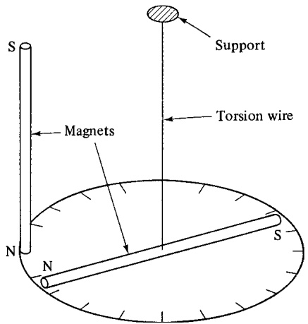

Fig. 1.1 Torsion balance for measuring the forces between poles.

$$
F = k \frac {p _ {1} p _ {2}}{d ^ {2}}.\tag{1.1}
$$

If the proportionality constant $k$ is put equal to 1, and we measure $F$ in dynes and $d$ in centimeters, then this equation becomes the definition of pole strength in the cgs–emu system. A unit pole, or pole of unit strength, is one which exerts a force of 1 dyne on another unit pole located at a distance of 1 cm. The dyne is in turn defined as that force which gives a mass of 1 g an acceleration of 1 $\mathrm{cm / sec^2}$ . The weight of a 1 g mass is 981 dynes. No name has been assigned to the unit of pole strength.

Poles always occur in pairs in magnetized bodies, and it is impossible to separate them.1 If a bar magnet is cut in two transversely, new poles appear on the cut surfaces and two magnets result. The experiments on which Equation 1.1 is based were performed with magnetized needles that were so long that the poles at each end could be considered approximately as isolated poles, and the torsion balance sketched in Fig. 1.1. If the stiffness of the torsion-wire suspension is known, the force of repulsion between the two north poles can be calculated from the angle of deviation of the horizontal needle. The arrangement shown minimizes the effects of the two south poles.

A magnetic pole creates a magnetic field around it, and it is this field which produces a force on a second pole nearby. Experiment shows that this force is directly proportional to the product of the pole strength and field strength or field intensity $H$:

$$
F = k p H.\tag{1.2}
$$

If the proportionality constant $k$ is again put equal to 1, this equation then defines $H$: a field of unit strength is one which exerts a force of 1 dyne on a unit pole. If an unmagnetized piece of iron is brought near a magnet, it will become magnetized, again through the agency of the field created by the magnet. For this reason $H$ is also sometimes called the magnetizing force. A field of unit strength has an intensity of one oersted (Oe). How large is an oersted? The magnetic field of the Earth in most places amounts to less than 0.5 Oe, that of a bar magnet (Fig. 1.2) near one end is about 5000 Oe, that of a powerful electromagnet is about 20,000 Oe, and that of a superconducting magnet can be 100,000 Oe or more. Strong fields may be measured in kilo-oersteds (kOe). Another cgs unit of field strength, used in describing the Earth’s field, is the gamma $(1\gamma = 10^{-5}\mathrm{Oe})$

<small>1The existence of isolated magnetic poles, or monopoles, is not forbidden by any known law of nature, and serious efforts to find monopoles have been made [P. A. M. Dirac, Proc. R. Soc. Lond., A133 (1931) p. 60; H. Jeon and M. J. Longo, Phys. Rev. Lett., 75 (1995) pp. 1443–1446]. The search has not so far been successful.</small>

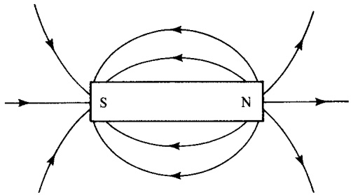

Fig. 1.2 External field of a bar magnet.

A unit pole in a field of one oersted is acted on by a force of one dyne. But a unit pole is also subjected to a force of 1 dyne when it is 1 cm away from another unit pole. Therefore, the field created by a unit pole must have an intensity of one oersted at a distance of 1 cm from the pole. It also follows from Equations 1.1 and 1.2 that this field decreases as the inverse square of the distance d from the pole:

$$
H = \frac {p}{d ^ {2}}.\tag{1.3}
$$

Michael Faraday (1791 – 1867) had the very fruitful idea of representing a magnetic field by “lines of force.” These are directed lines along which a single north pole would move, or to which a small compass needle would be tangent. Evidently, lines of force radiate outward from a single north pole. Outside a bar magnet, the lines of force leave the north pole and return at the south pole. (Inside the magnet, the situation is more complicated and will be discussed in Section 2.9) The resulting field (Fig. 1.3) can be made visible in two dimensions by sprinkling iron filings or powder on a card placed directly above the magnet. Each iron particle becomes magnetized and acts like a small compass needle, with its long axis parallel to the lines of force.

The notion of lines of force can be made quantitative by defining the field strength $H$ as the number of lines of force passing through unit area perpendicular to the field. A line of force, in this quantitative sense, is called a maxwell.2 Thus

$$
1 \mathrm{Oe} = 1 \text {line of force / cm} ^ {2} = 1 \mathrm{maxwell/cm} ^ {2}.
$$

<small>2James Clerk Maxwell (1831–1879), Scottish physicist, who developed the classical theory of electromagnetic fields described by the set of equations known as Maxwell’s equations.</small>

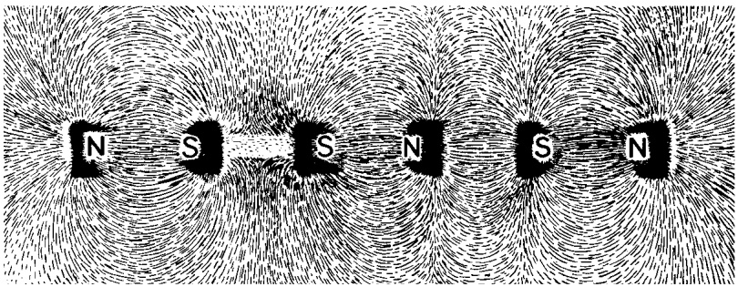

Fig. 1.3 Fields of bar magnets revealed by iron filings.

Imagine a sphere with a radius of 1 cm centered on a unit pole. Its surface area is $4\pi\mathrm{cm}^{2}$ Since the field strength at this surface is 1 Oe, or 1 line of force/cm² there must be a total of $4\pi$ lines of force passing through it. In general, $4\pi p$ lines of force issue from a pole of strength $p$.

## 1.3 MAGNETIC MOMENT

Consider a magnet with poles of strength $p$ located near each end and separated by a distance $l$. Suppose the magnet is placed at an angle $\theta$ to a uniform field $H$ (Fig. 1.4). Then a torque acts on the magnet, tending to turn it parallel to the field. The moment of this torque is

$$
(p H \sin \theta) \left(\frac {l}{2}\right) + (p H \sin \theta) \left(\frac {l}{2}\right) = p H l \sin \theta
$$

When $H = 1$ Oe and $\theta = 90^{\circ}$ , the moment is given by

$$
m = p l,\tag{1.4}
$$

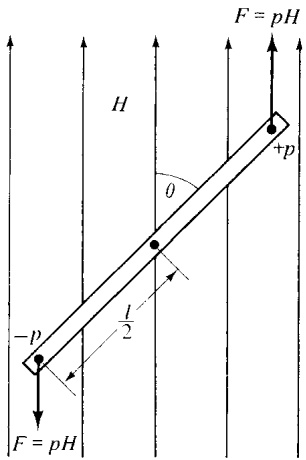

Fig. 1.4 Bar magnet in a uniform field. (Note use of plus and minus signs to designate north and south poles.)

where $m$ is the magnetic moment of the magnet. It is the moment of the torque exerted on the magnet when it is at right angles to a uniform field of 1 Oe. (If the field is nonuniform, a translational force will also act on the magnet. See Section 2.13.)

Magnetic moment is an important and fundamental quantity, whether applied to a bar magnet or to the “electronic magnets” we will meet later in this chapter. Magnetic poles, on the other hand, represent a mathematical concept rather than physical reality; they cannot be separated for measurement and are not localized at a point, which means that the distance $l$ between them is indeterminate. Although $p$ and $l$ are uncertain quantities individually, their product is the magnetic moment $m$, which can be precisely measured. Despite its lack of precision, the concept of the magnetic pole is useful in visualizing many magnetic interactions, and helpful in the solution of magnetic problems.

Returning to Fig. 1.4, we note that a magnet not parallel to the field must have a certain potential energy $E_{p}$ relative to the parallel position. The work done (in ergs) in turning it through an angle $d\theta$ against the field is

$$
d E _ {\mathrm{p}} = 2 (p H \sin \theta) \left(\frac {l}{2}\right) d \theta = m H \sin \theta d \theta .
$$

It is conventional to take the zero of energy as the $\theta = 90^{\circ}$ position. Therefore,

$$
E _ {\mathrm{p}} = \int_ {9 0 ^ {\circ}} ^ {\theta} m H \sin \theta d \theta = - m H \cos \theta .\tag{1.5}
$$

Thus $E_{\mathrm{p}}$ is $-mH$ when the magnet is parallel to the field, zero when it is at right angles, and $+mH$ when it is antiparallel. The magnetic moment $m$ is a vector which is drawn from the south pole to the north. In vector notation, Equation 1.5 becomes

$$
E _ {\mathrm{p}} = - \mathbf {m} \cdot \mathbf {H}\tag{1.6}
$$

Equation 1.5 or 1.6 is an important relation which we will need frequently in later sections.

Because the energy $E_{\mathrm{p}}$ is in ergs, the unit of magnetic moment $m$ is erg/oersted. This quantity is the electromagnetic unit of magnetic moment, generally but unofficially called simply the emu.

## 1.4 INTENSITY OF MAGNETIZATION

When a piece of iron is subjected to a magnetic field, it becomes magnetized, and the level of its magnetism depends on the strength of the field. We therefore need a quantity to describe the degree to which a body is magnetized.

Consider two bar magnets of the same size and shape, each having the same pole strength $p$ and interpolar distance $l$. If placed side by side, as in Fig. 1.5a, the poles add, and the magnetic moment $m = (2p)l = 2pl.$ which is double the moment of each individual magnet. If the two magnets are placed end to end, as in Fig. 1.5b, the adjacent poles cancel and $m = p(2l) = 2pl$, as before. Evidently, the total magnetic moment is the sum of the magnetic moments of the individual magnets.

In these examples, we double the magnetic moment by doubling the volume. The magnetic moment per unit volume has not changed and is therefore a quantity that describes the degree to which the magnets are magnetized. It is called the intensity of magnetization, or simply the magnetization, and is written $M$ (or $I$ or $J$ by some authors). Since

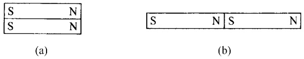

Fig. 1.5 Compound magnets.

$$
M = \frac {m}{v},\tag{1.7}
$$

where v is the volume; we can also write

$$
M = \frac {p l}{v} = \frac {p}{v / l} = \frac {p}{A},\tag{1.8}
$$

where $A$ is the cross-sectional area of the magnet. We therefore have an alternative definition of the magnetization $M$ as the pole strength per unit area of cross section.

Since the unit of magnetic moment $m$ is erg/oersted, the unit of magnetization $M$ is erg/oersted cm3. However, it is more often written simply as emu/cm3, where “emu” is understood to mean the electromagnetic unit of magnetic moment. However, emu is sometimes used to mean “electromagnetic cgs units” generically.

It is sometimes convenient to refer the value of magnetization to unit mass rather than unit volume. The mass of a small sample can be measured more accurately than its volume, and the mass is independent of temperature whereas the volume changes with temperature due to thermal expansion. The specific magnetization $\sigma$is defined as

$$
\sigma = \frac {m}{w} = \frac {m}{v \rho} = \frac {M}{\rho} \mathrm{emu/g},\tag{1.9}
$$

where $w$ is the mass and ρ the density.

Magnetization can also be expressed per mole, per unit cell, per formula unit, etc. When dealing with small volumes like the unit cell, the magnetic moment is often given in units called Bohr magnetons, $\mu_{B}$ , where 1 Bohr magn $\mathrm{e}$eton $= 9.27\times 10^{-21}\mathrm{erg / Oe}$ . The Bohr magneton will be considered further in Chapter 3.

## 1.5 MAGNETIC DIPOLES

As shown in Appendix 1, the field of a magnet of pole strength $p$ and length $l$, at a distance $r$ from the magnet, depends only on the moment $pl$ of the magnet and not on the separate values of $p$ and $l$, provided $r$ is large relative to $l$. Thus the field is the same if we halve the length of the magnet and double its pole strength. Continuing this process, we obtain in the limit a very short magnet of finite moment called a magnetic dipole. Its field is sketched in Fig. 1.6. We can therefore think of any magnet, as far as its external field is concerned, as being made up of a number of dipoles; the total moment of the magnet is the sum of the moments, called dipole moments, of its constituent dipoles.

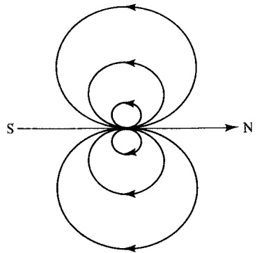

Fig. 1.6 Field of a magnetic dipole.

## 1.6 MAGNETIC EFFECTS OF CURRENTS

A current in a straight wire produces a magnetic field which is circular around the wire axis in a plane normal to the axis. Outside the wire the magnitude of this field, at a distance $r$ cm from the wire axis, is given by

$$
H = \frac {2 i}{1 0 r} \mathrm{Oe},\tag{1.10}
$$

where $i$ is the current in amperes. Inside the wire,

$$
H = \frac {2 i r}{1 0 r _ {0} ^ {2}} \mathrm{Oe},
$$

where $r_{0}$ is the wire radius (this assumes the current density is uniform). The direction of the field is that in which a right-hand screw would rotate if driven in the direction of the current (Fig. 1.7a). In Equation 1.10 and other equations for the magnetic effects of currents, we are using “mixed” practical and cgs electromagnetic units. The electromagnetic unit of current, the absolute ampere or abampere, equals 10 international or “ordinary” amperes, which accounts for the factor 10 in these equations.

If the wire is curved into a circular loop of radius _R_ cm, as in Fig. 1.7b, then the field at the center along the axis is

$$
H = \frac {2 \pi i}{1 0 R} \mathrm{Oe}.\tag{1.11}
$$

The field of such a current loop is sketched in (c). Experiment shows that a current loop, suspended in a uniform magnetic field and free to rotate, turns until the plane of the loop is normal to the field. It therefore has a magnetic moment, which is given by

$$
m (\text {loop}) = \frac {\pi R ^ {2} i}{1 0} = \frac {A i}{1 0} = \mathrm{amp} \cdot \mathrm{cm} ^ {2} \text {or erg / Oe},\tag{1.12}
$$

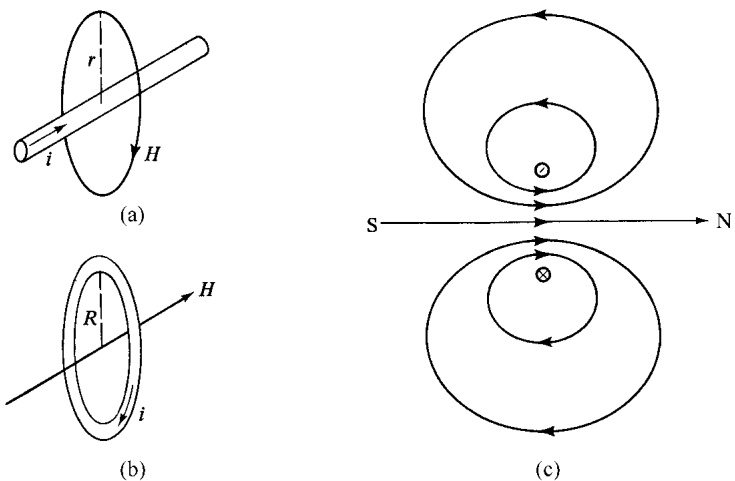

Fig. 1.7 Magnetic fields of currents.

where $A$ is the area of the loop in $\mathrm{cm}^2$ The direction of $m$ is the same as that of the axial field $H$ due to the loop itself (Fig. 1.7b).

A helical winding (Fig. 1.8) produces a much more uniform field than a single loop. Such a winding is called a solenoid, after the Greek word for a tube or pipe. The field along its axis at the midpoint is given by

$$
H = \frac {4 \pi n i}{1 0 L} \mathrm{Oe},\tag{1.13}
$$

where $n$ is the number of turns and $L$ the length of the winding in centimeters. Note that the field is independent of the solenoid radius as long as the radius is small compared to the length. Inside the solenoid the field is quite uniform, except near the ends, and outside it resembles that of a bar magnet (Fig. 1.2). The magnetic moment of a solenoid is given by

$$
m (\text {solenoid}) = \frac {n A i}{1 0} \frac {\text {erg}}{\text {Oe}},\tag{1.14}
$$

where $A$ is the cross-sectional area.

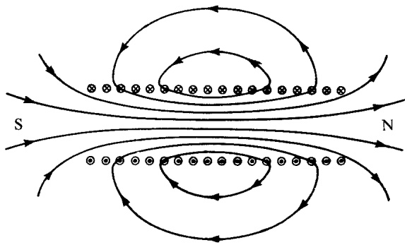

Fig. 1.8 Magnetic field of a solenoid.

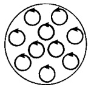

(a)

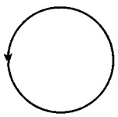

(b)

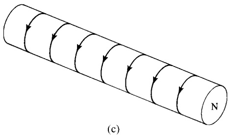

Fig. 1.9 Amperian current loops in a magnetized bar.

As the diameter of a current loop becomes smaller and smaller, the field of the loop (Fig. 1.7c) approaches that of a magnetic dipole (Fig. 1.6). Thus it is possible to regard a magnet as being a collection of current loops rather than a collection of dipoles. In fact, André-Marie Ampère (1775 – 1836) suggested that the magnetism of a body was due to “molecular currents” circulating in it. These were later called Amperian currents. Figure 1.9a shows schematically the current loops on the cross section of a uniformly magnetized bar. At interior points the currents are in opposite directions and cancel one another, leaving the net, uncanceled loop shown in Fig. 1.9b. On a short section of the bar these current loops, called equivalent surface currents, would appear as in Fig. 1.9c. In the language of poles, this section of the bar would have a north pole at the forward end, labeled $N$. The similarity to a solenoid is evident. In fact, given the magnetic moment and cross-sectional area of the bar, we can calculate the equivalent surface current in terms of the product $ni$ from Equation 1.14. However, it must be remembered that, in the case of the solenoid, we are dealing with a real current, called a conduction current, whereas the equivalent surface currents, with which we replace the magnetized bar, are imaginary (except in the case of superconductors; see Chapter 16.)

## 1.7 MAGNETIC MATERIALS

We are now in a position to consider how magnetization can be measured and what the measurement reveals about the magnetic behavior of various kinds of substances. Figure 1.10 shows one method of measurement. The specimen is in the form of a ring, wound with a large number of closely spaced turns of insulated wire, connected through a switch $S$ and ammeter $A$ to a source of variable current. This winding is called the primary, or magnetizing, winding. It forms an endless solenoid, and the field inside it is given by Equation 1.13; this field is, for all practical purposes, entirely confined to the region within the coil. This arrangement has the advantage that the material of the ring becomes magnetized without the formation of poles, which simplifies the interpretation of the measurement. Another winding, called the secondary winding or search coil, is placed on all or a part of the ring and connected to an electronic integrator or fluxmeter. Some practical aspects of this measurement are discussed in Chapter 2.

<small>3Sometimes called a Rowland ring, after the American physicist H. A. Rowland (1848– 1901), who first used this kind of specimen in his early research on magnetic materials. He is better known for the production of ruled diffraction gratings for the study of optical spectra.</small>

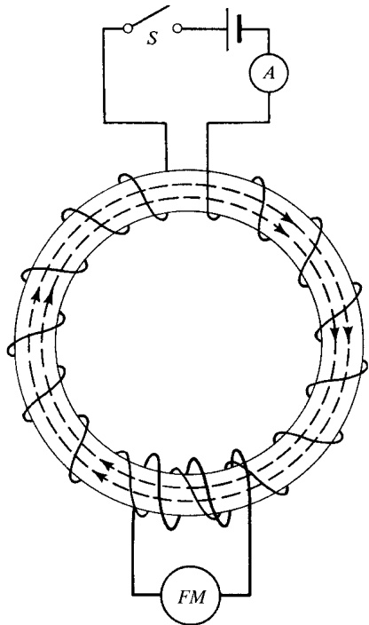

Fig. 1.10 Circuit for magnetization of a ring. Dashed lines indicate flux.

Let us start with the case where the ring contains nothing but empty space. If the switch $S$ is closed, a current i is established in the primary, producing a field of $H$ oersteds, or maxwells/cm2, within the ring. If the cross-sectional area of the ring is $A\mathrm{cm}^2$ , then the total number of lines of force in the ring is $HA = \Phi$ maxwells, which is called the magnetic flux. (It follows that $H$ may be referred to as a flux density.) The change in flux $\Delta \Phi$ through the search coil, from 0 to $F$, induces an electromotive force (emf ) in the search coil according to Faraday’s law:

$$
E = - 1 0 ^ {- 8} n \bigg (\frac {d \Phi}{d t} \bigg) \quad \text {or} \quad \int E   d t = - 1 0 ^ {- 8} n   \Delta \Phi ,
$$

where $n$ is the number of turns in the secondary winding, $t$ is time in seconds, and $E$ is in volts.

The (calibrated) output of the voltage integrator $\int E dt$ is a measure of $\Delta\Phi,$ which in this case is simply $Phi$. When the ring contains empty space, it is found that $\Phi_{\mathrm{observed}}$ obtained from the integrator reading, is exactly equal to $\Phi_{\mathrm{current}}$ which is the flux produced by the current in the primary winding, i.e., the product $A$ and $H$ calculated from Equation 1.13.

However, if there is any material substance in the ring, $\Phi_{\mathrm{observed}}$ is found to differ from $\Phi_{\mathrm{current}}$ This means that the substance in the ring has added to, or subtracted from, the number of lines of force due to the field $H$. The relative magnitudes of these two quantities, $\Phi_{\mathrm{observed}}$ and $\Phi_{\mathrm{current}}$ enable us to classify all substances according to the kind of magnetism they exhibit:

$$
\begin{array}{ll}
\Phi_{\text{observed}} \lt \Phi_{\text{current}}, & \text{diamagnetic (i.e., Cu, He)} \\
\Phi_{\text{observed}} \gt \Phi_{\text{current}}, & \text{paramagnetic (i.e., Na, Al)} \\
& \text{or antiferromagnetic (i.e., MnO, FeO)} \\
\Phi_{\text{observed}} \gg \Phi_{\text{current}}, & \text{ferromagnetic (i.e., Fe, Co, Ni)} \\
& \text{or ferrimagnetic (i.e., } \mathrm{Fe_3O_4} \text{)}
\end{array}
$$

Paramagnetic and antiferromagnetic substances can be distinguished from one another by magnetic measurement only if the measurements extend over a range of temperature. The same is true of ferromagnetic and ferrimagnetic substances.

All substances are magnetic to some extent. However, examples of the first three types listed above are so feebly magnetic that they are usually called “nonmagnetic,” both by the layman and by the engineer or scientist. The observed flux in a typical paramagnetic, for example, is only about 0.02% greater than the flux due to the current. The experimental method outlined above is not capable of accurately measuring such small differences, and entirely different methods have to be used. In ferromagnetic and ferrimagnetic materials, on the other hand, the observed flux may be thousands of times larger than the flux due to the current.

We can formally understand how the material of the ring causes a change in flux if we consider the fields which actually exist inside the ring. Imagine a very thin, transverse cavity cut out of the material of the ring, as shown in Fig. 1.11. Then $H$ lines/cm2 cross this gap, due to the current in the magnetizing winding, in accordance with Equation 1.13. This flux density is the same whether or not there is any material in the ring. In addition, the applied field $H$, acting from left to right, magnetizes the material, and north and south poles are produced on the surface of the cavity, just as poles are produced on the ends of a magnetized bar. If the material is ferromagnetic, the north poles will be on the left-hand surface and south poles on the right. If the intensity of magnetization is $M$, then each square centimeter of the surface of the cavity has a pole strength of $M$, and $4\pi M$ lines issue from it. These are sometimes called lines of magnetization. They add to the lines of force due to the applied field $H$, and the combined group of lines crossing the gap are called lines of magnetic flux or lines of induction. The total number of lines per $\mathrm{cm}^2$ is called the magnetic flux density or the induction $B$. Therefore,

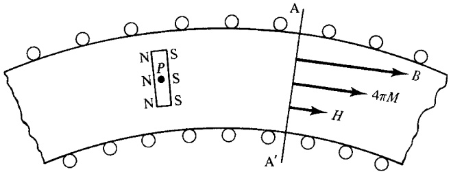

Fig. 1.11 Transverse cavity in a portion of a Rowland ring.

$$
B = H + 4 \pi M.\tag{1.15}
$$

The word “induction” is a relic from an earlier age: if an unmagnetized piece of iron were brought near a magnet, then magnetic poles were said to be “induced” in the iron, which was, in consequence, attracted to the magnet. Later the word took on the quantitative sense, defined above, of the total flux density in a material, denoted by $B$. Flux density is now the preferred term.

Because lines of $B$ are always continuous, Equation 1.15 gives the value of $B$, not only in the gap, but also in the material on either side of the gap and throughout the ring. Although $B$, $H$, and $M$ are vectors, they are usually parallel, so that Equation 1.15 is normally written in scalar form. These are vectors indicated at the right of Fig. 1.11, for a hypothetical case where $B$ is about three times $H$. They indicate the values of $B$, $H$, and $4\pi M$ at the section $AA'$ or at any other section of the ring.

Although $B$, $H$, and $M$ must necessarily have the same units (lines or maxwells $/cm^{2})$ different names are given to these quantities. A maxwell per $\mathrm{cm}^2$ is customarily called a gauss (G), $^{4}$ when it refers to $B$, and an oersted when it refers to $H$. However, since in free space or (for practical purposes) in air, $M = 0$ and therefore $B = H,$ it is not uncommon to see $H$ expressed in gauss. The units for magnetization raise further difficulties. As we have seen, the units for $M$ are erg/Oe cm³ , commonly written emu $/cm^{3}$ , but $4\pi M,$ from Equation 1.15, must have units of maxwells $/cm^{2}$ , which could with equal justification be called either gauss or oersteds. In this book when using cgs units we will write $M$ in emu/cm3, but $4\pi M$ in gauss, to emphasize that the latter forms a contribution to the total flux density $B$. Note that this discussion concerns only the names of these units ($B$, $H$, and $4\pi M$ ). There is no need for any numerical conversion of one to the other, as they are all numerically equal. It may also be noted that it is not usual to refer, as is done above, to $H$ as a flux density and to $HA$ as a flux, although there would seem to be no logical objection to these designations. Instead, most writers restrict the terms “flux density” and “flux” to $B$ and $BA$, respectively.

Returning to the Rowland ring, we now see that $\Phi_{\mathrm{observed}} = BA$ , because the integrator measures the change in the total number of lines enclosed by the search coil. On the other hand, $\Phi_{\mathrm{current}} = HA$ . The difference between them is $4\pi M$A. The magnetization $M$ is zero only for empty space. The magnetization, even for applied fields $H$ of many thousands of oersteds, is very small and negative for diamagnetics, very small and positive for paramagnetics and antiferromagnetics, and large and positive for ferro- and ferrimagnetics. The negative value of $M$ for diamagnetic materials means that south poles are produced on the left side of the gap in Fig. 1.11 and north poles on the right.

Workers in magnetic materials generally take the view that $H$ is the “fundamental” magnetic field, which produces magnetization $M$ in magnetic materials. The flux density $B$ is a useful quantity primarily because changes in $B$ generate voltages through Faraday’s law.

The magnetic properties of a material are characterized not only by the magnitude and sign of $M$ but also by the way in which $M$ varies with $H$. The ratio of these two

<small>4Carl Friedrich Gauss (1777–1855), German mathematician was renowned for his genius in mathematics. He also developed magnetostatic theory, devised a system of electrical and magnetic units, designed instruments for magnetic measurements, and investigated terrestrial magnetism.</small>

quantities is called the susceptibility $\chi$:

$$
\chi = \frac {M}{H} \frac {\mathrm{emu}}{\mathrm{Oe} \cdot \mathrm{cm} ^ {3}}.\tag{1.16}
$$

Note that, since $M$ has units $\mathrm{A}\cdot\mathrm{cm}^{2}/\mathrm{cm}^{3}$ , and $H$ has units A/cm, χ is actually dimensionless. Since $M$ is the magnetic moment per unit volume, χ also refers to unit volume and is sometimes called the volume susceptibility and given the symbol $\chi_{\mathrm{v}}$ to emphasize this fact. Other susceptibilities can be defined, as follows:

$\chi_{\mathrm{m}} = \chi_{\mathrm{v}} / \rho =$ mass susceptibility (emu/Oe g), where $\rho =$ density,

$\chi_{A} = \chi_{v}A = atomic\ susceptibility (emu/Oe\ g\ atom), \quad where\ A = atomic\ weight,$

$\chi_{\mathrm{M}} = \chi_{\mathrm{v}}M^{\prime}$ = molar susceptibility (emu=Oe mol), where M0 = molecular weight:

Typical curves of $M$ vs $H$, called magnetization curves, are shown in Fig. 1.12 for various kinds of substances. Curves (a) and (b) refer to substances having volume susceptibilities of $-2 \times 10^{-6}$ and $+20 \times 10^{-6}$ , respectively. These substances (dia-, para-, or antiferromagnetic) have linear $M$, $H$ curves under normal circumstances and retain no magnetism when the field is removed. The behavior shown in curve (c), of a typical ferro- or ferrimagnetic, is quite different. The magnetization curve is nonlinear, so that x varies with $H$ and passes through a maximum value (about 40 for the curve shown). Two other phenomena appear:

1. Saturation. At large enough values of $H$, the magnetization $M$ becomes constant at its saturation value of $M_{\mathrm{s}}$

2. Hysteresis, or irreversibility. After saturation, a decrease in $H$ to zero does not reduce $M$ to zero. Ferro- and ferrimagnetic materials can thus be made into permanent magnets. The word hysteresis is from a Greek word meaning “to lag behind,” and is today applied to any phenomenon in which the effect lags behind the cause, leading to irreversible behavior. Its first use in science was by Ewing$^{5}$ in 1881, to describe the magnetic behavior of iron.

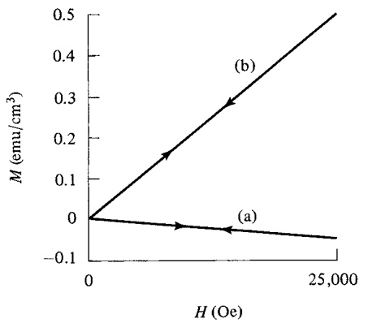

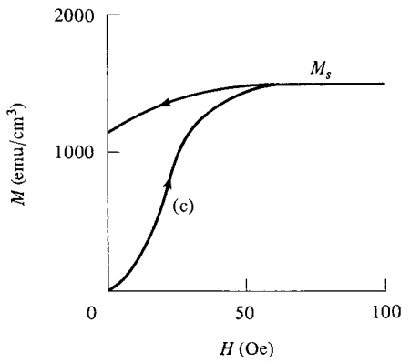

Fig. 1.12 Typical magnetization curves of (a) a diamagnetic; (b) a paramagnetic or antiferromagnetic; and (c) a ferromagnetic of ferrimagnetic.

In practice, susceptibility is primarily measured and quoted only in connection with diaand paramagnetic materials, where χ is independent of $H$ (except possibly at very low temperatures and high fields). Since these materials are very weakly magnetic, susceptibility is of little engineering importance. Susceptibility is, however, important in the study and use of superconductors.

Engineers are usually concerned only with ferro- and ferrimagnetic materials and need to know the total flux density $B$ produced by a given field. They therefore often find the $B$, $H$ curve, also called a magnetization curve, more useful than the $M$, $H$ curve. The ratio of $B$ to $H$ is called the permeability μ:

$$
\mu = \frac {B}{H} (\text {dimensionless}).\tag{1.17}
$$

Since $B = H + 4\pi M,$ we have

$$
\begin{array}{l} \frac {B}{H} = 1 + 4 \pi \bigg (\frac {M}{H} \bigg), \\ \mu = 1 + 4 \pi \chi . \end{array}\tag{1.18}
$$

Note that μ is not the slope $dB/dH$ of the $B$, $H$ curve, but rather the slope of a line from the origin to a particular point on the curve. Two special values are often quoted, the initial permeability $\mu_{0}$ and the maximum permeability $\mu_{\mathrm{max}}$ These are illustrated in Fig. 1.13, which also shows the typical variation of μ with $H$ for a ferro- or ferrimagnetic. If not otherwise specified, permeability μ is taken to be the maximum permeability $\mu_{\mathrm{max}}$ . The local slope of the $B$, $H$ curve $dB/dH$ is called the differential permeability, and is sometimes

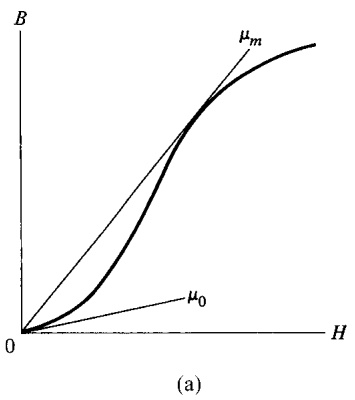

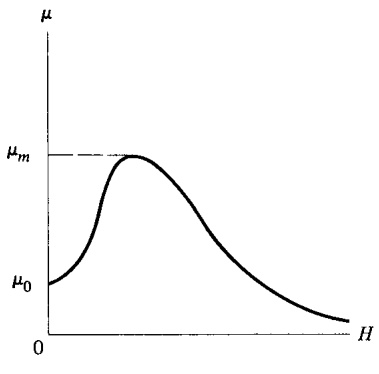

Fig. 1.13 (a) $B$ vs $H$ curve of a ferro- or ferrimagnetic, and (b) corresponding variation of μ with $H$.

5J. A. Ewing (1855–1935), British educator and engineer taught at Tokyo, Dundee, and Cambridge and did research on magnetism, steam engines, and metallurgy. During World War I, he organized the cryptography section of the British Admiralty. During his five-year tenure of a professorship at the University of Tokyo (1878–1883), he introduced his students to research on magnetism, and Japanese research in this field has flourished ever since.

used. Permeabilities are frequently quoted for soft magnetic materials, but they are mainly of qualitative significance, for two reasons:

1. Permeability varies greatly with the level of the applied field, and soft magnetic materials are almost never used at constant field.

2. Permeability is strongly structure-sensitive, and so depends on purity, heat treatment, deformation, etc.

We can now characterize the magnetic behavior of various kinds of substances by their corresponding values of χ and μ:

1. Empty space; $\chi = 0$ , since there is no matter to magnetize, and $\mu = 1$

2. Diamagnetic; χ is small and negative, and μ slightly less than 1.

3. Para- and antiferromagnetic; χ is small and positive, and μ slightly greater than 1.

4. Ferro- and ferrimagnetic; χ and μ are large and positive, and both are functions of $H$.

The permeability of air is about 1.000,000,37. The difference between this and the permeability of empty space is negligible, relative to the permeabilities of ferro- and ferrimagnetics, which typically have values of μ of several hundreds or thousands. We can therefore deal with these substances in air as though they existed in a vacuum. In particular, we can say that $B$ equals $H$ in air, with negligible error.

## 1.8 SI UNITS

The SI system of units uses the meter, kilogram, and second as its base units, plus the international electrical units, specifically the ampere. The concept of magnetic poles is generally ignored (although it need not be), and magnetization is regarded as arising from current loops.

The magnetic field at the center of a solenoid of length l, n turns, carrying current i, is given simply by

$$
H = \frac {n i}{l} \frac {\text {ampere turns}}{\text {meter}}.\tag{1.19}
$$

Since n turns each carrying current i are equivalent to a single turn carrying current ni, the unit of magnetic field is taken as A/m (amperes per meter). It has no simpler name. Note that the factor $4\pi$ does not appear in Equation 1.19. Since the factor $4\pi$ arises from solid geometry (it is the area of a sphere of unit radius), it cannot be eliminated, but it can be moved elsewhere in a system of units. This process (in the case of magnetic units) is called rationalization, and the SI units of magnetism are rationalized mks units. We will see shortly where the $4\pi$ reappears.

If a loop of wire of area $A(\mathrm{m}^{2})$ is placed perpendicular to a magnetic field $H(\mathrm{A / m})$ , and the field is changed at a uniform rate $dH / dt = \text{const.}$ , a voltage is generated in the loop according to Faraday’s law:

$$
E = - k A \left(\frac {d H}{d t}\right) \text {volt}.\tag{1.20}
$$

The negative sign means that the voltage would drive a current in the direction that would generate a field opposing the change in field. Examination of the dimensions of Equation 1.20 shows that the proportionality constant $k$ has units

$$
\frac {\mathrm{V} \cdot \sec}{\mathrm{m} ^ {2} \cdot (\mathrm{A} \cdot \mathrm{m} ^ {- 1})} = \frac {\mathrm{V} \cdot \sec}{\mathrm{A} \cdot \mathrm{m}}.
$$

Since

$$
\frac {\mathrm{V}}{\mathrm{A} \cdot \sec^ {- 1}}
$$

is the unit of inductance, the henry (H), the units of k are usually given as H/m (henry per meter). The numerical value of $k$ is $4\pi \times 10^{-7}H / m;$ it is given the symbol $\mu_{0}$ (or sometimes G), and has various names: the permeability of free space, the permeability of vacuum, the magnetic constant, or the permeability constant. This is where the factor $4\pi$ appears in rationalized units.

Equation 1.20 can alternatively be written

$$
E = - A \left(\frac {d B}{d t}\right) \quad \text {or} \quad \int E d t = - A \Delta B.\tag{1.21}
$$

Here $B$ is the magnetic flux density (V sec/m²) . A line of magnetic flux in the SI system is called a weber (Wb = V sec), so flux density can also be expressed in $\mathrm{Wb/m^{2}}$ , which is given the special name of the tesla (T).6

In SI units, then, we have a magnetic field $H$ defined from the ampere, and a magnetic flux density $B$, defined from the volt. The ratio between these two quantities (in empty space), B/H, is the magnetic constant $\mu_{0}$

A magnetic moment $m$ is produced by a current i flowing around a loop of area A, and so has units $\mathrm{A}\cdot\mathrm{m}^{2}$ . Magnetic moment per unit volume $M = m / V$ then has units

$$
\frac {\mathrm{A} \cdot \mathrm{m} ^ {2}}{\mathrm{m} ^ {3}} = \mathrm{A} \cdot \mathrm{m} ^ {- 1},
$$

the same as the units of magnetic field. Magnetization per unit mass becomes

$$
\sigma = \frac {\mathrm{A} \cdot \mathrm{m} ^ {2}}{\mathrm{w}} \left(\frac {\mathrm{A} \cdot \mathrm{m} ^ {2}}{\mathrm{kg}} \text {or} \mathrm{A} \cdot \mathrm{m} ^ {- 1} \frac {\mathrm{m} ^ {3}}{\mathrm{kg}}\right)
$$

The SI equivalent of Equation 1.15 is

$$
B = \mu_ {0} (H + M),\tag{1.22}
$$

with $B$ in tesla and $H$ and $M$ in A/m . This is known as the Sommerfeld convention. It is equally possible to express magnetization in units of tesla, or $\mu_0(\mathrm{A / m})$ . This is known as the Kennelly convention, under which Equation 1.15 becomes

<small>6Nicola Tesla (1856– 1943), Serbian-American inventor, engineer, and scientist is largely responsible for the development of alternating current (ac) technology.</small>

$$
B = \mu_ {0} H + I\tag{1.23}
$$

and $I$ (or $J$) is called the magnetic polarization. The Sommerfeld convention is “recognized” in the SI system, and will be used henceforth in this book.

Volume susceptibility $\chi_V$ is defined as $M / H,$ and is dimensionless. Mass susceptibility $\chi_{m}$ has units

$$
\frac {\mathrm{A} \cdot \mathrm{m} ^ {2}}{\mathrm{kg}} \cdot \frac {1}{\mathrm{A} \cdot \mathrm{m} ^ {- 1}} = \frac {\mathrm{m} ^ {3}}{\mathrm{kg}},
$$

or reciprocal density. Other susceptibilities are similarly defined.

Permeability μ is defined as B/H, and so has the units of $\mu_{0}$ . It is customary to use instead the relative permeability

$$
\mu_ {\mathrm{r}} = \frac {\mu}{\mu_ {0}},
$$

which is dimensionless, and is numerically the same as the cgs permeability μ.

Appendix 3 gives a table of conversions between cgs and SI units.

## 1.9 MAGNETIZATION CURVES AND HYSTERESIS LOOPS

Both ferro- and ferrimagnetic materials differ widely in the ease with which they can be magnetized. If a small applied field suffices to produce saturation, the material is said to be magnetically soft (Fig. 1.14a). Saturation of some other material, which will in general have a different value of $M_{\mathrm{s}}$ may require very large fields, as shown by curve (c). Such a material is magnetically hard. Sometimes the same material may be either magnetically soft or hard, depending on its physical condition: thus curve (a) might relate to a well-annealed material, and curve (b) to the heavily cold-worked state.

Figure 1.15 shows magnetization curves both in terms of $B$ (full line from the origin in first quadrant) and $M$ (dashed line). Although $M$ is constant after saturation is achieved, $B$ continues to increase with $H$, because $H$ forms part of $B$. Equation 1.15 shows that the slope $\mathrm{dB / dH}$ is unity beyond the point $B_{s},$ called the saturation induction; however, the slope of this line does not normally appear to be unity, because the $B$ and $H$ scales are usually quite different. Continued increase of $H$ beyond saturation will cause $\mu (\mathrm{cgs})$ or $\mu_{\mathrm{r}}(\mathrm{SI})$ to approach 1 as $H$ approaches infinity. The curve of $B$ vs $H$ from the demagnetized state to saturation is called the normal magnetization or normal induction curve. It may be measured in two different ways, and the demagnetized state also may be achieved in two different ways, as will be noted later in this chapter. The differences are not practically significant in most cases.

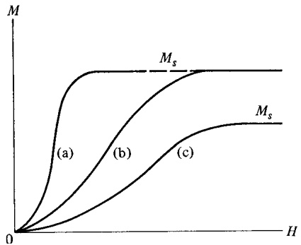

Fig. 1.14 Magnetization curves of different materials.

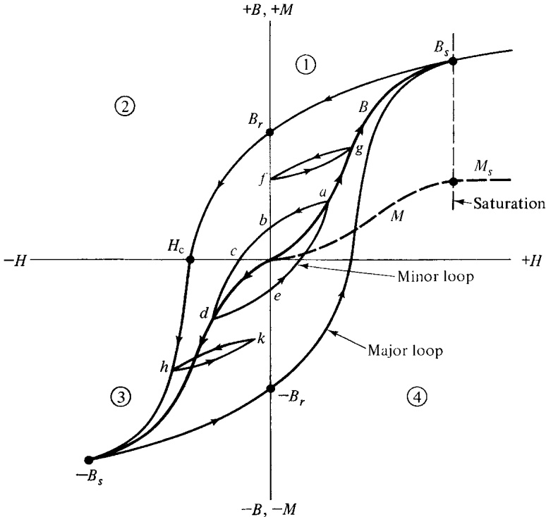

Fig. 1.15 Magnetization curves and hysteresis loops. (The height of the $M$ curve is exaggerated relative to that of the $B$ curve.)

Sometimes in cgs units the intrinsic induction, or ferric induction, $B_{i}=B-H,$ is plotted as a function of $H$. Since $B - H = 4\pi M,$ such a curve will differ from an $M$, $H$ curve only by a factor of $4\pi$ applied to the ordinate. $B_{i}$ measures the number of lines of magnetization $/cm^{2}$ , not counting the flux lines due to the applied field.

If $H$ is reduced to zero after saturation has been reached in the positive direction, the induction in a ring specimen will decrease from $B_{s}$ to $B_{r}$ called the retentivity or residual induction. If the applied field is then reversed, by reversing the current in the magnetizing winding, the induction will decrease to zero when the negative applied field equals the coercivity $H_{c}$ . This is the reverse field necessary to “coerce” the material back to zero induction; it is usually written as a positive quantity, the negative sign being understood. At this point, $M$ is still positive and is given by $\left|H_{\mathrm{C}} / 4\pi \right|$ (cgs) or $H_{\mathrm{C}}$ (SI). The reverse field required to reduce $M$ to zero is called the intrinsic coercivity $H_{\mathrm{ci}}$ (or sometimes $\mathrm{i}H_{\mathrm{c}}$ or $H_{\mathrm{c}}^{\mathrm{i}})$ . To emphasize the difference between the two coercivities, some authors write $B H_{c}$ for the coercivity and $M\mathrm{H}_{\mathrm{c}}$ for the intrinsic coercivity. The difference between $H_{c}$ and $H_{\mathrm{ci}}$ is usually negligible for soft magnetic materials, but may be substantial for permanent magnet materials. This point will be considered further in our consideration of permanent magnet materials in Chapter 14.

If the reversed field is further increased, saturation in the reverse direction will be reached at $-B_{s}$ If the field is then reduced to zero and applied in the original direction, the induction will follow the curve $-B_{\mathrm{s}}, - B_{\mathrm{r}}, + B_{\mathrm{s}}$ The loop traced out is known as the major hysteresis loop, when both tips represent saturation. It is symmetrical about the origin as a point of inversion, i.e., if the right-hand half of the loop is rotated $180^{\circ}$ about the $H$ axis, it will be the mirror image of the left-hand half. The loop quadrants are numbered 1–4 (or sometimes I – IV) counterclockwise, as shown in Fig. 1.15, since this is the order in which they are usually traversed.

If the process of initial magnetization is interrupted at some intermediate point such as a and the corresponding field is reversed and then reapplied, the induction will travel around the minor hysteresis loop abcdea. Here b is called the remanence and c the coercive field (or in older literature the coercive force). (Despite the definitions given here, the terms remanence and retentivity, and coercive field and coercivity, are often used interchangeably. In particular, the term coercive field is often loosely applied to any field, including $H_{c},$ which reduces $B$ to zero, whether the specimen has been previously saturated or not. When “coercive field” is used without any other qualification, it is usually safe to assume that “coercivity” is actually meant.)

There are an infinite number of symmetrical minor hysteresis loops inside the major loop, and the curve produced by joining their tips gives one version of the normal induction curve. There are also an infinite number of nonsymmetrical minor loops, some of which are shown at fg and hk.

If a specimen is being cycled on a symmetrical loop, it will always be magnetized in one direction or the other when $H$ is reduced to zero. Demagnetization is accomplished by subjecting the sample to a series of alternating fields of slowly decreasing amplitude. In this way the induction is made to traverse smaller and smaller loops until it finally arrives at the origin (Fig. 1.16). This process is known as cyclic or field demagnetization. An alternative demagnetization method is to heat the sample above its Curie point, at which it becomes paramagnetic, and then to cool it in the absence of a magnetic field. This is called thermal demagnetization. The two demagnetization methods will not in general lead to identical internal magnetic structures, but the difference is inconsequential for most practical purposes. Some practical aspects of demagnetization are considered in the next chapter.

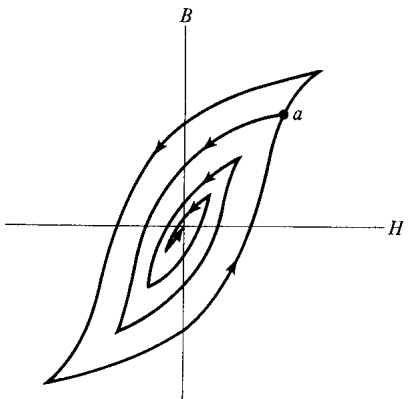

Fig. 1.16 Demagnetization by cycling with decreasing field amplitude.

## PROBLEMS

1.1 Magnetization $M$ and field strength $H$ have the same units (A/m) in SI units. Show that they have the same dimensional units (length, mass, time, current) in cgs.

1.2 A cylinder of ferromagnetic material is 6.0 cm long and 1.25 cm in diameter, and has a magnetic moment of $7.45\times 10^{3}$ emu.

a. Find the magnetization of the material.

b. What current would have to be passed through a coil of 200 turns, 6.0 cm long and 1.25 cm in diameter, to produce the same magnetic moment?

c. If a more reasonable current of 1.5 ampere is passed through this coil, what is the resulting magnetic moment?

1.3 A cylinder of paramagnetic material, with the same dimensions as in the previous problem, has a volume susceptibility $\chi_V$ of $2.0\times10^{-6}$ (SI). What is its magnetic moment and its magnetization in an applied field of 1.2 T?

1.4 A ring sample of iron has a mean diameter of 5.5 cm and a cross-sectional area of 1.2 $\mathrm{cm}^2$ . It is wound with a uniformly distributed winding of 250 turns. The ring is initially demagnetized, and then a current of 1.5 ampere is passed through the winding. A fluxmeter connected to a secondary winding on the ring measures a flux change of $8.25\times10^{-3}$ weber.

a. What magnetic field is acting on the material of the ring?

b. What is the magnetization of the ring material?

c. What is the relative permeability of the ring material in this field?

