# EXPERIMENTAL METHODS

## 2.1 INTRODUCTION

No clear understanding of magnetism can be attained without a sound knowledge of the way in which magnetic properties are measured. Such a statement, of course, applies to any branch of science, but it seems to be particularly true of magnetism. The beginner is therefore urged to make some simple, quantitative experiments early in her study of the subject. Quite informative measurements on an iron rod, which will vividly demonstrate the difference between $B$ and $H$, for example, can be made with inexpensive apparatus: an electronic integrator (an integrator adequate for demonstration purposes can be made as described in Section 2.5), an easily made solenoid, some wire, and a variable-output dc power supply. Most books on magnetism contain some information on experimental methods. The text by Crangle [J. Crangle, The Magnetic Properties of Solids, Edward Arnold (1977)] provides more detailed information than most. Books and papers devoted entirely to magnetic measurements are those of Zijlstra [H. Zijlstra, Experimental Methods in Magnetism (2 vols), North-Holland (1967)], and McGuire and Flanders [T. R. McGuire and P. J. Flanders, Direct Current Magnetic Measurements, Magnetism and Metallurgy, Volume 1, Ami E. Berkowitz and Eckart Kneller, Eds., Academic Press (1969)]. The standards of the ASTM (originally the American Society for Testing and Materials) Committee A06 specify equipment and procedures for various magnetic measurements, mainly but not exclusively of soft magnetic materials under dc or power frequency conditions.

The experimental study of magnetic materials requires (a) a means of producing the field which will magnetize the material, and (b) a means of measuring the resulting effect on the material. We will therefore first consider ways of producing magnetic fields, by solenoids, by electromagnets, and by permanent magnets. Then we will take up the various methods of measuring the magnetization curve and the hysteresis loop of a strongly magnetic substance, and finally, in the last section of this chapter, the methods of measuring the susceptibility of a weakly magnetic substance. Methods of measuring more specialized magnetic properties (e.g. anisotropy, magnetostriction, and core losses) will be dealt with at the appropriate place in later chapters.

The student who wishes to gain a good understanding of magnetic materials cannot afford to slight the contents of this chapter, even if she is not particularly interested in measurements, because some quite basic magnetic phenomena are first introduced here. For example, the demagnetizing fields discussed in Section 2.9 have an importance not restricted to measurements; these fields can affect the magnetic state and magnetic behavior of many specimens.

## 2.2 FIELD PRODUCTION BY SOLENOIDS

Solenoids are useful for measurements on specimens of almost any shape, but are particularly suited to rods and wires. They can be designed to produce fields ranging up to more than 200 kilo-oersteds (kOe) or 16 MA/m or 20 tesla (T), although simple solenoids are limited to fields below about 1 kOe or 0.1 T. [Although the SI unit of field is the A/m. it is common to express field strengths, especially large field strengths, in units of $\mu_{0}H = B$ (tesla).] Two types of solenoids can be distinguished, normal and superconducting.

## 2.2.1 Normal Solenoids

These are usually made with insulated copper wire, wound on a tube of any electrically insulating material, such as polyvinyl chloride (PVC) pipe. For the dimensions shown in Fig. 2.1, the field $H$ at a point P on the axis, distant x from the center, is given by

$$
H = C _ {1} \frac {n i}{L} \left[ \frac {L + 2 x}{2 \sqrt {D ^ {2} + (L + 2 x) ^ {2}}} + \frac {L - 2 x}{2 \sqrt {D ^ {2} + (L - 2 x) ^ {2}}} \right],\tag{2.1}
$$

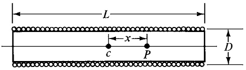

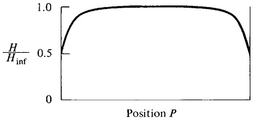

Fig. 2.1 Single-layer solenoid and its field distribution. The axial field at point P is expressed as the fraction of the field at the center of an infinitely long solenoid.

where n is the number of turns and i is the current in amperes. With $C_1 = 1$ and L measured in meters, the field is in A/m; with $C_1 = 4\pi /10$ and L measured in centimeters, the field is in oersteds. The terms inside the brackets are dimensionless when all quantities are measured in the same units. Note that the coil diameter is measured to the center of the winding; that is, the value of D is the outer diameter of the tube plus twice the radius of the wire.

At the center of the solenoid $(x = 0)$ , this reduces to

$$
H = C _ {1} \frac {n i}{L} \left[ \frac {L}{\sqrt {D ^ {2} + L ^ {2}}} \right]\tag{2.2}
$$

and, when $L^{2}\gg D^{2}$ , to

$$
H = C _ {1} \frac {n i}{L}.\tag{2.3}
$$

In any solenoid, the field is highest at the center and decreases towards the ends. The field at the end of a long solenoid is just one-half of the field at the center. But the field over the middle half is quite uniform, as shown by Fig. 2.1, and the values in Table 2.1, which are derived from Equation 2.1. In this table, $H_{\mathrm{inf}}$ is the field, given by Equation 2.3, at the center of an infinitely long solenoid. When the L/D ratio is 20, for example, the field over the middle half is uniform to within 0.15% and is only about 0.13% less than that produced by an infinitely long solenoid. The field variation in the radial direction is generally negligible.

To achieve a higher field, it is preferable to increase n/L by winding the wire in two or more layers rather than to increase the current. Although $H$ is proportional to i, the heat developed in the winding is proportional to $i^{2}R.$ where R is its resistance. Thus doubling the number of layers and keeping the current constant will double $H$, R, and the amount of heat; whereas doubling the current will double $H$, but quadruple the heat. Solenoids consisting of relatively few layers can be treated mathematically as a series of concentric solenoids of increasing diameter whose fields add together. Very thick solenoids (many layers) are the subject of an extensive literature, which is well summarized by Montgomery [E. Bruce Montgomery, Solenoid Magnet Design, Wiley-Interscience (1969)].

Cooling of the winding becomes necessary for continuous fields larger than about 1 kOe or 0.1 T. This can be accomplished in a variety of ways, such as by blowing air over the solenoid with a fan, by immersing the solenoid in a cooling liquid, usually water but possibly liquid nitrogen, by winding the wire on a water-cooled tube; or by forming the winding from copper tubing so that it can carry both electric current and cooling water.

TABLE 2.1 Field Uniformity in Solenoids

|  L/D | H at Center | H at Edge of Middle Half |
| --- | --- | --- |
| 5 | 0.9806 Hinf | 0.9598 Hinf |
| 10 | 0.9950 | 0.9892 |
| 20 | 0.9987 | 0.9972 |
| 50 | 0.9996 | 0.9994 |

Solenoids are usually made from high-purity copper wire insulated with a thin, flexible enamel insulating coating. Such wire is made and sold as magnet wire; it is available in a wide range of diameters, and with various types and thicknesses of insulating coatings. The thinnest coating is generally adequate for solenoid construction, but a high-temperature insulation may be desirable. The enamel insulations are organic materials, and are limited to working temperatures of $240^{\circ}\mathrm{C}$ or lower. For higher temperatures, braided fiberglass tubing may be used, although it is bulky compared to enamel coatings. Also available, but expensive, is nickel-plated copper wire with a bonded surface layer of very small insulating ceramic particles. Its operating temperature is limited by oxidation of the wire rather than failure of the insulating layer.

Solenoid design is a matter of balancing several conflicting requirements, and the following points should be kept in mind:

1. D is determined by the working space required within the solenoid.

2. The ratio L/D is fixed by the distance over which field uniformity is required. Because the specimen to be tested must normally be subjected to a reasonably uniform field, this means that the maximum specimen length effectively determines the ratio L/D , with the coil length L 1.5 – 2 times the length of the sample. Specimen length is in turn governed by the factors discussed in Section 2.6.

3. For a given L, the field is proportional to the number of ampere-turns ni, and the power required (which is equal to the rate of heat generated) is proportional to $i^{2}R$

4. For a given current, the voltage required from the power source is proportional to R, which in turn is proportional to n. For the most effective use of a given power supply, the solenoid resistance R should be chosen so that at maximum field the power supply operates at both its maximum current and maximum voltage ratings.

Helmholtz coils will produce an almost uniform field over a much larger volume than a solenoid. Two identical thin parallel coils, ideally with square cross-section, are placed at a distance apart equal to their common radius r (Fig. 2.2). The field parallel to the axis of the coils at a point P on the axis a distance z from the midpoint is given by

$$
H = \frac {C _ {1}}{2} n i \left[ \frac {r ^ {2}}{\left(r ^ {2} + \left(\frac {L}{2} + z\right) ^ {2}\right) ^ {3 / 2}} + \frac {r ^ {2}}{\left(r ^ {2} + \left(\frac {L}{2} - z\right) ^ {2}\right) ^ {3 / 2}} \right].\tag{2.4}
$$

The distance between the two coils is L, so for the Helmholtz configuration $L = r.$ Here $C_{1}$ is defined as in Equation 2.1, dimensions are in centimeters for cgs and meters for SI, and n is the number of turns in each coil. At the center of the coil system $(z = 0)$

$$
H = \frac {8}{5 \sqrt {5}} C _ {1} \frac {n i}{r} = 0. 7 1 6 C _ {1} \frac {n i}{r}.\tag{2.5}
$$

Figure 2.3 shows the field from each of the individual coils (normalized to unity), and the total field from both. G. G. Scott [J. Appl. Phys. , 28 (1957) pp. 270– 272] gives equations for both components of the field at points off the axis. For the same power consumption, Helmholtz coils produce a field which is only a few percent of that produced by a solenoid of length r. They are thus confined to low-field applications.

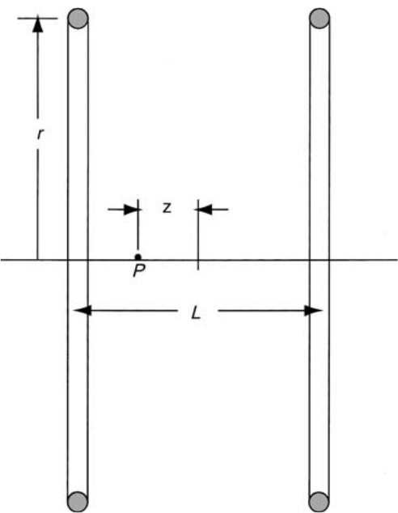

Fig. 2.2 Helmholtz coils. The spacing between coils L is equal to the coil radius r.

By increasing the coil spacing slightly, the length of the uniform field region can be increased at the cost of a slight dip in field at the center. Figure 2.4 compares the computed fields of a “pure” Helmholtz coil with one where the coil spacing has been increased by 10%. The arrows show the distance over which the field is within 0.7% of the maximum field. Increasing the coil spacing by 10% lowers the maximum field by about 5%, but increases the length of the uniform field by almost 50%. Equation 2.4 is written in a form than permits the effect of changing the coil spacing L to be easily calculated.

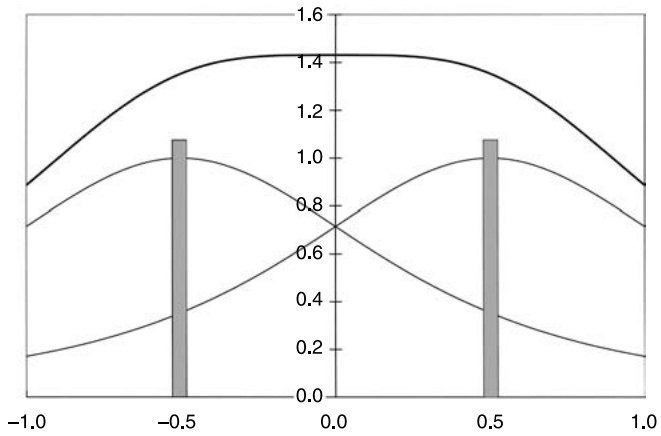

Fig. 2.3 Field distribution in Helmholtz coils. Position is specified in units of the coil radius r. The light lines show the field (normalized to unity) from the individual coils (gray bars), located at +0.5 r, and the heavy line is the total field.

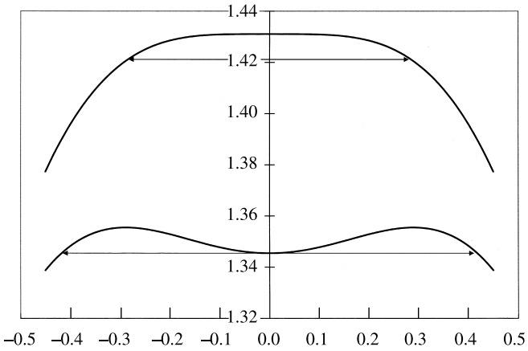

Fig. 2.4 Field distribution in a “pure” Helmholtz coil (upper curve) compared with field distribution in a Helmholtz coil pair whose coil spacing has been increased by 10%. The dimension lines show the distance over which the field is uniform within 0.7% of the maximum field.

The power supply to a solenoid or Helmholtz coil pair must normally provide variable direct current. Variable dc power supplies, dry cells, lead-acid storage batteries, or alternating current rectifiers (with suitable filtering) can all be used. If the field needs to be reversed during the measurement, so as to record a hysteresis loop, either a reversing switch is needed or a bipolar power supply can be used. The bipolar supply permits a smooth and unbroken reversal of the field, which is often a significant advantage. Solenoids may be driven with alternating current (ac) when required. The inductance of the solenoid must be considered, which may require balancing capacitors and can lead to high voltages appearing across the terminals of the solenoid.

## 2.2.2 High Field Solenoids

To produce very high fields with normal solenoids requires very large power input, and two major design problems must be addressed. The first is the removal of large amounts of heat. (Note that maintaining a steady magnetic field by means of an electric current is a process of exactly zero efficiency. All the input power goes into heat.) The second is providing sufficient mechanical strength to resist the large forces acting on current carriers in the presence of large fields.

Beginning about 1936, Francis Bitter [Rev. Sci. Instrum., 10 (1939) pp. 373– 381] began the development of high-field solenoids of a new type. The coil of a Bitter magnet is sketched in Fig. 2.5, and a photograph of two partly assembled coils in shown in Fig. 2.6. (Any device which produces a field is commonly referred to as a “magnet,” whether or not it contains iron.) The winding is composed, not of wire, but of thin disks of copper or a copper alloy. These disks, usually 1 ft (30 cm) or more in diameter and about 0.04 in (1 mm) thick, have a central hole and a narrow radial slot and are insulated from each other by similarly cut sheets of thin insulating material. Each copper disk is rotated about $20^{\circ}$ with respect to its neighbor, so that the region of overlap provides a conducting path for the current to flow from one disk to the next. The current path through the entire stack of disks is therefore helical, and the stack of disks acts as a solenoid. The disks are clamped tightly together and enclosed

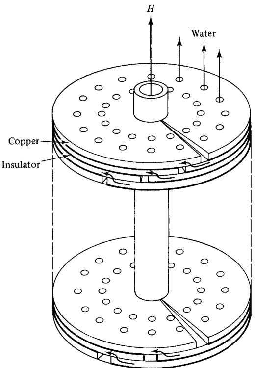

Fig. 2.5 Sketch of a Bitter magnet solenoid. Arrows indicate the current path from one disk to another.

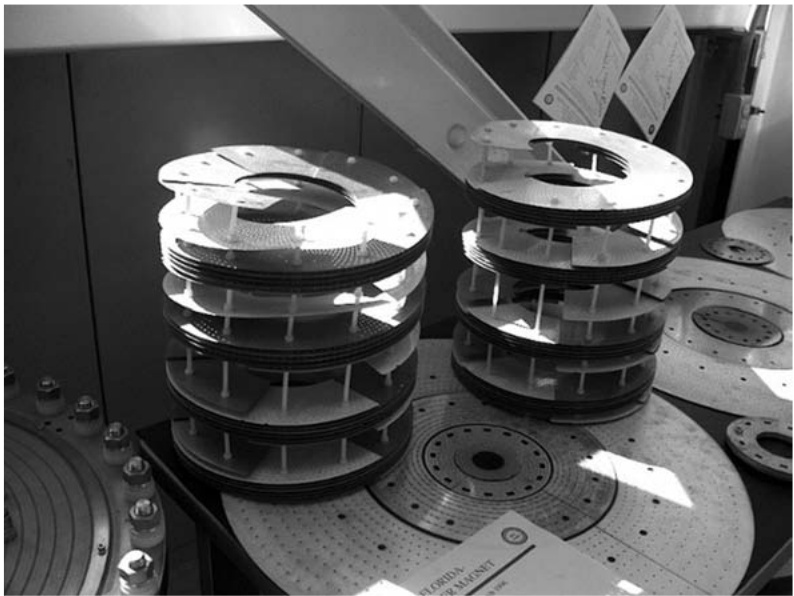

Fig. 2.6 Photograph of partially-assembled Bitter magnets. Figures 2.6 and 2.7 are by Walter Thorner, National High Magnetic Field Laboratory.

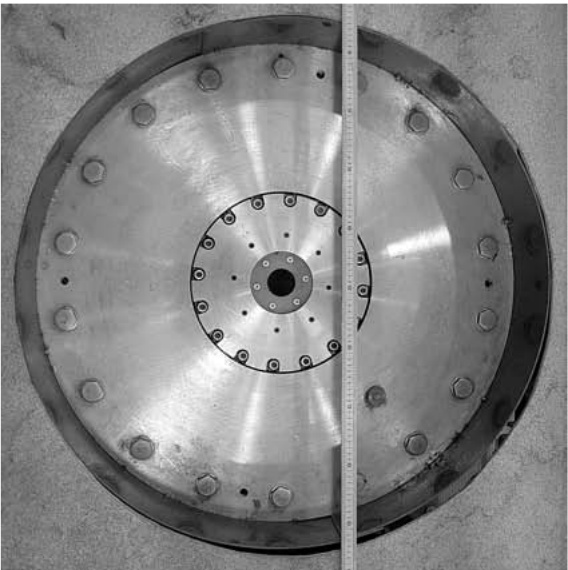

(a)

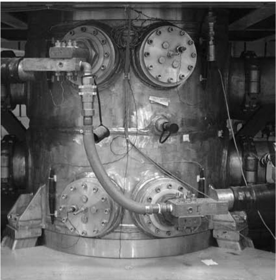

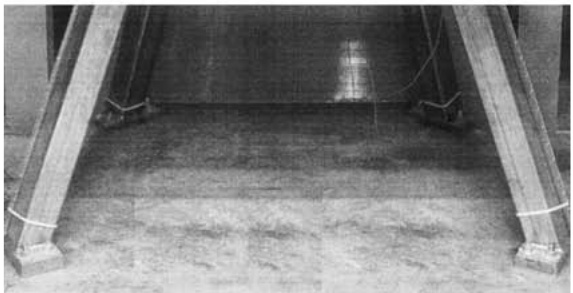

(b)

Fig. 2.7 Assembled Bitter magnet. (a) Top view with meter stick; (b) front view.

in a case (not shown in the sketch). Cooling water is pumped axially through the magnet, through a large number of small holes or slots cut in each disk. At the National High Magnetic Field Laboratory (NHMFL) in Florida, dc fields of 45 T (450 kOe) can be produced in a magnet with a bore of 32 mm (1.25 in), requiring dc current up to 67,000 amperes and power inputs of about 20 MW. The NHFML operates Bitter magnets of various sizes, maximum field, and field uniformity. The photographs in Fig. 2.7 show top and side views of a Bitter magnet ready for use.

Many aspects of the design of high-field Bitter magnets are treated in the book by Montgomery, previously cited. Bitter magnets require large motor-generator sets, consisting of an ac motor driving a dc generator, or else high power rectifier systems, to provide the necessary large variable dc currents. Such installations, together with the necessary cooling water supply and pumps, are expensive and only a few exist in the world.

Pulsed fields offer a less costly approach to the problem of measurements in high fields. If the measurement can be made quickly, by means of high-speed data collection, then only a transient field is needed. This is most commonly done by slowly charging a bank of capacitors and then abruptly discharging them through a solenoid. A large pulse of current, lasting a fraction of a second, is produced, and the problem of heat removal is thus greatly minimized or even eliminated, depending on the magnitude of the field required. Pulsed fields up to 200 kOe (20 T) or more can be attained in special watercooled or cryogenically-cooled solenoids, and pulsed fields of moderate strength (10 – 30 kOe, 1 – 3 T) in conventional, wire-wound, uncooled solenoids are easily obtained. Even higher fields and longer pulse durations of 0.5 s or more are reached by extracting the stored rotational energy of a large dc generator in a relatively long current pulse. The design of pulsed field solenoids must also take into account the large forces acting on the current carriers.

For even higher fields, flux compression devices can be used. A large field is created inside a heavy copper tube, which is then compressed radially inward, usually by explosive charges. A large induced current flows around the tube, which effectively keeps all the flux lines within the tube. As the tube area shrinks, the flux density, or field, increases. In this case, the sample is destroyed as the experiment is carried out.

## 2.2.3 Superconducting Solenoids

The phenomenon of superconductivity provides a radically different approach to the highfield problem. When a normal metal is cooled near 0K, its electrical resistivity decreases to a low but nonzero value $\rho_{\mathrm{r}}$ called the residual resistivity (Fig. 2.8a). However, the resistivity of some metals and alloys decreases abruptly to zero at a critical temperature $T_{\mathrm{c}}$ These materials are called superconductors; lead $(T_{\mathrm{c}} = 7.2\mathrm{K})$ and tin $(T_{\mathrm{c}} = 3.7\mathrm{K})$ are examples. (The magnetic properties of superconductors are also important; see Chapter 16.) If a current is once started in a circuit formed of a superconductor maintained below $T_{\mathrm{c}}$ it will persist indefinitely without any power input or heat generation, because the resistance is zero. The attractive possibility at once presents itself of producing very large magnetic fields by making a solenoid of, for example, lead wire and operating it below $T_{\mathrm{c}}$ by immersing the windings in liquid helium (4.2K). However, soon after the discovery of superconductivity in 1911, it was found that an applied magnetic field decreased $T_{c}$ and a field of a few hundred oersteds or several tens of milli-tesla destroyed the superconductivity completely (Fig. 2.8b). Thus, when the field produced by the solenoid itself exceeds a critical value $H_{\mathrm{cr}}$ the normal resistivity of the wire returns, along with the attendant problems of heating and power consumption.

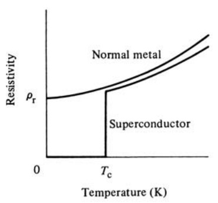

(a)

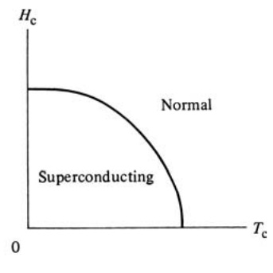

(b)

Fig. 2.8 (a) Variation of electrical resistivity with temperature for a normal metal and a superconductor. (b) Dependence of critical temperature on magnetic field.

The solution to this problem was not found until 1961 when Kunzler et al. [J. E. Kuntzler, E. Buehler, F. S. L. Hsu, and J. H. Wernick, Phys. Rev. Lett., 6 (1961) pp. 89 – 91] discovered that the niobium-tin intermetallic compound $\mathrm{Nb}_{3}\mathrm{Sn}$ remains superconducting even at a field of 88 kOe or 8.8 T or 7 MA m. It was later found that the critical field of this alloy at 4.2K, the temperature of liquid helium, is 220 kOe or 17.6 MA/m $\mathrm{Nb}_{3}\mathrm{Sn}$ is very brittle, and various metallurgical problems had to be solved before it was successfully made in the form of a composite tape suitable for a solenoid winding. It was later found that Nb-Zr and Nb –Ti alloys, which are reasonably ductile, are superconducting up to fields of about 80 kOe or 6.4 MA/m at 4.2K. Superconducting solenoids of all three of these materials have been constructed.

Once current is flowing in a superconducting solenoid, no power input is required for the solenoid itself. However, a superconducting short-circuit link must be provided while the field is constant, and opened when the field needs to be altered. For this reason, superconducting solenoids in which the field needs to be swept, or frequently changed, are commonly operated with external power supplies and with nonsuperconducting leads carrying the current to the magnet.

A superconducting solenoid must be maintained at or near the temperature of liquid helium, which means that liquid helium must be purchased or a helium liquifier must be operated. The sample environment is therefore naturally at liquid helium temperature, but can be maintained at temperatures up to room temperature or even higher with appropriate equipment. Temperatures significantly above room temperature are hard to obtain. Superconducting solenoids are the common choice when fields above about 20 kOe or 2 T are required, up to a maximum of about 200 kOe or 20 T (unless the sample needs to be at high temperature). Superconducting materials with much higher critical temperatures have been discovered, but have not yet (2007) been made into successful high-field magnets.

The great interest in high magnetic fields extends beyond studies of their effects on the magnetic properties of materials. They are needed for a wide range of experiments in solidstate physics and biology, and for magnetic resonance imaging (MRI) systems.

## 2.3 FIELD PRODUCTION BY ELECTROMAGNETS

In the ordinary laboratory, the need for fields larger than those obtainable from conventional solenoids is met with electromagnets. These usually produce fields up to about 20 kOe or 2 T, although some are capable of 3 T in a small volume.

An electromagnet consists essentially of an iron “core” around which is wrapped a coil of wire carrying a direct current. Figure 2.9 illustrates its development. A simple solenoid is shown in Fig. 2.9a; the field $H$ at its center C is proportional to the number of ampere-turns per unit length of its winding, in accordance with Equation 2.3. If an iron rod is inserted in the coil, as in Fig. 2.9b, the field at its center C, inside the iron, is now very much larger, because the field is now given by $B$, which is the sum of $H$ due to the current and $M$ due to the iron (in appropriate units; Equation 1.15). We cannot, of course, make any use of the field at a point inside the iron. However, the field at the point P, just outside the end of the rod, is also equal to $B$. Further away, the lines of force diverge and the flux density, or field strength, decreases rapidly. The iron has, in effect, multiplied the field due to the current, and the multiplying factor is simply the permeability μ or $\mu_{r}$ , because $B = \mu H.$ Thus, if the permeability is 2000 for $H = 10\mathrm{Oe}$ or 1 mT, the field inside and just outside the iron is 20,000 Oe or 2 T. In this way quite a large field can be obtained with a relatively low current. Here we have ignored the fact that $B$ inside the rod near one end is much less than $B$ in the center of the rod, as we shall see in Section 2.6. When this effect is taken into account, we find that the current in the coil has to produce a field $H$ many times larger than 10 Oe or 1 mT if the flux density $B$ at the end of the rod is to be 20,000 G or 2 T. Even so, this current will still be very much less than if the iron were absent.

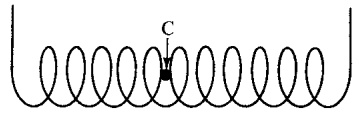

(a)

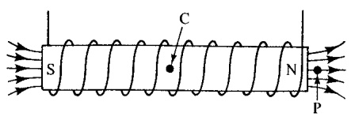

(b)

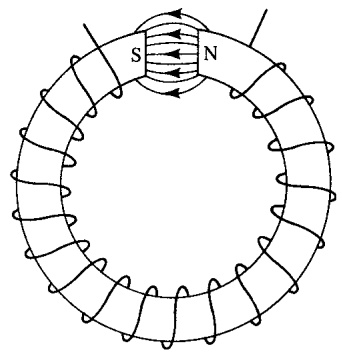

(c)

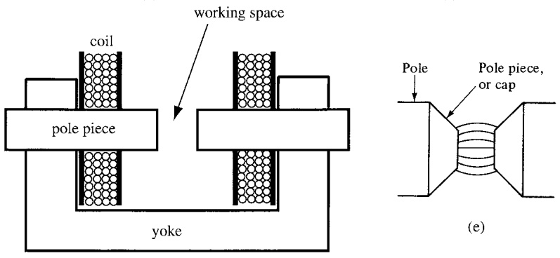

(d)

Fig. 2.9 Evolution of the electromagnet.

The rotor of an ordinary electric motor or generator is fundamentally a rotating electromagnet, composed of an iron core wound with copper wire. If these machines are to do any useful work, they must operate at high flux densities; without the flux-multiplying power of iron they would be not much more than scientific toys. It is a most remarkable fact of technological history that, when Faraday and Henry and their successors needed this power, they found it readily available in ordinary cheap iron, which later work has shown to be the best element for this purpose in the whole periodic table. One wonders what direction the development of technology would have taken if the only strongly ferromagnetic element had a price like that of gold or platinum.

The divergence of the lines of force near the ends of a straight iron rod can be reduced by bending the rod into a circle so that the ends nearly touch, as in Fig. 2.9c. The flux then travels directly from one pole to the other across the air gap. As the current in the winding is increased, the magnetization of the iron increases to its saturation value $M_{\mathrm{s}}$ . The maximum contribution of the iron to the field in the air gap is therefore about 21.5 kG or 2.15 T, if the pole faces are flat. Any further increase is due only to an increased current in the winding. To make this contribution more effective, the turns of the winding are brought close to the air gap, and the magnet assumes the final form shown in Fig. 2.9d. The flux generated by the winding passes through the core into the yoke, and back through the other core. Both core and yoke are made of iron or low-carbon steel, annealed to produce high permeability. The yoke must also be massive enough to resist the strong force of attraction between the two poles. The windings are usually water-cooled. The size of a magnet is specified in terms of the diameter of its poles, and electromagnets are made in a range of sizes from 3 to 12 inches (7.5 to 30 cm) or more. Figure 2.10 shows a commercial electromagnet with its power supply and measuring equipment.

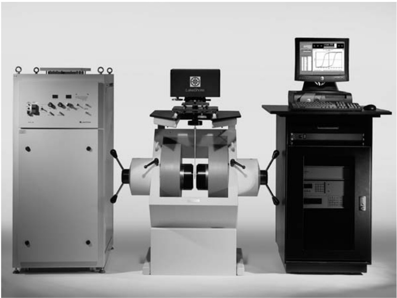

Fig. 2.10 Commercial electromagnet (center). Power supply at left, control and measurement equipment on right. Courtesy Lake Shore Cryotronics, Inc.

When a field uniform over a fairly large volume is required, flat pole faces are used. To achieve higher fields, tapered pole pieces (pole caps) can be installed. The free poles formed on the tapered surfaces contribute to the field at the center of the gap, as suggested by Fig. 2.9e. This contribution can be comparable to Ms [Y. Ishikawa and S. Chikazumi, Jap. J. Appl. Phys., 1 (1962) p. 155], but this higher field is achieved only in a smaller volume and it is not very uniform. A still further increase in field can be obtained by making the pole pieces of an Fe–Co alloy, which has a saturation magnetization about 10% higher than that of Fe.

In many electromagnets the size of the air gap (distance between poles) can be adjusted by a screw mechanism or by interchangeable pole caps of varying size. The larger the gap, the smaller the field, because the larger air gap increases the reluctance of the magnetic circuit (see Section 2.8) and because much of the flux then leaves the volume of the gap proper and forms the “fringing flux” indicated in Fig. 2.9c and e. Figure 2.11a shows how the field in the gap depends on gap size and the current in the winding for an

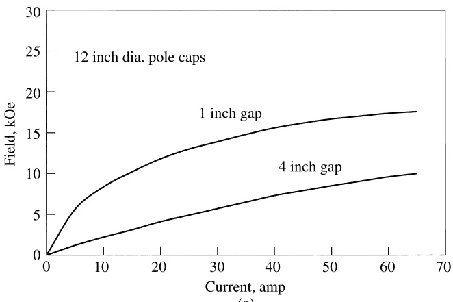

(a)

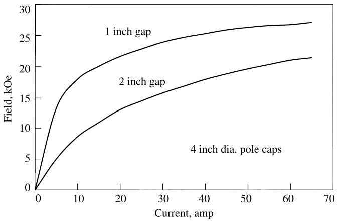

(b)

Fig. 2.11 Magnetic field (kOe) vs current in a 12-inch electromagnet: (a) 4-inch and 1-inch gaps; (b) with 4-inch tapered pole caps, 2-inch and 1-inch gaps.

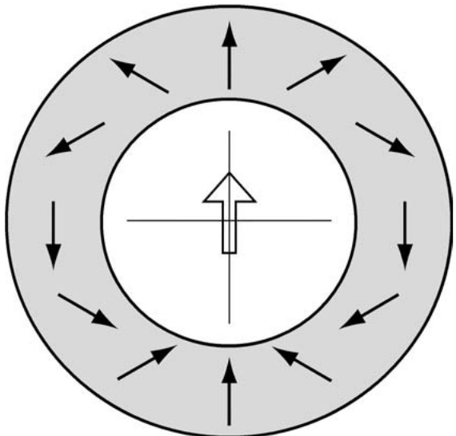

Fig. 2.12 Halbach cylinder. Solid arrows show direction of local magnetization. The open arrow is the resulting field.

electromagnet with flat 12-inch diameter pole pieces; Fig. 2.11b shows the increase in field that results if pole caps tapering to 4-inch diameter are installed in the same magnet.

## 2.4 FIELD PRODUCTION BY PERMANENT MAGNETS

A constant magnetic field up to some limiting value can be produced by an appropriate geometrical arrangement of one or more permanent magnets. This is frequently useful, in meters, motors, loudspeakers, and other devices, but a fixed field is generally not appropriate for experimental work. However, the development of rare earth permanent magnets has led to materials that can retain their magnetization in very large reverse fields, and this makes possible an arrangement of rotating permanent magnets that can provide magnetic fields in the working space varying continuously from +20 to -20 kOe or +2 to -2 T. No cooling water is required, and the only power is that needed to physically rotate the magnets [O. Cugat, P. Hansson, and J. M. D. Coey, IEEE Trans. Magn., 30 (1994) p. 4602].

The device is based on an arrangement called the Halbach cylinder (Fig. 2.12). The direction of local magnetization in a permanent magnet ring at any angular position $\theta$ is rotated by an angle $2\theta$ from its original orientation at $\theta$ = 0. The result is a uniform field across a diameter of the cylinder, as shown by the large open arrow. In practice, the cylinder is replaced with an array of uniformly-magnetized blocks arranged in an octagon, as shown in Fig. 2.13. If two Halbach arrays are arranged concentrically, as in Fig. 2.14, and if the inner array is made of a material whose state of magnetization is not altered significantly by the field of the outer array, then the field at the center is simply the sum of the field from each of the individual arrays. In Fig. 2.14, the fields of the two arrays are in opposite directions, so if both arrays produce the same central field, the net field is zero. If either array is rotated through $180^{\circ}$, the fields add, and the net field is the sum of the two individual fields. By appropriate rotation of the two arrays, the central field can have any value and

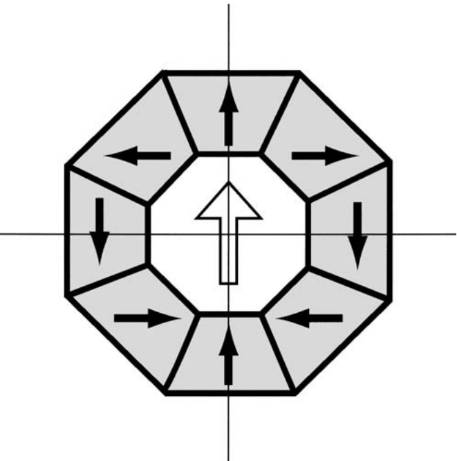

Fig. 2.13 Halbach magnet array.

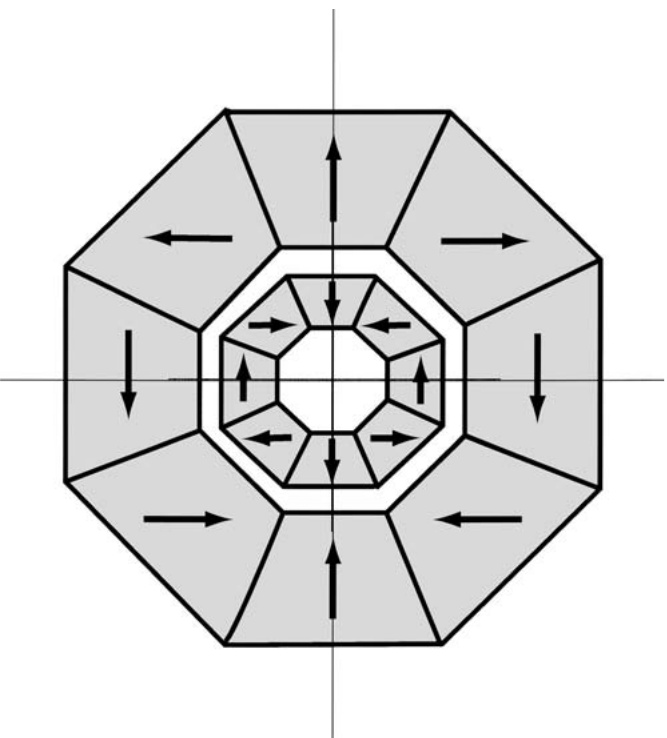

Fig. 2.14 Pair of concentric Halbach arrays. Each array can be rotated independently about the central axis perpendicular to the page.

any direction up to this sum. Using high-quality rare-earth permanent magnet materials, this maximum field can be as high as 20 kOe or 2 T, as noted above.

## 2.5 MEASUREMENT OF FIELD STRENGTH

The field $H$ to which a specimen is subjected in a measurement of its magnetic properties must be known, by calculation or measurement. If the field is produced by a solenoid, the field strength can be calculated from the current, number of turns, and length of the winding, since these quantities can all be determined with good accuracy. However, the field in the gap of an electromagnet must be measured, because it depends not only on the current in the windings but also on the geometry and magnetic properties of the core and yoke. It is possible to measure this field for a range of magnet currents and prepare calibration curves like those of Fig. 2.11, although these do not take account of the fact that the field at a given current varies slightly depending on whether the field is increasing or decreasing, due to the hysteresis in the core material.

The two most common methods of measuring magnetic fields are by means of the Hall effect and by electronically integrating the voltage induced in a search coil.

## 2.5.1 Hall Effect

This effect1 occurs in any conductor carrying a current in the presence of a transverse magnetic field. If there is a current i in a plate-shaped conductor (Fig. 2.15), then two opposite points a and b will be at the same potential in the absence of a magnetic field. When a field $H$ acts at right angles to the plate, the current path is distorted, and an emf $e_{\mathrm{H}}$ is developed between a and b. The magnitude of this Hall emf is proportional to the product of the current and the field:

$$
e _ {\mathrm{H}} = R _ {\mathrm{H}} \frac {i H}{t} \quad \text {volt,}\tag{2.6}
$$

where t is the thickness of the plate, and $R_{\mathrm{H}}$ the Hall constant, is a property of the material. The effect occurs both in metals and semiconductors, but is very much larger in the latter.

If i is kept constant, then $e_{\mathrm{H}}$ is a measure of field strength $H$. If i is alternating, then $e_{\mathrm{H}}$ is also alternating and can be easily amplified. The sensing element, called a Hall probe, is usually the semiconductor InSb in commercial instruments. The probe can be made very small, 1 mm2 or less, and is usually mounted on the end of a thin rod connected by a small-diameter cable to a control unit containing the current source, amplifier, and indicating meter. Depending on the orientation of the semiconductor chip, the measured field can be perpendicular to the rod (transverse probe) or parallel to the rod (axial probe). Multirange instruments are available for measurement of fields ranging from values smaller than the Earth’s field to 30 kOe (3 T) or more. Because of the small size of the probe, these instruments are well suited to the measurement of fields in confined regions, or of field gradients. Alternating fields may also be measured, up to some frequency limit set by the characteristics of the measuring circuit.

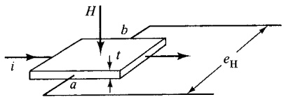

Fig. 2.15 Sketch of a Hall plate, showing the relationship between field, current, and emf.

<small>1Discovered in 1879 by the American physicist Edwin Hall (1855– 1938) when he was a student under H. A. Rowland at Johns Hopkins University.</small>

Commercial instruments, called gaussmeters or teslameters, have a manual zero setting, and if it is necessary to measure very small fields the zero must be set with the probe located in a magnetically shielded cylinder to eliminate the Earth’s field of about 0.5 Oe or 40 A/m In practice, the relationship between Hall voltage and field is not perfectly linear, and becomes increasingly non-linear at high fields. This means that generally Hall probes can be used only with control units for which they have been specifically calibrated.

Calibration of a Hall probe requires a series of accurately known fields. It is possible to buy small permanent magnet assemblies of known field strengths in small gaps just large enough to insert a probe; these are stable over long time periods. Alternatively, the field of an electromagnet can be very accurately measured with a nuclear magnetic resonance probe. The NMR technique is the standard for establishing an accurate value of a magnetic field; NMR is discussed briefly later in this chapter, and in somewhat more detail in Chapter 12. The technique depends on the measurement of a frequency, which can be done to very high precision and accuracy.

## 2.5.2 Electronic Integrator or Fluxmeter

By Faraday’s law, a changing magnetic flux w through a coil of N turns generates a voltage in the coil proportional to the rate of change of flux

$$
e = - C _ {2} N \frac {d \varphi}{d t} \quad \text {volt,}\tag{2.7}
$$

where in SI units $C_2 = 1$ and w is in webers or volt-seconds; in cgs units $C_2 = 10^{-8}$ and w is in maxwells. Time t is in seconds.

Rewriting Equation 2.7 we obtain

$$
e d t = - C _ {2} N d \varphi ,\tag{2.8}
$$

and integrating,

$$
\int_ {0} ^ {t} e d t = - C _ {2} N \int_ {\phi 1} ^ {\phi 2} d \varphi = - C _ {2} N \Delta \varphi .\tag{2.9}
$$

An instrument to integrate the voltage from a search coil is called a fluxmeter. Various moving-coil devices have been used in the past, but fluxmeters are now electronic integrators based on capacitative feedback around an operational amplifier (see Fig. 2.16). The electronic integrator provides a voltage output that can be digitized and recorded, rather than a pointer deflection that must be written down.

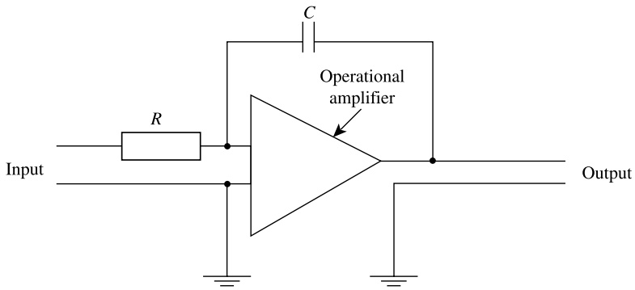

Fig. 2.16 Electronic integrator (schematic). $E_{\mathrm{out}} = 1 / RC \int_0^t E_\mathrm{in} dt.$

If the flux is uniform over the area of the coil A, there will be a flux density in the coil:

$$
B = \frac {\phi}{\Lambda}.\tag{2.10}
$$

B is in gauss = maxwell/cm² (cgs) or $\text{tesla} = \text{weber}/\text{m}^2 = \text{V-sec}/\text{m}^2$ (SI). Then

$$
\int e d t = - C _ {2} N \mathrm{A} \Delta B \quad \mathrm{V} \cdot \sec .\tag{2.11}
$$

Note that a fluxmeter measures only changes in flux or flux density. If the measuring coil encloses no magnetic material, $B = H(\mathrm{cgs})$ or $B = \mu_{0}H$ (SI), and the fluxmeter measures the field $H$. A fluxmeter can be used to record $H$ during the measurement of a hysteresis loop, when the value of the starting field is known. To measure a constant field, the search coil must be moved from the unknown field to a zero-field region, or rotated through $180^{\circ}$. For this kind of measurement (finding the value of a constant field) a Hall probe is generally more convenient, since it provides a continuous reading.

The voltage generated in a search coil is often quite small. Consider a coil of 100 turns and area $1\mathrm{cm}^2 = 10^{-4}\mathrm{m}^2$ , in a field that changes from +100 to -100 Oe or +8 to -8 kA $m$ in 1 sec. From Equation 2.11, the coil voltage has an average value of 0.2 mV, and the integrated voltage is 0.2 mV-sec. Small parasitic voltages, usually thermally induced at dissimilar-metal junctions, can cause significant background drift at these signal levels, and fluxmeters always have some kind of drift control built in. Electronic fluxmeters generally have a limiting sensitivity of about 10 maxwell turns = 10 gauss $\mathrm{cm}^2$ turns or $10^{-3}$ weber turns $= 10^{-3}$ tesla $\mathrm{m}^2$ turns. This means that a quantity about 100 times larger can be measured to 1% precision.

Calibration of a fluxmeter is in principle not required. The properties of an electronic integrator depend only on the values of its input resistor R and its feedback (integrating) capacitor C, according to

$$
e _ {\mathrm{out}} = \frac {1}{R C} \int e _ {\mathrm{in}} d t.\tag{2.12}
$$

Resistors of accurately known value are readily available, but not capacitors, and the precise measurement of capacitance is difficult. So calibration is usually accomplished with a coil of known area-turns in a known magnetic field, or with a purchased or constructed mutual inductor. Commercial instruments are calibrated before delivery. Note that the resistance of the measuring coil must be added to the internal resistance of the integrator to give the correct value of R in Equation 2.12. This correction is usually, but not always, small.

A suitable calibrating apparatus can be simply constructed by placing a search coil of known area-turns at the center of a solenoid of known dimensions, with the axes of the two coils aligned parallel. The field at the center of the solenoid is known from Equation 2.2 or 2.3, so the magnetic flux through the search coil is known. This device is in fact a mutual inductor. Alternatively, a known input signal can be provided to the integrator in the form of a small fixed voltage applied for a controlled time period. From the example in a previous paragraph, a fixed voltage of 100 mV could be applied for exactly 2 sec, or 0.2 mV for 1 sec.

## 2.5.3 Other Methods

Various other methods can be and have been used to measure magnetic fields.

Rotating Coil Magnetometer If a search coil in a field is continuously rotated about an axis perpendicular to the field, an alternating emf will be generated that is proportional to the field strength. This voltage may be brought out through slip rings and measured directly, or converted to pulsating dc by a mechanical commutator (electronic rectifiers do not work well at low voltages). The slip rings can be eliminated if the coil is oscillated through $90^{\circ}$ or $180^{\circ}$ rather than rotated. The output signal is inherently linear with field, but the rotating or oscillating coil and its mechanical drive system is bulky compared to a Hall probe.

Magnetoresistance Most conducting materials show a change in resistance when placed in a magnetic field. The effect is generally small and non-linear, and has not been very successfully used for field measurement. Very large values of magnetoresistance can be found in certain special materials and thin film arrays. This effect is used to sense changes in field in magnetic computer storage and memory devices, but not for the measurement of field strength. See Chapter 15.

Fluxgate Magnetometer A rod or strip of soft magnetic material driven beyond its linear magnetization region by an alternating field will display a symmetric hysteresis loop. If a dc field is superimposed on the ac field, the hysteresis loop will become asymmetric as it is displaced from a center at $H = 0$, as in Fig. 2.17. The asymmetry is easily detected, and can be cancelled by applying an opposing dc field with a small solenoid surrounding the sensing strip. The current required to cancel the asymmetry is a direct measure of the field that caused the original asymmetry. An instrument based on this principle is called a fluxgate (or saturable core) magnetometer, and is commonly used to detect changes in the Earth’s field for archeology and oil-field surveys, to control a coil current to produce a stable magnetic environment in the laboratory, etc. The fluxgate magnetometer is generally limited by heating in the balancing coil to the measurement of fields not much greater than the Earth’s field. The sensing element is also large compared to a Hall element. Further details are given in Section 2.5.3.

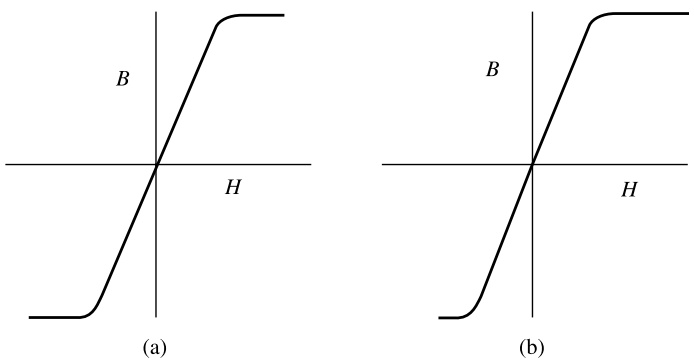

Fig. 2.17 Principle of fluxgate magnetometer (schematic).

Magnetic Potentiometer or Chattock Coil This is a tightly wound coil, usually but not necessarily semi-circular, wound on a nonmagnetic form, whose two ends lie in the same plane (see Fig. 2.18). If no current flows in the coil, the line integral $\oint H dl$ around the path shown by the dotted line must be zero. We can write this integral as the

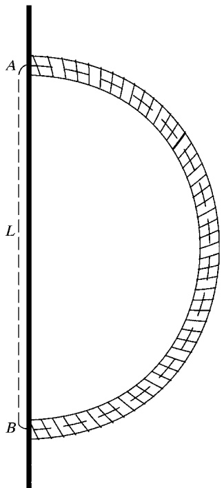

Fig. 2.18 Sketch of Chattock coil or magnetic potentiometer.

sum of two parts:

$$
\int_ {A} ^ {B} H d l + \int_ {B} ^ {A} H d L = 0.\tag{2.13}
$$

If the field is uniform from $A$ to $B$ along the line $L$, we may write

$$
\int_ {B} ^ {A} H d L = H \Delta L = - \int_ {A} ^ {B} H d l.\tag{2.14}
$$

If the output of the Chattock coil is connected to an integrator, the integrated voltage is proportional to the change in $H$ along the line L. Or the Chattock coil can be moved from the field-measuring position to a region of zero field, and the integrator output will be proportional to the (constant) field between $A$ and $B$.

It is difficult to make a very small Chattock coil, so this device has been used less as sample sizes have grown smaller over the years. It also suffers from the disadvantage of being unable to measure a steady field without there being a relative motion of the sample and the coil.

Nuclear Magnetic Resonance This was referred to above as a calibration method. The resonance frequency of an atomic nucleus depends linearly on the applied field. A probe containing a modest quantity of appropriate nuclei, plus coils for applying and detecting high-frequency fields, is placed in the field to be measured and the frequency at which resonance occurs is determined. Frequencies can be measured with high accuracy and pre-cision, and the conversion factor from frequency to field is known with high accuracy and precision, so this method is the most accurate way to measure magnetic fields. The probe is relatively large, and the instrumentation is expensive; also the field must be uniform over the volume of the probe. The subject is treated in somewhat more detail in Chapter 12.

SQUID Magnetometer This device is based on the tunneling of superconducting electrons across a very narrow insulating gap, called a Josephson junction, between two superconductors. A sketch of the device in its usual form is shown in Fig. 2.19. A superconducting measuring current flows through the ring, dividing so that equal currents pass through each of two Josephson junctions. A changing magnetic flux through the ring generates a voltage and a current in the ring, according to Faraday’s Law. This induced current adds to the measuring current in one junction, and subtracts in the other. Because of the wave nature of the superconducting current, the result is a periodic appearance of resistance in the superconducting circuit, and the appearance of a voltage between points $A$ and $B$. Each voltage step corresponds to the passage of a single flux quantum across the boundary of the ring. The existence of the flux quantum was demonstrated in somewhat similar experiments on superconducting rings; its value is $h / 2e = 2.07\times 10^{-15}$ weber or $\mathrm{Tm}^2$ , or $2.07\times 10^{-7}$ maxwell or gauss $\mathrm{cm}^2$ . This sensitivity is rarely needed in a measurement of magnetic field, and in practice the device is most commonly linked to a coil to measure the flux from a small sample, and thus the sample magnetization. In this form it is called a SQUID (for superconducting quantum interference device) magnetometer. Since a superconducting Josephson device requires low-temperature operation, it is usually used in conjunction with a superconducting solenoid.

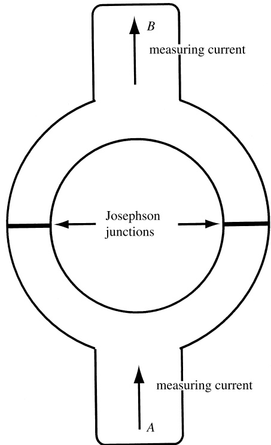

Fig. 2.19 SQUID (superconducting quantum interference device) flux sensor.

## 2.6 MAGNETIC MEASUREMENTS IN CLOSED CIRCUITS

Lines of magnetic induction $B$ are continuous and form closed loops. The region occupied by these closed loops is called a magnetic circuit. Sometimes the flux follows a welldefined path, sometimes not. When the flux path lies entirely within strongly magnetic material, except possibly for a small amount of leakage flux, the circuit is said to be closed. If the flux passes partially through “nonmagnetic” material, usually air, the circuit is said to be open.

An important property of a closed and homogeneous magnetic circuit is that the material comprising it can be magnetized without the production of magnetic poles, and therefore without the production of any magnetic fields due to the material itself. As we shall see, this circumstance considerably simplifies the determination of the field $H$, which causes the magnetization.

The simplest example of a closed magnetic circuit is a ring, with a uniform circular or square or rectangular cross-section, magnetized circumferentially. We will now consider how the normal induction curve and hysteresis loop of a ring specimen can be determined. A search coil of N turns is wound directly on the ring, often over a thin layer of electrically insulating tape to protect the electrical insulation on the wire. This is called the secondary winding, and since it will carry no significant current, it can be made using the smallest practical wire size. If the material is known to be homogeneous and nondirectional, this winding need not extend around the entire circumference of the sample. However, not many samples can be reliably known to meet these conditions, so a complete circumferential winding is usually best. This winding should consist of a single layer if possible (and it usually is). Over this is placed a magnetizing winding of n turns. This is the primary winding. It must carry the magnetizing current, and its wire diameter must be chosen accordingly (see Fig. 2.20). The primary winding must be distributed uniformly around the sample circumference, and may consist of multiple layers. A current i through this winding subjects the material of the ring to a field $H$, given by

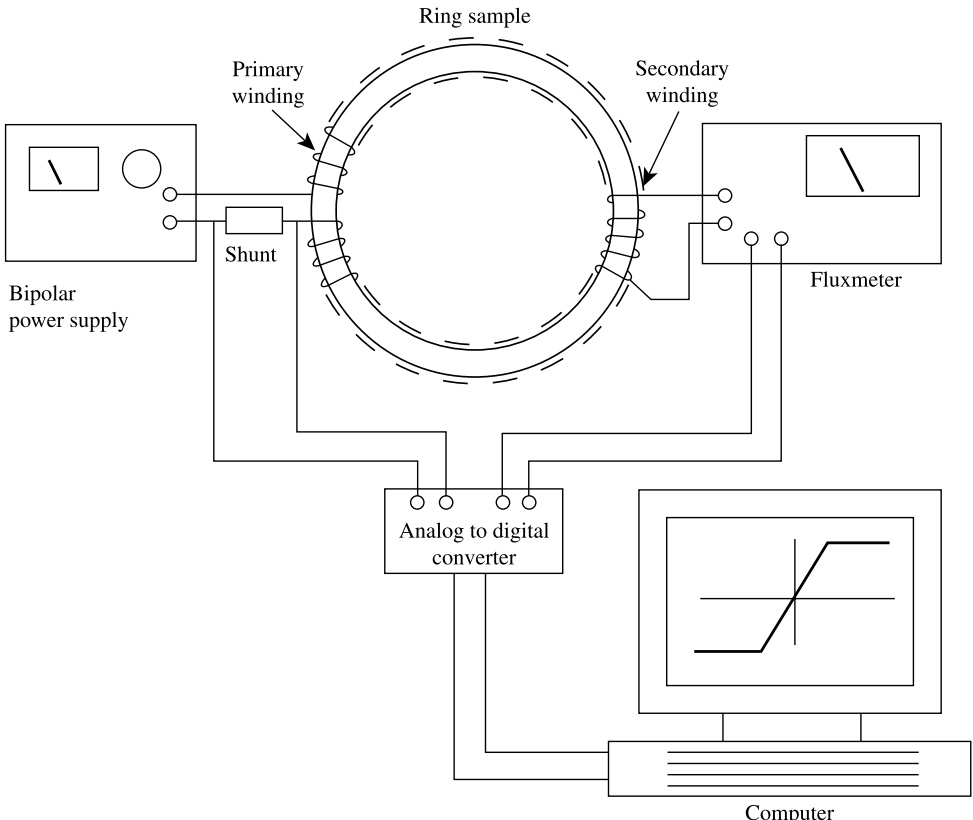

Fig. 2.20 Arrangement for measuring the magnetic properties of a ring sample.

$$
H = C _ {1} \frac {n i}{L} \text {   Oe   or   } \text {   A / m   }\tag{2.15}
$$

where $C_{1}$ is defined at Equation 2.1. The quantity L is the circumference of the ring (cm for cgs, m for SI). Note that the field will be larger around the inside circumference and smaller around the outside circumference, as the value of L varies. A common recommendation is that

$$
\frac {D _ {\text {outside}} - D _ {\text {inside}}}{D _ {\text {mean}}} \leq 0. 1,\tag{2.16}
$$

where the Ds are the diameters of the sample ring. This ensures that the field is uniform within +5% over the volume of the ring sample. The value of L in Equation 2.15 is then taken as the mean circumference of the ring.

The general procedure is to vary the current through the primary winding and measure its magnitude (usually from the voltage drop across a low-value shunt resistor in series), while simultaneously integrating the output voltage from the secondary winding with a fluxmeter. The primary winding current can be converted directly to magnetic field by means of Equation 2.15, and the integrator output is proportional to changes in the flux density in the sample. The two voltages are plotted as x and y signals to give the hysteresis loop of the sample material. The plot may be produced directly using an $x-y$ recorder, but more commonly the voltages are converted to digital values using an analog-to-digital ($A-D$) converter and a computer. The hysteresis loop may then be plotted on the computer screen and/or on a printer, using the software that controls the $A-D$ converter or some other program. An ordinary spreadsheet program works very well. A complete setup for measuring and recording hysteresis loops is called a hysteresigraph, or sometimes a hysteresisgraph.

Before beginning the measurement, the fluxmeter controls should be adjusted for minimum drift, and the fluxmeter should be reset to give zero output. If only a complete hysteresis loop is needed, it is best to start the integration at the maximum field (+ or -). The field is then varied from its maximum value, through zero, to its maximum value in the opposite direction, and then back to its original value. Use of a bipolar power supply allows the magnetizing current to be varied smoothly through zero; otherwise a reversing switch is required, with the direction of current flow reversed at zero current. The field sweep may be manually controlled, or controlled by a computer driving a programmable power supply. It may be desirable to decrease the rate of field change while traversing the steepest parts of the loop. Unless the loop shape is bizarre, it is normally sufficient to acquire about 50 data points for the entire loop, although with most software and hardware setups it is easy to acquire many more points.

If there is drift in the integrator during the measurement, the plotted loop will not close perfectly at the starting/ending tip. The usual practice is to correct for this by assuming the drift rate is constant throughout the measurement, and applying a linearly increasing (positive or negative) correction to each recorded point such that the plotted loop closes.

Since the zero setting of the fluxmeter will not in general coincide with the demagnetized state of the sample, the plotted loop will be displaced from zero in the y direction and a constant value must be added to (or subtracted from) each measured y value to center the loop about the x axis. Finally, it is necessary to convert the recorded voltages to values of field and flux density, using the dimensions of the sample, the value of the series resistor in the primary circuit, the number of turns in the two windings, and the calibration factor of the fluxmeter. Some or all of these corrections and calibrations may be made automatically in the software if routine measurements are being made on similar samples.

Note that this procedure measures the magnetic flux density $B$, not the magnetization $M$. Since it is not possible to apply very large circumferential fields to a ring sample, the method is generally limited to measurements on soft magnetic materials, in which $B$ is large relative to $H$ (or $\mu_0H$ and the distinction between $B$ and $4\pi M$ (or $\mu_0M)$ is not significant. However, the correction from $B$ to $M$ is easily made if necessary, using $4\pi M = B - H$ (cgs) or $\mu_0M = B - \mu_0H$ (SI).

To measure the _normal magnetization curve_, we must start with a demagnetized sample at zero field, so that $H=0$ and $B = 0$ simultaneously. As noted in Chapter 1, there are two ways to demagnetize a ring sample: thermal and cyclic. Thermal demagnetization is achieved by heating the sample above its Curie temperature and cooling in zero field. This is tedious at best, and furthermore once any significant field is applied to the sample, the demagnetized state is lost and can only be regained by another thermal cycle. So usually a demagnetized state is achieved by subjecting the sample to a series of decreasing positive and negative fields, as indicated in Fig. 1.16. The sample then traverses a series of smaller and smaller symmetrical hysteresis loops collapsing toward the origin. At $H=0$ and $B=0$ , the fluxmeter is set to zero and the field increased to its maximum value to record the normal curve. Before the introduction of the electronic fluxmeter, when point by point readings were necessary, a series of symmetrical hysteresis loops with increasing maximum field could be measured, and the normal curve taken as the line joining the tips of the loops.

In principle, the thermally demagnetized state is not the same as the cyclically demagnetized state, and the resulting normal magnetization curves might differ. Thermal demagnetization is hardly ever used in practice, mainly because it is time-consuming but also because the thermally demagnetized state will rarely be achieved in the actual operation of a magnetic device, and so is of limited practical interest. Of course, the cyclically demagnetized state is also rarely achieved in working devices.

Sometimes _minor hysteresis loops_, in which the field limits do not correspond to magnetic saturation, and may not be symmetrical about $H$ = 0, are of interest. They are easy to record using the system described above. See Fig. 1.15.

The time to record a nominally dc hysteresis loop is generally a minute or less. Ac loops can be measured up to some limiting frequency; the limit may be set by the power supply, the $A-D$ converter, or the eddy-currents in the material (see Chapter 12).

Ring specimens, although free from magnetic poles, have some disadvantages. As noted above, it is generally not possible to apply very high magnetic fields to the sample. Primary and secondary windings must be applied to each specimen to be tested, and this can be time-consuming. There are toroidal coil winding machines to speed this procedure. Some specimens cannot be formed into a satisfactory ring. For example, if a wire or rod is bent into a circle, there will be a significant gap at the joint. If the joint is welded, it is not in the same magnetic state as the rest of the ring and this can lead to erroneous results. Sheet material, on the other hand, is often quite satisfactory; rings can be stamped out, and if necessary a number of these can be stacked together to form a composite, laminated ring. Small ring samples of thin sheet material may be placed in a snugly fitting protective plastic cover, called a core box, before the windings are applied. Note that sheet material is usually magnetically anisotropic; it has different properties in directions at different angles to the direction in which the sheet was originally rolled. Therefore, measurements on rings cut or stamped from such sheets reveal only the average properties over the various directions in the sheet. Thin strip material may be coiled like a roll of masking tape to make a laminated ring. Such a sample is known as a tape-wound core.

A “ring” sample need not be circular, but may be cut in the form of a hollow square or other closed geometrical figure. This is appropriate, for example, when the sample is a single crystal, and the properties in a particular crystallographic direction are required. Such a sample is generally called a picture-frame sample.

## 2.7 DEMAGNETIZING FIELDS

Before considering magnetic measurements in open circuits, we must examine the nature of the fields involved. A magnetic field $H$ can be produced either by electric currents or by magnetic poles. If due to currents, the lines of $H$ are continuous and form closed loops; for example, the $H$ lines around a current-carrying conductor are concentric circles. If due to poles, on the other hand, the $H$ lines begin on north poles and end on south poles.

Suppose a bar sample is magnetized by a field applied from left to right and subsequently removed. Then a north pole is formed at the right end, and a south pole at the left, as shown in Fig. 2.21a. We see that the $H$ lines, radiating out from the north pole and ending at the south pole, constitute a field both outside and inside the magnet which acts from north to south and which therefore tends to demagnetize the magnet. This self-demagnetizing action of a magnetized body is important, not only because of its bearing

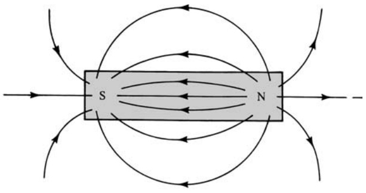

(a)

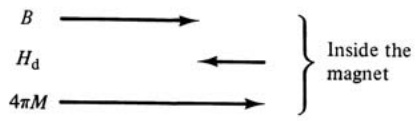

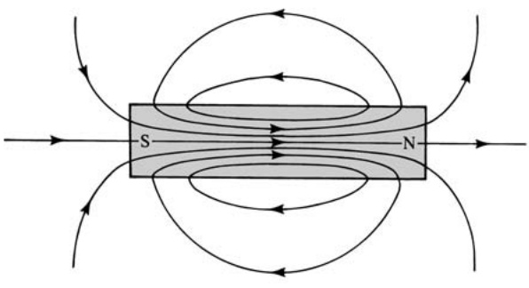

(b)

Fig. 2.21 Fields of a bar magnet in zero applied field. (a) $H$ field, and (b) $B$ field. The vectors in the center indicate the values and directions of $B,H_{\mathrm{d}},$ and $4\pi M$ (cgs units) at the center of the magnet.

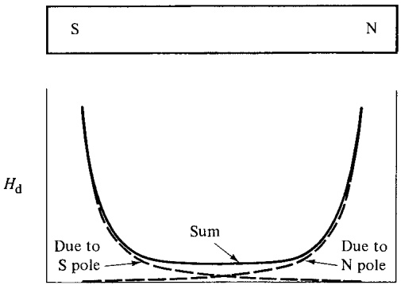

Fig. 2.22 Variation of the demagnetizing field along the length of a bar magnet.

on magnetic measurements, but also because it strongly influences the behavior of magnetic materials in many practical devices. We will therefore consider it in some detail.

The demagnetizing field $H_{\mathrm{d}}$ acts in the opposite direction to the magnetization $M$ which creates it. In Fig. 2.21a, $H_{\mathrm{d}}$ is the only field acting, and the relation $B = H + 4\pi M$ becomes $B = -H_{\mathrm{d}} + 4\pi M$ (cgs) , or $B = \mu_0(H + M)$ becomes $B = -\mu_0H_{\mathrm{d}} + \mu_0M$ (SI). The flux density $B$ inside the magnet is therefore less than $4\pi M$ $(\mu_0M)$ but in the same direction, because $H_{\mathrm{d}}(\mu_0H_{\mathrm{d}})$ can never exceed $4\pi M$ $(\mu_0M)$ in magnitude. These vectors are indicated in Fig. 2.21, along with a sketch of the $B$ field of the magnet. Note that lines of $B$ are continuous and are directed from south to north inside the magnet. Outside the magnet, $B = H$ (cgs) or $B = \mu_0H$ (SI) and the external fields in Fig. 2.21a and b are therefore identical. The magnet of Fig. 2.21b is in an open magnetic circuit, because part of the flux is in the magnet and part is in air.

As Fig. 2.21b shows, the flux density of a bar magnet is not uniform: the lines diverge toward the ends, so that the flux density there is less than in the center. This results from the fact that $H_{\mathrm{d}}$ is stronger near the poles, and Fig. 2.22 shows why: the dashed lines show the $H$ field due to each pole separately, and the resultant curve has a minimum at the center.

The variation in induction along a bar magnet is easily demonstrated experimentally. A closely fitting but moveable search coil, connected to a fluxmeter, is placed around the magnet at a particular point and then removed to a distance where the field is negligible; the resulting deflection is proportional to $B$ at that point. The distribution of $B$ shown in Fig. 2.23a was measured on a steel bar magnet. Newer and better permanent magnets are more resistant to demagnetization, so the same experiment using an alnico magnet of almost the same length-to-area ratio gives a different result (Fig. 2.23b), but still shows the reduction in flux at the ends of the sample due to the demagnetizing field. Ferrite and rare-earth permanent magnets would show even less drop in flux, but these materials are not normally made as rods or bars magnetized lengthwise.

When a soft magnetic body is placed in a field, it alters the shape of that field. Thus, in Fig. 2.24, suppose that Fig. 2.24a is a uniform field, such as the field of a solenoid. It may be regarded as either an $H$ field or a $B$ field. The $B$ field of a magnet in zero applied field is shown in Fig. 2.24b. The $B$ field in Fig. 2.24c is the vector sum of the fields in Fig. 2.24a and b. The flux tends to crowd into the magnet, as though it were more permeable than the surrounding air; this is the origin of the term permeability for the quantity m. At points outside the magnet near its center, the field is actually reduced. The same general result is obtained if the body placed in the field is originally unmagnetized, because the field itself will produce magnetization. Figure 2.24 applies to a material like iron, with $\mu \gg 1$ . The opposite effect occurs for a diamagnetic body: the flux tends to avoid the body, so that the flux density is greater outside than inside. (Because lines of $B$ are continuous, the $B$ lines of Fig. 2.24 must close on themselves outside the drawing. If the field in which the body was placed was generated by a solenoid, then the manner in which the lines close is suggested in Fig. 1.8.)

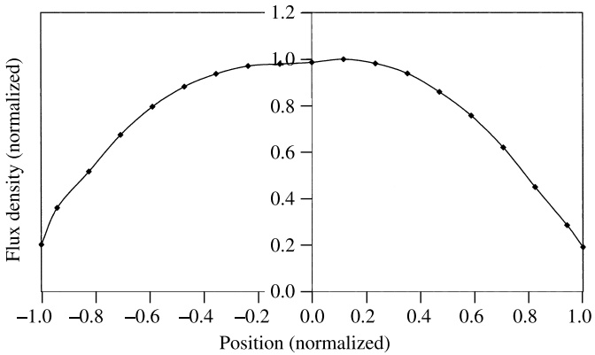

(a)

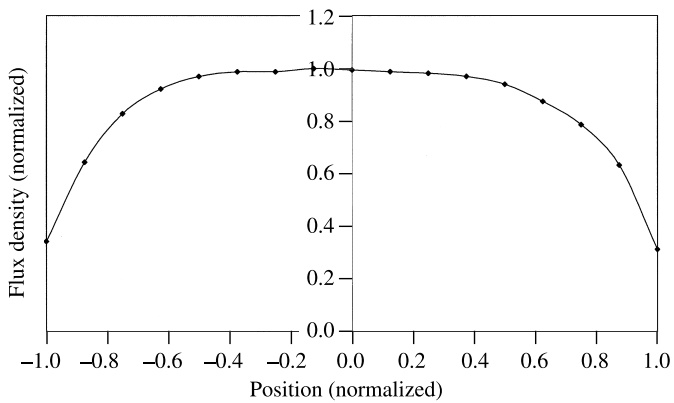

(b)

Fig. 2.23 (a) Measured flux density vs position in a steel bar magnet. (b) Same for an alnico bar magnet. The two magnets had similar length/area ratios.

The extent to which a body, originally unmagnetized, disturbs the field in which it is placed depends on its permeability. For strongly magnetic materials (ferro- and ferrimagnetic) the disturbance is considerable; for weakly magnetic materials it is practically negligible. Steel ships produce appreciable disturbance of the Earth’s magnetic field at a considerable distance from the ship, and the magnetic mines used in warfare make use of this fact. As the ship passes, the change in field at the position of the mine is sensed by some kind of magnetometer which then actuates an electrical circuit to activate the mine.

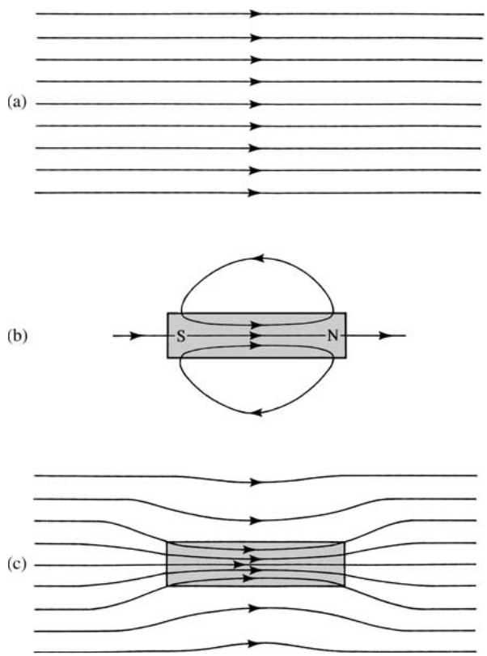

Fig. 2.24 Result of placing a magnetized body in an originally uniform field.

## 2.8 MAGNETIC SHIELDING

If a high-permeability ring or cylinder is placed in a field, it tends to shield the space inside from the field, as suggested by Fig. 2.25a. The field lines tend to follow the magnetic material around the perimeter and emerge from the other side. The difficulty with this explanation of shielding is that it suggests that the part of the cylinder normal to the field plays a primary role in diverting the flux. Actually, a field normal to the center of a flat plate passes right through, undeviated, as shown in Fig. 2.25b. It is the sides of the cylinder parallel to the applied field that have the greatest effect. These become magnetized, with poles as shown in Fig. 2.25c, and they reduce the field inside the ring by exactly the same mechanism as that by which the bar magnet of Fig. 2.24 reduces the field in the region adjacent to its center. (The portions of the cylinder normal to the field acquire little magnetization, because of their very large demagnetizing factor. See below.) Two or more concentric thin cylinders, separated by air gaps, are more effective than one thick cylinder. Components of some electronic circuits and devices need to be shielded from external magnetic fields, and this is done by enclosing them in one or more thin sheets of a high-permeability material, usually a Ni -Fe alloy.

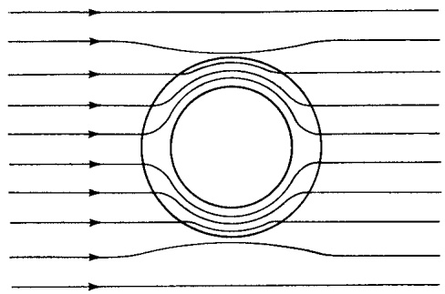

(a)

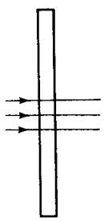

(b)

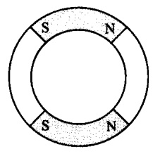

(c)

Fig. 2.25 Magnetic shielding.

## 2.9 DEMAGNETIZING FACTORS

Returning to the bar magnets of Fig. 2.24, we might ascribe the nonuniformity of the induction inside the magnet to the fact that lines of $B$ “leak out” of the sides. If we taper the magnet toward each end to make up for this leakage, the induction can be made uniform throughout. It may be shown, although not easily, that the correct taper to achieve this result is that of an ellipsoid (Fig. 2.26). If an unmagnetized ellipsoid is placed in a uniform magnetic field, it becomes magnetized uniformly throughout; the uniformity of $M$ and $B$ are due to the uniformity of $H_{\mathrm{d}}$ throughout the volume. This uniformity can be achieved only in an ellipsoid. (These statements require qualification for ferro- and ferrimagnetic materials, because they are made up of domains, or small regions magnetized to saturation in different directions. Even an ellipsoidal specimen of such a material cannot be uniformly magnetized, although a condition of uniform $M$ is approached as the domain size becomes small relative to the specimen size. (See Sections 4.1 and 7.2.)

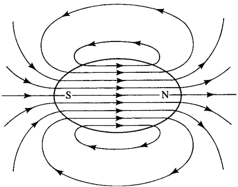

Fig. 2.26 The $H$ field of an ellipsoidal magnet in zero applied field.

The demagnetizing field $H_{\mathrm{d}}$ of a body is proportional to the magnetization which creates it:

$$
H _ {\mathrm{d}} = - N _ {\mathrm{d}} M,\tag{2.17}
$$

where $N_{\mathrm{d}}$ is the demagnetizing factor or demagnetizing coefficient. The value of $N_{d}$ depends mainly on the shape of the body, and has a single calculable value only for an ellipsoid. The sum of the demagnetizing factors along the three orthogonal axes of an ellipsoid is a constant:

$$
\begin{array}{l} N _ {\mathrm{a}} + N _ {\mathrm{b}} + N _ {\mathrm{c}} = 4 \pi (\mathrm{cgs}) \\ N _ {\mathrm{a}} + N _ {\mathrm{b}} + N _ {\mathrm{c}} = 1 (\mathrm{SI}). \end{array}\tag{2.18}
$$

For a sphere, the three demagnetizing factors must be equal, so

$$
N _ {\text {sphere}} = \frac {4 \pi}{3} (\text {cgs}) \text {or} N _ {\text {sphere}} = \frac {1}{3} (\text {SI}).
$$

The general ellipsoid has three unequal axes 2a, 2b, 2c, and a section perpendicular to any axis is an ellipse (Fig. 2.27). Of greater practical interest is the ellipsoid of revolution, or spheroid. A prolate spheroid is formed by rotating an ellipse about its major axis 2c; then $a = b < c,$ and the resulting solid is cigar-shaped. Rotation about the minor axis 2a results in the disk-shaped oblate spheroid, with $a <   b = c$ . Maxwell calls this the planetary spheroid, which may be easier to remember.

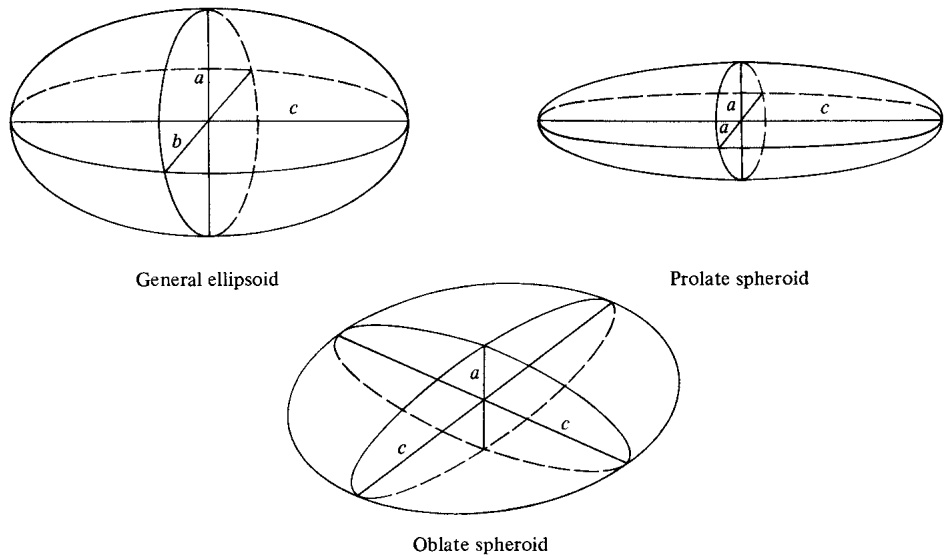

Fig. 2.27 Ellipsoids.

Equations, tabular data, and graphs for the demagnetizing factors of general ellipsoids are given by E. C. Stoner [Phil. . Mag., 36 (1945) p. 803] and J. A. Osborn [Phys. Rev. , 67 (1945) p. 351]. The most important results are as follows [here $C_3 = 4\pi$ (cgs) $C_3 = 1$ (SI)]

1. Prolate spheroid, or rod (cigar). $a = b <   c$ . Put $c / a = m$ . Then,

$$
N _ {\mathrm{c}} = \frac {C _ {3}}{(m ^ {2} - 1)} \left[ \frac {m}{\sqrt {m ^ {2} - 1}} \ln (m + \sqrt {m ^ {2} - 1}) - 1 \right]\tag{2.19}
$$

$$
N _ {\mathrm{a}} = N _ {\mathrm{b}} = \frac {C _ {3} - N _ {\mathrm{c}}}{2}.\tag{2.20}
$$

When $m$ is large (long, thin rod), then

$$
N _ {\mathrm{c}} \approx \frac {C _ {3}}{m ^ {2}} (\ln (2 m) - 1)\tag{2.21}
$$

$$
N _ {\mathrm{a}} = N _ {\mathrm{b}} \approx \frac {C _ {3}}{2}.\tag{2.22}
$$

The approximation is in error by less than 0.5% for $m > 20.N_{\mathrm{c}}$ approaches zero as $m$ becomes large. Example: For $m = 10$ $N_{\mathrm{c}} = 0.255$ and $N_{\mathrm{a}} = N_{\mathrm{b}} = 6.156$ (cgs); $N_{\mathrm{c}} = 0.0203$ and $N_{\mathrm{a}} = N_{\mathrm{b}} = 0.490$ (SI) .

2. Oblate (planetary) spheroid, or disk. $a < b = c.$ and $c / a = m$

$$
N _ {\mathrm{c}} = N _ {\mathrm{b}} = \frac {C _ {3}}{2} \frac {1}{(m ^ {2} - 1)} \left(\frac {m ^ {2}}{\sqrt {m ^ {2} - 1}} \arcsin \left(\frac {\sqrt {m ^ {2} - 1}}{m}\right) - 1\right)\tag{2.23}
$$

$$
N _ {\mathrm{a}} = C _ {3} - 2 N _ {\mathrm{c}}\tag{2.24}
$$

$N_{\mathrm{b}}$ and $N_{c}$ approach zero as $m$ becomes large. Example: For $m = 10$ $N_{\mathrm{b}} = N_{\mathrm{c}} =$ 0.875 and $N_{\mathrm{a}} = 10.82$ (cgs); $N_{\mathrm{b}} = N_{\mathrm{c}} = 0.0696$ and $N_{\mathrm{a}} = 0.861$ (SI) . When $m$ is large (thin disk), then

$$
N _ {\mathrm{c}} = N _ {\mathrm{b}} \approx C _ {3} \left(\frac {\pi}{4 m} - \frac {1}{2 m ^ {2}}\right)\tag{2.25}
$$

$$
N _ {\mathrm{a}} \approx C _ {3} \left(1 - \frac {\pi}{2 m} + \frac {1}{m ^ {2}}\right)\tag{2.26}
$$

This approximation is in error by less than 0.5% for $m > 20$ . For larger values of m. the $1/m^{2}$ terms can be dropped, giving

$$
N _ {\mathrm{c}} = N _ {\mathrm{b}} \approx C _ {3} \frac {\pi}{4 m}\tag{2.27}
$$

$$
N _ {\mathrm{a}} \approx C _ {3} \Big (1 - \frac {\pi}{2 m} \Big)\tag{2.28}
$$

Specimens often encountered in practice are a cylindrical rod magnetized along its axis and a disk magnetized in its plane. Since these are not ellipsoids, the demagnetizing factors calculated according to the previous formulas will be in error to some degree. Rods and disks are never uniformly magnetized except when completely saturated. The demagnetizing field varies from one point to another in the specimen and so has no single value. Two specific effective demagnetizing factors may be defined and used, depending on the way the magnetization is measured. The ballistic or fluxmetric demagnetizing factor $N_{f}$ is the ratio of the average demagnetizing field to the average magnetization, both taken at the midplane of the sample. It is the appropriate factor to use when the magnetization is measured with a small coil wound around the sample at its midpoint, using a ballistic galvanometer (now obsolete) or a fluxmeter. The fluxmetric demagnetizing factor is useful primarily for rod-shaped samples. The magnetometric demagnetizing factor $N_{m}$ the ratio of the average demagnetizing field to the average magnetization of the entire sample. It is the appropriate factor to use when the total magnetic moment of the sample is determined using a vibrating-sample, an alternating-gradient, or a SQUID magnetometer (these instruments are described later). Note, however, that strictly speaking these devices measure the total sample moment only when the sample is small enough (relative to the pickup coil dimensions) to act as a point dipole. The samples used in these instruments are commonly disks magnetized along a diameter, although they may also be rods or rectangular prisms.

Values of the demagnetizing factor depend primarily on the geometry of the sample, but also on the permeability or susceptibility of the material. Bozorth [R. M. Bozorth, Ferromagnetism, Van Nostrand (1951); reprinted IEEE Press (1993)] gives a table and graphs of demagnetizing factors for prolate and oblate (planetary) spheroids, and also of fluxmetric demagnetizing factors for cylindrical samples with various values of permeability. Bozorth’s curves have been widely reprinted and used. They are shown here as Fig. 2.28. The values for cylinders are based on a selection of early theoretical and experimental results, and should not be regarded with reverence. Note particularly that the demagnetizing factors for cylindrical (nonellipsoidal) samples given by Bozorth are fluxmetric values (although Bozorth does not use this terminology) and are only appropriate for measurements made with a short, centrally-positioned pickup coil around a cylindrical sample.

The values in Bozorth’s graph for disk samples magnetized along a diameter are calculated for planetary (oblate) ellipsoids, and so do not distinguish between fluxmetric and magnetometric values. It should also be noted that Bozorth plots and tabulates values of $N / 4\pi$ (cgs), not N (cgs), presumably so that the values can be multiplied by $B$ to give demagnetizing fields $H_{\mathrm{d}}$ This is strictly incorrect, but useful for soft magnetic materials where $H \ll B$ and so $B\approx 4\pi M$ . Since

$$
N (\mathrm{SI}) = \frac {N (\mathrm{cgs})}{4 \pi},\tag{2.29}
$$

Bozorth’s values are numerically correct in SI.

Better values for the demagnetizing factors of rods and disks (and other shapes, such as rectangular prisms) can be determined by experiment, or by calculation. The calculations generally assume a material of constant susceptibility χ, which is in fact the differential susceptibility dM/dH measured at a point on the magnetization curve. Three specific values of χ are of special significance: $\chi = -1$ , corresponding to a superconductor in the fullyshielded state; $\chi \approx 0.$ , corresponding to a weakly magnetic material such as a para- or diamagnet, or to a fully-saturated ferro- or ferrimagnet; and $\chi = \infty$ , corresponding to very soft magnetic material. The condition $\chi = -1$ requires that $B = 0$ everywhere in the samples. The condition $\chi = 0$ requires that the magnetization $M$ be constant throughout the sample, with $H_{\mathrm{d}}$ variable. Note that $\chi = dM / dH = 0$ does not require $M = 0$ . The condition $\chi = \infty$ requires that the demagnetizing field be constant throughout the samples, exactly equal and opposite to the applied field, with magnetization $M$ varying from point to point. Demagnetizing factors can be calculated for other values of χ, both positive and negative, but the assumption of constant and uniform χ makes them of limited usefulness.

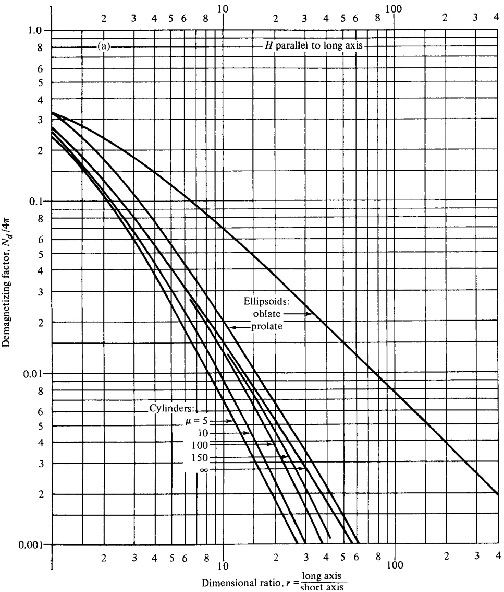

Fig. 2.28 Demagnetizing factors for various samples. [R. M. Bozorth, Ferromagnmetism, Van Nostrand (1952); reprinted IEEE (1993) pp. 846 –847]. Values plotted are $N_{\mathrm{cgs}} / 4\pi ,$ which are numerically equal to $N_{\mathrm{SI}}$

The values for $\chi = \infty$ should apply for soft magnetic materials far from saturation, and values for $\chi = 0$ to materials at or approaching magnetic saturation. In practice, demagnetizing field corrections are most important at low fields, where values of permeability and remanence are determined. Demagnetizing corrections are relatively unimportant (although not small) as the sample approaches saturation. Values of the coercive field are generally not much affected by demagnetizing effects, since they are determined when the magnetization is at or near zero. Permanent magnet materials, in which the values of susceptibility are low and uncertain, are normally measured in closed magnetic circuits where the demagnetizing fields are kept small.

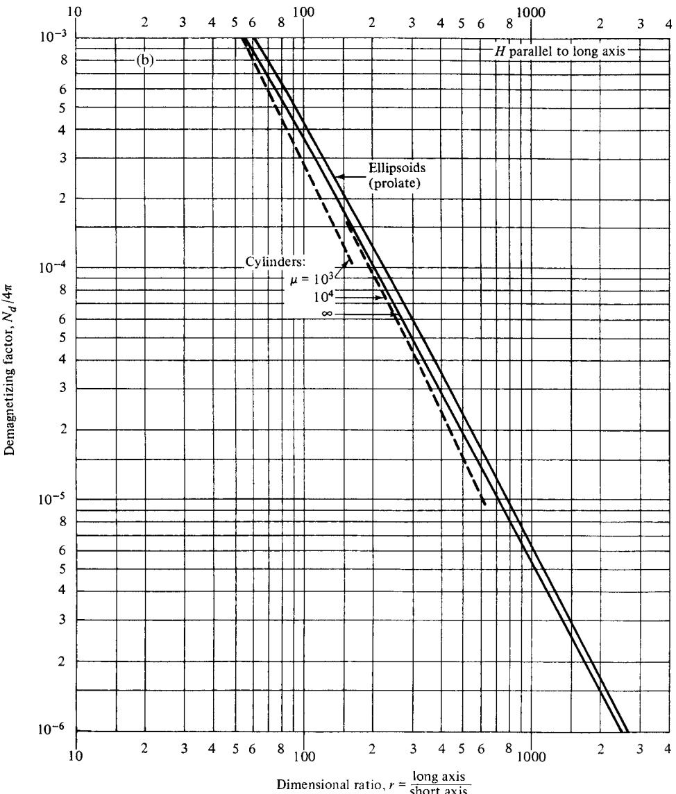

Fig. 2.28 Continued.

A paper by D.-X. Chen, J. A. Brug, and R. B. Goldfarb [IEEE Trans. Mag., 37 (1991) p. 3601] reviews the history of demagnetizing factor calculations and derives new values of Nf and $N_{\mathrm{m}}$ for rod samples. A later paper [D.-X. Chen, E. Pardo, and A. Sanchez, J. Magn. Mag. Matls., 306 (2006) p. 135] gives improved values for rod samples, and adds some calculated values of $N_{\mathrm{m}}$ for disk samples. Similar results for rectangular prisms are given by the same authors [IEEE Trans. Mag., 41 (2005) p. 2077]. All three of these papers include results for a range of values of susceptibility as well as for sample shape.

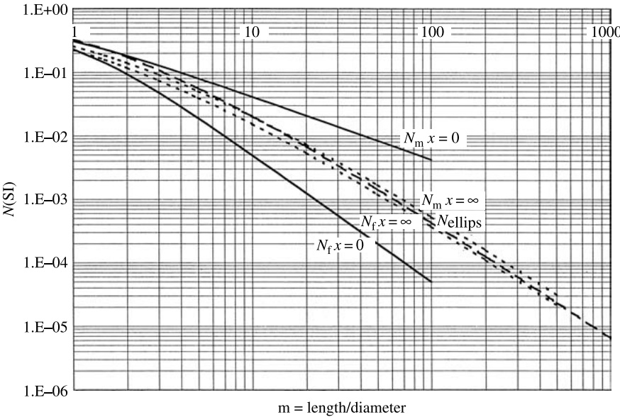

Fig. 2.29 Calculated SI magnetometric demagnetizing factors for rod samples magnetized parallel to the rod axis. Central dashed line is for a prolate ellipsoid. Dotted curves are for $\chi = \infty ;$ solid curves for $\chi = 0$ . Upper dotted and solid curves are magnetometric factors $N_{m};$ lower curves are fluxmetric factors $N_{\mathrm{f}}$ Data in Figs. 2.29 and 2.30 from D.-X. Chen, E. Pardo, and A. Sanchez, J. Magn. Mag. Mater., 306 (2006) p. 125.

The results are extensive and detailed, and not easy to summarize. Figure 2.29 shows calculated values of $N_{f}$ and $N_{\mathrm{m}}$ for rod samples. The central dashed line is for prolate ellipsoids, where $N_{f}$ and $N_{\mathrm{m}}$ are the same. The dotted lines are calculated values of $N_{f}$ and $N_{\mathrm{m}}$ for $\chi = \infty$ , i.e., for very soft magnetic materials. At large values of $m$ (long, thin rods) $N_{\mathrm{m}}$ is slightly above the ellipsoid line, and $N_{f}$ is slightly below. Note that values of $m$ less than about 10 are largely of mathematical interest, since the measurement requires a central coil whose length is small compared to the sample length. The upper solid line is $N_{\mathrm{m}}$ for $\chi = 0$ , and the lower solid line is $N_{f}$ for $\chi = 0$ . For samples of low susceptibility, or for samples approaching magnetic saturation, the demagnetizing factors can differ from those of the ellipsoid (of the same $m$ value) by a factor approaching 10 when $m = 100$ For samples of high susceptibility, in low fields, the demagnetizing factor for an ellipsoid of the same $m$ value is generally a reasonable approximation, considering the various uncertanties involved.

Figure 2.30 gives some results for the magnetometric demagnetizing factor $N_{\mathrm{m}}$ for disk samples magnetized along a diameter. Fluxmetric demagnetizing factors $N_{f}$ are of little interest for disk samples. The dashed curve is for oblate (planetary) ellipsoids; this is the same curve given by Bozorth. The dotted curve is for $\chi = \infty$ (high permeability) and the solid curve is for $\chi = 0$ (uniform magnetization). In the $m$ range of practical interest, values of $N_{\mathrm{m}}$ are always higher than for the ellipsoid of the same $m$ value, and the difference between the $\chi = \infty$ and the $\chi = 0$ values is much less than for rod samples.

There are some relevant experimental measurements. Figure 2.31 shows data points from vibrating-sample (VSM) measurements on a series of permalloy disks, together with the calculated curves for $\chi = \infty$ and $\chi = 0$ from Fig. 2.30. The experimental points generally fall between the two calculated curves. Note that it is not difficult to prepare samples with values of $m$ greater than the highest value for which calculations (other than for ellipsoids) have been made; this is especially true if thin-film samples are measured.

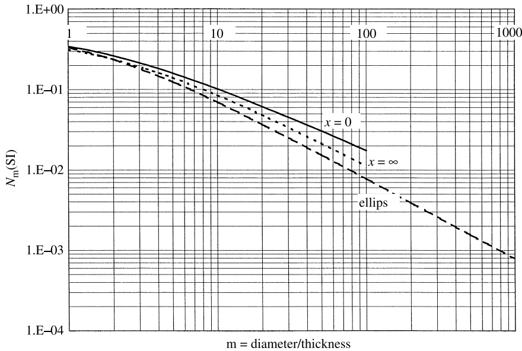

Fig. 2.30 Calculated SI magnetometric demagnetizing factors for disk samples magnetized along a diameter. Dashed line is for an oblate (planetary) ellipsoid. Dotted line is $N_{\mathrm{m}}$ for $\chi = \infty ;$ solid line is for $\chi = 0$

The theoretical papers give demagnetizing factors for values of χ between 0 and 1, and also for χ between 0 and 21. The negative values apply to superconductors, and will be treated in Chapter 16.

In the case of nonellipsoidal samples, it is no longer necessarily true that the sum of the three orthogonal demagnetizing factors is a constant, so Equations 2.18 are not exactly correct.

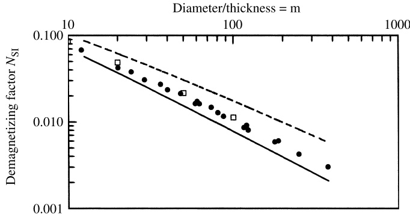

Fig. 2.31 Magnetometric demagnetizing factors for disk samples. Data points measured on 80 permalloy disk samples using a vibrating-sample magnetometer [C. D. Graham and B. E. Lorenz, IEEE Trans. Mag., 43 (2007) p. 2743]. Dotted and solid lines are copied from Fig. 2.30, for $\chi = \infty$ and $\chi = 0$

Clearly in experimental work it is advantageous to make the value of $m$ large, to minimize the demagnetizing correction. Ideally, the worst-case value of $H_{\mathrm{d}}$ should be comparable to the uncertainty in the measurement of the applied field; then uncertainty in the value of N becomes unimportant.

Permanent magnet samples are usually made in the form of short cylinders or rectangular blocks, and they need to be measured in high fields, so the usual practice is to make the sample part of a closed magnetic circuit. This largely eliminates the demagnetizing effect. See the next section.

A common mathematical procedure to calculate the demagnetizing field is to make use of the magnetic pole density on the sample surface, given by $\rho_{\mathrm{s}} = M$ cos $\theta$ , where $M$ is the magnetization of the sample and $\theta$ is the angle between $M$ and the normal to the surface. Note that $M\cos\theta$ is the component of the magnetization normal to the surface inside the body, and that $M$ is zero outside. Therefore, the pole density produced at a surface equals the discontinuity in the normal component of $M$ at that surface. If $\vec{\mathbf{n}} is a unit vector normal to the surface, then

$$
M \cos \theta = \vec {M} \cdot \hat {\mathbf {n}} = \rho_ {\mathrm{s}}.\tag{2.30}
$$

Note that this agrees with one of the definitions of $M$ as the pole strength per unit area of cross section. The polarity of the surface is positive, or north, if the normal component of $M$ decreases as a surface is crossed in the direction of $M$. Free poles can also be produced at the interface between two bodies magnetized by different amounts and/or in different directions. If $M_{1}$ and $M_{2}$ are the magnetizations of the two bodies, then the discontinuity in the normal component is

$$
\vec {M} _ {1} \cdot \hat {\mathbf {n}} - \vec {M} _ {2} \cdot \hat {\mathbf {n}} = \rho_ {\mathrm{s}}.\tag{2.31}
$$

This is an important principle, which we shall need later.

We also note that, at the interface between two bodies or between a body and the surrounding air, certain rules govern the directions of $H$ and $B$ at the interface:

1. The tangential components of $H$ on each side of the interface must be equal.

2. The normal components of $B$ on each side of the interface must be equal.

These conditions govern the angles at which the $B$ and $H$ lines meet the air—body interfaces depicted in Fig. 2.24, for example.

Free poles may exist not only at the surface of a body, but also in the interior. For example, on a gross scale, if a bar has a winding like that shown in Fig. 2.32a, south poles will be produced at each end and a north pole in the center, for a current i in the direction indicated. On a somewhat finer scale, free poles exist inside a cylindrical bar magnet, as very approximately indicated in Fig. 2.32b. The condition for the existence of interior poles is nonuniform magnetization. An ellipsoidal body can be uniformly magnetized, and it has free poles only on the surface, unless it contains domains. A body of any other shape, such as a cylindrical bar, cannot be uniformly magnetized except at saturation, because the demagnetizing field is not uniform, and so the body always has interior as well as surface poles. Nonuniformity of magnetization means that there is a net outward flux of $M$ from a small volume element, i.e., the divergence of $M$ is greater than zero. But if there is a net outward flux of $M$, there must be free poles in the volume element to supply this flux. Such a volume element is delineated by dashed lines in Fig. 2.32b, in which lines of $M$ have also been drawn, going from south to north poles. (For clarity, the lines of $M$ connecting surface poles on the ends have been omitted.) If $\rho_{\mathrm{v}}$ is the volume pole density (pole strength per unit volume), then

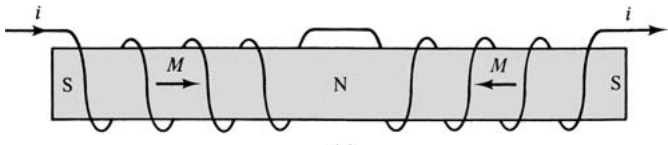

(a)

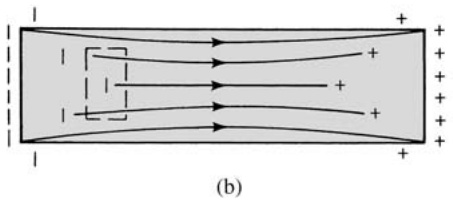

Fig. 2.32 Internal poles in a magnetized body.

$$
\mathrm{div} \mathbf {M} = \nabla \cdot \mathbf {M} = \frac {\partial M _ {\mathrm{x}}}{\partial x} + \frac {\partial M _ {\mathrm{y}}}{\partial y} + \frac {\partial M _ {\mathrm{z}}}{\partial z} = - \rho_ {\mathrm{v}}.\tag{2.32}
$$

On the axis of a bar magnet, $M$ decreases in magnitude from the center toward each end, as indicated qualitatively by the density of flux lines in Fig. 2.32b. Suppose the axis of the magnet is the x-axis, and we assume for simplicity that $M$ is uniform over any cross section. Then only the term $\partial M_{x} / \partial x$ need be considered. Between the center of the magnet and the north end, $\partial M_{\mathrm{x}} / \partial x$ becomes increasingly negative, which means that $\rho_{v}$ is positive and that it increases in magnitude toward the end, as depicted in Fig. 2.32b. Although the interior pole distributions in Fig. 2.32a and b differ in scale, both are rather macroscopic; we shall see in Chapter 9 that interior poles can also be distributed on a microscopic scale.

The general derivations of Equations. 2.31 and 2.32 may be found in any intermediatelevel text on electricity and magnetism.

In summary:

1. Lines of $B$ are always continuous, never terminating.

2. a. If due to currents, lines of $H$ are continuous.

b. If due to poles, lines of $H$ begin on north poles and end on south poles.

3. At an interface,

a. the normal component of $B$ is continuous,

b. the tangential component of $H$ is continuous, and

c. the discontinuity in the normal component of $M$ equals the surface pole density $\rho_{s}$ at that interface.

4. The negative divergence of $M$ at a point inside a body equals the volume pole density at that point.

5. The magnetization of an ellipsoidal body is uniform, and free poles reside only on the surface, unless the body contains domains. See Section 9.5.

6. The magnetization of a nonellipsoidal body is nonuniform, and free poles exist on the surface and in the interior. (The saturated state constitutes the only exception to this statement. A saturated body of any shape is uniformly magnetized and has poles only on its surface.)

## 2.10 MAGNETIC MEASUREMENTS IN OPEN CIRCUITS

Measurements of this type are usually made with a VSM or alternating gradient magnetometer (AGM), a fluxmeter, or a SQUID magnetometer. In the case of the VSM, AGM, or SQUID, the direct experimental result is a plot of the sample magnetic moment $m$ vs the applied field $H_{a}$ . In the case of the fluxmeter, the usual result is a plot of flux density $B$ vs applied field $H_{a}$ . The problem is to correct values of the applied field $H_{a}$ to values of the true field $H_{\mathrm{tr}}$ by subtracting the values of the demagnetizing field $H_{\mathrm{d}}$ The relationship is

$$
H _ {\mathrm{tr}} = H _ {\mathrm{a}} - H _ {\mathrm{d}},\tag{2.33}
$$

where $H_{\mathrm{d}} = N_{\mathrm{d}}M$ and $N_{d}$ is the demagnetizing factor. As discussed above, unless the sample is in the shape of an ellipsoid, there is no single demagnetizing factor $N_{d}$ that applies for all parts of the sample at all levels of magnetization. A workable procedure is to select a value of $N_{f}$ or $N_{\mathrm{m}}$ from Figs. 2.28 –2.31 that is appropriate for the dimensions of the sample, the measurement technique, and the low-field permeability or susceptibility of the sample. It is important to remember that the demagnetizing field is always directed opposite to the direction of magnetization in the sample. If the experiment produces values of $M$, the correction is straightforward: at each value of $M$, the demagnetizing field is calculated from Equation 2.17, and the demagnetizing field is subtracted from the applied field (Equation 2.33) to obtain the true field acting on the sample. The corrections are made at fixed values of $M$, and move the measured $M$ values parallel to the $H$ axis. Since the demagnetizing field is proportional to the magnetization, $H_{\mathrm{d}}$ can be represented by the line OD in Fig. 2.33, and the demagnetizing correction can be visualized by rotating the line OD counterclockwise about the origin O until it coincides with the y-axis, and simultaneously moving each of the experimental values of $M$ parallel to the H-axis, keeping the distance between the line OD and the value of $M$ fixed. This is sometimes called the shearing correction.

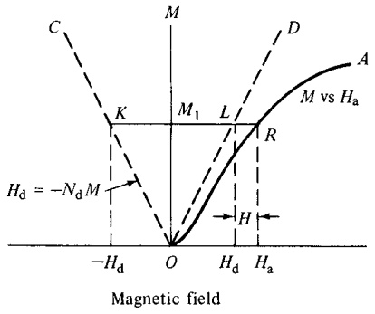

(a)

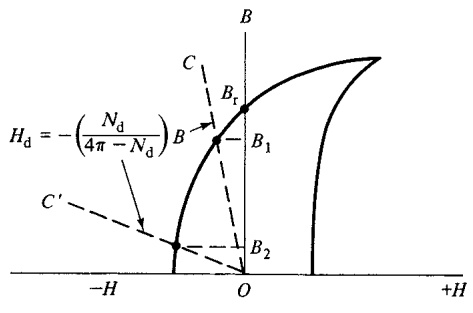

(b)

Fig. 2.33 Graphical treatment of demagnetizing fields. (a) Plot of $M$ versus $H$. (b) Plot of $B$ versus $H$.

When the measurement gives values of flux density $B$ rather then $M$, the correction becomes more complicated. $M$ and $H_{\mathrm{d}}$ are evaluated as follows:

$$
\begin{array}{c} B = H _ {\mathrm{tr}} + 4 \pi M = H _ {\mathrm{a}} - N _ {\mathrm{d}} M + 4 \pi M (\mathrm{cgs}) \\ \frac {B}{\mu_ {0}} = H _ {\mathrm{tr}} + M = H _ {\mathrm{a}} - N _ {\mathrm{d}} M + M (\mathrm{SI}). \end{array}\tag{2.34}
$$

Then

$$
M = \frac {B - H _ {\mathrm{a}}}{4 \pi - N _ {\mathrm{d}}} (\mathrm{cgs}) \quad M = \frac {(B / \mu_ {0}) - H _ {\mathrm{a}}}{1 - N _ {\mathrm{d}}} (\mathrm{SI})\tag{2.35}
$$

$$
H _ {\mathrm{d}} = N _ {\mathrm{d}} \bigg (\frac {B - H _ {\mathrm{a}}}{4 \pi - N _ {\mathrm{d}}} \bigg) (\mathrm{cgs}) \quad H _ {\mathrm{d}} = N _ {\mathrm{d}} \bigg (\frac {(B / \mu_ {0}) - H _ {\mathrm{a}}}{1 - N _ {\mathrm{d}}} \bigg) (\mathrm{SI})\tag{2.36}
$$

Two simplifications are often possible. First, if $N_{\mathrm{d}}$ is reasonably small compared to $4\pi$ (cgs) or 1 (SI), the denominator in Eqs. 2.35 and 2.36 may be replaced by $4\pi$ or 1. Remembering that demagnetizing factors are not exact or well-defined except for ellipsoids, we may say that if $N_{d}$ is less than about 2% of its maximum value (4p or 1), it may be neglected here. This would mean $m$ greater than 10 for a prolate ellipsoid (cigar) or greater than 30 for an oblate (planetary) ellipsoid (disk). This does not mean that the demagnetizing field is negligible, just that $N_{d}$ may be neglected in this denominator. Second, in many cases of measurement on soft magnetic materials, $H_{\mathrm{a}}$ is small compared to $B$ (cgs), or compared to $B / \mu_{0}$ (SI). If both these conditions hold, Equation 2.33 reduces to

$$
H _ {\mathrm{d}} = N _ {\mathrm{d}} \frac {B}{4 \pi} (\mathrm{cgs}) \quad \text {or} \quad H _ {\mathrm{d}} = N _ {\mathrm{d}} \frac {B}{\mu_ {0}} (\mathrm{SI})\tag{2.37}
$$

How this works is illustrated by the experimental data in Table 2.2, obtained from a rod of commercially pure iron in the cold-worked condition. The rod was 240 mm long and 6.9 mm in diameter and hence had a length/diameter ratio of 35. The measurements were made with a search coil at the center of the rod, so the fluxmetric demagnetizing factor applies. The low-field permeability is unknown, but we may make the reasonable assumption that it lies somewhere between $10^{2}$ and 1. From Fig. 2.28 we read $N_{\mathrm{d}} = 0.002$ (SI) or $N_{\mathrm{d}} = (0.002)(4\pi) = 0.025$ (cgs) . Using Equation 2.37, this leads to the demagnetizing fields $H_{\mathrm{d}}$ listed in the table (which is in cgs units), and we see that they form a very substantial fraction of the applied fields. The flux density is plotted in Fig. 2.34 as a function of both applied and true fields. It is clear that the apparent permeability, given by $B/H_{a},$ is much less than the true permeability, or $B/H_{\mathrm{tr}}$ If the two conditions noted above are met, it may be shown that

TABLE 2.2 Magnetization of Iron Rod

| Ha, Oe | B, G | (B 2 Ha), G | M, emu/cm3 | Hd, Oe | H, Oe |
| --- | --- | --- | --- | --- | --- |
| 8.1 | 1,080 | 1,070 | 85 | 2.1 | 6.0 |
| 16.2 | 3,850 | 3,830 | 305 | 7.7 | 8.5 |
| 26.9 | 7,910 | 7,880 | 627 | 15.8 | 11.1 |
| 35.0 | 10,080 | 10,040 | 799 | 20.1 | 14.9 |
| 43.0 | 12,420 | 12,380 | 985 | 24.8 | 18.2 |
| 53.9 | 14,860 | 14,810 | 1,180 | 29.6 | 24.3 |
| 80.7 | 18,220 | 18,140 | 1,450 | 36.3 | 44.4 |

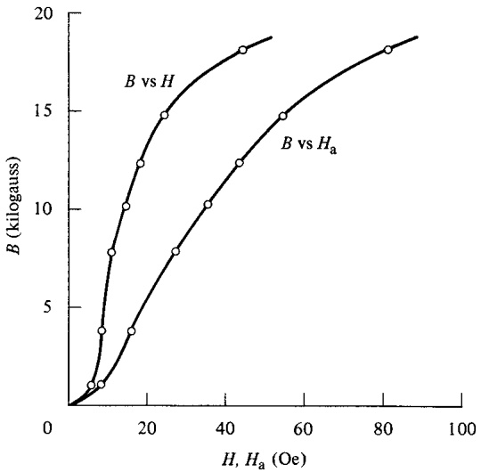

Fig. 2.34 Measured and corrected magnetization curves of cold-worked iron, from the data of Table 2.2.

$$
\frac {1}{\mu_ {\mathrm{true}}} = \frac {1}{\mu_ {\mathrm{apparent}}} - \frac {N _ {\mathrm{d}}}{4 \pi} (\mathrm{cgs}) \quad \frac {1}{\mu_ {\mathrm{r(true)}}} = \frac {1}{\mu_ {\mathrm{r(apparent)}}} - N _ {\mathrm{d}} (\mathrm{SI}).\tag{2.38}
$$

This suggests an experimental method to determine a value for the demagnetizing factor. If a material has a high permeability $\mu_{\mathrm{true}}$ say 5000 or higher, then $1 / \mu_{\mathrm{true}}$ is negligible and Equation 2.38 gives:

$$
\mu_ {\text {apparent}} = \frac {4 \pi}{N _ {\mathrm{d}}} (\mathrm{cgs}) \quad \mu_ {\mathrm{r(apparent)}} = \frac {1}{N _ {\mathrm{d}}} (\mathrm{SI}).\tag{2.39}
$$

A measurement of $B$ vs $H_{\mathrm{a}}$ on a sample of this material will give an initial straight line with a slope

$$
\frac {B}{H _ {\mathrm{a}}} = \mu_ {\mathrm{apparent}} = \frac {4 \pi}{N _ {\mathrm{d}}} (\mathrm{cgs}) \quad \text {or} \quad \frac {B}{\mu_ {0} H _ {\mathrm{a}}} = \mu_ {\mathrm{r(apparent)}} = \frac {1}{N _ {\mathrm{d}}} (\mathrm{SI})
$$

The reciprocal of the numerical value of this slope gives the experimental value of $N_{\mathrm{d}}$ So a sample of high-permeability material, such as Ni–Fe permalloy or high-purity annealed iron or nickel, made in the same size and shape as the sample(s) to be measured, can be used to establish an experimental demagnetizing factor for all high-permeability samples of the same size and shape, measured in the same apparatus.

If $M$ is measured directly instead of $B$, then we can write

$$
\frac {H}{M} = \frac {H _ {\mathrm{a}}}{M} - N\tag{2.40}
$$

or, since susceptibility $\chi = M / H$.

$$
\frac {H _ {\mathrm{a}}}{M} - \frac {1}{\chi} = N.\tag{2.41}
$$

The value of χ at low field can be measured on a ring sample where N = 0 . For soft magnetic materials, 1/χ may be negligible. Then the reciprocal of the slope of the measured $M$ vs $H_{\mathrm{a}}$ curve gives an experimental value for N. This is the method used to determine the experimental points in Fig. 2.31.

When the field applied to a specimen on open circuit is reduced to zero, the induction remaining is always less than in a ring specimen, because of the demagnetizing field. In Fig. 2.33b the induction in a ring specimen would be $B_{r}$ , because $H_{\mathrm{d}} = 0$ and $H_{\mathrm{a}} = H$. But in an open-circuit specimen, the remanent induction is given by the intersection of the demagnetizing line OC or OC' with the second quadrant of the hysteresis loop. If the specimen is long and thin, this line (OC) will be steep and the residual induction $B_{1}$ will not differ much from that of the ring. If the specimen is short and thick, the line $(OC')$ will be so nearly flat that the residual induction $B_{2}$ will be very small.

The demagnetizing effect can assume huge proportions in short specimens of magnetically soft materials. For example, suppose a sample of iron can be brought to its saturation value of $M_{\mathrm{s}} = 1700 \mathrm{emu} / \mathrm{cm}^{3} (1.7 \times 10^{6} \mathrm{~A} / \mathrm{m})$ by a field of 10 Oe (800 A/m) when it is in the form of a ring. If it is in the form of a sphere, $H_{\mathrm{d}}$ at saturation will be $(4\pi /3)(1700) = 7120$ Oe $([1 / 3][1.7\times 10^{6}] = 570\mathrm{kA / m})$ , and the applied field necessary to saturate it will be $7120 + 10 = 7130$ Oe or $570 + 0.8 = 571\mathrm{kA / m}$ . The $M$, $H_{\mathrm{a}}$ (or $B, H_{a})$ curve will be a straight line almost to saturation, with a slope determined by the value of $N_{\mathrm{d}}$ and the details of the true curve, such as the initial permeability, will be unobservable.

In open-circuit measurements on very soft magnetic materials, the Earth’s magnetic field of $\sim 0.5$ Oe or 40 A/m may be significant. This influence can be minimized by orienting the long axis of the sample perpendicular to the Earth’s field, as determined by a magnetic compass. It may be important to consider that the Earth’s field has a component normal to the Earth’s surface, except near the equator.

We have seen three possible methods of calculating or eliminating the demagnetizing field correction:

1. Make the specimen in the form of an ellipsoid. Then $H_{\mathrm{d}}$ can be exactly calculated, but at the cost of laborious specimen preparation.

2. Use a rod or strip or thin film specimen of very large length–area ratio. The demagnetizing factor is then so small that any error in it has little effect on the computed value of the true field.

3. Apply a correction using a calculated or tabulated or measured demagnetizing factor. The uncertainties in this approach have been noted above.

A fourth approach, which is often used, is to make the specimen into part of a closed magnetic circuit, so that the free poles causing the demagnetizing field are largely eliminated. This is done by clamping the sample into some form of magnetic yoke; the resulting device is known as a permeameter. It is described in more detail below.

If a large number of identical rod samples are to be tested using a fluxmeter, time will be saved by slipping each rod into a single search coil, previously wound on a nonmagnetic form. Since the cross-sectional area $A_{c}$ of the search coil will be larger than the area $A_{s}$ of the specimen, an air-flux correction must be made for the flux in air outside the specimen but inside the search coil:

$$
\begin{array}{c} \phi_ {\text {observed}} = \phi_ {\text {specimen}} + \phi_ {\text {air}}, \\ B _ {\text {apparent}} A _ {\mathrm{s}} = B _ {\text {true}} A _ {\mathrm{s}} + H (A _ {\mathrm{c}} - A _ {\mathrm{s}}) (\mathrm{cgs}) = B _ {\text {true}} A _ {\mathrm{s}} - \mu_ {0} H (A _ {\mathrm{c}} - A _ {\mathrm{s}}) (\mathrm{SI}) \\ B _ {\text {true}} = B _ {\text {apparent}} - H \bigg (\frac {A _ {\mathrm{c}} - A _ {\mathrm{s}}}{A _ {\mathrm{s}}} \bigg) (\mathrm{cgs}) = B _ {\text {apparent}} - \mu_ {0} H \bigg (\frac {A _ {\mathrm{c}} - A _ {\mathrm{s}}}{A _ {\mathrm{s}}} \bigg) (\mathrm{SI}). \end{array}\tag{2.42}
$$

## 2.11 INSTRUMENTS FOR MEASURING MAGNETIZATION

## 2.11.1 Extraction Method

This method is based on the flux change in a search coil when the specimen is removed (extracted) from the coil, or when the specimen and search coil together are extracted from the field. When the solenoid in Fig. 2.35 is producing a magnetic field, the total flux through the search coil is

$$
\Phi_ {1} = B A = (H + 4 \pi M) A = (H _ {\mathrm{a}} - H _ {\mathrm{d}} + 4 \pi M) A = (H _ {\mathrm{a}} - N _ {\mathrm{d}} M + 4 \pi M) A (\mathrm{cgs})
$$

or

$$
\Phi_ {1} = B A = \mu_ {0} (H + M) A = \mu_ {0} (H _ {\mathrm{a}} - H _ {\mathrm{d}} + M) A = \mu_ {0} (H _ {\mathrm{a}} - N _ {\mathrm{d}} M + M) A (\mathrm{SI})\tag{SI}
$$

(2.43)

where $A$ is the specimen or search-coil area. (The two are assumed equal here to simplify the equations, i.e., the air-flux correction is omitted.) If the specimen is suddenly removed from the search coil, the flux through the coil becomes

Fig. 2.35 Arrangement for measuring a rod sample in a magnetizing solenoid. Two procedures are possible: (1) solenoid current is varied continuously and fluxmeter output is recorded continuously; (2) at a series of constant solenoid current values the sample (not the search coil) is moved to a position of effectively zero field, and the fluxmeter reading is recorded. This is the extraction method. Procedure 1 measures $B$ vs $H$; procedure 2 measures $M(4\pi - N)$ (cgs) or $\mu_0M(1 - N)$ (SI).

$$
\Phi_ {2} = H _ {\mathrm{a}} A (\mathrm{cgs}) \quad \Phi_ {2} = \mu_ {0} H _ {\mathrm{a}} A (\mathrm{SI}).\tag{2.44}
$$

The fluxmeter will therefore record a value proportional to the flux change:

$$
\Phi_ {1} - \Phi_ {2} = (4 \pi - N _ {\mathrm{d}}) M A (\mathrm{cgs}) \quad \text {or} \quad \Phi_ {1} - \Phi_ {2} = \mu_ {0} (1 - N _ {\mathrm{d}}) M A (\mathrm{SI}).\tag{2.45}
$$

This version of the extraction method therefore measures $M$ directly, rather than $B$. Note that $M$ is measured at a particular field strength, rather than as a change in $M$ due to a change in field, and that the flux change in the search coil does not involve $H$. This fact results in greater sensitivity when $M$ is small compared to $H$, as it is for weakly magnetic substances.

A variation of this method involves two identical search coils, located symmetrically in the solenoid. These are connected in “series opposition,” i.e., if one is wound clockwise, viewed along their common axis, the other is wound counterclockwise. If the area-turns of both coils are equal, then a change in $H_{\mathrm{a}}$ will induce equal and opposite emfs in the two coils, and the fluxmeter will show no deflection. Thus variations in the applied field will not influence the results. When the specimen is moved out of one coil and into the other, the measured signal is twice that obtained with a single coil. Similar reasoning controls the design of pickup coils in the vibrating sample magnetometer (see next section).

The extraction method, with either a single or double coil, may be used with an electromagnet as a field source. In Fig. 2.36 the coil axes are parallel to the field but displaced from one another; each coil is also split in two, so that the entire coil system resembles two Helmholtz pairs.

The extraction method does not allow continuous recording of $H$ and $M$ in a simple way and is no longer widely used, except in the SQUID magnetometer. However, the vibrating-sample method, which may be regarded as kind of partial extraction method, is very common.

## 2.11.2 Vibrating-Sample Magnetometer

This instrument is credited to S. Foner [Rev. Sci. Instrum., 30 (1959) pp. 548 – 557] and is sometimes referred to as a Foner magnetometer. The idea was also published by G. W. Van Oosterhout [Appl. Sci. Res., B6 (1956) p. 101], and by P. J. Flanders [IEEE Special Publication T-91, Conference on Magnetism and Magnetic Materials, Boston (1956) pp. 315– 317]. It is based on the flux change in a coil when a magnetized sample is vibrated near it. The sample, commonly a small disk, is attached to the end of a nonmagnetic rod, the other end of which is fixed to a loudspeaker cone (Fig. 2.37) or to some other kind of mechanical vibrator. The oscillating magnetic field of the moving sample induces an alternating emf in the detection coils, whose magnitude is proportional to the magnetic moment of the sample. The (small) alternating emf is amplified, usually with a lock-in amplifier which is sensitive only to signals at the vibration frequency. The lock-in amplifier must be provided with a reference signal at the frequency of vibration, which can come from an optical, magnetic, or capacitive sensor coupled to the driving system. The detection-coil arrangement shown in Fig. 2.37 is only one of several possible ones described by Foner, all of which involve balanced pairs of coils that cancel signals due to variation in the applied field. The coil arrangement of Fig. 2.37 is very commonly used. The apparatus is calibrated with a specimen of known magnetic moment, which must be of the same size and shape as the sample to be measured, and should also be of similar permeability.

Fig. 2.36 Extraction method using two coils, in the air gap of an electromagnet.

Fig. 2.37 Vibrating sample magnetometer or VSM (schematic).

The driving system may be mechanical, through a cam or crank and a small synchronous motor, or in a recent commercial instrument, with a linear motor. In this case the vibration frequency is generally below 40 Hz, and the vibration amplitude is a few millimeters. The amplitude is fixed by the geometry of the mechanical system or by the drive signal to the linear motor. Alternatively, the driving system may be based on a loudspeaker, as in Fig. 2.37, in which case the frequency is generally about 100 Hz, and the amplitude is near 0.1 mm. In this case, the amplitude may vary, depending on the mass of the sample and its interaction with the magnetic field, so there must be some provision for monitoring and/or controlling the amplitude as well as the frequency of vibration. One method is to attach a small permanent magnet to the sample rod, outside the varying field region, with a second set of sensing coils. Then the signal from these coils can be used in a feedback loop to maintain a constant amplitude of vibration. Alternatively, a portion of the signal from the permanent magnet can be balanced against the signal from the unknown sample, making the method a null method.

Fig. 2.38 VSM working in a superconducting solenoid. The oscillating sample motion is provided by a linear motor. Courtesy of Quantum Design, Inc.

Care is necessary to minimize vibration of the sensing coils in the field, and to keep the measuring field from influencing other parts of the system. Note that the VSM measures the magnetic moment $m$ of the sample, and therefore the magnetization $M$, whereas the fluxmeter method ordinarily measures the flux density $B$.

The VSM is very versatile and sensitive. It may be used for both weakly and strongly magnetic substances, and standard versions can detect a magnetic moment of about $10^{-5}\mathrm{emu} = \mathrm{erg / Oe}$ or $10^{-8}\mathrm{A m^{2}}$ . This corresponds to the saturation magnetization of about 0.04 μg of iron, which suggests the attention to cleanliness that is necessary when measuring small or weakly magnetic samples. The VSM must be used with care in the determination of the magnetization curves or hysteresis loops of magnetically soft materials. The specimen has to be short, and the demagnetizing field may then be such a large fraction of the applied field that the true field is uncertain. However, if the sample is or can be made very thin, as is often the case in the computer and electronics industries, the demagnetizing correction can be small or negligible. The demagnetizing correction is also generally unimportant in the determination of saturation magnetization $M_{s}$

The VSM can be adapted for measurements at high and low temperatures, since only the sample and vibrating rod must be heated or cooled. (The organic insulation on magnet wire does not suffer at low temperatures, but has limited high temperature endurance.) VSMs of normal design are limited to small samples, generally less than 1 g.

Figure 2.10 shows a commercial VSM mounted to operate in an electromagnet, and Fig. 2.38 shows a VSM driven by a linear motor, working in a superconducting solenoid magnet. The arrangement in Fig. 2.38 can operate as a VSM or as an extraction magnetometer.

## 2.11.3 Alternating (Field) Gradient Magnetometer—AFGM or AGM (also called Vibrating Reed Magnetometer)

Sensitivities even higher than the VSM can be achieved by mounting the sample at the end of a fiber, and subjecting it to a fixed dc field plus an alternating field gradient, produced by an appropriate coil pair, as indicated in Fig. 2.39. The field gradient produces an alternating force on the sample, which causes it to oscillate and flexes the fiber. If the frequency of vibration is tuned to a resonant frequency of the system, the vibration amplitude increases by a factor equal to the quality factor Q of the vibrating system, which can be of the order of 100. The first system of this kind used an optical microscope to observe the vibration amplitude, but later versions [P. J. Flanders, J. Appl. Phys., 63 (1988) pp. 3940 – 1345] use a piezoelectric crystal to generate a voltage proportional to the vibrational amplitude, which in turn is proportional to the sample moment. The limiting sensitivity of the commercial version is about $10^{-6}$ emu or $10^{-9}\mathrm{Am}^{2}$ . At this level of sensitivity, sample cleanliness and mounting methods become critical. The AGM, also called the resonant reed or vibrating reed magnetometer, is more limited than the VSM in the maximum mass of the sample that can be measured, and tuning the vibration frequency to resonance complicates the measurement. The necessary presence of a field gradient means the sample is never in a completely uniform field, which is sometimes a limitation.

## 2.11.4 Image Effect

Open-circuit measurements made with an electromagnet may show errors due to the image effect. Figure 2.40a shows the exterior field of a short magnetized specimen. If this

Fig. 2.39 Alternating-gradient magnetometer or AGM (schematic).

(a)

(b)

Fig. 2.40 Image effect. (a) field due to magnetized sample in empty space; (b) field due to magnetized sample placed between two soft iron pole pieces.

Fig. 2.41 Magnetization curve showing image effect.

specimen is now placed in the gap of an unmagnetized electromagnet, the lines of force from the specimen swing around to the positions indicated in Fig. 2.40b. These new positions are just those which would result if the lines of force were connected to the “magnetic images” of the specimen in the pole pieces, as shown by the dashed lines. An analogous effect occurs in electrostatics, when the lines of force from a point charge shift their position when a conducting plate is placed nearby. The magnetic moment of the magnetic image exactly equals that of the specimen when the permeability μ of the pole caps is infinite, decreases as μ decreases, and vanishes when the pole caps become magnetically saturated [m (cgs) or $\mu_{\mathrm{r}}$ (SI) = 1] . The change in field distribution caused by this image effect generally increases the flux linkage with the search coil and therefore increases the fluxmeter or VSM signal. This increased signal disappears as the material of the pole caps approaches saturation, which results in an apparent magnetization curve like that in Fig. 2.41. The image effect appears as a drop in signal at high fields, although physically it results from an increase in signal at low fields. An analogous effect occurs in a superconducting magnet, as magnetic flux can increasingly penetrate the coil windings at high field levels.

The image effect can be minimized by keeping the sample and sensing coils as far as possible from the pole faces of the electromagnet, or by increasing the working gap of the magnet. However, these are not usually practical methods, because they reduce either the working space in the magnet or the maximum field that can be applied to the sample. The best solution in principle is to measure a sample of known constant magnetization, and of the same size and shape as the sample to be measured, over the full range of fields available in the electromagnet, and use these data to establish a field-dependent correction factor. This requires a sample whose magnetic moment remains constant over a wide range of applied fields. Such a sample can be achieved in the form of an artificial specimen, consisting of a small coil of the same shape and size as the real specimen, in which a constant current is maintained in order to produce a constant magnetic moment of known magnitude. However, the total magnetic moment of such a coil will be much less than the moment of a strongly magnetic sample of the same size. It is also difficult to make a coil in any shape other than a cylinder. Another possibility is to use a sample of a modern permanent magnet material, whose remanent moment is unaffected by a wide range of applied fields, or a soft magnetic material that saturates in low fields and keeps a constant saturated magnetization in high fields. In both these cases it is hard to be sure that the sample magnetization is exactly constant over a wide range of fields, but the correction may be adequate for many purposes.

Precise measurements by any of the methods noted above require that the position of the specimen be accurately reproducible, both with respect to the coils and, because of the image effect, with respect to the pole pieces. In addition, the standard specimen used to calibrate the apparatus must have the same size and shape as the unknown, and also have similar susceptibility or permeability.

## 2.11.5 SQUID Magnetometer

The SQUID device described previously, when used as a magnetometer, acts as a very high-sensitivity fluxmeter, in which the integration is performed by counting voltage steps. It is of such high sensitivity that in a working instrument the magnetic field is held exactly constant by a superconducting shield, and the sample is moved slowly through a superconducting pickup coil coupled to the SQUID while flux quanta are counted. Since the SQUID is a superconducting device, it is usually incorporated in a system including a superconducting magnet. Measurements over a range of fields and temperatures are time consuming, and the systems are normally operated unattended, under computer control. The sensitivity of a SQUID magnetometer is generally about $10^{-7}$ emu or $10^{-10}\mathrm{Am}^{2}$ , an order of magnitude more sensitive than the AGM.

## 2.11.6 Standard Samples

The U.S. National Institute of Standards and Technology (NIST) includes in its list of Standard Reference Materials three different magnetic moment standards: one of yttrium iron garnet (YIG) and two of nickel, and a magnetic susceptibility standard of platinum. (www.nist.gov/srm).

## 2.11.7 Background Fields

Any kind of work involving weak fields, such as the measurement of low-field properties of materials, the measurement of magnetic fields produced by small current flows in the human body, or the calibration of magnetometers for use in satellite systems, is likely to be influenced by variations in the Earth’s magnetic field. In addition to short-term and long-term variations in the Earth’s field itself, which are small but not zero, substantial fields can be generated locally by electric power lines, large motors, transformers, and the like. One solution is to build a laboratory in a remote location, avoiding the use of any iron or steel construction materials (such as nails!). A more practical solution is to control the field in an existing laboratory. This control can be achieved by building a magnetically shielded room and/or by generating compensating fields. The latter are produced by an arrangement of three large Helmholtz-coil pairs on mutually perpendicular axes. Three magnetometers (or a single three-axis magnetometer) at the center sense the fields there and through appropriate circuits control the currents in the Helmholtz coils to control the three field components. In this manner the field in the central region can be made to have any required (low) value, including zero, regardless of field changes outside the system.

## 2.12 MAGNETIC CIRCUITS AND PERMEAMETERS

A permeameter is a device for testing straight bars or rods in a closed magnetic circuit. To understand this method requires a general knowledge of the magnetic circuit, which we will now consider. The concept of a magnetic circuit is a very useful one, not merely with respect to materials testing, but also in the design of electric motors and generators and devices containing permanent magnets.

Fig. 2.42 Magnetic circuits. (a) closed, (b) open.

Suppose an iron ring of permeability $\mu_{\mathrm{r}}$ (SI) , circumferential length l, and cross section A is uniformly wound with n turns of wire carrying a current of i amperes (Fig. 2.42a). Then the field and the flux are given by

$$
H = \frac {4 \pi n i}{1 0} \frac {n i}{l} \mathrm{Oe(cgs)} \quad H = \frac {n i}{l} \mathrm{Am} ^ {- 1} (\mathrm{SI})\tag{2.46}
$$

$$
\Phi = B \mathrm{A} = \mu H \mathrm{A} \text {Maxwell(cgs)} \quad \Phi = B \mathrm{A} = \mu H \mathrm{A} = \mu_ {0} \mu_ {\mathrm{r}} H \mathrm{A} \mathrm{Wb(SI)}.\tag{2.47}
$$

Combining these equations gives

$$
\Phi = \frac {4 \pi}{1 0} \mu \frac {n i}{l} \mathrm{A} = \frac {4 \pi}{1 0} \frac {n i}{l / \mu \mathrm{A}} (\mathrm{cgs}) \quad \Phi = \mu_ {0} \mu_ {\mathrm{r}} \frac {n i}{l} A = \mu_ {0} \frac {n i}{l / \mu_ {\mathrm{r}} A} (\mathrm{SI}).\tag{2.48}
$$

This should be compared with the equation for the current i in a wire of length l, cross secton A, resistance R, resistivity ρ, and conductivity $\sigma = 1 / \rho ,$ when an electromotive force e is acting:

$$
i = \frac {e}{R} = \frac {e}{\rho l / A} = \frac {e}{l / \sigma A}.\tag{2.49}
$$

The similarity in form between Equations 2.48 and 2.49 suggests the various analogies between electric and magnetic quantities listed in Table 2.3. The most important of these are the magnetomotive force (mmf ) = (4p/10)ni (cgs), unit gilbert or oersted-centimeter; mmf = ni (SI), unit ampere; and the reluctance $= 1 / \mu \mathrm{A}$ (cgs), $= 1 / \mu_{r}\mathrm{A}$ (SI)

TABLE 2.3 Circuit Analogies

| Electric | Magnetic |
| --- | --- |
| Current = electromotive force/resistance | Flux = magnetomotive force/reluctance |
| Current = i | Flux = $\Phi$ |
| Electromotive force = e | Magnetomotive force = ni (SI) or (4p/10)ni (cgs) |
| Resistance = R = rl/A = l/sA | Reluctance = l/mrA (SI) or l/mA (cgs) |
| Resistivity = r | Reluctivity = 1/mr (SI) or 1/m (cgs) |
| Conductance = 1/R | Permeance = mrA/l (SI) or mA/l (cgs) |
| Conductivity = s = 1/r | Permeability = mr (SI) or m (cgs) |

A magnetic circuit may consist of various substances, including air, in series. We then add reluctances to find the total reluctance of the circuit, just as we add resistances in series:

$$
\Phi = \frac {\mathrm{mmf}}{(l _ {1} / \mu_ {1} A _ {1}) + (l _ {2} / \mu_ {2} A _ {2}) \dots},\tag{2.50}
$$

where $l_{1}, l_{2}, \ldots$ are the lengths of the various portions of the circuit, $\mu_{1},\mu_{2},\mu_{3},\ldots$ . their permeabilities, and $A_{1}, A_{2}, \ldots$ . their areas. [Linear dimensions are in centimeters for cgs, m for SI; μ (cgs) is replaced by $\mu_{r}$ (SI); and the right-hand side must be multiplied by $\mu_{0}$ for SI.) Similarly, if the circuit elements are in parallel, the reciprocal of the total reluctance is equal to the sum of the reciprocals of the individual reluctances.

The open magnetic circuit of Fig. 2.42b, consisting of an iron ring with an air gap, may be regarded as a series circuit of iron and air. Because the permeability of air is so small compared to that of iron, the presence of a gap of length $l_{\mathrm{g}}$ greatly increases the reluctance of the circuit. Thus

$$
\frac {\text {Reluctance with gap}}{\text {Reluctance without gap}} = \frac {\frac {(l - l _ {\mathrm{g}})}{\mu A} + \frac {l _ {\mathrm{g}}}{(1) A}}{\frac {l}{\mu A}} = 1 + \left(\frac {l _ {\mathrm{g}}}{l}\right) (\mu - 1),\tag{2.51}
$$

where μ is replaced by $\mu_{r}$ for SI units.

A value for μ or $\mu_{r}$ of 5000 is typical of iron near the knee of its magnetization curve. If the ring has a mean diameter of 10 cm (circumference 31.4 cm) and a gap length of 1 cm, then the reluctance of the gapped ring is 160 times that of the complete ring, although the gap amounts to only 3% of the circumference. Even if the gap is only 0.05 mm $(2 \times 10^{-3}$ in), so that it is more in the nature of an imperfect joint than a gap, the reluctance is 1.8 times that of a complete ring. Since the magnetomotive force is proportional to the reluctance (for constant flux), the current in the winding would have to be 160 times as large to produce the same flux in the ring with a 1 cm gap as in the complete ring, and 1.8 times as large for the 0.05 mm gap.

These results may be recast in different language. To say that the current in the winding must be increased to overcome the reluctance of the gap is equivalent to saying that a current increase is required to overcome the demagnetizing field $H_{\mathrm{d}}$ created by the poles formed on either side of the gap. We can then regard the field due to the winding as the applied field $H_{a}$ If $H_{\mathrm{a}}$ (and $\phi)$ are clockwise, as in Fig. 2.42b, $H_{\mathrm{d}}$ will be counterclockwise. This demagnetizing field can be expressed in terms of a demagnetizing coefficient $N_{\mathrm{d}}$ which we will find to be directly proportional to the gap width. If $H_{\mathrm{tr}}$ is the true field, then (using cgs units)

$$
\begin{array}{r l} H _ {\mathrm{tr}} = \frac {B}{\mu} = \frac {\Phi}{\mu A} = \frac {\mathrm{mmf/reluctance}}{\mu A} = \frac {1}{\mu A} \left[ \frac {4 \pi n i 1 0}{\left(\frac {l - l _ {\mathrm{g}}}{\mu A} + \frac {l _ {\mathrm{g}}}{A}\right)} \right] \\ = \left(\frac {4 \pi n i}{1 0}\right) \left[ \frac {1}{l + l _ {\mathrm{g}} (\mu - 1)} \right] = \frac {H _ {\mathrm{a}} l}{l + l _ {\mathrm{g}} (\mu - 1)}. \end{array}\tag{2.52a}
$$

But $\mu - 1 = 4\pi \chi = 4\pi M / H_{\mathrm{tr}}$ , where χ is the susceptibility. Substituting and rearranging, we find

$$
H _ {\mathrm{tr}} = H _ {\mathrm{a}} - 4 \pi \frac {l _ {\mathrm{g}}}{l} M = H _ {\mathrm{a}} - N _ {\mathrm{d}} M = H _ {\mathrm{a}} - H _ {\mathrm{d}}.\tag{2.53a}
$$

The demagnetizing coefficient is thus given by $4\pi (l_{\mathrm{g}} / l)$ . The field in the gap is $H_{\mathrm{g}} = B_{\mathrm{g}},$ which, because of the continuity of lines of $B$, is equal to the flux density $B$ in the iron, provided that fringing (widening) of the flux in the gap can be neglected.

Repeating in SI units,

$$
\begin{array}{r l} H _ {\mathrm{tr}} & = \frac {B / \mu_ {0}}{\mu_ {\mathrm{r}}} = \frac {\Phi}{\mu_ {0} \mu_ {\mathrm{r}} A} = \frac {\mathrm{mmf/reluctance}}{\mu_ {0} \mu_ {\mathrm{r}} A} \\ & = \frac {1}{\mu_ {0} \mu_ {\mathrm{r}} A} \left[ \frac {n i}{\frac {l - l _ {\mathrm{g}}}{\mu_ {\mathrm{r}} A} + \frac {l _ {\mathrm{g}}}{A}} \right] = \frac {n i}{\mu_ {0}} \frac {1}{(l - l _ {\mathrm{g}} + \mu_ {\mathrm{r}} l _ {\mathrm{g}})} \\ & = \frac {n i}{\mu_ {0}} \frac {1}{l + l _ {\mathrm{g}} (\mu_ {\mathrm{r}} - 1)} = \frac {H _ {\mathrm{a}} l}{l + l _ {\mathrm{g}} (\mu_ {\mathrm{r}} - 1)} \end{array}\tag{2.52b}
$$

but $\mu_{\mathrm{r}} - 1 = \chi = M / H$. , where χ is the volume susceptibility. Substituting and rearranging, we find

$$
H _ {\mathrm{tr}} = H _ {\mathrm{a}} - \frac {l _ {\mathrm{g}}}{l} M = H _ {\mathrm{a}} - N _ {\mathrm{d}} M = H _ {\mathrm{a}} - H _ {\mathrm{d}}.\tag{2.53b}
$$

The demagnetizing coefficient is given by $l_{\mathrm{g}} / l.$ The field in the gap is $H_{\mathrm{g}} = B_{\mathrm{g}} / \mu_{0}$ which, because of the continuity of lines of $B$, is equal to the flux density $B$ in the iron, provided that fringing (widening) of the flux in the gap can be neglected.

Returning to the ungapped ring, we may write Equation 2.46 as

$$
H l = \frac {4 \pi}{1 0} n i = \mathrm{mmf(cgs)} \quad \text {or} \quad H l = n i = \mathrm{mmf(SI)}.\tag{2.54}
$$

Since l is the mean circumference of the ring, Hl is the line integral of $H$ around the circuit, which we may take as another definition of magnetomotive force:

$$
\oint H d l = \mathrm{mmf} = \frac {4 \pi}{1 0} n i = 1. 2 5 7 n i (\mathrm{cgs}) \quad \text {or} \quad \oint H d l = \mathrm{mmf} = n i (\mathrm{SI}).\tag{2.55}
$$

It is understood here that $H$ is parallel to l, as is usually true. If not, we must write the integral as $\oint H\cos\theta dl$, where $\theta$ is the angle between $H$ and dl. Although we have extracted Equation 2.55 from a particular case, it is quite generally true and is known as Ampere’s law: the line integral of $H$ around any closed curve equals $4\pi /10$ (cgs) or 1 (SI) times the total current through the surface enclosed by the curve. Thus, if l is the mean circumference of the ring in Fig. 2.42a, the total current through this surface is ni, so that $Hl = (4\pi /10)ni$ (cgs) or $Hl = ni$ (SI) . Ampere’s law often provides a simple means of evaluating magnetic fields. For example, the value of $\oint H dl$ around a wire carrying a current i, and at a distance r from the wire, is simply $(H)(2\pi r)$ ; therefore,

$$
2 \pi r H = \frac {4 \pi}{1 0} i, \quad \text {or} \quad H = \frac {2 i}{1 0 r} (\mathrm{cgs}); \qquad 2 \pi r H = i, \quad \text {or} \quad H = \frac {i}{2 \pi r} (\mathrm{SI}),
$$

in agreement with Equation 1.10.

Magnetomotive force may also be defined as the work required to take a unit magnetic pole around the circuit. Since the force exerted by a field $H$ on a unit pole is simply $H$, the work done in moving it a distance dl is $H dl$, and we again arrive at $\oint H dl$ as the magnetomotive force in the circuit. Pursuing the analogy with electricity still further, we may define the difference in magnetic potential V between two points as the work done in bringing a unit magnetic pole from one point to the other against the field, or

$$
V _ {2} - V _ {1} = - \int_ {1} ^ {2} H   d l.\tag{2.56}
$$

In a circuit, closed or open, composed of permanently magnetized material, flux exists even though the magnetomotive force is zero. Discussion of such circuits will be deferred to Chapter 14.

Although the analogy between magnetic and electric circuits is useful, it cannot be pushed too far. The following differences exist:

1. There is no flow of anything in a magnetic circuit corresponding to the flow of charge in an electric circuit.

2. No such thing as a magnetic insulator exists (except for some superconductors). Thus flux tends to “leak out” of magnetized bodies instead of confining itself to welldefined paths. This fact alone is responsible for the greater difficulty and lower accuracy of many magnetic measurements, compared to electrical.

3. Electrical resistance is independent of the current strength. But magnetic reluctance depends on the flux density, because μ or $\mu_{\mathrm{r}}$ varies with flux density $B$.

## 2.12.1 Permeameter

In a permeameter a closed magnetic circuit is formed by attaching a yoke, or yokes, of soft magnetic material to the specimen in order to provide a closed flux path. A magnetizing winding is applied to the specimen or yoke, or both. A permeameter can be regarded as an electromagnet in which the gap is closed by the specimen.

Many types of permeameters have been made and used, distinguished by the size and shape of the sample, the relative arrangement of specimen, yoke, and magnetizing winding, and by the means of sensing the field. As an example, we may consider the Fahy Simplex permeameter shown in Fig. 2.43. The specimen, usually in the form of a flat bar, is clamped between two soft iron blocks, $A$ and $A'$, and a heavy U-shaped yoke. The yoke is made of silicon steel (iron containing 2 or 3% Si), a common high-permeability material, laminated to reduce eddy currents. Its cross section is made large relative to that of the specimen, so that its reluctance will be low. The lower the reluctance, the greater will be the effect of a given number of ampere-turns on the yoke in producing a field through the specimen.

Fig. 2.43 Fahy Simplex permeameter (sketch).

A B-coil is wound on a hollow form into which the specimen can be easily slipped. If the current through the magnetizing winding is changed, the field $H$ acting on the specimen will change. The resulting change in $B$ in the specimen is measured by means of a fluxmeter connected to the B-coil. The only problem then is the measurement of $H$, and the same problem exists in any permeameter because none of them has a perfectly closed magnetic circuit. In the Fahy permeameter the field in the specimen is not the same as the field through the magnetizing coil because of leakage; therefore $H$ cannot be calculated from the magnetizing current. Instead, $H$ is measured by means of the $H$-coil, which consists of a large number of turns on a nonmagnetic cylinder placed near the specimen and between the blocks $A$ and A0. This $H$-coil is an example of the Chattock potentiometer described on page 42. When the magnetizing current is changed, $H$ is measured by another fluxmeter connected to the H-coil. In effect, the assumptions are made that the magnetic potential difference between the ends of the specimen in contact with the blocks is the same as that between the ends of the H-coil, and that the H-coil accurately measures this difference. This is found to be not quite correct, and rather low accuracy results unless the H-coil is calibrated by means of a specimen with known magnetic properties. All permeameters suffer from uncertainty in measuring the value of the field applied to the sample, which results in part from the fact that the field is not uniform over the length of the sample.

Other permeameters are designed for various shapes and sizes of samples, and may use other methods, such as a Hall probe, to measure the magnetic field. A related class of devices are single-sheet testers, used to measure power loss in samples of transformer and motor steels (see Chapter 13). A closed circuit can be made of interleaved strips of magnetic sheet; this is the basis of the Epstein frame test, which is also described in Chapter 13.

The properties of magnetically soft materials may be sensitive to strain, and this must be kept in mind when clamping a specimen of such material in a permeameter. Too much clamping pressure alters the properties of the specimen, and too little results in a magnetically poor joint and greater leakage.

## 2.12.2 Permanent Magnet Materials

Measurements on permanent magnet materials present some special problems. Ring-shaped samples are generally not available, and in any case higher fields are needed than can be applied to ring samples. Permanent magnet samples are often too heavy for a VSM or other moving-sample instruments. The demagnetizing corrections are large and uncertain.

The usual solution is to use a special form of permeameter, in which the permanent magnet sample is clamped between the (moveable) pole pieces of an electromagnet to create a closed magnetic circuit. The flux density $B$ is measured with a close-fitting coil around the sample, connected to an integrating fluxmeter. The field $H$ is determined by means of a pair of concentric coils around the sample, of slightly different areas, wound directly above the $B$ coil or adjacent to it (see Fig. 2.44). Let $A_{i}$ be the area of the inner $H$ coil, $A_{0}$ the area of the outer $H$ coil, and $A_{s}$ the cross-sectional area of the sample. Then the magnetic flux through the inner coil is

$$
B A _ {\mathrm{i}} = 4 \pi M A _ {\mathrm{s}} + H A _ {\mathrm{i}} (\mathrm{cgs}) \quad \text {or} \quad B A _ {\mathrm{i}} = \mu_ {0} M A _ {\mathrm{s}} + \mu_ {0} H A _ {\mathrm{i}} (\mathrm{SI})\tag{2.57}
$$

Fig. 2.44 Measurement of permanent magnet sample (schematic).

and the magnetic flux through the outer coil is

$$
B A _ {\mathrm{o}} = 4 \pi M A _ {\mathrm{s}} + H A _ {\mathrm{o}} (\mathrm{cgs}) \quad \text {or} \quad B A _ {\mathrm{o}} = \mu_ {0} M A _ {\mathrm{s}} + \mu_ {0} H A _ {\mathrm{o}} (\mathrm{SI}).\tag{2.58}
$$

If the coils are connected so that the difference between the two coil signals is measured, the signal due to the sample magnetization disappears, and we are left with

$$
\begin{array}{l} B A _ {\mathrm{o}} - B A _ {\mathrm{i}} = H A _ {\mathrm{o}} - H A _ {\mathrm{i}} = H (A _ {\mathrm{o}} - A _ {\mathrm{i}}) (\text {cgs}) \\ B A _ {\mathrm{o}} - B A _ {\mathrm{i}} = \mu_ {0} (H A _ {\mathrm{o}} - H A _ {\mathrm{i}}) = \mu_ {0} H (A _ {\mathrm{o}} - A _ {\mathrm{i}}) (\text {SI}). \end{array}\tag{2.59}
$$

If $A_{\mathrm{o}}$ and $A_{i}$ are known, integration of the difference signal gives a signal proportional to $H$. Alternatively, the quantity $(A_{\mathrm{o}} - A_{\mathrm{i}})$ may be determined by calibration in a known field. Equations 2.58 and 2.59 assume that each of the coils has the same number of turns. If this is not true, the number of turns in each coil must be included explicitly to give the area-turns product $n_{x}A_{x}$ for each coil.

This method relies on that fact that the tangential component of field is the same just inside and just outside the sample, and on the assumption that the field is independent of radial position from the center of the sample out to the radius of the outer coil. The comments about drift control, zero offsets, etc., noted above in connection with measurements on ring samples apply here as well, with the added complication that both $B$ and $H$ signals must be integrated.

In samples with length-to-diameter ratios less than about 2, a drop in signal like that caused by the image effect (Fig. 2.41) appears. This is presumably due to non-uniform saturation of the pole tips, with saturation occurring first in the region where the flux from the sample enters the pole tips. This explanation is consistent with the observation that the apparent drop in magnetization occurs at lower fields when the sample saturation magnetization is high. The error fortunately does not influence measurements in the second quadrant, which are of greatest importance for permanent magnets, and can be eliminated by making the length-to-diameter ratio large enough.

Instead of using an analog electronic integrator and recording the integrated signal, it is possible to record the unintegrated voltage signal, either amplified or not, and then carry out the integration digitally in software. This is regularly done in the case of high-speed pulse magnetization, where the short time intervals give large values of $dB/dt$ , but not in the case of slow measurements on bulk permanent magnet samples.

## 2.13 SUSCEPTIBILITY MEASUREMENTS

The chief property of interest in the case of weakly magnetic substances (dia-, para-, and antiferromagnetic) is their susceptibility. The $M$ vs $H$ curve is linear except at very low temperatures and very high fields, so that measurements at one or two values of $H$ are enough to fix the slope of the curve, which equals the susceptibility. Fields of the order of several kOe or several hundred kA/m are usually necessary in order to produce an easily measurable magnetization, and these fields are usually provided by an electromagnet. Because $M$ is small, the demagnetizing field $H_{\mathrm{d}}$ is small, even for short specimens, and usually negligible relative to the large applied fields $H_{\mathrm{a}}$ involved. If a demagnetizing correction is needed, the appropriate value of $N_{\mathrm{m}}$ can be read from the curve for $\chi = 0$ in Fig. 2.29 or 2.30.

The vibrating-sample magnetometer, the vibrating reed magnetometer (AGM), and the SQUID magnetometer may all be used to measure susceptibility. In addition, another category of techniques is available for susceptibility measurements. These methods are based on measurement of the force acting on a body when it is placed in a nonuniform magnetic field. An instrument designed for this purpose is usually called a magnetic balance or a magnetic force balance.

A homogeneous non-spherical body placed in a uniform field will rotate until its long axis is parallel to the field. The field then exerts equal and opposite forces on the two poles so that there is no net force of translation. On the other hand, consider the nonuniform field, increasing from left to right, of Fig. 2.45. In a body of positive χ, such as a paramagnetic, poles of strength p will be produced as shown. Because the field is stronger at the north pole than at the south, there will be a net force to the right, given by

$$
\begin{array}{r l} F _ {x} & = - p H + p \bigg (H + l \frac {d H}{d x} \bigg) \\ & = p l \frac {d H}{d x} = m \frac {d H}{d x} = M v \frac {d H}{d x} \\ & = \chi v H \frac {d H}{d x} = \frac {\chi v}{2} \frac {d H ^ {2}}{d x} \end{array}\tag{2.60}
$$

where $m$ is the magnetic moment and v the volume of the body. Thus the body, if free to do so, will move to the right, that is, into a region of greater field strength. (Note that the body moves in such a way as to increase the number of lines through it, just as the same body, if placed at rest in a previously uniform field, acts to concentrate lines within it as shown in Fig. 2.24c.) If the body is diamagnetic (negative χ). its polarity in the field will be reversed and so will the force: It will move toward a region of lower field strength. This statement should be contrasted with the ambiguous remark, sometimes made, that a diamagnetic is “repelled by a field.”

The orientation of a para- or diamagnetic rod in a field depends on the shape of the field. If the field is uniform, both rods will be parallel to the field. If the field is axially symmetrical, with the field lines concave to the axis, as in Fig. 2.46, the paramagnetic rod will lie parallel to the field (Greek para = beside, along) and the diamagnetic rod at right angles (dia = through, across). These terms were originated by Faraday. A field of this shape always exists between the tapered pole pieces of an electromagnet or between flat pole pieces if they are widely separated.

Fig. 2.45 Magnetized body in a nonuniform field.

Fig. 2.46 Orientations of para- and diamagnetic rods in the field of an electromagnet.

If the field $H$ has components $H_{x}, H_{y}, H_{z}$ then $H^{2}=H_{x}^{2}+H_{y}^{2}+H_{z}^{2}$ , and the force on the body in the x direction is

$$
\begin{array}{l} F _ {\mathrm{x}} = \frac {\chi v}{2} \left(\frac {\partial H _ {\mathrm{x}} ^ {2}}{\partial x} + \frac {\partial H _ {\mathrm{y}} ^ {2}}{\partial x} + \frac {\partial H _ {\mathrm{z}} ^ {2}}{\partial x}\right) \\ = \chi v \left(H _ {\mathrm{x}} \frac {\partial H _ {\mathrm{x}}}{\partial x} + H _ {\mathrm{y}} \frac {\partial H _ {\mathrm{y}}}{\partial x} + H _ {\mathrm{z}} \frac {\partial H _ {\mathrm{z}}}{\partial x}\right). \end{array}\tag{2.61}
$$

It is often necessary to correct for the effect of the medium, usually air, in which the body exists, because the susceptibility χ of the body may not be greatly different from the susceptibility $\chi_{0}$ of the medium. The force on the body then becomes

$$
F _ {\mathrm{x}} = (\chi - \chi_ {0}) v \left(H _ {\mathrm{x}} \frac {\partial H _ {\mathrm{x}}}{\partial x} + H _ {\mathrm{y}} \frac {\partial H _ {\mathrm{y}}}{\partial x} + H _ {\mathrm{z}} \frac {\partial H _ {\mathrm{z}}}{\partial x}\right),\tag{2.62}
$$

because motion of the body in the +x direction must be accompanied by motion of an equal volume of the medium in the -x direction.

The two most important ways of measuring susceptibility are the Curie method (sometimes called the Faraday method) and the Gouy method.

In the Curie method the specimen is small enough so that it can be located in a region where the field gradient is constant throughout the specimen volume. The pole pieces of an electromagnet may be shaped or arranged in various ways to produce a small region of constant field gradient. Figure 2.47 shows one example. Alternatively, a set of small currentcarrying coils can be placed in the gap of an ordinary electromagnet to produce a local and controllable field gradient. The field is predominantly in the y direction and, in the region occupied by the specimen, $H_{x}$ and $H_{z}$ and their gradients with x are small. The variation of $H_{\mathrm{y}}^{2}$ with x is shown by the curve superimposed on the diagram, and it is seen that

$$
\frac {d H _ {\mathrm{y}} ^ {2}}{d x} \left(= 2 H _ {\mathrm{y}} \frac {d H _ {\mathrm{y}}}{d x}\right)
$$

is approximately constant over the specimen length. Equation (2.62) therefore reduces to

$$
F _ {\mathrm{x}} = (\chi - \chi_ {0}) v H _ {\mathrm{y}} \frac {d H _ {\mathrm{y}}}{d x}.\tag{2.63}
$$

Fig. 2.47 Curie method for measurement of susceptibility.

Note that $\chi v\mathrm{H}$ is the magnetic moment $m$ of the sample. $F_{x}$ is measured by suspending the specimen from one arm of a sensitive balance or other force-measuring device. If $(\chi - \chi_0)$ is positive, there will be an apparent increase in mass $\Delta w$ when the field is turned on. Then

$$
F _ {x} = g \Delta w,\tag{2.64}
$$

where g is the acceleration due to gravity. The Curie method is difficult to use as an absolute method because of the difficulty of determining the field and its gradient at the position of the specimen. But it is capable of high precision and high sensitivity, and can be calibrated by measurements on specimens of known susceptibility, determined, for example, by the Gouy method.

The specimen in the Gouy method is in the form of a long rod (Fig. 2.48). It is suspended so that one end is near the center of the gap between parallel magnet pole pieces, where the field $H_{y}$ is uniform and strong. The other end extends to a region where the field $H_{\mathrm{y0}}$ is relatively weak. The field gradient $dH_{\mathrm{y}} / \mathrm{dx}$ therefore produces a downward force on the specimen, if the net susceptibility $(\chi - \chi_0)$ of specimen and displaced medium is positive. The force on a small length dx of the rod, of volume dv and cross-sectional area a, is

Fig. 2.48 Gouy method for measurement of susceptibility.

$$
d F _ {\mathrm{x}} = \frac {(\chi - \chi_ {0})}{2} d v \frac {d H _ {\mathrm{y}} ^ {2}}{d x} = \frac {(\chi - \chi_ {0})}{2} a d x \frac {d H _ {\mathrm{y}} ^ {2}}{d x}.\tag{2.65}
$$

The force on the whole rod is

$$
F _ {\mathrm{x}} = \frac {(\chi - \chi_ {0})}{2} a \int_ {H _ {\mathrm{y} 0}} ^ {H _ {\mathrm{y}}} d H _ {\mathrm{y}} ^ {2} = \frac {(\chi - \chi_ {0})}{2} a (H _ {\mathrm{y}} ^ {2} - H _ {\mathrm{y} 0} ^ {2}).\tag{2.66}
$$

$H_{y}$ is typically about 10,000 Oe = 800 kA/m , and $H_{y0}$ is less than $100\mathrm{Oe} = 8\mathrm{kA / m}$ Hence $H_{\mathrm{y0}}^{2}$ is negligible compared to $H_{\mathrm{y}}^{2}$ and

$$
F _ {\mathrm{x}} = \frac {(\chi - \chi_ {0})}{2} a H _ {\mathrm{y}} ^ {2}.\tag{2.67}
$$

The field gradient does not have to be determined in this method; all that is needed is a measurement of the uniform field in the magnet gap. The only disadvantage of the method is that a fairly large amount of specimen is required (about 10 cm3), since the specimen must be 10 – 15 cm long. Solid rods may be measured directly. Powdered materials or liquids are enclosed in a glass tube, and the force on the empty tube is measured separately to find the correction for the container.

A variation of the Gouy method uses a small sample, and measures the force acting on the sample continuously as it is moved from a high field region to a region of effectively zero field. The integral of this force over the distance moved is equivalent to Equation 2.66.

In this section, statements regarding paramagnetics apply to any material with positive x. If the material is ferro- or ferrimagnetic, the forces involved will be quite large and the magnetization $M$ is not a linear function of the field, so force methods are not usually used. Force methods do have the advantage that no insulated wire is needed near the sample, so measurements at high temperatures are relatively easy. For this reason they are sometimes used for determination of Curie points.

As will become apparent in later chapters, susceptibility measurements made just at room temperature are of limited value. Only by making measurements over an extended temperature range can we obtain information which will permit a description of the true magnetic nature of the specimen. Thus furnaces and/or cryostats are needed, and these must be narrow enough to fit in a magnet gap and yet enclose the specimen. Furnaces are usually of the electrical resistance type, water-cooled on the outside. It should be noted that the usual helically wound tube furnace constitutes a solenoid, and the heating current produces an appreciable magnetic field. In magnetic experiments it may be important to suppress this field. This can be done by winding the furnace “non-inductively,” as shown in Fig. 2.49. The wire is simply doubled on itself before it is wound on the furnace core. Currents in adjacent turns are then in opposite directions, and their magnetic fields cancel one another. Whether wound inductively or not, furnaces exposed to strong magnetic fields should be powered with direct, not alternating, current. Because of the force on a current-carrying conductor in a magnetic field, windings carrying ac will vibrate at twice the frequency of the ac voltage. This vibration can quickly loosen refractory cement and cause failure of the furnace.

The liquids in general use for cooling cryostats are liquid helium (normal boiling point = 4.2K), liquid hydrogen (20.4K), and liquid nitrogen (77.3K). Liquid hydrogen is not often used because of its flammability.

Fig. 2.49 Noninductive, or bifilar, winding.

When measurements extend over a range of temperature, the mass susceptibility $\chi_{m}$ is a more convenient property to deal with than the volume susceptibility $\chi_{\mathrm{v}}$ because the specimen mass does not change with temperature, whereas its volume does. Since $\chi_{\mathrm{v}}v =$ $\chi_{\mathrm{v}}w = m / H =$ (magnetic moment produced by unit field), all that is necessary is to replace $\chi_{\mathrm{v}}v$ by $\chi_{\mathrm{v}}w$ in equations like 2.59, where w is the mass of the specimen.

## PROBLEMS

2.1 A solenoid 50 cm long and 2.5 cm in diameter is uniformly wound with insulated copper wire of American Wire Gage (AWG) size 22, which has copper diameter 0.02535 inch or 0.0644 cm and resistance at $20^{\circ}\mathrm{C}$ of 16.14 ohm/1000 feet or 53 ohm/1000 meter. The coil carries a current of 2.75 A. Find the voltage required to produce this current, the power dissipated, and the magnitude of the field at the center of the solenoid.

2.2 For the solenoid of the previous problem, plot the field on the axis as a function of position, from the center to the end. Consider the middle half of the solenoid (that is, the section extending ±1/4 of the total length, measured from the center). What is the ratio of the field at the center of the solenoid to the field at the end of center half? What is the ratio of the field at the center of the solenoid to the field at the end of the solenoid?

2.3 A given power source can deliver a maximum of 4.0 A at a voltage of 20 V. A solenoid of length 30 cm and diameter 2.0 cm is to be wound with a single layer of copper wire of diameter d. Copper has a room-temperature resistivity of 1.7 × $10^{-6}$ ohm cm. Find the optimum wire diameter to produce a maximum field of 100 oersted. Neglect the thickness of the electrical insulation on the wire, and assume the winding diameter is the same as the solenoid diameter.

2.4 If the wire diameter in the previous problem is increased by 50%, what is the effect on the maximum field and the maximum power?

2.5 Compare the field at the center of a Helmholtz coil pair and at the center of a solenoid, if both use the same total length of wire and carry the same current. Take the solenoid length equal to the spacing between the Helmholtz coils, and let the solenoid diameter be 0.1 of its length.

2.6 A nickel-iron ring with cross-sectional area $0.85\mathrm{cm}^{2}$ is expected to be driven to its saturation magnetization of 1.1 T in a field of 800 A/m . The flux density will be measured by an electronic flux integrator with input resistance of 1 kOhm and an integrating capacitor of 10 μF. How many turns should be would on the secondary (flux-measuring) coil to give an output signal of ±5 V as the ring sample is driven to +1.1 T?

2.7 A magnet is placed in a uniform field $H_{\mathrm{a}}$ directed opposite to its magnetization. As in Fig. 2.21, sketch the vector relationships inside the magnet and the $B$ field inside and outside the magnet under the following conditions:

a. $H_{a}$ is large enough to reduce $B$ in the magnet to zero (the coercive field).

b. $H_{\mathrm{a}}$ is large enough to reduce $M$ in the magnet to zero (the intrinsic coercive field).

2.8 A field of 750Oe is applied perpendicular to the surface of a large iron plate (the surface area may be taken to be infinite). The permeability of the iron is 1200 (cgs units). What is the flux density $B$ in the iron?

2.9 An unmagnetized body in the shape of a prolate ellipsoid with relative permeability 5000 (SI) is placed in a uniform magnetic field parallel to the long axis. Find the ratio of the flux density in the body to the flux density in the original field when the axial ratio of the ellipsoid is (a) 1 (a sphere); (b) 5; (c) 100; and (d) 1.

2.10 The following values of $H$ (Oe) and $M(\mathrm{emu/cm}^{3})$ were measured on a ring specimen of annealed nickel.

| H | M |
| --- | --- |
| 4.04 | 49.1 |
| 5.38 | 91.9 |
| 8.08 | 196 |
| 13.44 | 298 |
| 17.48 | 330 |
| 21.5 | 349 |
| 26.9 | 365 |
| 33.9 | 379 |
| 40.4 | 388 |

a. Plot the $M$ versus $H$ curve for the material.

b. Compute and plot the $M$ versus $H_{\mathrm{a}}$ curve for the same material in the form of a sphere.

c. What is the reciprocal slope of the initial linear part of the curve of question b? Express this number as a multiple of π.

d. Show that if the permeability is large, a plot of $M$ versus $H_{\mathrm{a}}$ has an initial slope of 1/N.

2.11 A cylinder of silver measures 15.00 cm long and 1.00 cm in diameter, and has a density of $10.48\mathrm{g/cm^{3}}$ . The susceptibility of silver is $-0.181 \times 10^{-6} \mathrm{emu/cm}^{3}$ . Oe (cgs) and the susceptibility of air can be taken as $0.027\times10^{-6}$ in the same units. The cylinder is suspended in a Gouy susceptibility apparatus, initially with zero applied field.

a. What is the weight of the silver sample?

b. When a field of 8500 Oe is turned on, by how much does the measured weight change?

c. If the price of silver is \$450/kg , how much is the sample worth?

