# DIAMAGNETISM AND PARAMAGNETISM

## 3.1 INTRODUCTION

By appropriate methods we can measure the bulk magnetic properties of any substance and classify that substance as diamagnetic, paramagnetic, or ferromagnetic, etc. We will now proceed, in Chapters 3–6, to examine the internal mechanisms responsible for the observed magnetic behavior of various substances. In these chapters we will be interested only in two structure-insensitive properties, the susceptibility of weakly magnetic substances and the saturation magnetization of strongly magnetic ones. These properties are said to be structure-insensitive meaning they do not depend on details of structural elements such as grain size, crystal orientation, strain, lattice imperfections, or small amounts of impurities. We will also pay particular attention to the variation of these properties with temperature, because this variation provides an important clue to the magnetic nature of the substance.

The magnetic properties in which we are interested are due entirely to the electrons of the atom, which have a magnetic moment by virtue of their motion. The nucleus also has a small magnetic moment, but it is insignificant compared to that of the electrons, and it does not affect the gross magnetic properties.

## 3.2 MAGNETIC MOMENTS OF ELECTRONS

There are two kinds of electron motion, orbital and spin, and each has a magnetic moment associated with it. The orbital motion of an electron around the nucleus may be likened to a current in a loop of wire having no resistance; both are equivalent to a circulation of charge. The magnetic moment of an electron, due to this motion, may be calculated by an equation

similar to Equation 1.12, namely,

$$
\mu = (\text {area of loop}) (\text {current})\tag{3.1}
$$

(Use of the symbol μ for both permeability and for an electronic or atomic moment is common and ordinarily does not lead to any ambiguity.) To evaluate μ we must know the size and shape of the orbit and the electron velocity. In the original (1913) Bohr theory of the atom, the electron moved with velocity v in a circular orbit of radius r. In cgs units e is the charge on the electron in esu and c the velocity of light, so e/c is the charge in emu. In SI units, the charge of the electron is measured in coulombs. The current, or charge passing a given point per unit time, is then $(e / c)(v / 2\pi r)$ (cgs) or ev/ $2\pi r$ (SI). Therefore,

$$
\mu (\text {orbit}) = \pi r ^ {2} \left(\frac {e v}{2 \pi r c}\right) = \frac {e v r}{2 c} (\mathrm{cgs}) \quad \text {or} \quad = \pi r ^ {2} \left(\frac {e v r}{2 \pi r}\right) = \frac {e v r}{2} (\mathrm{SI}).\tag{3.2}
$$

An additional postulate of the theory was that the angular momentum of the electron must be an integral multiple of $h / 2\pi ,$ where h is Planck’s constant. Therefore,

$$
m v r = n \frac {h}{2 \pi},\tag{3.3}
$$

where $m$ is the mass of the electron. Combining these relations, we have

$$
\mu (\text {orbit}) = \frac {e h}{4 \pi m c} (\mathrm{cgs}) \quad \text {or} \quad = \frac {e h}{4 \pi m} (\mathrm{SI})\tag{3.4}
$$

for the magnetic moment of the electron in the first $(n = 1)$ Bohr orbit.

The spin of the electron was postulated in 1925 in order to explain certain features of the optical spectra of hot gases, particularly gases subjected to a magnetic field (Zeeman effect), and it later found theoretical confirmation in wave mechanics. Spin is a universal property of electrons in all states of matter at all temperatures. The electron behaves as if it were in some sense spinning about its own axis, and associated with this spin are definite amounts of magnetic moment and angular momentum. It is found experimentally and theoretically that the magnetic moment due to electron spin is equal to

$$
\begin{array}{r l} \mu (\mathrm{spin}) & = \frac {e h}{4 \pi m c} (\mathrm{cgs}) \\ & = \frac {(4 . 8 0 \times 1 0 ^ {- 1 0} \mathrm{esu}) (6 . 6 2 \times 1 0 ^ {- 2 7} \mathrm{ergsec})}{4 \pi (9 . 1 1 \times 1 0 ^ {- 2 8} \mathrm{g}) (3 . 0 0 \times 1 0 ^ {1 0} \mathrm{cm/sec})} (\mathrm{cgs}) \\ & = 0. 9 2 7 \times 1 0 ^ {- 2 0} \mathrm{erg/Oeoremu}. \end{array}
$$

$$
\begin{array}{r l} \mu (\mathrm{spin}) & = \frac {e h}{4 \pi m} (\mathrm{SI}) \\ & = \frac {(1 . 6 0 \times 1 0 ^ {- 1 9} \mathrm{C}) (6 . 6 2 \times 1 0 ^ {- 3 4} \mathrm{Js})}{4 \pi (9 . 1 1 \times 1 0 ^ {- 3 1} \mathrm{kg})} (\mathrm{SI}) \\ & = 9. 2 7 \times 1 0 ^ {- 2 4} \mathrm{J/TorAm} ^ {2}. \end{array}\tag{3.5}
$$

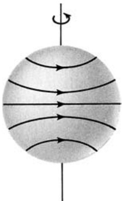

Fig. 3.1 Visualization of electron spin.

Thus the magnetic moment due to spin and that due to motion in the first Bohr orbit are exactly equal. Because it is such a fundamental quantity, this amount of magnetic moment is given a special symbol $\mu_{B}$ and a special name, the Bohr magneton. Thus,

$$
\begin{array}{r l} \mu_ {\mathrm{B}} & = \text {Bohr magneton} = e h / 4 \pi m c = 0. 9 2 7 \times 1 0 ^ {- 2 0} \text {erg / Oe (cgs)} \\ & = e h / 4 \pi m = 9. 2 7 \times 1 0 ^ {- 2 4} \text {A} \cdot \text {m} ^ {2} (\text {SI}) \\ & = \mu_ {0} e h / 4 \pi m = 1. 1 7 \times 1 0 ^ {- 2 9} \text {Wb} \cdot \text {m (SI)}. \end{array}\tag{3.6}
$$

It is a natural unit of magnetic moment, just as the electronic charge e is a natural unit of electric charge.

How can the magnetic moment due to spin be understood physically? We may, if we like, imagine an electron as a sphere with its charge distributed over its surface. Rotation of this charge produces an array of tiny current loops (Fig. 3.1), each of which has a magnetic moment directed along the rotation axis. But if we calculate the resultant moment of all these loops, we obtain the wrong answer, $(5 / 6)\mu_{\mathrm{B}}$ instead of $\mu_{B}$ . Nor does the right answer result from the assumption that the charge is uniformly distributed through the volume of the sphere. Such calculations are fruitless, because we do not know the shape of the electron or the way in which charge is distributed on or in it. The spin of the electron, and its associated magnetic moment, has to be accepted as a fact, consistent with wave mechanics and with a large number of experiments of various kinds, but with no basis in classical physics. The model of Fig. 3.1 is therefore only an aid to visualization; it has no quantitative significance.

## 3.3 MAGNETIC MOMENTS OF ATOMS

Atoms contain many electrons, each spinning about its own axis and moving in its own orbit. The magnetic moment associated with each kind of motion is a vector quantity, parallel to the axis of spin and normal to the plane of the orbit, respectively. The magnetic moment of the atom is the vector sum of all its electronic moments, and two possibilities arise:

1. The magnetic moments of all the electrons are so oriented that they cancel one another out, and the atom as a whole has no net magnetic moment. This condition leads to diamagnetism.

2. The cancellation of electronic moments is only partial and the atom is left with a net magnetic moment. Such an atom is often referred to, for brevity, as a magnetic atom. Substances composed of atoms of this kind are para-, ferro-, antiferro-, or ferrimagnetic.

To calculate the vector sum of the magnetic moments of all the electrons in any particular atom is a rather complex problem which is treated in any book on atomic physics. However, this problem is not particularly relevant here because the result applies only to the free atom, such as the atoms in a monatomic gas. The calculation from first principles of the net magnetic moment of an atom in a solid is, in general, not yet possible, and the net moment must be determined experimentally. This knowledge of atomic moments, obtained experimentally, is of great importance in the continued development of solid-state physics, entirely aside from its relevance to commercially important magnetic materials.

## 3.4 THEORY OF DIAMAGNETISM

A diamagnetic is a substance that exhibits, so to speak, negative magnetism. Even though it is composed of atoms which have no net magnetic moment, it reacts in a particular way to an applied field. The classical (nonquantum-mechanical) theory of this effect was first worked out by the French physicist Paul Langevin (1872–1946) in a noted paper published in 1905 [P. Langevin, Ann. Chemie et Physique, 5 (1905) p. 70–127]. He refined and made quantitative some ideas which had been earlier advanced by Ampére and by the German physicist Wilhelm Weber (1804–1891).

The theory considers that the effect of an applied field on a single electron orbit is to reduce the effective current of the orbit, and so to produce a magnetic moment opposing the applied field. This effect is summed over all the electrons in the atom, and each atom is regarded as acting independently of the others. The values of diamagnetic susceptibility calculated in this way generally agree with experimental values to better than a factor of 10, which suggests that the model is at least qualitatively correct. Nothing in the model suggests a strong temperature dependence of susceptibility, and this also agrees with the experiment.

## 3.5 DIAMAGNETIC SUBSTANCES

Electrons which constitute a closed shell in an atom usually have their spin and orbital moments oriented so that the atom as a whole has no net moment. Thus the monoatomic rare gases He, Ne, A, etc., which have closed-shell electronic structures, are all diamagnetic. So are most polyatomic gases, such as $H_{2}, N_{2}$ , etc., because the process of molecule formation usually leads to filled electron shells and no net magnetic moment per molecule.

The same argument explains the diamagnetism of ionic solids like NaCl. The process of bonding in this substance involves the transfer of an electron from each Na atom to each Cl atom; the resulting ions, $\mathrm{Na^{+}}$ and Cl $^{-}$ , then have closed shells and are both diamagnetic. Covalent bonding by the sharing of electrons also leads to closed shells, and elements like C (diamond), Si, and Ge are diamagnetic. Most organic compounds are diamagnetic, and magnetic measurements have furnished much useful information about the size and shape of organic molecules.

But not all gases are diamagnetic, nor are all ionic or covalent solids. Generalizations in this area are dangerous. The reader interested in further details should consult books on magnetochemistry such as A. F. Orchard, Magnetochemistry, Oxford University Press, (2003), which is a subject devoted to the relation between magnetic properties and the chemical bond. The behavior of the metals is particularly complex; most are paramagnetic, but some diamagnetic; they are discussed in Section 3.8.

Superconductors under some conditions are perfect diamagnets. They are treated in Chapter 16.

## 3.6 CLASSICAL THEORY OF PARAMAGNETISM

The first systematic measurements of the susceptibility of a large number of substances over an extended range of temperature were made by Pierre Curie1 and reported by him in 1895. He found that the mass susceptibility $\chi_{\mathrm{m}}$ was independent of temperature for diamagnetics, but that it varied inversely with the absolute temperature for paramagnetics:

$$
\chi_ {\mathrm{m}} = C / T.\tag{3.7}
$$

This relation is called the Curie law, and C is the Curie constant per gram. It was later shown that the Curie law is only a special case of a more general law,

$$
\chi_ {\mathrm{m}} = C / (T - \theta),\tag{3.8}
$$

called the Curie–Weiss law. Here $\theta$ is a constant, with the dimensions of temperature, for any one substance, and equal to zero for those substances which obey Curie’s law. Some authors write the denominator of Equation 3.8 as (T+$\theta$).

Curie’s measurements on paramagnetics went without theoretical explanation for 10 years, until Langevin in 1905 took up the problem in the same paper in which he presented his theory of diamagnetism. Qualitatively, his theory of paramagnetism is simple. He assumed a paramagnetic to consist of atoms, or molecules, each of which has the same net magnetic moment μ, because all the spin and orbital moments of the electrons do not cancel out. In the absence of an applied field, these atomic moments point at random and cancel one another, so that the magnetization of the specimen is zero. When a field is applied, there is a tendency for each atomic moment to turn toward the direction of the field; if no opposing force acts, complete alignment of the atomic moments would be produced and the specimen as a whole would acquire a very large moment in the direction of the field. But thermal agitation of the atoms opposes this tendency and tends to keep the atomic moments pointed at random. The result is only partial alignment in the field direction, and therefore a small positive susceptibility. The effect of an increase in temperature is to increase the randomizing effect of thermal agitation and therefore to decrease the susceptibility.

We will now consider the quantitative aspects of the theory in some detail, because the theory of paramagnetism leads naturally into the theory of ferro and ferrimagnetism.

We consider a unit volume of material containing n atoms, each having a magnetic moment μ. Let the direction of each moment be represented by a vector, and let all the vectors be drawn through the center of a sphere of unit radius. We wish to find the number dn of moments inclined at an angle between $\theta$ and $\theta + d\theta$ to the field $H$. In the absence of a field the number of μ vectors passing through unit area of the sphere surface is the same at any point on the sphere surface, and dn is proportional simply to the area $dA$ , which is given, as in Fig. 3.2, by 2p sinu $d\theta$ for a sphere of unit radius. But when a field is applied, the μ vectors all shift toward the direction of the field. Each atomic moment then has a certain potential energy $E_{p}$ in the field, given by Equation 1.5, so that

<small>1Pierre Curie (1859–1906) was a French physicist. He and his wife, Marie (Sklodowska) Curie (1867–1934), later became famous for their research on radioactivity.</small>

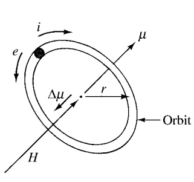

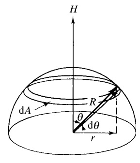

Fig. 3.2 Effect of field on orbital moment.

$$
E _ {\mathrm{p}} = - \mu H \cos \theta .\tag{3.9}
$$

In a state of thermal equilibrium at temperature T, the probability of an atom having an energy $E_{\mathrm{p}}$ is proportional to the Boltzmann factor $e^{-\bar{E}_{\mathrm{p}} / kT}$ where $k$ is the Boltzmann constant. The number of moments between $\theta$ and $\theta + \mathrm{d}\theta$ will now be proportional to dA, multiplied by the Boltzmann factor, or

$$
d n = K d A e ^ {- E _ {\mathrm{p}} / k T} = 2 \pi K e ^ {(\mu H \cos \theta) / k T} \sin \theta d \theta ,\tag{3.10}
$$

where K is a proportionality factor, determined by the fact that

$$
\int_ {0} ^ {n} d n = n.
$$

For brevity we put $a = \mu H / kT$ . We then have

$$
2 \pi K \int_ {0} ^ {\pi} e ^ {a \cos \theta} \sin \theta   d \theta = n.\tag{3.11}
$$

The total magnetic moment in the direction of the field acquired by the unit volume under consideration, that is, the magnetization $M$, is given by multiplying the number of atoms dn by the contribution mcosu of each atom and integrating over the total number:

$$
M = \int_ {0} ^ {n} \mu \cos \theta   d n.
$$

Substituting Equations 3.10 and 3.11 into this expression, we have

$$
\begin{array}{r l} M & = 2 \pi K \mu \int_ {0} ^ {\pi} e ^ {a \cos \theta} \sin \theta \cos \theta d \theta \\ & = \frac {n \mu \int_ {0} ^ {\pi} e ^ {a \cos \theta} \sin \theta \cos \theta d \theta}{\int_ {0} ^ {\pi} e ^ {a \cos \theta} \sin \theta d \theta} \end{array}
$$

To evaluate these integrals, we put $x = \cos \theta$ and $dx = -\sin \theta d\theta .$ Then

$$
\begin{array}{l} M = \frac {n \mu \int_ {1} ^ {- 1} x e ^ {a x} d x}{\int_ {1} ^ {- 1} e ^ {a x} d x} \\ \quad = n \mu \bigg (\frac {e ^ {a} + e ^ {- a}}{e ^ {a} - e ^ {- a}} - \frac {1}{a} \bigg) = n \mu \bigg (\coth a - \frac {1}{a} \bigg). \end{array}\tag{3.12}
$$

But $n\mu$ is the maximum possible moment which the material can have. It corresponds to perfect alignment of all the atomic magnets parallel to the field, which is a state of complete saturation. Calling this quantity $M_{0},$ we have

$$
\frac {M}{M _ {0}} = \coth a - \frac {1}{a}.\tag{3.13}
$$

The expression on the right is called the Langevin function, usually abbreviated to L(a). Expressed as a series, it is

$$
\mathrm{L} (a) = \frac {a}{3} - \frac {a ^ {3}}{4 5} + \frac {2 a ^ {5}}{9 4 5} - \dots\tag{3.14}
$$

which is valid only for $a \leq 1. \mathrm{~L}(a)$ as a function of a is plotted in Fig. 3.3. At large a, L(a) tends to 1; and for a less than about 0.5, it is practically a straight line with a slope of $\frac{1}{3}$ as seen in Equation 3.14.

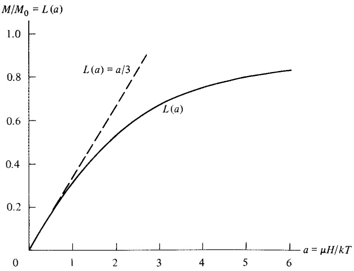

Fig. 3.3 Langevin function.

The Langevin theory leads to two conclusions:

1. Saturation will occur if a $(= \mu H / kT)$ is large enough. This makes good physical sense, because large $H$ or low T, or both, is necessary if the aligning tendency of the field is going to overcome the disordering effect of thermal agitation.

2. At small a, the magnetization $M$ varies linearly with $H$. As we shall see presently, a is small under “normal” conditions, and linear $M$, $H$ curves are observed, like that of Fig. 1.13b.

The Langevin theory also leads to the Curie law. For small a, $\mathrm{L}(a) = a / 3$ , and Equation 3.12 becomes

$$
M = \frac {n \mu a}{3} = \frac {n \mu^ {2} H}{3 k T}.\tag{3.15}
$$

Therefore,

$$
\chi_ {\mathrm{v}} = \frac {M}{H} = \frac {n \mu^ {2}}{3 k T},\tag{3.16}
$$

$$
\chi_ {\mathrm{m}} = \frac {\chi_ {\mathrm{v}}}{\rho} = \frac {n \mu^ {2}}{3 \rho k T}.
$$

where ρ is density. But $n$, the number of atoms per unit volume, is equal to $N\rho /A$ where $N$ is atoms/mol (Avogadro’s number), ρ is density, and $A$ is atomic weight. Therefore,

$$
\chi_ {\mathrm{v}} = \frac {N \mu^ {2}}{3 A k T} = \frac {C}{T} \frac {\mathrm{emu}}{\mathrm{cm} ^ {3} \mathrm{Oe}} (\mathrm{cgs}) \text {or} \frac {\mathrm{Am} ^ {2}}{\mathrm{m} ^ {3} \mathrm{Am} ^ {- 1}} [ \text {dimensionless} ] (\mathrm{SI})
$$

and

$$
\chi_ {\mathrm{m}} = \frac {N \mu^ {2}}{\rho 3 A k T} = \frac {C}{\rho T} \frac {\mathrm{emu}}{\mathrm{gOe}} (\mathrm{cgs}) \text {or} \frac {\mathrm{Am} ^ {2}}{\mathrm{kgAm} ^ {- 1}} = \frac {\mathrm{m} ^ {3}}{\mathrm{kg}} (\mathrm{SI})\tag{3.17}
$$

which is Curie’s law, with the Curie constant given by

$$
C = \frac {N \mu^ {2}}{3 A k}.\tag{3.18}
$$

The net magnetic moment μ per atom may be calculated from experimental data by means of Equation 3.17. Consider oxygen, for example. It is one of the few gases which is paramagnetic; it obeys the Curie law and has a mass susceptibility of

$$
\begin{array}{l} \chi_ {\mathrm{m}} = 1. 0 8 \times 1 0 ^ {- 4} \frac {\mathrm{emu}}{\mathrm{gOe}} (\mathrm{cgs}) \\ \chi_ {\mathrm{m}} = 1. 3 6 \times 1 0 ^ {- 6} \frac {\mathrm{J/T}}{\mathrm{kgAm} ^ {- 1}} \text {or} \frac {\mathrm{Am} ^ {2}}{\mathrm{kgAm} ^ {- 1}} \text {or} \frac {\mathrm{m} ^ {3}}{\mathrm{kg}} (\mathrm{SI}) \end{array}
$$

at $20^{\circ}\mathrm{C}$ . Therefore, writing $M'$ (molecular weight) instead of $A$ (atomic weight) in Equation 3.17 because the constituents of oxygen are molecules, we have

$$
\begin{array}{l} \mu = \left(\frac {3 M ^ {\prime} k T \chi}{N}\right) ^ {1 / 2} \\ = \left[ \frac {(3) (3 2 \mathrm{g/mole}) (1 . 3 8 \times 1 0 ^ {- 1 6} \mathrm{erg/K}) (2 9 3 \mathrm{K}) (1 . 0 8 \times 1 0 ^ {- 4} \mathrm{emu/gOe})}{6 . 0 2 \times 1 0 ^ {2 3} \text {molecules / mole}} \right] ^ {1 / 2} (\mathrm{cgs}) \\ = \left[ \frac {(3) (0 . 0 3 2 \mathrm{kg/mole}) (1 . 3 8 \times 1 0 ^ {- 2 3} \mathrm{J/K}) (2 9 3 \mathrm{K}) (1 . 3 6 \times 1 0 ^ {- 6} (\mathrm{J/T}) / (\mathrm{kgAm} ^ {- 1}))}{(6 . 0 2 \times 1 0 ^ {2 3} \text {molecules / mole}) (4 \pi \times 1 0 ^ {- 7} \mathrm{T/Am} ^ {- 1})} \right] ^ {1 / 2} \\ = 2. 6 4 \times 1 0 ^ {- 2 0} \text {erg / Oe per molecule (cgs)} \\ = 2. 6 4 \times 1 0 ^ {- 2 3} \mathrm{Am} ^ {2} / \text {molecule or J / T per molecule (SI)} \end{array}\tag{SI}
$$

and dividing by the value of the Bohr magneton $\mu_{B}$

$$
= \frac {2 . 6 4 \times 1 0 ^ {- 2 0}}{0 . 9 2 7 \times 1 0 ^ {- 2 0}} \text {or} \frac {2 . 6 4 \times 1 0 ^ {- 2 3}}{0 . 9 2 7 \times 1 0 ^ {- 2 3}} = 2. 8 5 \mu_ {\mathrm{B}} \text {per molecule}.
$$

This value of μ is typical. Even in heavy atoms or molecules containing many electrons, each with orbital and spin moments, most of the moments cancel out and leave a net magnetic moment of only a few Bohr magnetons.

We can now calculate a and justify our assumption that it is small. Typically, $H$ is about 10,000 Oe or 1T or 800 kA/m in susceptibility measurements. Therefore, at room temperature,

$$
\begin{array}{r l} a = & \frac {\mu H}{k T} = \frac {(2 . 6 4 \times 1 0 ^ {- 2 0} \mathrm{erg/Oe}) (1 0 ^ {4} \mathrm{Oe})}{(1 . 3 8 \times 1 0 ^ {- 1 6} \mathrm{erg/K}) (2 9 3 \mathrm{K})} \\ = & 0. 0 0 6 5, \end{array}
$$

which is a value small enough so that the Langevin function L(a) can be replaced by a/3 The effect of even very strong fields in aligning the atomic moments of a paramagnetic is very feeble compared to the disordering effect of thermal energy at room temperature. For example, there are N/32 oxygen molecules per gram, each with a moment of $2.64\times10^{-20}$ emu. If complete alignment could be achieved, the specific magnetization s of oxygen would be $(6.02 \times 10^{23} / 32)(2.64 \times 10^{-20})$ , or 497 emu /g (cgs), $(6.02\times 10^{-23} / 0.032)(2.64\times 10^{-23}) = 497\mathrm{Am}^2 /\mathrm{kg}$ (SI) . This value is more than double that of saturated iron. But the magnetization acquired in a field as strong as 100,000 Oe or 10 T or 8 MA/m at room temperature is only $\sigma = \chi H = (1.08\times 10^{-4})(10^{5}) = 10.8\mathrm{emu / g(cgs)} =$ $(1.36 \times 10^{-6})(8 \times 10^{6}) = 10.9 \mathrm{~Am}^{2} / \mathrm{kg}$ (SI), about 2% of the saturation value.

There is nothing in our previous discussion of the diamagnetic effect to indicate that it was restricted to atoms with no net magnetic moment. In fact, it is not; the diamagnetic effect occurs in all atoms, whether or not they have a net moment. A calculation of the susceptibility of a paramagnetic should therefore be corrected by subtracting the diamagnetic contribution from the value given by Equation 3.17. This correction is usually small (of the order of $-0.5 \times 10^{-6} \mathrm{emu/g Oe})$ and can often be neglected in comparison to the paramagnetic term.

The Langevin theory of paramagnetism, which leads to the Curie law, is based on the assumption that the individual carriers of magnetic moment (atoms or molecules) do not interact with one another, but are acted on only by the applied field and thermal agitation. Many paramagnetics, however, do not obey this law; they obey instead the more general Curie –Weiss law,

$$
\chi_ {\mathrm{m}} = \frac {C}{(T - \theta)}.\tag{3.19}
$$

In 1907 Weiss $^{2}$ in the J. de Physique 6 (1907) pp. 66–690 pointed out that this behavior could be understood by postulating that the elementary moments do interact with one another. He suggested that this interaction could be expressed in terms of a fictitious internal field which he called the “molecular field” $H_{\mathrm{m}}$ and which acted in addition to the applied field $H$. The molecular field was thought to be in some way caused by the magnetization of the surrounding material. (If Weiss had advanced his hypothesis some 10 years later, he would probably have called $H_{\mathrm{m}}$ the “atomic” field. X-ray diffraction was first observed in 1912, and by about 1917 diffraction experiments had shown that all metals and simple inorganic solids were composed of atoms, not molecules.)

Weiss assumed that the intensity of the molecular field was directly proportional to the magnetization:

$$
H _ {\mathrm{m}} = \gamma M,\tag{3.20}
$$

where γ is called the molecular field constant. Therefore, the total field acting on the material is

$$
H _ {\mathrm{t}} = H + H _ {\mathrm{m}}.\tag{3.21}
$$

Curie’s law may be written

$$
\chi_ {\mathrm{m}} = \frac {M}{\rho H} = \frac {C}{T}.
$$

H in this expression must now be replaced by $H_{\mathrm{t}}$

$$
\frac {M}{\rho (H + \gamma M)} = \frac {C}{T}.
$$

Solving for $M$, we find

$$
M = \frac {\rho C H}{T - \rho C \gamma}.
$$

<small>2Pierre Weiss (1865–1940), French physicist deserves to be called the “Father of Modern Magnetism” because almost the whole theory of ferromagnetism is due to him, and his ideas also permeate the theory of ferrimagnetism. Most of his work was done at the University of Strasbourg.</small>

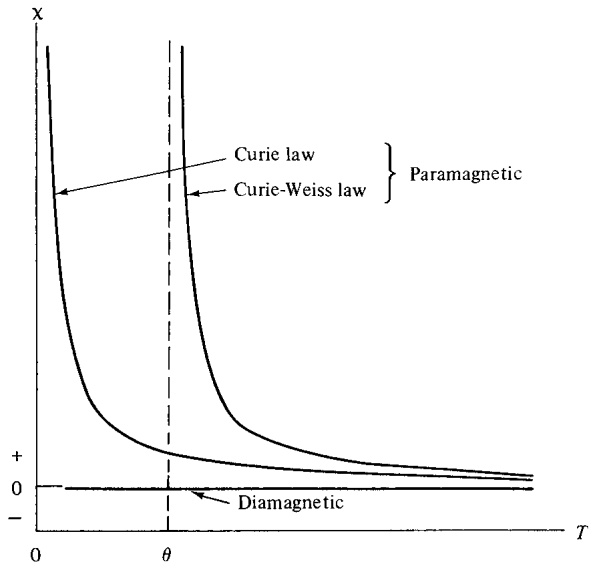

Fig. 3.4 Variation of mass susceptibility with absolute temperature for para- and diamagnetics.

Therefore,

$$
\chi_ {\mathrm{m}} = \frac {M}{\rho H} = \frac {C}{T - \rho C \gamma} = \frac {C}{T - \theta}.\tag{3.22}
$$

Therefore, $\theta (= \rho C\gamma)$ is a measure of the strength of the interaction because it is proportional to the molecular field constant γ. For substances that obey Curie’s law, $\theta = \gamma = 0$

Figure 3.4 shows how χ varies with T for para- and diamagnetics. If we plot $1 / \chi$ versus T for a paramagnetic, a straight line will result; this line will pass through the origin (Curie behavior) or intercept the temperature axis at $T = \theta$ (Curie–Weiss behavior). Data for two paramagnetics which obey the Curie–Weiss law are plotted in this way in Fig. 3.5, and we note that both positive and negative values of θ are observed, positive for MnCl2 and negative for $\mathrm{FeSO}_{4}$ . Many paramagnetics obey the Curie–Weiss law with small values of θ, of the order of 10 K or less. A positive value of θ, as illustrated in Fig. 3.5, indicates that the molecular field is aiding the applied field and therefore tending to make the elementary magnetic moments parallel to one another and to the applied field. Other things being equal, the susceptibility is then larger than it would be if the molecular field were absent. If $\theta$ is negative, the molecular field opposes the applied field and tends to decrease the susceptibility.

It is important to note that the molecular field is in no sense a real field; it is rather a force, which tends to align or disalign the atomic or molecular moments. The strength of this force depends on the amount of alignment already attained, because the molecular field is proportional to the magnetization. Further discussion of the molecular field will be deferred to the next chapter.

Early in this section it was stated that the effect of an applied field on the atomic or molecular “magnets” was to turn them toward the direction of the field. This statement requires qualification, because the effect of the field is not just a simple rotation, like that of a compass needle exposed to a field not along its axis. Instead, there is a precession of the atomic moments about the applied field, because each atom possesses a certain amount of angular momentum as well as a magnetic moment. This behavior is analogous to that of a spinning top. If the top in Fig. 3.6a is not spinning, it will simply fall over because of the torque exerted by the force of gravity $F$ about its point of support $A$. But if the top is spinning about its axis, it has a certain angular momentum about that axis; the resultant of the gravitational torque and the angular momentum is a precession of the axis of spin about the vertical, with no change in the angle of inclination $\theta$. In an atom, each electron has angular momentum by virtue of its spin and its orbital motion, and these momenta combine vectorially to give the atom as a whole a definite angular momentum. We might then roughly visualize a magnetic atom as a spinning sphere, as in Fig. 3.6b, with its magnetic moment vector and angular momentum vector both directed along the axis of spin. A magnetic field $H$ exerts a torque on the atom because of the atom’s magnetic moment, and the resultant of this torque and the angular momentum is a precession about $H$. If the atom were isolated, the only effect of an increase in $H$ would be an increase in the rate of precession, but no change in $\theta$. However, in a specimen containing many atoms, all subjected to thermal agitation, there is an exchange of energy among atoms. When a field is applied, this exchange of energy disturbs the precessional motion enough so that the value of $\theta$ for each atom decreases slightly, until the distribution of $\theta$ values becomes appropriate to the existing values of field and temperature.

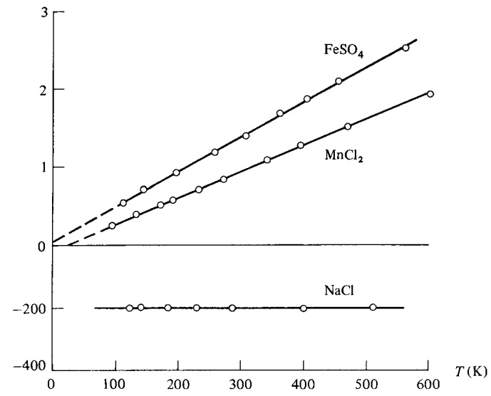

Fig. 3.5 Reciprocal mass susceptibilities of one diamagnetic and two paramagnetic compounds. Note change of vertical scale at the origin.

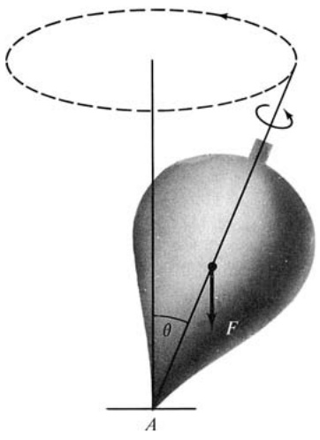

(a)

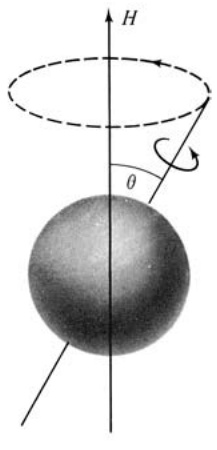

(b)

Fig. 3.6 Precession of (a) a spinning top in a gravitational field, and (b) a magnetic atom in a magnetic field.

## 3.7 QUANTUM THEORY OF PARAMAGNETISM

The main conclusions of the classical theory are modified by quantum mechanics, but not radically so. We will find that quantum theory greatly improves the quantitative agreement between theory and experiment without changing the qualitative features of the classical theory.

The central postulate of quantum mechanics is that the energy of a system is not continuously variable. When it changes, it must change by discrete amounts, called quanta, of energy. If the energy of a system is a function of an angle, then that angle can undergo only discontinuous stepwise changes. This is precisely the case in a paramagnetic substance, where the potential energy of each atomic moment μ in a field $H$ is given by $-\mu H$ cos $\theta$. In the classical theory, the energy, and hence u, is regarded as a continuous variable, and μ can lie at any angle to the field. In quantum theory, $\theta$ is restricted to certain definite values $\theta_{1},\theta_{2},\ldots$ , and intermediate values are not allowed. This restriction is called space quantization, and is illustrated schematically in Fig. 3.7, where the arrows indicate atomic moments. The classical case is shown in Fig. 3.7a, where the moments can have any direction in the shaded area; Figs. 3.7b and c illustrate two quantum possibilities, in which the moments are restricted to two and five directions, respectively. The meaning of J is given later.

The rules governing space quantization are usually expressed in terms of angular momentum rather than magnetic moment. We must therefore consider the relation between the two, first for orbital and then for spin moments. The orbital magnetic moment for an electron in the first Bohr orbit is, from Equation 3.4,

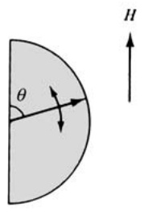

(a)

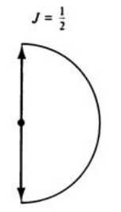

(b)

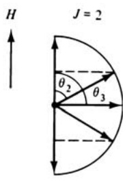

(c)

Fig. 3.7 Space quantization: (a) classical, (b) and (c), two quantum possibilities.

$$
\mu_ {\mathrm{orbit}} = \frac {e h}{4 \pi m c} = \frac {e}{2 m c} \left(\frac {h}{2 \pi}\right) (\mathrm{cgs})
$$

$$
\mu_ {\mathrm{orbit}} = \frac {e h}{4 \pi m} = \frac {e}{2 m} \left(\frac {h}{2 \pi}\right) (\mathrm{SI})
$$

If we write the corresponding angular momentum $h / 2\pi$ as p, we have

$$
\mu_ {\mathrm{orbit}} = \frac {e}{2 m c} (p _ {\mathrm{orbit}}) (\mathrm{cgs}) \text {or} \frac {e}{2 m n} (p _ {\mathrm{orbit}}) (\mathrm{SI})\tag{3.23}
$$

The angular momentum due to spin is sh/2π where s is a quantum number equal to $\frac{1}{2}$ Therefore, from Equation 3.5,

$$
\begin{array}{l} \mu_ {\mathrm{spin}} = \frac {e h}{4 \pi m c} = \frac {e}{m c} \left(\frac {h}{4 \pi}\right) = \frac {e}{m c} (p _ {\mathrm{spin}}) (\mathrm{cgs}), \\ \mu_ {\mathrm{spin}} = \frac {e h}{4 \pi m} = \frac {e}{m} \left(\frac {h}{4 \pi}\right) = \frac {e}{m} (p _ {\mathrm{spin}}) (\mathrm{SI}) \end{array}\tag{3.24}
$$

Therefore the ratio of magnetic moment to angular momentum for spin is twice as great as it is for orbital motion. The last two equations can be combined into one general relation between magnetic moment μ and angular momentum p by introducing a quantity g:

$$
\begin{array}{l} \mu = g (e / 2 m c) (p) (\mathrm{cgs}) \\ \mu = g (e / 2 m) (p) (\mathrm{SI}) \end{array}\tag{3.25}
$$

where $g = 1$ for orbital motion and $g = 2$ for spin. The factor g is called (for historical reasons) the spectroscopic splitting factor, or g factor.

In an atom composed of many electrons the angular momenta of the variously oriented orbits combine vectorially to give the resultant orbital angular momentum of the atom, which is characterized by the quantum number L. Similarly, the individual electron spin momenta combine to give the resultant spin momentum, described by the quantum number S. Finally, the orbital and spin momenta of the atom combine to give the total angular momentum of the atom, described by the quantum number J. Then the net magnetic moment of the atom, usually called the effective moment $\mu_{\mathrm{eff}}$ , is given in terms of g and J, as we might expect by analogy with Equation 3.25. The relation is

$$
\begin{array}{l} \mu_ {\mathrm{eff}} = g \left(\frac {e h}{4 \pi m c}\right) \sqrt {J (J + 1)} \mathrm{erg/Oe, (cgs)} \\ \mu_ {\mathrm{eff}} = g \left(\frac {e h}{4 \pi m}\right) \sqrt {J (J + 1)} \frac {\mathrm{J}}{\mathrm{T}} \text {or Am} ^ {2} (\mathrm{SI}) \\ \mu_ {\mathrm{eff}} = g \sqrt {J (J + 1)} \mu_ {\mathrm{B}}. \end{array}\tag{3.26}
$$

The moment may be said to consist of an effective number $n_{\mathrm{eff}}$ of Bohr magnetons:

$$
n _ {\mathrm{eff}} = g \sqrt {J (J + 1)}.
$$

Because of spatial quantization the effective moment can point only at certain discrete angles $\theta_{1},\theta_{2},\ldots$ to the field. Rather than specify these angles, we specify instead the possible values of $\mu_{\mathrm{H}}$ , the component of $\mu_{eff}$ in the direction of the applied field $H$. These possible values are

$$
\mu_ {\mathrm{H}} = g M _ {J} \mu_ {\mathrm{B}},\tag{3.27}
$$

where $M_{J}$ is a quantum number associated with J. For an atom with a total angular momentum J, the allowed values of $M_{J}$ are

$$
J, J - 1, J - 2, \dots , - (J - 2), - (J - 1), - J,
$$

and there are $(2J + 1)$ numbers in this set. For example, if $J = 2$ for a certain atom, the effective moment has five possible directions, and the component $\mu_{\mathrm{H}}$ in the field direction must have one of the following five values:

$$
2 g \mu_ {\mathrm{B}}, g \mu_ {\mathrm{B}}, 0, - g \mu_ {\mathrm{B}}, - 2 g \mu_ {\mathrm{B}}.
$$

This is the case illustrated in Fig. 3.7c.

The maximum value of $\mu_{H}$ is

$$
\mu_ {\mathrm{H}} = g J \mu_ {\mathrm{B}},\tag{3.28}
$$

and the symbol $\mu_{H}$ if not otherwise qualified, is assumed to stand for this maximum value. [The moments given by Equations 3.23–3.25 are $\mu_{\mathrm{H}}$ values.] The relation between $\mu_{\mathrm{H}}$ and $\mu_{\mathrm{eff}}$ is shown in Fig. 3.8.

The value of J for an atom may be an integer or a half-integer, and the possible values range from $J = \frac{1}{2}$ to $J = \infty$ . These extreme values have the following meanings:

1. $J = \frac{1}{2}.$ This corresponds to pure spin, with no orbital contribution $(L = 0.$ $J = \bar{S} = \frac{1}{2})$ , so that $g = 2$ . Since the permissible values of $M_{J}$ decrease from +J to $-J$ in steps of unity, these values are simply $+\frac{1}{2}$ and $- \frac { 1 } { 2 }$ for this case. The corresponding resolved moments $\mu_{H}$ are then $\mu_{B}$ and $-\mu_{\mathrm{B}}$ , parallel and antiparallel to the field, as illustrated in Fig. 3.7b.

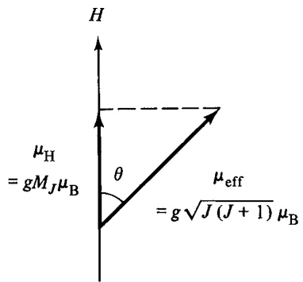

Fig. 3.8 Relationship between effective moment and its component in the field direction.

2. $J = \infty$ . Here there are an infinite number of J values, corresponding to an infinite number of moment orientations. This is equivalent to the classical distribution of Fig. 3.7a.

To compute $\mu_{H}$ or $\mu_{\mathrm{eff}}$ we must know g, as well as J, for the atom in question. The g factor is given by the Landé equation:

$$
g = 1 + \frac {J (J + 1) + S (S + 1) - L (L + 1)}{2 J (J + 1)}.\tag{3.29}
$$

If there is no net orbital contribution to the moment, $L = 0$ and $J = S.$ Then Equation 3.29 gives $g = 2$ whatever the value of J. On the other hand, if the spins cancel out, then $S = 0$ $J = L$ , and $g = 1$ . The g factors of most atoms lie between 1 and 2, but values outside this range are sometimes encountered.

At this point the calculation of the net magnetic moment of an atom would seem straightforward, simply by a combination of Equations 3.29 and 3.28. However, the values of J, L, and S are known only for isolated atoms; it is, in general, impossible to calculate μ for the atoms of a solid, unless certain simplifying assumptions are made. One such assumption, valid for many substances, is that there is no orbital contribution to the moment, so that $J = S$ . The orbital moment is, in such cases, said to be quenched. This condition results from the action on the atom or ion considered of the electric field, called the crystalline or crystal field, produced by the surrounding atoms or ions in the solid. This field has the symmetry of the crystal involved. Thus the electron orbits in a particular isolated atom might be circular, but when that atom forms part of a cubic crystal, the orbits might become elongated along three mutually perpendicular axes because of the electric fields created by the adjoining atoms located on these axes. In any case, the orbits are in a sense bound, or “coupled,” rather strongly to the crystal lattice. The spins, on the other hand, are only loosely coupled to the orbits. Thus, when a magnetic field is applied along some arbitrary direction in the crystal, the strong orbit– lattice coupling often prevents the orbits, and their associated orbital magnetic moments, from turning toward the field direction, whereas the spins are free to turn because of the relatively weak spin–orbit coupling. The result is that only the spins contribute to the magnetization process and the resultant magnetic moment of the specimen; the orbital moments act as though they were not there. Quenching may be complete or partial.

Fortunately, it is possible to measure g for the atoms of a solid, and such measurements tell us what fraction of the total moment, which is also measurable, is contributed by spin and what fraction by orbital motion. Experimental g factors will be given later.

## 3.7.1 Gyromagnetic Effect

Two entirely different kinds of experiments are available for the determination of g. The first involves the gyromagnetic effect, which depends on the fact that magnetic moments and angular momenta are coupled together; whatever is done to change the direction of one will change the direction of the other. From the magnitude of the observed effect a quantity $g'$ called the magnetomechanical factor or $g'$ factor, can be calculated. The g

factor can then be found from the relation

$$
\frac {1}{g} + \frac {1}{g ^ {\prime}} = 1.\tag{3.30}
$$

If the magnetic moment is due entirely to spin, then $g = g^{\prime} = 2$ . If there is a small orbital contribution, g is somewhat larger than 2 and $g'$ somewhat smaller.

Two methods of measuring the gyromagnetic effect, and thus the value of $g'$ , have been successful:

1. Einstein–de Haas Method. A rod of the material to be investigated is suspended vertically by a fine wire and surrounded by a magnetizing solenoid. If a field is suddenly applied along the axis of the rod, the atomic moments will turn toward the axis. But this will also turn the angular momentum vectors toward the axis. Since angular momentum cannot be created except by external torques, this increase in the axial component of momentum of the atoms must be balanced by an increase, in the opposite direction, of the momentum of the bar as a whole. The result is a rotation of the bar through a very small angle, from which the value of $g'$ can be computed. The experiment is extremely difficult with a ferromagnetic rod, and even more so with a paramagnetic, because the size of the observed effect depends mainly on the magnetization that can be produced in the specimen.

2. Barnett Method. The specimen, again in the form of a rod, is very rapidly rotated about its axis. The angular momentum vectors therefore turn slightly toward the axis of rotation and cause the magnetic moments to do the same. The rod therefore acquires a very slight magnetization along its axis, from which $g'$ can be calculated.

The two methods may be described as “rotation by magnetization” and “magnetization by rotation.” Detailed accounts of both are given by L. F. Bates in Modern Magnetism, Cambridge University Press (1961). These are difficult experiments, and the results of various authors do not always agree. The available values were almost all published before 1950.

## 3.7.2 Magnetic Resonance

The second kind of experiment is magnetic resonance, which measures g directly. The specimen is placed in the strong field $H_{z}$ of an electromagnet, acting along the z-axis. It is also subjected to a weak field $H_{x}$ acting at right angles, along the x-axis; $H_{x}$ is a highfrequency alternating field generally in the microwave region near 10 GHz. The atomic moments precess around $H_{z}$ at a rate dependent on g and $H_{z}$ Energy is absorbed by the specimen from the alternating field $H_{x},$ and, if the intensity of $H_{z}$ or the frequency n of $H_{x}$ is slowly varied, a point will be found at which the energy absorption rises to a sharp maximum. In this resonant state the frequency n equals the frequency of precession, and both are proportional to the product $gH_{z}$ from which g may be calculated.

Assuming that g and J are known for the atoms involved, we can proceed to calculate the total magnetization of a specimen as a function of the field and temperature. The procedure is the same as that followed in deriving the classical (Langevin) law, except that:

1. The quantized component of magnetic moment in the field direction $\mu_{\mathrm{H}}(= gM_J\mu_{\mathrm{B}})$ replaces the classical term μ cos $\theta$.

2. A summation over discrete moment orientations replaces an integration over a continuous range of orientations.

The potential energy of each moment in the field $H$ is

$$
E _ {p} = - g M _ {J} \mu_ {\mathrm{B}} H,\tag{3.31}
$$

which is the counterpart of Equation 3.9. According to Boltzmann statistics, the probability of an atom having an energy $E_{p}$ is proportional to

$$
e ^ {- E _ {p} / k T} = e ^ {g M _ {J} \mu_ {\mathrm{B}} H / k T}
$$

If there are n atoms per unit volume, the magnetization $M$ is given by the product of n and the average magnetic moment resolved in the direction of the field, or

$$
M = n \frac {\sum g M _ {J} \mu_ {\mathrm{B}} e ^ {g M _ {J} \mu_ {\mathrm{B}} H / k T}}{\sum e ^ {g M _ {J} \mu_ {\mathrm{B}} H / k T}},\tag{3.32}
$$

where the summations are over $M_{J}$ and extend from $-J \text{ to } + J.$ After considerable manipulation, this reduces to

$$
M = n g J \mu_ {\mathrm{B}} \left[ \frac {2 J + 1}{2 J} \coth \left(\frac {2 J + 1}{2 J}\right) a ^ {\prime} - \frac {1}{2 J} \coth \frac {a ^ {\prime}}{2 J} \right],\tag{3.33}
$$

where

$$
a ^ {\prime} = \frac {g J \mu_ {\mathrm{B}} H}{k T} = \frac {\mu_ {\mathrm{H}} H}{k T}.
$$

But $ngJ\mu_{\mathrm{B}} = n\mu_{\mathrm{H}}$ , which is the product of the number of atoms per unit volume and the maximum moment of each atom in the direction of the field. Therefore $n\mu_{\mathrm{H}} = M_{0}$ the saturation magnetization, and

$$
\frac {M}{M _ {0}} = \frac {2 J + 1}{2 J} \coth \left(\frac {2 J + 1}{2 J}\right) a ^ {\prime} - \frac {1}{2 J} \coth \frac {a ^ {\prime}}{2 J}.\tag{3.34}
$$

The expression on the right is called the Brillouin function and was first obtained in 1927. It is abbreviated $B(J,a^{\prime})$

When $J = \infty$ , the classical distribution, the Brillouin function reduces to the Langevin function:

$$
\frac {M}{M _ {0}} = \coth a ^ {\prime} - \left(\frac {1}{a ^ {\prime}}\right).\tag{3.35}
$$

When $J = \frac{1}{2},$ so that the magnetic moment consists of one spin per atom, the Brillouin function reduces to

$$
\frac {M}{M _ {0}} = \tanh \left(a ^ {\prime}\right)\tag{3.36}
$$

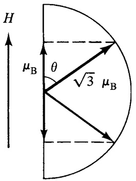

Fig. 3.9 Vector relations for $J = \frac{1}{2}.$

A direct derivation of this last equation may clarify some of the physics involved. When $J = \frac{1}{2}$ the effective moment, given by Equation 3.26, is

$$
2 \sqrt {\left(\frac {1}{2}\right) \left(\frac {3}{2}\right)} \mu_ {\mathrm{B}} \quad \text {or} \quad \sqrt {3} \mu_ {\mathrm{B}}.
$$

The component of this in the field direction is, according to Equation 3.28, $2\left(\frac{1}{2}\right)\mu_{\mathrm{B}}$ or $\mu_{B}$ Note that J is always less than $\sqrt{J(J + 1)}$ , so that $\mu_{H}$ is always less than $\mu_{\mathrm{eff}}$ This means that the moment is never parallel to the field direction, even when J is large, and that drawings like Figs. 3.7b and c, which show such parallelism, are, strictly speaking, incorrect. The true situation is shown in Fig. 3.9, for $J = \frac{1}{2}$ where $\theta = 54.7^{\circ}$ . Nevertheless, a drawing like Fig. 3.7b is a conventional description, and so is loose language like “spins parallel and antiparallel to the field,” or, more briefly, “spins up and spins down.”

Let $n_{+}$ and $n_{-}$ equal the numbers of atoms (per unit volume) with spins parallel and antiparallel to the field. The corresponding potential energies are $-\mu_{\mathrm{B}}H$ and $+ \mu_{\mathrm{B}} H.$ Then

$$
n _ {+} = b e ^ {\mu_ {\mathrm{B}} H / k T} \quad \text { and } \quad n _ {-} = b e ^ {- \mu_ {\mathrm{B}} H / k T},\tag{3.37}
$$

where b is a proportionality constant. Thus, at constant temperature, the number of atoms with spin-up increases as the field increases, and the number of atoms with spin-down decreases. We say loosely that the field has caused some of the spins to “flip over.” The total number of atoms per unit volume is

$$
n = n _ {+} + n _ {-} = b \Big (e ^ {\mu_ {\mathrm{B}} H / k T} + e ^ {- \mu_ {\mathrm{B}} H / k T} \Big).\tag{3.38}
$$

The average magnetic moment in the field direction is

$$
(\mu_ {\mathrm{H}}) _ {\mathrm{av}} = \frac {n _ {+} (\mu_ {\mathrm{B}}) + n _ {-} (- \mu_ {\mathrm{B}})}{n}.\tag{3.39}
$$

Combining the previous equations yields the magnetization

$$
\begin{array}{l} M = n (\mu_ {\mathrm{H}}) _ {\mathrm{av}}, \\ M = n \mu_ {\mathrm{B}} \frac {e ^ {\mu_ {\mathrm{B}} H / k T} - e ^ {- \mu_ {\mathrm{B}} H / k T}}{e ^ {\mu_ {\mathrm{B}} H / k T} + e ^ {- \mu_ {\mathrm{B}} H / k T}}, \\ M = M _ {0} \tanh \frac {\mu_ {\mathrm{B}} H}{k T}, \\ \frac {M}{M _ {0}} = \tanh a ^ {\prime}. \end{array}\tag{3.40}
$$

which reproduces Equation 3.36.

The Brillouin function, like the Langevin, is zero for $a'$ equal to zero and tends to unity as $a'$ becomes large. However, the shape of the curve in between depends on the value of J for the atom involved. Moreover, the quantity a in the classical theory differs from the corresponding quantity $a'$ in the quantum theory:

$$
(\text {classical}) \quad a = \mu H / k T,\tag{3.41}
$$

$$
(\text {quantum}) \quad a ^ {\prime} = \mu_ {\mathrm{H}} H / k T.\tag{3.42}
$$

In the classical theory, μ is the net magnetic moment of the atom. The quantity which corresponds to this in quantum theory is the effective moment $\mu_{\mathrm{eff}}$ and not its component $\mu_{\mathrm{H}}$ on the field direction. The parameters a and $a'$ therefore have distinctly different physical meanings.

When $H$ is large enough and T low enough, a paramagnetic can be saturated, and we can then compare the experimental results with the predictions of classical and quantum theory. For example, W. E. Henry [Phys. Rev., 88 (1952) p. 559] measured the magnetization of potassium chromium alum, $\mathrm{KCr(SO_4)_2\cdot 12H_2O}$ at fields up to 50,000 Oe and at temperatures of 4.2 K (liquid helium) and below. The only magnetic atom, or rather ion, in this compound is the $\mathrm{Cr^{3+}}$ ion. The quantum numbers for this ion in the free state are $J = \frac{3}{2}, L = 3, S = \frac{3}{2},$ which lead to $g = \frac{2}{5},$ as the reader can verify from Equation 3.30. The magnetic moment per molecule, or per chromium ion, is then given by Equation 3.31:

$$
M / n = g J B (J, a ^ {\prime}) \mu_ {\mathrm{B}}.\tag{3.43}
$$

Figure 3.10 shows the experimental data as a function of H/T. The curve through the experimental points is a plot of Equation 3.43, with $g = 2$ (not $\frac{2}{5}$) and $J = \frac{3}{2}.$ The lower curve is a similar plot with $g = \frac{2}{5}.$ The excellent agreement between theory and experiment for $g = 2$ shows that the magnetic moment of the chromium ion in this compound is entirely due to spin; in the solid, $L = 0$ rather than 3, and the orbital component has been entirely quenched. The maximum moment of the chromium ion in the field direction is (2) $(\frac{3}{2})\mu_{\mathrm{B}}$, or $3\mu_{\mathrm{B}}$ , and its effective moment is

$$
\begin{array}{r l} \mu_ {\mathrm{eff}} & = g \sqrt {J (J + 1)} \mu_ {\mathrm{B}} \\ & = 2 \sqrt {\left(\frac {3}{2}\right) \left(\frac {5}{2}\right)} \mu_ {\mathrm{B}} \\ & = \sqrt {1 5} \mu_ {\mathrm{B}} = 3. 8 7 \mu_ {\mathrm{B}}. \end{array}\tag{3.44}
$$

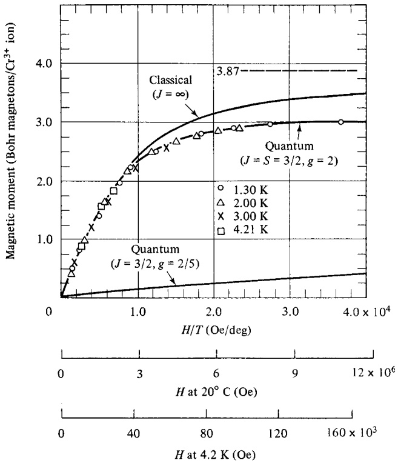

Fig. 3.10 Magnetic moment of potassium chromium alum as a function of H/T. Data from W. E. Henry, Phys. Rev., 88 (1952) p. 550.

If this value is set equal to μ in the classical equations 3.41 and 3.14, the upper curve of Fig. 3.10 results. It is asymptotic to $3.87\mu_{\mathrm{B}}$ per ion, whereas the experimental and quantum curves are asymptotic to 3.00. The wide disparity between classical theory and experiment, when H/T is large, is clearly evident.

The fields required, at room and liquid-helium temperatures, to produce the values of H/ T shown in Fig. 3.10, are indicated on the two $H$ scales at the bottom. At room temperature, enormous fields, of the order of 10 million oersteds or 1000 tesla would be required to achieve saturation.

While measurements at very low temperatures and high fields are necessary in order to obtain the saturation effects which allow magnetic theories to be tested, most measurements on paramagnetics are confined to “normal” temperatures and “moderate” fields (5000–10,000 Oe or 0.5 to 1T), i.e., to the region near the origin of Fig. 3.10, where the magnetization curves are linear. We therefore need a quantum-theory expression for the susceptibility. When χ is small, coth x can be replaced by $(1 / \chi +\chi /3)$ . With this substitution, the Brillouin function, for small $a'$ reduces to

$$
B (J, a ^ {\prime}) = \frac {a ^ {\prime} (J + 1)}{3 J},\tag{3.45}
$$

and

$$
\begin{array}{r l} M & = n g J \mu_ {\mathrm{B}} B (J, a ^ {\prime}) \\ & = n g J \mu_ {\mathrm{B}} \left(\frac {g J \mu_ {\mathrm{B}} H}{k T}\right) \left(\frac {J + 1}{3 J}\right) \\ & = \frac {n g ^ {2} J (J + 1) \mu_ {\mathrm{B}} ^ {2} H}{3 k T} \\ & = \frac {n \mu_ {\mathrm{eff}} ^ {2} H}{3 k T}. \end{array}\tag{3.46}
$$

The mass susceptibility is then

$$
\chi_ {\mathrm{m}} = \frac {\chi_ {v}}{\rho} = \frac {M}{\rho H} = \frac {n \mu_ {\mathrm{eff}} ^ {2}}{3 \rho k T} = \frac {N \mu_ {\mathrm{eff}} ^ {2}}{3 A k T}.\tag{3.47}
$$

This is the quantum analog of the classical Equation 3.23. Similarly, the Curie constant per gram is given by

$$
C = \frac {N \mu_ {\mathrm{eff}} ^ {2}}{3 A k},\tag{3.48}
$$

where N is Avogadro’s number and A, the atomic weight, is to be replaced by $M'$ the molecular weight, if $\mu_{\mathrm{eff}}$ refers to a molecule rather than an atom.

As mentioned earlier, the quantum numbers J, L, and S are normally not known for an atom or molecule in a solid. Under these circumstances it is customary to compute the magnetic moment from the susceptibility measurements, on the assumption that the moment is due only to the spin component; then $L = 0, J = S.$ and $g = 2$ . The result is called the “spinonly” moment. The value of $J(= S)$ is computed from the experimental value of C by a combination of Equations 3.26 and 3.48, and the moment $\mu_{H}$ is then given by $gJ\mu_{\mathrm{B}} = 2J\mu_{\mathrm{B}} = 2S\mu_{\mathrm{B}}$ . Reporting the results of susceptibility measurements in terms of a spin-only moment is merely a convention and does not imply that the orbital contribution is really absent. Other kinds of information are usually necessary to decide this point.

As an example of this kind of calculation, we can consider the data on potassium chromium alum. This substance follows the Curie law exactly, with a molecular Curie constant $C_M$ of 1.85. $(C_M$ is the Curie constant per mole.) Therefore, Equation 3.48 becomes

$$
C _ {M} = C M ^ {\prime} = \frac {N \mu_ {\mathrm{eff}} ^ {2}}{3 k}
$$

and

$$
\begin{array}{r l} \mu_ {\mathrm{eff}} & = \left(\frac {3 k C _ {M}}{N}\right) ^ {1 / 2} \\ & = \left[ \frac {3 (1 . 3 8 \times 1 0 ^ {- 1 6}) (1 . 8 5)}{6 . 0 2 \times 1 0 ^ {2 3}} \right] ^ {1 / 2} \\ & = 3. 5 7 \times 1 0 ^ {- 2 0} \mathrm{erg/Oe} \\ & = \frac {3 . 5 7 \times 1 0 ^ {- 2 0}}{0 . 9 2 7 \times 1 0 ^ {- 2 0}} \mu_ {\mathrm{B}} = 3. 8 5 \mu_ {\mathrm{B}}. \end{array}
$$

For pure spin, Equation 3.26 becomes

$$
2 \sqrt {J (J + 1)} \mu_ {\mathrm{B}} = \mu_ {\mathrm{eff}} = 3. 8 5 \mu_ {\mathrm{B}}.\tag{3.49}
$$

(Some authors write S instead of J in this equation to emphasize that only spin moments are involved.) The solution of Equation 3.49 is $J = 1.49$ , which compares well with $J = \frac{3}{2},$ the value assumed in drawing the central curve of Fig. 3.10. (In this case, the good fit of the magnetization data to the curve, over the whole range of H/T, is conclusive evidence that the moment of the chromium ion in this compound is due only to spin.) We can also calculate the maximum component of the moment in the field direction, namely,

$$
\mu_ {\mathrm{H}} = g J \mu_ {\mathrm{B}} = 2 (1. 4 9) \mu_ {\mathrm{B}} = 2. 9 8 \mu_ {\mathrm{B}}.
$$

Writers of technical papers sometimes cause confusion by not being sufficiently specific when reporting their results. For example, the statement that “the susceptibility measurements lead to a spin-only moment of x Bohr magnetons” is ambiguous. Does the author mean $\mu_{H}$ or $\mu_{\mathrm{eff}}?$ Usually, $\mu_{H}$ is meant, but one can never be sure unless the value of the Curie constant C is also given. This should always be done, because the value of either moment can be calculated from C.

Equation 3.47 for the susceptibility applies to a substance which obeys the Curie law. A quantum relation for Curie–Weiss behavior can be obtained, just as in the classical case, by introducing a molecular field $H_{\mathrm{m}}(= \gamma M)$ , which adds to the applied field $H$. We then have, according to Equation 3.21,

$$
\chi_ {m} = C / (T - \theta),
$$

where C, the Curie constant per gram, is now given by Equation 3.48. Therefore,

$$
\chi_ {m} = \frac {N \mu_ {\mathrm{eff}} ^ {2}}{3 A k (T - \theta)} = \frac {N g ^ {2} J (J + 1) \mu_ {\mathrm{B}} ^ {2}}{3 A k (T - \theta)},\tag{3.50}
$$

where θ, as before, is a measure of the molecular field constant g and is given by

$$
\theta = \rho C \gamma = \frac {\rho N \mu_ {\mathrm{eff}} ^ {2} \gamma}{3 A k} = \frac {\rho N g ^ {2} J (J + 1) \mu_ {\mathrm{B}} ^ {2} \gamma}{3 A k}.\tag{3.51}
$$

Before concluding these sections on the theory of dia- and paramagnetism, it is only fair to point out the range of validity of some of the arguments advanced. On a basic level, the theory of any kind of magnetism must be an atomic theory or, more exactly, an electronic theory. But the electrons in atoms do not behave in a classical way, and to understand their behavior we must abandon the relative simplicity and “reasonableness” of classical physics for the complexity and abstractions of quantum mechanics. Classical explanations are simply not valid on the atomic level, even when they lead to the right answer. For example, Equation 3.22, which states that the ratio of the magnetic moment to the angular momentum is e/2mc (cgs) for an electron moving in a circular orbit, is true in quantum mechanics. But the way in which this result was derived in this chapter is entirely classical. This classical treatment, and similar treatments of other basic magnetic phenomena, should be regarded more as aids to visualization than as valid analyses of the problem.

## 3.8 PARAMAGNETIC SUBSTANCES

These are substances composed of atoms or ions which have a net magnetic moment because of noncancellation of the spin and orbital components. Closed electron shells usually exhibit no net magnetic moment and lead to diamagnetism. Incomplete outer shells, as in metals like sodium or copper, lead to complex behavior, discussed below. However, incomplete inner shells, such as those of the transition metal ions and rare earth ions, can have a large net moment, and compounds of these elements are strongly paramagnetic.

## 3.8.1 Salts of the Transition Elements

These show the simplest behavior. The only magnetic ions in such compounds are the transition metal ions, and the magnetic moments of these are due almost entirely to spin, the orbital components being largely quenched. This is shown by the fact that the susceptibility calculated on a spin-only basis agrees well with the measured value, and we have already seen an example of that in potassium chromium alum, $\mathrm{KCr(SO_4)_2\cdot 12H_2O}$ Even more direct evidence is given by experimental values of the g factor, which are close to 2. The transition-metal salts usually obey the Curie law, or the Curie – Weiss with a small value of θ, as shown in Fig. 3.6. [This behavior is rather surprising. The Langevin theory or its quantum-mechanical counterpart, which leads to the Curie law, was originally derived for a gas, on the assumption that there is no interaction between the individual carriers of magnetic moment, be they atoms or molecules. There is no a priori reason why this theory should also apply to solids, in which the atoms are packed close together. But in fact it often does apply, and we find that it applies more exactly the more “magnetically dilute” the substance is. Thus, if a compound contains a lot of water of crystallization, as $\mathrm{KCr(SO_4)_2\cdot 12H_2O}$ does, the magnetic ions, in this case $\mathrm{Cr}^{3+}$ , will be so far separated from each other that any interaction between them will be negligible, and the Curie law will be closely obeyed.]

## 3.8.2 Salts and Oxides of the Rare Earths

These compounds are very strongly paramagnetic. (The effective magnetic moment varies in a regular way with atomic number and reaches a value as large as 10.6 Bohr magnetons for the trivalent ion of dysprosium.) In these substances both susceptibility and g-factor measurements show that orbital motion contributes a large part of the observed moment. In effect, the electrons in the unfilled shell responsible for the magnetic moment (the 4f shell in these substances) lie so deep in the ion that the outer electron shells shield them from the crystalline field of the other ions, and the orbital moments remain unquenched.

## 3.8.3 Rare-Earth Elements

These are also strongly paramagnetic. The magnetic moments per ion are so large that there is considerable interaction between adjacent ions, even though the moments are deepseated, and these elements obey the Curie–Weiss law with rather large values of θ, rather than the simple Curie law. Many of the rare earths become ferromagnetic at low temperature, although gadolinium becomes ferromagnetic at just below room temperature. They are discussed further in Section 5.4.

## 3.8.4 Metals

The magnetic behavior of metals is complex. Three are ferromagnetic at room temperature (Fe, Co, and Ni); two are antiferromagnetic (Cr and Mn), and the rest are para- or diamagnetic. The transition metals are ferro-, antiferro-, or paramagnetic. (All ferromagnetic substances become paramagnetic above their Curie temperatures, and the paramagnetism of Fe, Co, and Ni above their Curie points will be dealt with in the next chapter.) The susceptibility of the para- and diamagnetic metals is made up of three parts:

1. Diamagnetism of the core electrons. A metal is made up of positive ions and free electrons. These ions usually consist of closed shells which contribute a diamagnetic term to the susceptibility, just as they do in any substance.

2. Diamagnetism of the conduction electrons. When a magnetic field is present, the conduction electrons must move in curved paths. This results in an additional diamagnetic effect, for much the same reason that electron motion in an orbit causes a diamagnetic reaction when a field is applied.

3. Paramagnetism of the conduction electrons, also called Pauli paramagnetism or weak spin paramagnetism. The conduction electrons, present to the extent of one or more per atom, depending on the valence, each have a spin magnetic moment of one Bohr magneton. One would therefore expect them to make a sizable paramagnetic contribution. This does not happen, however, because the conduction electrons of a metal occupy energy levels in such a way that an applied field can reorient the spins of only a very small fraction of the total number of electrons. The resulting paramagnetism, which will be more fully explained in Section 4.4, is very weak and does not vary much with temperature.

The sum of these three effects, all of them small, is the observed susceptibility of the metal. If the first two are stronger, the metal is diamagnetic, like copper; if the third outweighs the other two, it is paramagnetic, like aluminum. If the net effect is paramagnetic, the resultant paramagnetism is very weak (i.e., at room temperature the susceptibility per atom of manganese in metallic manganese is less than 4% of the susceptibility per atom of manganese in MnCl2). Moreover, the susceptibility of such a paramagnetic does not obey the Curie or Curie–Weiss law; because effects (1) and (2) are independent, and (3) is almost independent of temperature. The resulting susceptibility can decrease as the temperature increases, remain constant, or even increase.

## 3.8.5 General

When a solid solution is formed between paramagnetic or diamagnetic metals, or between a para- and a diamagnetic, the variation of the susceptibility with composition is, in general, unpredictable. One effect is clear, however: If a para- and a diamagnetic form a continuous series of solid solutions, the susceptibility must pass through zero at some intermediate composition. A substance having this composition will be completely unaffected by an applied magnetic field and forms an exception to the general statement that all substances are magnetic. However, this zero value of the susceptibility will be retained only at one temperature, because the susceptibility of the paramagnetic constituent will generally change with temperature. An example of such a material occurs in the Cu–Ni system. The phase diagram is shown in Fig. 3.11a, where the dashed line indicates the Curie temperatures of the ferromagnetic, Ni-rich alloys. Below about 65% Ni, the alloys become paramagnetic at room temperature. Figure 3.11b shows the room temperature susceptibility of the Cu-rich alloys; it passes through zero at 3.7 wt% Ni. Below room temperature this alloy becomes slightly diamagnetic but, at any temperature between room temperature and 2K, its susceptibility is less than one-tenth that of pure copper. It is therefore a suitable material for specimen holders, and other parts of equipment designed for delicate magnetic measurements, which must have a susceptibility as near zero as possible.

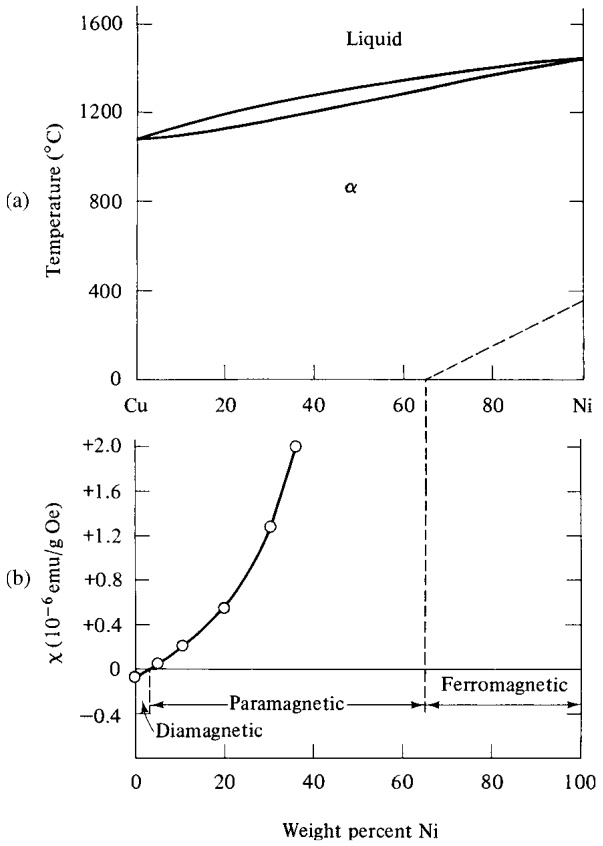

Fig. 3.11 (a) Phase diagram of the Cu – Ni system. (b) Mass susceptibility of Cu– Ni alloys at room temperature.

Although the terms “weak” and “strong” paramagnetism have been used in this section, it must be remembered that they are only relative and the susceptibility of any paramagnetic is minute in comparison with that of a ferromagnetic. This means that a small amount of a ferromagnetic impurity in a para- or diamagnetic can mask the true behavior of the material. If the impurity is present in solid solution, the observed $M$, $H$ curve will be linear from the origin, but the slope, and hence the susceptibility, will depend on the concentration of the impurity. If the impurity is present as a ferromagnetic second phase, the $M$, $H$ curve will be curved initially as the second phase becomes increasingly saturated. Figure 3.12 shows this effect. A specimen of copper containing 0.1 wt% iron gave curve $A$, which can be regarded as the sum of curves $B$ and $C$. There is enough iron present in solid solution to change the normally diamagnetic “copper” to a paramagnetic, and $B$ is the $M$, $H$ curve of this solid solution. The rest of the iron is present as a ferromagnetic second phase, consisting of particles of an iron-rich iron–copper solid solution. C is the magnetization curve of this phase, which is saturated at a field of about 6 kOe. The susceptibility of the solid solution is given by the slope of the straight-line portion of A, which has the same slope as $B$. The applied field at which the second-phase particles saturate can depend markedly on the shape and orientation of these particles. The demagnetizing field associated with each particle will be much larger if it is spherical than if it is, for example, in the shape of a rod parallel to the applied field.

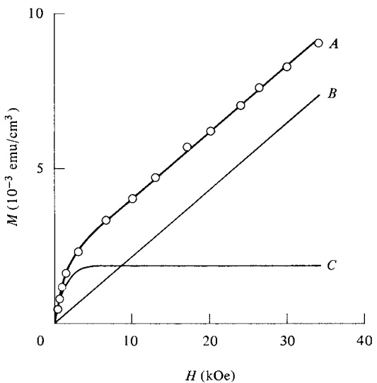

Fig. 3.12 Magnetization curve of copper containing 0.1 wt% iron (curve $A$). See text for meaning of curves $B$ and $C$.

## PROBLEMS

3.1 Assume that an electron is a solid sphere rotating about an axis through its center. Its rotational velocity is determined by the fact that the angular momentum due to spin is sh/2π, where $s = \frac{1}{2}$ and h is Planck’s constant. Calculate the magnetic moment due to spin, in units of Bohr magnetons, on the assumption that the total charge of the electron is (a) distributed uniformly over its surface and (b) distributed uniformly throughout its volume.

3.2 For a paramagnet that obeys the Curie–Weiss law, show that:

a. The effective number of Bohr magnetons per molecule is given by $n_{\mathrm{eff}} =$ 2 2.83$\sqrt{C_{\mathrm{M}}}$ where $C_{\mathrm{M}}$ is the Curie constant per molecule.

b. The molecular field is given by

$$
H _ {\mathrm{m}} = \frac {\theta H}{T - \theta}.
$$

3.3 The susceptibility of $\mathrm{FeCl}_{2}$ obeys the Curie–Weiss law over the temperature range 90 K to room temperature, with $\theta = 48\mathrm{K}$ . Its molecular susceptibility at room temperature is $1.475 \times 10^{-2}$ emu /Oe/(g mol).

a. What is the effective magnetic moment in Bohr magnetons?

b. What are the spin-only values of J and $\mu_{\mathrm{H}}$ (max)?

c. At an applied field of 8000 Oe, what is the value of the molecular field at $0^{\circ}\mathrm{C}$ and at $100^{\circ}\mathrm{C}$?

3.4 Show that the Brillouin function $B(J, a')$ reduces to Equation 3.35 for $J = \infty$ , to Equation 3.40 for $J = \frac{1}{2}$ , and to Equation 3.45 when $a'$ is small.

3.5 Plot the relation between $M / M_{0}$ and $H$, according to quantum theory, for a material with $g = 2$ and $J = \frac{1}{2}$ for fields up to 10 T and temperatures of $20^{\circ}\mathrm{C}$ and 2K.

a. What is the effective moment?

b. What is the atomic susceptibility at $20^{\circ}\mathrm{C}$?

c. What percentage of the saturation magnetization is attained at a field of 10 T at $20^{\circ}\mathrm{C}$?

d. What field is needed to produce 85% of saturation at 2K?

3.6 Repeat the plots of Problem , according to classical theory.

a. What is the atomic susceptibility at $20^{\circ}\mathrm{C}$?

b. What percentage of the saturation magnetization is attained at a field of 10 T at $20^{\circ}\mathrm{C}$?

c. How can the susceptibilities be the same (for classical and quantum theories) but the saturation percentages be different?

## 3.7 The susceptibility of a-Mn is

$$
7 6 6 \times 1 0 ^ {- 6} \frac {\mathrm{A} \cdot \mathrm{m} ^ {2}}{\mathrm{A} \cdot \mathrm{m} ^ {- 1} \cdot \mathrm{kg}} = 7 6 6 \times 1 0 ^ {- 6} \frac {\mathrm{m} ^ {3}}{\mathrm{kg}} \text {at} 2 0 ^ {\circ} \mathrm{C}.
$$

The susceptibility of $\mathrm{MnCl_{2}}$ obeys the Curie–Weiss law, with $\theta = 3.0\mathrm{K}$ and an effective moment of 5.7  $\mu_{B}$ per molecule. Calculate the susceptibility per atom of Mn in α-Mn as a percentage of the susceptibility per atom of Mn in $\mathrm{MnCl}_{2}$

