# FERROMAGNETISM

## 4.1 INTRODUCTION

Magnetization curves of iron, cobalt, and nickel are shown in Fig. 4.1. These curves are partly schematic. The experimental values of the saturation magnetization $M_{\mathrm{s}}$ are given for each metal, but no field values are shown on the abscissa. This is done to emphasize the fact that the shape of the curve from $M = 0$ to $M = M_{\mathrm{s}}$ and the strength of the field at which saturation is attained, are structure-sensitive properties, whereas the magnitude of $M_{\mathrm{s}}$ is not. The problems presented by the magnetization curve of a ferromagnet are therefore rather sharply divisible into two categories: the magnitude of the saturation value, and the way in which this value is reached from the demagnetized state. We shall now consider the first problem and leave the details of the second to later chapters.

A single crystal of pure iron, properly oriented, can be brought to near saturation in a field of less than 50 Oe or 4 kA/m . Each cubic centimeter then has a magnetic moment of about 1700 emu, or each cubic meter a moment of about 1.7 MA m² or MJ/T. At the same field a typical paramagnet will have a magnetization of about $10^{-3}\mathrm{emu/cm^{3}}$ or 1 A/m . Ferromagnetism therefore involves an effect which is at least a million times as strong as any we have yet considered.

No real progress in understanding ferromagnetism was made until Pierre Weiss in 1906 advanced his hypothesis of the molecular field [P. Weiss, Compt. Rend. 143 (1906) p. 1136 – 1139]. We have seen in the previous chapter how this hypothesis leads to the Curie – Weiss law, $\chi = C / (T - \theta)$ , which many paramagnetic materials obey. We saw also that $\theta$ is directly related to the molecular field $H_{\mathrm{m}}$ because $\theta = \rho \gamma C$ and $H_{\mathrm{m}} = \gamma M,$ where g is the molecular field coefficient. If $\theta$ is positive, so is g, which means that $H_{\mathrm{m}}$ and $M$ are in the same direction or that the molecular field aids the applied field in magnetizing the substance.

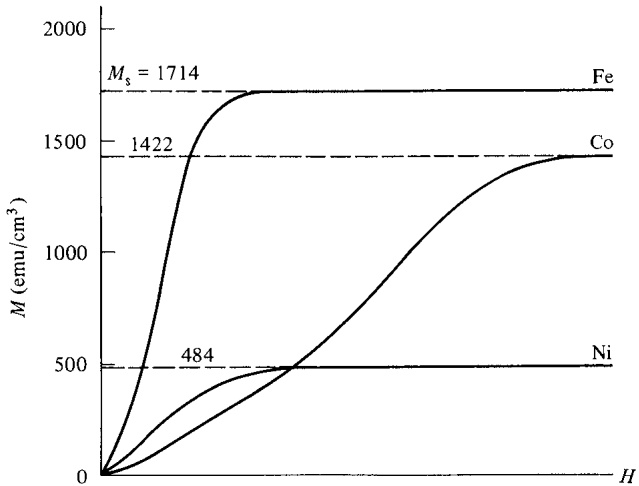

Fig. 4.1 Magnetization curves of iron, cobalt, and nickel at room temperature (H-axis schematic). The SI values for saturation magnetization in A/m are $10^{3}$ times the cgs values in emu/cm³

Above its Curie temperature $T_{c}$ a ferromagnet becomes paramagnetic, and its susceptibility then follows the Curie –Weiss law, with a value of $\theta$ approximately equal to $T_{\mathrm{c}}$ The value of $\theta$ is therefore large and positive (over 1000K for iron), and so is the molecular field coefficient. This fact led Weiss to make the bold and brilliant assumption that a molecular field acts in a ferromagnetic substance below its Curie temperature as well as above, and that this field is so strong that it can magnetize the substance to saturation even in the absence of an applied field. The substance is then self-saturating, or “spontaneously magnetized.” Before we consider how this can come about, we must note at once that the theory is, at this stage, incomplete. For if iron, for example, is self-saturating, how can we explain the fact that it is quite easy to obtain a piece of iron in the unmagnetized condition?

Weiss answered this objection by making a second assumption: a ferromagnet in the demagnetized state is divided into a number of small regions called domains. Each domain is spontaneously magnetized to the saturation value $M_{\mathrm{s}}$ but the directions of magnetization of the various domains are such that the specimen as a whole has no net magnetization. The process of magnetization is then one of converting the specimen from a multi-domain state into one in which it is a single domain magnetized in the same direction as the applied field. This process is illustrated schematically in Fig. 4.2. The dashed line in Fig. 4.2a encloses a portion of a crystal in which there are parts of two domains; the boundary separating them is called a domain wall. The two domains are spontaneously magnetized in opposite directions, so that the net magnetization of this part of the crystal is zero. In Fig. 4.2b a field $H$ has been applied, causing the upper domain to grow at the expense of the lower one by downward motion of the domain wall, until in Fig. 4.2c the wall has moved right out of the region considered. Finally, at still higher applied fields, the magnetization rotates into parallelism with the applied field and the material is saturated, as in Fig. 4.2d. During this entire process there has been no change in the magnitude of the magnetization of any region, only in the direction of magnetization.

The Weiss theory therefore contains two essential postulates: (1) spontaneous magnetization; and (2) division into domains. Later developments have shown that both of these postulates are correct. It is a tribute to Weiss’s creative imagination that a century of subsequent research has served, in a sense, only to elaborate these two basic ideas.

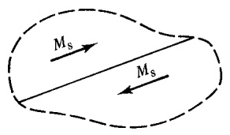

(a) M=0

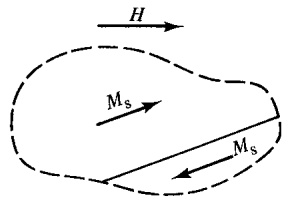

(b) M> 0

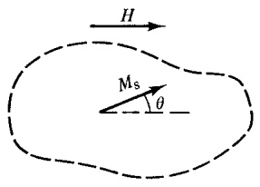

(c) $M=M_{s}$ cos θ

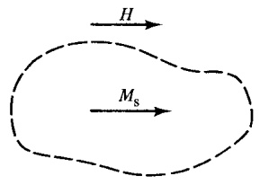

(d) $M=M_{s}$

Fig. 4.2 The magnetization process in a ferromagnet.

## 4.2 MOLECULAR FIELD THEORY

Consider a substance in which each atom has a net magnetic moment. Assume that the magnetization of this substance increases with field, at constant temperature, according to curve 1 of Fig. 4.3, as though the substance were paramagnetic. Assume also that the only field acting on the material is a molecular field $H_{\mathrm{m}}$ proportional to the magnetization:

$$
H _ {\mathrm{m}} = \gamma M.\tag{4.1}
$$

Line 2 in Fig. 4.3 is a plot of this equation, with the slope of the line equal to 1/γ. The magnetization which the molecular field will produce in the material is given by the intersection of the two curves. There are actually two intersections, one at the origin and one at the point P. However, the one at the origin represents an unstable state. If $M$ is zero and the slightest applied field, the Earth’s field for example, acts even momentarily on the material, it will be magnetized to the point A, say. But if $M = A$ , then line 2 states that $H_{\mathrm{m}}$ is $B$. But a field of this strength would produce a magnetization of C. Thus $M$ would go through the values 0, A, C, E, . . . , and arrive at P. We know that P is a point of stability, because the same argument will show that a magnetization greater than P will spontaneously revert to P, in the absence of an applied field. The substance has therefore become spontaneously magnetized to the level of P, which is the value of $M_{s}$ for the temperature in question. It is, in short, ferromagnetic. We may therefore regard a ferromagnet as a paramagnet subject to a very large molecular field. The size of this field will be calculated later.

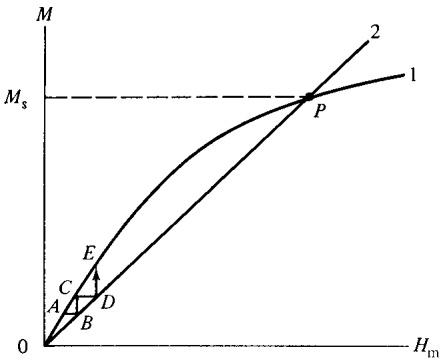

Fig. 4.3 Spontaneous magnetization by the molecular field.

We now inquire how this behavior is affected by changes in temperature. How will $M_{\mathrm{s}}$ vary with temperature, and at what temperature will the material become paramagnetic? To answer these questions, we replot Fig. 4.3 with a as a variable rather than $H_{\mathrm{m}}$ where $a = \mu H / kT$ is the variable which appears in the theory of paramagnetism. Following Weiss, we will suppose that the relative magnetization is given by the Langevin function:

$$
\frac {M}{M _ {0}} = L (a) = \coth (a) - \frac {1}{a}.\tag{4.2}
$$

(Later we will replace this with the correct quantum-mechanical relation, namely, the Brillouin function.) When the applied field is zero, we have

$$
a = \frac {\mu H _ {\mathrm{m}}}{k T} = \frac {\mu \gamma M}{k T} = \frac {\mu \gamma M}{k T} \frac {M _ {0}}{M _ {0}},\tag{4.3}
$$

$$
\frac {M}{M _ {0}} = \bigg (\frac {k T}{\mu \gamma M _ {0}} \bigg) a.\tag{4.4}
$$

$M / M_{0}$ is therefore a linear function of a with a slope proportional to the absolute temperature. In Fig. 4.4, curve 1 is the Langevin function and line 2 is a plot of Equation 4.4 for a temperature $T_{2}$ . Their intersection at P gives the spontaneous magnetization achieved at this temperature, expressed as a fraction $M_{\mathrm{s}} / M_{0}$ of the saturation magnetization $M_{0}$ An increase in temperature above $T_{2}$ has the effect of rotating line 2 counterclockwise about the origin. This rotation causes P and the corresponding magnetization to move lower and lower on the Langevin curve. The spontaneous magnetization vanishes at temperature $T_{3}$ when the line is in position 3, tangent to the Langevin curve at the origin. $T_{3}$ is therefore equal to the Curie temperature $T_{\mathrm{c}}$ At any higher temperature, such as $T_{4}$ , the substance is paramagnetic, because it is not spontaneously magnetized.

The Curie temperature can be evaluated from the fact that the slope of line 3 is the same as the slope of the Langevin curve at the origin, which is $\frac{1}{3}$ Replacing T with $T_{\mathrm{c}}$ we have

$$
\begin{array}{c} \frac {k T _ {\mathrm{c}}}{\mu \gamma M _ {0}} = \frac {1}{3} \\ T _ {\mathrm{c}} = \frac {\mu \gamma M _ {0}}{3 k}. \end{array}\tag{4.5}
$$

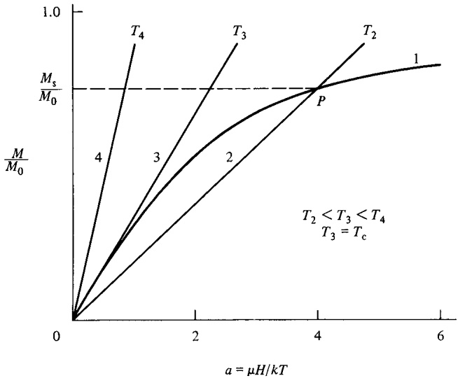

Fig. 4.4 Effect of temperature on the value of spontaneous magnetization. Curve 1 is the Langevin function.

Therefore the slope of the straight line representing the molecular field is, at any temperature,

$$
\frac {k T}{\mu \gamma M _ {0}} = \frac {T}{3 T _ {\mathrm{c}}}.\tag{4.6}
$$

But the slope of the line determines the point of intersection P with the Langevin curve and hence the value of $M_{\mathrm{s}} / M_{0}$ Therefore $M_{\mathrm{s}} / M_{0}$ is determined solely by the ratio $T / T_{\mathrm{c}}$ . This means that all ferromagnetic materials, which naturally have different values of $M_{0}$ and $T_{\mathrm{c}}$ have the same value of $M_{\mathrm{s}} / M_{0}$ for any particular value of $T / T_{\mathrm{c}}$ This is sometimes called the law of corresponding states.

This statement of the law is very nearly, but not exactly, correct. In arriving at the Langevin law in Equation 3.13, we considered the number n of atoms per unit volume and set $n\mu = M_0$ . But n changes with temperature because of thermal expansion. Therefore, values of $M / M_{0}$ at different temperatures are not strictly comparable, because they refer to different numbers of atoms. When dealing with magnetization as a function of temperature, a more natural quantity to use is the specific magnetization σ, which is the magnetic moment per unit mass, because then thermal expansion does not affect the result.

If $n_{g}$ is the number of atoms per gram and $\bar{\mu}$ the average component of magnetic moment in the direction of the field, then we can write Equation 3.13 as

$$
\frac {n _ {g} \bar {\mu}}{n _ {g} \mu} = \frac {\sigma}{\sigma_ {0}} = \coth a - \frac {1}{a}.\tag{4.7}
$$

If we then define, for a ferromagnetic material, $\sigma_{s}$ and $\sigma_{0}$ as the saturation magnetizations at TK and 0K, respectively, an exact statement of the law of corresponding states is that all materials have the same value of $\sigma_{\mathrm{s}} / \sigma_{0}$ for the same value of $T / T_{\mathrm{c}}$ . The relation between the and $M$ values is

$$
\frac {\sigma_ {\mathrm{s}}}{\sigma_ {0}} = \frac {M _ {\mathrm{s}} / \rho_ {\mathrm{s}}}{M _ {0} / \rho_ {0}} = \frac {M _ {\mathrm{s}} \rho_ {0}}{M _ {0} \rho_ {\mathrm{s}}},\tag{4.8}
$$

where $\rho_{s}$ and $\rho_{0}$ are the densities at TK and 0K, respectively. A change from $M$ to $\sigma$ also involves a change in the molecular field constant γ:

$$
H _ {\mathrm{m}} = \gamma M = \gamma \rho (M / \rho) = (\gamma \rho) \sigma .\tag{4.9}
$$

Thus (gr) becomes the molecular field constant, and Equations 4.5 and 4.6 become

$$
T _ {\mathrm{c}} = \frac {\mu \gamma \rho \sigma_ {0}}{3 k},\tag{4.10}
$$

and

$$
\frac {k T}{\mu \gamma \rho \sigma_ {0}} = \frac {T}{3 T _ {\mathrm{c}}}.\tag{4.11}
$$

Equation 4.4 therefore becomes

$$
\frac {\sigma}{\sigma_ {0}} = \left(\frac {k T}{\mu \gamma \rho \sigma_ {0}}\right) a = \left(\frac {T}{3 T _ {\mathrm{c}}}\right) a,\tag{4.12}
$$

when the magnetization is expressed in terms of σ.

Experimental data on the variation of the saturation magnetization $\sigma_{s}$ of Fe, Co, and Ni with temperature are shown in Fig. 4.5. The temperature scales shown in Fig. 4.6 give the Curie points and the temperatures of phase changes and recrystallization for the three metals. The recrystallization temperatures are the approximate minimum temperatures at which heavily cold-worked specimens will recrystallize; thus iron and cobalt can be recrystallized while still ferromagnetic, but nickel cannot. The three curves of Fig. 4.5 have similar shapes and, when the data are replotted in the form of $\sigma_{\mathrm{s}} / \sigma_{0}$ $T / T_{\mathrm{c}}$ as in Fig. 4.7, the points conform rather closely to a single curve. Thus Weiss prediction of a law of corresponding states is verified. However, the shape of the curve of $\sigma_{\mathrm{s}} / \sigma_{0}$ vs $T / T_{\mathrm{c}}$ predicted by the Weiss –Langevin theory does not agree with experiment. We can see this by finding graphically the points of intersection of the curve of Equation 4.7 and the lines of Equation 4.12 for various values of $T / T_{\mathrm{c}}$ . The result is shown by the curve labeled “classical, $J=\infty$ ” in Fig. 4.7. This disagreement is not surprising, inasmuch as we have already seen in Chapter 3 that the classical Langevin theory, which was the only theory available for Weiss to test in this manner, does not conform to experiment.

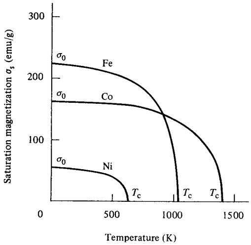

Fig. 4.5 Saturation magnetization of iron, cobalt, and nickel as a function of temperature.

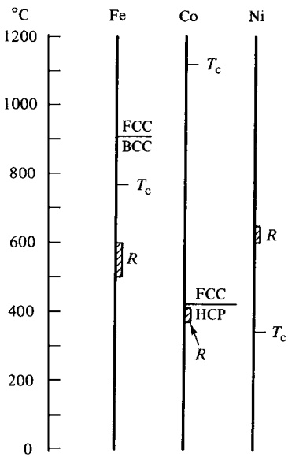

Fig. 4.6 Curie points $(T_{\mathrm{c}})$ , recrystallization temperatures [R], and phase changes in Fe, Co, and Ni. BCC = body-centered cubic; FCC = face-centered cubic; HCP = hexagonal close packed. Ni is FCC at all temperatures.

The Weiss theory may be modernized by supposing that the molecular field acts on a substance having a relative magnetization determined by a quantum-mechanical Brillouin function $B(J, a')$ , as discussed in Chapter 3. In terms of specific magnetization, we have

$$
\frac {\sigma}{\sigma_ {0}} = \frac {2 J + 1}{2 J} \coth \left(\frac {2 J + 1}{2 J}\right) a ^ {\prime} - \frac {1}{2 J} \coth \frac {a ^ {\prime}}{2 J},\tag{4.13}
$$

where $a^{\prime} = \mu_{\mathrm{H}}H / kt$ from Equation 3.40. The straight line representing the molecular field is given by

$$
\frac {\sigma}{\sigma_ {0}} = \left(\frac {k T}{\mu_ {\mathrm{H}} \gamma \rho \sigma_ {0}}\right) a ^ {\prime}.\tag{4.14}
$$

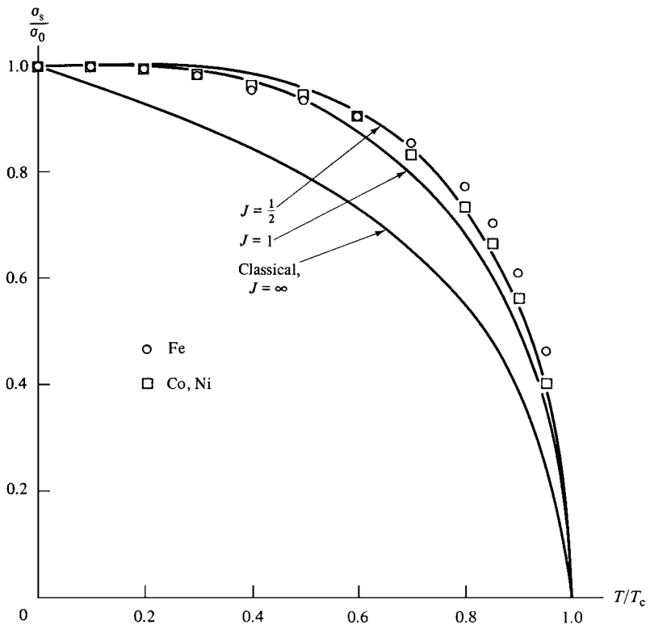

Fig. 4.7 Relative saturation magnetization of iron, cobalt, and nickel as a function of relative temperature. Calculated curves are shown for three values of J.

The slope of the Brillouin function at the origin is $(J + 1) / 3J,$ from Equation 3.45. Therefore, the Curie temperature is

$$
T _ {\mathrm{c}} = \left(\frac {\mu_ {\mathrm{H}} \gamma \rho \sigma_ {0}}{k}\right) \left(\frac {J + 1}{3 J}\right)\tag{4.15}
$$

$$
= \frac {g (J + 1) \mu_ {\mathrm{B}} \gamma \rho \sigma_ {0}}{3 k}.\tag{4.16}
$$

The equation of the molecular-field line can then be written

$$
\frac {\sigma}{\sigma_ {0}} = \left(\frac {J + 1}{3 J}\right) \left(\frac {T}{T _ {\mathrm{c}}}\right) a ^ {\prime}.\tag{4.17}
$$

Values of the relative spontaneous magnetization $\sigma_{\mathrm{s}} / \sigma_{0}$ as a function of $T / T_{\mathrm{c}}$ can be found graphically from the intersections of the curve of Equation 4.13 and the lines of Equation 4.17. A different relation will be found for each value of J. The particular value $J = \frac{1}{2}$ is of special interest. Equations 4.13 and 4.17 then become

$$
\frac {\sigma}{\sigma_ {0}} = \tanh a ^ {\prime}\tag{4.18}
$$

and

$$
\frac {\sigma}{\sigma_ {0}} = \left(\frac {T}{T _ {\mathrm{c}}}\right) a ^ {\prime}.\tag{4.19}
$$

These can be combined to give

$$
\frac {\sigma_ {\mathrm{s}}}{\sigma_ {0}} = \tanh \frac {(\sigma_ {\mathrm{s}} / \sigma_ {0})}{(T / T _ {\mathrm{c}})},\tag{4.20}
$$

which can be solved for $\sigma_{\mathrm{s}} / \sigma_{0}$ as a function of $T / T_{\mathrm{c}}$ . The theoretical curves for $J = \frac{1}{2}$ and J = 1 are plotted in Fig. 4.7. Either one is in fairly good agreement with experiment, with the curve for $J = \frac{1}{2}$ perhaps slightly better.

If J equals $\frac{1}{2}$ the magnetic moment is due entirely to spin, the g factor is 2, and there is no orbital contribution. That this condition is closely approximated by ferromagnetic substances is also suggested by experimental values of g. Table 4.1 lists observed g factors for Fe, Co, Ni, and several ferromagnetic alloys, and they are all seen to be close to 2. We may therefore conclude that ferromagnetism in transition metals is due essentially to electron spin, with little or no contribution from the orbital motion of the electrons. At 0K the spins on all the atoms in any one domain are parallel and, let us say, “up.” At some higher temperature, a certain fraction of the total, determined by the value of the Brillouin function at that temperature, flips over into the “down” position; the value of that fraction determines the value of $\sigma_{s}$

Up to this point we have put the applied field equal to zero and considered only the effect of the molecular field. If a field $H$ is applied, the total field acting on the substance is $(H +$ $H_{\mathrm{m}})$ , where by $H$ we mean the applied field corrected for any demagnetizing effects. Therefore,

$$
a ^ {\prime} = \frac {\mu_ {\mathrm{H}} (H + H _ {\mathrm{m}})}{k T} = \frac {\mu_ {\mathrm{H}} (H + \gamma \rho \sigma)}{k T},\tag{4.21}
$$

TABLE 4.1 Values of the g Factor

| Material | g |
| --- | --- |
| Fe | 2.10 |
| Co | 2.21 |
| Ni | 2.21 |
| FeNi | 2.12 |
| CoNi | 2.18 |
| Supermalloy (79 Ni, 5 Mo, 16 Fe) | 2.10 |
| Cu2MnAl | 2.01 |
| MnSb | 2.10 |
| NiFe2O4 | 2.19 |

S. Chikazumi, Physics of Ferromagnetism, 2nd ed. Oxford University Press (1997), p. 69.

which may be written

$$
\frac {\sigma}{\sigma_ {0}} = \bigg (\frac {k T}{\mu_ {\mathrm{H}} \gamma \rho \sigma_ {0}} \bigg) a ^ {\prime} - \frac {H}{\gamma \rho \sigma_ {0}}.\tag{4.22}
$$

This is a straight line parallel to the line of Equation 4.14 but displaced downward by an amount $H / \gamma \rho \sigma_{0}$ , proportional to the applied field. In Fig. 4.8, lines 2 and 4 represent the molecular field alone, while the dashed lines 2' and $4'$ represent the molecular and applied fields.

Above the Curie point, at $T = 1.2 T_{\mathrm{c}}$ for example, the effect of the applied field is to move the point of intersection of the field line and the magnetization curve from the origin to the point $B$, and from this change in magnetization the susceptibility can be calculated. Inasmuch as we are interested only in the region near the origin, the Brillouin function can be approximated by the straight line

$$
\frac {\sigma}{\sigma_ {0}} = \bigg (\frac {J + 1}{3 J} \bigg) a ^ {\prime}.\tag{4.23}
$$

Eliminating $a'$ from Equations 4.22 and 4.23, we obtain

$$
\chi = \frac {\sigma}{H} = \frac {\mu_ {\mathrm{H}} \sigma_ {0} (J + 1) / 3 k J}{T - [ \mu_ {\mathrm{H}} \gamma \rho \sigma_ {0} (J + 1) / 3 k J ]},\tag{4.24}
$$

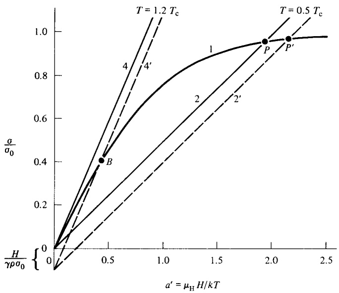

Fig. 4.8 Effects of temperature and applied field on magnetization. Curve 1 is the Brillouin function for $J = \frac{1}{2}$

which has the form of the Curie –Weiss law $\chi = C / (T - \theta)$ , provided that

$$
C = \frac {\mu_ {\mathrm{H}} \sigma_ {0} (J + 1)}{3 k J},\tag{4.25}
$$

$$
\theta = \frac {\mu_ {\mathrm{H}} \gamma \rho \sigma_ {0} (J + 1)}{3 k J}.\tag{4.26}
$$

Since Equations 4.15 and 4.26 are identical, it follows from molecular-field theory that $T_{c}$ , the temperature at which the spontaneous magnetization becomes zero, and u, the temperature at which the susceptibility becomes infinite, are identical. It is left as an exercise to show that the Curie constant per gram given by Equation 4.25 is the same as that given by Equation 3.46.

At temperatures well below the Curie temperature, for example at room temperature in most ferromagnets, even a very strong applied field produces only a small increase in the spontaneous magnetization $\sigma_{s}$ or $M_{\mathrm{s}}$ already produced by the molecular field. Thus, for $T = 0.5 T_{\mathrm{c}}$ line 2 in Fig. 4.8 shifts to position 2' when a field is applied, but the increase in relative magnetization, from P to $P'$ is very slight, because the magnetization curve is so nearly flat in this region. To increase the magnetization of a ferromagnetic specimen from zero to $\sigma_{s}$ or $M_{\mathrm{s}}$ usually requires, at room temperature, applied fields less than 1000 oersted or 80 kA/m. In this chapter “applied field” means the true field acting inside the specimen. It is the difference between the actual applied field and any demagnetizing field that may be present. The magnetization of the specimen is then the same as that of each domain in the demagnetized state, and the specimen is sometimes said to be in a state of “technical saturation” or simply “saturation.” To produce any appreciable increase in magnetization beyond this point requires fields 100 times stronger, and such an increase is called forced magnetization. It represents an increase in the magnetization of the domain itself. At any temperature above 0K an infinite field is required to produce absolute saturation, for which $\sigma_{\mathrm{s}} = \sigma_{0}$ or $M_{\mathrm{s}} = M_{0}$ . At 0K this condition can be reached with fields of $10^{2}-10^{3}$ Oe, or 8-80 kA/m . (At 0K the obstacles to absolute saturation no longer include thermal agitation, because $\sigma_{s}$ equals $\sigma_{0}$ in each domain of the demagnetized state. The obstacles are then only the “ordinary” ones inherent in domain wall motion and domain rotation; these processes are discussed in Chapters 7 – 9.)

Forced magnetization beyond the value of the spontaneous magnetization is called the para-process by Russian authors. It is represented, at temperature $T_{1}$ , by points lying along the line AB of Fig. 4.9. The increase in magnetization beyond $\sigma_{s}$ caused by a given increase in field is larger the closer $T_{1}$ is to the Curie temperature; this and other phenomena occurring near $T_{c}$ have been described in detail by K. P. Belov [Magnetic Transitions, Consultants Bureau (1961), translated from Russian], L. F. Bates [Modern Magnetis, 4th ed., Cambridge University Press (1961)], and R. M. Bozorth [Ferromagnetism, Van Nostrand (1951); reprinted by IEEE Press (1993)].

Figure 4.9 summarizes the results of molecular-field theory. The temperature $\theta$ at which the susceptibility χ becomes infinite, and 1/χ becomes zero, is the same as the temperature $T_{c}$ at which the spontaneous magnetization appears. Careful measurements have shown that the situation near the Curie point is not that simple. Two deviations from the theory, illustrated in Fig. 4.10, are observed:

1. The curve of 1/χ vs T is a straight line at high temperatures but becomes concave upward near the Curie point. The extrapolation of the straight-line portion cuts the temperature axis at $\theta_{\mathrm{p}}$ which is called the paramagnetic Curie point. It is therefore equal to the $\theta$ of the Curie – Weiss law.

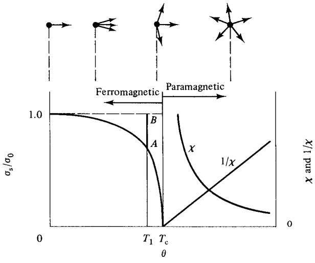

T(°K)

Fig. 4.9 Magnetization and susceptibility curves below and above the Curie temperature. The small sketches at the top represent the distribution of classical spin directions, in zero applied field within a single domain (below $T_{\mathrm{c}})$ , and in a group of atoms (above $T_{\mathrm{c}})$

2. The curve of the spontaneous magnetization $\sigma_{\mathrm{s}} / \sigma_{0}$ vs T does not cut the temperature axis at a large angle but bends over to form a small “tail.” The temperature $\theta_{\mathrm{f}}$ defined by the extrapolation of the main part of the curve is called the ferromagnetic Curie point.

It is usual to refer to the Curie point as $T_{c}$ (or u) except when dealing with phenomena in the immediate neighborhood of this “point.” It is then necessary to distinguish between the two Curie points $\theta_{\mathrm{f}}$ and $\theta_{\mathrm{p}}$ The difference between the two is generally 10 – 30K. This behavior shows that the transition from the ferromagnetic to the paramagnetic state is not sharp, but blurred. The fuzziness of the transition is attributed to spin clusters. These are small groups of atoms in which the spins remain parallel to one another over a small temperature range above $\theta_{p};$ as such they constitute a kind of magnetic short-range order. These clusters of local spin order exist within a matrix of the spin disorder which constitutes a true paramagnetic material, and they gradually disappear as the temperature is raised. Conversely, below $\theta_{\mathrm{f}}$ there is a long-range order of spins even in the absence of an applied field; this is pre-cisely what spontaneous magnetization means.

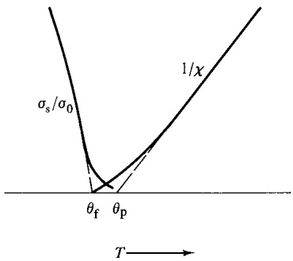

Fig. 4.10 Magnetic behavior near the Curie point.

There is an extensive literature on the behavior of ferromagnets in the temperature region near the Curie point, which is generally categorized under the topic critical indices. The book by Chikazumi (see Table 4.1) treats this subject in some detail.

Another and perhaps more serious disagreement between molecular-field theory and experiment involves the magnitudes of the magnetic moment per atom below and above the Curie point. At absolute zero, where complete saturation is attained, the specific magnetization $\sigma_{0}$ is given by the maximum magnetic moment per atom in the direction of the field multiplied by the number of atoms per gram, or

$$
\sigma_ {0} = \mu_ {\mathrm{H}} \frac {N}{A},\tag{4.27}
$$

where $N$ is Avogadro’s number and $A$ the atomic weight. For iron, substituting the value of $\sigma_{0}$ from Appendix 2, we have

$$
\begin{array}{r l} \mu_ {\mathrm{H}} & = \frac {(2 2 1 . 9) (5 5 . 8 5)}{6 . 0 2 \times 1 0 ^ {2 3}} = 2. 0 6 \times 1 0 ^ {- 2 0} \mathrm{erg/Oe} \\ & = \frac {2 . 0 6 \times 1 0 ^ {- 2 0}}{0 . 9 2 7 \times 1 0 ^ {- 2 0}} = 2. 2 2 \mu_ {\mathrm{B}}. \end{array}
$$

Similar calculations for cobalt and nickel yield the values listed in the second column of Table 4.2. According to molecular-field theory, these elements should exhibit the same atomic moments above the Curie point, but this is not found to be true. From the observed Curie constants in the paramagnetic region we can calculate the effective moments per atom; these appear in the third column. Values of $\mu_{H}$ can then be calculated from observed values of $\mu_{\mathrm{eff}}$ for any assumed value of J; two such values of $\mu_{\mathrm{H}}$ are shown for each metal in the last two columns. From Equations 3.26 and 3.28, it follows that for any value of g, $\mu_{\mathrm{H}} = \mu_{\mathrm{eff}} / \sqrt{3}$ when $J = \frac{1}{2}$ and $\mu_{\mathrm{H}} = \mu_{\mathrm{eff}} / \sqrt{2}$ when $J = 1$ . Neither for $J = \frac{1}{2}$ nor for

TABLE 4.2 Atomic Moments of Iron, Cobalt, and Nickel

<table><tr><td rowspan="3"></td><td colspan="2">Ferromagnetic</td><td colspan="3">Paramagnetic</td></tr><tr><td rowspan="2"> $\sigma_0$  emu/g or A m2/kg</td><td rowspan="2"> $\mu_H$ </td><td rowspan="2"> $\mu_{\text{eff}}$ </td><td colspan="2">Calculated  $\mu_H$ </td></tr><tr><td> $J = \frac{1}{2}$ </td><td> $J=1$ </td></tr><tr><td>Fe</td><td>221.9</td><td>2.22  $\mu_B$ </td><td>3.15  $\mu_B$ </td><td>1.82  $\mu_B$ </td><td>2.23  $\mu_B$ </td></tr><tr><td>Co</td><td>162.5</td><td>1.72</td><td>3.13</td><td>1.81</td><td>2.21</td></tr><tr><td>Ni</td><td>57.50</td><td>0.60</td><td>1.61</td><td>0.93</td><td>1.14</td></tr></table>

(f)

$J = 1$ is there agreement for all three metals with the values of $\mu_{H}$ in the ferromagnetic region. These differences are generally attributed to and explained on the basis of the band theory of magnetism.

Certain aspects of the $\mu_{H}$ values in the ferromagnetic region should be noted.

1. They are nonintegral. This fact will be discussed in Section 4.4

2. They are not what one would expect from the relation $\mu_{\mathrm{H}} = gJ\mu_{\mathrm{B}}$ (Equation 3.28) and reasonable values of g and J. If $g = 2$ and $J = \frac{1}{2},$ as seems most likely, mH should be one Bohr magneton or one spin per atom. But the observed value, for iron, is $2.2\mu_{\mathrm{B}}$ . Suppose we ignore the fractional part and assume exactly two spins per atom. How can this value be reconciled with $J = \frac{1}{2}$ and the tanh $a'$ variation of $\sigma_{\mathrm{s}} / \sigma_{0}$ (Equation 4.18), which is experimentally observed? The answer is that the two spins on any one atom are not coupled together. Figure 4.11 shows atoms represented by circles and spin moments by arrows, and Fig. 4.11a –c shows the possible arrangements of two spins per atom on three atoms, for $J = \frac{1}{2}.$ Because one spin is able to flip over, in response to a change in temperature, for example, without causing the other spin on the same atom to flip, these arrangements are equivalent to the possible arrangements of one spin per atom on six atoms, and the statistics of this situation lead to the tanh $a'$ relation. On the other hand, if $J = 1$ and $g = 2$ the possible values of $\mu_{H}$ are +2, 0, and -2 Bohr magnetons. But here the two spins per atom are coupled; if one flips, the other must, too, as in Fig. 4.11d – f, and the tanh $a'$ relation is not followed. Complete spin reversal, from Fig. 4.11d to f, is a common transition when $J = 1$ , but the same change, from Fig. 4.11a to c, is quite unlikely when $J = \frac{1}{2},$ because it would require the simultaneous reversal of two independent spins.

3. The $\mu_{H}$ values in the ferromagnetic region are of the same order of magnitude as the $\mu_{H}$ values for paramagnetic substances generally. The huge difference between a ferromagnet and a paramagnet is therefore due to the degree of alignment achieved and not to any large difference in the size of the moment per atom.

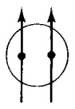

(a)

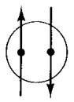

(b)

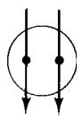

(c)

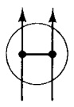

(d)

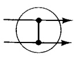

(e)

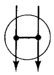

Fig. 4.11 Possible spin arrangements for coupled and uncoupled spins.

We will conclude this section on the molecular field by calculating its magnitude. From Equation 4.26 for $J = \frac{1}{2},$ we have for the molecular field coefficient:

$$
\gamma \rho = \frac {k \theta}{\mu_ {\mathrm{H}} \sigma_ {0}}.\tag{4.28}
$$

For iron, this becomes

$$
\gamma \rho = \frac {(1 . 3 8 \times 1 0 ^ {- 1 6}) (1 0 4 3)}{(2 . 0 6 \times 1 0 ^ {- 2 0}) (2 2 1 . 9)} = 3. 1 5 \times 1 0 ^ {4} \mathrm{Oe} \frac {\mathrm{g}}{\mathrm{emu}}.
$$

Therefore, the molecular field in iron at room temperature is

$$
H _ {\mathrm{m}} = (\gamma \rho) \sigma_ {\mathrm{s}} = (3. 1 5 \times 1 0 ^ {4}) (2 1 8. 0) = 6. 9 \times 1 0 ^ {6} \mathrm{Oe} = 5 5 0 \times 1 0 ^ {6} \mathrm{A/m}
$$

The corresponding values for cobalt and nickel are 11.9 and $14.7\times 10^{6}$ oersteds (950 and $1200 \times 10^{6} \mathrm{~A/m})$ , respectively. These fields are very much larger than any continuous field yet produced in the laboratory, and some $10^{4}$ times larger than the fields normally needed to achieve technical saturation. It is therefore not surprising to find that the application of even quite large fields produces only a slight increase in the spontaneous magnetization already produced by the molecular field. Finally, it should be stressed again that the molecular field is not a real field, but rather a force or torque tending to make adjacent atomic moments parallel to one another; it is called a field, and measured in field units, because it has the same kind of effect as a real field.

## 4.3 EXCHANGE FORCES

The Weiss theory of the molecular field says nothing about the physical origin of this field. However, the hypothesis that $H_{\mathrm{m}}$ is proportional to the existing magnetization implies that the phenomenon involved is a cooperative one. Thus, the greater the degree of spin alignment in a particular region of a crystal, the greater is the force tending to align any one spin in that region. The cooperative nature of the phenomenon is clearly shown by the way in which $\sigma_{s}$ decreases with increasing temperature (Fig. 4.7). Near absolute zero the decrease is slight, but, as the temperature is raised, thermal energy is able to reverse more and more spins, thus reducing the aligning force on those spins which are still aligned. The result is a more and more rapid breakdown in alignment, culminating in almost complete disorder at the Curie point.

In seeking for a physical origin of the molecular field, we might at first wonder if it could be entirely magnetic. Figure 4.12a, for example, shows a set of atoms, represented by small circles, each having a net magnetic moment. The directions of these moments, considered as classically free to point in any direction, are indicated by the arrows. Each atom, considered as a magnetic dipole, produces an external field like that of Fig. 1.6, and the sum of the fields of all the dipoles at the point P would be a field from left to right, tending to increase the alignment of the moment on an atom placed at that point. The calculation of this field at P would involve a summation over all the dipoles in the specimen. The calculation becomes easier if we replace the set of dipoles with a continuous medium of average magnetization $M$, as in Fig. 4.12b and ask: What is the field at P in the center of a spherical hole in the material? This field, called the Lorentz field, is due to the north and south poles produced on the sides of the hole and is exactly equal in magnitude to the demagnetizing field of a solid magnetized sphere in empty space. We have already calculated this field in Section 2.6 and found it to be $4\pi /3M$ (cgs) or 1/3M (SI). For saturated iron at room temperature this is equal to $4\pi/3$ (1714) or about 7200 Oe (cgs) or 575 kA/m (SI). So purely magnetostatic forces are too small by about a factor of 1000 to account for the molecular field.

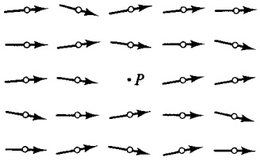

(a)

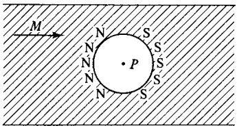

(b)

Fig. 4.12 Field at an interior point due to surrounding magnetized material.

The physical origin of the molecular field was not understood until 1928, when Heisenberg showed that it was caused by quantum-mechanical exchange forces. About a year earlier the new wave mechanics had been applied to the problem of the hydrogen molecule, i.e., the problem of explaining why two hydrogen atoms come together to form a stable molecule. Each of these atoms consists of a single electron moving about the simplest kind of nucleus, a single proton. For a particular pair of atoms, situated at a certain distance apart, there are certain electrostatic attractive forces (between the electrons and protons) and repulsive forces (between the two electrons and between the two protons) which can be calculated by Coulomb’s law. But there is still another force, entirely nonclassical, which depends on the relative orientation of the spins of the two electrons. This is the exchange force. If the spins are antiparallel, the sum of all the forces is attractive and a stable molecule is formed; the total energy of the atoms is then less for a particular distance of separation than it is for smaller or larger distances. If the spins are parallel, the two atoms repel one another. The exchange force is a consequence of the Pauli exclusion principle, applied to the two atoms as a whole. This principle states that two electrons can have the same energy only if they have opposite spins. Thus two hydrogen atoms can come so close together that their two electrons can have the same velocity and occupy very nearly the same small region of space, i.e., have the same energy, provided these electrons have opposite spin. If their spins are parallel, the two electrons will tend to stay far apart. The ordinary (Coulomb) electrostatic energy is therefore modified by the spin orientations, which means that the exchange force is fundamentally electrostatic in origin.

The term “exchange” arises in the following way. When the two atoms are adjacent, we can consider electron 1 moving about proton 1, and electron 2 moving about proton 2. But electrons are indistinguishable, and we must also consider the possibility that the two electrons exchange places, so that electron 1 moves about proton 2 and electron 2 about proton 1. This consideration introduces an additional term, the exchange energy, into the expression for the total energy of the two atoms. This interchange of electrons takes place at a very high frequency, about $10^{18}$ times per second in the hydrogen molecule.

The exchange energy forms an important part of the total energy of many molecules and of the covalent bond in many solids. Heisenberg showed that it also plays a decisive role in ferromagnetism. If two atoms i and j have spin angular momentum $\mathbf{S}_i h / 2\pi$ and $\mathbf{S}_jh / 2\pi$ respectively, then the exchange energy between them is given by

$$
E _ {\mathrm{ex}} = - 2 J _ {\mathrm{ex}} \mathbf {S} _ {i} \mathbf {S} _ {j} = - 2 J \mathbf {S} _ {i} \mathbf {S} _ {j} \cos \phi\tag{4.29}
$$

where $J_{ex}$ is a particular integral, called the exchange integral, which occurs in the calculation of the exchange effect, and f is the angle between the spins. If $J_{ex}$ is positive, $E_{\mathrm{ex}}$ is a minimum when the spins are parallel (cos $\phi = 1)$ and a maximum when they are antiparallel (cos $\phi = -1)$ . If $J_{ex}$ is negative, the lowest energy state results from antiparallel spins. As we have already seen, ferromagnetism is due to the alignment of spin moments on adjacent atoms. A positive value of the exchange integral is therefore a necessary condition for ferromagnetism to occur. This is also a rare condition, because $J_{\mathrm{ex}}$ is commonly negative, as in the hydrogen molecule.

According to the Weiss theory, ferromagnetism is caused by a powerful “molecular field” which aligns the atomic moments. In modern language we say that “exchange forces” cause the spins to be parallel. However, it would be unrealistic to conclude from this change in terminology that all the mystery has been removed from ferromagnetism. The step from a hydrogen molecule to a crystal of iron is a giant one, and the problem of calculating the exchange energy of iron is so formidable that it has not yet been solved. Expressions like Equation 4.29, which is itself something of a simplification and which applies only to two atoms, have to be summed over all the atom pairs in the crystal. Exchange forces decrease rapidly with distance, so that some simplification is possible by restricting the summation to nearest-neighbor pairs. But even this added simplification does not lead to an exact solution of the problem. In the present state of knowledge, it is impossible to predict from first principles that iron is ferromagnetic, i.e., merely from the knowledge that it is element 26 in the periodic table.

Nevertheless, knowledge that exchange forces are responsible for ferromagnetism and, as we shall see later, for antiferro- and ferrimagnetism, has led to many conclusions of great value. For example, it allows us to rationalize the appearance of ferromagnetism in some metals and not in others. The curve of Fig. 4.13, usually called the Bethe –Slater curve, shows the postulated variation of the exchange integral with the ratio $r_{\mathrm{a}} / r_{3d},$ where $r_{\mathrm{a}}$ is the radius of an atom and $r_{3d}$ the radius of its 3d shell of electrons. (It is the spin alignment of some of the 3d electrons which is the immediate cause of ferromagnetism in Fe, Co, and Ni.) The atom diameter is $2r_{a}$ and this is also the distance apart of the atom centers, since the atoms of a solid are regarded as being in contact with one another. If two atoms of the same kind are brought closer and closer together but without any change in the radius $r_{3d}$ of their 3d shells, the ratio $r_{\mathrm{a}} / r_{3d}$ will decrease. When this ratio is large, $J_{ex}$ is small and positive. As the ratio decreases and the 3d electrons approach one another more closely, the positive exchange interaction, favoring parallel spins, becomes stronger and then decreases to zero. A further decrease in the interatomic distance brings the 3d electrons so close together that their spins must become antiparallel (negative $J_{ex}$ . This condition is called antiferromagnetism.

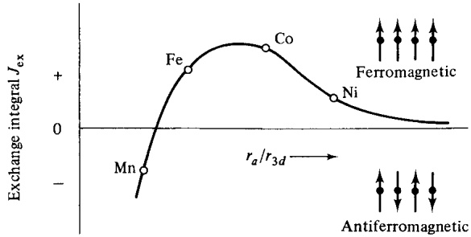

Fig. 4.13 Bethe–Slater curve (schematic).

The curve of Fig. 4.13 can be applied to a series of different elements if we compute $r_{a}/r_{3d}$ from their known atom diameters and shell radii. The points so found lie on the curve as shown, and the curve correctly separates Fe, Co, and Ni from Mn and the next lighter elements in the first transition series. (Mn is antiferromagnetic below 95K, and Cr, the next lighter element, is antiferromagnetic below $37^{\circ}\mathrm{C}$ ; above these temperatures they are both paramagnetic.) When $J_{ex}$ is positive, its magnitude is proportional to the Curie temperature (see below), because spins which are held parallel to each other by strong exchange forces can be disordered only by large amounts of thermal energy. The positions of Fe, Co, and Ni on the curve agree with the fact that Co has the highest, and Ni the lowest, Curie temperature of the three.

Although the theory behind the Bethe –Slater curve has received much criticism, the curve does suggest an explanation of some otherwise puzzling facts. Thus ferromagnetic alloys can be made of elements which are not in themselves ferromagnetic; examples of these are MnBi and the Heusler alloys, which have approximate compositions $Cu_{2}$ MnSn and $\mathrm{Cu_2MnAl}$ Because the manganese atoms are farther apart in these alloys than in pure manganese, $r_{a}/r_{3d}$ becomes large enough to make the exchange interaction positive.

Inasmuch as the molecular field and the exchange interaction are equivalent, there must be a relation between them. We can find an approximate form of this relation as follows. Let z be the coordination number of the crystal structure involved, i.e., let each atom have z nearest neighbors, and assume that the exchange forces are effective only between nearest neighbors. Then, if all atoms have the same spin S, the exchange energy between one atom and all the surrounding atoms is

$$
E _ {\mathrm{ex}} = z (- 2 J _ {\mathrm{ex}} S ^ {2}),
$$

when all the spins are parallel. But this is equivalent to the potential energy of the atom considered in the molecular field $H_{\mathrm{m}}$ If the atom has a magnetic moment of $\mu_{\mathrm{H}}$ in the direction of the field, this energy is

$$
E _ {\mathrm{pot}} = - \mu_ {\mathrm{H}} H _ {\mathrm{m}}.
$$

Equating these two expressions for the energy, we have

$$
H _ {\mathrm{m}} = (\gamma \rho) \sigma_ {0} = \frac {2 z J _ {\mathrm{ex}} S ^ {2}}{\mu_ {\mathrm{H}}}.\tag{4.30}
$$

But the molecular field coefficient (gr) is related to the Curie temperature $\theta$ by Equation 4.26. When J = S (pure spin), this substitution gives

$$
J _ {\mathrm{ex}} = \frac {3 k \theta}{2 z S (S + 1)},\tag{4.31}
$$

which shows that the exchange integral is proportional to the Curie temperature, as mentioned above. For a body-centered cubic structure like that of iron, for which z = 8 , and for $S = \frac{1}{2},$ Equation 4.31 gives $J_{\mathrm{ex}} = 0.25 k\theta .$ A more rigorous calculation gives $J_{\mathrm{ex}} = 0.34$ ku for this case.

Exchange forces depend mainly on interatomic distances and not on any geometrical regularity of atom position. Crystallinity is therefore not a requirement for ferromagnetism. The first discovery of an amorphous ferromagnet was reported in 1965 by S. Mader and A. S. Nowick [Appl. Phys. Lett., 7 (1965) p. 57]. They made amorphous thin films of cobalt-gold alloys by co-depositing the two metals from the vapor on a substrate maintained, not at room or elevated temperatures, but at 77K. These alloys were both ferromagnetic and amorphous, as judged from electron-diffraction photographs, and they retained their amorphous condition when heated to room temperature. Many ferromagnetic amorphous alloys have since been made, and several are produced commercially. See Chapter 13.

## 4.4 BAND THEORY

The band theory is a broad theory of the electronic structure of solids. It is applicable not only to metals, but also to semiconductors and insulators. It leads to conclusions about a variety of physical properties, e.g. cohesive, elastic, thermal, electrical, and magnetic. When the band theory is applied specifically to magnetic problems, it is sometimes called the collective-electron theory. This application of band theory was first made in 1933 – 1936 by E. C. Stoner and N. F. Mott in the United Kingdom and by J. C. Slater in the United States. Our task in this section is to apply it to Fe, Co, and Ni in an attempt to explain the $\mu_{H}$ values of these metals at 0K, namely, 2.22, 1.72, and 0.60 Bohr magnetons per atom, respectively (Table 4.2). These are important numbers, and any satisfactory theory of magnetism has to account for them.

We will begin by reviewing the electronic structure of free atoms, i.e., atoms located at large distances from one another, as in a monatomic gas. The electrons in such atoms occupy sharply defined energy levels in accordance with the Pauli exclusion principle. This principle states that no two electrons in the atom can have the same set of four quantum numbers. Three of these numbers define the level (“shell”) or sublevel involved, while the fourth defines the spin state of the electron (spin up or spin down). The Pauli principle can therefore be alternatively stated: Each energy level in an atom can contain a maximum of two electrons, and they must have opposite spin. Table 4.3 lists the various energy levels and the number of electrons each can hold, in terms of X-ray notation $(K,L,\dots)$ and quantum-mechanical notation $(1s, 2s, \ldots)$ . The 2p subshell is actually composed of three sub-subshells of almost the same energy, each capable of holding two electrons; the 3d subshell has a similar kind of substructure, and its total capacity is 10 electrons.

TABLE 4.3 Atomic Energy Levels

<table><tr><td>Shell</td><td>K</td><td colspan="2">L</td><td colspan="3">M</td><td colspan="2">N</td></tr><tr><td>Subshell</td><td>1s</td><td>2s</td><td>2p</td><td>3s</td><td>3p</td><td>3d</td><td>4s</td><td>...</td></tr><tr><td>Capacity</td><td>2</td><td>2</td><td>6</td><td>2</td><td>6</td><td>10</td><td>2</td><td>...</td></tr></table>

The filling up of levels proceeds regularly in the elements from hydrogen to argon, which has 18 electrons. At this point all levels up to and including the 3p are filled. As we go to heavier elements, however, we find irregularities in the way that the 3d and 4s levels are filled, because these two have nearly the same energy and they shift their relative positions almost from atom to atom. Observations of optical spectra disclose the electron distributions listed in Table 4.4. The transition elements, those in which an incomplete 3d shell is being filled, are the ones of most interest to us because they include the three ferromagnetic metals. It must be emphasized that the electron distributions in Table 4.4 apply only to free atoms, because of the way in which these distributions were observed. The optical spectrum of an element is obtained by placing it in an electric arc, and the temperature of the arc is high enough to convert any element into a monatomic gas.

When atoms are brought close together to form a solid, the positions of the energy levels are profoundly modified. Suppose that two atoms of iron approach each other from a large distance. When they are well separated, their 1s levels, each containing two electrons, have exactly the same energy. When they approach so closely that their electron clouds begin to overlap, the Pauli principle now applies to the two atoms as a unit and prevents them from having a single 1s level containing four electrons; instead, the 1s level must split into two levels with two electrons in each. Similarly, when N atoms come together to form a solid, each level of the free atom must split into N levels, because the Pauli principle now applies to the whole group of N atoms. However, the extent of the splitting is different for different levels, as indicated in Fig. 4.14. In the transition elements, the outermost electrons are the 3d and 4s; these electron clouds are the first to overlap as the atoms are brought together, and the corresponding levels are the first to split. When the interatomic distance d has decreased to $d_{0},$ the equilibrium value for the atoms in the crystal, the 3d levels are spread into a band extending from $B$ to $C$, and the 4s levels are spread into a much wider band, extending from $A$ to $D$, because the 4s electrons are farther from the nucleus. At the same atom spacing, however, the inner core electrons (1s and 2s) are too far apart to have much effect on one another, and the corresponding energy levels show a negligible amount of splitting. If the atoms could be forced together to distances much smaller than $d_{0}$ the 1s and 2s levels would presumably broaden considerably, as indicated in the drawing. Experimental evidence for the above statements is afforded by the X-ray emission spectra of solid metals. When electron transitions occur between two inner shells, radiation of a single wavelength is emitted, namely, the sharp K, L, etc. X-ray lines. The levels involved must therefore have sharply defined energies. On the other hand, when the transition is between an outer and an inner shell, the emitted radiation consists of a broad range of wavelengths.

TABLE 4.4 Electron Distributions in Free Atoms

<table><tr><td rowspan="2">Number of Electrons in Shell</td><td colspan="3"></td><td colspan="7">Transition Elements</td><td colspan="2"></td></tr><tr><td>K</td><td>Ca</td><td>Sc</td><td>Ti</td><td>V</td><td>Cr</td><td>Mn</td><td>Fe</td><td>Co</td><td>Ni</td><td>Cu</td><td>Zn</td></tr><tr><td>3d</td><td>0</td><td>0</td><td>1</td><td>2</td><td>3</td><td>5</td><td>5</td><td>6</td><td>7</td><td>8</td><td>10</td><td>10</td></tr><tr><td>4s</td><td>1</td><td>2</td><td>2</td><td>2</td><td>2</td><td>1</td><td>2</td><td>2</td><td>2</td><td>2</td><td>1</td><td>2</td></tr><tr><td>3d + 4s</td><td>1</td><td>2</td><td>3</td><td>4</td><td>5</td><td>6</td><td>7</td><td>8</td><td>9</td><td>10</td><td>11</td><td>12</td></tr></table>

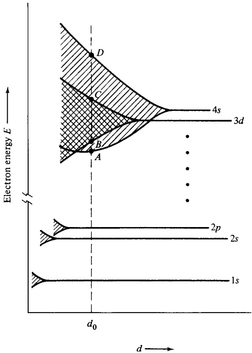

Fig. 4.14 Splitting of electron energy levels as the interatomic distance decreases.

There are a great many energy levels in a band, even for a small bit of crystal. For example, 55.85 g of iron (the gram atomic weight) contain $6.02 \times 10^{23}$ atoms (Avogadro’s number). Thus 1 mg of iron contains about $10^{19}$ atoms, and the Pauli principle therefore requires that each separate energy level in the free atom split into about $10^{19}$ levels in a 1 mg crystal. This means that the levels in a band are so closely spaced as to constitute almost a continuum of allowed energy. Nevertheless, we will still be interested in the energy difference between levels or, to put it in other terms, in the density of levels in the band. This density is often written as N(E) to emphasize the fact that it is not constant but a function of the energy E itself. The product of the density N(E) and any given energy range gives the number of levels in that range; thus N(E)dE is the number of levels lying between the energies E and $E + dE,$ and $1 / N(E)$ is the average energy separation of adjacent levels in that range.

An important and difficult problem of the band theory is to calculate the “shape” of energy bands, i.e., the form of the N(E) vs E curve for the band. The result of one such calculation, for the 3d band of nickel, is shown in Fig. 4.15. More recent calculations for nickel and other metals are given in the text by Chikazumi. All 3d band calculations show that the variation of N(E) with E is quite irregular. However, the exact shape of the band does not affect the general arguments to be advanced later.

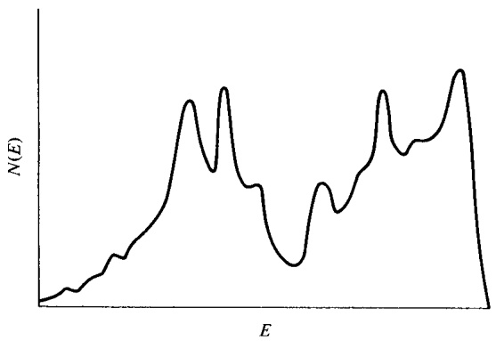

Fig. 4.15 One calculation of the density of levels as a function of energy in the 3d band of nickel.

Since the 3d and 4s bands overlap in energy (Fig. 4.14), it is convenient to draw the corresponding density curves side by side, as in Fig. 4.16. Here the density of 3d levels increases outward to the left, and that of 4s levels outward to the right; the letters $A$, $B$, $C$, and $D$ refer to the same energies as in Fig. 4.14; and a simplified form, of schematic significance only, has been adopted for the shape of the 3d band. Note that the density of 3d levels is far greater than that of 4s levels, because there are five 3d levels per atom, with a capacity of 10 electrons, whereas there is only one 4s level, with a capacity of two electrons, as noted in Table 4.3. The area under each N(E) vs E curve is equal to the total number of levels in the band.

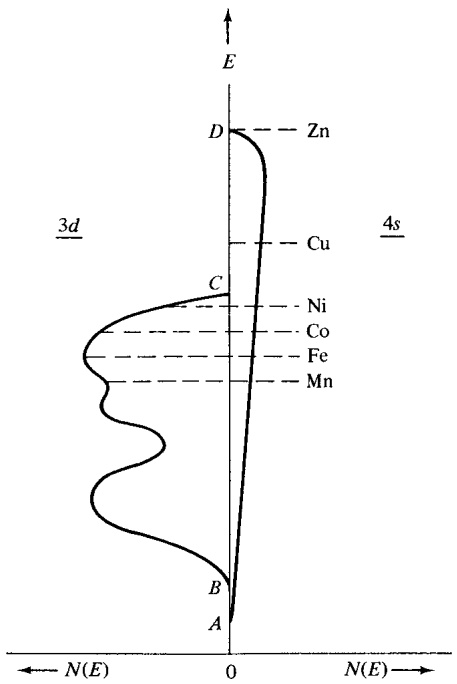

Fig. 4.16 Density of levels in the 3d and 4s bands (schematic).

We will now use the curves of Fig. 4.16 as a basis for discussing the electronic structure of the elements Mn through Zn; i.e., we will make the first-approximation assumption that the shape of these bands does not change much from one element to another in this range. This is called the rigid-band model. Note that the N(E) curves show the density of available levels. The extent to which these levels are occupied by electrons depends on the number of (3d + 4s) electrons in the atom. The 3d band can hold a total of 10 electrons per atom, but in the transition elements it is never completely full. The extent to which it is filled in several metals is shown by dashed lines in Fig. 4.16. The topmost filled level for any metal is called the Fermi level. These lines also show the extent to which the 4s band, which can hold only two electrons per atom, is filled. As long as both bands are partly full, they must be filled to the same height, just as water in two interconnected tanks must reach the same level.

Nickel has a total of 10 (3d + 4s) electrons, in the solid or the free atom, and magnetic evidence, described below, indicates that 9.4 are in the 3d band and 0.6 in the 4s. (The corresponding distribution in the free atom is 8 and 2, respectively.) The Fermi level for nickel is therefore drawn just below the top of the 3d zone. Copper has one more electron, and its 3d zone is therefore completely full and its 4s zone half full. In zinc both zones are full.

Filled energy levels cannot contribute a magnetic moment, because the two electrons in each level have opposite spin and thus cancel each other out. This situation is depicted in Fig. 4.17a, where a band of levels, imagined to consist of two half bands, contains an equal number of spin-up and spin-down electrons. The band shown corresponds to a highly simplified, very unreal example: Suppose an atom has just one electron in a particular energy level, when the atom is free, and then suppose that 10 such atoms are brought together to form a “crystal.” Then the single level in the free atom will split into 10 levels, and the lower five will each contain two electrons. If one electron reverses its spin, as in Fig. 4.17b, then a spin unbalance of 2 is created, and the magnetic moment, or value of $\mu_{\mathrm{H}}$ , is $2 / 10$ or $0 / .2\mu_{\mathrm{B}}$ per atom. The force creating this spin unbalance in a ferromagnet is just the exchange force. Returning to the water-in-a-tank analogy, we might say that the exchange force is like a dam holding water in one half of a tank at a higher level than in the other half. To create a spin unbalance requires that one or more electrons be raised to higher energy levels; evidently these levels must not be too widely spaced or the exchange force will not be strong enough to effect a transfer.

The ferromagnetism of Fe, Co, and Ni is due to spin unbalance in the 3d band. The 4s electrons are assumed to make no contribution. The density of levels in the 4s band is low, which means that the levels themselves are widely spaced. Since the 3d band can hold five electrons with spin up and five with spin down, the maximum unbalance, i.e., the saturation magnetization, is achieved when one half-band is full of five electrons. Suppose we let

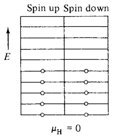

(a)

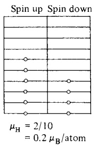

(b)

Fig. 4.17 Energy bands with (a) balanced and (b) unbalanced spins.

$$
\begin{array}{r l r} n = \text {number of} (3 d + 4 s) & \quad & \text {electrons per atom} \\ x = \text {number of} 4 s & \quad & \text {electrons per atom} \\ n - x = \text {number of} 3 d & \quad & \text {electrons per atom} \end{array}
$$

At saturation, five 3d electrons have spin up and $(n - x - 5)$ have spin down. The magnetic moment per atom is therefore

$$
\mu_ {\mathrm{H}} = [ 5 - (n - x - 5) ] \mu_ {\mathrm{B}} = [ 1 0 - (n - x) ] \mu_ {\mathrm{B}}.\tag{4.32}
$$

This equation also shows that the maximum spin unbalance is equal to the number of unfilled electron states in the 3d band. For nickel, n is 10 and the experimental value of $\mu_{H}$ is $0.60\mu_{\mathrm{B}}$ . Inserting these values in Equation 4.32, we find $x = 0.60$ . This number is proportional to the area enclosed by the lower part of the 4s N(E) curve in Fig. 4.16 and the dashed line marked “Ni.” It is therefore only a slight approximation to assume that the number of 4s electrons is constant at 0.60 for elements near nickel. We then have

$$
\mu_ {\mathrm{H}} = (1 0. 6 - n) \mu_ {\mathrm{B}}.\tag{4.33}
$$

The magnetic moments per atom predicted by this equation are compared with experiment in Fig. 4.18 and Table 4.5. Note that theory and experiment have been made to agree for nickel and that the predicted negative moment for copper has no physical meaning, since the 3d band of copper is full.

Figure 4.18 shows fairly good agreement between theory and experiment for Fe, Co, and Ni, and, as we shall see in the next section, for certain alloys. However, the theory predicts that manganese and the next lighter elements would be more magnetic than iron, whereas they are, in fact, not ferromagnetic at all. In iron we have assumed 5.00 electrons with spin up and 2.40 with spin down, leading to a spin unbalance of 2.60. Since the observed spin unbalance in iron is some 20% less than this predicted value, and in manganese actually zero, it appears that the exchange force cannot keep one half-band full of electrons if the other half-band is less than about half full.

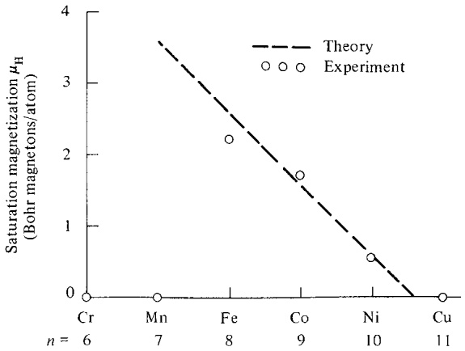

Fig. 4.18 Observed and calculated dependence of the saturation magnetization on the number n of (3d and 4s) electrons per atom.

TABLE 4.5 Saturation Magnetization

|  | Mn | Fe | Co | Ni | Cu |
| --- | --- | --- | --- | --- | --- |
| n | 7 | 8 | 9 | 10 | 11 |
| mH (observed) (mB/atom) | 0 | 2.22 | 1.72 | 0.60 | 0 |
| mH (calculated) (mB/atom) | 3.60 | 2.60 | 1.60 | 0.60 | 20.40 |

The fact that the observed values of $\mu_{H}$ are nonintegral follows quite naturally from the band theory as soon as it is assumed that the 4s electrons contribute nothing to the magnetism. For then the division of an integral number of $(3d + 4s)$ electrons between the two bands must lead, more often than not, to a nonintegral number of electrons in the 3d band. However, the difficulty of the appropriate value to assign to J, mentioned in Section 4.3, still remains. “Experimental” values of J can be obtained by putting the experimental value of $\mu_{\mathrm{H}}$ and $g = 2$ into the relation $\mu_{\mathrm{H}} = gJ\mu_{\mathrm{B}}$ . This leads to J values of 1.11, 0.86, and 0.30 for Fe, Co, and Ni, respectively. Inasmuch as these numbers are not integral multiples of $\frac{1}{2}$ , it is not at all clear what physical significance should be attached to them.

To summarize the results of the last two sections we can write down certain criteria for the existence of ferromagnetism in a metal:

1. The electrons responsible must lie in partially filled bands in order that there may be vacant energy levels available for electrons with unpaired spins to move into.

2. The density of levels in the band must be high, so that the increase in energy caused by spin alignment will be small.

3. The atoms must be the right distance apart so that the exchange force can cause the d-electron spins in one atom to align the spins in a neighboring atom.

Requirement (1) rules out inner core electrons, and (2) rules out valence electrons, because the density of levels in the valence band is low. But the transition elements, which include the rare-earth metals, have incompletely filled inner shells with a high density of levels, so these elements are possible candidates for ferromagnetism. However, of all the transition elements, only Fe, Co, and Ni meet requirement (3). Many of the rare earths are ferromagnetic below room temperature, as shown in Appendix 3; their spontaneous magnetization is due to spin unbalance in their 4f bands.

Note that all of the above criteria are the result of hindsight. They are a blend of experiment and theory, and were not predicted from first principles.

The band theory affords a ready explanation of the Pauli paramagnetism (weak spin paramagnetism) mentioned in Section 3.8. Electrons in a partially filled band of a metal occupy the available levels in accordance with the Fermi –Dirac distribution law. At 0K this distribution is such that all levels up to the Fermi level are full and all higher levels completely empty, as shown in Fig. 4.19a, where the heavy lines indicate the density of occupied levels and the light lines the density of available levels. At any higher temperature, as in Fig. 4.19b, thermal energy excites some electrons into higher levels; the density of occupied levels above the former Fermi level therefore increases from zero to some finite value, and the density of occupied levels just below the former Fermi level decreases.

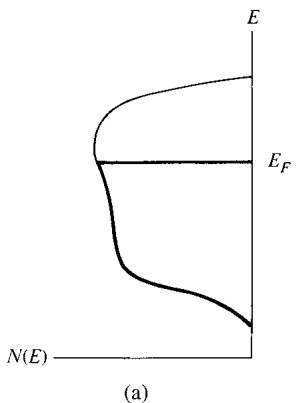

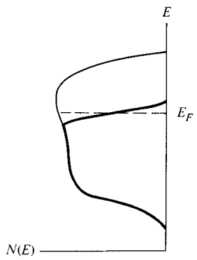

(b)

Fig. 4.19 Electron distributions at (a) 0K and (b) at a high temperature. $E_{F}$ is the Fermi level.

To understand the effect of an applied field, imagine the band divided into two halfbands, containing electrons of opposite spin. In zero applied field, each half-band contains the same number of electrons, and the crystal as a whole has no net moment. When a field is applied at 0K, it can reverse the spins only of those electrons which lie at and just below the Fermi level, and these constitute only a tiny fraction of the total number of electrons. The spins of those which lie in levels deep below $E_{F}$ cannot be changed, because there are no empty levels immediately above. The result is a weak paramagnetism. Note that here the field creates a moment on each atom, in sharp contrast to a normal paramagnetic material, in which each atom has a net moment before the field is applied. The effect of an increase in temperature is merely to excite the uppermost electrons in the band to higher levels, but this effect takes place to about the same extent in both half-bands and does not change the spin unbalance created by the field. The susceptibility is therefore essentially independent of temperature.

Figure 4.19 is drawn to suggest the high, narrow 3d band characteristic of a transition metal like manganese, which has a high density of 3d levels. In a metal like potassium, however, the Pauli paramagnetism will be even weaker, because the outermost electrons are now 4s electrons. The density of 4s levels is low, which means that the spacing of levels is large. The effect of a given applied field in producing spin unbalance is therefore less than for a metal with closely spaced levels.

We can now see that the phenomena of ferromagnetism and Pauli paramagnetism are very much alike, except for one vital factor: the magnitude of the force creating spin unbalance. The band sketched in Fig. 4.19 might well indicate, in a schematic way, the 3d band of both manganese (paramagnetic at room temperature) and iron (ferromagnetic). The only difference would be that the Fermi level of manganese would be somewhat lower than that of iron, because manganese has one less electron. In manganese, spin unbalance can be created only by an applied field; the amount of unbalance is small, and it disappears when the field is removed. In iron, on the other hand, a very powerful molecular field (exchange force) spontaneously and permanently creates a large spin unbalance in every atom and forces the net spins of all the atoms in a single domain to be parallel to one another.

## 4.5 FERROMAGNETIC ALLOYS

Ferromagnetism is found in the binary and ternary alloys of Fe, Co, and Ni with one another, in alloys of Fe, Co, and Ni with other elements, and in a relatively few alloys which do not contain any ferromagnetic elements. The ferromagnetism of alloys is therefore a very wide subject, and we can examine here only the more important trends.

Certain distinctions can be made at the beginning. In terms of binary alloys, these are:

1. When two elements form a mutual solid solution, the variation of the saturation magnetization $\sigma_{s}$ and the Curie temperature $T_{c}$ with composition is, in general, unpredictable.

2. When an alloy consists of two phases, a change in overall composition changes only the relative amounts of the two phases, but the composition of each phase remains constant. Therefore, if one phase is ferromagnetic, the saturation magnetization $\sigma_{s}$ of the alloy will vary linearly with the weight percent of the added element in the alloy, and $T_{c}$ will remain constant.

These two kinds of behavior are illustrated in Fig. 4.20. Element $A$ is assumed to be ferromagnetic, and $B$, together with the B-rich solid solution β, is assumed to be paramagnetic. When $B$ is added to $A$ to form the a solid solution, both $\sigma_{s}$ and $T_{\mathrm{c}}$ are expected to decrease, but the shape of the curve of $\sigma_{\mathrm{s}}$ (or $T_{\mathrm{c}}$) vs composition is unpredictable. In the two-phase $(\alpha + \beta)$ region, the a phase is saturated and does not change its composition, but the amount of a decreases as $B$ is added. Therefore $\sigma_{s}$ decreases linearly to zero at the edge of the two-phase field, and $T_{c}$ remains constant.

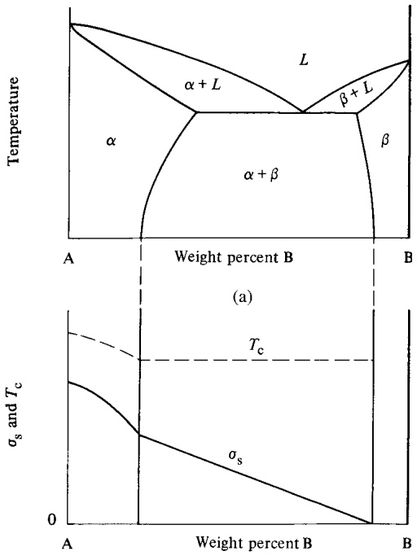

(b)

Fig. 4.20 (a) Hypothetical phase diagram of $A–B$ alloys. Element $A$ is ferromagnetic, $B$ is paramagnetic. (b) Variation of $\sigma_{s}$ and $T_{c}$ with composition.

Iron-cobalt alloys illustrate these effects. Figure 4.21a shows the phase diagram; there is a very wide range of solid solubility at room temperature, extending to about 75% Co. The 50% Co alloy undergoes long-range ordering, and $\alpha^{\prime}$ is the ordered form of a. The Curie temperature, shown by dotted lines, follows the boundaries of the $(\alpha + \gamma)$ region from about 15 to 73% Co, a range over which these boundaries are almost coincident; $T_{c}$ is then constant, but not shown on the diagram, over the two-phase region from 73 to

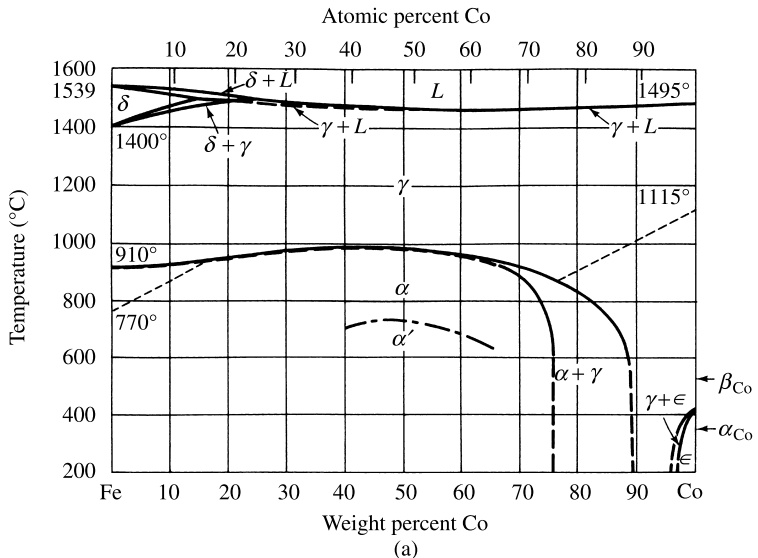

(a)

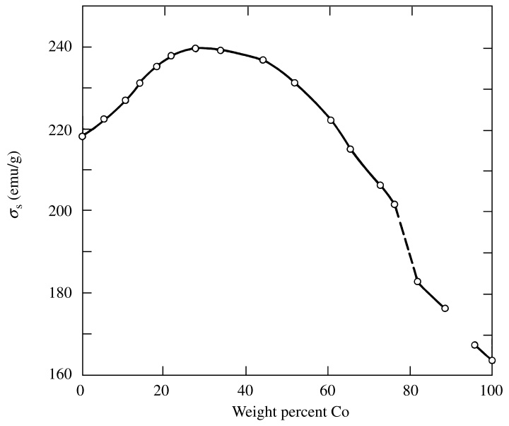

(b)

Fig. 4.21 (a) Fe–Co binary phase diagram. (b) Variation of $\sigma_{s}$ at room temperature with composition.

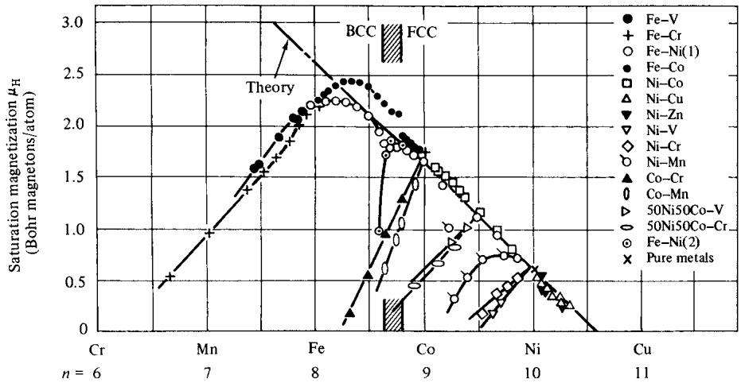

Fig. 4.22 Slater –Pauling curve: dependence of saturation magnetization of alloys on the number of (3d + 4s) electrons per atom. [S. Chikazumi, Physics of Ferromagnetism, Oxford University Press, (1997).]

76% Co, and then rises to the value for pure Co. Figure 4.21b shows the variation of $\sigma_{s}$ with composition. The addition of cobalt, which is less magnetic than iron, increases the magnetization, and the 30% Co alloy has a higher value of $\sigma_{s}$ at room temperature than any other known material. The cobalt-rich alloys are not spaced closely enough in composition to clearly show the expected variation of $\sigma_{s}$ in the two-phase $(\alpha + \gamma)$ and $(\gamma + \varepsilon)$ regions, but the marked change in slope of the curve at about 75% Co, the edge of the a region, is apparent. The dashed line corresponds to the $(\alpha + \gamma)$ field, but the phase diagram and the magnetic data are not in full accord in the Co-rich region.

In the remainder of this section we will consider only single-phase solid solutions. According to the band theory, the saturation magnetization of elements near nickel should depend only on the number n of $(3d + 4s)$ electrons per atom in accordance with Equation 4.33. By alloying we can make n take on nonintegral values and, in this way, test the theory over those ranges of n in which solid solutions exist. The results are shown in Fig. 4.22, generally called the Slater–Pauling curve. We note the following points:

1. When n is greater than about 8.3, theory and experiment are in good agreement. Both the theoretical and experimental values of $\mu_{H}$ go to zero in a Ni–Cu alloy containing 60% Cu $(n = 10.6)$; this composition is such that the 3d band is just filled. In general, however, good agreement is obtained only when a particular value of n is arrived at by alloying adjacent elements.

2. For n greater than 8.3, most of the data are in marked disagreement with theory for alloys of nonadjacent elements. For example, Co containing 50% Ni has $n = 9.5$ and lies on the main curve, but Mn containing 83% Ni, for which n is also 9.5, has a value of $\mu_{H}$ much lower than the theoretical. There appears to be no general agreement on the reason for such deviations. (See also Section 5.5.)

3. When n is less than 8.3, there is no agreement whatever between theory and experiment, and the magnetization decreases as n decreases.

When a nontransition element (e.g., Cu, Zn, Al, Si, etc.) is dissolved in Fe, Co, or Ni, the magnetization decreases, but the rate of decrease per added atom is not the same for all solutes.

† Ni-base Alloys. Here the magnetization decreases at a rate proportional to the valence of the solute. Thus 60 atom% of Cu (valence 1) is needed to reduce the magnetization to zero, but only 30 atom% of Zn (valence 2). The solute atom appears to contribute all its valence electrons to the 3d band of the alloy; the larger the valence, the more rapidly the band fills up, and hence the more rapid is the decrease in magnetization. This behavior is in good agreement with the band theory.

† Fe- and Co-rich Alloys. Here the rate of decrease of magnetization, at least initially, is much the same, whatever the added atom. The solute atom appears to act as a simple diluent, i.e., the magnetization decreases as though iron atoms, for example, of moment $2.22\mu_{\mathrm{B}}$ were being replaced by atoms of zero moment. This behavior is inexplicable in terms of the simple band theory.

Even more complex problems are presented to the theorist by binary alloys of Fe, Co, or Ni and one of the transition metals immediately below them in the periodic table (Ru, Rh, Pd, Os, Ir, and Pt). The magnetization usually decreases as one of the latter is added, but at a rate which is greater than, equal to, or less than the rate corresponding to simple dilution. And in some of the alloys the magnetization actually increases at first, before it begins to decrease.

At low temperatures, surprisingly small amounts of Fe, Co, or Ni, when alloyed with elements like Pt or Pd, can serve to make the alloy ferromagnetic. Thus ferromagnetism has been observed in Pd containing only 10 atom% Fe at temperatures below about 260K. And ferromagnetism still persists when the Fe content is as low as 0.15 atom%, although the Curie temperature is then about 3K. In such a dilute alloy the iron atoms are so far apart, some 8 – 10 interatomic distances, that exchange forces could not possibly keep the spins of nearest-neighbor iron atoms parallel to one another. The intervening palladium atoms must take part in the long-range coupling between iron atoms.

All of the above remarks on alloys apply to disordered (random) solid solutions, in which the constituent atoms, $A$ and $B$, occupy the available lattice sites at random. In many alloys this disordered state is stable only at relatively high temperatures; below a certain critical temperature, long-range ordering sets in. A atoms then occupy a particular set of lattice sites and $B$ atoms occupy another set. In the disordered state, like atoms are often adjacent to each other (AA or BB pairs), whereas ordering commonly makes all nearest neighbors unlike (AB pairs). Because the nature of the nearest neighbors in a particular alloy can influence its electronic nature, ordering usually changes the magnetic properties, sometimes dramatically.

In Fe–Co alloys, at and near the composition of FeCo, ordering takes place below a critical temperature of about $730^{\circ}\mathrm{C},$ as shown in Fig. 4.21a. In the disordered a phase the atoms are arranged at random on the corners and at the center of a cubic unit cell. The ordered a0 phase has the CsCl structure, in which iron atoms occupy only corner sites and cobalt atoms only the cube-center sites. Ordering produces a slight increase in the saturation magnetization. The same small effect is found in $\mathrm{FeNi}_{3}$ . Here the disordered phase is face-centered cubic, while the ordered structure is one in which iron atoms occupy only the cube corners and nickel atoms only the centers of the cube faces (see Fig. 4.5). But in MnNi3, which orders like $\mathrm{FeNi}_{3}$ , ordering has a profound effect: the disordered alloy is paramagnetic, the ordered one ferromagnetic.

Many binary alloys of a transition metal and a rare earth element are ferromagnetic. For example, alloys of the composition $RCo_{5}$ , where R = Y, Ce, Pr, Nd, or Sm, are ferromagnetic and some of them are good permanent magnets; see Chapter 14.

Finally, we will consider ferromagnetism in alloys made of nonferromagnetic elements. Most of these contain manganese or chromium. The Heusler alloys $\mathrm{Cu_{2}MnSn}$ and $\mathrm{Cu_2MnAl}$ , which have been known since 1898, have already been mentioned in Section 4.3 Like $\mathrm{MnNi}_{3}$ , they are paramagnetic when disordered and ferromagnetic when ordered. Presumably, in all three alloys, ordering makes the Mn–Mn distance large enough for the exchange interaction to become positive. MnBi and MnAl are ferromagnetic, and their coercivities are high enough to make them of interest as possible permanent-magnet materials. Some other ferromagnetic manganese alloys are $\mathrm{Ag_5MnAl}$ $\mathrm{Mn}_{3}\mathrm{ZnC}$ $\mathrm{Au}_{4}\mathrm{Mn}$ MnSb, MnCrSb, and $\mathrm{Pt}_{3}\mathrm{Mn}$ . Ferromagnetic chromium alloys or compounds include CrS, CrTe, and $\mathrm{CrBr}_{3}$ . One would not expect to find ferromagnetism in the $\mathrm{Zr-Zn}$ system, but the compound $\mathrm{ZrZn_{2}}$ is ferromagnetic; however, its Curie temperature is only 35K.

Ferromagnetism is rare in ionic compounds, in general, and even rarer in oxides. Only two examples of the latter are known, $\mathrm{CrO_{2}}$ and EuO. The Curie point of EuO is 77K, but $\mathrm{CrO_{2}}$ is ferromagnetic at room temperature $(T_{\mathrm{c}} = 127^{\circ}\mathrm{C})$ . The crystal structure of $\mathrm{CrO_{2}}$ is that of the mineral rutile; it is shown in Fig. 5.12. The $\mathrm{Cr^{4+}}$ ions are located at the cell center and the cell corners, and the spins on these ions are all parallel, unlike the spin structure illustrated there. The properties of $\mathrm{CrO_{2}}$ make it suitable for magnetic recording tape (see Section 15.3).

## 4.6 THERMAL EFFECTS

Ferromagnetic substances exhibit two unusual thermal effects. These effects are of interest to solid-state physicists because of the light they can throw on the electronic nature of a solid, and may have some practical applications in refrigeration systems. They are:

Specific Heat. The specific heat of a ferromagnet is greater than that of a nonferromagnet and goes through a maximum at the Curie temperature. When heat is added to any metal, part of it increases the amplitude of thermal vibration of the atoms (lattice specific heat) and the remainder increases the kinetic energy of the valence electrons (electronic specific heat). If the metal is ferromagnetic, additional heat is required to disorder the spins (magnetic specific heat). The number of spins disordered per degree rise in temperature increases with the temperature in accordance with the appropriate Brillouin function, and becomes very large just below the Curie temperature, where the magnetization is decreasing precipitously. The fact that the specific heat is still abnormally high just above the Curie temperature is further evidence for the spin clusters mentioned in Section 4.2.

Magnetocaloric Effect. When heat is absorbed by a ferromagnet, part of the heat causes a decrease in the degree of spin order. Conversely, if the spin order is increased, by the application of a large field, heat will be released. If the field is applied suddenly, the process will be essentially adiabatic and the temperature of the specimen will rise. This is the magnetocaloric effect. The increase in temperature amounts to 1 or $2^{\circ}\mathrm{C}$ for fields of the order of 10 – 20 kOe (1 – 2 T).

The magnetocaloric effect is not to be confused with a much smaller heating effect which occurs at room temperature during a change of magnetization from zero to the state of technical saturation, i.e., during the conversion of the specimen from the multi-domain to the single-domain state. The magnetocaloric effect is caused by the change in spin order accompanying forced magnetization, in which a high field causes an increase in magnetization of the domain itself. This increase in magnetization above $\sigma_{s},$ for a given applied field, is greatest at the Curie temperature and decreases as the temperature decreases below $T_{\mathrm{c}}$ A relatively large increase in magnetization per unit of applied field can also be produced just above the Curie temperature because there the susceptibility of the paramagnetic state has its maximum value. As a result the temperature increase produced by this effect goes through a maximum at $T_{\mathrm{c}}$

## 4.7 THEORIES OF FERROMAGNETISM

The critical reader must by now have come to the conclusion, correctly, that the theory of ferromagnetism is in a far from satisfactory state. In this section we shall briefly examine the theory in the light of the main experimental facts. Actually, there is not a single theory, but at least two rather divergent viewpoints: (1) the localized moment theory, and (2) the band theory.

According to the localized moment theory, the electrons responsible for ferromagnetism are attached to the atoms and cannot move about in the crystal. These electrons contribute a certain magnetic moment to each atom and that moment is localized at each atom. This view is implicit in the molecular field theory, either in the original form given by Weiss or in the quantum-mechanical form obtained by substituting the Brillouin function for the Langevin. As we have seen, this theory accounts satisfactorily for the variation of the saturation magnetization $\sigma_{s}$ with temperature and for the fact that a Curie – Weiss law is obeyed, at least approximately, above $T_{c}$ . But it cannot explain the fact that the observed moments per atom $\mu_{H}$ are nonintegral for metals; since the moment is due almost entirely to spin, as shown by g factor measurements, the moment per atom, if due to localized electrons, should be an integer. Other defects of the theory are that $\mu_{H}$ and the molecular-field constant gr are different above and below the Curie temperature.

The Heisenberg approach is also based on the assumption of localized moments, because the expression for the exchange energy (Equation 4.29) explicitly localizes a certain spin magnetic moment on each atom. A substance which does behave as though its moments were localized, and there are a few, like EuO, is called a Heisenberg ferromagnet. Thus the assumption of localized moments is built into the molecular field theory, whether we call the force causing parallel spin alignment a molecular field or an exchange force.

In the band theory, on the other hand, all attempts at localizing the outer electrons of the atom are abandoned. As mentioned earlier, the band theory is sometimes called the collective-electron theory, when applied to magnetic properties. Another name is the itinerant-electron theory. These alternative names emphasize the fact that the electrons responsible for ferromagnetism are considered to belong to the crystal as a whole and to be capable of moving from one atom to another, rather than localized at the positions of the atoms. This theory accounts quite naturally for the nonintegral values of the moment per atom. It also explains fairly well the relative magnitudes of $\mu_{\mathrm{H}}$ in iron, cobalt, and nickel, and the value of the average magnetic moment per atom in certain alloys. These are important accomplishments of the theory. However, the band theory, at least in its simple form, cannot account for those alloys which depart from the main curve of Fig. 4.22.

It seems clear that the molecular field theory, with its attendant assumption of localized moments, is simply not valid for metals. Instead, band theory is a more useful approach. Steady progress has been and is being made in this subject, but the details are largely unnecessary for the remainder of this book. Summaries of the current status of the fields can be found in the books by Soshin Chikazumi [Physics of Ferromagnetism, Oxford University Press (1997)] and Robert C. O’Handley [Modern Magnetic Materials, Principles and Applications, Wiley (2000)].

## 4.8 MAGNETIC ANALYSIS

We turn now to a very practical subject. Magnetic analysis, in the widest sense of the term, embraces any determination of chemical composition or physical structure by means of magnetic measurements. It therefore includes the following:

1. Measurement of the susceptibility χ of weakly magnetic substances. If the relation between χ and the chemical composition of a solid solution is known, either from the literature or from calibration experiments, a measurement of χ will give the composition. (An example was mentioned in the previous chapter, in the discussion of Fig. 3.11.) Determination of the $M$, $H$ curve will disclose the presence of a small amount of a ferromagnetic second phase, as described in the discussion of Fig. 3.12.

2. Measurement of the structure-sensitive properties, such as the initial permeability $\mu_{0}$ and the coercivity $H_{c},$ of ferro- and ferrimagnetics. The interpretation of such measurements, although difficult, can yield information about the physical structure of the material, e.g. preferred crystal orientation, residual stress, and the presence of inclusions. These topics will be taken up in later portions of the book.

3. Measurement of the structure-insensitive properties of ferro- and ferrimagnetics. These are considered below.

The structure-insensitive properties are the saturation magnetization $\sigma_{s}$ and the Curie temperature $T_{\mathrm{c}}$ . As we saw in Fig. 4.20, the value of $\sigma_{s}$ for a two-phase alloy is simply the weighted average of the magnetizations of the two phases:

$$
\sigma_ {\mathrm{s}} (\text {alloy}) = w _ {\alpha} \sigma_ {\mathrm{s} \alpha} + w _ {\beta} \sigma_ {\mathrm{s}} = w _ {\alpha} \sigma_ {\mathrm{s} \alpha} + (1 - w _ {\alpha}) \sigma_ {\mathrm{s} \beta}\tag{4.34}
$$

where $w_{\alpha}$ and $w_{\beta}$ are the weight fractions of the $\alpha$ and β phases. This equation holds whether the β phase is ferromagnetic $(\sigma_{\mathrm{s}\beta} > 0)$ or paramagnetic $(\sigma_{\mathrm{s}\beta} = 0)$ . If $\sigma_{\mathrm{s}\alpha}$ and $\sigma_{\mathrm{s}\beta}$ are known, a measurement of $\sigma_{s}$ (alloy) will give the amount of each phase present. At least two applications of such measurements have been made:

1. Determination of Retained Austenite in Hardened Steel. At a sufficiently high temperature, steel is wholly austenitic. Austenite is a paramagnetic solid solution of carbon and possibly other elements, in face-centered cubic g-iron. When the steel is quenched (rapidly cooled), the austenite transforms wholly or partially to martensite, which is a ferromagnetic, supersaturated solid solution of carbon in a-iron, with a body-centered tetragonal unit cell. Any untransformed austenite is called retained austenite, and is generally undesirable; it can be present in amounts ranging from 0 to about 20% in many steels.

2. Determination of Martensite in Stainless Steel. Many stainless steels are wholly austenitic, and paramagnetic, at room temperature; an example is the popular “18-8” variety, which contains about 18% Cr and 8% Ni. However, a substantial amount of ferromagnetic martensite may be formed if the steel is deformed at room temperature or merely cooled to a temperature far below room temperature.

Although the application of Equation 4.34 to these determinations might seem easy, there is a certain experimental difficulty in determining $\sigma_{s}$ (alloy). The approach to magnetic saturation, as the applied field is increased, is gradual, and it is sometimes difficult to know whether or not saturation has actually been reached (see Section 9.15). This means in turn that greater accuracy can be achieved in determining a small amount of a ferromagnet dispersed in a paramagnetic matrix (e.g. martensite in stainless steel) than in determining, by difference, a small amount of a paramagnet dispersed in a ferromagnet (e.g. retained austenite in hardened steel).

Measurements of $\sigma_{s}$ can be helpful in determining phase diagrams. Measurement of the solid solubility of $B$ in $A$ is illustrated in Fig. 4.23, in which, as before, a is assumed to be ferromagnetic and β paramagnetic. If the alloys are very slowly cooled to room temperature $T_{1}$ , so that they are in equilibrium at that temperature, then $\sigma_{s}$ will vary with composition along the curve abe. But if the alloys are brought to equilibrium at $T_{2}$ and then quenched to room temperature, $\sigma_{s}$ will vary along abcd. The intersections of the straight line portions with the curve abc, which shows the variation of $\sigma_{s}$ with composition in the $\alpha$ region, gives the solid solubilities, namely, x and y% $B$ at temperatures $T_{1}$ and $T_{2}$ respectively. Although magnetic analysis can be of considerable value in the study of some alloy systems, it should be supplemented with the more common techniques of microscopic examination and X-ray diffraction.

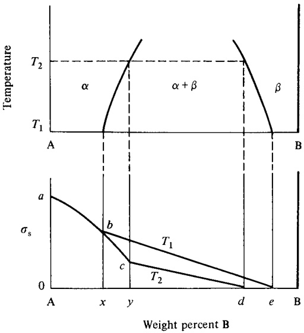

Fig. 4.23 Variation of saturation magnetization $\sigma_{s}$ with composition in alloys equilibrated at temperatures $T_{1}$ and $T_{2}$

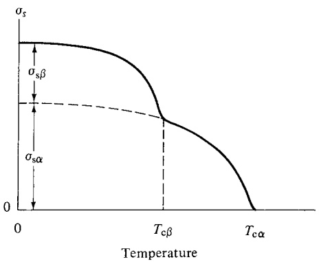

Fig. 4.24 Variation of $\sigma_{s}$ with temperature in an alloy of two ferromagnetic phases.

In all the above examples, the measurement of $\sigma_{s}$ is made at room temperature. Another method, called magnetothermal analysis, involves measurement of $\sigma_{s}$ as a function of temperature, leading to a curve like that of Fig. 4.24. This curve would apply to a twophase alloy in which both phases are ferromagnetic. In principle, at least, the composition of each phase can be found from the observed Curie points, $T_{\mathrm{c}\alpha}$ and $T_{\mathrm{c}\beta},$ and their relative amounts from $\sigma_{\mathrm{s}\alpha}$ and $\sigma_{\mathrm{s}\beta}$ One difficulty with this method is that both Curie points must be well below the temperature of rapid diffusion, or alternatively, the solid—solubility limits of each phase must not change with temperature; if these conditions are not met, the mere act of heating the specimen to the measurement temperatures will change the composition of one or both phases and make quantitative interpretation of the $\sigma_{s}$ T curve impossible.

Magnetic measurements have also been used to study the precipitation process in alloys, particularly those in which a ferromagnetic phase precipitates in a paramagnetic matrix. When conditions are favorable, the size of the precipitate particles, the total amount of pre-cipitate, and the way in which these quantities change with time can be measured. The interpretation of such measurements is not always straightforward. For one thing, the size of the field required to saturate the particles depends on their shape and orientation, as mentioned near the end of Section 3.8. But more important is the fact that the magnetic properties of very fine particles are unusual. These properties are described in Chapter 11, and an example of a magnetic study of precipitation will be given there (Section 11.7).

## PROBLEMS

4.1 Show that Equation 4.25 is equivalent to Equation 3.48.

4.2 From Fig. 4.22,

a. What alloy has the highest saturation magnetization?

b. What is the numerical value of this magnetization, expressed as magnetization per unit mass?

c. How does this compare with the saturation per unit mass of iron?

