# ANTIFERROMAGNETISM

## 5.1 INTRODUCTION

Antiferromagnetic substances have a small positive susceptibility at all temperatures, but their susceptibilities vary in a peculiar way with temperature. At first glance, they might therefore be regarded as anomalous paramagnets. However, closer study has shown that their underlying magnetic structure is so entirely different that they deserve a separate classification. The theory of antiferromagnetism was developed chiefly by Néel$^{1}$ in a series of papers, beginning in 1932 [L. Néel, Ann. de Physique, 18 (1932) p. 5], in which he applied the Weiss molecular field theory to the problem.

The way in which the susceptibility of an antiferromagnetic varies with temperature is shown in Fig. 5.1. As the temperature decreases, x increases but goes through a maximum at a critical temperature called the Néel temperature $T_{\mathrm{N}}$ The substance is paramagnetic above $T_{\mathrm{N}}$ and antiferromagnetic below it. $T_{N}$ often lies far below room temperature, so that it may be necessary to carry susceptibility measurements down to quite low temperatures to discover if a given substance, paramagnetic at room temperature, is actually antiferromagnetic at some lower temperature. Most, but not all, antiferromagnetics are ionic compounds: oxides, sulfides, chlorides, and the like. A very large number are known, which makes them much more common than ferromagnetics. A selection is given in Table 5.1. They are of considerable scientific interest, and are important in some computer applications that make use of exchange anisotropy or exchange bias (see Chapter 15). The theory of these materials is worth examining in some detail because it leads naturally into the theory of ferrimagnetic materials, which are of great industrial importance.

<small>1Louis Néel (1904–2000) was a French physicist and former student under Weiss at Strasbourg. He founded, after World War II, a flourishing center of magnetic research at the University of Grenoble. He was awarded a Nobel prize in 1970.</small>

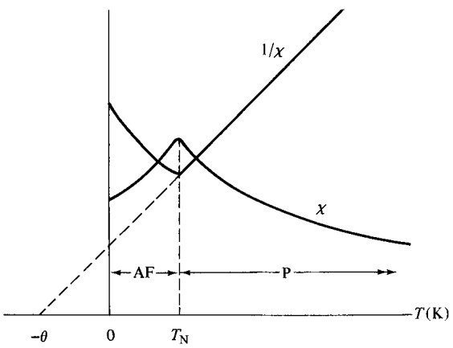

Fig. 5.1 Temperature dependence of susceptibility χ and inverse susceptibility $1 / \chi$ for an antiferromagnetic material (schematic). AF = antiferromagnetic, P = paramagnetic.

Just as in the case of ferromagnetism, the clue to the behavior of an antiferromagnet lies in the way its susceptibility varies with temperature above the critical temperature. Figure 5.1 shows that a plot of 1/χ vs T is a straight line above $T_{\mathrm{N}}$ and that this line extrapolates to a negative temperature at $1/\chi=0$ . The equation of the line is

TABLE 5.1 Some Antiferromagnetic Materialsa

| Material | Metal Ion Arrangement$^{b}$ | $T_{\text{N}}$(K) | $\Theta$(K)$^c$ | $\frac{\Theta}{T_{\text{N}}}$ | $\frac{\chi_{\text{p}}(0)}{\chi_{\text{p}}(T_{\text{N}})}$ |
| --- | --- | --- | --- | --- | --- |
| MnO | fcc | 122 | 610 | 5.0 | 0.69 |
| FeO | fcc | 198 | 570 | 2.9 | 0.78 |
| CoO | fcc | 293 | 280 | 1.0 | — |
| NiO | fcc | 523 | 3000 | 5.7 | 0.67 |
| α-MnS | fcc | 154 | 465 | 3.0 | 0.82 |
| β-MnS | fcc | 155 | 982 | 6.3 | — |
| α-Fe$_2$O$_3$ | r | 950 | 2000 | 2.1 | — |
| Cr$_2$O$_3$ | r | 307 | 1070 | 3.5 | 0.76 |
| CuCl$_2$·2H$_2$O | r | 4.3 | 5 | 1.2 | — |
| FeS | hl | 613 | 857 | 1.4 | — |
| FeCl$_2$ | hl | 24 | -48 | -2.0 | &lt;0.2 |
| CoCl$_2$ | hl | 25 | -38 | -1.5 | ~0.6 |
| NiCl$_2$ | hl | 50 | -68 | -1.4 | — |
| MnF$_2$ | bct | 67 | 80 | 1.2 | 0.76 |
| FeF$_2$ | bct | 79 | 117 | 1.5 | 0.72 |
| CoF$_2$ | bct | 40 | 53 | 1.3 | — |
| NiF$_2$ | bct | 78 | 116 | 1.5 | — |
| MnO$_2$ | bct | 84 | — | — | 0.93 |
| Cr | bcc | 310 |  |  |  |
| α-Mn | cc | 100 |  |  |  |

aData from various sources.

bfcc = face-centered cubic, r = rhombohedral, hl = hexagonal layers, bct = body-centered tetragonal, bcc = body-centered cubic, cc = complex cubic.

cThe sign of $\theta$ in this column refers to a χ, T relation in the form $\chi = C / (T + \theta)$

$$
\frac {1}{\chi} = \frac {T + \theta}{C}\tag{5.1}
$$

or

$$
\chi = \frac {C}{T + \theta} = \frac {C}{T - (- \theta)}\tag{5.2}
$$

In other words, the material obeys a Curie –Weiss law but with a negative value of $\theta$. Inasmuch as $\theta$ is proportional to the molecular field coefficient γ (see Equation 3.21), the molecular field $H_{\mathrm{m}}$ in the paramagnetic region, is opposed to the applied field H; whereas $H$ acts to align the ionic moments, $H_{\mathrm{m}}$ acts to disalign them. If we now think of the molecular field on a very localized scale, the result is that any tendency of a particular ionic moment to point in one direction is immediately counteracted by a tendency for the moment on an adjacent ion to point in the opposite direction. In other words, the exchange force is negative.

Below the critical temperature $T_{\mathrm{N}}$ this tendency toward an antiparallel alignment of moments is strong enough to act even in the absence of an applied field, because the randomizing effect of thermal energy is so low. The lattice of magnetic ions in the crystal then breaks up into two sublattices, designated $A$ and $B$, having moments more or less opposed. The tendency toward antiparallelism becomes stronger as the temperature is lowered below $T_{\mathrm{N}}$ until at 0K the antiparallel arrangement is perfect, as depicted in Fig. 5.2. Only the magnetic metal ions are shown in this sketch: the other ions (oxygen, or sulfur, etc., as the case may be) are nonmagnetic and need not be considered at this point.

We now see that an antiferromagnetic at 0K consists of two interpenetrating and identical sublattices of magnetic ions, each spontaneously magnetized to saturation in zero applied field, but in opposite directions, just as the single lattice of a ferromagnetic is spontaneously magnetized. Evidently, an antiferromagnetic has no net spontaneous moment and can acquire a moment only when a strong field is applied to it. We note also that the Néel temperature $T_{N}$ plays the same role as the Curie temperature $T_{c};$ each divides the temperature scale into a magnetically ordered region below and a disordered (paramagnetic) region above. The several analogies to ferromagnetism are apparent and the name “antiferromagnetism” is entirely appropriate.

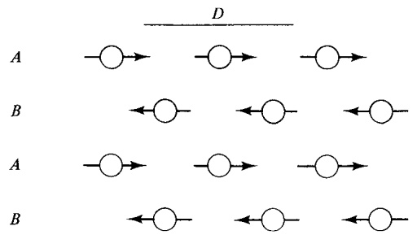

Fig. 5.2 Antiferromagnetic arrangement of $A$ and $B$ sublattices.

## 5.2 MOLECULAR FIELD THEORY

Before entering into the details of the molecular field theory, we should note that almost all antiferromagnetics are electrical insulators or semiconductors. Their electrical resistivities are thus at least a million times larger than those of typical metals. This means that they contain essentially no free electrons and that the electrons responsible for their magnetic properties are localized to particular ions. We therefore expect greater success in applying the molecular field theory, which is a localized-moment theory, to an antiferromagnetic insulator like MnO than to a ferromagnetic conductor like iron.

We will apply the molecular field theory to the simplest possible case, namely, one for which the lattice of magnetic ions can be divided into two identical sublattices, $A$ and $B$, such that any $A$ ion has only $B$ ions as nearest neighbors, and vice versa, as shown for two dimensions in Fig. 5.2. We assume that the only interaction is between nearest neighbors $(AB)$ and ignore the possibility of interactions between second-nearest neighbors $(AA$ and $BB)$.

We now have two molecular fields to deal with. The molecular field $H_{\mathrm{mA}}$ acting on the $A$ ions is proportional, and in the opposite direction, to the magnetization of the $B$ sublattice:

$$
H _ {\mathrm{mA}} = - \gamma M _ {\mathrm{B}},\tag{5.3}
$$

where γ is the molecular field coefficient, taken as positive. Similarly,

$$
H _ {\mathrm{m}} = - \gamma M _ {\mathrm{A}}.\tag{5.4}
$$

These two equations are valid both above and below $T_{\mathrm{N}}$ We will consider the two cases in turn.

## 5.2.1 Above $T_{\mathrm{N}}$

In the paramagnetic region we can find an equation for the susceptibility by proceeding as in Section 3.6, according to Equations 3.19– 3.22. Assuming Curie-law behavior, we have

$$
\chi = \frac {M}{\rho H} = \frac {C}{T}\tag{5.5}
$$

or

$$
M T = \rho C H,\tag{5.6}
$$

where $H$ must be interpreted as the total field, applied and molecular, acting on the material. We now write Equation 5.6 for each sublattice:

$$
M _ {\mathrm{A}} T = \rho C ^ {\prime} (H - \gamma M _ {\mathrm{B}}),\tag{5.7}
$$

$$
M _ {\mathrm{B}} T = \rho C ^ {\prime} (H - \gamma M _ {\mathrm{A}}),\tag{5.8}
$$

where $C'$ is the Curie constant of each sublattice and $H$ is the applied field. By adding these two equations we can find the total magnetization $M$ produced by the field and

hence the susceptibility:

$$
\begin{array}{c} (M _ {\mathrm{A}} + M _ {\mathrm{B}}) T = 2 \rho C ^ {\prime} H - \rho C ^ {\prime} \gamma (M _ {\mathrm{A}} + M _ {\mathrm{B}}), \\ M T = 2 \rho C ^ {\prime} H - \rho C ^ {\prime} \gamma M, \\ M (T + \rho C ^ {\prime} \gamma) = 2 \rho C ^ {\prime} H, \end{array}\tag{5.9}
$$

$$
\chi_ {\mathrm{m}} = \frac {M}{\rho H} = \frac {2 C ^ {\prime}}{T + \rho C ^ {\prime} \gamma}.
$$

This relation is equivalent to Equation 5.2, found experimentally, with

$$
C = 2 C ^ {\prime} \text { and } \theta = \rho C ^ {\prime} \gamma .\tag{5.10}
$$

Note that, when a field is applied above $T_{\mathrm{N}}$ each sublattice becomes magnetized in the same direction as the field, but each sublattice then sets up a molecular field, in the opposite direction to the applied field, tending to reduce both $M_{A}$ and $M_{\mathrm{B}}$ . The result is that the susceptibility x is smaller, and 1/χ larger, than that of an ideal paramagnetic in which the molecular field is zero. The two are compared graphically in Fig. 5.3, which also shows how x varies with T in a substance with a large positive molecular field, such as a ferromagnetic above its Curie point.

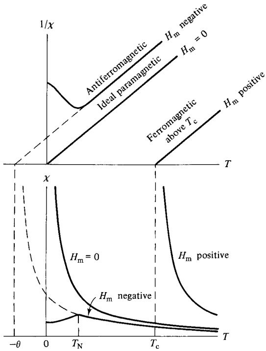

Fig. 5.3 Dependence of the susceptibility χ on the molecular field $H_{\mathrm{m}}$ for a fixed value of the Curie constant C.

## 5.2.2 Below $T_{\mathrm{N}}$

In the antiferromagnetic region, each sublattice is spontaneously magnetized, in zero applied field, by the molecular field created by the other sublattice. When $H$ is zero,

$$
M = M _ {\mathrm{A}} + M _ {\mathrm{B}} = 0,
$$

and

$$
M _ {\mathrm{A}} = - M _ {\mathrm{B}},\tag{5.11}
$$

at any temperature below $T_{\mathrm{N}}$ At a temperature infinitesimally below $T_{\mathrm{N}}$ we may assume that $M$ is still proportional to the total field, because saturation effects are unimportant near $T_{\mathrm{N}}$ Then Equations 5.7 and 5.8 are still valid. At $T = T_{\mathrm{N}}$ and $H=0$ , Equation 5.7 becomes

$$
M _ {\mathrm{A}} T _ {\mathrm{N}} = - \rho C ^ {\prime} \gamma M _ {\mathrm{B}}.\tag{5.12}
$$

Therefore,

$$
\rho C ^ {\prime} \gamma = \theta = - (M _ {\mathrm{A}} / M _ {\mathrm{B}}) T _ {\mathrm{N}} = T _ {\mathrm{N}}.\tag{5.13}
$$

The Néel temperature, at which the maximum in the $\chi, T$ curve occurs, should therefore equal the $\theta$ value found from the high-temperature susceptibility measurements.

Below $T_{\mathrm{N}}$ each sublattice is spontaneously magnetized to saturation just as a ferromagnetic is, and we can compute its magnetization in the same way. As in Section 4.2, we prefer to consider the specific magnetization $\sigma (= M / \rho)$ rather than $M$, because a range of temperature is involved. The fractional specific magnetization of the $A$ sublattice will then be given, according to Equation 4.13, for any temperature and field by

$$
\frac {\sigma_ {\mathrm{A}}}{\sigma_ {0 \mathrm{A}}} = B (J, a ^ {\prime}) = B \bigg (J, \frac {\mu_ {\mathrm{H}} H}{k T} \bigg),\tag{5.14}
$$

where $B$ is the Brillouin function. The field $H$ which appears in Equation 5.14 is the total field acting on the $A$ sublattice. Since we are computing the spontaneous magnetization, the applied field is zero, and we include only the molecular field due to the $B$ sublattice:

$$
H _ {\mathrm{mA}} = - \gamma M _ {\mathrm{B}} = \gamma M _ {\mathrm{A}} = \gamma \rho \sigma_ {\mathrm{A}}.\tag{5.15}
$$

Therefore, the fractional spontaneous magnetization of the $A$ sublattice is given by

$$
\frac {\sigma \mathrm{s} _ {\mathrm{A}}}{\sigma_ {0 \mathrm{A}}} = B \Big (J, \frac {\mu_ {\mathrm{H}} \gamma \rho \sigma_ {\mathrm{sA}}}{k T} \Big),\tag{5.16}
$$

with a similar expression for the $B$ sublattice. This equation can be solved graphically by the method of Fig. 4.4. A plot of the two sublattice magnetizations is given in Fig. 5.4.

Although the net spontaneous magnetization is zero below $T_{\mathrm{N}}$ an applied field can produce a small magnetization. The resulting susceptibility is found to depend on the angle which the applied field makes with the axis of antiparallelism marked D in

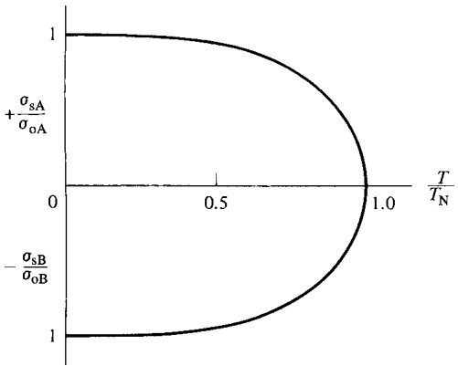

Fig. 5.4 Spontaneous magnetizations of the $A$ and $B$ sublattices at temperatures below $T_{\mathrm{N}}$ (schematic).

Fig. 5.2, an axis which usually coincides with an important crystallographic direction in the crystal. For brevity we will call this the spin axis. (In most antiferromagnetics, the orbital contribution is almost entirely quenched, so that the net moment per magnetic ion is due essentially to spin.) We will consider two limiting cases.

Field at Right Angles to Spin Axis. The effect of the applied field $H$ is to turn each sublattice magnetization away from the spin axis by a small angle a, as shown in Fig. 5.5a, where the vectors representing the magnetizations of the two sublattices are drawn from one point. This rotation immediately creates a magnetization s in the direction of the field and sets up an unbalanced molecular field $H_{\mathrm{m}}$ in the opposite direction. The spins will rotate until $H_{\mathrm{m}}$ equals $H$, or

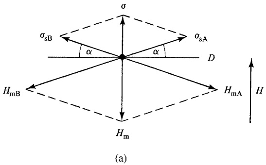

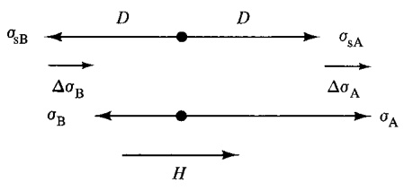

(b)

Fig. 5.5 Magnetization changes in an antiferromagnet when the field $H$ is applied (a) at right angles and (b) parallel to the spin axis D.

$$
\begin{array}{l} 2 (H _ {\mathrm{mA}} \sin \alpha) = H, \\ 2 \gamma \rho \sigma_ {\mathrm{sA}} \sin \alpha = H. \end{array}\tag{5.17}
$$

But

$$
\sigma = 2 \sigma_ {\mathrm{sA}} \sin \alpha .
$$

Therefore, grs = $H$, and

$$
\chi_ {\perp} = \frac {\sigma}{H} = \frac {1}{\gamma \rho} = \frac {C}{2 \theta}.\tag{5.18}
$$

We have assumed here that the sublattice magnetizations $\sigma_{\mathrm{sA}}$ and $\sigma_{\mathrm{sB}}$ change only their directions and not their magnitude when a field is applied; this is a good approximation because $\alpha$ is very small. We note from Equation 5.18 that the susceptibility at right angles to the spin axis is inversely proportional to the molecular field constant, as might be expected, and it is independent of the temperature. The high-temperature susceptibility Equation 5.9 should thus give the same result as Equation 5.18 at $T_{\mathrm{N}}$ This can be shown by combining Equations 5.9, 5.10, and 5.13.

Field Parallel to Spin Axis. Suppose the field is applied in the direction of the $A$ sublattice magnetization. Then the effect of the field is to increase the zero-field value of the $A$ sublattice magnetization $\sigma_{\mathrm{sA}}$ by an amount $\Delta \sigma_{\mathrm{A}}$ and decrease the corresponding value $\sigma_{\mathrm{sB}}$ of the $B$ sublattice by an amount $\Delta\sigma_{B}$ , as shown in Fig. 5.5b. The balance between the two sublattices is upset, and a net magnetization in the direction of the field is produced:

$$
\sigma = \sigma_ {\mathrm{A}} - \sigma_ {\mathrm{B}} = | \Delta \sigma_ {\mathrm{A}} | + | \Delta \sigma_ {\mathrm{B}} |.\tag{5.19}
$$

Now the magnetization of either sublattice is governed by the Brillouin function $B(J,a^{\prime})$ of Equation 4.13, as shown in Fig. 5.6. Here $P$ represents the spontaneous magnetization $\sigma_{s}$ , in the absence of an applied field, of either sublattice; it is determined by the particular value $a_{0}^{\prime}$ of the variable $a'$. The effect of an applied field is to move the point $P$ up on the curve for the $A$ sublattice and down on the curve for the $B$ sublattice. To simplify the calculation, we replace the Brillouin curve by its tangent at P, which amounts to assuming that the applied field produces equal changes in both sublattices:

$$
\begin{array}{c} | \Delta \sigma_ {\mathrm{A}} | = | \Delta \sigma_ {\mathrm{B}} |, \\ \sigma = 2 \Delta \sigma_ {\mathrm{A}}. \end{array}\tag{5.20}
$$

The value of $\Delta \sigma_{\mathrm{A}}$ will be given by the product of $\Delta a^{\prime}$ and the slope of the magnetization curve:

$$
\Delta \sigma_ {\mathrm{A}} = \Delta a ^ {\prime} [ \sigma_ {0 \mathrm{A}} B ^ {\prime} (J, a _ {0} ^ {\prime}) ],\tag{5.21}
$$

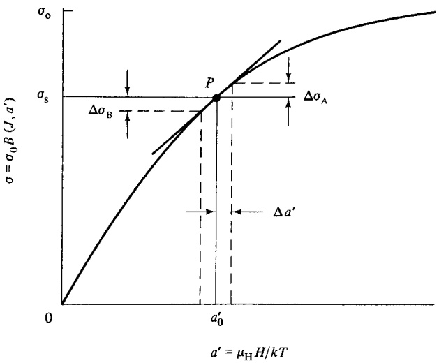

Fig. 5.6 Magnetization changes when the field is applied parallel to the spin axis.

where $B^{\prime}(J,a_{0}^{\prime})$ is the derivative of the Brillouin function with respect to its argument a0, evaluated at $a_{0}^{\prime}$ To find $\Delta a^{\prime}$ , we must remember that the field $H$ in the variable $a^{\prime}(=\mu_{\mathrm{H}}H/kt)$ can include both an applied field, which we will now write explicitly as $H_{a},$ and a molecular field. In the present problem, the increase in $a'$ is caused by the application of the field $H_{\mathrm{a}}$ less the amount the molecular field due to the $B$ sublattice has decreased due to $H_{a}$ or

$$
\Delta a ^ {\prime} = \frac {\mu_ {\mathrm{H}}}{k \mathrm{T}} (H _ {\mathrm{a}} - \gamma \rho | \Delta \sigma_ {\mathrm{B}} |) = \frac {\mu_ {\mathrm{H}}}{k \mathrm{T}} (H _ {\mathrm{a}} - \gamma \rho \Delta \sigma_ {\mathrm{A}}).\tag{5.22}
$$

Equation 5.21 then becomes

$$
\Delta \sigma_ {\mathrm{A}} = \frac {n _ {\mathrm{g}} \mu_ {\mathrm{H}} ^ {2}}{2 k \mathrm{T}} (H _ {\mathrm{a}} - \gamma \rho D \sigma_ {\mathrm{A}}) B ^ {\prime} (J, a _ {0} ^ {\prime}),\tag{5.23}
$$

where we have put $\sigma_{0A}$ , which represents absolute saturation of the $A$ sublattice, equal to $(n_{\mathrm{g}} / 2)\mu_{\mathrm{H}}$ where $n_{\mathrm{g}}$ is the number of magnetic ions per gram. After solving Equation 5.23 for $\Delta \sigma_{\mathrm{A}}$ , we arrive finally at an expression for the susceptibility parallel to the spin axis:

$$
\chi_ {\parallel} = \frac {\sigma}{H _ {\mathrm{a}}} = \frac {2 \Delta \sigma_ {\mathrm{A}}}{H _ {\mathrm{a}}} = \frac {2 n _ {\mathrm{g}} \mu_ {\mathrm{H}} ^ {2} B ^ {\prime} (J , a _ {0} ^ {\prime})}{2 k T + n _ {\mathrm{g}} \mu_ {\mathrm{H}} ^ {2} \gamma \rho B ^ {\prime} (J , a _ {0} ^ {\prime})}.\tag{5.24}
$$

This equation may be put in another form by making the substitution

$$
n _ {\mathrm{g}} \mu_ {\mathrm{H}} ^ {2} = 3 k C \bigg (\frac {J}{J + 1} \bigg),\tag{5.25}
$$

which follows from Equation 3.48 and where C is the Curie constant and J the quantum number.

Equation 5.24 is quite general and holds both above and below the Néel temperature. It also holds for a ferromagnet: The increase in magnetization caused by unit applied field, as given by Equation 5.24, corresponds exactly to the “forced magnetization” of Section 4.2. This forced magnetization of a ferromagnet is difficult to measure because it is small and imposed on the spontaneous magnetization, which is rather large. But it is easy to measure in an antiferromagnetic, because the net magnetization, before the field is applied, is zero. It is left to the reader to demonstrate the following properties of Equation 5.24:

1. It reduces to Equation 5.2 at high temperatures.

2. It reduces to Equation 5.18 at $T_{\mathrm{N}}$

3. It approaches zero as T approaches 0K.

The variation of $\chi_{\parallel}$ between 0K and $T_{\mathrm{N}}$ relative to $\chi_{\perp}$ , depends only on J and may be calculated with the aid of $B^{\prime}(J,a_{0}^{\prime})$ values. This variation is shown in Fig. 5.7. It may be interpreted physically as follows: at 0K, $a'$ is infinite and the sublattice magnetization curve is perfectly flat, so that an applied field can produce no change in the magnetization of either sublattice, both of which are in a state of absolute saturation. As the temperature increases above 0K, thermal energy decreases the spontaneous magnetization of each sublattice (as shown in Fig. 5.4), the applied field is able to reverse an increasing number of spins, and $\chi_{\parallel}$ increases.

In a powder specimen or a random polycrystal, in which there is no preferred orientation of the grains, the spin axis D takes on all possible orientations with respect to the applied field. To find the susceptibility of a powder we must therefore average over all orientations. If the applied field $H$ makes an angle $\theta$ with the spin axis D of a particular crystal in the powder, then the magnetizations acquired by that crystal, parallel and perpendicular to D, are

$$
\begin{array}{c} \sigma_ {\parallel} = \chi_ {\parallel} H \cos \theta , \\ \sigma_ {\perp} = \chi_ {\perp} H \sin \theta . \end{array}\tag{5.26}
$$

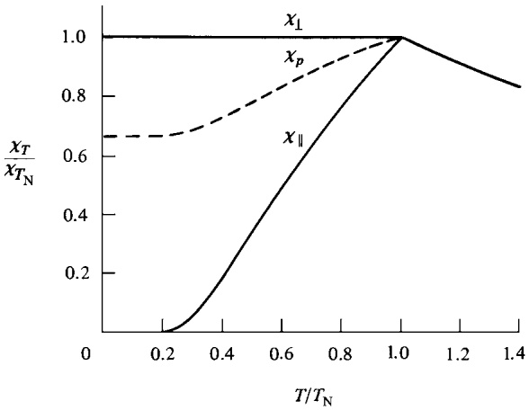

Fig. 5.7 Calculated temperature variation of the susceptibility of an antiferromagnet near and below the Néel temperature $T_{\mathrm{N}}$ The curve of $\chi_{\parallel}$ is calculated for $J = 1$

The magnetization in the direction of the field is then

$$
\begin{array}{r l} \sigma = \sigma_ {\parallel} \cos \theta + \sigma_ {\perp} \sin \theta \\ = \chi_ {\parallel} H \cos^ {2} \theta + \chi_ {\perp} H \sin^ {2} \theta \end{array}
$$

or

$$
\chi = \frac {\sigma}{H} = \chi_ {\parallel} \cos^ {2} \theta + \chi_ {\perp} \sin^ {2} \theta .\tag{5.27}
$$

This susceptibility of one crystal must then be averaged over all possible values of $\theta$ to give the susceptibility of the powder:

$$
\begin{array}{c} \chi_ {p} = \chi_ {\parallel} \overline {{\cos^ {2} \theta}} + \chi_ {\perp} \overline {{\sin^ {2} \theta}} \\ = \frac {1}{3} \chi_ {\parallel} + \frac {2}{3} \chi_ {\perp}. \end{array}\tag{5.28}
$$

A plot of the temperature variation of the powder susceptibility is included in Fig. 5.7.

## 5.2.3 Comparison with Experiment

The molecular field theory outlined above leads to three predictions, easily compared with experiment:

1. $\theta / T_{\mathrm{N}}$ should equal 1, according to Equation 5.13.

2. The values of $\chi_{\parallel}$ and $\chi_{\perp}$ for a single crystal should vary with temperature as in Fig. 5.7.

3. The ratio of the susceptibility of a powder at 0K to its value at $T_{N}$ should equal $\frac{2}{3}$ , according to Equation 5.28, since $\chi_{\parallel} = 0$ and $\chi_{\perp} = \chi_{T_{\mathrm{N}}}$ at 0K.

Table 5.1 shows that observed values of $\theta /T_{\mathrm{N}}$ range from 1 up to 5 or 6. This departure from unity does not mean that the molecular field theory has failed but that our initial assumption was too restrictive. We assumed that the only molecular field acting on the $A$ ions was due to the $B$ sublattice. Actually, there is no reason to exclude the possibility that $AA$ and $BB$ exchange forces are also acting. Equations 5.3 and 5.4 would then be replaced by

$$
H _ {\mathrm{mA}} = - \gamma_ {\mathrm{AB}} M _ {\mathrm{B}} + \gamma_ {\mathrm{AA}} M _ {\mathrm{A}},
$$

$$
H _ {\mathrm{mB}} = - \gamma_ {\mathrm{AB}} M _ {\mathrm{A}} + \gamma_ {\mathrm{BB}} M _ {\mathrm{B}},\tag{5.29}
$$

(5.30)

where there are now two molecular field constants; $\gamma_{AB}$ defines the strength of the AB interaction, and $\gamma_{AA}$ usually assumed equal to $\gamma_{BB}$ , defines the strength of the AA interaction. The constant $\gamma_{\mathrm{AA}} (= \gamma_{\mathrm{BB}})$ can be positive, negative, or zero. When $\gamma_{AA}$ is not zero, the ratio $\theta /T_{\mathrm{N}}$ can take on larger values than unity; the ratio $\gamma_{AA}/\gamma_{AB}$ can then be computed from the observed value of $\theta / T_{\mathrm{N}}$ . Negative values of u, which mean that $\chi = C / (\mathrm{T} - \theta)$ above $T_{\mathrm{N}}$ observed for some chlorides like $\mathrm{FeCl}_{2}$ , imply that $\gamma_{AA}$ is negative.

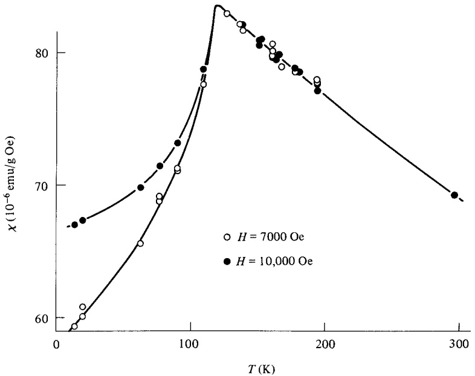

Fig. 5.8 Temperature variation of the susceptibility of MnO powder. [H. Bizette, C. F. Squire, and B. Tai, Compt. Rend., 207 (1938) p. 449.]

The other predictions of the theory are reasonably well satisfied by experiment. Table 5.1 shows that $\chi_{\mathrm{p}}(0) / \chi_{\mathrm{p}}(T_{\mathrm{N}})$ is nearly always close to the theoretical value of 0.67. Typical $\chi, T$ curves for powders are shown in Figs 5.8 and 5.9 and for a single crystal in Fig. 5.9; these curves are seen to agree quite closely with the theoretical curves of Fig. 5.7. (The fact that the susceptibility of MnO below $T_{\mathrm{N}}$ depends on the size of the field used to measure it is due to crystal anisotropy, which is discussed in Section 7.9.)

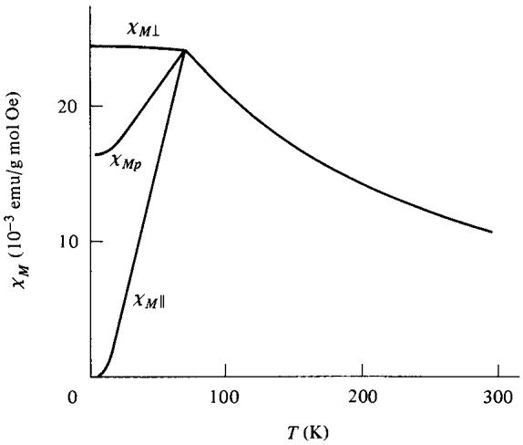

Fig. 5.9 Temperature variation of the molar susceptibility of $\mathrm{MnF_{2}}$ The central curve (below $T_{N}$ is for a powder sample, and the other two curves are for a single crystal. [H. Bizette and B. Tai, Compt. Rend., 238 (1954) p. 1575.]

The generally good agreement between theory and experiment is all the more remarkable when we realize that one of our initial assumptions is often not satisfied. This is the assumption that any $A$ ion has only $B$ ions as nearest neighbors. This requirement can be satisfied by a body-centered cubic arrangement of metal ions, in which the cube-center ions form the $A$ sublattice and the cube-corner ions the $B$ sublattice, and by a body-centered tetragonal arrangement, provided the axial ratio c/a of the unit cell lies between certain limits. It is not satisfied for the face-centered cubic arrangement, as will become clear in the next section.

The crystal anisotropy of antiferromagnetics and the attendant phenomenon of metamagnetism are discussed in Section 7.9.

## 5.3 NEUTRON DIFFRACTION

The first substance to be clearly recognized as antiferromagnetic was MnO, in 1938, when the results shown in Fig. 5.8 were published. Between 1938 and 1949 the evidence which had accumulated for the assumed spin arrangement in antiferromagnets below $T_{\mathrm{N}}$ was good but rather indirect: it consisted solely in the agreement of the susceptibility data with what could be predicted from the model. In 1949 the first direct evidence was provided, when C. G. Shull and J. S. Smart [Phys. Rev., 76 (1949) p. 1256] succeeded in showing by neutron diffraction that the spins on the manganese ions in MnO are divided into two groups, one antiparallel to the other. Neutron diffraction has wide applicability as a research tool, but here we are interested only in its application to magnetic studies. These are not confined to antiferromagnetic substances, because neutron diffraction can furnish important information about ferro- and ferrimagnetics as well.

A stream of particles has many attributes of wave motion, in particular a wavelength l, given by $\lambda = h / p.$ where h is Planck’s constant and p is the momentum of the particles. A stream, or beam, of neutrons can therefore be diffracted by a crystal just like a beam of X rays, provided that the neutron wavelength is of the same order of magnitude as the interplanar spacings of the crystal. The neutrons in the core of a nuclear reactor have just the right wavelength, about 0.1nm, and a beam of them can be obtained simply by cutting a narrow hole through the shielding of the reactor.

The diffraction of neutrons is governed by the same Bragg law that governs the diffraction of X rays

$$
n \lambda = 2 d \sin \theta ,\tag{5.31}
$$

where n is an integer (0, 1, 2, . . .) called the order of reflection, d is the spacing of atomic planes in the crystal, and $\theta$ is the angle between the incident beam and the atomic planes involved (Fig. 5.10). When neutrons, or X rays, encounter an atom, they are scattered in all directions, and what we call a diffracted beam is simply a set of scattered beams which are in phase, so that they reinforce one another. The Bragg law states the condition that rays scattered in the direction shown in the sketch, making an angle $\theta$ with the atomic planes equal to the angle of incidence, will be in phase with one another. In all other directions of space the phase relations between the scattered beams are such that they cancel one another. In experimental work, the angle $2\theta$, rather than $\theta$, is usually measured; it is the angle between the diffracted beam and the incident or the transmitted beam.

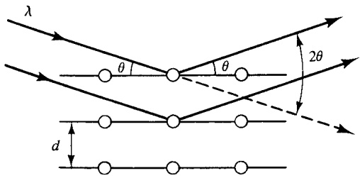

Fig. 5.10 Diffraction geometry.

Although both X rays and neutrons obey the Bragg law, they are scattered by atoms in markedly different ways. X rays are scattered by the electrons of the atom, because X rays are electromagnetic radiation which can interact with the electronic charge. Neutrons are uncharged, easily penetrate the electron screen, and are scattered only by the nucleus. There is one important exception to this statement: if the scattering atom or ion has a net magnetic moment, that moment will interact with the neutron beam, because the neutron has a small magnetic moment of its own, equal to about $10^{-3}$ Bohr magneton. Neutron scattering from a magnetic ion therefore has two parts, one nuclear, the other magnetic; the magnetic part is due to the electrons of the ion, because it is the ion’s electrons that are responsible for its magnetic moment. Neutrons can thus “see” elementary magnetic moments, whereas X rays cannot. Furthermore, both the magnitude and direction of the magnetic moment of an atom or ion can be determined from measurements of the intensity of the magnetic scattering. It is this feature of neutron diffraction which makes it so valuable in the study of magnetic materials.

Electron diffraction is a fairly common means of investigating crystals, and the reader may wonder why it also is not effective in revealing magnetic structure. After all, each electron in the beam of electrons incident on the solid, in an electron diffraction experiment, has a magnetic moment of one Bohr magneton and therefore of the same order of magnitude as the net magnetic moment of each atom of the solid, rather than a moment of less than $10^{-3}$ times an atomic moment, as is typical of neutrons. The answer lies in the fact that electrons are charged. The incident electrons are scattered by atomic electrons because of the very large electrostatic (Coulomb) repulsion between them. This electrostatic interaction is so much stronger than the magnetic interaction that the latter is normally unobservable. Neutrons, on the other hand, are uncharged, and their magnetic interaction with the scattering atoms, although much weaker than that of electrons, can easily be observed because it is not overwhelmed by an electrostatic interaction.

When an antiferromagnet is cooled below $T_{\mathrm{N}}$ what was previously a random arrangement of spins becomes an ordered arrangement, with one set of spins antiparallel to the other. This change is very similar, especially from a diffraction point of view, to the chemical ordering which takes place in certain solid solutions when cooled below a critical temperature. Consider X-ray diffraction from the (100) planes of such a solid solution, consisting of elements C and D in equal atomic proportions and assumed to have a body-centered cubic structure. These planes are marked X and Z in Fig. 5.11a, which applies to the disordered state. If the incoming X rays make an angle $\theta$ such that the path difference abc between scattered rays 1 and 3 equals one whole wavelength, then rays 1 and 3 will be in phase and reinforce each other. But if $abc = \lambda$ , the path difference def between rays 1 and 2 is λ/2 , so that these rays are exactly out of phase. Moreover, the amplitudes of 1 and 2 are exactly equal, because planes X and Y are statistically identical when the solution is disordered. Scattered rays 1 and 2 therefore cancel each other, as indicated in the sketch of the scattered wave form, and so do 3 and 4, 5, and 6, etc. There is no 100 reflection from the disordered solution. There is, however, a 200 reflection; this is obtained by increasing the angle $\theta$ until def = λ so that rays 1 and 2, scattered from the (200) planes X and Y, are in phase. In Fig. 5.11b there is perfect order: C atoms occupy only cube corners and D atoms only cube centers. For first-order (n = 1) reflection from (100) planes, scattered rays 1 and 2 are again exactly out of phase. But now their amplitudes differ, because planes X and Y now contain chemically different atoms, with different numbers of electrons per atom and hence different X-ray scattering powers. Therefore, rays 1 and 2 do not cancel but combine to form the wave indicated by the dashed line in the sketch. The ordered solid solution thus produces a 100 reflection. If we examined other reflections, from planes of different Miller indices hkl, we would find other examples of lines which are present in the diffraction pattern of ordered solutions and absent from the pattern of disordered ones. These extra lines are called superlattice lines, and their presence constitutes direct evidence of order.

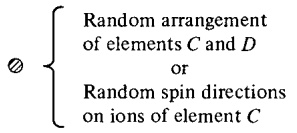

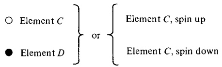

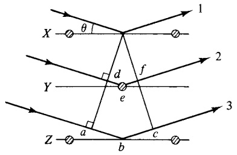

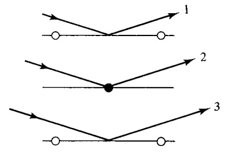

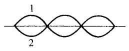

(a)

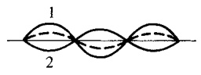

(b)

Fig. 5.11 Diffraction by (a) disordered and (b) ordered structures.

The detection of order in magnetic systems with neutrons is exactly analogous. We now regard Fig. 5.11a as representing a lattice of chemically identical ions, C ions, say, each with an identical magnetic moment randomly oriented in space. For the same reasons as in the X-ray case, there will be no 100 neutron reflection. In Fig. 5.11b we have magnetic order: the spins on the corner ions are “up,” say, and those on the body-centered ions, “down.” There will now be a 100 neutron superlattice line, because the neutron magnetic scattering is sensitive to the differing directions of the spin moments on adjacent planes.

Before considering a particular example, we must qualify the remarks just made about “up” and “down” spins. No magnetic scattering at all can take place if the spin axes are normal to the reflecting planes, for reasons described by G. E. Bacon [Neutron Diffraction, 2nd ed., Oxford University Press (1962)]. Thus, if “up” and “down” mean normal to the (100) planes, there will be no 100 superlattice reflection, not because of any cancellation effect, as in Fig. 5.11a, but because there is no magnetic scattering to begin with, only nuclear scattering. But a 100 superlattice reflection will occur if the axis of the antiparallel spins makes any angle other than $90^{\circ}$ with the (100) planes.

We choose $\mathrm{MnF_{2}}$ to exemplify these general rules, because it exhibits simpler diffraction phenomena than MnO. It has the structure of the mineral rutile $(\mathrm{TiO}_2)$ , with $2\mathrm{MnF}_{2}$ per unit cell, located as follows:

$$
\begin{array}{l} 2 \mathrm{Mnionsat000,} \frac {1}{2} \frac {1}{2} \frac {1}{2}. \\ 4 \mathrm{Fionsat} x x 0; \bar {x} \bar {x} 0; \frac {1}{2} + x, \frac {1}{2} - x, \frac {1}{2}; \frac {1}{2} - x, \frac {1}{2} + x, \frac {1}{2}. \end{array}
$$

(The ionic coordinates are given as fractions of the unit-cell edges.) The value of x is 0.31. The cell is tetragonal with $a = 0.487$ nm and $c = 0.331 \mathrm{~nm}$ . The unit cell is shown in Fig. 5.12.

Neutron diffraction experiments were carried out on this compound with an instrument called a neutron diffractometer (Fig. 5.13). The neutrons which issue from a reactor have a range of wavelengths, and it is necessary to select a single wavelength from this range for the diffraction experiment. This is done by setting a single crystal, usually copper or lead, in the path of the beam at a particular angle $\theta$ of incidence, so that it will reflect, in accordance with the Bragg law, only the particular wavelength desired, usually one in the range 0.10–0.12 nm. The crystal “monochromator” thus reflects only one wavelength out of the many wavelengths incident on it. The reflected beam from the monochromator then encounters the specimen (which may be a single crystal or a compacted mass of powder), is diffracted by it, and enters a counter which measures its intensity. The diffraction pattern is obtained by moving the counter stepwise through various angles $2\theta$ and measuring the intensity of the radiation diffracted by the specimen at each angle.

The result is a plot of diffracted intensity vs $2\theta$ which is shown for $\mathrm{MnF_{2}}$ in Fig. 5.14, for temperatures above and below the Néel temperature of 67K. The chief difference between the two patterns is the presence of the strong 100 superlattice line below $T_{N}$ . This tells us immediately that the spins on the cell-corner ions are antiparallel to those on the cell-center ions. On the other hand, there is no 001 line; the spin axis is therefore normal to these planes and parallel to the c-axis of the unit cell, as shown in Fig. 5.15. Detailed analysis of the intensities of the other lines in the pattern confirms this conclusion. The intensity of the 100 line from $\mathrm{MnF_{2}}$ depends on the degree of spin order, and it increases as the temperature decreases from $T_{\mathrm{N}}$ to 0K. From such measurements one can determine the shape of the sublattice s, T curve, shown schematically in Fig. 5.4. Such information cannot be obtained from magnetic measurements.

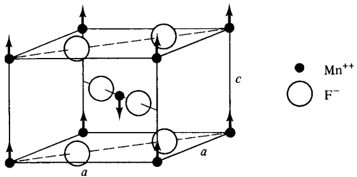

Fig. 5.12 Structure of MnF2.

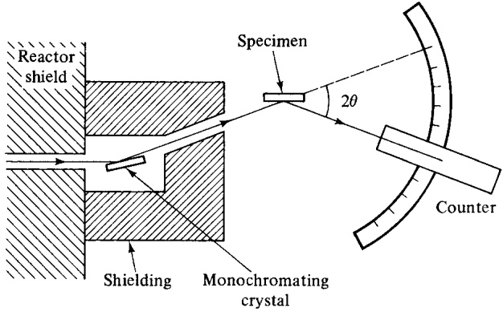

Fig. 5.13 Neutron diffractometer (schematic).

It is not always possible to determine the orientation of the spin axis solely from diffraction patterns made with powder specimens. Often a single-crystal specimen is required. (In some substances the orientation of the spin axis can be found from susceptibility measurements alone, without any recourse to neutron diffraction; by trial and error two orientations of the crystal in the applied field were found for which the $\chi, T$ curves have the form of Fig. 5.7.)

MnO has the face-centered cubic NaCl structure, which is like a three-dimensional checkerboard (Fig. 5.16a). In Fig. 5.16b, only the magnetic ions are shown, and the spin structure as deduced by neutron diffraction. The spin axis is parallel to (111) planes and lies in the [110] direction in these planes; alternate (111) planes, shown by dashed lines in the drawing, have opposite spin. The antiferromagnetic state of MnO has one feature not found in $\mathrm{MnF_{2}}$ : The magnetic unit cell differs from the chemical (also called the nuclear) unit cell. Although a unit cell may be chosen in many ways, the choice must meet certain requirements. One is that the “entity” (chemical species, spin direction, etc.) at one corner of the cell be the same as that at all other corners. The unit cell in Fig. 5.16a is the chemical unit cell and has a manganese ion at each corner; it is also the magnetic unit cell above $T_{\mathrm{N}}$ because the spin directions are then random and the manganese ions are, in a magnetic sense, statistically identical. But when magnetic ordering sets in, the spin direction at one corner of the chemical unit cell is opposite to that at the three nearest corners. It is then necessary to choose a magnetic unit cell twice as large along each cube edge, as shown in Fig. 5.16b.

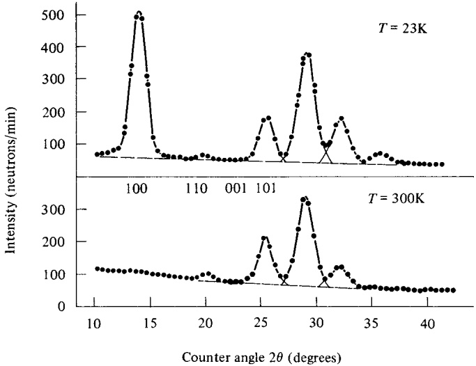

Fig. 5.14 Neutron diffraction patterns of a powder sample of $\mathrm{MnF_{2}}$ in the paramagnetic state (300K) and in the antiferromagnetic state (23K). [R. A. Erickson, Phys. Rev., 90 (1953) p. 779.]

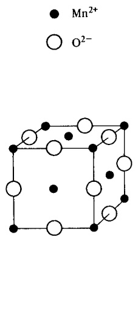

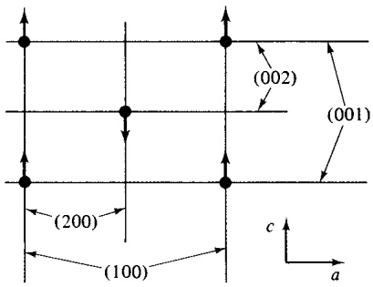

Fig. 5.15 Projection of the MnF2 unit cell on a (010) face. Only the Mn ions are shown.

Neutron diffraction has disclosed spin structures in which the spins in alternate layers are not antiparallel but inclined at some angle other than $180^{\circ}$. $\mathrm{MnAu}_{2}$ is an example and Fig. 5.17 shows its chemical unit cell. It is body-centered tetragonal, and Au atoms are arranged at a distance of about c/3 above and below each Mn atom, along the c-axis. The spins of the Mn ions in each (002) plane are parallel to one another and to the (002) plane itself, but the spins rotate through an angle φ of $51^{\circ}$ about the c-axis from one (002) plane to the next. Such an arrangement of spins is called a spiral or helical structure.

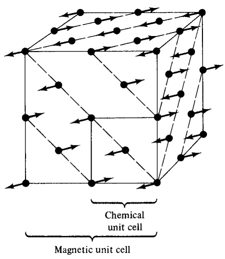

(a)

(b)

Fig. 5.16 Structure of MnO. (a) Chemical unit cell of Mn and O ions. (b) Chemical and magnetic units cells, Mn ions only.

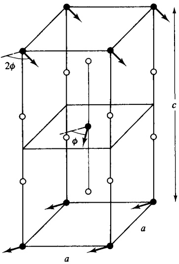

Fig. 5.17 Structure of Mn $\mathrm{Au}_{2}$

Evidently we must revise our earlier definition of antiferromagnetism and make it more general, to include the possibility that the spins of the two sublattices may have any relation to each other as long as they form an ordered arrangement with no net magnetization. More complex spin arrangements than that of $\mathrm{MnAu}_{2}$ have been found, some involving more than two sublattices.

Slight deviations from ideal antiferromagnetism can also exist. In some substances the spins of the two sublattices are not quite antiparallel but slightly tilted or “canted” out of alignment, as indicated in Fig. 5.18. The result is a small net magnetization $\sigma_{s}$ in one direction. From one point of view such substances are ferromagnetic; they are composed of domains, each spontaneously magnetized to a magnitude $\sigma_{s}$ , and they show hysteresis. But they do not saturate, and in strong fields they exhibit a susceptibility x appropriate to their basic antiferromagnetism. Such substances have a magnetization curve like that of curve $A$ of Fig. 3.12, which can be described by

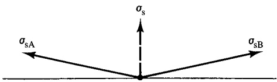

Fig. 5.18 Canted spins.

$$
\sigma = \sigma_ {\mathrm{s}} + \chi H,\tag{5.32}
$$

where the first term reaches its maximum value $\sigma_{s}$ only in a finite field, as indicated by curve C of Fig. 3.12. In the older literature this phenomenon is called parasitic ferromagnetism, and it was often attributed to a ferromagnetic impurity existing as particles of a second phase. It is now recognized as having a more basic cause and is known as canted antiferromagnetism. Substances which show this behavior at room temperature include $\alpha-\mathrm{Fe}_{2}\mathrm{O}_{3}$ (hematite) and the rare-earth orthoferrites. These have the general formula $\mathrm{RFeO_{3}}$ where R is yttrium or a rare earth. Their crystal structure is orthorhombic (three axes of unequal length at right angles to one another), and the spontaneous magnetization $\sigma_{s}$ is parallel to the c-axis (the <001>-axis of the cell), except in $\mathrm{SmFeO_{3}}$ where $\sigma_{s}$ is parallel to the a-axis.

The exchange interaction in antiferromagnetic ionic solids takes place by the mechanism of indirect exchange, also called superexchange, already alluded to briefly near the end of Section 4.7. In these structures, the positive metal ions, which carry the magnetic moment, are too far apart for direct exchange forces to be of much consequence. Instead, they act indirectly through the neighboring anions (negative ions). Consider, for example, two $\mathrm{Mn}^{2+}$ ions being brought up to an $\mathrm{O}^{2-}$ ion from a large distance, as in Fig. 5.19a. The directions of the moments on these two ions are at first unrelated. The oxygen ion has no net moment, because it has a neon-like structure of filled shells. But imagine that the outer electrons of the oxygen ion constitute two superimposed orbits, one with a net spin up, the other with a net spin down, as pictured in Fig. 5.19a. When a manganese ion with an up spin is brought close to the oxygen ion, the up-spin part of the oxygen ion will be displaced as in Fig. 5.19b, because parallel spins repel one another. If now another manganese ion is brought up from the right, it is forced to have a down spin when it comes close to the up-spin side of the “unbalanced” oxygen ion. The strength of the antiparallel coupling between metal ions $M$ depends on the bond angle AOB and is generally greatest when this angle is $180^{\circ}$ ($M$ – $O$ – $M$ collinear).

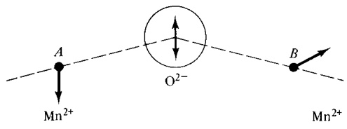

(a)

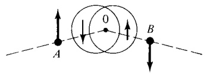

(b)

Fig. 5.19 Superexchange.

To conclude this section we will consider what neutron diffraction has revealed concerning the spin structure of some transition metals.

## 5.3.1 Antiferromagnetic

Chromium is antiferromagnetic below $37^{\circ}\mathrm{C}$ and manganese below 95K. Neither has a susceptibility which varies much with temperature and neither obeys a Curie–Weiss law. (Inasmuch as they are both electrical conductors, rather than insulators, we do not expect their behavior to conform closely to a localized-moment, molecular-field theory.) Chromium turns out to have a peculiar magnetic structure known as a incommensurate spin-density wave, in which the magnitude of the spin forms a spatial wave whose wavelength is not an integral number of unit cell edges. Manganese has a complicated crystal structure with 29 atoms per unit cell, and develops a complicated antiferromagnetic structure with moments varying from 0.25 to $1.9\mu_{\mathrm{B}}$ per Mn atom.

## 5.3.2 Ferromagnetic

For iron, nickel, and cobalt, neutron diffraction shows that the spins on all the atoms are parallel to one another and that the moment per atom is in accord with values deduced from measurements of saturation magnetization. (Furthermore, the diffraction experiments show that each atom has the same moment. This evidence disposes of a suggestion that had been made that a nonintegral moment, such as $0.6\mu_{\mathrm{B}}/\mathrm{atom}$ , was simply an average, resulting from the appropriate mixture of atoms of zero moment and atoms with a moment of one Bohr magneton.) It has even been possible to discover the way in which the magnetization is distributed around the nucleus [C. G. Shull, in Magnetic and Inelastic Scattering of Neutrons by Metals, T. J. Rowland and P. A. Beck, eds, Gordon and Breach (1968)]. In cobalt this distribution is spherically symmetrical. In iron, however, the magnetization is drawn out to some extent along the cube-edge directions of the unit cell; in nickel, it tends to bulge out in the face-diagonal and body-diagonal directions.

## 5.4 RARE EARTHS

The 15 rare earth metals extend from lanthanum La (atomic number 57) to lutetium Lu (71). They are all paramagnetic at room temperature and above. At low temperatures their magnetic behavior is complex. Because almost all the rare earths are antiferromagnetic over at least some range of temperature, it is convenient to give their magnetic properties some brief consideration here.

The rare earths are chemically very similar, and it is therefore difficult to separate them from one another or to obtain them in a pure state. This near identity of chemical behavior is due to the fact that the arrangement of their outer electrons is almost identical. However, the number of electrons in the inner 4f shell varies from 0 to 14 through the series La to Lu, and the magnetic properties are due to this inner, incomplete shell. Because the 4f electrons are so deep in the atom, they are shielded from the crystalline electric field of the surrounding ions; the orbital moment is therefore not quenched, and the total magnetic moment has both orbital and spin components. The total moment can become very large in some of the atoms and ions of the rare earths (see following text).

The “light” rare earths, lanthanum (La) to europium (Eu), remain paramagnetic down to 91K or below, and then five of the seven become antiferromagnetic. [Promethium (Pm) is not found in nature and has no stable isotope; the properties of the metallic form are unknown.]

Of the eight “heavy” rare earths, six become ferromagnetic at sufficiently low temperatures, and five of these (terbium, Tb, through thulium, Tm) pass through an intermediate antiferromagnetic state before becoming ferromagnetic. Gadolinium (Gd) just misses being ferromagnetic at room temperature; its Curie point is $16^{\circ}\mathrm{C}$ All six ferromagnetic rare earths have magnetic moments per atom $\mu_{H}$ exceeding that of iron; if they only retained their ferromagnetism up to room temperature, they might make useful, although expensive, materials. The one with the largest moment is holmium, Ho, which has $\mu_{\mathrm{H}} = 10.34\mu_{\mathrm{B}}/$ atom, or almost five times that of iron (2.22 $\mu_{\mathrm{B}}$) . The rare earth atoms are so heavy, however, that their saturation magnetizations $\sigma_{0}$ per gram at 0K are not very different from that of iron. For example, we may calculate, by means of Equation 4.27 and the moment per atom given above, that $\sigma_{0}$ for holmium is 351 emu/g, compared to 221.9 emu/g for iron.

The rare earths and their alloys have provided a rich field for research by neutron diffraction. The spin structures of the antiferromagnetic states include helical and even more complex arrangements. Even the ferromagnetic structures are sometimes unusual. Consider, for example, gadolinium and holmium, which have the same crystal structure (hexagonal close-packed). Ferromagnetic Gd has a simple arrangement of parallel spins, like iron. Antiferromagnetic Ho has a helical spin structure like that of Mn $\mathrm{Au}_{2}$ in Fig. 5.17; the spins in any one hexagonal layer are all parallel, but they progressively rotate about the c-axis from one layer to the next. In the ferromagnetic state below 20K, this spiral spin structure is retained, but added to it is a ferromagnetic component of spins parallel to the c-axis in every layer. (The c-axis is normal to the hexagonal layers.) The resultant of these two components, one parallel and one at right angles to the hexagonal layers, gives ferromagnetic Ho a kind of conical spin arrangement.

## 5.5 ANTIFERROMAGNETIC ALLOYS

Antiferromagnetism is now known to exist in a considerable number of alloys, most of them containing Mn or Cr. It is more common in chemically ordered structures, which exist at simple atomic ratios of one element to the other, like AB or $AB_{2}$ , but it has also been found, surprisingly, in some disordered solid solutions.

An example of antiferromagnetism in an ordered phase has already been given: $\mathrm{MnAu}_{2}$ in Fig. 5.17. In the same alloy system, the phases MnAu and MnAu3 are also antiferromagnetic. Some other antiferromagnetic ordered phases are CrSb, CrSe, FeRh, FePt3, MnSe, MnTe, $\mathrm{Mn}_{2}\mathrm{As}$ , and NiMn. The spin structure of the latter is interesting. The unit cell is face-centered tetragonal and the (002) planes, normal to the c-axis, are occupied alternately by Ni and Mn atoms. Each (002) layer of atoms, whether all Ni or all Mn, is antiferromagnetic in itself, i.e., half the atoms in one layer have spins pointing in one direction and parallel to the plane of the layer, and the other half have spins pointing in the opposite direction.

Among disordered alloys antiferromagnetism has been observed in Mn-rich Mn–Cu and Mn –Au alloys. They have a face-centered tetragonal structure. All the spins in any one (002) plane are parallel to one another and to the c-axis, but the spins in alternate (002) layers point “up” and “down.” Disordered MnCr is also antiferromagnetic. It is body-centered cubic, with the spins on the cell-corner atoms antiparallel to those on the body-centered atoms. In none of these examples is there any chemical ordering. Each lattice site in, for example, the Mn –Cu alloys is occupied by a statistically “average” Mn –Cu atom, and each average atom appears to have a magnetic moment of the same magnitude. This behavior is understandable on the basis of the band theory, which envisages all the 3d and 4s electrons as belonging to a common pool, but not on the basis of a localized-moment theory. If the moments were localized, the various exchange interactions (molecular fields), between Mn–Mn, Mn–Cu, and Cu–Cu atoms, would have different orientations from one unit cell to the next in a disordered alloy, so that it would be difficult to understand how any long-range magnetic order could result.

Finally, it should be noted that the susceptibility–temperature curves of alloys do not usually give evidence for, or against, the existence of antiferromagnetism, because a Curie – Weiss law is not often followed. Neutron diffraction is the only sure test.

## PROBLEMS

5.1 MnF2 is antiferromagnetic and at high temperatures its Curie constant per mol is 4.10. Its molar susceptibility xM is 0.024 emu/Oe/(g mol) at the Néel temperature. Assuming the ideal behavior described in Section 5.2, and assuming all the magnetic moment of Mn is due to spin, calculate

a. The value of J.

b. The spontaneous magnetization of each sublattice at 0K.

c. The molecular field acting on each sublattice at 0K.

d. The angle a in Fig. 5.5a when a field of 1.2 T is applied perpendicular to the spin axis of a single crystal at 0K.

5.2 Show that Equation 5.24 reduces to Equation 5.2 at high temperatures, to Equation 5.18 at $T_{\mathrm{N}}$ and to zero at 0K.

5.3 In a body-centered tetragonal arrangement of metal ions (Fig. 5.12), the cell-center ions form the $A$ sublattice and the cell-corner atoms form the $B$ sublattice. If an $A$ ion is to have only $B$ ions as nearest neighbors, find the range of allowable values for c/a

