# FERRIMAGNETISM

## 6.1 INTRODUCTION

Ferrimagnetic substances exhibit a substantial spontaneous magnetization at room temperature, just like ferromagnetics, and this fact alone makes them industrially important. Like ferromagnetics, they consist of magnetically saturated domains, and they exhibit the phenomena of magnetic saturation and hysteresis. Their spontaneous magnetization disappears above a certain critical temperature $T_{\mathrm{c}}$ also called the Curie temperature, and then they become paramagnetic (Fig. 6.1). Ferrimagnetics were not recognized as forming a distinct magnetic class until 1948. In practical importance they are second only to ferromagnetics and are essential materials in some applications.

The most important ferrimagnetic substances are certain double oxides of iron and another metal, called ferrites (although not all oxide ferrites are ferrimagnetic). This mineralogical term is not to be confused with the same word applied by metallurgists to bodycentered cubic iron. The ferrites were developed into commercially useful magnetic materials, chiefly during the years 1933 – 1945, by Snoek and his associates at the Philips Research Laboratories in the Netherlands [J. Smit and H. P. J. Wijn, Ferrites, Wiley (1959)]. In a classic paper published in 1948, L. Néel [Ann. Phys., 3 (1948) p.137] provided the theoretical key to an understanding of the ferrites, and the word ferrimagnetism is due to him. It was perhaps not the best choice, since careful enunciation is needed to distinguish “ferrimagnetism” from “ferromagnetism.” Ferrimagnetism is pronounced either as fer-eye-magnetism or fer-ee-magnetism.

The magnetic ferrites fall mainly into two groups with different crystal structures:

1. Cubic. These have the general formula $\mathrm{MO}\cdot\mathrm{Fe}_{2}\mathrm{O}_{3}$ , where $M$ is a divalent metal ion, like Mn, Ni, Fe, Co, or Mg. Cobalt ferrite $\mathrm{CoO}\cdot\mathrm{Fe}_{2}\mathrm{O}_{3}$ is magnetically hard, but all the other cubic ferrites are magnetically soft. As magnetic materials, these ferrites are both old and new, inasmuch as magnetite $\mathrm{Fe}_{3}\mathrm{O}_{4} (= \mathrm{FeO} \cdot \mathrm{Fe}_{2}\mathrm{O}_{3})$ , which might be called iron ferrite, is the oldest magnetic material known to man, the “lodestone” of the ancients.

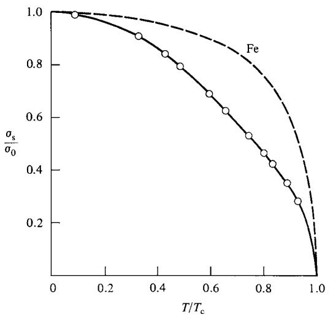

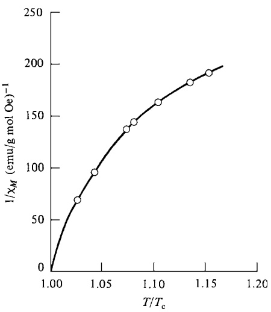

Fig. 6.1 Temperature dependence of magnetic properties of a typical ferrimagnet $(\mathrm{NiO}\cdot\mathrm{Fe}_{2}\mathrm{O}_{3})$ Left-hand figure shows the fractional saturation magnetization per unit mass $\sigma_{\mathrm{s}} / \sigma_{0}$ in the ferrimagnetic region and the right-hand figure shows the reciprocal susceptibility (per mole) in the paramagnetic region. The dashed curve in the left-hand figure is the corresponding data for metallic iron.

2. Hexagonal. The most important in this group are barium and strontium ferrites, $\mathrm{BaO}\cdot6\mathrm{Fe}_{2}\mathrm{O}_{3}$ and $\mathrm{SrO}\cdot6\mathrm{Fe}_{2}\mathrm{O}_{3}$ , which are magnetically hard.

Ferrites are manufactured by the usual techniques of ceramics. To make nickel ferrite, for example, NiO and $\mathrm{Fe_{2}O_{3}}$ , in powder form, are thoroughly mixed, pressed to the desired shape, and sintered at temperatures in excess of $1200^{\circ}\mathrm{C}$ Sometimes metal carbonates are used as the starting materials and converted to oxides in a preliminary calcining stage. (See Section 13.6 for details.) The resulting product is hard and brittle. It is also a semiconductor, which means that its electrical resistivity is at least a million times that of a metal. This very large resistivity means in turn that an applied alternating magnetic field will not induce eddy currents (Section 12.2) in a ferrite. This property makes ferrites the best magnetic materials for high-frequency applications where power losses from eddy currents must be minimized.

Many ferrites are found, usually in an impure state, as naturally occurring minerals in rocks. Knowledge of the properties of ferrites is therefore important to geologists working in the field of rock magnetism. Studies of the magnetic properties of rocks have led to important conclusions about the strength and direction of the Earth’s magnetic field in past geological ages, and these conclusions form part of the evidence for the theory of continental drift.

The ferrites are ionic compounds, and their magnetic properties are due to the magnetic ions they contain. We are therefore interested in knowing what magnetic moment a particular metal ion should have. (The oxygen ion $O^{2-}$ has no net moment.) This information is given by Hund’s rule, which states that the spins in a partly filled shell are arranged so as to produce the maximum spin unbalance consistent with the Pauli exclusion principle. The rule is stated here in terms of spin alone, because the orbital contribution is unimportant in ferrites. Hund’s rule was derived from a study of optical spectra, and the spin arrangements which it predicts are the result of exchange forces acting within a single atom or ion. We can apply the rule to ions of the first transition series in the following way. The outermost shell is the 3d, and it can contain five electrons with spin up and five with spin down. The first five electrons enter with spin up, say, in order to maximize the moment. The sixth electron, because of the exclusion principle, must have spin down. An ion with six 3d electrons, such as $\mathrm{Fe}^{2+}$ , must then have a spin-only moment of 5 - $1 = 4\mu_{\mathrm{B}}$ . The moments of a number of other ions are given in Table 6.1. Note again that we are dealing with ionic compounds which are effectively insulators. In such materials, the electronic energy levels of the ions do not overlap, as they do in a metal, and therefore an integral number of electrons can be associated with each ion of the solid, just as in the free ion. This is just another way of saying that the electrons of each ion in the solid are fixed to that ion and cannot wander freely about.

When we try to reconcile the ionic moments of Table 6.1 with the measured magnetization values for ferrites we realize the great difference between ferrimagnets and ferromagnetics. In nickel ferrite $\mathrm{NiO}\cdot\mathrm{Fe}_{2}\mathrm{O}_{3}$ , for example, there is one divalent nickel ion with a moment of $2\mu_{B}$ and two trivalent iron ions, each with a moment of $5\mu_{\mathrm{B}}$ . If positive exchange forces produced a parallel alignment of all of these moments as in a ferromagnetic, the total moment per $\mathrm{NiO}\cdot\mathrm{Fe}_{2}\mathrm{O}_{3}$ formula unit would be $2 + 5 + 5 = 12\mu_{\mathrm{B}}$ . On the other hand, the measured saturation magnetization $\sigma_{0}$ at 0K is 56 emu /g or $\mathrm{A m^{2}/kg}$ which corresponds to 2.3  $\mu_{B}$ per molecule. This marked difference shows that the ionic moments cannot be aligned parallel to one another.

Inspection of Fig. 6.1 yields further evidence that the ferrites are not ferromagnetic. The fractional magnetization $\sigma_{\mathrm{s}} / \sigma_{0}$ of a typical ferrite decreases rather rapidly with increasing temperature, whereas the value of $\sigma_{\mathrm{s}} / \sigma_{0}$ for iron, for example, remains large until $T / T_{\mathrm{c}}$ exceeds about 0.8. Furthermore, in the paramagnetic region, the variation of the inverse susceptibility with temperature is decidedly nonlinear, which means that the Curie–Weiss law is not obeyed.

TABLE 6.1 Spin-Only Moments of Ions of First Transition Series

<table><tr><td colspan="3"></td><td colspan="6">Ions</td><td>Number of 3d Electrons</td><td>Spin-Only Moment in  $\mu_{\text{B}}$ </td></tr><tr><td rowspan="11"> $Sc^{3+}$ </td><td> $Ti^{4+}$ </td><td></td><td></td><td></td><td></td><td></td><td></td><td></td><td>0</td><td>0</td></tr><tr><td> $Ti^{3+}$ </td><td> $V^{4+}$ </td><td></td><td></td><td></td><td></td><td></td><td></td><td>1</td><td>1</td></tr><tr><td> $Ti^{2+}$ </td><td> $V^{3+}$ </td><td> $Cr^{4+}$ </td><td></td><td></td><td></td><td></td><td></td><td>2</td><td>2</td></tr><tr><td></td><td> $V^{2+}$ </td><td> $Cr^{3+}$ </td><td> $Mn^{4+}$ </td><td></td><td></td><td></td><td></td><td>3</td><td>3</td></tr><tr><td></td><td></td><td> $Cr^{2+}$ </td><td> $Mn^{3+}$ </td><td> $Fe^{4+}$ </td><td></td><td></td><td></td><td>4</td><td>4</td></tr><tr><td></td><td></td><td></td><td> $Mn^{2+}$ </td><td> $Fe^{3+}$ </td><td> $Co^{4+}$ </td><td></td><td></td><td>5</td><td>5</td></tr><tr><td></td><td></td><td></td><td></td><td> $Fe^{2+}$ </td><td> $Co^{3+}$ </td><td> $Ni^{4+}$ </td><td></td><td>6</td><td>4</td></tr><tr><td></td><td></td><td></td><td></td><td></td><td> $Co^{2+}$ </td><td> $Ni^{3+}$ </td><td></td><td>7</td><td>3</td></tr><tr><td></td><td></td><td></td><td></td><td></td><td></td><td> $Ni^{2+}$ </td><td></td><td>8</td><td>2</td></tr><tr><td></td><td></td><td></td><td></td><td></td><td></td><td></td><td> $Cu^{2+}$ </td><td>9</td><td>1</td></tr><tr><td></td><td></td><td></td><td></td><td></td><td></td><td></td><td> $Cu^{+}$ </td><td>10</td><td>0</td></tr></table>

[After J. Smit and H. P. J. Wijn, Ferrites, Wiley (1959)]

These several facts led Néel to the conclusion that the ferrites had a magnetic structure distinctly different from any previously recognized. It was known that the metal ions in a ferrite crystal occupied two crystallographically different kinds of position, called $A$ sites and $B$ sites. Néel made the basic assumption that the exchange force acting between an ion on an $A$ site and an ion on a $B$ site is negative, as in an antiferromagnetic. There is thus a lattice of $A$ ions spontaneously magnetized in one direction and a lattice of $B$ ions magnetized in the opposite direction. However, in a ferrimagnetic, the magnitudes of the $A$ and $B$ sublattice magnetizations are not equal. The two opposing magnetic moments do not cancel, and a net spontaneous magnetization results. Ferrimagnetism can therefore be thought of as imperfect or incomplete antiferromagnetism. Néel worked out all the implications of his hypothesis using molecular-field theory and obtained results in good agreement with experiment. Before examining this theory, we will consider the crystal structure of a cubic ferrite in some detail in order to understand the difference between $A$ and $B$ sites.

## 6.2 STRUCTURE OF CUBIC FERRITES

These ferrites have the spinel structure and are sometimes called ferrospinels, because their crystal structure is closely related to that of the mineral spinel, $\mathrm{MgO}\cdot \mathrm{Al}_{2}\mathrm{O}_{3}$ The structure is complex, in that there are eight formula units, or a total of $8\times 7 = 56$ ions, per unit cell. The large oxygen ions (radius about 0.13 nm) are packed quite close together in a face-centered cubic arrangement, and the much smaller metal ions (radii from about 0.07 to 0.08 nm) occupy the spaces between them. These spaces are of two kinds. One is called a tetrahedral or $A$ site, because it is located at the center of a tetrahedron whose corners are occupied by oxygen ions (Fig. 6.2a). The other is called an octahedral or $B$ site, because the oxygen ions around it occupy the corners of an octahedron (Fig. 6.2b). The crystallographic environments of the $A$ and $B$ sites are therefore distinctly different.

The unit cell contains so many ions that a two-dimensional drawing of the complete cell is too cluttered to be useful. Instead we can consider a unit cell of edge a to be divided into eight octants, each of edge a/2. , as shown in Fig. 6.2c. The four shaded octants have identical contents, and so do the four unshaded octants. The contents of the two lower-left octants in Fig. 6.2c are shown in Fig. 6.2d. One tetrahedral site occurs at the center of the right octant of Fig. 6.2d, and other tetrahedral sites are at some but not all octant corners. Four octahedral sites occur in the left octant; one is connected by dashed lines to six oxygen ions, two of which, shown dotted, are in adjacent octants behind and below. The oxygen ions are arranged in the same way, in tetrahedra, in all octants.

Not all of the available sites are actually occupied by metal ions. Only one-eighth of the $A$ sites and one-half of the $B$ sites are occupied, as shown in Table 6.2. In the mineral spinel, the $\mathrm{Mg}^{2+}$ ions are in $A$ sites and the $\mathrm{Al}^{3+}$ ions are in $B$ sites. Some ferrites $\mathrm{MO}\cdot \mathrm{Fe}_{2}\mathrm{O}_{3}$ have exactly this structure, with $\mathrm{M}^{2+}$ in $A$ sites and $\mathrm{Fe}^{3+}$ in $B$ sites. This is called the normal spinel structure. Both zinc and cadmium ferrite have this structure and they are both nonmagnetic, i.e., paramagnetic. Many other ferrites, however, have the inverse spinel structure, in which the divalent ions are on $B$ sites, and the trivalent ions are equally divided between $A$ and $B$ sites. The divalent and trivalent ions normally occupy the $B$ sites in a random fashion, i.e., they are disordered. Iron, cobalt, and nickel ferrites have the inverse structure, and they are all ferrimagnetic.

The normal and inverse structures are to be regarded as extreme cases, because X-ray and neutron diffraction show that intermediate structures can exist. Thus manganese ferrite is almost, but not perfectly, normal; instead of all the $\mathrm{Mn}^{2+}$ ions being on $A$ sites, a fraction 0.8 is on $A$ sites and 0.2 on $B$ sites. Similarly, magnesium ferrite is not quite inverse; a fraction 0.9 of the $\mathrm{Mg}^{2+}$ ions is on $B$ sites and 0.1 on $A$ sites. The distribution of the divalent ions on $A$ and $B$ sites in some ferrites can be altered by heat treatment; it may depend, for example, on whether the material is quenched from a high temperature or slowly cooled.

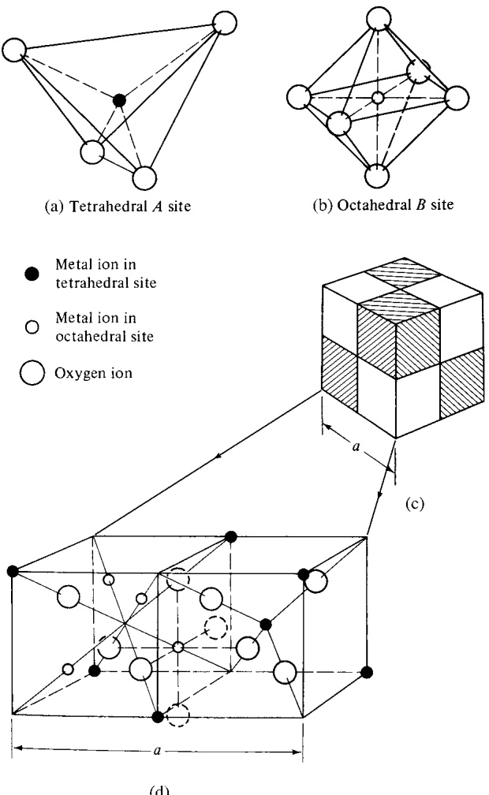

Fig. 6.2 Crystal structure of a cubic ferrite.

TABLE 6.2 Arrangements of Metal Ions in the Unit Cell of a Ferrite $\mathrm{MO}\cdot \mathrm{Fe}_{2}\mathrm{O}_{3}$

<table><tr><td rowspan="2">Kind of Site</td><td rowspan="2">Number Available</td><td rowspan="2">Number Occupied</td><td colspan="2">Occupants</td></tr><tr><td>Normal Spinel</td><td>Inverse Spinel</td></tr><tr><td>Tetrahedral (A)</td><td>64</td><td>8</td><td> $8M^{2+}$ </td><td> $8Fe^{3+}$ </td></tr><tr><td>Octahedral (B)</td><td>32</td><td>16</td><td> $16Fe^{3+}$ </td><td> $8Fe^{3+}$  $8M^{2+}$ </td></tr></table>

Ferrites can be prepared containing two or more different kinds of divalent ion, e.g. (Ni,Zn)O·Fe₂O₃ . This is called a mixed ferrite. Most of the cubic ferrites used commercially are mixed ferrites.

## 6.3 SATURATION MAGNETIZATION

We can calculate the saturation magnetization of a ferrite at 0K, knowing (a) the moment on each ion, (b) the distribution of the ions between $A$ and $B$ sites, and (c) the fact that the exchange interaction between $A$ and $B$ sites is negative. Actually, the AB, AA, and BB interactions all tend to be negative, but they cannot all be negative simultaneously. The AB interaction is usually the strongest, so that all the $A$ moments are parallel to one another and antiparallel to the $B$ moments. The crystallographic directions of these moments are of the form <111>, i.e., parallel to a body diagonal of the unit cell, in all the cubic ferrites except cobalt. In cobalt ferrite the moments are parallel to the cube edge directions <100>.

Example 1 of Table 6.3 shows how the calculation is made for Ni ferrite. The structure is inverse, with all the $\mathrm{Ni}^{2+}$ ions in $B$ sites and the $\mathrm{Fe}^{3+}$ ions evenly divided between $A$ and $B$ sites. The moments of the $\mathrm{Fe}^{3+}$ ions therefore cancel, and the net moment is simply that of the $\mathrm{Ni}^{2+}$ ion, which is $2\mu_{B}$ . Generalizing on this, we conclude that the saturation magnetization $\mu_{H}$ of any inverse ferrite is simply the moment on the divalent ion. This leads to the following calculated values, in $\mu_{\mathrm{B}}$ per molecule, for the series of ferrites from Mn to Zn:

| Ferrite | Mn | Fe | Co | Ni | Cu | Zn |
| --- | --- | --- | --- | --- | --- | --- |
| Calculated mH | 5 | 4 | 3 | 2 | 1 | 0 |
| Measured mH | 4.6 | 4.1 | 3.7 | 2.3 | 1.3 | 0 |

As stated earlier, Mn ferrite is far from being inverse, and yet its calculated net moment is still $5\mu_{\mathrm{B}}$ per molecule. This is due to the fact that $\mathrm{Mn}^{2+}$ and $\mathrm{Fe}^{3+}$ ions each have a moment of $5\mu_{B}$ ; whatever their distribution between $A$ and $B$ sites, the expected net moment per molecule is still 5 $\mu_{\mathrm{B}}$ . The ion and spin distribution in Zn ferrite are shown in Example 2 of Table 6.3. This ferrite has the normal structure, and $\mathrm{Zn}^{2+}$ ions of zero moment fill the $A$ sites. There can thus be no AB interaction. The negative BB interaction then comes into play: the $\mathrm{Fe}^{3+}$ ions on $B$ sites then tend to have antiparallel moments, and there is no net moment. One would therefore expect Zn ferrite to be antiferromagnetic. It is, but only below 9K. It is paramagnetic down to this temperature, because the negative BB interaction is so weak that even small amounts of thermal energy can prevent the antiparallel ordering of the moments.

Figure 6.3 compares the calculated and measured moments of the series of ferrites just discussed. The agreement is generally good, and affords strong support to Néel’s basic assumption. Even more direct support has been given by neutron diffraction, which has shown that the moments on the $A$ and $B$ sites are indeed antiparallel.

TABLE 6.3 Ion Distribution and Net Moment per Molecule of Some Typical Ferrites

<table><tr><td>Example</td><td>Substance</td><td>Structure</td><td colspan="2">Tetrahedral A Sites</td><td colspan="2">Octahedral B Sites</td><td>Net Moment ( $\mu_{B}$ /Molecule)</td></tr><tr><td>1</td><td> $NiO \cdot Fe_{2}O_{3}$ </td><td>Inverse</td><td colspan="2"> $Fe^{3+}$  $\stackrel{\rightarrow}{5}$ </td><td> $Ni^{2+}$  $\stackrel{\leftarrow}{2}$ </td><td> $Fe^{3+}$  $\stackrel{\leftarrow}{5}$ </td><td>2</td></tr><tr><td>2</td><td> $ZnO \cdot Fe_{2}O_{3}$ </td><td>Normal</td><td colspan="2"> $Zn^{2+}$ 0</td><td> $Fe^{3+}$  $\stackrel{\leftarrow}{5}$ </td><td> $Fe^{3+}$  $\stackrel{\rightarrow}{5}$ </td><td>0</td></tr><tr><td>3</td><td> $MgO \cdot Fe_{2}O_{3}$ </td><td>Mostly inverse</td><td> $Mg^{2+}$ 0</td><td> $Fe^{3+}$ 4.5 $\stackrel{\rightarrow}{4.5}$ </td><td> $Mg^{2+}$ 0</td><td> $Fe^{3+}$ 5.5 $\stackrel{\leftarrow}{5.5}$ </td><td>1</td></tr><tr><td rowspan="3">4</td><td> $0.9NiO \cdot Fe_{2}O_{3}$ </td><td>Inverse</td><td colspan="2"> $Fe^{3+}$ 4.5 $\stackrel{\rightarrow}{4.5}$ </td><td> $Ni^{2+}$ 1.8 $\stackrel{\leftarrow}{4.5}$ </td><td> $Fe^{3+}$ 4.5 $\stackrel{\leftarrow}{4.5}$ </td><td></td></tr><tr><td rowspan="2"> $0.1ZnO \cdot Fe_{2}O_{3}$ </td><td rowspan="2">Normal</td><td colspan="2"> $Zn^{2+}$ 0</td><td> $Fe^{3+}$ 0.5 $\stackrel{\leftarrow}{0.5}$ </td><td> $Fe^{3+}$ 0.5 $\stackrel{\leftarrow}{0.5}$ </td><td></td></tr><tr><td colspan="2">4.5 $\stackrel{\rightarrow}{4.5}$ </td><td colspan="2">7.3 $\stackrel{\leftarrow}{7.3}$ </td><td>2.8</td></tr></table>

The discrepancies between theory and experiment, evident in Fig. 6.3, are generally ascribed to one or both of the following:

1. Orbital moments may not be completely quenched; i.e., there may be an orbital moment, not allowed for in the theory, besides the spin moment. This is thought to be particularly true of the $\mathrm{Co}^{2+}$ ion.

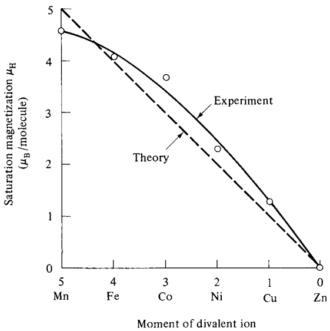

Fig. 6.3 Saturation magnetization at 0K of some simple ferrites.

2. The structure may not be completely inverse. And, as mentioned earlier, the degree of inversion can sometimes be changed by heat treatment. The saturation magnetization then becomes a structure-sensitive property.

Mg ferrite is a frequent component of mixed ferrites. If its structure were completely inverse, its net moment would be zero, because the moment of the $\mathrm{Mg}^{2+}$ ion is zero. But, as noted earlier, 0.1 of the $\mathrm{Mg}^{2+}$ ions are on $A$ sites, displacing an equal number of $\mathrm{Fe}^{3+}$ ions. Then, as shown in Example 3 of Table 6.3, the A-site moment becomes 0.9 (5) $= 4.5\mu_{\mathrm{B}}$ and the B-site moment 1.1 (5) $= 5.5\mu_{\mathrm{B}}$ , giving an expected net moment of $1.0\mu_{\mathrm{B}}$ . This agrees well with the experimental value of 1.1 $\mu_{B}$

A surprising fact about mixed ferrites containing zinc is that the addition of the nonmagnetic $\mathrm{Zn}^{2+}$ ion increases the saturation magnetization. Suppose we compute, as in Example 4 of Table 6.3, the net moment of a mixed ferrite (solid solution) containing 10 mol% Zn ferrite in Ni ferrite. The $\mathrm{Zn^{2+}}$ ions of zero moment go to the $A$ sites as in pure Zn ferrite, thus weakening the A-site moment, and the $\mathrm{Fe}^{3+}$ ions from the Zn ferrite now have parallel moments in the $B$ sites, because of the strong AB interaction. The expected net moment therefore increases from $2.0\mu_{\mathrm{B}}$ , for pure Ni ferrite, to 2.8  $\mu_{B}$ for the mixed one. If this increase, of $0.8\mu_{\mathrm{B}}$ per 10 mol% of Zn ferrite, continued with further additions, we would expect pure Zn ferrite to have a moment of $10\mu_{\mathrm{B}}$ . This cannot occur because the $A$ moments will soon become too weak to affect the $B$ moments, and the net moment must sooner or later begin to decrease. However, the experimental curve does begin with a slope very close to the theoretical, as shown in Fig. 6.4, which gives data on three mixed ferrites containing zinc.

Table 6.4 summarizes magnetic and other data on various pure ferrites and compares them with similar data on metallic iron. Although the magnetic moment per molecule of many ferrites is rather large (several Bohr magnetons), iron has a much larger magnetization on the basis of unit mass or unit volume.

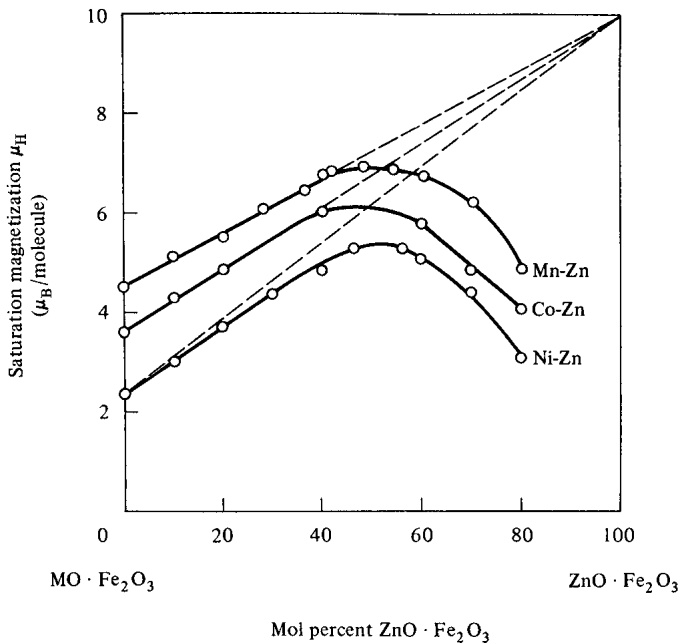

Fig. 6.4 Effect on the saturation moment (at 0K) of adding Zn ferrite to Mn, Co, and Ni ferrite.

TABLE 6.4 Magnetic and Other Data for Various Ferrites and Metallic Iron

<table><tr><td rowspan="2">Substance</td><td rowspan="2">Lattice Parameter a, nm</td><td rowspan="2">Density, g/cm3</td><td colspan="2">0K</td><td colspan="2">20°C</td><td rowspan="2"> $T_c$ , °C</td></tr><tr><td> $\sigma_0$ , emu/g</td><td> $M_0$ , emu/cm3</td><td> $\sigma_s$ , emu/g</td><td> $M_s$ , emu/cm3</td></tr><tr><td>MnO·Fe2O3</td><td>0.85</td><td>5.00</td><td>112</td><td>560</td><td>80</td><td>400</td><td>300</td></tr><tr><td>FeO·Fe2O3</td><td>0.839</td><td>5.24</td><td>98</td><td>510</td><td>92</td><td>480</td><td>585</td></tr><tr><td>CoO·Fe2O3</td><td>0.838</td><td>5.29</td><td>90</td><td>475</td><td>80</td><td>425</td><td>520</td></tr><tr><td>NiO·Fe2O3</td><td>0.834</td><td>5.38</td><td>56</td><td>300</td><td>50</td><td>270</td><td>585</td></tr><tr><td>CuO·Fe2O3</td><td> $0.837^a$ </td><td>5.41</td><td>30</td><td>160</td><td>25</td><td>135</td><td>455</td></tr><tr><td>MgO·Fe2O3</td><td>0.836</td><td>4.52</td><td>31</td><td>140</td><td>27</td><td>120</td><td>440</td></tr><tr><td>BaO·6Fe2O3</td><td>a=0.588c=2.32</td><td>5.28</td><td>100</td><td>530</td><td>72</td><td>380</td><td>450</td></tr><tr><td>Fe</td><td>0.287</td><td>7.87</td><td>222</td><td>1747</td><td>218</td><td>1714</td><td>770</td></tr></table>

aCubic when quenched from above $760^{\circ}\mathrm{C}.$ If slowly cooled it becomes tetragonal, with $a = 0.822$ and $c = 0.870 \mathrm{~nm}$. [After J. Smit and H. P. J. Wijn, Ferrites, Wiley (1959)]

## 6.4 MOLECULAR FIELD THEORY

Most ferrimagnetics have such low electrical conductivity that their magnetic moments may be regarded as completely localized at particular ions. A molecular field (localizedmoment) theory is therefore expected to be valid. We also expect that the exchange forces between the metal ions in a ferrimagnetic will act through the oxygen ions by means of the indirect exchange (super-exchange) mechanism, just as in antiferromagnetics (Fig. 5.19).

However, molecular field theory for a ferrimagnetic is inherently more complicated than for an antiferromagnetic, because the $A$ and $B$ sites are crystallographically different for a ferrimagnetic, but identical for an antiferromagnetic. This means that the AA interaction in a ferrimagnetic will differ from the BB interaction, even though the ions involved are identical. The basic reason is that an ion on an $A$ site has a different number and arrangement of neighbors from the same ion on a $B$ site.

Figure 6.5a shows the interactions (exchange forces) that would have to be considered in a rigorous treatment of an inverse ferrite $\mathrm{MO}\cdot\mathrm{Fe}_{2}\mathrm{O}_{3}$ . These interactions are shown by arrows, and there are five in all, compared to two (AB and AA = BB) in an antiferromagnetic. To simplify the problem, Néel replaced the real ferrimagnetic with a model composed of identical magnetic ions divided unequally between the $A$ and $B$ sublattices. This still leaves three different interactions to be considered, as shown in Fig. 6.5b. The Néel theory is outlined below.

Let there be n identical magnetic ions per unit volume, with a fraction $\lambda$ located on $A$ sites and a fraction $v(= 1 - \lambda)$ on $B$ sites. Let $\mu_{A}$ be the average moment of an $A$ ion in the direction of the field at temperature T. (Even though the $A$ and $B$ ions are identical, $\mu_{A}$ is not equal to $\mu_{B}$ , because these ions, being on different sites, are exposed to different molecular fields.) Then the magnetization of the $A$ sublattice is $M_{\mathrm{A}} = \lambda n\mu_{\mathrm{A}}$

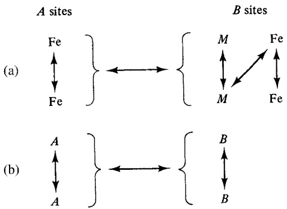

Fig. 6.5 Exchange interactions between ions in an inverse cubic ferrite.

Put $n\mu_{\mathrm{A}} = M_{\mathrm{a}}$ . Then $M_{\mathrm{A}} = \lambda M_{\mathrm{a}},$ and $M_{\mathrm{B}} = vM_{\mathrm{b}}$ The total magnetization is

$$
M = M _ {\mathrm{A}} + M _ {\mathrm{B}} = \lambda M _ {\mathrm{a}} + v M _ {\mathrm{b}}.\tag{6.1}
$$

The molecular field acting on sublattice $A$ is

$$
H _ {\mathrm{mA}} = - \gamma_ {\mathrm{AB}} M _ {\mathrm{B}} + \gamma_ {\mathrm{AA}} M _ {\mathrm{A}},\tag{6.2}
$$

where the molecular field coefficients g are regarded as positive quantities, and the signs correspond to the assumption of a negative (antiparallel) interaction between $A$ and $B$ ions and a positive (parallel) interaction between $A$ ions. Similarly,

$$
H _ {\mathrm{mB}} = - \gamma_ {\mathrm{AB}} M _ {\mathrm{A}} + \gamma_ {\mathrm{BB}} M _ {\mathrm{B}},\tag{6.3}
$$

The coefficients $\gamma_{AA}$ and gBB are now unequal, and we express them as fractions of $\gamma_{AB}$

$$
\alpha = \frac {\gamma_ {\mathrm{AA}}}{\gamma_ {\mathrm{AB}}} \qquad \beta = \frac {\gamma_ {\mathrm{BB}}}{\gamma_ {\mathrm{AB}}}.
$$

The molecular fields are then

$$
\begin{array}{r} H _ {\mathrm{mA}} = \gamma_ {\mathrm{AB}} (\alpha \lambda M _ {\mathrm{a}} - v M _ {\mathrm{b}}), \\ H _ {\mathrm{mB}} = \gamma_ {\mathrm{AB}} (\beta v M _ {\mathrm{b}} - \lambda M _ {\mathrm{a}}). \end{array}\tag{6.4}
$$

(6.5)

These equations are valid both above and below the Curie temperature.

## 6.4.1 Above $T_{c}$

In the paramagnetic region we proceed, as we did for antiferromagnetics, by assuming Curie-law behavior, namely,

$$
M T = \rho C H _ {\mathrm{t}}
$$

for each sublattice. Here ρ is the density and $H_{\mathrm{t}}$ is the total field, the sum of the applied field $H$ and the molecular field. Then, for the two sublattices,

$$
M _ {\mathrm{a}} T = \rho C (H + H _ {\mathrm{mA}}),\tag{6.6}
$$

$$
M _ {\mathrm{b}} T = \rho C (H + H _ {\mathrm{mB}}),\tag{6.7}
$$

where C is the Curie constant per gram of the magnetic ions involved, from Equation 3.49. By eliminating $M_{\mathrm{a}}, M_{\mathrm{b}}, H_{\mathrm{mA}}$ , and $H_{\mathrm{mB}}$ from Equations 6.1 and 6.4– 6.7, we find, after much tedious algebra, the following expression for the mass susceptibility χ:

$$
\chi = \frac {M}{\rho H} = \frac {C T - \gamma_ {\mathrm{AB}} \rho C ^ {2} \lambda \nu (2 + \alpha + \beta)}{T ^ {2} - \gamma_ {\mathrm{AB}} \rho C T (\alpha \lambda + \beta \nu) + \gamma_ {\mathrm{AB}} ^ {2} \rho^ {2} C ^ {2} \lambda \nu (\alpha \beta - 1)}.\tag{6.8}
$$

This may be written in the form

$$
\frac {1}{\chi} = \frac {T}{C} + \frac {1}{\chi_ {0}} - \frac {b}{T - \theta},\tag{6.9}
$$

$$
\frac {1}{\chi} = \frac {T + (C / \chi_ {0})}{C} - \frac {b}{T - \theta},\tag{6.10}
$$

where

$$
\begin{array}{l} \frac {1}{\chi_ {0}} = \gamma_ {\mathrm{AB}} \rho (2 \gamma \nu - \alpha \gamma^ {2} - \beta \nu^ {2}), \\ b = \gamma_ {\mathrm{AB}} ^ {2} \rho^ {2} C \gamma \nu [ \gamma (1 + \alpha) - \nu (1 - \beta) ] ^ {2} \\ \theta = \gamma_ {\mathrm{AB}} \rho C \gamma \nu (2 + \alpha + \beta). \end{array}
$$

Equation 6.10 represents a hyperbola, and the physically meaningful part of it is plotted in Fig. 6.6. It cuts the temperature axis at $\theta_{\mathrm{p}}$ called the paramagnetic Curie point. At high temperatures the last term of Equation 6.10 becomes negligible, and the equation reduces to a Curie–Weiss law:

$$
\chi = \frac {C}{T + (C / \chi_ {0})}.
$$

This is the equation of a straight line, shown dashed in Fig. 6.6, to which the (1/χ) vs T curve becomes asymptotic at high temperatures.

Equation 6.10 is in good agreement with experiment, except near the Curie point. Figure 6.7 shows the data for Mg ferrite. The temperature $\theta_{\mathrm{f}}$ (or $T_{\mathrm{c}}$) at which the susceptibility becomes infinite and spontaneous magnetization appears is called the ferrimagnetic Curie point; in the example shown, it was determined from measurements made in the ferrimagnetic region. This disagreement between theory and experiment in the region of the Curie “point” recalls the similar disagreement in ferromagnetism (Fig. 4.10) and is presumably due to the same cause: short-range spin order (spin clusters) at temperatures above $\theta_{\mathrm{f}}$

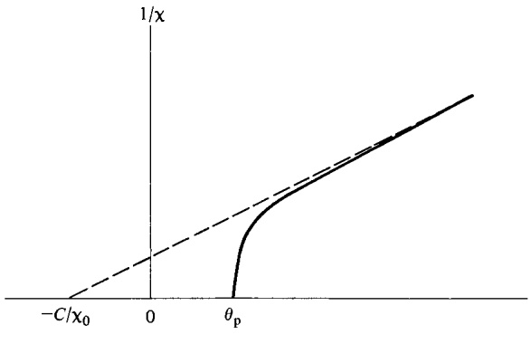

Temperature (K)

Fig. 6.6 Theoretical variation of reciprocal susceptibility with temperature for a ferrimagnetic above the Curie point.

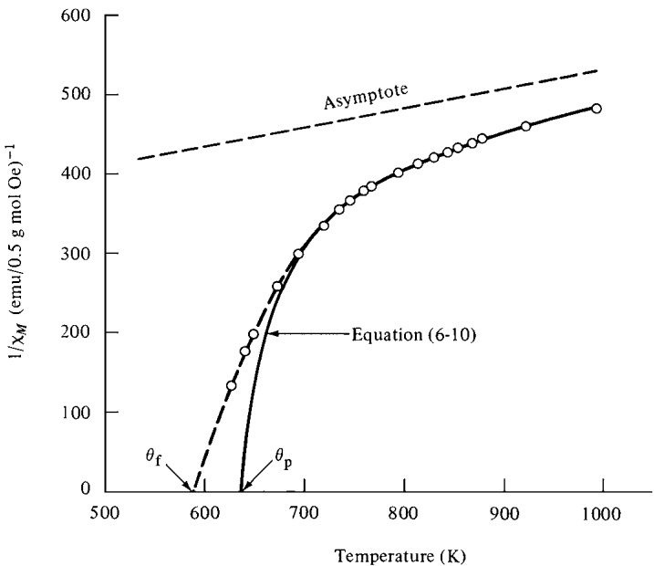

Fig. 6.7 Reciprocal susceptibility vs. temperature for Mn ferrite. Here $\chi_{M}$ refers to a half molecule of ferrite, i.e., to one mol of $\mathrm{Fe}^{3+}$

By fitting Equation 6.10 to the experimental points at temperatures sufficiently above $\theta_{\mathrm{f}}$ the constants $\chi_0, b$ and $\theta$ can be evaluated. For the curve of Fig. 6.7, for example, they have the values $1 / \chi_0 = 296.7, b = 14,700.$ and $\theta = 601.8$ , with C equal to 4.38 for the $\mathrm{Fe}^{3+}$ ion, which is assumed to be the only magnetic ion present. Values of $\gamma_{\mathrm{AB}}, \alpha, \beta,$ and $\lambda$ can then be calculated from $\chi_0, b.$ and θ, by a method given by Néel, provided that the saturation magnetization at 0K is also known. Néel analyzed the data on several ferrites in this way and found $\gamma_{AB}$ to be large and positive, as expected, but $\alpha$ and β small and negative, which means that $\gamma_{AA}$ and $\gamma_{BB}$ are small and negative. Recalling the assumptions behind the signs of Equations 6.2 and 6.3, we conclude that the AA and BB interactions are weakly antiparallel.

## 6.4.2 Below $T_{c}$

In the ferrimagnetic region each sublattice is spontaneously magnetized by the molecular field acting on it, but the two sublattice magnetizations are opposed to each other. The net (observable) magnetization is then

$$
| M | = | M _ {\mathrm{A}} | - | M _ {\mathrm{B}} |.
$$

Each sublattice magnetization is governed by the same relation as a ferromagnetic, namely, Equation 4.13. In terms of the magnetization per gram $\sigma(=M / \rho)$ , the fractional specific

magnetization of the $A$ sublattice is given by

$$
\frac {\sigma_ {\mathrm{A}}}{\sigma_ {0 \mathrm{A}}} = B (J, a ^ {\prime}) = B \bigg (J, \frac {\mu_ {\mathrm{H}} H}{k T} \bigg),\tag{6.11}
$$

where $B$ is the Brillouin function. The field $H$ here is to be put equal to the molecular field $H_{\mathrm{mA}}$ acting on the $A$ lattice, because we are computing the spontaneous magnetization in the absence of an applied field. In terms of s rather than $M$, Equation 6.4 becomes

$$
H _ {\mathrm{mA}} = - \gamma_ {\mathrm{AB}} \rho (\alpha \lambda \sigma_ {\mathrm{a}} - v \sigma_ {\mathrm{b}}).
$$

The two sublattice fractional spontaneous magnetizations are then given by

$$
\frac {\sigma_ {\mathrm{sA}}}{\sigma_ {\mathrm{0A}}} = B \left(J, \frac {\mu_ {\mathrm{H}} \gamma_ {\mathrm{AB}} \rho (\alpha \gamma \sigma_ {\mathrm{a}} - \nu \sigma_ {\mathrm{b}})}{k T}\right)\tag{6.12}
$$

$$
\frac {\sigma_ {s \mathrm{B}}}{\sigma_ {0 \mathrm{B}}} = B \Bigg (J, \frac {\mu_ {\mathrm{H}} \gamma_ {\mathrm{AB}} \rho (\beta \nu \sigma_ {\mathrm{b}} - \nu \sigma_ {\mathrm{a}})}{k T} \Bigg)\tag{6.13}
$$

These two equations cannot be solved separately by the simple graphical method of Fig. 4.4, because they are not independent. The extent to which the $A$ lattice is magnetized depends on the extent to which the $B$ lattice is magnetized, and vice versa. Instead, the equations must be solved simultaneously. The solutions in a typical case might appear like Fig. 6.8, where the dashed lines show the sublattice magnetizations and the full line is the resultant. Note that the two sublattices must have the same Curie point. If not, then, at some temperature between the two Curie points, one lattice would have zero moment and so could not align the moments on the other.

If the values of the constants $\gamma_{\mathrm{AB}},\alpha ,\beta ,$ and $\lambda$ have been calculated for a particular substance from an analysis of its paramagnetic behavior, then the $\sigma_{\mathrm{s}},T$ curve of that substance below $T_{c}$ can be calculated, and the result is in fairly good agreement with experiment. However, it is necessary to follow a rather arbitrary procedure. In an inverse ferrite $\mathrm{MO}\cdot\mathrm{Fe}_{2}\mathrm{O}_{3}$ , the $B$ sites are actually occupied by $\mathbf{M}^{2+}$ and $\mathrm{Fe}^{3+}$ ions with different moments. In the calculation it is necessary, to conform to the assumptions of the molecular-field theory, to replace these two kinds of ions on $B$ sites with a single fictitious kind of ion having a moment intermediate between that of $\mathrm{M}^{2+}$ and $\mathrm{Fe}^{3+}$

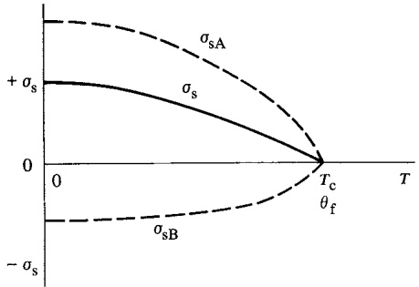

Fig. 6.8 Spontaneous magnetizations of the $A$ and $B$ sublattices, and the resultant saturation magnetization $\sigma_{s}$ , for a typical cubic ferrimagnet (schematic).

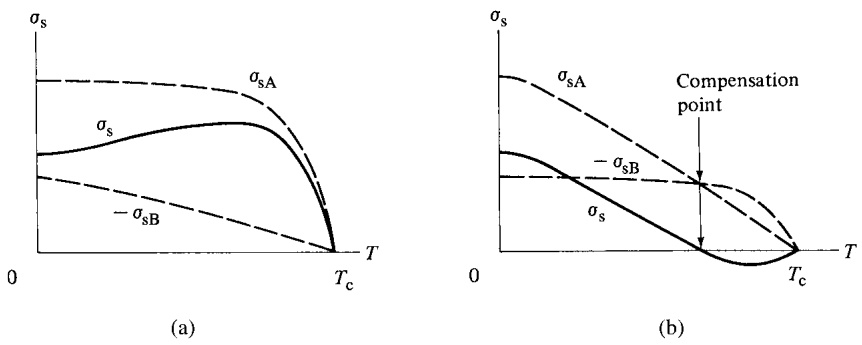

Fig. 6.9 Unusual $\sigma_{s}$ vs T curves for cubit ferrimagnets.

The sublattice magnetizations given by Equations 6.12 and 6.13 depend on the molecular field constants $\gamma_{AB}$, α, and β and on the magnetic ion distribution parameter $\lambda$. The shapes of the sublattice $\sigma_{\mathrm{s}}, T$ curves thus depend on the values of these constants, and the shape of the curve for lattice $A$ will generally differ from that of lattice $B$. Since the observed, resultant curve is the difference between these two, it follows that slight changes in the shapes of the sublattice curves can yield resultant curves of quite unusual shape. Néel has determined the various forms the resultant curve can assume, as a function of $\gamma_{\mathrm{AB}}, \alpha, \beta,$ and $\lambda$. Two quite unexpected forms, shown in Fig. 6.9, were predicted, and both have since been observed.

In Fig. 6.9, the sublattice magnetization curves are both plotted on the positive side of the temperature axis. In Fig. 6.9a the resultant magnetization increases with temperature and goes through a maximum before finally falling to zero, because $\left|\sigma_{\mathrm{sA}}\right|$ decreases less rapidly with increasing temperature than $\left|\sigma_{\mathrm{sB}}\right|$ . The chromite NiO. $\mathrm{Cr_{2}O_{3}}$ , which has the spinel structure, behaves like this. In Fig. 6.9b we see the opposite behavior: The resultant magnetization decreases to zero below $T_{c}$ and then becomes “negative.” The temperature at which the resultant becomes zero is that at which the opposing sublattice magnetizations are exactly balanced; it is called a compensation point. $\mathrm{Li_{0.5}Fe_{1.25}Cr_{1.25}O_4}$ , which also has the spinel structure, shows this behavior.

It is not accurate to say that $\sigma_{s}$ becomes negative above the compensation point, because that would imply diamagnetism. If a rod of the material is placed parallel to a saturating field directed from left to right, then, at any temperature below $T_{\mathrm{c}}$ the magnetization $\sigma_{s}$ will be directed from left to right. The $\sigma_{s}$ T curve should thus be plotted as in Fig. 6.10a rather than as in Fig. 6.9b. It is the remanent magnetization $\sigma_{\mathrm{r}}$ which changes sign with change in temperature. Let the rod be saturated at temperature $T_{1}$ and the field then removed; its remanent magnetization at this temperature $\sigma_{\mathrm{r}}(T_1)$ is then represented by point a in Fig. 6.10b. The effect of the demagnetizing field of the rod has been neglected in this illustration. If the rod is now heated, still in zero field, from $T_{1}$ to $T_{2}$ its remanent magnetization will decrease, become zero, and then reverse direction, ending up at point b in the diagram. This sign reversal of the remanence can be convincingly demonstrated in the following way. Hang the rod, in the remanent state at $T_{1}$ , by a torsion-free suspension, so that it can freely rotate in a horizontal plane, in a weak field. The field should be too weak to alter the magnetic state of the rod appreciably but strong enough to align it. When the rod is then heated through the compensation point, it will rotate through $180^{\circ}$ . Only a ferrimagnetic of this peculiar kind will behave in this way; this experiment is thus, in a sense, a crucial test of the theory of ferrimagnetism.

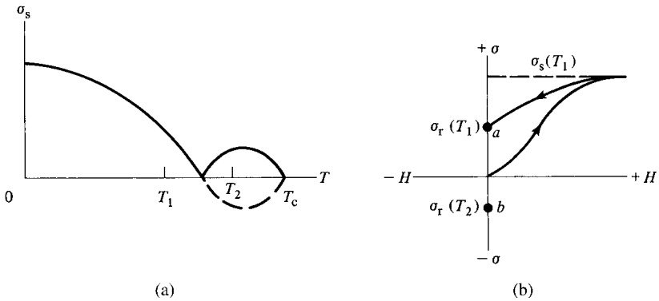

Fig. 6.10 Behavior of a ferrimagnet with a compensation point.

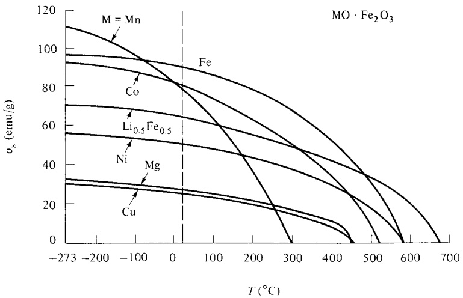

Fig. 6.11 Saturation magnetization vs temperature for several cubic ferrimagnets. [Data for Figs 6.11 and 6.13 from J. Smit and H. P. J. Wijn, Ferrites, Wiley (1959).]

The two examples just described are unusual. The saturation magnetization of most ferrimagnetics decreases continuously, but more rapidly than that of a ferromagnetic, to zero at $T_{c}$ . Typical examples are shown in Fig. 6.11.

## 6.4.3 General Conclusions

We have seen that the Néel molecular field theory successfully accounts for a whole new class of magnetic materials and is in generally good agreement with experiment. In particular, it offers satisfactory explanations for (a) the marked curvature of the $1 / \chi ,$ T plot, which has been called the most characteristic single property of ferrimagnetics, and (b) the unusually shaped $\sigma_{s}$ T curves shown in Fig. 6.9.

The success of the theory may seem surprising in view of the simplified magnetic structure of the model adopted, a structure which rarely corresponds to that of a real ferrimagnetic. However, according to J. S. Smart [Effective Field Theories of Magnetism, Saunders (1966)], “it can be shown that a generalization of the model to include the possibility [of more than one type of magnetic ion] merely introduces more adjustable parameters into the theory and does not change the general characteristics of the susceptibility and magnetization curves already predicted.”

## 6.5 HEXAGONAL FERRITES

There are many hexagonal ferrimagnetic oxides, but the only ones of commercial importance are barium ferrite $\mathrm{BaO}\cdot6\mathrm{Fe}_{2}\mathrm{O}_{3}(=\mathrm{BaFe}_{12}\mathrm{O}_{19})$ and strontium ferrite with Sr replacing Ba in the same formula. Barium ferrite has the same crystal structure as magnetoplumbite, which is a mineral with the approximate composition $\mathrm{PbFe_{7.5}Mn_{3.5}Al_{0.5}Ti_{0.5}O_{19}}$ . The Fe ions in barium ferrite occupy the same positions as the mixture of Fe, Mn, Al, and Ti ions in magnetoplumbite.

The hexagonal unit cell of barium ferrite contains two formula units, or an amount totalling $2\times 32 = 64$ atoms . It is very long in the c direction, with $c = 2.32$ nm and $a = 0.588$ nm. The $\mathrm{Ba}^{2+}$ and $O^{2-}$ ions are both large, about the same size, and nonmagnetic; they are arranged in a close-packed fashion. The smaller $\mathrm{Fe}^{3+}$ ions are located in the interstices.

The key to an understanding of this large complex cell lies in the relation between the hexagonal-close-packed and the face-centered-cubic structures. Both are built up by stacking identical layers of atoms one on top of another in a particular sequence. Within each layer the atoms are located at the corners of a network of adjoining equilateral triangles, as shown at the top of Fig. 6.12. If the layers are stacked in the sequence ABABAB. . . i.e., with the third layer directly over the first, the resulting structure is hexagonal closepacked. If the stacking sequence is ABCABC. . . , so that the sequence does not repeat until the fourth layer, the result is face-centered cubic. The cubic ferrites with the spinel structure may be thought of in this way, i.e., as being composed of layers of oxygen ions stacked in the ABCABC sequence, with the $\mathrm{M}^{2+}$ and $\mathrm{Fe}^{3+}$ ions in the interstices. The moments of the magnetic ions are normal to the plane of the oxygen layers, in a direction of the form <111>.

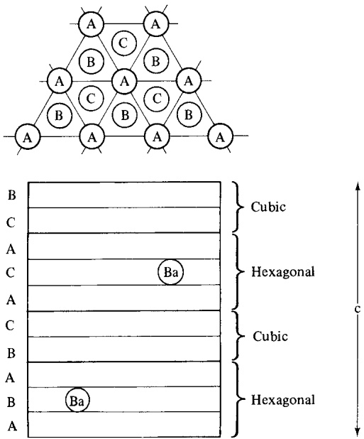

Fig. 6.12 The barium ferrite structure.

In the barium ferrite unit cell, shown schematically in Fig. 6.12, there are 10 layers of large ions $(\mathrm{Ba}^{2+}\ \mathrm{or}\ \mathrm{O}^{2-})$ , with four ions per layer. Eight of these layers are wholly oxygen, while two contain one barium ion each, as indicated. The whole block of 10 layers can be regarded as made up of four blocks, two cubic and two hexagonal. In the cubic blocks the arrangement of oxygen ions, occupied tetrahedral sites, and occupied octahedral sites is exactly the same as in the cubic spinels. In each hexagonal block a barium ion substitutes for an oxygen ion in the central of the three layers, and the layers are stacked in the hexagonal sequence. A study of the stacking sequence indicated in the drawing shows that the cubic and hexagonal sections overlap; thus the four layers between those containing barium have cubic packing, and the five layers centered on a barium ion have hexagonal packing. The unit cell as a whole has hexagonal symmetry.

The only magnetic ions in barium ferrite are the $\mathrm{Fe}^{3+}$ ions, each with a moment of $5\mu_{\mathrm{B}}$ These are located in three crystallographically different kinds of sites: tetrahedral, octahedral, and hexahedral. The hexahedral site is surrounded by five equidistant oxygen ions, arranged at the corners of a bipyramid with a triangular base. One of these sites occurs in each barium-containing layer. The $\mathrm{Fe}^{3+}$ ions have their moments normal to the plane of the oxygen layers, and thus parallel or antiparallel to the +c axis of the hexagonal cell, which is the <0001> direction. Of the 24 $\mathrm{Fe}^{3+}$ ions per cell, four are in tetrahedral sites, 18 in octahedral, and two in hexahedral. By starting with the known spin directions of the $\mathrm{Fe}^{3+}$ ions in the cubic sections of the cell and by applying the known principles governing the superexchange interaction, one can proceed from ion to ion throughout the cell and predict the direction of its spin moment, that is, whether it is [0001] or $[000\bar{1}]$ In this way one arrives at a predicted value, per cell, of 16 ions with spins in one direction and eight with spins in the other. The predicted magnetic moment per cell is therefore (16 - 8)(5) = 40 $\mu_{\mathrm{B}}$ per cell or $20\mu_{\mathrm{B}}$ per molecule of $\mathrm{BaO}\cdot 6\mathrm{Fe}_{2}\mathrm{O}_{3}$ . This quantity corresponds to 100 emu /g or $\mathrm{Am}^2 /\mathrm{kg}$ , and agrees exactly with the measured value of the saturation magnetization at 0K. The variation of $\sigma_{s}$ with temperature is shown in Fig. 6.13. At 208C it has fallen to 72 emu/g or $\mathrm{Am}^2 /\mathrm{kg}$ $(M_{\mathrm{s}} = 380\mathrm{emu / cm}^{3})$ and the Curie temperature is $450^{\circ}\mathrm{C}$

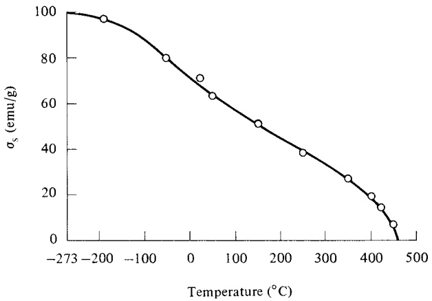

Fig. 6.13 Temperature variation of saturation magnetization of barium ferrite.

The hexagonal ferrites have strong uniaxial crystal anisotropy and are widely used as permanent magnet materials. See Chapter 14.

Other ferrimagnetic oxides with a hexagonal structure include the following:

$$
\begin{array}{l l} \mathrm{BaO} \cdot 2 \mathrm{MO} \cdot 8 \mathrm{Fe} _ {2} \mathrm{O} _ {3} & \mathrm{W} \\ 2 (\mathrm{BaO} \cdot \mathrm{MO} \cdot 3 \mathrm{Fe} _ {2} \mathrm{O} _ {3}) & \mathrm{Y} \\ 3 \mathrm{BaO} \cdot 2 \mathrm{MO} \cdot 1 2 \mathrm{Fe} _ {2} \mathrm{O} _ {3} & \mathrm{Z} \end{array}
$$

Here $M$ is a divalent ion as before, and the letter symbols at the right serve as abbreviations. Thus, $\mathrm{Co}_{2}\mathrm{Z}$ stands for $3\mathrm{BaO}\cdot 2\mathrm{CoO}\cdot 12\mathrm{Fe}_{2}\mathrm{O}_{3}$ . The structures and magnetic properties of these compounds are described by Smit and Wijn.

## 6.6 OTHER FERRIMAGNETIC SUBSTANCES

Besides the ferrites already described, there are a number of other ferrimagnetics of considerable interest.

## 6.6.1  $\gamma-Fe_{2}O_{3}$

This compound, called maghemite, has a cubic structure and is made by oxidizing magnetite:

$$
2 \mathrm{Fe} _ {3} \mathrm{O} _ {4} + \frac {1}{2} \mathrm{O} _ {2} \rightarrow 3 \mathrm{Fe} _ {2} \mathrm{O} _ {3}
$$

It is unstable and transforms to $\alpha-\mathrm{Fe}_{2}\mathrm{O}_{3}$ (hematite) on heating above $400^{\circ}\mathrm{C}$ . (Hematite is rhombohedral and a canted antiferromagnetic, with a Néel temperature of 950K.) Elongated particles of $\gamma-\mathrm{Fe}_{2}\mathrm{O}_{3}$ are used as the active recording medium in many recording tapes and floppy disks for storing analog and digital data.

All the magnetic ions in $\gamma-\mathrm{Fe}_{2}\mathrm{O}_{3}$ are identical, namely $\mathrm{Fe}^{3+}$ , and ferrimagnetism arises from an unequal distribution of these ions in $A$ and $B$ sites. This substance therefore corresponds exactly to the model adopted by Néel for his theory of ferrimagnetism. The higher O/Fe ratio of $\gamma-\mathrm{Fe}_{2}\mathrm{O}_{3}$ , compared to that of $\mathrm{Fe_{3}O_{4}}$ , is achieved, not by adding oxygen, but by removing iron. The unit cell of $\gamma-\mathrm{Fe}_{2}\mathrm{O}_{3}$ is tetragonal, with $c / a = 3$ . It is made by piling up three of the cubic spinel cells of $\mathrm{Fe_{3}O_{4}}$ and then removing eight Fe ions from octahedral (B) sites. The unit cell of $\mathrm{Fe_{3}O_{4}}$ contains eight molecules, so that the conversion to $\gamma-\mathrm{Fe}_{2}\mathrm{O}_{3}$ can be written, in terms of the tetragonal cell, as:

$$
({3}) (8) (\mathrm{Fe} _ {3} \mathrm{O} _ {4}) - 8 \mathrm{Fe} = \mathrm{Fe} _ {6 4} \mathrm{O} _ {9 6} = 3 2 (\mathrm{Fe} _ {2} \mathrm{O} _ {3}).
$$

From the information in Table 6.2 we can then conclude that the $\mathrm{Fe}^{3+}$ ions in a unit cell of $\gamma-\mathrm{Fe}_{2}\mathrm{O}_{3}$ are distributed as follows:

$$
\begin{array}{l} \text {A sites:} 8 \times 3 = 2 4, \\ \text {B sites:} (1 6 \times 3) - 8 = 4 0. \end{array}
$$

Because each ion has a moment of $5\mu_{B}$ , the net moment is $(40 - 24)(5) = 80\mu_{\mathrm{B}}$ per unit cell or $80 / 32 = 2.50\mu_{\mathrm{B}}$ per molecule of $\mathrm{Fe_{2}O_{3}}$ . This is in good agreement with the experimental value of $\sigma_{0}$ of 2.39 $\mu_{\mathrm{B}}/$ molecule = 83.5 emu/g or $A$ m²/kg. At 20°C, σs is 76.0 emu/g or $\mathrm{Am}^{2}/\mathrm{kg}$

## 6.6.2 Garnets

The semiprecious stone garnet is actually a group of isomorphous minerals with a complex cubic structure. A typical composition is $3\mathrm{MnO}\cdot \mathrm{Al}_{2}\mathrm{O}_{3}\cdot 3\mathrm{SiO}_{2}$ but certain other divalent ions can be substituted for $\mathrm{Mn}^{2+}$ and certain other trivalent ions for $\mathrm{Al}^{3+}$ . By substituting certain trivalent ions for the mixture of divalent $(\mathrm{Mn}^{2+})$ and tetravalent $(\mathrm{Si}^{4+})$ ions in natural garnet, it is possible to make silicon-free garnets with the composition $3\mathrm{M}_{2}\mathrm{O}_{3} \cdot 5\mathrm{Fe}_{2}\mathrm{O}_{3}$. The most magnetically interesting of these synthetic garnets are those in which $M$ is yttrium (Y) or one of the rare earths from gadolinium (Gd) to lutetium (Lu), inclusive. These are all ferrimagnetic, but rather weakly so; $\sigma_{s}$ in the neighborhood of room temperature is less than 10 emu/g or $\mathrm{Am}^2 /\mathrm{kg}$ . Yttrium –iron garnet, commonly known as YIG, has a normal $\sigma_{s}$ T curve, but most of the rare-earth garnets exhibit a compensation point (Fig. 6.10). YIG has important applications at very high frequency, in the microwave region.

The cubic unit cell is large, with a lattice parameter of more than 1.29 nm, and it contains 160 atoms. Three crystallographically different kinds of sites exist, labeled conventionally as $A$, $B$, and $C$, and occupied as follows: $16Fe^{3+}$ in A, $24Fe^{3+}$ in $B$, and $24M^{3+}$ in C. The interaction between the $\mathrm{Fe}^{3+}$ ions in $A$ and $B$ sites is strongly antiparallel. In the rare-earth garnets, the moment on the rare-earth ions in C sites is antiparallel to the resultant moment of the $\mathrm{Fe}^{3+}$ ions. The $\mathrm{Y}^{3+}$ ion in YIG has no moment, so that the net moment of YIG is solely due to an unequal distribution of the same kind of ions $(\mathrm{Fe}^{3+})$ in $A$ and $B$ sites, as in $\gamma-\mathrm{Fe}_{2}\mathrm{O}_{3}$

The garnets were extensively investigated and developed in the 1960s and 1970s during the creation of a nonvolatile computer memory and processor system based on moveable magnetized regions called bubble domains. A great deal of high-quality materials and engineering work was done, but the system was not commercially successful and has disappeared.

## 6.6.3 Alloys

Ferrimagnetic intermediate phases occur in several alloy systems. Perhaps the best known is $\mathrm{Mn}_{2}\mathrm{Sb}$ . Its tetragonal cell contains two atoms of manganese in different kinds of sites. The moment of a Mn atom in an $A$ site is antiparallel and unequal to the moment of a Mn atom in a $B$ site, leading to a net moment of $0.94\mu_{\mathrm{B}}$ per Mn atom. This magnetic structure for $\mathrm{Mn}_{2}\mathrm{Sb}$ was proposed by Guillaud in 1943, five years before the publication of Néel’s general theory of ferrimagnetism, and was later confirmed by neutron diffraction. $\mathrm{Mn}_{2}\mathrm{Sb}$ was the first strongly magnetic substance to be recognized as ferrimagnetic rather than ferromagnetic.

Other ferrimagnetic metallic phases include $\mathrm{Mn}_{2}\mathrm{Sn}, \mathrm{Mn}_{3}\mathrm{Ga}, \mathrm{Mn}_{3}\mathrm{Ge}_{2}, \mathrm{Mn}_{3}\mathrm{In}, \mathrm{FeGe}_{2}$ FeSe, $\mathrm{Cr_{3}As_{2}}$ , and $\mathrm{CrPt}_{3}$

Many binary alloys of a rare-earth element, especially a heavy rare earth, and a transition metal, are ferrimagnetic. Typical examples are $\mathrm{RCo}_{5}$ alloys, where R = Gd, Tb, Dy, Ho, Er, or Tm, all of which, incidentally, show a compensation point. In these alloys the cobalt moments are antiparallel to those of the rare earths. On the other hand, when R is a light rare earth, all moments are parallel, resulting in ferromagnetism, as mentioned in Section 4.5.

## 6.7 SUMMARY: KINDS OF MAGNETISM

We have surveyed, in Chapters 3 – 6, the five main kinds of magnetism exhibited by matter. A graphical summary of this material is shown in Fig. 6.14. Here a circle represents an atom or ion, and an arrow through that circle represents its net magnetic moment. Open and solid circles represent atoms or ions of different valence or chemical species. The magnetic structures depicted are those which exist in zero applied field.

The five kinds of magnetism can be divided into three broad categories:

1. Diamagnetism and Pauli paramagnetism, characterized by atoms having no inherent magnetic moments.

2. Ideal Curie paramagnetism, characterized by noninteracting atomic moments.

3. Curie –Weiss paramagnetism, ferromagnetism, antiferromagnetism, and ferrimagnetism, characterized by interacting atomic moments.

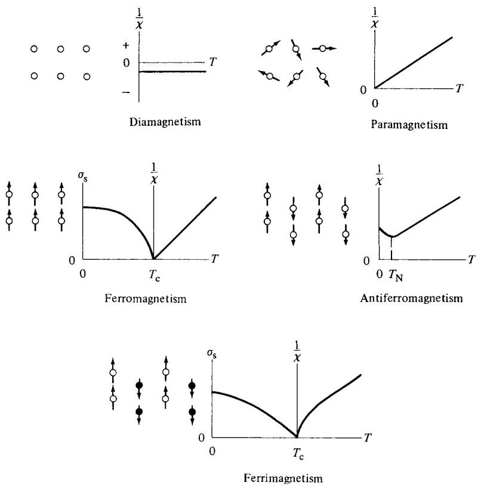

Fig. 6.14 Kinds of magnetism.

## PROBLEMS

6.1 In 1907, Pierre Weiss published measurements of the magnetization of magnetite $(Fe_{3}O_{4})$ as a function of temperature. His values, with magnetization expressed as a fraction of the magnetization at absolute zero and temperature expressed as a fraction of the Curie temperature, are as follows:

| $\sigma/\sigma_{\text{o}}$ | 0.92 | 0.88 | 0.83 | 0.77 | 0.68 | 0.58 | 0.43 | 0.32 | 0.22 | 0.03 |
| --- | --- | --- | --- | --- | --- | --- | --- | --- | --- | --- |
| $T/T_{\text{c}}$ | 0.23 | 0.33 | 0.43 | 0.54 | 0.55 | 0.78 | 0.69 | 0.94 | 0.95 | 0.98 |

Plot these values together with the curve derived from the Weiss –Langevin theory of ferromagnetism, which is the curve labeled $J = \infty$ in Fig. 4.7. In 1907, ferrimagnetism was unknown, and magnetite was regarded as a ferromagnet. The agreement between theory and experiment shown by these two curves was strong evidence for the validity of the theory. But the agreement was just a coincidence; the ferrimagnetic structure of magnetite means the theory cannot apply.

6.2 The measured saturation magnetization of $\mathrm{NiO}\cdot\mathrm{Fe}_{2}\mathrm{O}_{3}$ at 0K is 56 $\mathrm{Am}^2 /\mathrm{kg}$ . Calculate the magnetic moment per molecule, in Bohr magnetons.

6.3 A mixed Co-Zn ferrite contains cobalt and zinc in the ratio of 4.5 : 1 by weight. Find the saturation magnetization in Bohr magnetons per molecule. Assume pure Co ferrite to have the theoretical spin-only moment of a completely inverse ferrite.

