# MAGNETIC ANISOTROPY

## 7.1 INTRODUCTION

The remainder of this book will be devoted, almost without exception, to the strongly magnetic substances, namely, ferro- and ferrimagnetics. Chapters 7–12 deal mainly with structure-sensitive properties, those which depend on the prior history (thermal, mechanical, etc.) of the specimen. In these chapters we shall be concerned chiefly with the shape of the magnetization curve; that is, with the way in which the magnetization changes from zero to the saturation value $M_{\mathrm{s}}$ The value of $M_{\mathrm{s}}$ itself will be regarded simply as a constant of the material. If we understand the several factors that affect the shape of the $M$, $H$ curve, we will then understand why some materials are magnetically soft and others magnetically hard.

One factor which may strongly affect the shape of the $M$, $H$ (or $B$, $H$ ) curve, or the shape of the hysteresis loop, is magnetic anisotropy. This term simply means that the magnetic properties depend on the direction in which they are measured. It is pronounced ann-eye-SOT-rope-ee. This general subject is of considerable practical interest, because anisotropy is exploited in the design of most magnetic materials of commercial importance. A thorough knowledge of anisotropy is thus important for an understanding of these materials.

There are several kinds of anisotropy:

1. Crystal anisotropy, formally called magnetocrystalline anisotropy.

2. Shape anisotropy.

3. Stress anisotropy (Section 8.5).

4. Anisotropy induced by

a. Magnetic annealing (Chapter 10).

b. Plastic deformation (Chapter 10).

c. Irradiation (Chapter 10).

5. Exchange anisotropy (Section 11.8).

Of these, only crystal anisotropy is intrinsic to the material. Strictly, then, all the others are extrinsic or “induced.” However, it is customary to limit the term “induced” to the anisotropies listed under item 4 above. All the anisotropies from 1 to 5 (except 4c) are important in practice, and any one may become predominant in special circumstances. In this chapter we will consider only crystal and shape anisotropy.

## 7.2 ANISOTROPY IN CUBIC CRYSTALS

Suppose a single crystal with cubic structure is cut in the form of a disk parallel to a plane of the form {110}. This specimen will then have directions of the form <100>, <110>, and <111> as diameters, as shown in Fig. 7.1 for the plane $(1\bar{1}1)$. Measurements of magnetization curves along these diameters, in the plane of the disk, will then give information about three important crystallographic directions. The results for iron, which has a body-centered cubic structure, are shown in Fig. 7.2a, and those for nickel (face-centered cubic), in Fig. 7.2b.

For iron these measurements show that saturation can be achieved with quite low fields, of the order of a few tens of oersteds at most, in the <100> direction, which is accordingly called the “easy direction” of magnetization. This tells us something about domains in iron in the demagnetized state. As will become clear later, a domain wall separating two domains in a crystal can be moved by a small applied field. If we assume that domains in demagnetized iron are spontaneously magnetized to saturation in directions of the form <100>, then a possible domain structure for a demagnetized crystal disk cut parallel

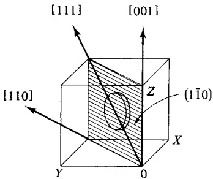

Fig. 7.1 The three principal crystallographic directions in the $(1\bar{1}1)$ plane of a cubic material.

<small>1Planes of a form are planes related by symmetry, such as the six faces of a cube: (100), (010), (001), $(\bar{1}00)$, $(0\bar{1}0)$, and $(00\bar{1})$. By convention, minus signs are placed above the index number. The indices of any one, enclosed in braces {100}, stand for the whole set. The indices of particular directions are enclosed in square brackets, such as the six cube-edge directions: [100], [010], [001], $[\bar{1}00]$, $[0\bar{1}0]$, and $[00\bar{1}]$. These are directions of a form, and the whole set is designated by the indices of any one, enclosed in angular brackets <100>.</small>

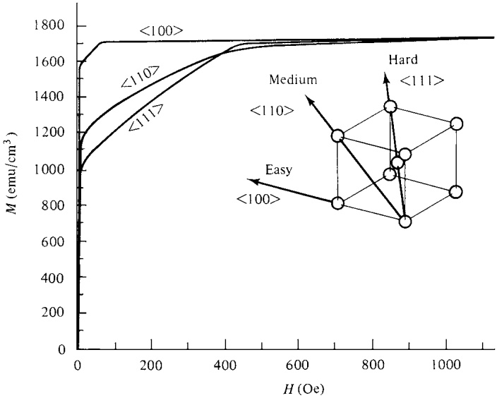

(a)

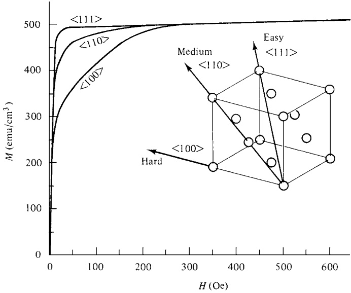

(b)

Fig. 7.2 Magnetization curves for single crystals of iron (a) and nickel (b).

to (001) would be that shown in Fig. 7.3a. It has four kinds of domains, magnetized parallel to four of the six possible easy directions, namely, [010], [100], $[0\bar{1}0]$, and $[\bar{1}00]$. Actually, an iron crystal disk of diameter, say, 1 cm, would contain tens or hundreds of domains, rather than the four shown in Fig. 7.3. However, it would still be true that all these domains would be of only four kinds, namely those with $M_{\mathrm{s}}$ vectors in the [010], [100], $[0\bar{1}0]$, and $[\bar{1}00]$ directions. If a field $H$ is now applied in the [010] direction, the [010] domain will grow in volume by the mechanism of domain-wall motion, as indicated in Fig. 7.3b. It does so because the magnetic potential energy of the crystal is thereby lowered; Equation 1.5 shows that the energy of a [010] domain in the field is $-M_{\mathrm{s}}H$ per unit volume, that of a $[0\bar{1}0]$ domain is $+M_{\mathrm{s}}H,$ and that of a [100] or $[\bar{1}00]$ domain is zero. Continued application of the field eliminates all but the favored domain, and the crystal is now saturated (Fig. 7.3c). This has been accomplished simply by applying the low field required for domain wall motion. Since experiment shows that only a low field is needed to saturate iron in a <100> direction, we conclude that our postulated domain structure is basically correct and, more generally, that the direction of easy magnetization of a crystal is the direction of spontaneous domain magnetization in the demagnetized state. In nickel, Fig. 7.2b shows that the direction of easy magnetization is of the form <111>, the body diagonal of the unit cell. The direction <111> is also the direction of easy magnetization in all the cubic ferrites, except cobalt ferrite or mixed ferrites containing a large amount of cobalt. The latter have <100> as an easy direction.

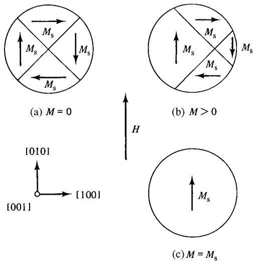

Fig. 7.3 Domain structures in a single-crystal disk of iron (schematic). The field $H$ is applied in the [010] direction.

Note that, on the scale of a few domains, as in Fig. 7.3b, a partially magnetized crystal is never uniformly magnetized, in the sense of $M$ being everywhere equal in magnitude and direction, whether or not the crystal is ellipsoidal in shape. The notion of uniform magnetization predates the domain hypothesis. It has validity, for a crystal containing domains, only when applied either to a volume less than that of one domain, or to a volume so large that it contains many domains and has a net magnetization $M$ equal to that of the whole crystal.

Figure 7.2a shows that fairly high fields, of the order of several hundred oersteds or tens of kiloamps per meter, are needed to saturate iron in a <110> direction. For this orientation of the field, the domain structure changes as in Fig. 7.4. Domain wall motion, in a low field, occurs until there are only two domains left (Fig. 7.4c), each with the same potential energy. The only way in which the magnetization can increase further is by rotation of the Ms vector of each domain until it is parallel with the applied field. This process is called domain rotation. The domain itself, which is a group of atoms, does not rotate. It is the net magnetic moment of each atom which rotates. Domain rotation occurs only in fairly high fields, because the field is then acting against the force of crystal anisotropy, which is usually fairly strong. Crystal anisotropy may therefore be regarded as a force which tends to hold the magnetization in certain equivalent crystallographic directions in a crystal. When the rotation process is complete (Fig. 7.4d), the domain wall in Fig. 7.4c disappears, and the crystal is saturated.

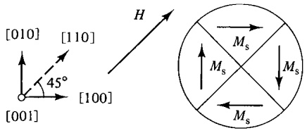

(a) $M$ = 0

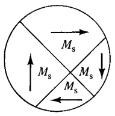

(b) $M$ > 0

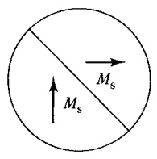

(c) $M$ = Ms cos 45°

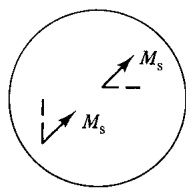

(d) $M$ = Ms

Fig. 7.4 Domain structures in a single crystal of iron (schematic). The field $H$ is applied in the [110] direction.

Because the applied field must do work against the anisotropy force to turn the magnetization vector away from an easy direction, there must be energy stored in any crystal in which $M_{\mathrm{s}}$ points in a noneasy direction. This is called the crystal anisotropy energy E. The Russian physicist Akulov showed in 1929 that E can be expressed in terms of a series expansion of the direction cosines of $M_{s}$ relative to the crystal axes. In a cubic crystal, let $M_{s}$ make angles a, b, c with the crystal axes, and let $\alpha_{1},\alpha_{2},\alpha_{3}$ be the cosines of these angles, which are called direction cosines. Then

$$
E = K _ {0} + K _ {1} (\alpha_ {1} ^ {2} \alpha_ {2} ^ {2} + \alpha_ {2} ^ {2} \alpha_ {3} ^ {2} + \alpha_ {3} ^ {2} \alpha_ {1} ^ {2}) + K _ {2} (\alpha_ {1} ^ {2} \alpha_ {2} ^ {2} \alpha_ {3} ^ {2}) + \dots\tag{7.1}
$$

where $K_{0}, K_{1}, K_{2}, \ldots$ are constants for a particular material at a particular temperature and are expressed in $\mathrm{erg / cm^3}$ (cgs) or $\mathrm{J / m^3}$ (SI) . Higher powers are generally not needed, and sometimes $K_{2}$ is so small that the term involving it can be neglected. The first term, $K_{0},$ is independent of angle and is usually ignored, because normally we are interested only in the change in the energy E when the $M_{s}$ vector rotates from one direction to another. Table 7.1 gives the value of E when the $M_{\mathrm{s}}$ vector lies in a particular direction [u v w].

TABLE 7.1 Crystal Anisotropy Energies for Various Directions in a Cubic Crystal

| [u v w] | a | b | c | $\alpha_{1}$ | $\alpha_{2}$ | $\alpha_{3}$ | E |
| --- | --- | --- | --- | --- | --- | --- | --- |
| [100] | 0 | 90° | 90° | 1 | 0 | 0 | $K_{0}$ |
| [110] | 45° | 45° | 90° | 1/$\sqrt{2}$ | 1/$\sqrt{2}$ | 0 | $K_{0} + K_{1}/4$ |
| [111] | 54.7° | 54.7° | 54.7° | 1/$\sqrt{3}$ | 1/$\sqrt{3}$ | 1/$\sqrt{3}$ | $K_{0} + K_{1}/3 + K_{2}/27$ |

TABLE 7.2 Directions of Easy, Medium, and Hard Magnetization in a Cubic Crystal

| $K_{1}$ | + | + | + | - | - | - |
| --- | --- | --- | --- | --- | --- | --- |
| $K_{2}$ | +$\infty$ to -9$K_{1}$/4 | -9$K_{1}$/4 to -9$K_{1}$ | -9$K_{1}$ to -$\infty$ | -$\infty$ to 9$\|K_{1}\|$/4 | 9$\|K_{1}\|$/4 to 9$\|K_{1}\|$ | 9$\|K_{1}\|$ to +$\infty$ |
| Easy | $\langle 100\rangle$ | $\langle 100\rangle$ | $\langle 111\rangle$ | $\langle 111\rangle$ | $\langle 110\rangle$ | $\langle 110\rangle$ |
| Medium | $\langle 110\rangle$ | $\langle 111\rangle$ | $\langle 100\rangle$ | $\langle 110\rangle$ | $\langle 111\rangle$ | $\langle 100\rangle$ |
| Hard | $\langle 111\rangle$ | $\langle 110\rangle$ | $\langle 110\rangle$ | $\langle 100\rangle$ | $\langle 100\rangle$ | $\langle 111\rangle$ |

When $K_{2}$ is zero, the direction of easy magnetization is determined by the sign of $K_{1}$ . If $K_{1}$ is positive, then $E_{100} < E_{110} < E_{111}$ and <100> is the easy direction, because E is a minimum when $M_{\mathrm{s}}$ is in that direction. Thus iron and the cubic ferrites containing cobalt have positive values of $K_{1}$ . If $K_{1}$ is negative, $E_{111} <   E_{110} <   E_{100},$ and <111> is the easy direction. $K_{1}$ is negative for nickel and all the cubic ferrites that contain little or no cobalt.

When $K_{2}$ is not zero, the easy direction depends on the values of both $K_{1}$ and $K_{2}$ . The way in which the values of these two constants determine the directions of easy, medium, and hard magnetization is shown in Table 7.2.

An alternative notation for anisotropy constants [see Robert C. O’Handley, Modern Magnetic Materials, Wiley (2000)] has some advantages, especially when higher-order anisotropy terms are important, but is rarely used in practice.

## 7.3 ANISOTROPY IN HEXAGONAL CRYSTALS

Magnetization curves of cobalt, which has a hexagonal close-packed structure at room temperature, are shown in Fig. 7.5. The hexagonal c axis is the direction of easy magnetization, and, within the accuracy of the measurements, all directions in the basal plane are found to be equally hard. Under these circumstances the anisotropy energy E depends on only a single angle, the angle $\theta$ between the $M_{s}$ vector and the c axis, and the anisotropy can be described as uniaxial. Therefore,

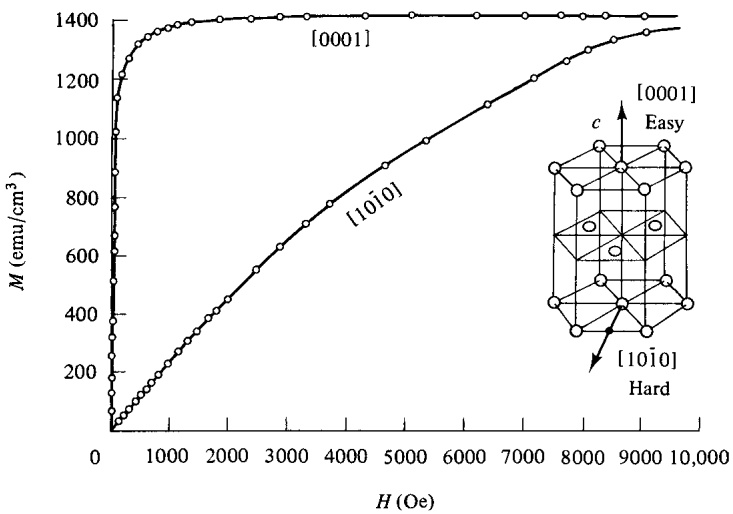

Fig. 7.5 Magnetization curves for a single crystal of cobalt.

$$
E = K _ {0} ^ {\prime} + K _ {1} ^ {\prime} \cos^ {2} \theta + K _ {2} ^ {\prime} \cos^ {4} \theta + \dots\tag{7.2}
$$

However, it is customary to write the equation for E in uniaxial crystals in powers of sinu. Putting $\cos^2\theta = 1 - \sin^2\theta$ into Equation 7.2, we have

$$
E = K _ {0} + K _ {1} \sin^ {2} \theta + K _ {2} \sin^ {4} \theta + \dots\tag{7.3}
$$

When $K_{1}$ and $K_{2}$ are both positive, the energy E is minimum for $\theta = 0$ , and the c-axis is an axis of easy magnetization. A crystal with a single easy axis, along which the magnetization can point either up or down, is referred to as a uniaxial crystal, as noted above. Its domain structure in the demagnetized state is particularly simple (Fig. 7.6). Elemental cobalt, barium ferrite, and many rare earth transitional metal intermetallic compounds behave in this way.

When $K_{1}$ and $K_{2}$ are both negative, the minimum value of E occurs at $\theta = 90^{\circ}$ . This creates an easy plane of magnetization, which is the basal plane of a hexagonal material, lying perpendicular to the c-axis.

If $K_{1}$ and $K_{2}$ have opposite signs, the situation can be more complicated, as indicated in Fig. 7.7. Here $K_{1}$ is plotted on the x-axis and $K_{2}$ on the y-axis, so any pair of values $K_{1}, K_{2}$ is represented by a point in the plane of the figure. If $K_{1}$ is positive and $K_{2}$ is negative, the line $K_{2} = -K_{1}$ is the boundary between uniaxial and planar anisotropy. When $K_{1} = -K_{2}$ exactly, there are easy directions at both 0 and $90^{\circ}$

If $K_{1}$ is negative and $K_{2}$ is positive, the limit of easy plane behavior is $K_{2} < -\frac{1}{2} K_{1}$ . In the range $K_{2} = -\frac{1}{2} K_{1}$ to $K_{2} = \infty$ (with $K_{1}$ negative), the minimum value of E is at an angle between 0 and 908, so there is an easy cone of magnetization. The value of u, which is the half-angle of the cone, drops sharply from $90^{\circ}$ to near $0^{\circ}$ as $K_{2}$ increases relative to $|K_{1}|$ , as indicated in Fig. 7.7. The value of $\theta$ is given by $\theta = \arcsin (\sqrt{(|K_1| / 2K_2)})$ . The easy cone configuration is unusual, but not unknown.

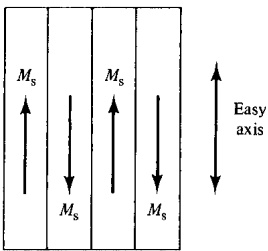

Fig. 7.6 Domain structure of a uniaxial crystal.

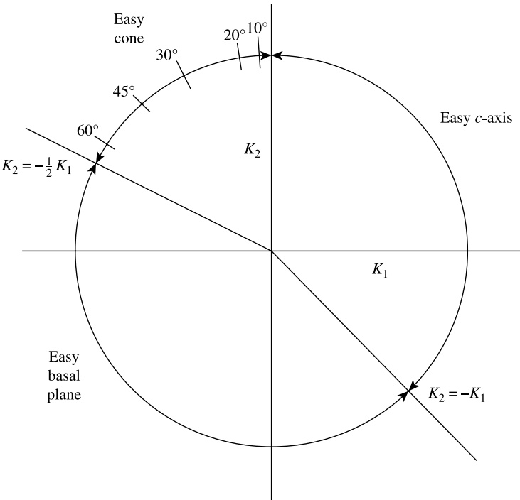

Fig. 7.7 Easy directions and planes in hexagonal crystals for all possible values of $K_{1}$ and $K_{2}$

## 7.4 PHYSICAL ORIGIN OF CRYSTAL ANISOTROPY

Crystal anisotropy is due mainly to spin-orbit coupling. By coupling is meant a kind of interaction. Thus we can speak of the exchange interaction between two neighboring spins as a spin–spin coupling. This coupling can be very strong, and acts to keep neighboring spins parallel or antiparallel to one another. But the associated exchange energy is isotropic; it depends only on the angle between adjacent spins, as stated by Equation 4.29, and not at all on the direction of the spin axis relative to the crystal lattice. The spin – spin coupling therefore cannot contribute to the crystal anisotropy.

The orbit-lattice coupling is also strong. This follows from the fact that orbital magnetic moments are almost entirely quenched, as discussed in Section 3.7 This means, in effect, that the orientations of the orbits are fixed very strongly to the lattice, because even large fields cannot change them.

There is also a coupling between the spin and the orbital motion of each electron. When an external field tries to reorient the spin of an electron, the orbit of that electron also tends to be reoriented. But the orbit is strongly coupled to the lattice and therefore resists the attempt to rotate the spin axis. The energy required to rotate the spin system of a domain away from the easy direction, which we call the anisotropy energy, is just the energy required to overcome the spin–orbit coupling. This coupling is relatively weak, because fields of a few hundred oersteds or a few tens of kilamps per meter are usually strong enough to rotate the spins. Inasmuch as the “lattice” consists of a number of atomic nuclei arranged in space, each with its surrounding cloud of orbital electrons, we can also speak of a spin–lattice coupling and conclude that it too is weak. These several relationships are summarized in Fig. 7.8.

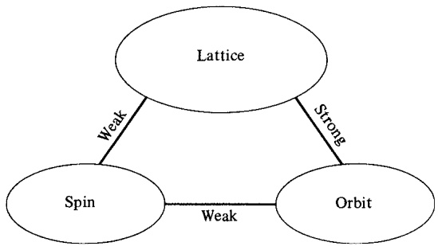

Fig. 7.8 Spin – lattice – orbit interactions.

The strength of the anisotropy in any particular crystal is measured by the magnitude of the anisotropy constants $K_{1}, K_{2}$ etc. Although there seems to no doubt that crystal anisotropy is due primarily to spin – orbit coupling, the details are not clear, and it is generally not possible to calculate the values of the anisotropy constants in a particular material from first principles.

Nor is there any simple relationship between the easy, or hard, direction of magnetization and the way atoms are arranged in the crystal structure. Thus in iron, which is body-centered cubic, the direction of greatest atomic density, i.e., the direction in which the atoms are most closely packed, is <111>, and this is the hard axis. But in nickel (face-centered cubic) the direction of greatest atomic density is <110>, which is an axis of medium hard magnetization. And when iron is added to nickel to form a series of face-centered cubic solid solutions, the easy axis changes from <111> to <100> at about 25% iron, although there is no change in crystal structure.

The magnitude of the crystal anisotropy generally decreases with temperature more rapidly than the magnetization, and vanishes at the Curie point. Since the anisotropy contributes strongly to the coercive field, the coercive field generally goes to zero together with the anisotropy. The combination of vanishing anisotropy and coercive field and nonvanishing magnetization leads to a maximum in permeability, especially the low-field or initial permeability. A maximum in permeability at or near the Curie point was noted by Hopkinson long before there was any theory to account for it, and is known as the Hopkinson effect; it can be used as a simple method to determine an approximate value of the Curie point.

## 7.5 ANISOTROPY MEASUREMENT

The anisotropy constants of a crystal may be measured by the following methods:

1. Torque curves.

2. Torsion pendulum.

3. Magnetization curves (Section 7.6).

4. Magnetic resonance (Section 12.7).

The first method is generally the most reliable and will be described, along with the closely related torsion-pendulum method, in this section. The other methods are left to later sections, or a later chapter.

## 7.5.1 Torque Curves

A torque curve is a plot of the torque required to rotate the saturation magnetization away from an easy direction as a function of the angle of rotation. Consider first a uniaxial crystal, such as a hexagonal crystal, with an easy axis parallel to the c-axis. It is cut in the form of a thin disk with the c-axis in the plane of the disk, placed in a saturating magnetic field (usually provided by an electromagnet) directed in the plane of the disk, as in Fig. 7.9. The disk is rotated about an axis through its center, and the torque acting on the disk is measured as a function of the angle of rotation. Details of how the torque can be measured will be discussed later. If the field is strong enough, the magnetization $M_{\mathrm{s}}$ will be parallel to $H$ and the angle between c and $M_{\mathrm{s}}$ which we can call u, will be the same as the angle between c and $H$.

From Equation 7.3 the u-dependent part of the anisotropy energy, if $K_{2}$ is negligible, is given by

$$
E = K _ {1} \sin^ {2} \theta .\tag{7.4}
$$

When the energy of a system depends on an angle, the derivative of the energy with respect to the angle is a torque. Thus $dE / d\theta$ is the torque exerted by the crystal on $M_{\mathrm{s}}$ and $-dE / d\theta$ is the torque exerted on the crystal by $M_{s}$ . (Clockwise torques are taken as positive, and the positive direction of $\theta$ is measured from $M_{\mathrm{s}}$ to c.) Then the torque on the crystal per unit volume is

$$
L = - \frac {d E}{d \theta},\tag{7.5}
$$

$$
L = - 2 K _ {1} \sin \theta \cos \theta = - K _ {1} \sin 2 \theta .\tag{7.6}
$$

The torque L is in dyne-cm/cm³ if E is in $\mathrm{erg/cm^{3}}$ , or in N $\mathrm{m/m^{3}}$ if E is in $\mathrm{J/m^{3}}$ Figure 7.10 shows how E and L vary with angle. For positive $K_{1}$ , the 0 and $180^{\circ}$ positions are energy minima, and $\theta = 90^{\circ}$ , which is a direction of difficult magnetization, is a position of instability. The slope of the torque curve at $L = 0$ is negative for the positions of stability $(\theta = 0$ and $180^{\circ}$) and positive for the unstable position $(\theta = 90^{\circ})$ . At a stable position, a clockwise (positive) rotation of the sample produces a negative (counterclockwise) torque, and vice versa. At an unstable position, a clockwise rotation of the sample produces a positive (clockwise) torque. The value of $K_{1}$ can found simply from the maximum amplitude of the torque curve $(= \pm K_{1})$ , or from the values of the slope at the zero crossings $(= \pm 2K_{1})$ , or by fitting the entire curve to Equation 7.6 with the value of $K_{1}$ as a fitting parameter.

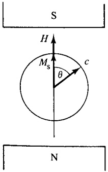

Fig. 7.9 Uniaxial disk sample in a saturating magnetic field produced by an electromagnet. $c =$ easy axis.

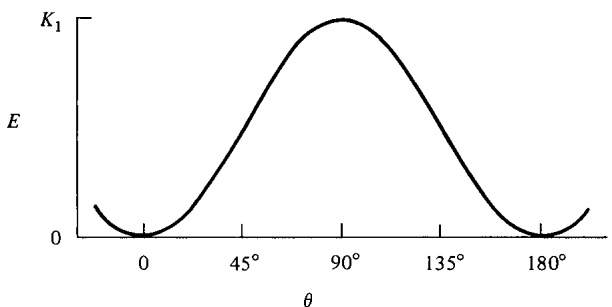

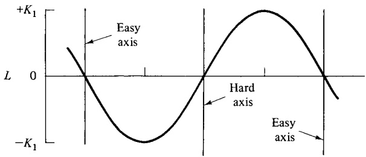

Fig. 7.10 Variation with $\theta$ of the anisotropy energy E and the torque $L(= -dE / d\theta)$ for a uniaxial crystal. $\theta$ is the angle between $M_{s}$ and the easy axis.

The preceding analysis is valid only if the field is strong enough so that the magnetization $M_{\mathrm{s}}$ is aligned with the field $H$ for all values of $\theta$. This condition is often not met, and we have instead the situation shown in Fig. 7.11. Here ψ is the angle from the c direction to the applied field, which is known from the measurement; θ is the angle from the c direction to the magnetization $M_{\mathrm{s}}$ and $\varphi (= \psi -\theta)$ is the angle from the field $H$ to the magnetization $M_{\mathrm{s}}$ Neither $\theta$ nor φ is known directly, but the angular position of $M_{\mathrm{s}}$ is determined by the balance between two torques, $L_{K} = -K_{1}$ sin $2\theta$ and $L_{H}=M_{s}H$ sin w. Here $L_{K}$ is the anisotropy torque, acting to rotate the magnetization toward the easy direction, and $L_{H}$ is the torque exerted by the field, acting to rotate the magnetization toward the field. Since these torques are balanced, we have $K_{1}$ sin $2\theta = M_{\mathrm{s}}H$ sin φ. We also know that the torque exerted on the sample by the anisotropy must be balanced by the measured torque $L_{meas}$ so that

$$
L _ {\mathrm{meas}} = K _ {1} \sin 2 \theta = M _ {\mathrm{s}} H \sin \phi .\tag{7.7}
$$

So if we measure L, and we know $M_{\mathrm{s}}$ and $H$, we can find sin f and therefore φ from sin $\phi =$ $(L_{\mathrm{meas}} / M_{\mathrm{s}}H)$ . And knowing $\phi,$ we can correct the measured value of ψ for each measured

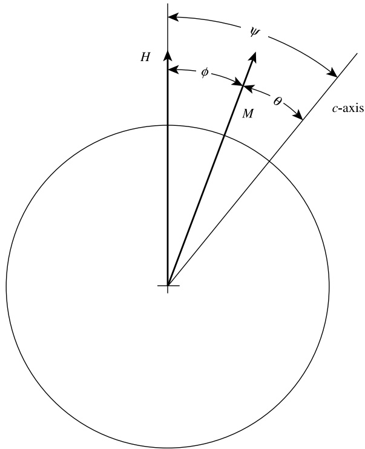

Fig. 7.11 As Fig. 7.9, for the case where $M_{s}$ is not aligned with the field $H$.

L to a value of $\theta$. Figure 7.12 shows a plot of torque L vs c, for uniaxial anisotropy with $M_{\mathrm{s}}H = 2K_{1}$ (dashed line). The corrected curve (solid line) corresponds to $M_{\mathrm{s}}H \gg K_{1}$ . The correction does not affect the maximum torque, but it clearly does affect the slopes at zero torque, and the general shape of the curve.

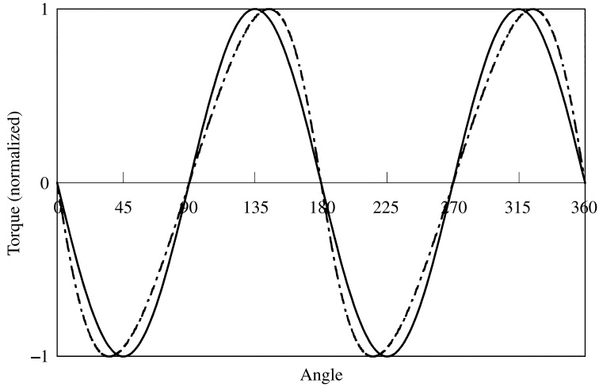

Fig. 7.12 Variation of torque with angle c between easy axis c and field $H$ for a uniaxial crystal. The dashed curve is for $H = 2K_{1} / M_{\mathrm{s}};$ solid curve for $H \gg 2K_{1} / M_{s}$

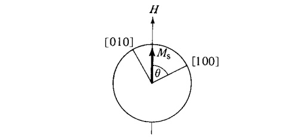

Note that the demagnetizing field does not directly influence the torque curve, because the demagnetizing field is always directed opposite to the magnetization, and therefore exerts no torque on the magnetization or on the sample. However, the demagnetizing field is present, and the proper value of $H$ to use in the preceding equations is the true or corrected field.

Note also that $M_{\mathrm{s}}$ sin φ (see Equation 7.7) is the component of magnetization perpendicular to the applied field, which may be labeled $M_{\perp}$ . This fact suggests an alternate method for measuring torque: a measurement of $M_{\perp}$ in a known (true) field $H$ gives a value of $M_{\perp}H,$ which is numerically equal to torque L. Various methods can be used to measure $M_{\perp}$ , including a VSM equipped with pickup coils to measure the perpendicular component of magnetization. The principal disadvantage of this method is that as the field becomes large, where one would expect the best results, φ and therefore $M_{\perp}$ become small, and correspondingly difficult to measure accurately.

For a cubic crystal, the simplest case is a disk cut parallel to the (001) plane with <100> easy directions. This disk will have biaxial anisotropy, because it has two easy directions in its plane. The top of Fig. 7.13 shows the orientation after the [100] axis has been rotated by an angle $\theta$ away from $M_{s}$ and $H$, which is assumed to be very strong. The direction cosines of $M_{s}$ are then $\alpha_{1} = \cos \theta$ , $\alpha_{2} = \cos (90^{\circ} - \theta) = \sin \theta ,$ and $\alpha_{3}=0$ . Putting these values into Equation 7.1, we find the crystal anisotropy energy

$$
E = K _ {0} + K _ {1} \sin^ {2} \theta \cos^ {2} \theta ,\tag{7.8}
$$

which is independent of $K_{2}$ . This can be written as

$$
E = K _ {0} + \frac {K _ {1}}{4} \sin^ {2} 2 \theta .\tag{7.9}
$$

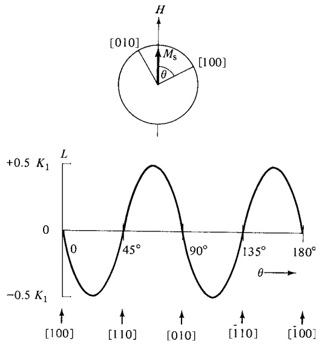

Fig. 7.13 Variation of torque L with angle $\theta$ in the {001} plane of a cubic crystal for $K_{1} > 0$

The torque on the crystal is then

$$
\begin{array}{l} L = - \frac {d E}{d \theta} = - K _ {1} \sin 2 \theta \cos 2 \theta , \\ L = - \frac {K _ {1}}{2} \sin 4 \theta . \end{array}\tag{7.10}
$$

This equation is plotted in the lower part of Fig. 7.13. The torque goes through a full cycle in a $90^{\circ}$ rotation of the disk. The peak value of the curve is $\pm K_{1} / 2$ and the zero-crossing slopes are $\pm 2K_{1}$ . No information about $K_{2}$ results. The polar diagram of Fig. 7.14 clearly shows the minima in anisotropy energy in <100> directions and the maxima in <110>.

If a disk is cut parallel to {110}, as in Fig. 7.1, it will have three principal crystal directions in its plane, and both $K_{1}$ and $K_{2}$ will contribute to the torque curve. If $M_{\mathrm{s}}$ is in the $(1\bar{1}0)$ plane of Fig. 7.1 and at an angle $\theta$ to [001], the direction cosines of $M_{\mathrm{s}}$ are $\alpha_{1} = \alpha_{2} =$ (sin $\theta / \sqrt{2})$ and $\alpha_{3} = \cos \theta .$ Equation 7.1 then becomes

$$
E = K _ {0} + \left(\frac {K _ {1}}{4}\right) (\sin^ {4} \theta + \sin^ {2} 2 \theta) + \left(\frac {K _ {2}}{4}\right) (\sin^ {4} \theta \cos^ {2} \theta).\tag{7.11}
$$

When this equation is differentiated to find the torque, the result is an equation in powers of sin $\theta$ and cos $\theta$. This may be transformed into an equation in the sines of multiple angles:

$$
L = - \frac {d E}{d \theta} = - \left(\frac {K _ {1}}{4} + \frac {K _ {2}}{6 4}\right) \sin 2 \theta - \left(\frac {3 K _ {1}}{8} + \frac {K _ {2}}{1 6}\right) \sin 4 \theta + \left(\frac {3 K _ {2}}{6 4}\right) \sin 6 \theta.\tag{7.12}
$$

This form of the equation shows immediately the various components of the torque: the term in sin $2\theta$ is the uniaxial component (like Equation 7.6), the term in sin 4u is the biaxial component (like Equation 7.14), etc. Figure 7.15 shows the torque curve obtained on a {110} disk cut from a crystal of 3.85% silicon iron (iron containing 3.85 wt% silicon in solid solution). The points are experimental, and the curve is a plot of Equation 7.12 with values of the constants chosen to give the best fit. There are many published experiments on single crystals of iron with 3 – 4 wt% silicon. This is because these alloys are much easier to prepare in single-crystal form than pure iron, for reasons given in Section 13.4, while they remain like iron in having <100> easy directions. Similar Fe–Si alloys are widely used in the magnetic cores of electrical machines.

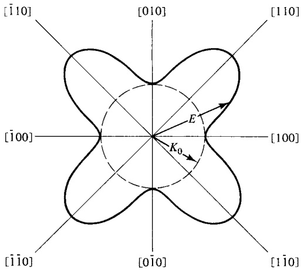

Fig. 7.14 Polar plot of crystal anisotropy E as a function of direction in the (001) plane of a cubic crystal. $K_{1}$ is positive and taken as $5K_{0}$

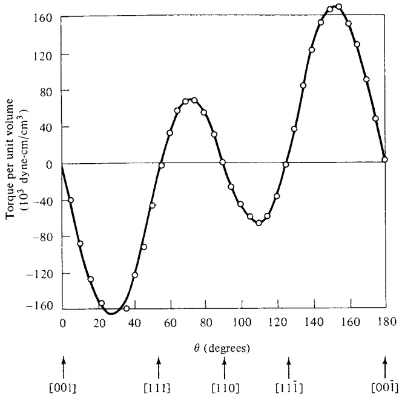

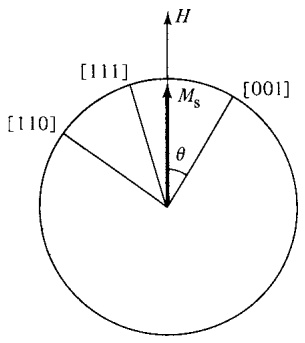

Fig. 7.15 Measured torque of a f011g disk of an Fe + 3.85 wt% Si alloy. The fitted curve is drawn for $K_{1}=2.87\times10^{5}\mathrm{erg/cm^{3}}$ and $K_{2}=1\times10^{5}\mathrm{erg/cm^{3}}$ . [R. M. Bozorth, Ferromagnetism, reprinted by IEEE Press (1993).]

Distortion of the torque curve occurs when the field is not strong enough to align the magnetization exactly in the field direction, just as in the case of uniaxial anisotropy discussed above, and can be corrected in the same way, if the magnetization and field are known. The value of sin φ is found from $L_{\mathrm{meas}} = M_{\mathrm{s}}H$ sin $\phi,$ and the value of φ is used to correct the measured value of ψ to give $\theta$.

If a disk is cut parallel to {111} and $M_{s}$ makes an angle $\theta$ with a <110> direction, the crystal anisotropy energy may be written

$$
E = K _ {0} + \frac {K _ {1}}{4} + \left(\frac {K _ {2}}{1 0 8}\right) (1 - \cos 6 \theta).\tag{7.13}
$$

The torque is then

$$
L = - \frac {d E}{d \theta} = - \left(\frac {K _ {2}}{1 8}\right) \sin 6 \theta .\tag{7.14}
$$

The calculated torque curve is a simple sine curve, repeating itself every $60^{\circ}$ , with an amplitude of $\pm K_{2} / 18$ and zero-crossing slope $\pm K_{2} / 3$ . In principle, a disk cut parallel to {111} is a better specimen for the determination of $K_{2}$ than one cut parallel to {110}, because the torque on a {111} specimen is determined only by $K_{2}$ , whereas the torque on a {110} specimen is a function of both $K_{1}$ and $K_{2}$ . In practice, however, {111} disks often yield imperfect sin $6\theta$ curves, because slight misorientation of the specimen gives a relatively large contribution from $K_{1}$ . In general, accurate $K_{2}$ values are not easy to obtain from torque measurements, and the values reported in the literature tend to be inconsistent.

Fourier analysis of experimental torque curves offers a means of sorting out the various contributions to the observed torque. The torque is expressed as a Fourier series:

$$
L = A _ {1} \cos \theta + A _ {2} \cos 2 \theta + \dots + B _ {1} \sin \theta + B _ {2} \sin 2 \theta + \dots\tag{7.15}
$$

Fourier analysis of the experimental curve then yields the values of the various coefficients $A_{n}$ and $B_{n},$ which in turn describe the kinds of anisotropy present. For example, suppose a torque curve is obtained from a disk cut parallel to {100} in a cubic crystal. If conditions are perfect, Fourier analysis of the experimental curve would show that all Fourier coefficients are zero except $B_{4}$ , because Equation 7.10 shows that the torque varies simply as sin 4u. But suppose that the specimen or torque magnetometer, or both, is slightly misaligned and that this misalignment introduces a spurious uniaxial component into the torque curve. This will be reflected in a nonzero value for $B_{2},$ because Equation 7.6 shows that uniaxial anisotropy causes a sin $2\theta$ variation of torque. The nonzero value of $B_{2}$ in this particular example, discloses the misalignment, while the value of $B_{4}$ yields the quantity desired, namely, $K_{1} = -2B_{4}$

Slight experimental imperfections do not distort a torque curve so much that its basic character is unrecognizable. Thus, in the example just described, the experimental curve would be somewhat distorted but still recognized as basically similar to the curve of Fig. 7.13, which describes pure biaxial anisotropy. The function of Fourier analysis is then to separate out the spurious torques and leave only the torque due to the crystal itself. But specimens are also encountered in which two, or even three, sources of anisotropy are simultaneously present, and with more or less the same strength. Fourier analysis of the torque curve then becomes not merely a means of refining slightly imperfect experimental data, but a necessary method for disentangling the various components of the anisotropy. Before computers became ubiquitous, Fourier analysis of experimental torque data was a fairly tedious computational task. It is now quick and easy.

## 7.5.2 Torque Magnetometers

The instrument for making torque measurements is called a torque magnetometer. Depending on the material to be measured, the size of the sample, and the temperature, the maximum torque may vary over many orders of magnitude, so that no single design is universally useful. Commercial instruments are available, but many torque magnetometers are specially built for particular uses.

Early designs made use of a torsion fiber, or a spiral clock spring, to measure the torque, as suggested by Fig. 7.16. In this case, the deflections (the twist in the torsion fiber) are large enough to be read by eye, but there is no simple way to record the data automatically. A further difficulty is that over substantial portions of the torque curve, centered around the unstable hard axes, there may be no stable angular position of the sample. The condition for stability is that the net torque on the sample (the sum of the anisotropy torque and the torsion fiber torque) is zero and has negative slope. As noted above, negative slope means that a positive (clockwise) rotation of the sample produces a negative (counterclockwise) torque, and vice versa. Therefore the condition for stability is that the stiffness of the torsion fiber, given by the (negative) slope of the torque vs angle curve, must be greater than the positive slope of the torque curve in the hardest direction. In making this comparison, the absolute value of the torque must be used; that is, the torque per unit volume times the volume of the sample.

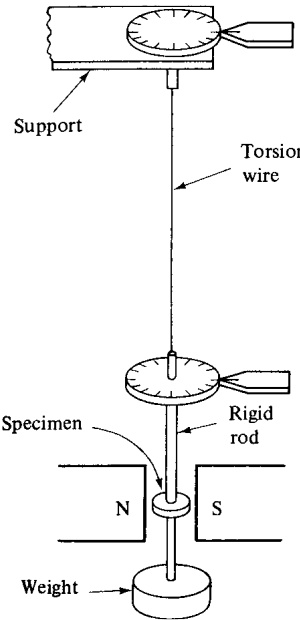

Fig. 7.16 Basic mechanical torque magnetometer (schematic).

Again using the uniaxial case as the simplest example, the absolute value of the slope in the hard direction is $2K_{1}\nu$, where $\nu$ is the volume of the sample. The torque acting on the sample due to the torsion fiber is $-k\beta$ , where $k$ is the torsion constant (dyne-cm or N-m per radian) and β is the twist in the fiber. The slope of this torque (vs angle) is simply -k. The zero net torque condition gives $k\beta = K_{1}v.$ and the negative slope condition gives $2K_{1}\nu-k < 0$, or $k > 2K_{1}\nu$ . Solving for β gives $\beta <  \frac{1}{2}$ (radian), or less than $30^{\circ}$ . Thus the suspension fiber must be made stiff enough so that the maximum twist angle is less than $30^{\circ}$ to permit stable readings through a full $360^{\circ}$ rotation of the sample. This analysis does not take into account the distortion of the torque curve when the field is not strong enough to align the magnetization parallel to the field, as discussed above. The distortion increases the measured slope in the hard direction, and thus increases the required stiffness of the torsion fiber and decreases the maximum twist in the fiber. Exactly similar reasoning applies to the torque curves for the various cubic anisotropy cases.

The conclusion is that, in order to insure stable readings, the simple torsion fiber version of the torque magnetometer must be made so stiff that its maximum deflection is limited to about ±20° in the most favorable case, which limits the precision of the torque readings. This limitation can be overcome to some extent by using a softer torsion fiber and limiting the angular motion of the sample to a small range, say $\pm1^{\circ}$ , with mechanical stops, and measuring the torque required to jump the sample position from one limit to the other over the range of unstable positions. However, this virtually eliminates any possibility of automatic recording of the torque data.

For automatic recording of torque curves, two basic possibilities exist.

1. Passive Sensing. The torque magnetometer can be built with a very stiff torsion structure and equipped with a sensitive way to measure the angle of twist. For example, resistance strain gages can be used to measure small elastic strains in a thin-walled torsion tube. Or sensitive position detectors such as linear variable differential transformers (LVDTs) can be used to detect small displacements of pointers attached above and below a stiff torsion-sensing fiber. Such a system can have the advantage that the sample is rigidly supported in the air gap of the electromagnet, so that no bearing is required to limit the sideways motion of the sample. This design is best suited to the measurement of relatively large torques—large anisotropy or large sample, or both.

2. Active Sensing. The sample can be hung from a very sensitive torsion fiber, and fitted with a feedback mechanism to supply the balancing torque. Figure 7.17 shows a common arrangement. The top of the sample rod carries a coil of fine wire, which is placed in the field of a small permanent magnet. This is exactly the configuration of a D’Arsonval analog meter; if the coil carries a current, it experiences a torque proportional to the current. A sensing circuit, usually based on a light beam, mirror, and photocell or photodiode as in the figure, provides a feedback signal that drives a current through the coil to balance the anisotropy torque. If the system response is fast enough (which is not difficult), the sample can be held at any angle to the field. The value of the current through the coil is proportional to the torque on the sample. This design can be made very sensitive for the measurement of small anisotropies in small samples. Generally some low-friction method of keeping the sample centered in the air gap of the magnet is required; for example, a jewel bearing, an airbearing, or a second torsion fiber.

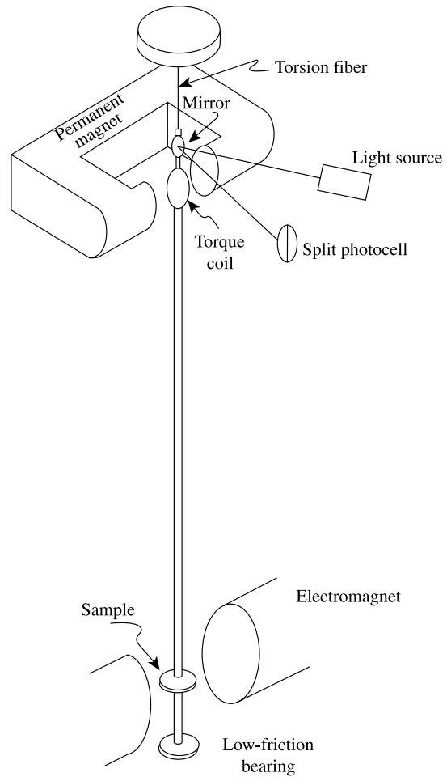

Fig. 7.17 Automatic recording torque magnetometer.

In any torque magnetometer, either the electromagnet may be rotated around the sample, or the magnetometer and sample may be rotated in a stationary magnet gap. Neither is easy, but either is possible.

The ideal specimen shape is that of an ellipsoid of revolution (planetary or oblate spheroid), which is relatively easy to saturate. However, an ellipsoidal specimen is difficult to make and also somewhat difficult to mount securely in the sample holder, and most investigators settle for a disk with a diameter/thickness ratio of 10 or more. Thin film samples have inherently a very large diameter/thickness ratio, and make very satisfactory samples if the sensitivity of the instrument is high enough. Simple theory predicts that the measured value of the anisotropy should remain constant with increasing field once the field is large enough to saturate the sample in any direction, but in practice, at least with samples other than thin films, the measured anisotropy increases with increasing measuring field. This is presumably partly due to lack of saturation in small volumes of the sample where the local demagnetizing fields are large, and partly due to the real increase in saturation magnetization with field as the field overcomes thermal vibration (the paraprocess). Whether the measured values should be extrapolated to infinite field or back to zero field, and how the extrapolation should be done, are matters that remain unresolved. They rarely have a major impact on the measured values of the anisotropy, but they do limit the accuracy of experimental values.

Torque measurements in a superconducting magnet are difficult, because access to the sample is normally only possible in a direction parallel to the field. Split-coil superconducting magnets can be built to provide access perpendicular to the field direction, but they must be designed to withstand the large attractive force between the two coils, and the perpendicular access path must penetrate the thermal insulation around the superconducting windings.

## 7.5.3 Calibration

The torsion constant of a fiber (dyne-cm or N-m per radian) is given by

$$
k = \frac {L}{\beta} = \frac {\pi G r ^ {4}}{2 l},\tag{7.16}
$$

where r is the fiber radius, l is the length, and G is the shear modulus, all in consistent units. However, this equation does not give values accurate enough for most measurements, mainly because uncertainty in the value of the radius r of a small fiber is magnified in the $r^{4}$ term.

The value of the torsion constant can be determined quite accurately by using it as a torsion pendulum. The wire is suspended from a fixed support and its lower end is attached to the center of a heavy disk of radius R and mass $M$. By rotating the disk through a small angle and then releasing it, the system will go into torsional oscillation. The period of oscillation T (sec) is measured by counting complete cycles of oscillation in a measured time interval, and the torsion constant is obtained from

$$
T = 2 \pi \sqrt {I / k},\tag{7.17}
$$

where I is the moment of inertia, equal to $MR^{2}/2$ for a disk. Therefore

$$
k = \frac {2 \pi^ {2} M R ^ {2}}{T ^ {2}},\tag{7.18}
$$

which requires no knowledge of the fiber dimensions or material. If $k$ is large (a stiff suspension), the period of oscillation T may be small, and some kind of electronic recording system will be needed.

Torque magnetometers that do not rely on the properties of a torsion fiber must be calibrated directly. In principle, any torque measuring system can be calibrated with a string wrapped around the shaft and a set of appropriate weights and pulleys. In practice, this does not work well for a sensitive instrument, and a sample of known anisotropy is needed instead. The usual choice is to rely on the shape anisotropy of a thin straight wire of a material of known saturation magnetization, commonly nickel. The anisotropy energy (per unit volume) is uniaxial, and is given by

$$
E _ {\mathrm{shape}} = \frac {1}{2} \Delta N M _ {\mathrm{s}} ^ {2} \sin^ {2} \theta ,\tag{7.19}
$$

where DN is the difference in demagnetizing factor parallel and perpendicular to the wire axis. For a long thin wire, N is 2p (cgs) or 1(SI) when the magnetization is perpendicular to the wire axis, and effectively zero when the magnetization is parallel to the axis. The sample behaves as described previously for a uniaxial material, and the torque (per unit volume of wire) is

$$
L = - \frac {d E}{d \theta} = - \pi M _ {\mathrm{s}} ^ {2} \sin 2 \theta (\mathrm{cgs}) \quad \text {or} \quad L = - \frac {M _ {\mathrm{s}} ^ {2}}{4} \sin 2 \theta (\mathrm{SI}).\tag{7.20}
$$

The field must be high enough to saturate the wire in the perpendicular direction $[H>$ $2\pi M_{s}$ (cgs) or $>1 / 2M_{\mathrm{s}}$ (SI)]. The sample volume can be obtained by direct measurement, or (preferably) from the sample mass and density.

For smaller fields, and for small rotations of the wire away from the easy direction, F. E. Luborsky and C. R. Morelock [J. Appl. Phys., 35 (1964) p. 2055] give

$$
L = - \frac {\pi M _ {\mathrm{s}} ^ {2} H}{(H + 2 \pi M _ {\mathrm{s}})} 2 \theta (\mathrm{cgs}) \quad \text {or} \quad L = - \frac {M _ {\mathrm{s}} ^ {2} H}{(4 H + 2 M _ {\mathrm{s}})} 2 \theta (\mathrm{SI})\tag{7.21}
$$

where $\theta$ is in radians and L is the torque per unit volume of wire.

An alternative standard torque sample might be a disk of a highly anisotropic, highcoercive field permanent magnet, such as one of the rare-earth transition metal compounds discussed in Chapter 14. These materials can have magnetic moments that are almost unchanged in fields over the range +20 kOe (2T) or more. The energy of such a sample, of magnetic moment $m$ in a field $H$ as function of the angle between $m$ and $H$, is

$$
E = - m H \cos \theta ,\tag{7.22}
$$

and the torque is given by

$$
L = - \frac {d E}{d \theta} = - m H \sin \theta .\tag{7.23}
$$

Here $m$ is the absolute magnetic moment of the sample, in emu (cgs) or A/m (SI), which must be determined experimentally in a separate measurement.

It is important that the component parts of a torque magnetometer be properly aligned. Each of three axes should coincide with the center of the magnet air gap: the axis of the specimen, the axis of rotation of the torsion head (upper dial of Fig. 7.16), and the axis of the instrument (the line from the upper support of the torsion wire through the center of gravity of all the suspended parts). Improper alignment will introduce spurious torques which distort the experimental curve. The alignment can be checked by determining the torque curve of a specimen having a known, and simple, anisotropy, such as uniaxial, and comparing this curve with that theoretically expected.

## 7.5.4 Torsion-Pendulum Method

In this case, the specimen is a disk, suspended by a torsion wire in the air gap of an electromagnet, just as in a torque magnetometer. Suppose the crystal is uniaxial, with the easy axis c in the plane of the disk. The initial, minimum-energy position of the specimen is one with c parallel to the field $H$ and no twist in the torsion wire. The specimen is then rotated away from $H$ by a small angle, released, and allowed to oscillate back and forth about the field direction at the natural frequency of the suspended system. This frequency is measured, by counting the number of oscillations in a known time interval. When the specimen is in the deflected position, two restoring torques act on it: (1) the torque in the wire, and (2) the crystal anisotropy torque which tries to rotate c back into parallelism with $M_{\mathrm{s}}$ and $H$. The period T of the oscillatory motion is still given by an equation of the general form of Equation 7.21, but modified to include the anisotropy torque:

$$
\frac {1}{f} = T = 2 \pi \sqrt {\frac {I}{k _ {\mathrm{w}} + k _ {\mathrm{s}}}}\tag{7.24}
$$

where f is oscillation frequency, I is the moment of inertia of the suspended system, $k_{\mathrm{w}}$ is the torsion constant of the wire, and $k_{\mathrm{s}}$ is the torsional stiffness of the specimen. The quantity $k_{s}$ is the rate of change of torque with angle and is therefore given by $dL/d\theta.$ But $|L| = dE/d\theta,$ so that $k_{\mathrm{s}} = d^{2}E / d\theta^{2}$ , where E is the anisotropy energy. From the measured frequency, $k_{\mathrm{s}}$ may be calculated, because I and $k_{\mathrm{w}}$ are known, and the anisotropy constant may then be determined from $k_{s}$

Anisotropy can be measured by the torsion-pendulum method in a few seconds, but only the slope of the torque curve at the equilibrium angle is measured, not the full torque curve. The method is rarely used.

## 7.6 ANISOTROPY MEASUREMENT (FROM MAGNETIZATION CURVES)

Anisotropy constants may determined from the magnetization curves of single crystals in two ways:

1. By fitting a calculated magnetization curve to the observed one.

2. By measuring, on a graph of $M$ vs $H$, the area included between the magnetization curves for two different crystal directions.

## 7.6.1 Fitted Magnetization Curve

This is not a very common method. However, it is instructive to see how magnetization curves are calculated, because the calculation tells us something about the magnetization process. In such calculations we ignore everything but the crystal anisotropy forces; that is, we assume that domain walls will move in negligibly small fields, but that $M_{s}$ can be rotated out of the easy direction only by fields strong enough to overcome the anisotropy forces.

The simplest case is that of a crystal magnetized in one of its easy directions, e.g. an iron crystal magnetized in one of the <100> directions, as illustrated in Fig. 7.3, or a uniaxial crystal (Fig. 7.6), magnetized parallel to its easy axis. Here the whole process, from the demagnetized state to saturation, occurs by wall motion only, at an (assumed) negligibly small field. The magnetization curve, shown in Fig. 7.18, is simply a vertical line, and the hysteresis loop encloses zero area.

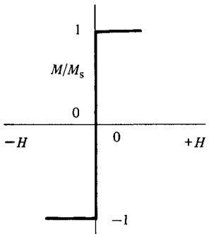

Fig. 7.18 Idealized hysteresis loop of a crystal measured parallel to an easy axis.

When a field is applied to an iron crystal in the [110] direction, wall motion occurs until there are only two kinds of domains left, namely those with $M_{s}$ vectors in the [010] and [100] directions, the two easy directions closest to the field (Fig. 7.4). The magnetization of the sample is then $M=M_{s}$ cos $45^{\circ} = M_{\mathrm{s}} / \sqrt{2} = 0.707$ $M_{\mathrm{s}}$ Further increase in field rotates the $M_{\mathrm{s}}$ vectors away from the easy directions by an angle d in the (001) plane (Fig. 7.19a). The direction cosines of $M_{\mathrm{s}}$ relative to the crystal axes are then $\alpha_{1} = \cos \delta ,$ $\alpha_{2} = \cos (90^{\circ} - \delta)$ , and $\alpha_{3}=0$ , for the [100] domains. (These comprise half the volume of the crystal. It is enough to base the following calculation on them alone, because the behavior of the [010] domains is exactly similar.) The anisotropy energy is then, from Equation 7.13,

$$
E _ {\mathrm{a}} = K _ {0} + \frac {K _ {1}}{4} \sin^ {2} 2 \delta .
$$

The magnetic potential energy is, from Equation 1.5,

$$
E _ {\mathrm{p}} = - M _ {\mathrm{s}} H \cos (4 5 ^ {\circ} - \delta).
$$

The larger the angle d, the larger is the anisotropy energy and the smaller the potential energy. The angle d will therefore be such as to minimize the total energy $E_{\mathrm{t}}$

$$
E _ {\mathrm{t}} = K _ {0} + \frac {K _ {1}}{4} \sin^ {2} 2 \delta - M _ {\mathrm{s}} H \cos (4 5 ^ {\circ} - \delta).
$$

To minimize $E_{t}$ we put

$$
\frac {d E _ {\mathrm{t}}}{d \delta} = [ K _ {1} \sin 2 \delta \cos 2 \delta ] - [ M _ {\mathrm{s}} H \sin (4 5 ^ {\circ} - \delta) ] = 0.\tag{7.25}
$$

This problem may be thought of in terms of torques, rather than energies. The first term in Equation 7.25 is the torque exerted on $M_{\mathrm{s}}$ by the crystal, the second term is the torque exerted on $M_{\mathrm{s}}$ by the field, and the equation states that these torques are equal and opposite. The component of $M_{s}$ in the field direction is the measured magnetization:

$$
M = M _ {\mathrm{s}} \cos (4 5 ^ {\circ} - \delta).\tag{7.26}
$$

[010]

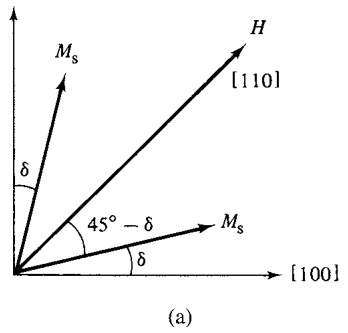

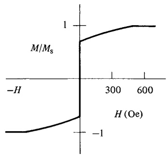

Fig. 7.19 Magnetization of an iron crystal in a [011] direction.

Eliminating d from Equations 7.21 and 7.22, we find

$$
H = \frac {4 K _ {1}}{M _ {\mathrm{s}}} \frac {M}{M _ {\mathrm{s}}} \left[ \left(\frac {M}{M _ {\mathrm{s}}}\right) ^ {2} - \frac {1}{2} \right],\tag{7.27}
$$

which gives the field required to reach any given level of magnetization. This field is directly proportional to $K_{1}$ and independent of $K_{2}$ The field required to make $M=M_{s}$ which is to saturate the magnetization in the [110] direction, is

$$
H = \frac {2 K _ {1}}{M _ {\mathrm{s}}}.\tag{7.28}
$$

Figure 7.18b shows the magnetization curve for iron at room temperature, calculated for $M_{\mathrm{s}} = 1714 \mathrm{emu} / \mathrm{cm}^{3}$ and $K_{1}=4.5\times10^{5}\mathrm{erg/cm^{3}}(1.714\times10^{6}\mathrm{A/m}$ and $4.5\times10^{4}\mathrm{~J/m^{3}})$

The magnetization curve in the [111] direction of a crystal having <100> easy directions is calculated in similar fashion. Wall motion in low fields will eliminate all but three kinds of domains—[100], [010], and [001]—and $M_{\mathrm{s}}$ in each will be equally inclined, at $54.7^{\circ}$ , to the [111] field direction. The magnetization will then be $M=M_{s}$ cos $54.7^{\circ} = M_{\mathrm{s}} / \sqrt{3} =$ $0.577M_{s}$ Further increase in field will rotate the $M_{\mathrm{s}}$ vectors in {110} planes, as shown for one of these in Fig. 7.20. The equation for the magnetization curve is complex:

$$
\begin{array}{r l} H M _ {\mathrm{s}} & = \frac {K _ {1}}{3} \left[ \sqrt {2 - 2 \mathrm{m} ^ {2}} (4 \mathrm{m} ^ {2} - 1) + \mathrm{m} (7 \mathrm{m} ^ {2} - 3) \right] \\ & \quad - \frac {K _ {2}}{1 8} \left[ \sqrt {2 - 2 \mathrm{m} ^ {2}} (1 0 \mathrm{m} ^ {4} - 9 \mathrm{m} ^ {2} + 1) - \mathrm{m} (2 3 \mathrm{m} ^ {4} - 1 6 \mathrm{m} ^ {2} + 1) \right], \end{array}\tag{7.29}
$$

where $m = M / M_{\mathrm{s}}$ . The field required to saturate in the [111] direction is

$$
H = \frac {4 (3 K _ {1} + K _ {2})}{9 M _ {\mathrm{s}}}.\tag{7.30}
$$

For a crystal like iron, this is less than the field required for saturation in the [110] direction, in agreement with the experimental results shown in Fig. 7.2a.

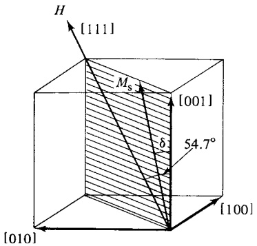

Fig. 7.20 Magnetization of an iron crystal in a [111] direction.

It is also of interest to calculate the magnetization of a uniaxial crystal like cobalt, when the field is applied in a direction at right angles to the easy axis. When the field is strong enough to rotate $M_{s}$ away from the easy axis by an angle u, the anisotropy energy is, from Equation 7.3,

$$
E _ {\mathrm{a}} = K _ {0} + K _ {1} \sin^ {2} \theta + K _ {2} \sin^ {4} \theta .
$$

The magnetic potential energy is

$$
E _ {\mathrm{p}} = - M _ {\mathrm{s}} H \cos (9 0 ^ {\circ} - \theta).
$$

The condition for minimum total energy is

$$
2 K _ {1} \sin \theta \cos \theta + 4 K _ {2} \sin^ {3} \theta \cos \theta - M _ {\mathrm{s}} H \cos \theta = 0.
$$

Also,

$$
M = M _ {\mathrm{s}} \cos (9 0 ^ {\circ} - \theta).
$$

Elimination of $\theta$ from these two equations gives

$$
H = \frac {2 K _ {1}}{M _ {\mathrm{s}}} \left(\frac {M}{M _ {\mathrm{s}}}\right) + \frac {4 K _ {2}}{M _ {\mathrm{s}}} \left(\frac {M}{M _ {\mathrm{s}}}\right) ^ {3},\tag{7.31}
$$

with saturation $(M / M_{\mathrm{s}} = 1)$ attained in a field of

$$
H = \frac {2 K _ {1} + 4 K _ {2}}{M _ {\mathrm{s}}}.\tag{7.32}
$$

If $K_{2}$ is zero, the magnetization curve becomes a straight line,

$$
H = \frac {2 K _ {1} M}{M _ {\mathrm{s}} ^ {2}},\tag{7.33}
$$

and the saturating field becomes

$$
H = \frac {2 K _ {1}}{M _ {\mathrm{s}}},\tag{7.34}
$$

Figure 7.21 shows the room-temperature magnetization curve for cobalt, calculated for $M_{\mathrm{s}} = 1422 \mathrm{emu} / \mathrm{m}^{3}, K_{1} = 4.5 \times 10^{6} \mathrm{erg} / \mathrm{cm}^{3}$ , and $K_{2}=1.5\times10^{6}\mathrm{erg/cm^{3}(cgs)}$ or $M_{\mathrm{s}} =$ $1.422 \times 10^{6} \mathrm{~A/m}, K_{1} = 450 \times 10^{3} \mathrm{~J/m}^{3}$ , and $K_{2}=150\times10^{3}\mathrm{~J/m^{3}}$ (SI). Fields in excess of 10,000 Oe or 0.8 MA/m are needed for saturation. The dashed line shows the magnetization behavior if $K_{2}$ is zero.

For iron, nickel, and cobalt crystals the general features of the experimental magnetization curves are well reproduced by the calculated ones. Figure 7.22 shows this kind of a comparison for crystals of 3.85% silicon iron. The fact that nonzero fields are required for saturation in the easy direction, evident in Figs 7.2, 7.5, and 7.22, shows that domain walls encounter obstacles to their easy motion. This topic will be pursued in Chapter 9.

Up to this point we have examined the magnetization curve of a single crystal only when the field is applied parallel to an axis of symmetry in the crystal. If the field is in some arbitrary direction, the magnetization process becomes more complicated. The demagnetizing field $H_{\mathrm{d}}$ must then be considered and a distinction made between the applied field $H_{\mathrm{a}}$ and the true field $H$, equal to the vector sum of $H_{\mathrm{a}}$ and $H_{\mathrm{d}},$ inside the specimen. $H$ and $M$ are no longer always parallel, and neither is necessarily parallel to $H_{a}$ For the case of an iron crystal, see H. Lawton and K. H. Stewart [Proc. R. Soc., 193 (1948) p. 72], and for a cobalt crystal see Y. Barnier, R. Pauthenet, and G. Rimet [Cobalt, 15 (1962) p. 1] or [J. Phys. Soc. Japan, 17 (suppl. B1) (1962) p. 309].

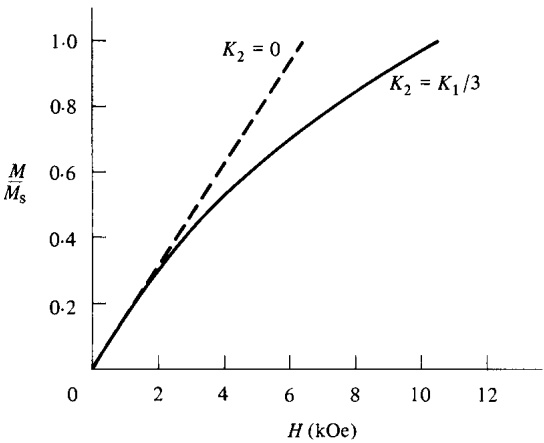

Fig. 7.21 Calculated magnetization curves for cobalt single crystal with field perpendicular to the easy axis.

## 7.6.2 Area Method

This method of determining anisotropy constants from magnetization curves is based directly on the definition of the anisotropy energy E, namely, the energy stored in a crystal when it is magnetized to saturation in a noneasy direction. If we can determine W, the work done on the crystal to bring it to saturation, we can equate E and W and so determine the anisotropy constants.

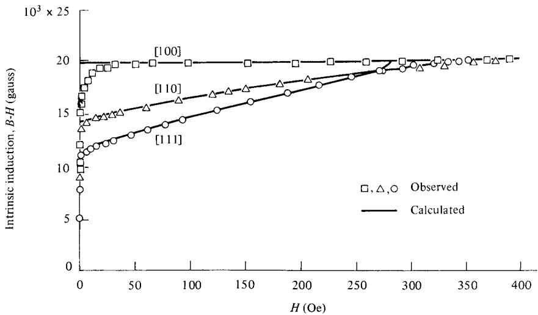

Fig. 7.22 Calculated and measured magnetization curves for Fe–Si crystals. [R. M. Bozorth, Ferromagnetism, reprinted by IEEE Press (1993).]

One way of finding an expression for W is to calculate the electrical work done in magnetizing a rod specimen by means of a current in a solenoidal coil wound on the rod. Assume that the rod is so long that the demagnetizing field can be neglected. Let the rod be of length l and cross-sectional area A, wound with n turns. When the current increases by an amount di, the induction increases by dB and the flux by $d\phi = A dB$ . This change in flux causes a back emf e in the coil, and work must be done to overcome this emf. We ignore the work done in producing heat in the coil, equal to $i^{2}R.$ where R is the resistance, because this work does not contribute to the magnetization of the rod. The total work done in time dt is

$$
V d W = e i d t \text { joule },\tag{7.35}
$$

where V is the volume of the rod and W the work per unit volume. From Equation 2.6 we have (using cgs units)

$$
e = 1 0 ^ {- 8} n \frac {d \phi}{d t} = 1 0 ^ {- 8} n A \frac {d B}{d t} \text {volt}.\tag{7.36}
$$

The field produced by the current is, from Equation 1.12,

$$
H = \frac {4 \pi n i}{1 0} \frac {}{l} \mathrm{Oe}.\tag{7.37}
$$

Combining the last three equations and noting that $V = Al,$ we obtain

$$
d W = \frac {1 0 ^ {- 7}}{4 \pi} H d B \frac {\mathrm{joule}}{\mathrm{cm} ^ {3}} \quad \text {or} \quad d W = \frac {H}{4 \pi} d B \frac {\mathrm{erg}}{\mathrm{cm} ^ {3}}.\tag{7.38}
$$

Then the work done per unit volume in changing the induction from 0 to $B$ is

$$
W = \frac {1}{4 \pi} \int_ {0} ^ {B} H d B \frac {\mathrm{erg}}{\mathrm{cm} ^ {3}},\tag{7.39}
$$

where $H$ is in oersteds and $B$ in gauss. Because $B = H + 4\pi M.$ , at the same field $dB=4\pi dM$, and

$$
W = \int_ {0} ^ {M} H d M \frac {\mathrm{erg}}{\mathrm{cm} ^ {3}},\tag{7.40}
$$

where $M$ is in emu/cm³ . The work done in magnetization is simply the area between the $M$, $H$ curve and the $M$-axis, shown shaded in Fig. 7.23a.

The SI equivalent of Equation 7.39 is

$$
W = \int_ {0} ^ {B} H d B \frac {\mathrm{J}}{\mathrm{m} ^ {3}}
$$

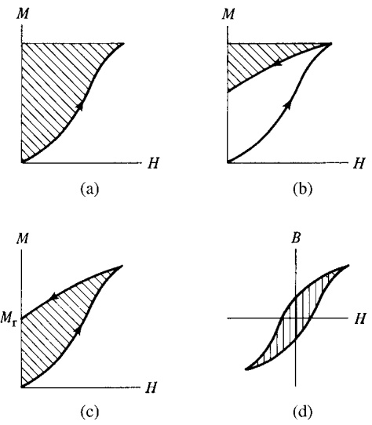

Fig. 7.23 Work done in magnetization.

and of Equation 7.40 is

$$
W = \int_ {0} ^ {M} \mu_ {0} H d M \frac {\mathrm{J}}{\mathrm{m} ^ {3}}\tag{7.41}
$$

Hysteresis has no direct connection with the measurement of anisotropy from magnetization curves. In fact, complete reversibility (no hysteresis) is usually assumed in such measurements. But if hysteresis is present, then removal of the magnetizing field will return energy equal to the area shaded in Fig. 7.23b to the magnetizing circuit. The energy stored in the material at its remanence point $M_{\mathrm{r}}$ is the area shaded in Fig. 7.23c.

When a specimen is driven through one complete cycle, the total work done on the specimen is the hysteresis loss $W_{\mathrm{h}}$ which is equal to $1 / 4\pi$ times the area enclosed by the $B$, $H$ loop (erg/cm³) , cgs), or unity times this area $(J/m^{3}$ SI) as shown in Fig. 7.23d. This work appears as heat in the specimen.

For a substance of constant permeability μ, such as a dia-, para-, or antiferromagnetic, $B = \mu H, dB = \mu dH.$ , and Equation 7.41 becomes

$$
W = \frac {\mu H ^ {2}}{8 \pi} (\mathrm{cgs}) \quad \text {or} \quad \mathrm{W} = \frac {\mu H ^ {2}}{2} = \frac {\mu_ {\mathrm{r}} \mu_ {0} H ^ {2}}{2} (\mathrm{SI}).\tag{7.42}
$$

If the substance is air, then μ or $\mu_{\mathrm{r}} \approx 1$ , and

$$
W = \frac {H ^ {2}}{8 \pi} (\mathrm{cgs}) \quad \text {or} \quad W = \frac {\mu_ {0} H ^ {2}}{2} (\mathrm{SI}).\tag{7.43}
$$

This is the energy per unit volume stored in a magnetic field in air (or vacuum).

The magnetization of a specimen can increase either by domain rotation or domain wall motion, or both. Consider a small volume of the specimen with a magnetic moment $m$ oriented at an angle $\theta$ to the magnetizing field $H$. This moment has a component $m \cos \theta$ parallel to the field. Summing over unit volume of the specimen, we have

$$
\sum m \cos \theta = M.\tag{7.44}
$$

When the field increases from $H$ to $H + dH,$ the moment of the small volume considered will rotate from orientation $\theta$ to $\theta - d\theta.$ The work done by the field is (couple)(angle) = (mH sin $\theta)(-d\theta)$ (see Section 1.3). Summed over unit volume, the work done is

$$
d W = - \sum m H \sin \theta d \theta .\tag{7.45}
$$

From Equation 7.43,

$$
d M = d \Big (\sum m \cos \theta \Big) = - \sum m \sin \theta d \theta .\tag{7.46}
$$

Combination of Equations 7.45 and 7.46 gives

$$
d W = H d M.
$$

If W is the area between a particular $M$, $H$ curve and the M-axis, then W equals the anisotropy energy E stored in a crystal magnetized in that particular direction. We have already worked out these energies for cubic crystals, and they appear in Table 7.1. Therefore,

$$
\left. \begin{array}{l} W _ {1 0 0} = E _ {1 0 0} = K _ {0}, \\ W _ {1 1 0} = E _ {1 1 0} = K _ {0} + \frac {K _ {1}}{4}, \\ W _ {1 1 1} = E _ {1 1 1} = K _ {0} + \frac {K _ {1}}{3} + \frac {K _ {2}}{2 7}. \end{array} \right\}\tag{7.47}
$$

These equations may be solved for the anisotropy constants:

$$
\left. \begin{array}{l} K _ {0} = W _ {1 0 0}, \\ K _ {1} = 4 (W _ {1 1 0} - W _ {1 0 0}), \\ K _ {2} = 2 7 (W _ {1 1 1} - W _ {1 0 0}) - 3 6 (W _ {1 1 0} - W _ {1 0 0}). \end{array} \right\}\tag{7.48}
$$

Here an expression like $(W_{110} - W_{100})$ is to be understood as the area included between the $M$, $H$ curves for the [110] and [100] directions. As mentioned earlier, experimental $M$, $H$ curves in the easy direction usually show a nonzero area between the curve and the M-axis, indicating that the field has had to overcome hindrances to domain wall motion. These hindrances are assumed to be the same for any direction of the applied field relative to the crystal axes. Therefore, equations like 7.48, which are based on the area between certain curves, yield anisotropy constants which should be largely free of the effects of domain wall motion.

It is rare to find more than one experimental method used in a single investigation, and the literature therefore contains almost no comparisons of alternative techniques. Williams, however, measured the anisotropy constants of his silicon iron crystals by three methods, with the results shown in Table 7.3 [H. J. Williams, Phys. Rev., 52 (1937) p. 747]. Differences between the three results reflect not only experimental error, but also differences in what is actually being measured. The torque measurement is the most fundamental, because a high-field torque measurement involves only the rotation of $M_{\mathrm{s}}$ relative to the axes of a single-domain crystal; no wall motion is included. The other two methods include (or ignore) the effects of domain wall motion at low fields, which are not directly related to the anisotropy.

TABLE 7.3 Anisotropy Constants of $\mathbf{Fe} + 3.85$ wt% Si

| Method | K1 (105 erg/cm3) | K2 (105 erg/cm3) |
| --- | --- | --- |
| Torque curves | 2.87 | 1.0 |
| Fitting magnetization curves | 2.80 | 1.0 |
| Areas between magnetization curves | 2.72 | 1.5 |

## 7.6.3 Anisotropy Field

The crystal anisotropy forces which hold the spontaneous magnetization $M_{\mathrm{s}}$ of any domain in an easy direction can also be expressed in an indirect but often useful way that does not explicitly involve anisotropy constants. For small rotations of the magnetization away from an easy direction, the crystal anisotropy acts like a magnetic field trying to hold the magnetization parallel to the axis. This field is called the anisotropy field and is given the symbol $H_{\mathrm{K}}$ The anisotropy field is parallel to the easy direction and of a magnitude such that for small angular deviations $\theta$ it exerts the same torque on $M_{\mathrm{s}}$ as the crystal anisotropy itself. The torque due to the anisotropy field is $H_{\mathrm{K}}M_{\mathrm{s}}$ sin θ, or $H_{\mathrm{K}}M_{\mathrm{s}}\theta$ for small values of θ. The torque due to crystal anisotropy depends on the crystal structure, the anisotropy constants, the easy axis direction, and in some cases the crystallographic plane in which $M_{s}$ rotates away from the easy axis. For example, in a cubic crystal with <100> easy directions, the torque exerted on Ms by the crystal when $M_{s}$ rotates away from <100> is, from Equation 7.14, $+K_{1} / 2$ sin 4u, or $2K_{1}\theta$ for small $\theta$.

Equating these torques, we have

$$
\begin{array}{c} H _ {\mathrm{K}} M _ {\mathrm{s}} \theta = 2 K _ {1} \theta \\ H _ {\mathrm{K}} = \frac {2 K _ {1}}{M _ {\mathrm{s}}} (\mathrm{cgs}) \qquad H _ {\mathrm{K}} = \frac {2 K _ {1}}{\mu_ {0} M _ {\mathrm{s}}} (\mathrm{SI}). \end{array}\tag{7.49}
$$

If <111> is the easy direction, similar reasoning shows that

$$
H _ {\mathrm{K}} = \frac {- 4 (3 K _ {1} + K _ {2})}{9 M _ {\mathrm{s}}} (\mathrm{cgs}) \quad H _ {\mathrm{K}} = \frac {- 4 (3 K _ {1} + K _ {2})}{9 \mu_ {0} M _ {\mathrm{s}}} (\mathrm{SI})\tag{7.50}
$$

The last two equations are valid whatever the plane of rotation of $M_{\mathrm{s}}$ away from the easy direction. For a uniaxial crystal we find, through Equation 7.4, that

$$
H _ {\mathrm{K}} = \frac {2 K _ {1}}{M _ {\mathrm{s}}} (\mathrm{cgs}) \quad H _ {\mathrm{K}} = \frac {2 K _ {1}}{\mu_ {0} M _ {\mathrm{s}}} (\mathrm{SI}).\tag{7.51}
$$

From Equation 7.34 this is also the value of the field that is required to reach magnetic saturation in the hard direction when $K_{2}$ is zero. Thus for a uniaxial crystal the anisotropy field has the added physical significance of being the magnitude of the field, applied at $90^{\circ}$ to the easy axis, which can completely overcome the anisotropy forces by rotating $M_{\mathrm{s}}$ through $90^{\circ}$

## 7.7 ANISOTROPY CONSTANTS

Table 7.4 shows the values of the room temperature anisotropy constants of several magnetic materials. It is usually found that lower symmetry leads to larger anisotropy, so materials with hexagonal crystal structure have larger anisotropy constants than cubic materials. The extremely large anisotropy of $\mathrm{YCo}_{5}$ is typical of that of other $RCo_{5}$ phases, where R is Y (yttrium) or a rare-earth element.

The values of these constants are usually known only to two significant figures (sometimes only one) and the accuracy of $K_{2}$ is less than that of $K_{1}$ . Furthermore, the results of different investigators are sometimes in poor agreement. The lack of reproducibility may result from differences between samples, different experimental techniques, and different maximum applied fields.

Anisotropy constants almost always decrease as the temperature increases and become essentially zero before the Curie temperature is reached. There is then no preferred crystallographic direction for the magnetization of a domain. Figure 7.24 shows the behavior of iron and nickel and Fig. 7.25 that of cobalt. (The data for iron, which are quite old, are in poor agreement with the room-temperature values given in Table 7.4.) The thermal variation of $K_{1}$ and $K_{2}$ for cobalt is such that the easy axis is (a) parallel to the c axis up to $245^{\circ}\mathrm{C},$ (b) inclined to the c axis, but having any azimuthal position about it, at an angle which increases from 0 to $90^{\circ}$ as the temperature increases from $245^{\circ}$ to $325^{\circ}\mathrm{C}$ , and (c) in any direction in the basal plane above $325^{\circ}\mathrm{C}$ Note that cobalt undergoes a sluggish phase transformation from hexagonal close-packed to face centered cubic at about $410^{\circ}\mathrm{C}$ , with no change in saturation magnetization.

One model for the temperature dependence of anisotropy is based on the idea that, as the temperature increases, the local magnetization direction spreads over a range of angles about the mean direction. This raises the energy of the easy direction and lowers the energy of the hard direction, and leads to the prediction that anisotropy will decrease as a power of the reduced magnetization $M / M_{0},$ where $M_{0}$ is the saturation magnetization at 0K. Specifically, the prediction is that

$$
\frac {K ^ {n}}{K _ {0} ^ {n}} \propto \left(\frac {M _ {\mathrm{s}}}{M _ {\mathrm{s,0}}}\right) ^ {\frac {n (n + 1)}{2}}\tag{7.52}
$$

TABLE 7.4 Anisotropy Constants

| Structure Substance | K1 (105 erg/cm3 ) K2 (105 erg/cm3 ) |
| --- | --- |
| Cubic Fe | 4.8 +0.5 |
| Ni | 20.5 20.2 |
| FeO . Fe2O3 | 21.1 |
| MnO . Fe2O3 | 20.3 |
| NiO . Fe2O3 | 20.62 |
| MgO . Fe2O3 | 20.25 |
| CoO . Fe2O3 | 20 |
| Hexagonal Co | 45 15 |
| BaO . 6Fe2O3 | 33 |
| YCo5 | 550 |
| MnBi | 89 27 |

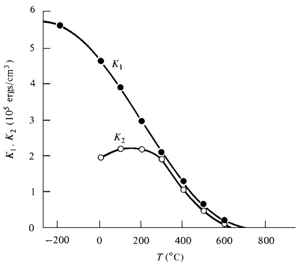

(a)

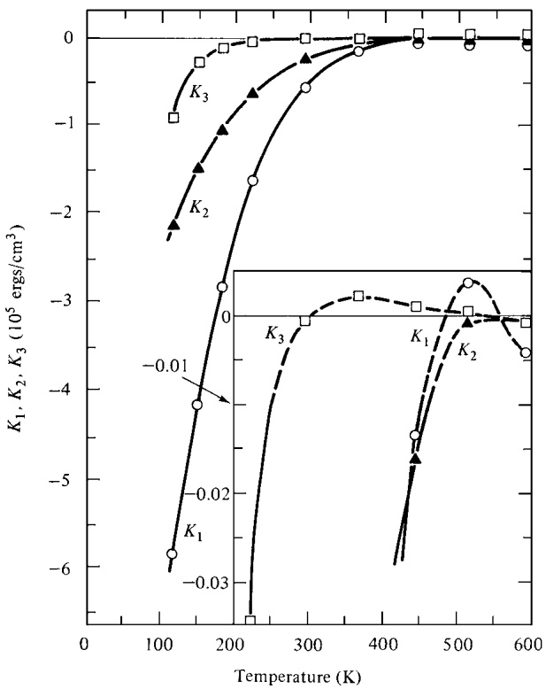

(b)

Fig. 7.24 Temperature dependence of anisotropy constants. (a) Iron [K. Honda, H. Masumoto, and S. Kaya, Sci. Rep. Tohoku Univ., 17 (1928) p. 111]. (b) Nickel [G. Aubert, J. Appl. Phys., 39 (1968) p. 504].

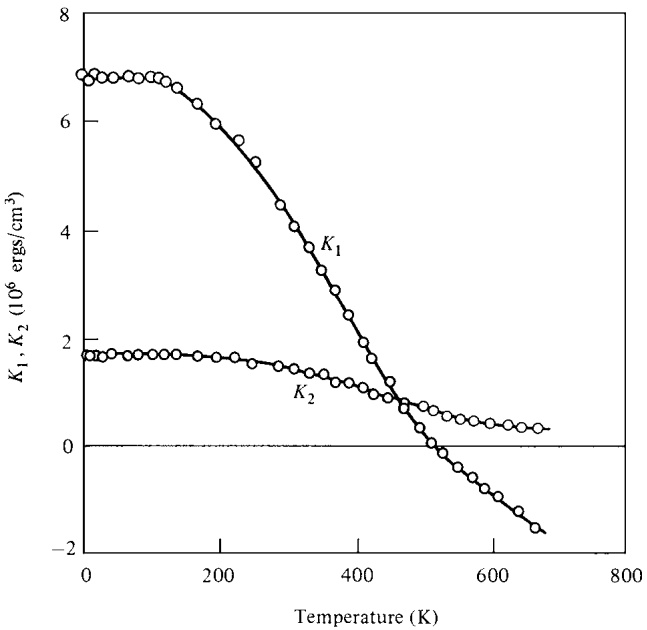

Fig. 7.25 Temperature dependence of anisotropy constants of cobalt [Y. Barnier, R. Pauthenet, and G. Rimet, Cobalt, 15 (1962) p. 1].

where n is the power of the anisotropy function. So for uniaxial anisotropy (n = 2),

$$
\frac {K _ {\mathrm{u}}}{K _ {\mathrm{u,0}}} \propto \left(\frac {M _ {\mathrm{s}}}{M _ {\mathrm{s,0}}}\right) ^ {3}\tag{7.53}
$$

and for cubic anisotropy $(n = 4)$

$$
\frac {K _ {1}}{K _ {1 , 0}} \propto \left(\frac {M _ {\mathrm{s}}}{M _ {\mathrm{s,0}}}\right) ^ {1 0}\tag{7.54}
$$

This model fits the data quite well for iron, but fails badly for some other materials.

The anisotropy constants of alloys vary markedly with composition. These values will be given later when particular alloy systems are discussed.

## 7.8 POLYCRYSTALLINE MATERIALS

If the constituent crystals (grains) of a polycrystalline body are oriented randomly in space (which is not often the case), then the anisotropy of the individual grains will average out, and the body on the whole will exhibit no crystal anisotropy. If, on the other hand, the crystals have a preferred orientation, also called a crystallographic texture, then the polycrystalline aggregate itself will have an anisotropy dictated by the weighted average of the individual crystals.

The kind of texture possessed by a body depends on its shape and how it was formed. Thus a round wire, rod, or bar generally has a fiber texture: each grain has a certain crystallographic direction < uvw > parallel, or nearly parallel, to a single direction called the fiber axis, which, in the case of a wire, coincides with the wire axis. However, the grains can have any rotational position about this axis. Iron wire, for example, has a <110> fiber texture. Double textures are also possible. Wires of some face-centered-cubic metals have a <111> + <100> texture; some grains have <111> directions parallel to the wire axis, others have <100>. Electrodeposited or evaporated layers, deposited on a flat surface, may also have a fiber texture, but here the fiber axis is normal to the surface of deposition.

Sheet made by rolling has a texture in which, in each grain, a certain plane {hkl} tends to be parallel to the sheet surface and a certain direction < uvw > in that plane tends to be parallel to the direction in which the sheet was rolled. Such sheet textures are described by the symbolism: frolling planeg krolling directionl. Thus the “cube texture,” found in some metals and alloys, is {100} <001>; a cube plane {100} is parallel to the sheet surface, and a cube-edge direction <001> is parallel to the rolling direction.

Textures in metals are also distinguished by whether they are formed during deformation (deformation textures) or during a recrystallization heat treatment (recrystallization textures).

Crystal anisotropy is often exploited in the manufacture of magnetic materials by inducing a texture such that the easy directions of magnetization in all grains are at least approximately parallel. The polycrystalline body as a whole then has an easy direction. Some control of the degree and, to a lesser extent, of the kind of preferred orientation is possible in metals and alloys formed by the usual processes of casting and working by rolling or wire drawing. But in general it is not possible to produce a particular desired texture at will. Thus both the deformation and recrystallization textures of iron wire are <110>, and it stubbornly resists any attempts to rotate the <100> easy directions into parallelism with the wire axis. Efforts to make marked changes of any kind in the <110> texture, including recrystallization in a magnetic field, have so far been unsuccessful.

On the other hand, control of easy-axis orientation is relatively easy when the manufacturing operation is one of pressing and sintering a powder, either metallic or nonmetallic, if the individual particles are single crystals. It is simply a matter of applying a strong magnetic field in the required direction during the pressing operation. When the powder particles are still a loose assemblage, the field lines them up with their easy axes parallel to one another and to the field; the compacting die then locks in this preferred orientation as the powder is compressed. Note that alignment will not occur if the individual particles are themselves random polycrystals.

The aligning effect of a magnetic field can also be used in a method for determining the easy axis of a material, when a single-crystal specimen is not available. A powder is pre-pared by grinding or filing, annealed to remove the effects of deformation, and mixed with a solution of a binder so that it forms a powder suspension. A few drops are then placed on a glass slide, or other flat plate, and allowed to dry in the presence of a magnetic field applied normal to the slide surface. The dried powder specimen on the slide then has a marked preferred orientation, with easy axes < uvw > normal to the slide surface. It is subsequently examined in an X-ray diffractometer in the usual way, i.e., with the incident and diffracted beams making equal angles with the slide surface. Under these circumstances, only those grains which have their {hkl} planes parallel to the slide surface can contribute to a particular hkl reflection. For the field-oriented specimen, certain X-ray reflections will be abnormally strong, namely, those from planes at right angles to the < uvw > easy axis. The direction < uvw > can then be determined from a knowledge of the crystal structure of the specimen. For example, a field-oriented powder specimen of hexagonal barium ferrite $(\mathrm{BaO} \cdot 6\mathrm{Fe}_{2}\mathrm{O}_{3})$ produces abnormally strong basal-plane {0002} reflections. This means that the c-axis <0002> is the easy direction.

If a polycrystalline specimen in the form of a sheet, for example, has preferred orientation, then a disk cut from the sheet will normally show magnetic anisotropy when examined in a torque magnetometer. If it is a cubic material, with <100> easy axes, and has the cube texture, then its torque curve will resemble Fig. 7.13 with a smaller amplitude. Textures are never perfectly sharp, since a perfect texture would be a single crystal. Scatter of the crystal orientations about the ideal orientation {100} <001> introduces a degree of randomness and therefore decreases the amplitude of the torque-curve peaks.

While it is thus possible to predict the torque curve of a polycrystalline disk from a knowledge of its texture, the texture cannot be unambiguously deduced from the torque curve. For example, consider again a cubic material with <100> easy axes. If one sheet has the cube texture {100} <001>, called texture $A$ for short, and another sheet has texture $B$, {100} <011>, the corresponding torque curves would resemble Fig. 7.26a and b. If a third sheet had a double texture, composed of 75% $A$ and 25% $B$, its torque curve would look like Fig. 7.26c, the weighted sum of the (a) and (b) curves. But curve (c) would also be produced by a mixture of 50% $A$ and 50% random orientations. Furthermore, an equal mixture of textures $A$ and $B$ would produce curve (d), which exhibits no anisotropy, even though the specimen has preferred orientation. (See also Section 7.11.)

The only sure way of determining the kind and degree of preferred orientation is by X-ray diffraction or some other direct crystallographic technique. On the other hand, even though torque curves are ambiguous, in that more than one kind of texture corresponds to a given curve, torque curves may nevertheless be very useful in any work aimed at the development of magnetically useful textures. A torque curve requires much less time than an X-ray texture determination, and it does indicate the magnetically easy direction in the sheet. When torque and X-ray measurements are carried out together, the effect of processing variables on texture, and thus on magnetic properties, can be evaluated more quickly than with either technique alone.

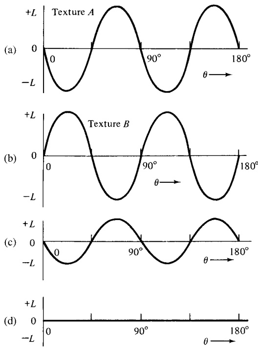

Fig. 7.26 Effect of mixed textures on torque curves.

## 7.9 ANISOTROPY IN ANTIFERROMAGNETICS

We digress now from the main subject of strongly magnetic substances to consider unusual effects which occur in some antiferromagnetics. These effects are due to their crystal anisotropy, which is about as strong as in ferro- or ferrimagnetics. In Section 5.2 we noted that the spins of the two sublattices are parallel, in zero applied field, to an important crystallographic axis, labeled D in Fig. 5.2. When a field was applied at right angles to the D-axis, we saw that the sublattice magnetizations rotated away from D, as shown in Fig. 5.5a, until the reverse molecular field equaled the applied field. Actually, there is another force tending to resist the rotation of the spins, and that is the crystal anisotropy which tends to bind the spin directions to the D-axis. Inclusion of an anisotropy term does not alter the main conclusions reached in Section 5.2, but anisotropy forces are responsible for the following effects:

1. Field-dependent Susceptibility of Powders. When the specimen is a powder composed of randomly oriented crystals, the angle between the applied field and the D-axis takes on all values between 0 and 908. Under these circumstances the susceptibility increases as the field strength increases, as shown for MnO powder in Fig. 5.8.

2. Spin Flopping. When a substance of mass susceptibility $\chi_{\mathrm{m}}$ and density ρ is magnetized by a field $H$, its magnetization $M$ is $\chi\rho H$ and its potential energy in the field is $(-\chi\rho H^{2})$ , from Equation 1.5. In an antiferromagnetic below the Néel temperature, $\chi_{\perp}$ is greater than $\chi_{\parallel}$ , which means that the state with spins at right angles to $H$ is of lower energy than that in which spins are parallel and antiparallel to $H$. Thus when $H$ is parallel to the spin directions and the D-axis, as in Fig. 7.27a, there is a tendency for the spin directions to rotate into orientation (b). Counteracting this is the binding of the spin directions to the D-axis by the crystal anisotropy forces. As the field increases, a critical value will be reached when these forces are overcome;

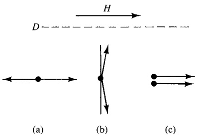

Fig. 7.27 Spin flopping and metamagnetism.

the spins then “flop over” from orientation (a) to (b), causing a sudden increase in magnetization; further increase in field then rotates the spins slightly from the perpendicular orientation, and $M$ increases with $H$ at a rate governed by the value of $\chi_{\perp}$ Figure 7.28a shows an example of this behavior in single crystals of $\mathrm{MnF_{2}}$ at

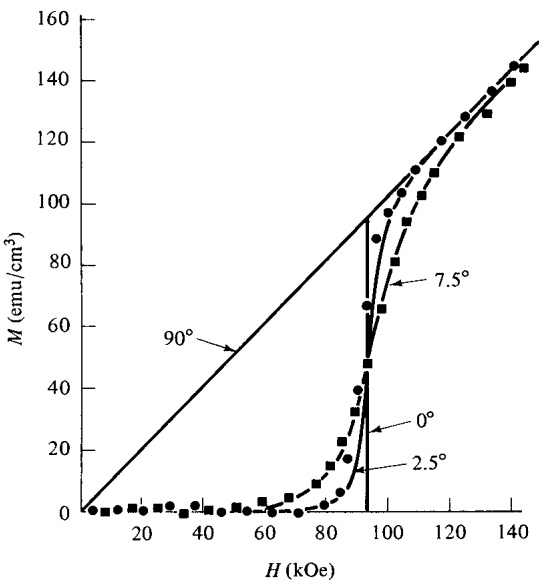

(a)

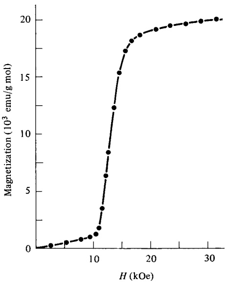

(b)

Fig. 7.28 (a) Spin flop in $\mathrm{MnF_{2}}$ at 4.2K [I.S. Jacobs, J. Appl. Phys., 32 (1961) p. 1067]. (b) Metamagnetism in $\mathrm{FeCl}_{2}$ at 13.9K [C. Starr, F. Bitter, and A. R. Kaufmann, Phys. Rev., 58 (1940) p. 977].

4.2K. The angles marked on the curves are those between $H$ and the spin direction, which is the c-axis in these crystals. (See Fig. 5.12 for the spin structure of $\mathrm{MnF_2}$ .)

3. Metamagnetism. If the anisotropy forces are very strong and the field is applied parallel to D, the magnetization will first increase with $H$ according to the value of $\chi_{\parallel}$ . Then, at a high, critical value of $H$, the spins antiparallel to the field will flip over into parallelism, and the substance will saturate. Thus an abrupt transition is made from Fig. 7.27a to c; because of the very strong binding of the spin directions to the D-axis, the intermediate state (b) is not stable. This behavior is known as metamagnetism, and Fig. 7.28b shows an example. The specimen of $\mathrm{FeCl}_{2}$ was in the form of a powder with a very high degree of preferred orientation, and the field direction was such that it was almost parallel to the D axis in every powder particle. Note that metamagnetic behavior represents a change in magnetic state from antiferromagnetic to ferromagnetic, because the final state of parallel spins is, by definition, ferromagnetic. This transition is brought about solely by an increase in field at constant temperature, and it thus differs from the antiferromagnetic-to-ferromagnetic transition which occurs spontaneously in some rare earths on cooling through a critical temperature.

## 7.10 SHAPE ANISOTROPY

Consider a polycrystalline specimen having no preferred orientation of its grains, and therefore no net crystal anisotropy. If it is spherical in shape, the same applied field will magnetize it to the same extent in any direction. But if it is nonspherical, it will be easier to magnetize it along a long axis than along a short axis. The reason for this is contained in Section 2.6, where we saw that the demagnetizing field along a short axis is stronger than along a long axis. The applied field along a short axis then has to be stronger to produce the same true field inside the specimen. Thus shape alone can be a source of magnetic anisotropy.

In order to treat shape anisotropy quantitatively, we need an expression for the magnetostatic energy $E_{\mathrm{ms}}$ of a permanently magnetized body in zero applied field. If a body is magnetized by an applied field to some level $A$ (Fig. 7.29) and the applied field is then removed, the magnetization will decrease to C under the action of the demagnetizing field $H_{\mathrm{d}}$ Here O C is the demagnetizing-field line, with a slope of $-1 / N_{\mathrm{d}}$ , where $N_{d}$ is the demagnetizing coefficient. The specimen then contains stored energy $E_{ms}$ equal to the area of the shaded triangle OCD, according to Equation 7.40. This energy is that associated with the demagnetizing field of the specimen, and is variously called the magnetostatic energy, the self-energy, or the energy of a magnet in its own field. From Equation 7.43, this energy is

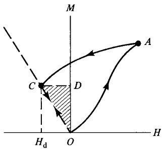

Fig. 7.29 Magnetostatic energy of a magnetized body in zero applied field.

$$
E _ {\mathrm{ms}} = \frac {1}{8 \pi} \int H _ {\mathrm{d}} ^ {2} d v \text {erg(cgs)} \quad \text {or} \quad E _ {\mathrm{ms}} = \frac {\mu_ {0}}{2} \int H _ {\mathrm{d}} ^ {2} d v \text {joule(SI)},\tag{7.55}
$$

where dv is an element of volume and the integration extends over all space. The distribution of $H_{\mathrm{d}}$ in space is seldom known accurately and, even when it is, the evaluation of this integral would be difficult. It is easier to compute the area of the triangle OCD in Fig. 7.28:

$$
E _ {\mathrm{ms}} = \frac {1}{2} H _ {\mathrm{d}} M,\tag{7.56}
$$

where $M$ is the level of magnetization at point C. This energy can be written in vector form as

$$
E _ {\mathrm{ms}} = - \frac {1}{2} \mathbf {H} _ {\mathrm{d}} \cdot \mathbf {M},\tag{7.57}
$$

because $H_{d}$ is antiparallel to $M$.

On the other hand, the potential energy per unit volume of a magnet in an applied field $H_{\mathrm{a}}$ is, from Equation 1.6,

$$
E _ {\mathrm{p}} = - \mathbf {H} _ {\mathrm{a}} \cdot \mathbf {M}.\tag{7.58}
$$

The expressions for the energy of a magnet in its own field and in an applied field are therefore similar in form, except for the factor $\frac{1}{2}$ Equation 7.58 can be written in terms of $N_{\mathrm{d}}$ by the substitution $H_{\mathrm{d}} = N_{\mathrm{d}}M:$

$$
E _ {\mathrm{ms}} = \frac {1}{2} N _ {\mathrm{d}} M ^ {2} \mathrm {erg / cm^ {3} (cgs)} \quad \text {or} \quad E _ {\mathrm{ms}} = \frac {1}{2} \mu_ {0}   N _ {\mathrm{d}} M ^ {2}   \mathrm {joule / m^ {3} (SI)}.\tag{7.59}
$$

The reasoning leading to Equation 7.59 is more physically meaningful when one realizes that the point representing the state of the specimen, or part of it, in Fig. 7.29 can be made to move back and forth along the line OC. If C represents the room-temperature state, then the point moves from C to O when the specimen is heated from room temperature to the Curie point. If one now imagines a small volume, smaller that the normal volume of a domain, at a temperature above $T_{\mathrm{c}}$ then, on cooling through $T_{\mathrm{c}}$ this small volume becomes spontaneously magnetized to a level $M_{\mathrm{s}}$ which increases as the temperature decreases. Simultaneously, a demagnetizing field $H_{\mathrm{d}}$ is set up. The point representing this small volume therefore moves from O toward C. At room temperature the magnetization of the whole specimen, which is the sum of the $M_{s}$ vectors in all the domains, is at point C.

To return to shape anisotropy, we now consider a specimen in the shape of a prolate spheroid (rod) with semi-major axis c and semi-minor axes a of equal length (Fig. 7.30). Let it be magnetized to a value $M$ at an angle $\theta$ to c. Then, taking components of $M$ parallel and perpendicular to c, we have

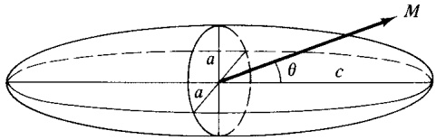

Fig. 7.30 Prolate ellipsoid.

$$
E _ {\mathrm{ms}} = \frac {1}{2} [ (M \cos \theta) ^ {2} N _ {\mathrm{c}} + (M \sin \theta) ^ {2} N _ {\mathrm{a}} ],\tag{7.60}
$$

where $N_{c}$ and $N_{\mathrm{a}}$ are demagnetizing coefficients along c and a, respectively, as given by Equations (2.20) and (2.21). Substituting cos $\mathrm{s}^2\theta = 1 - \sin^2\theta ,$ we find

$$
E _ {\mathrm{ms}} = \frac {1}{2} M ^ {2} N _ {\mathrm{c}} + \frac {1}{2} (N _ {\mathrm{a}} - N _ {\mathrm{c}}) M ^ {2} \sin^ {2} \theta .\tag{7.61}
$$

This expression for the magnetostatic energy has an angle-dependent term of exactly the same form as uniaxial crystal anisotropy energy (Equation 7.4). The long axis of the specimen plays the same role as the easy axis of the crystal, and the shape-anisotropy constant $K_{\mathrm{s}}$ is given by

$$
K _ {\mathrm{s}} = \frac {1}{2} (N _ {\mathrm{a}} - N _ {\mathrm{c}}) M ^ {2} \mathrm {erg / cm^ {3} (cgs)} \quad \text {or} \quad K _ {\mathrm{s}} = \frac {1}{2} \mu_ {0} (N _ {\mathrm{a}} - N _ {\mathrm{c}}) M ^ {2} \mathrm {joule / m^ {3} (SI)},\tag{7.62}
$$

which are often written as

$$
K _ {s} = \frac {1}{2} \Delta N M ^ {2} \mathrm{erg/cm} ^ {3} (\mathrm{cgs}) \quad \text {or} \quad K _ {s} = \frac {1}{2} \mu_ {0} \Delta N M ^ {2} \mathrm{joule/m} ^ {3} (\mathrm{SI}).\tag{7.63}
$$

Magnetization is easy along the c-axis and equally hard along any axis normal to c. If c shrinks until it equals a, the specimen becomes spherical, $N_{\mathrm{a}} = N_{\mathrm{c}}, K_{\mathrm{s}} = 0.$ , and shape anisotropy disappears. The long axis of the spheroid is labeled 2c in Fig. 7.30 to conform with the earlier definition of ellipsoids. It is not to be confused with the c axis of a hexagonal crystal.

Magnetization of a planetary or oblate spheroid (disk) is difficult along the short a-axis and equally easy along any axis normal to a, i.e., in the plane of the disk, which is why specimens for crystal-anisotropy measurements are made in the form of disks.

As Equation 7.62 shows, the “strength” of shape anisotropy depends both on the axial ratio c/a of the specimen, which determines $(N_{\mathrm{a}} - N_{\mathrm{c}})$ , and on the magnitude of the magnetization $M$. To illustrate the sort of numbers involved, we put $M = 1422\mathrm{emu / cm}^3$ or $1.422 \times 10^{6} \mathrm{~A} \mathrm{~m}^{2} / \mathrm{m}^{3}$ , which is the room-temperature saturation magnetization of uniaxial cobalt, and calculate the value of the shape-anisotropy constant $K_{s}$ as a function of c/a for a prolate spheroid of polycrystalline cobalt with no preferred orientation. E. C. Stoner and E. P. Wohlfarth in [Phil. Trans. R. Soc, A-240 (1948) p. 599] give values of $(N_{a} - N_{c})$ as a function of c/a for both prolate and oblate spheroids. Figure 7.31 shows the results. At an axial ratio of about 3.5, $K_{s}$ is about $45\times10^{5}\mathrm{erg/cm^{3}}$ or $4.5 \times 10^{6} \mathrm{~J} / \mathrm{m}^{3}$ , which is equal to the value of the first crystal-anisotropy constant $K_{1}$ of cobalt. In other words, neglecting $K_{2}$ we can say that a prolate spheroid of saturated cobalt, with axial ratio 3.5 and without any crystal anisotropy, would show the same uniaxial anisotropy as a spherical cobalt crystal with its normal crystal anisotropy.

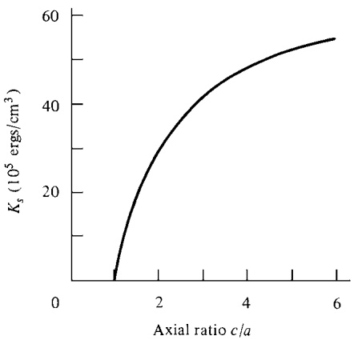

Fig. 7.31 Shape anisotropy constant vs axial ratio of a prolate spheroid. Numerical values calculated for cobalt $(M_{\mathrm{s}} = 1422 \mathrm{emu} \mathrm{cm}^{3})$

## 7.11 MIXED ANISOTROPIES

The calculation of the last paragraph suggests that we consider a more realistic situation, in which two anisotropies are present together. The discussion will be limited to uniaxial anisotropies. We have already touched on the problem of mixed anisotropies in Section 7.8, where the effect of double textures on the anisotropy of polycrystalline sheet was discussed. Here we are interested in the combined effect of two anisotropies of different physical origin, such as crystal and shape anisotropy, on the resultant anisotropy of a single crystal.

We might have, for example, a rod-shaped crystal of a uniaxial substance like cobalt, with its easy crystal axis at right angles to the rod axis. Will it be easier to magnetize along the rod axis, as dictated by shape anisotropy, or at right angles to the rod axis, as dictated by crystal anisotropy? Both anisotropy energies are given, except for constant terms, by expressions of the form: $energy = (constant) \cdot \sin^{2}$ (angle between $M$ and easy axis).

The problem is generalized in Fig. 7.32. where AA represents one easy axis and BB the other. The separate anisotropy energies, distinguished by subscripts, are

$$
\begin{array}{l} E _ {\mathrm{A}} = K _ {\mathrm{A}} \sin^ {2} \theta , \\ E _ {\mathrm{B}} = K _ {\mathrm{B}} \sin^ {2} (9 0 ^ {\circ} - \theta). \end{array}
$$

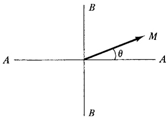

Fig. 7.32 Mixed anisotropy.

The total energy is

$$
\begin{array}{r l} E & = K _ {\mathrm{A}} \sin^ {2} \theta + K _ {\mathrm{B}} \cos^ {2} \theta \\ & = K _ {\mathrm{B}} + (K _ {\mathrm{A}} - K _ {\mathrm{B}}) \sin^ {2} \theta . \end{array}\tag{7.64}
$$

If the two anisotropies are of equal strength $(K_{\mathrm{A}} = K_{\mathrm{B}})$ , then E is independent of angle and there is no anisotropy. (Thus two equal uniaxial anisotropies at right angles are not equivalent to biaxial anisotropy.) If they are not equal, we want the value of $\theta$ for which E is a minimum:

$$
\frac {d E}{d \theta} = (K _ {\mathrm{A}} - K _ {\mathrm{B}}) \sin 2 \theta = 0.\tag{7.65}
$$

The solutions are $\theta = 0$ and $\theta = 90^{\circ}$ . To find whether these are minima or maxima, we take the second derivative,

$$
\frac {d ^ {2} E}{d \theta^ {2}} = 2 (K _ {\mathrm{A}} - K _ {\mathrm{B}}) \cos 2 \theta ,\tag{7.66}
$$

which must be positive for a minimum. Therefore, $\theta = 0$ is a minimum-energy position if $K_{\mathrm{A}} > K_{\mathrm{B}}$ , and $\theta = 90^{\circ}$ if $K_{\mathrm{A}} < K_{\mathrm{B}}$ . The direction of easiest magnetization is not, as might be expected, along some axis lying between AA and $BB$. The easy direction is along AA if the $A$ anisotropy is stronger, and along $BB$ if $B$ is stronger. The basic reason for this behavior is that a uniaxial anisotropy exerts no torque on $M$ when $M$ is at $90^{\circ}$ to the uniaxial axis.

If the two easy axes of Fig. 7.31 are at some angle a to each other, rather than at right angles, the reader can show that they are together equivalent to a new uniaxial axis CC, which either (a) lies midway between AA and BB, if $K_{\mathrm{A}} = K_{\mathrm{B}}$ , and has a strength of $K_{\mathrm{C}} = K_{\mathrm{A}} = K_{\mathrm{B}}$ , or (b) lies closer to AA, if $K_{\mathrm{A}} > K_{\mathrm{B}}$ , and has a strength $K_{\mathrm{C}} > K_{\mathrm{A}}$

## PROBLEMS

7.1 Prove the statements in Section 7.1 regarding the equilibrium values of the angle $\theta$ for various relative values of $K_{1}$ and $K_{2}$ in a hexagonal crystal.

7.2 A disk sample 0.80 cm in diameter and 0.050 cm thick has a weak uniaxial anisotropy with $K_{1}=2500\mathrm{erg/cm^{3}}$ . What is the maximum torque acting on the sample when it is rotated in a strong magnetic field about an axis perpendicular to the disk surface?

7.3 a. Find the relations between $H$ and $M$ for magnetization in the <100> and <110> directions of a cubic crystal like nickel, with $K_{1}<0$ . Assume $K_{2}=0$

b. Compute and plot the magnetization curves of a nickel crystal in the <100> <110> , and <111> directions. Take $K_{1} = -5.0\times 10^{3},K_{2} = 0,M =$ $846\times10^{3}\mathrm{~A/m}$

c. What are the fields required to saturate in the <110> and <100> directions?

7.4 Calculate the anisotropy energy stored in a cubic crystal with <100> easy directions, magnetized in a <110> direction, by finding the area between the $M$, $H$ curve and the M-axis.

7.5 Derive Equation 7.50.

7.6 An oblate or planetary spheroid and a prolate spheroid have the same ratio of major axis to minor axis. Which has the greater shape anisotropy?

7.7 A cobalt single crystal is made into an oblate or planetary ellipsoid with ratio of major to minor axis = 2. The <0001> easy axis of the crystal is normal to the plane of the ellipsoid. Take $K_{1} = 4.5 \times 10^{6} \mathrm{erg/cm}^{3}, K_{2} = 0, M_{\mathrm{s}} = 1422 \mathrm{emu/cm}^{3}$ . In which direction is it easiest to magnetize the sample to saturation?

7.8 At what value of the dimensional ratio will the sample of Problem 7.7 be equally easy to saturate parallel and perpendicular to the surface?

