# MAGNETOSTRICTION AND THE EFFECTS OF STRESS

## 8.1 INTRODUCTION

When a substance is exposed to a magnetic field, its dimensions change. This effect is called magnetostriction. It was discovered as long ago as 1842 by Joule, who showed that an iron rod increased in length when it was magnetized lengthwise by a weak field. The fractional change in length $\Delta l / l$ is simply a strain, and, to distinguish it from the strain 1 caused by an applied stress, we give the magnetically induced strain a special symbol l:

$$
\lambda = \frac {\Delta l}{l}.\tag{8.1}
$$

The value of $\lambda$ measured at magnetic saturation is called the saturation magnetostriction $\lambda_{s},$ and, when the word “magnetostriction” is used without qualification, $\lambda_{s}$ is usually meant.

The longitudinal, sometimes called Joule, magnetostriction just described is not the only magnetostrictive effect. Others include the magnetically induced torsion or bending of a rod. These effects, which are really only special cases of the longitudinal effect, will not be described here.

Magnetostriction occurs in all pure substances. However, even in strongly magnetic substances, the effect is usually small: $\lambda_{s}$ is typically of the order of $10^{-5}$ . The small magnitude of this strain may perhaps be better appreciated if it is translated into terms of stress. If Young’s modulus is $30 \times 10^{6} \mathrm{~lb/in}^{2}$ (the normal value for iron and steel), a strain of $10^{-5}$ would be produced by an applied stress of only $(10^{-5})(30\times 10^{6}) = 300\mathrm{lb / in}^{2}$ or $0.2\mathrm{kg}/\mathrm{mm}^{2}$ or 2 MPa. Alternatively, the magnetostrictive strain can be compared to thermal expansion. Metals and alloys typically have thermal expansion coefficients near

$20\times10^{-6}$ per K, so a strain of $10^{-5}$ results from a temperature change of just 0.5K. In weakly magnetic substances the effect is even smaller, by about two orders of magnitude, and can be observed only in very strong fields. We will not be concerned with magnetostriction in such materials.

Although the direct magnetostrictive effect is small, and not usually important in itself, there exists an inverse effect (Section 8.5) which causes such properties as permeability and the size and shape of the hysteresis loop to be strongly dependent on stress in many materials. Magnetostriction therefore has many practical consequences, and a great deal of research has accordingly been devoted to it.

The value of the saturation longitudinal magnetostriction $\lambda_{s}$ can be positive, negative, or, in some alloys at some temperature, zero. The value of $\lambda$ depends on the extent of magnetization and hence on the applied field, and Fig. 8.1 shows how $\lambda$ typically varies with $H$ for a substance with positive magnetostriction. As mentioned in the preceding chapter, the process of magnetization occurs by two mechanisms, domain-wall motion and domain rotation. Most of the magnetostrictive change in length usually occurs during domain rotation.

Between the demagnetized state and saturation, the volume of a specimen remains very nearly constant. This means that there will be a transverse magnetostriction $\lambda_{t}$ very nearly equal to one-half the longitudinal magnetostriction and opposite in sign, or

$$
\lambda_ {\mathrm{t}} = - \frac {1}{2} \lambda\tag{8.2}
$$

When technical saturation is reached at any given temperature, in the sense that the specimen has been converted into a single domain magnetized in the direction of the field, further increase in field causes a small further strain (Section 4.2). This causes a slow change in $\lambda$ with $H$ called forced magnetostriction, and the logarithmic scale of $H$ in Fig. 8.1 roughly indicates the fields required for this effect to become appreciable. It is caused by the increase in the degree of spin order which very high fields can produce (the paraprocess).

The longitudinal, forced-magnetostriction strain $\lambda$ shown in Fig. 8.1 is a consequence of a small volume change, of the order of $\Delta V / V = 10^{-10}$ per oersted, occurring at fields beyond saturation and called volume magnetostriction. It causes an equal expansion or contraction in all directions. Forced magnetostriction is a very small effect and has no bearing on the behavior of practical magnetic materials in ordinary fields.

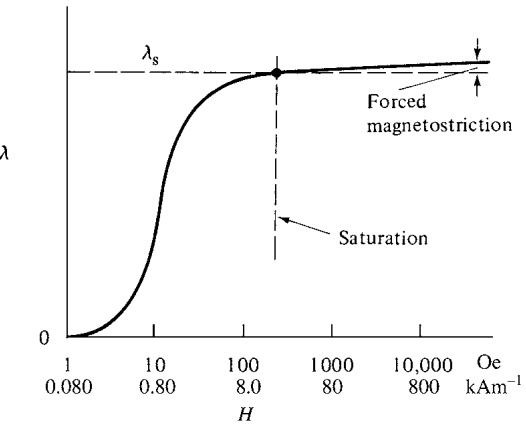

Fig. 8.1 Dependence of magnetostriction on magnetic field (schematic). Note that the field scale is logarithmic.

The measurement of longitudinal magnetostriction is straightforward but not trivial, especially over a range of temperatures. While early investigators used mechanical and optical levers to magnify the magnetostrictive strain to an observable magnitude, today this measurement on bulk samples is commonly made with an electrical-resistance strain gage cemented to the specimen. The gage is made from an alloy wire or foil grid, embedded in a thin paper or polymer sheet, which is cemented to the sample. When the sample changes shape, so does the grid, and the change in shape causes a change in the electrical resistance of the gage. With ordinary gages, the fractional change in resistance is about twice the elastic strain. This is typically a small resistance change, but one fairly easily measured with a bridge circuit, either ac or dc.

Commercial strain gages commonly are magnetoresistive (show a change in resistance when subjected to a magnetic field). This effect can be compensated by including in the bridge circuit used for detection a dummy gage that is subject to the same magnetic field as the active gage, but that is not attached to the sample and so undergoes no strain. The sensitivity, or gage factor, of a strain gage may also be temperature dependent. Semiconductor strain gages are much more sensitive than ordinary alloy gages, but have larger magnetoresistance and larger temperature dependence.

Capacitance or inductance or optical measuring systems of various designs may also be used. These have the advantage that nothing has to be cemented to the specimen, and by appropriate design they can be used over a wide temperature range. Careful control of the sample temperature is always necessary, since (as noted above) a one-degree temperature change can easily produce a strain larger than the magnetostrictive strain to be measured. Other, more subtle sources of error, due to uncertainties about the nature of the demagnetized state, are considered later.

Thin film samples present special challenges in the measurement of magnetostriction, since the films are almost always bonded to a nonmagnetic substrate. If the substrate is thin enough, a change in dimension of the film may produce a measurable curvature in the substrate, from which the magnetostrictive strain can be deduced. Another approach is to apply a known stress to the sample and measure the resulting change in magnetic anisotropy. This method makes use of the concept of the stress anisotropy, as described later in this chapter.

## 8.2 MAGNETOSTRICTION OF SINGLE CRYSTALS

When an iron single crystal is magnetized to saturation in a [100] direction, the length of the crystal in the [100] direction is found to increase. From this we infer that the unit cell of ferromagnetic iron is not exactly cubic, but slightly tetragonal. (A tetragonal cell has three axes at right angles; two are equal to each other, and the third is longer or shorter than the other two.) This conclusion follows from what we already know about the changes occurring in an iron crystal during magnetization in a [100] direction. These changes consist entirely of domain wall motion and were described with reference to Fig. 7.3. If the saturated crystal is longer in the direction of its magnetization than the demagnetized crystal, then the single domain which comprises the saturated crystal must be made up of unit cells which are slightly elongated in the direction of the magnetization vector.

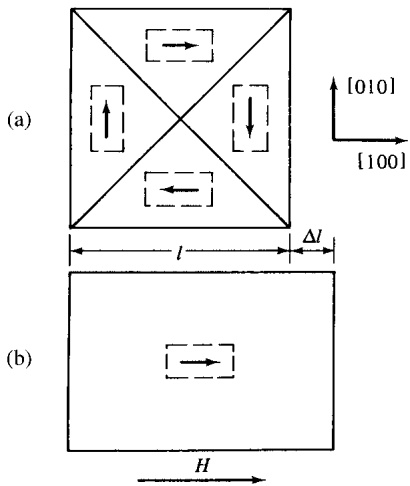

Fig. 8.2 Magnetostriction of an iron crystal in the [100] direction.

The same is true of each separate domain in the demagnetized state. Figure 8.2a depicts this state in terms of four sets of domains, [100], $[\bar{1}00]$, [010], and $[0\bar{1}0]$. Unit cells are shown by dashed lines; their tetragonality is enormously exaggerated and so is their size relative to the domain size. But the main point to notice is that these cells are all longer in the direction of the local $M_{s}$ vector than they are in directions at right angles to this vector. Thus, when a region originally occupied by, say, a $[0\bar{1}0]$ domain is replaced by a [100] domain, by the mechanism of wall motion, that region must expand in the [100] direction and contract in directions at right angles. The length of the whole crystal therefore changes from l to $l + \Delta l,$ where $\Delta l / l = \lambda_{\mathrm{s}} =$ the saturation magnetostriction in the [100] direction.

The unit cell of iron is exactly cubic only when the iron is above the Curie temperature, i.e., only when it is paramagnetic, and subject to no applied field. As soon as it cools below $T_{\mathrm{c}}$ spontaneous magnetization occurs and each domain becomes spontaneously strained, so that it is then made up of unit cells which are slightly tetragonal. The degree of tetragonality in iron and most other materials is less than can be detected by X-ray diffraction, so iron is regarded as cubic in the crystallographic literature.

There are therefore two basic kinds of magnetostriction: (1) spontaneous magnetostriction, which occurs in each domain when a specimen is cooled below the Curie point; and (2) forced magnetostriction, which occurs when a saturated specimen is exposed to fields large enough to increase the magnetization of the domain above its spontaneous value. Both kinds are due to an increase in the degree of spin order. The spontaneous magnetostriction is difficult to observe directly, but it is evidenced by a local maximum at $T_{c}$ in the variation of the thermal expansion coefficient with temperature. (This is the reason why Invar, an Fe–Ni alloy containing 36% Ni, has such a low expansion coefficient near room temperature. Its Curie point is near room temperature, and its spontaneous magnetostriction varies with temperature in such a way that it almost compensates the normal thermal expansion.) The “ordinary,” field-induced magnetostriction which concerns us, and in which $\lambda$ changes from 0 to ls (Fig. 8.1), is caused by the conversion of a demagnetized specimen, made up of domains spontaneously strained in various directions, into a saturated, single-domain specimen spontaneously strained in one direction. Figure 8.2 shows one special case of such a conversion, in which the only mechanism of magnetization change is domain wall motion.

Domain walls are described by the angle between the $M_{\mathrm{s}}$ vectors in the two domains on either side of the wall. Two types exist: $180^{\circ}$ walls and non-$180^{\circ}$ walls. The uniaxial crystal of Fig. 7.6 has only $180^{\circ}$ walls, while the iron crystal of Fig. 8.2a has only $90^{\circ}$ walls. Nickel, which has <111> easy directions, can have $180^{\circ}$, $110^{\circ}$, or $71^{\circ}$ walls. Non-$180^{\circ}$ walls are often called $90^{\circ}$ walls for brevity, whether the actual angle is 908, 1108, or $71^{\circ}$ The domain structure of real single crystals is normally such that both $180^{\circ}$ and non-$180^{\circ}$ walls exist.

The magnetostrictive effect of the motion of the two kinds of walls is quite different. Because the spontaneous strain is independent of the sense of the magnetization, the dimensions of a domain do not change when the direction of its spontaneous magnetization is reversed. Since passage of a $180^{\circ}$ wall through a certain region reverses the magnetization of that region, we conclude that $180^{\circ}$ wall motion does not produce any magnetostrictive change in dimensions. Thus, when the uniaxial crystal of Fig. 7.6 is saturated in the axial direction by an applied field, only $180^{\circ}$ wall motion is involved, and the length of the crystal does not change in the process. On the other hand, magnetization of the iron crystal of Fig. 8.2 is accomplished by $90^{\circ}$ wall motion, and a change in the length of the crystal does occur.

Rotation of the $M_{\mathrm{s}}$ vector of a domain always produces a dimensional change, because the spontaneous magnetostriction depends on the direction of the $M_{\mathrm{s}}$ vector relative to the crystal axes. Thus, in the general case of a crystal being magnetized in a noneasy direction, the magnetization process will involve $180^{\circ}$ and $90^{\circ}$ wall motion and domain rotation. The last two of these three processes will be accompanied by magnetostriction.

We now need expressions for the strain which a crystal undergoes in a certain direction when it is magnetized either in the same direction or in some arbitrary direction.

## 8.2.1 Cubic Crystals

The saturation magnetostriction $\lambda_{si}$ undergone by a cubic crystal in a direction defined by the direction cosines $\beta_{1},\beta_{2},\beta_{3}$ relative to the crystal axes, when it changes from the demagnetized state to saturation in a direction defined by the direction cosines $\alpha_{1},\alpha_{2}$ $\alpha_{3}$ , is given by

$$
\begin{array}{c} \lambda_ {\mathrm{si}} = \frac {3}{2} \lambda_ {1 0 0} (\alpha_ {1} ^ {2} \beta_ {1} ^ {2} + \alpha_ {2} ^ {2} \beta_ {2} ^ {2} + \alpha_ {3} ^ {2} \beta_ {3} ^ {2} - \frac {1}{3}) \\ \quad + 3 \lambda_ {1 1 1} (\alpha_ {1} \alpha_ {2} \beta_ {1} \beta_ {2} + \alpha_ {2} \alpha_ {3} \beta_ {2} \beta_ {3} + \alpha_ {3} \alpha_ {1} \beta_ {3} \beta_ {1}), \end{array}\tag{8.3}
$$

where $\lambda_{100}$ and $\lambda_{111}$ are the saturation magnetostrictions when the crystal is magnetized, and the strain is measured, in the directions <100> and <111>, respectively. This equation is valid for crystals having either <100> or <111> as easy directions. Most commonly, we want to know the strain in the same direction as the magnetization; then $\beta_{1},\beta_{2},\beta_{3} = \alpha_{1},\alpha_{2},\alpha_{3}$ , and Equation 8.3 becomes

$$
\lambda_ {\mathrm{si}} = \frac {3}{2} \lambda_ {1 0 0} (\alpha_ {2} ^ {4} + \alpha_ {2} ^ {4} + \alpha_ {3} ^ {4} - \frac {1}{3}) + 3 \lambda_ {1 1 1} (\alpha_ {1} ^ {2} \alpha_ {2} ^ {2} + \alpha_ {2} ^ {2} \alpha_ {3} ^ {2} + \alpha_ {3} ^ {2} \alpha_ {1} ^ {2}).\tag{8.4}
$$

This can be further reduced, by means of the relation

$$
(\alpha_ {1} ^ {2} + \alpha_ {2} ^ {2} + \alpha_ {3} ^ {2}) ^ {2} = (\alpha_ {1} ^ {4} + \alpha_ {2} ^ {4} + \alpha_ {3} ^ {4}) + 2 (\alpha_ {1} ^ {2} \alpha_ {2} ^ {2} + \alpha_ {2} ^ {2} \alpha_ {3} ^ {2} + \alpha_ {3} ^ {2} \alpha_ {1} ^ {2}) = 1,\tag{8.5}
$$

to the expression

$$
\lambda_ {\mathrm{si}} = \lambda_ {1 0 0} + 3 (\lambda_ {1 1 1} - \lambda_ {1 0 0}) (\alpha_ {1} ^ {2} \alpha_ {2} ^ {2} + \alpha_ {2} ^ {2} \alpha_ {3} ^ {2} + \alpha_ {3} ^ {2} \alpha_ {1} ^ {2}).\tag{8.6}
$$

Equation 8.3 is called the “two-constant” equation for magnetostriction. Like the rather similar equation for crystal anisotropy energy (Equation 7.1), it can be expanded to higher powers of the direction cosines. The next approximation involves five constants; its use is rarely justified by the accuracy of available magnetostriction data.

Equation 8.3 and others derived from it require a word of caution. They give the fieldinduced strain when the crystal is brought from the demagnetized to the saturated state. The saturated state is, by definition, one in which the whole specimen consists of a single domain with its $M_{\mathrm{s}}$ vector parallel to the applied field. The demagnetized state, on the other hand, is not well-defined. All that is required is that all the domain magnetizations, each properly weighted by its volume, add vectorially to zero. The difficulty is that there are an infinite number of domain arrangements and relative volumes that can result in zero net magnetization of the whole specimen. Equation 8.3 is based on a paticular definition of the demagnetized state, namely, one in which all possible types of domains have equal volumes. For example, in a cubic crystal like iron, with <100> easy directions, this state is one in which the total volume of the crystal is divided equally among six kinds of domains: [100], $[\bar{1}00]$, [010], $[0\bar{1}0]$, [001], and $[00\bar{1}]$. If this “ideal” demagnetized state is not achieved, Equation 8.3 is invalid, and the measured magnetostriction will be larger or smaller than the calculated value. Differences in the magnetostriction values observed by different investigators for the same material are usually due to differences in the demagnetized states of their specimens.

The special symbol $\lambda_{\mathrm{si}}$ is used in Equation 8.3 and similar ones, where the subscript “i” refers to the ideal demagnetized state. This symbol is not widely used in the scientific literature. It is introduced here in an attempt to inject greater clarity into the discussion of magnetostrictive strains. The single symbol $\lambda_{\mathrm{s}}$ is ambiguous, because it is used in the literature to refer both to ideal and nonideal demagnetized states. We therefore have two kinds of saturation magnetostriction:

1. $\lambda_{\mathrm{si}}$ measured from the ideal demagnetized state. This value is a constant of the material. Because it is defined, through Equation 8.3, in terms of $\lambda_{100}$ and $\lambda_{111}$ the two latter are also $\lambda_{\mathrm{si}}$ values, measured in these particular crystal directions.

2. $\lambda_{s}$ measured on a particular specimen having a particular, nonideal demagnetized state. This value is a property only of that particular specimen. The quantity $\lambda_{s}$ is highly structure sensitive, in that it depends on the mechanical, thermal, and magnetic history of the specimen. If the demagnetized state is nonideal, i.e., if all possible domains are not present in equal volumes, it is said to be a state of preferred domain orientation. Thus a preferred domain orientation can exist in the demagnetized state of a single crystal, or in the individual grains of a polycrystal, in addition to the preferred grain orientation that may exist in a polycrystal.

The domain arrangement shown for the demagnetized crystal in Fig. 8.2a is an example of preferred domain orientation, because it contains only four kinds of domains. If the missing domains [001] and $[00\bar{1}]$ were present, the demagnetized crystal would be shorter in both the [100] and [010] directions than the crystal shown. This means, for magnetization and strain measurement both in the direction [100], that the magnetostriction for the ideal state would be greater than that for the crystal shown.

Equation 8.3 is of greater utility than may first appear. Properly manipulated, it allows us (a) to calculate the dimensional change of a single domain due to a rotation of its $M_{\mathrm{s}}$ vector out of the easy direction, and (b) to circumvent, in magnetostriction measurements, the uncertainty about the demagnetized state. The first application arises from the fact that a saturated single crystal is a single domain. If we compute, by means of Equation 8.3, the values of $\lambda_{si}$ for two different orientations of $M_{\mathrm{s}}$ in the saturated state, then the difference between these two values is the strain undergone by the saturated, single-domain crystal when $M_{\mathrm{s}}$ rotates from one orientation to the other. For example, suppose we wish to know how the length of a cube-edge direction <100> in a single domain changes as the $M_{\mathrm{s}}$ vector rotates away from it. In Fig. 8.3a let $M_{\mathrm{s}}$ rotate away from [001] by an angle d in the plane (010). The direction cosines of $M_{\mathrm{s}}$ are $\alpha_{1} = \cos (90^{\circ} - \delta) =$ sin δ, $\alpha_{2} = 0, \alpha_{3} = \cos \delta$ . We wish to know the strain along the [001] direction; therefore, $\beta_{1}=$ $\beta_{2} = 0$ and $\beta_{3} = 1$ . Substituting these values into Equation 8.3, we find

$$
\lambda_ {\mathrm{si}} (\delta = \delta) = \frac {3}{2} \lambda_ {1 0 0} (\cos^ {2} \delta - \frac {1}{3}).\tag{8.7}
$$

This is the strain along [001] which occurs when an ideally demagnetized crystal is saturated in the direction d. When $\delta = 0$ , this expression reduces to

$$
\lambda_ {\mathrm{si}} (\delta = 0) = \lambda_ {1 0 0},\tag{8.8}
$$

as it should. If we take the state of saturation along [001] as the initial state, then the strain along [001] in a single domain when $M_{\mathrm{s}}$ rotates by an angle d away from [001] is

$$
\begin{array}{r l} \frac {\Delta l}{l} & = \lambda_ {\mathrm{si}} (\delta = \delta) - \lambda_ {\mathrm{si}} (\delta = 0) \\ & = \frac {3}{2} \lambda_ {1 0 0} (\cos^ {2} \delta - \frac {1}{3}) - \lambda_ {1 0 0} \\ & = - \frac {3}{2} \lambda_ {1 0 0} \sin^ {2} \delta . \end{array}\tag{8.9}
$$

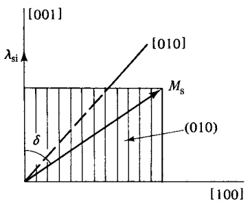

(a)

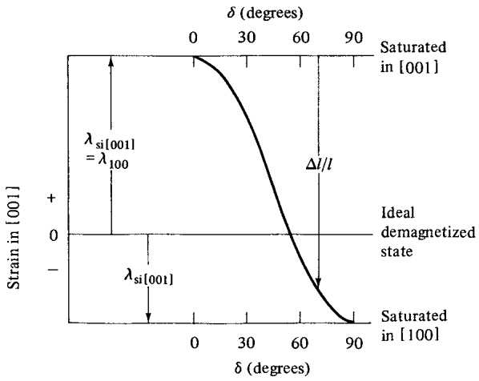

(b)

Fig. 8.3 Magnetostrictive strains in a cubic crystal with $\lambda_{100}$

In iron, $\lambda_{100}$ is positive and <100> is an easy direction. Therefore, when $M_{\mathrm{s}}$ rotates through an angle of $90^{\circ}$ out of an easy direction, the domain contracts fractionally in that direction by an amount $\frac{3}{2}\lambda_{100}$ . The $M_{\mathrm{s}}$ vector may rotate away from [001] in any plane, not only (010), and Equation 8.9 will still apply, because a change in the plane of rotation changes only $\alpha_{1}$ and $\alpha_{2}$ . Inasmuch as these appear only in terms involving $\beta_{1}$ or $\beta_{2}$ , both zero, they do not affect the final result. These several changes in the length of the crystal along [001] are illustrated in Fig. 8.3b. If the demagnetized state is nonideal, the zero of strain in this diagram will be shifted up or down, and the $\lambda_{\mathrm{si}}$ values shown will become $\lambda_{s}$ values. However, the strain $\Delta l / l,$ resulting from a change from one saturated state to another, will remain the same.

These results show that magnetostriction constants can be determined, without any uncertainty regarding the demagnetized state, by making strain measurements as the $M_{\mathrm{s}}$ vector rotates from one orientation to another in a saturated crystal. For example, $\lambda_{100}$ can be determined by cutting a disk from a crystal parallel to the plane (010). A strain gage is cemented to the disk with its axis parallel to the chosen direction of measurement, namely, [001], as in Fig. 8.4. The disk is then placed in the strong field of an electromagnet. When this is done, the disk magnetostrictively strains, of course, but this strain is ignored. With the disk in the position shown, the strain gage reading is noted. The disk is then rotated by $90^{\circ}$ in its own plane to make [100] parallel to $M_{\mathrm{s}}$ which is parallel to the applied field, and the gage reading is again noted. The difference between these two readings multiplied by 23 gives $\lambda_{100}$ according to Equation 8.9. Actually, it is better to cut the disk parallel to {110} , because this plane contains both <100> and <111> directions. Then $\lambda_{100}$ and $\lambda_{111}$ can both be determined from measurements on a single specimen. By this technique, without any reference to or knowledge of the demagnetized state, we can determine the value of $\lambda_{100}$ , for example, even though $\lambda_{100}$ is defined as the strain in <100> occurring in a crystal when it passes from the ideal demagnetized state to saturation in <100>.

Figure 8.5 shows experimental curves for magnetostriction in various directions in an iron crystal. The behavior is complex. When the field is parallel to [100], the strain in that direction is a simple expansion, as noted earlier. When the field is parallel to [111], $180^{\circ}$ wall motion occurs until the crystal contains only three sets of domains—[100], [010], and [001]—with $M_{\mathrm{s}}$ in each set equally inclined at $55^{\circ}$ to the field; during this process the dimensions of the crystal do not change. Further increase of field causes $M_{\mathrm{s}}$ vectors to rotate toward [111], and this rotation causes a contraction along [111].

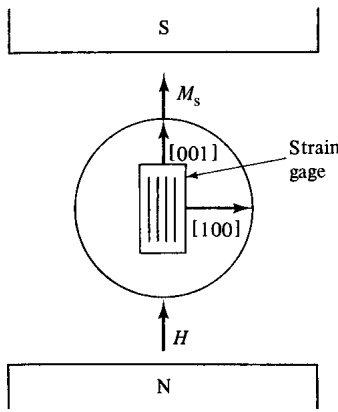

Fig. 8.4 Magnetostriction measurement on a single crystal using a strain gage.

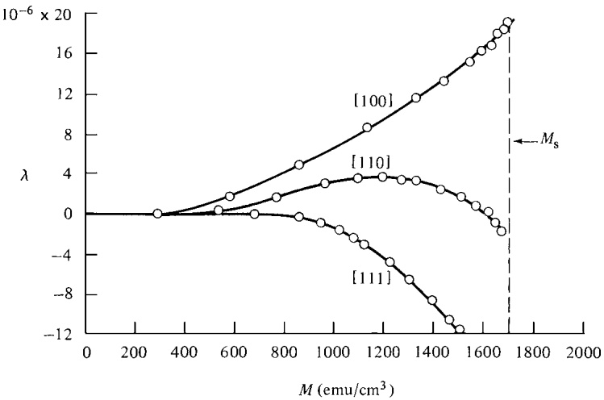

Fig. 8.5 Magnetostriction as a function of magnetization in single crystal iron rods. Each rod had a different crystallographic axis. [ W. L. Webster, Proc. R. Soc., A109 (1925) p. 570.]

When $H$ is parallel to [110] in iron, the crystal first expands in that direction and then contracts. These changes can be understood by reference to Fig. 7.4, if one imagines the addition of [001] and $[00\bar{1}]$ domains to the initial state depicted there. In response to the applied field, $90^{\circ}$ and $180^{\circ}$ wall motion will take place until the crystal contains only two sets of domains, those corresponding to the two easy axes nearest the applied field (Fig. 7.4c). During this process, [001] and $[00\bar{1}]$ domains have disappeared. Inasmuch as these domains are spontaneously contracted in a direction parallel to the field direction [110], their removal causes an expansion in the [110] direction, as observed. With further increase in field, the magnetization in the remaining [100] and [010] domains rotates into the [110] direction, causing an additional strain of $\frac{3}{4}\lambda_{111}$ along [110]. Because $\lambda_{111}$ is negative, this strain is a contraction, and it is large enough to make the crystal shorter at saturation than it was initially.

A nickel crystal contracts in all three principal directions when magnetized, as shown in Fig. 8.6. From the observed contraction in the [111] direction and the fact that the easy directions in nickel are <111>, it follows that the unit cell of ferromagnetic nickel is slightly distorted from cubic to rhombohedral, with one cell diagonal, the one parallel to the local direction of magnetization, slightly shorter than the other three. So when the $M_{s}$ vector in a domain is rotated away from a <111> easy axis, that axis becomes longer. One can then understand, by arguments similar to those given above for iron, why l100 and $\lambda_{111}$ are both negative in nickel.

Note that, in Fig. 8.5, magnetostriction is plotted against magnetization, while in Fig. 8.6 magnetostriction is plotted against magnetic field $H$. These qualitative descriptions of the variation of $\lambda$ with $H$ (or $M$ ) below saturation can be made quantitative without much difficulty, although certain rather arbitrary assumptions have to be made about the sequence of $180^{\circ}$ and $90^{\circ}$ wall motion.

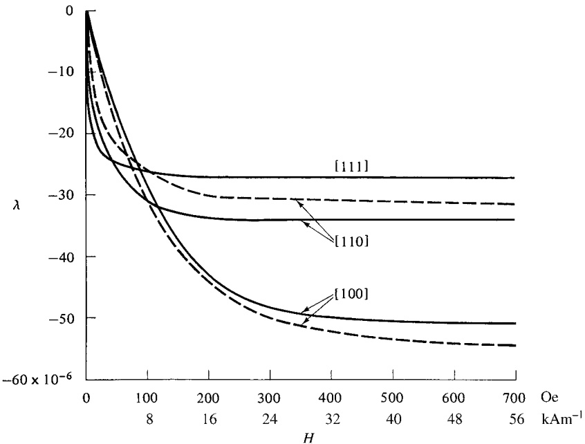

Fig. 8.6 Magnetostriction as a function of field and crystal direction for nickel single crystal. Samples were planetary (oblate) spheroids. Solid lines, {011} disk; dashed lines, [001] disk. [Y. Masiyama, Sci. Rep. Tohoku Univ., 17 (1928) p. 947.]

If the magnetostriction of a particular material is isotropic, we can put $\lambda_{100} = \lambda_{111} = \lambda_{\mathrm{si}}$ Then Equation 8.3 becomes, with the introduction of a new symbol,

$$
\begin{array}{l} \lambda_ {\theta} = \frac {3}{2} \lambda_ {\mathrm{si}} [ (\alpha_ {1} ^ {2} \beta_ {1} ^ {2} + \alpha_ {2} ^ {2} \beta_ {2} ^ {2} + \alpha_ {3} ^ {2} \beta_ {3} ^ {2} - \frac {1}{3}) + 2 (\alpha_ {1} \alpha_ {2} \beta_ {1} \beta_ {2} + \alpha_ {2} \alpha_ {3} \beta_ {2} \beta_ {3} + \alpha_ {3} \alpha_ {1} \beta_ {3} \beta_ {1}) ], \\ \lambda_ {\theta} = \frac {3}{2} \lambda_ {\mathrm{si}} [ (\alpha_ {1} \beta_ {1} + \alpha_ {2} \beta_ {2} + \alpha_ {3} \beta_ {3}) ^ {2} - \frac {1}{3} ], \\ \lambda_ {\theta} = \frac {3}{2} \lambda_ {\mathrm{si}} (\cos^ {2} \theta - \frac {1}{3}), \end{array}\tag{8.10}
$$

where $\lambda_{\theta}$ is the saturation magnetostriction at an angle $\theta$ to the direction of magnetization, measured from the ideal demagnetized state. (If $\theta$ is the angle between two directions defined by cosines $\alpha_{1},\alpha_{2},\alpha_{3}$ and $\beta_{1},\beta_{2},\beta_{3}$ , then cos $\theta = \alpha_{1}\beta_{1} + \alpha_{2}\beta_{2} + \alpha_{3}\beta_{3}.$ Because of isotropy, no reference to the crystal axes appears in Equation 8.10, and the magnetostrictive effect can be illustrated quite simply by Fig. 8.7, which shows a demagnetized sphere distorted into an ellipsoid of revolution when saturated, for a positive value of $\lambda_{\mathrm{si}}$ Figure 8.6 shows that the magnetostrictive behavior of nickel is approximately isotropic, and Equation 8.10 is often applied to nickel.

Table 8.1 lists $\lambda_{\mathrm{si}}$ values for some cubic metals and ferrites. (The variation with composition of $\lambda_{\mathrm{si}}$ for alloys will be described later.) In general, the magnetostriction of the ferrites is of about the same order of magnitude as that of the metals, with the notable exception of cobalt ferrite. Here the spontaneous distortion of the crystal unit cell, from cubic to tetragonal, is so large that it can be detected by X-ray diffraction. This ferrite also has an unusually large value of crystal anisotropy (Table 7.4).

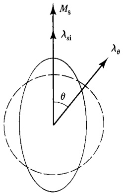

Fig. 8.7 Isotropic magnetostriction.

## 8.2.2 Hexagonal Crystals

The magnetostriction of a hexagonal crystal is given by the following equation, which corresponds to Equation 8.3 for a cubic crystal:

$$
\begin{array}{r l} \lambda_ {\mathrm{si}} & = \lambda_ {\mathrm{A}} [ (\alpha_ {1} \beta_ {1} + \alpha_ {2} \beta_ {2}) ^ {2} - (\alpha_ {1} \beta_ {1} + \alpha_ {2} \beta_ {2}) \alpha_ {3} \beta_ {3} ] \\ & \quad + \lambda_ {\mathrm{B}} [ (1 - \alpha_ {3} ^ {2}) (1 - \beta_ {3} ^ {2}) - (\alpha_ {1} \beta_ {1} + \alpha_ {2} \beta_ {2}) ^ {2} ] \\ & \quad + \lambda_ {\mathrm{C}} [ (1 - \alpha_ {3} ^ {2}) \beta_ {3} ^ {2} - (\alpha_ {1} \beta_ {1} + \alpha_ {2} \beta_ {2}) \alpha_ {3} \beta_ {3} ] \\ & \quad + 4 \lambda_ {\mathrm{D}} (\alpha_ {1} \beta_ {1} + \alpha_ {2} \beta_ {2}) \alpha_ {3} \beta_ {3}. \end{array}\tag{8.11}
$$

Although this expression has four constants, it is the first approximation, like Equation 8.3. The next approximation, involving higher powers of the direction cosines, has nine constants. It is important to note that the direction cosines in Equation 8.11 relate, not to hexagonal axes, but to orthogonal axes x, y, z. Figure 8.8 shows the relation between the two. The usual hexagonal axes are $a_{1}, a_{2}, a_{3}$ , and c. The orthogonal axes are chosen so that x is parallel to $a_{1}, a_{2}, \text{ or } a_{3}$ , and z is parallel to c. The base of the hexagonal unit cell is outlined. The c and z axes are normal to the plane of the drawing. Equation 8.11 is valid only for crystals in which the c-axis is the easy direction.

TABLE 8.1 Magnetostriction Constants of Cubic Substances (Units of $10^{-6}$

| Material | $\lambda_{100}$ | $\lambda_{111}$ | $\lambda_{\text{p}}^{a}$ |
| --- | --- | --- | --- |
| Fe | +21 | -21 | -7 |
| Ni | -46 | -24 | -34 |
| $FeO \cdot Fe_{2}O_{3}$ | -20 | +78 | +40 |
| $Co_{0.8}Fe_{0.2}O \cdot Fe_{2}O_{3}$ | -590 | -120 |  |
| $CoO \cdot Fe_{2}O_{3}$ |  |  | -110 |
| $Ni_{0.8}Fe_{0.2}O \cdot Fe_{2}O_{3}$ | -36 | -4 |  |
| $NiO \cdot Fe_{2}O_{3}$ |  |  | -26 |
| $MnO \cdot Fe_{2}O_{3}$ |  |  | -5 |
| $MgO \cdot Fe_{2}O_{3}$ |  |  | -6 |

aExperimental values for polycrystalline specimens.

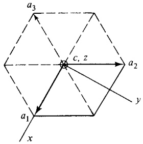

Fig. 8.8 Hexagonal and orthogonal axes in a hexagonal crystal.

When the magnetostriction is measured in the same direction as the magnetization, then $\beta_{1},\beta_{2},\beta_{3} = \alpha_{1},\alpha_{2},\alpha_{3}$ , and Equation 8.11 reduces to a two-constant expression

$$
\lambda_ {\mathrm{si}} = \lambda_ {\mathrm{A}} [ (1 - \alpha_ {3} ^ {2}) ^ {2} - (1 - \alpha_ {3} ^ {2}) \alpha_ {3} ^ {2} ] + 4 \lambda_ {\mathrm{D}} (1 - \alpha_ {3} ^ {2}) \alpha_ {3} ^ {2},\tag{8.12}
$$

because $\alpha_{1}^{2} + \alpha_{2}^{2} + \alpha_{3}^{2} = 1$ . Inasmuch as only $\alpha_{3}$ appears in Equation 8.12, the value of $\lambda_{si}$ in, for example, the basal plane, is the same in any direction. Equations 8.11 and 8.12 therefore express cylindrical, rather than hexagonal, symmetry. Hexagonal symmetry appears only in the next approximation. R. M. Bozorth [Ferromagnetism, Van Nostrand (1951); reprinted by IEEE (1993)] finds that the behavior of cobalt is adequately described by the following constants:

$$
\begin{array}{l l} \lambda_ {\mathrm{A}} = - 4 5 \times 1 0 ^ {- 6}, & \quad \lambda_ {\mathrm{B}} = - 9 5 \times 1 0 ^ {- 6}, \\ \lambda_ {\mathrm{C}} = + 1 1 0 \times 1 0 ^ {- 6}, & \quad \lambda_ {\mathrm{D}} = - 1 0 0 \times 1 0 ^ {- 6}. \end{array}
$$

Magnetostriction as a function of field strength is shown in Fig. 8.9. As expected, $\lambda_{si}$ parallel to the c-axis is zero, because only $180^{\circ}$ wall motion is involved. The contraction observed at $60^{\circ}$ to the c-axis is much larger than in the basal plane $(\theta = 90^{\circ})$ and is, in fact, the maximum contraction for any value of $\theta$.

Alternative Notation An alternative notation for magnetostriction in single crystals [E. R. and H. B. Callen, Phys. Rev., 129 (1963) p. 578; A139 (1965) p. 455] is sometimes used, especially in theoretical treatments of the subject.

General Magnetostriction constants usually decrease in absolute magnitude as the temperature increases, and approach zero at the Curie point. However, there are exceptions. Figure 8.10 shows the behavior of iron; it is clear that $\lambda_{100}$ and $\lambda_{111}$ have very different temperature dependences.

Before leaving the topic of single crystals it is important to realize that any demagnetized crystal that contains $90^{\circ}$ walls is never completely stress free at room temperature. The various domains simply do not fit together exactly. Figure 8.11a depicts a single crystal of iron, for example, at a temperature above the Curie point; the dashed lines indicate where domain walls will form below $T_{\mathrm{c}}$ As the crystal cools below $T_{c}$ , it spontaneously

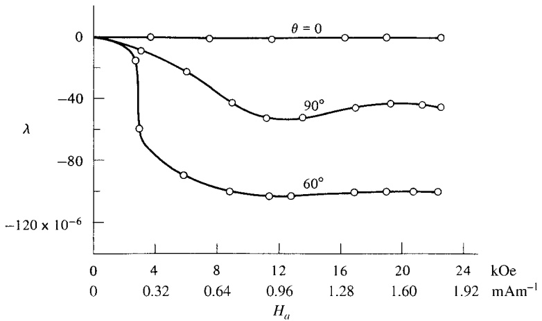

Fig. 8.9 Magnetostriction of a cobalt single crystal as a function of field. The strain $\lambda$ is measured parallel to the field $H$, and $\theta$ is the angle between them and the hexagonal axis. [R. M. Bozorth, Ferromagnetism, reprinted by IEEE Press (1993).]

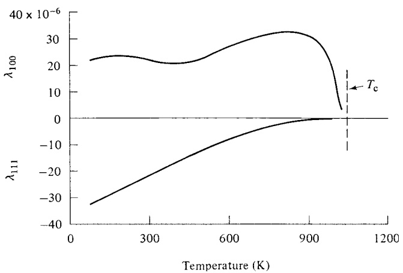

Fig. 8.10 Temperature dependence of magnetostriction constants of iron. [T. Okamoto and E. Tatsumoto, J. Phys. Soc. Japan, 14 (1959) p. 1588.]

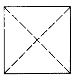

(a)

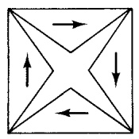

(b)

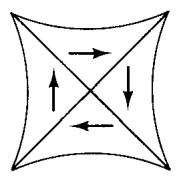

(c)

Fig. 8.11 Strains in a demagnetized single crystal.

magnetizes in four different directions in various parts of the crystal, thus forming domains. At the same time, each domain strains spontaneously. If the domains were free to deform, they would separate at the boundaries, as shown in Fig. 8.11b, because each domain lengthens in the direction of $M_{\mathrm{s}}$ and contracts at right angles. But the strains involved are much too small to cause separation of the domains. The result is an elastically deformed state, something like Fig. 8.11c, in which each domain exerts stress on its neighbor. Saturation removes the $90^{\circ}$ walls, the cause of the misfit, and an elongated, singledomain, stress-free crystal results.

## 8.3 MAGNETOSTRICTION OF POLYCRYSTALS

The saturation magnetostriction of a polycrystalline specimen, parallel to the magnetization, is characterized by a single constant $\lambda_{\mathrm{p}}$ Its value depends on the magnetostrictive properties of the individual crystals and on the way in which they are arranged, i.e., on the presence or absence of preferred domain or grain orientation.

If the grain orientations are completely random, the saturation magnetostriction of the polycrystal should be given by some sort of average over these orientations. Just how this averaging should be carried out, however, is not entirely clear. When a polycrystal is saturated by an applied field, each grain tries to strain magnetostrictively, in the direction of the field, by an amount different from its neighbors, because of its different orientation. There are two limiting cases: (1) stress is uniform throughout, but strain varies from grain to grain; or (2) strain is uniform, and stress varies.

The condition of uniform strain is usually considered to be physically more realistic. It is then a question of averaging the magnetostriction in the field direction over all crystal orientations, or, what amounts to the same thing, averaging Equation 8.6, for cubic crystals, over all orientations of the $M_{s}$ vector with respect to a set of fixed crystal axes. We first express $\alpha_{1},\alpha_{2},\alpha_{3}$ in terms of the angles  and φ of Fig. 8.12. The relations are

$$
\alpha_ {1} = \sin \phi \cos \theta , \alpha_ {2} = \sin \phi \sin \theta , \alpha_ {3} = \cos \phi.
$$

On the surface of a sphere of unit radius centered on the origin, the element of area is $\mathrm{d}A =$ sin φ df du. Averaging over the upper hemisphere, we find the average value of $\lambda_{si}$ to be

$$
\overline {{\lambda_ {\mathrm{si}}}} = \frac {1}{2 \pi} \int_ {\theta = 0} ^ {\pi / 2} \int_ {\phi = 0} ^ {\pi / 2} \lambda_ {\mathrm{si}} \sin \phi \mathrm{d} \phi \mathrm{d} \theta .\tag{8.13}
$$

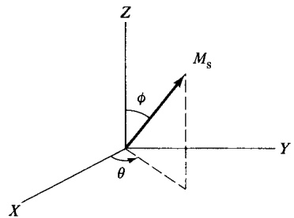

Fig. 8.12 Definitions of angles $\theta$ and φ.

Substituting Equation 8.6 for $\lambda_{si}$ and integrating, we obtain

$$
\overline {{\lambda_ {\mathrm{si}}}} = \frac {2 \lambda_ {1 0 0} + 3 \lambda_ {1 1 1}}{5}.\tag{8.14}
$$

On the other hand, H. E. Callen and N. Goldberg [J. Appl. Phys., 36 (1965) p. 976] claim that an assumption intermediate between those of uniform stress and uniform strain leads to an equation which better represents the data available for a number of polycrystalline metals, alloys, and ferrites. This assumption leads to the following equation

$$
\overline {{\lambda_ {\mathrm{si}}}} = \lambda_ {1 1 1} + \left(\frac {2}{5} - \frac {\ln c}{8}\right) (\lambda_ {1 0 0} - \lambda_ {1 1 1}),\tag{8.15}
$$

where $c = 2c_{44} / (c_{11} - c_{12})$ , and $c_{44}, c_{11}$ , and $c_{12}$ are single-crystal elastic constants. A crystal is elastically isotropic if $c = 1$ ; in that case, Equations 8.14 and 8.15 are the same.

When the single-crystal data for iron are substituted into these relations, $\bar{\lambda}_{\mathrm{si}}$ is found to be $-4\times 10^{-6}$ from Equation 8.14 and $-9 \times 10^{-6}$ from Equation 8.15. The usually accepted experimental value of $\lambda_{p}$ is about $-7\times 10^{-6}$ . However, it should be noted that the magnetostriction of polycrystalline materials is often measured on rod specimens, and iron rods almost invariably have a more or less pronounced <110> fiber texture, as mentioned in Section 7.8. Inasmuch as the value of $\lambda_{110}\mathrm{is} - 10\times 10^{-6}$ , the presence of a <110> component would tend to make the value of $\lambda_{p}$ measured on a rod specimen more negative than the value to be expected for a polycrystal with randomly oriented grains. This suggests that Equation 8.14 is more accurate for iron.

The usually accepted experimental value of $\lambda_{\mathrm{p}}$ for nickel, $-34\times10^{-6}$ , compares reasonably well with $-33\times10^{-6}$ given by Equation 8.14, and with $-30\times10^{-6}$ given by Equation 8.15. However, the values of $\lambda_{\mathrm{p}}$ reported by individual investigators cover a surprisingly wide range, from $-25 \times 10^{-6} \text{ to } -47 \times 10^{-6}$ . Part of this spread may be due to differences in preferred grain orientation. While magnetostriction in nickel is commonly regarded as approximately isotropic, the magnitude of $\lambda_{100}$ is in fact almost double that of $\lambda_{111}$ . Like other face-centered-cubic metals, nickel in rod form can be expected to have a double $\langle 100\rangle +\langle 111\rangle$ fiber texture, as mentioned in Section 7.8. Variations in the relative amounts of these two components could cause large changes in $\lambda_{\mathrm{p}}$ So could insufficient annealing of the specimens. The magnetic measurements might then have been made on specimens containing residual stress left over from the cold-worked state. This stress could introduce large errors, because the magnetic properties of nickel are very stress sensitive, as we shall see in Sections 8.5 and 8.6.

If we wish to know the magnetostriction at an angle $\theta$ to the magnetization, we can use Equation 8.10 to find

$$
\lambda_ {\theta} = \frac {3}{2} \lambda_ {\mathrm{p}} (\cos^ {2} \theta - \frac {1}{3}),\tag{8.16}
$$

where $\lambda_{\mathrm{p}}$ has been substituted for $\lambda_{\mathrm{si}}$ . Because this equation was derived for an isotropic specimen, its application to a polycrystal requires that the specimen have no preferred orientation or that it be composed of grains which are themselves magnetically isotropic.

Figure 8.13 shows typical l, $H$ curves for polycrystalline iron, cobalt and nickel. The shapes of such curves, as reported by different investigators, can vary widely, usually because of differences in preferred orientation. Unfortunately, however, the measurement of magnetostriction is hardly ever accompanied by a determination of the kind and degree of preferred orientation.

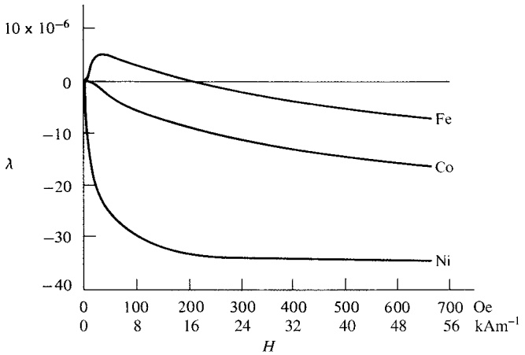

Fig. 8.13 Magnetostriction of polycrystalline iron, cobalt, and nickel. [E. W. Lee, Rep. Progr. Phys. 18 (1955) p. 184.]

Magnetostriction is usually measured, and the results presented, as strain vs field. Since magnetostriction results directly from changes in magnetization, it would be more appropriate from a fundamental viewpoint to plot magnetostrictive strain vs magnetization, although this makes the experimental work more complicated. Figure 8.14 shows plots of strain vs field and strain vs magnetization, for a sample of $\mathrm{FeCo} + 2\% \mathrm{V}$ at room temperature. The sample has been heat treated so that its coercive field is very small.

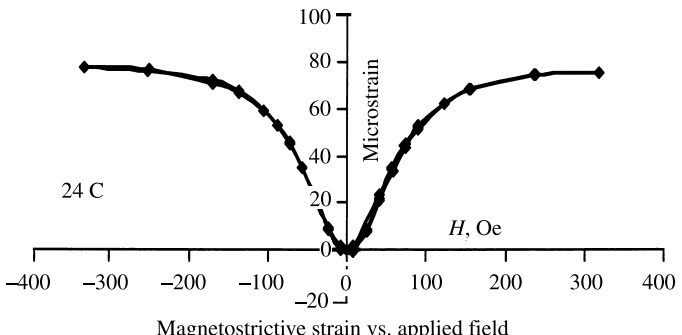

(a)

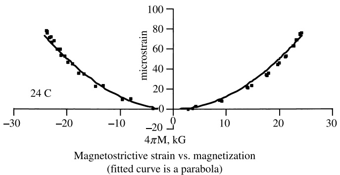

(b)

Fig. 8.14 Magnetostriction vs field and vs magnetization for polycrystalline FeCo + 2% V. [B. E. Lorenz and C. D. Graham, IEEE Trans. Mag., 42 (2006) p. 3886.]

## 8.4 PHYSICAL ORIGIN OF MAGNETOSTRICTION

Magnetostriction is due mainly to spin-orbit coupling. This coupling, as we saw in Section 7.4, is also responsible for crystal anisotropy. It is relatively weak, because applied fields of a few hundred oersteds usually suffice to rotate the spins away from the easy direction.

The relation between magnetostriction and spin-orbit coupling can be crudely pictured in terms of Fig. 8.15, which is a section through a row of atoms in a crystal. The black dots represent atomic nuclei, the arrows show the net magnetic moment per atom, and the oval lines enclose the electrons belonging to, and distributed nonspherically about, each nucleus. The upper row of atoms depicts the paramagnetic state above $T_{\mathrm{c}}$ If, for the moment, we assume that the spin – orbit coupling is very strong, then the effect of the spontaneous magnetization occurring below $T_{c}$ would be to rotate the spins and the electron clouds into some particular orientation determined by the crystal anisotropy, left to right, say. The nuclei would be forced further apart, and the spontaneous magnetostriction would be $\Delta L^{\prime} / L^{\prime}$ If we then apply a strong field vertically, the spins and the electron clouds would rotate through $90^{\circ}$ , and the domain of which these atoms are a part would magnetostrictively strain by an amount $\Delta L / L$

The strains pictured are enormous, of the order of 0.3. Actually, we know that the magnetostrictive strain produced in a domain or a crystal, when its direction of magnetization is changed, is usually very small, of the order of $10^{-5}$ . This means that the reorientation of electron clouds takes place only to a very small extent. This conclusion is in turn supported by the fact that orbital magnetic moments are almost entirely quenched, i.e., not susceptible to rotation by an applied field, in most materials, as shown by measurements of the g or $g'$ factors (Section 3.7 and Table 4.1).

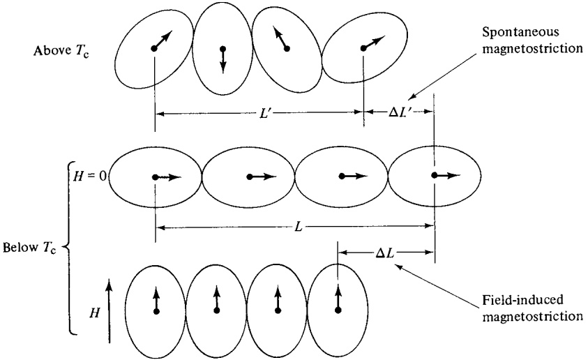

Fig. 8.15 Mechanism of magnetostriction (schematic).

The rare-earth metals are exceptions to the above statements. Many of them are ferromagnetic, at temperatures mostly well below room temperature, and their orbital moments are not quenched, i.e., the spin –orbit coupling is strong. Moreover, the electron cloud about each nucleus is decidedly nonspherical. Therefore, when an applied field rotates the spins, the orbits rotate too and considerable distortion results. At 22K the saturation magnetostriction of dysprosium is about $4.5\times10^{-3}$ in the basal plane, or some 100 times that of “normal” metals and alloys. Some rare-earth compounds with transition metals Fe, Ni, and Co have Curie points above room temperature together with abnormally large values of magnetostriction.

Inasmuch as magnetostriction and crystal anisotropy are both due to spin – orbit coupling, we would expect some correlation between the two. In fact, a large value of the anisotropy constant $K_{1}$ is usually accompanied by a large value of $\lambda_{\mathrm{si}}$ . For example, hexagonal substances tend to have larger values of both $\left|K_{1}\right|$ and $\left|\lambda_{\mathrm{si}}\right|$ than cubics. And in binary alloys, the addition of a second element in solid solution often decreases both $\left|K_{1}\right|$ and $\left|\lambda_{\mathrm{si}}\right|$ . These are just general trends, however, and there are exceptions.

The physical origin of magnetostriction is treated in some detail by E. du Trémolet de Lacheisserie [Magnetism, Volume 1, Chapter 12, Kluwer Academic (2002)].

## 8.4.1 Form Effect

When a specimen is magnetized, a strain $(\Delta l / l)_{\mathrm{f}}$ occurs which has a physical origin entirely different from that of magnetostriction but which can be erroneously ascribed to magnetostriction. Because this strain depends on the shape of the specimen, it is referred to as the form effect. This effect occurs because of the tendency of a magnetized body to minimize its magnetostatic energy. Suppose a specimen is magnetized to its saturation $M_{\mathrm{s}}$ in a direction along which its demagnetizing factor is $N_{\mathrm{d}}$ Then, according to Equation 7.51, its magnetostatic energy is of the form $\frac{1}{2} N_{\mathrm{d}}M_{\mathrm{s}}^{2}$ . The specimen can decrease this energy by lengthening a fractional amount $(\Delta l / l)_{\mathrm{f}}$ in the direction of $M_{\mathrm{s}}$ because a longer specimen has a smaller value of $N_{\mathrm{d}}$ The magnitude of the elongation will depend on the elastic constants of the material. The strain $\lambda_{si}$ due to magnetostriction is superimposed on the formeffect strain $(\Delta l / l)_{\mathrm{f}},$ and the two together make up the observed strain. For an iron sphere, $(\Delta l / l)_{\mathrm{f}}$ is about $4\times10^{-6}$ This value decreases rapidly as the sample is made more elongated in the direction of magnetization. So the form effect is generally small, but not negligible for short specimens.

Because it is difficult to calculate $(\Delta l / l)_{\mathrm{f}}$ with accuracy, it is better (and usual) to avoid the form effect by choosing a specimen shape with small $N_{\mathrm{d}}$ . The magnetostatic energy will then be so small that $(\Delta l / l)_{\mathrm{f}}$ will become negligible. For most materials, a disk sample with a diameter/thickness ratio of 10 or more will not require a correction for the form effect.

## 8.5 EFFECT OF STRESS ON MAGNETIC PROPERTIES

Although the magnetostrictive strain is small in most magnetic materials, the existence of magnetostriction means that an applied mechanical stress can alter the domain structure and create a new source of magnetic anisotropy. These effects can have a substantial effect on the low-field magnetic properties, such as permeability and remanence. Figure 8.16 shows the marked effects of applied stress on the magnetization behavior of polycrystalline nickel. At a field $H$ of 10 Oe (800 A/m), a compressive stress of 10,000 lb /in² (70 MPa) almost doubles the permeability μ, while the same amount of tensile stress reduces μ to about onetenth of the zero-stress value and makes the $M$, $H$ curve practically linear. Nickel is not unique in this respect. Materials are known in which the low-field permeability is changed by a factor of 100 by an applied stress of the order of 10,000 lb/in2.

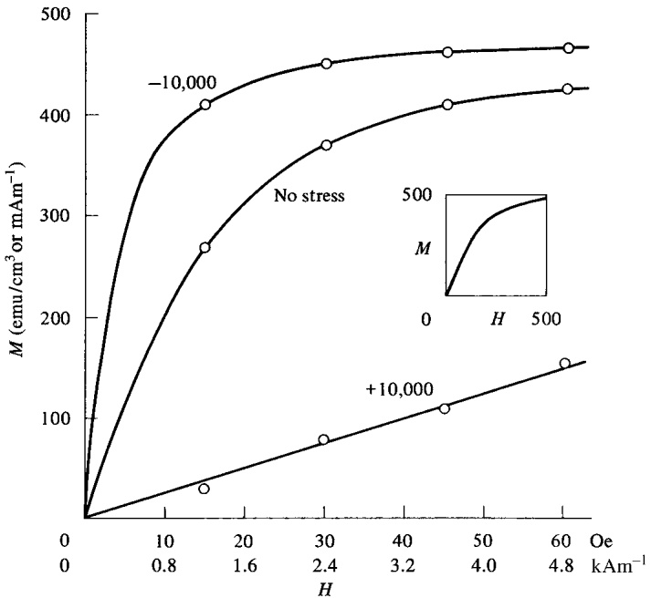

Fig. 8.16 Effect of applied tensile (+) and compressive (-) stress on the magnetization curve of polycrystalline nickel; 10,000 lb /in²  69 MPa. [D. K. Bagchi, unpublished.]

The magnetostriction of nickel is negative. For a material with positive magnetostriction, such as 68 permalloy, the effect of stress is just the opposite. (The word permalloy now refers to a family of Ni – Fe alloys, sometimes containing small additions of other elements. The number before the alloy name gives the nickel content. Thus “68 permalloy” means an alloy containing 68% Ni and 32% Fe.) Applied tensile stress increases the permeability of this alloy, as Fig. 8.17 shows.

The magnetostriction of polycrystalline iron is positive at low fields, then zero, then negative at higher fields, as shown in Fig. 8.13. As a result, the magnetic behavior under stress is complicated. At low fields tension raises the $B$, $H$ curve and at higher fields lowers it; the crossover of the two curves at a particular field strength, which depends on the stress and on preferred orientation, is called the Villari reversal. In the measurements shown in Fig. 8.18, tension has no appreciable effect until $B$ exceeds about 10 kilogauss; the Villari reversal occurs at about 20 Oe. Compression has a reverse, and larger, effect, lowering $B$ at low fields and raising it at large fields.

The experimental results of Figs 8.15 –8.18 show that there is a close connection between the magnetostriction $\lambda$ of a material and its magnetic behavior under stress. As a result, the effect of stress on magnetization is sometimes called the inverse magnetostrictive effect, but more commonly is referred to simply as a magnetomechanical effect. It is entirely distinct from the magnetomechanical factor of Section 3.7. These results could have been anticipated by a general argument based on Le Chatelier’s principle. If, for example, a material has positive l, it will elongate when magnetized; applied tensile stress, which tends to elongate it, will therefore increase the magnetization, and applied compressive stress will decrease it. These conclusions are valid whether or not a field is acting, as long as $M$ is not zero. Thus, in Fig. 8.19, if a field $H_{1}$ produces a magnetization of $A$ at zero stress, then application of a stress $+\sigma_{1}$ will raise the magnetization to $B$ at constant field. The magnetization in the remanent state at zero stress is C, and the same stress $+\sigma_{1}$ will increase this to D. But a stress applied to a demagnetized specimen will not produce any magnetization, as shown by the intersection of the full-line and dashed curves at the origin. (The symbol s is used here and in the following paragraphs for applied mechanical stress, not, as previously, for magnetization per unit mass.)

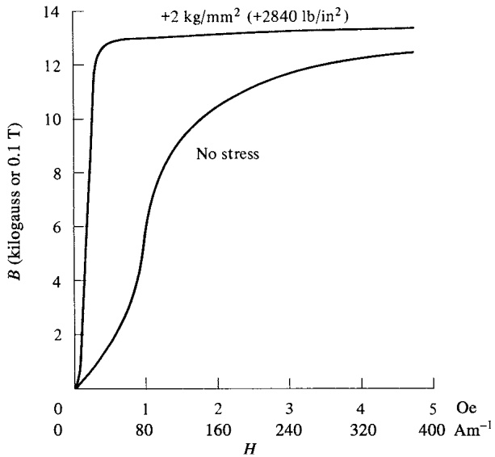

Fig. 8.17 Effect of applied tensile stress on the magnetization curve of 68 permalloy. [R. M. Bozorth, Ferromagnetism, reprinted by IEEE Press (1993).]

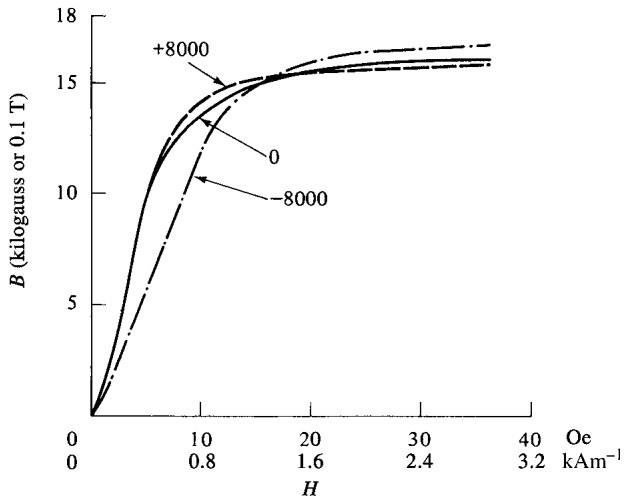

Fig. 8.18 Effects of applied tensile (+) and compressive (-) stress on the magnetization curve of iron; 8000 lb . $\cdot \mathrm{in}^2\approx 55\mathrm{MPa}$

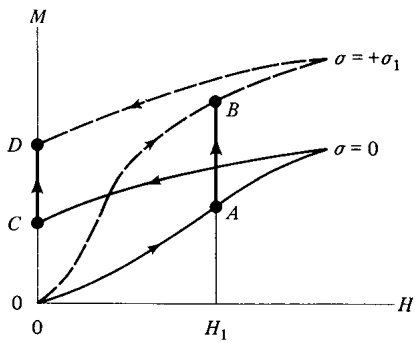

Fig. 8.19 Effect of tension on the magnetization of a material with positive magnetostriction (schematic).

So far we have tacitly assumed that $H$, $M$ (or $B$), and $\sigma$ are all parallel, but, in general, $M$ and $\sigma$ may not be parallel. We know from Equation 8.3 that the amount of magnetostrictive strain exhibited by a crystal in a particular direction depends on the direction of the magnetization. If we impose an additional strain by applying a stress, we expect that the direction of the magnetization will change. We therefore need a general relation between the direction of $M_{s}$ within a domain and the direction and magnitude of $\sigma$. But we know that, in the absence of stress, the direction of $M_{\mathrm{s}}$ is controlled by crystal anisotropy, as characterized by the first anisotropy constant $K_{1}$ . Therefore, when a stress is acting, the direction of $M_{s}$ is controlled by both $\sigma$ and $K_{1}$ . These two quantities are therefore involved in the expression for that part of the energy which depends on the direction of $M_{\mathrm{s}}$ which is, for a cubic crystal,

$$
\begin{array}{c} E = K _ {1} (\alpha_ {1} ^ {2} \alpha_ {2} ^ {2} + \alpha_ {2} ^ {2} \alpha_ {3} ^ {2} + \alpha_ {3} ^ {2} \alpha_ {1} ^ {2}) - \frac {3}{2} \lambda_ {1 0 0} \sigma (\alpha_ {1} ^ {2} \gamma_ {1} ^ {2} + \alpha_ {2} ^ {2} \gamma_ {2} ^ {2} + \alpha_ {3} ^ {2} \gamma_ {3} ^ {2}) \\ - 3 \lambda_ {1 1 1} \sigma (\alpha_ {1} \alpha_ {2} \gamma_ {1} \gamma_ {2} + \alpha_ {2} \alpha_ {3} \gamma_ {2} \gamma_ {3} + \alpha_ {3} \alpha_ {1} \gamma_ {3} \gamma_ {1}), \end{array}\tag{8.17}
$$

where $\alpha_{1},\alpha_{2},\alpha_{3}$ , are the direction cosines of $M_{s}$ as before, and $\gamma_{1},\gamma_{2},\gamma_{3}$ are the direction cosines of the stress σ. The units of E are $\mathrm{erg / cm^3}$ if s is expressed in $\mathrm{dyne / cm^2}$ (1 dyne/ $\mathrm{cm}^2 = 1.02 \times 10^{-8}$ $\mathrm{kg / mm^2 = 1.45\times 10^{-5}lb / in^2)}$ or joule/m³ if $\sigma$ is expressed in pascals $= \mathrm{N} / \mathrm{m}^{2}$

Note that here and subsequently the applied stress $\sigma$ is an elastic stress; that is, a stress less than the elastic limit or at least less than the yield stress. If a higher stress is applied, the material will undergo a permanent change in dimensions, and various magnetic properties will be affected.

The first term of Equation 8.17 is the crystal anisotropy energy, taken from Equation 7.1 in its abbreviated form. The next two terms, which involve the magnetostrictive strains and the stress, comprise what is usually called the magnetoelastic energy $E_{\mathrm{me}}$ The equilibrium direction of $M_{\mathrm{s}}$ is that which makes E a minimum, and this direction is seen to be a complicated function of $K_{1},\lambda_{100},\lambda_{111}$ , and σ, for any given stress direction $\gamma_{1}, \gamma_{2}, \gamma_{3}$ . But we can note, qualitatively, that the direction of $M_{s}$ will be determined largely by crystal anisotropy when $K_{1}$ is much larger than $\lambda_{100}\sigma$ and $\lambda_{111}\sigma;$ when this inequality is reversed, the stress will control the $M_{\mathrm{s}}$ direction.

When the magnetostriction is isotropic, so that $\lambda_{100} = \lambda_{111} = \lambda_{\mathrm{si}}$ , the last two terms of Equation 8.17 reduce to a very simple form for the magnetoelastic energy:

$$
E _ {\mathrm{me}} = - \frac {3}{2} \lambda_ {\mathrm{si}} \sigma \cos^ {2} \theta\tag{8.18}
$$

where θ is the angle between $M_{s}$ and σ. Alternatively, we can substitute $(1 - \sin^{2}\theta)$ for $\cos^2\theta,$ drop a constant term, and write the energy as

$$
E _ {\mathrm{me}} = \frac {3}{2} \lambda_ {\mathrm{si}} \sigma \sin^ {2} \theta .\tag{8.19}
$$

The two forms are equivalent with respect to the angular dependence of $E_{\mathrm{me}}$ and differ only in what is taken as the zero of energy. In one form or the other these relations are often used to determine the effect of stress on magnetic behavior. We note that the way in which a material responds to stress depends only on the sign of the product of $\lambda_{si}$ and; a material with positive $\lambda_{\mathrm{si}}$ under tension behaves like one with negative $\lambda_{si}$ under compression. Equation 8.19 is widely used, but it should be regarded as no more than semi-quantitative because it incorporates the assumption of isotropic magnetostriction, which is rarely justified.

A direct derivation of Equation 8.19 brings out its physical meaning. Suppose a tensile stress $\sigma$ is applied to the unit cube of Fig. 8.20 and that $M_{\mathrm{s}}$ is initially parallel to the stress. Let $M_{s}$ then rotate through an angle $\theta$. As it does so, the material will contract along the stress axis because $\lambda_{\theta}$ is less than $\lambda_{si}$ , as shown for positive $\lambda_{si}$ by Equation 8.10. This contraction, in the presence of a tensile stress, means that work is done on the material. This work is stored as magnetoelastic energy in the material and is given by $dE_{\mathrm{me}} = -\sigma d\lambda$ for an infinitesimal rotation of $M_{\mathrm{s}}$ . Therefore,

$$
\int_ {0} ^ {E _ {\mathrm{me}}} d E _ {\mathrm{me}} = - \sigma \int_ {\lambda_ {\mathrm{si}}} ^ {\lambda_ {\theta}} d \lambda ,\tag{8.20}
$$

$$
E _ {\mathrm{me}} = - \sigma [ \frac {3}{2} \lambda_ {\mathrm{si}} (\cos^ {2} \theta - \frac {1}{3}) - \lambda_ {\mathrm{si}} ],\tag{8.21}
$$

$$
E _ {\mathrm{me}} = \frac {3}{2} \lambda_ {\mathrm{si}} \sigma \sin^ {2} \theta .\tag{8.22}
$$

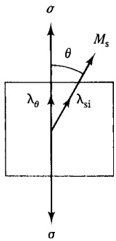

Fig. 8.20 Unit cube of material with isotropic magnetostriction.

This form of the equation states that the magnetoelastic energy is zero when $M_{\mathrm{s}}$ and s are parallel and that it increases to a maximum of $3/2\lambda_{\mathrm{si}}\sigma$ when they are at right angles, provided that $\lambda_{\mathrm{si}}\sigma$ is positive. If this quantity is negative, the minimum of energy occurs when $M_{s}$ and s are at right angles.

We are now in a position to understand why it is so easy to magnetize a material with positive l, such as 68 permalloy, when it is stressed in tension (Fig. 8.17). If the crystal anisotropy is weak, as it is in this alloy, the direction of $M_{\mathrm{s}}$ in the absence of a field will be controlled largely by stress, and, in a polycrystalline specimen with no preferred orientation, Equations 8.18 or 8.19 will apply. Let Fig. 8.21a represent a small portion of the specimen, comprising four domains. The application of a small tensile stress to the demagnetized specimen, as in Fig. 8.21b, will cause domain walls to move in such a way as to decrease the volume of domains magnetized at right angles to the stress axis, because such domains have a high magnetoelastic energy. These domains are completely eliminated by some higher value of the stress, as in Fig. 8.21c, and $E_{me}$ is now a minimum. The domain structure is now identical with that of a uniaxial crystal, shown in Fig. 7.6. Only a small applied field is now required to saturate the specimen, because the transition from Fig. 8.21c to d can be accomplished solely by the relatively easy process of $180^{\circ}$ wall motion. If the crystal anisotropy is zero, and if no impediments to wall motion (to be discussed in Chapter 9) exist, then an infinitesimal stress and an infinitesimal field should suffice for saturation. Of course these conditions are never met, and we find in practice that a nonzero stress and a nonzero field are required. For 68 permalloy, Fig. 8.17 shows that $+2840 \mathrm{lb} / \mathrm{in}^{2} (19.6 \mathrm{MPa})$ and 0.5 Oe (40 A/m) are enough to raise the magnetization almost to saturation.

(a)

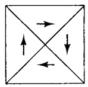

(b)

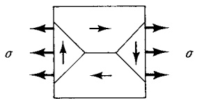

(c)

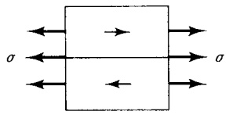

(d)

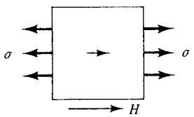

Fig. 8.21 Magnetization of a material with positive magnetostriction under tensile stress (schematic).

In this example, $\lambda_{\mathrm{si}}\sigma$ is a positive quantity. The mechanism of Fig. 8.21 will therefore also apply to nickel under compression, because $\lambda_{\mathrm{si}}\sigma$ is again positive, and we see in Fig. 8.16 that compression of nickel does indeed make magnetization easier.

Two points emerge from this examination of magnetization under stress:

1. In the demagnetized state, stress alone can cause domain wall motion. This motion will be such as to retain zero net magnetization for the whole specimen. This condition is not difficult to meet, however, because there is an infinite number of domain arrangements which make $M$ equal to zero.

2. Stress alone can create an easy axis of magnetization. Therefore, when stress is present, stress anisotropy must be considered, along with any other anisotropies that may exist. It is a uniaxial anisotropy, and the relation which governs it, namely Equation 8.19, is of exactly the same form as Equation 7.4 for uniaxial crystal anisotropy or Equation 7.53 for shape anisotropy. We therefore write for the stress anisotropy energy, which is a magnetoelastic energy,

$$
E _ {\mathrm{me}} = K _ {\sigma} \sin^ {2} \theta ,\tag{8.23}
$$

where the stress anisotropy constant $K_{\sigma}$ is given by $\frac{3}{2}\lambda_{\mathrm{si}}\sigma,$ from Equation 8.19. The axis of stress is an easy axis if $\lambda_{\mathrm{si}}\sigma$ is positive. If this quantity is negative, the stress axis is a hard axis and the plane normal to the stress axis is an easy plane of magnetization. The three anisotropies we have met so far are summarized in Table 8.2, in terms of a general uniaxial anisotropy constant $K_{u}$

When $\lambda_{\mathrm{si}}\sigma$ is negative, as it is for nickel under tension, the stress axis becomes a hard axis, because the field now has to supply energy equal to the magnetoelastic energy in order to rotate the $M_{\mathrm{s}}$ vector of each domain by $90^{\circ}$ into the field direction (Fig. 8.22c). When this rotation is complete, the domain wall simply disappears, and the saturated state of Fig. 8.22d results. The magnetization curve is then expected to be a straight line, just like the $M$, $H$ curve of a uniaxial crystal such as cobalt when $H$ is perpendicular to the easy axis. This latter example was discussed in Section 7.6, and the relation between $M$ and $H$ was given by Equation 7.29, in terms of a single anisotropy constant. Translating this equation into terms of stress anisotropy, we have

$$
M = \frac {M _ {\mathrm{S}} ^ {2} H}{2 K _ {\sigma}} = \frac {M _ {\mathrm{S}} ^ {2} H}{3 \lambda_ {\mathrm{si}} \sigma}.\tag{8.24}
$$

The lower curve of Fig. 8.16 shows that the $M$, $H$ behavior of nickel under tension is indeed linear, as required by Equation 8.24, at least up to a field of 60 Oe. However, over the whole range of about 500 Oe required to saturate, the $M$, $H$ relation is decidedly nonlinear, as shown by the insert to Fig. 8.16.

TABLE 8.2 Summary of Some Uniaxial Anisotropies

| Kind of Anisotropy | Energy Responsible | Governing Relation $E = K_{\text{u}} \sin^{2} \theta$ | Equation |
| --- | --- | --- | --- |
| Crystal | Crystal anisotropy | $K_{\text{u}} = K_{1}$ | (7.4) |
| Shape | Magnetostatic | $K_{\text{u}} = K_{\text{s}} = \frac{1}{2}(N_{\text{a}} - N_{\text{c}}) M^{2}$ | (7.53) |
| Stress | Magnetoelastic | $K_{\text{u}} = K_{\sigma} = 3/2 \lambda_{\text{si}} \sigma$ | (8.23) |

(a)

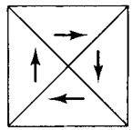

(b)

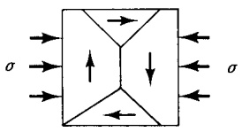

(c)

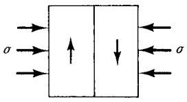

(d)

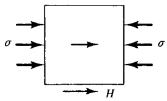

Fig. 8.22 Magnetization of a material with positive magnetostriction under compressive stress (schematic).

This disagreement suggests that we examine the validity of Equation 8.24. It is derived on the basis that only stress anisotropy is present, i.e., that any other anisotropy which may exist, such as crystal anisotropy, is negligible in comparison. Now crystal anisotropy, for example, is a constant of the material, but stress anisotropy, for a given material, depends on the stress. We might therefore ask: At what stress does the stress anisotropy become equal to the crystal anisotropy? This stress can be found approximately by equating the stress anisotropy energy $3 / 2\lambda_{\mathrm{si}}\sigma$ to the crystal anisotropy energy $K_{1}$ . For nickel, this critical stress will be (in cgs units)

$$
\begin{array}{r l} \sigma & = \frac {2 K _ {1}}{3 \lambda_ {\mathrm{si}}} = \frac {2 (0 . 5 \times 1 0 ^ {5})}{3 (3 4 \times 1 0 ^ {- 6})} \\ & = 1 0 ^ {9} \mathrm{dyne/cm} ^ {2} \approx 1 5, 0 0 0 \mathrm{lb/in} ^ {2} \approx 1 0 0 \mathrm{MPa}. \end{array}\tag{8.25}
$$

(The sign of $\lambda_{si}$ is irrelevant in this calculation.) Therefore, at a stress of 10,000 lb/in² , at which the data of Fig. 8.16 were obtained, stress anisotropy is actually weaker than crystal anisotropy. The stress would have to be many times 15,000 lb/in² before Equation 8.24 would strictly apply, all the way to saturation.

The calculation just made is only approximate, because it ignores the complex details of domain rotation. In a single domain of nickel, for example, there are four easy axes determined by the crystal anisotropy and one easy axis determined by the stress. As the $M_{s}$ vector of this domain rotates from its initial position, in response to an increasing applied field, its rotation is sometimes helped and sometime hindered by the crystal anisotropy, depending on the relative orientation at that time of $M_{\mathrm{s}}$ and the easy crystal axes. The calculation also assumes isotropic magnetostriction.

Of the three cases illustrated in Figs 8.16 to 8.18 (nickel, 68 permalloy, and iron), the effect of stress on magnetization is smallest for iron. This is because iron has a relatively large value of $K_{1}$ and a small value of $\lambda_{si}$ . This combination of properties means that crystal anisotropy is more important than stress anisotropy; the critical stress at which the two become equal is found from Equation 8.25 to have the very high value of $660,000\mathrm{lb / in}^2 = 4500\mathrm{MPa}$ . This stress is some ten times the breaking stress of iron and is therefore unattainable.

This section has been devoted mainly to the effect of stress on domain rotation. It can also affect domain wall motion, and this topic will be discussed in Section 9.11.

## 8.6 EFFECT OF STRESS ON MAGNETOSTRICTION

Stress not only alters the character of a magnetization curve, but it can produce large changes in the observed magnetostriction $\lambda_{s}$ This effect is nicely illustrated by the results shown in Fig. 8.23. Nickel rods were subjected to axial tension and compression and the saturation magnetostriction $\lambda_{si}$ was measured in the axial direction. Compression reduced the magnitude of $\lambda_{si}$ and, at a stress of about $12\mathrm{kg} / \mathrm{mm}^2$ (17,000 lb/in²) or 115 MPa), the magnetostriction disappeared. Tension, on the other hand, increased the magnitude of $\lambda_{si}$ and, at a tensile stress of about $12\mathrm{kg/mm^{2}}$ $\lambda_{s}$ had become 3/2 of the zero-stress value, which was found to be $-40\times 10^{-6}$

This behavior can be understood in terms of the preferred domain orientation set up in the demagnetized state by the applied stress before the magnetostriction measurement is begun. Thus, for nickel under compression, $\lambda_{\mathrm{si}}\sigma$ is positive, and sufficient compression will produce the domain arrangement shown in Fig. 8.21c. This specimen can be brought to saturation entirely by $180^{\circ}$ wall motion, which produces no magnetostrictive change in length. Similarly, a high tensile stress will result in the domain arrangement of Fig. 8.22c; saturation now requires $90^{\circ}$ domain rotation over the total volume of the specimen; the result is a numerically larger magnetostriction than that observed when the structure of Fig. 8.22a is saturated, because, in Fig. 8.22a, domain rotation is required in only a part of the total volume.

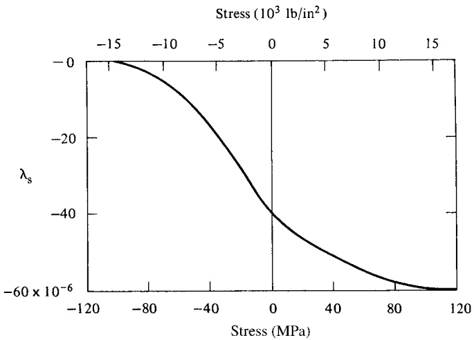

Fig. 8.23 Saturation magnetization of nickel under tension and compression. [H. Kirchner, Ann. Phys., 27 (1936) p. 49.]

These arguments can be made quantitative by means of Equation 8.10:

$$
\lambda_ {\theta} = \frac {3}{2} \lambda_ {\mathrm{si}} \bigl (\cos^ {2} \theta - \frac {1}{3} \bigr).\tag{8.10}
$$

Here $\lambda_{\theta}$ is the saturation magnetostriction, measured at an angle $\theta$ to the magnetization, when the initial state is the ideal demagnetized state. Suppose now that the initial state is the ideal demagnetized state and that the final state is, not saturation, but the state of partial magnetization indicated in Fig. 8.24, where the domain vectors all lie within a range of angles $\theta_{\mathrm{a}}$ to $\theta_{b}$ with the specimen axis. Then the observed magnetostriction parallel to the specimen axis $(\lambda_{\theta})$ would be

$$
\lambda = \frac {3}{2} \lambda_ {\mathrm{si}} \left(\langle \cos^ {2} \theta \rangle - \frac {1}{3}\right),\tag{8.26}
$$

where the angular brackets indicate an average of $\cos^2\theta$ over all orientations of the $M_{s}$ vectors in the final state, namely, over the range of angles $\theta_{\mathrm{a}}$ to $\theta_{b}$ . If now the state of a specimen changes from state 1 to state 2, defined by average values $\langle \cos^2\theta \rangle_1$ and $\langle \cos^2\theta \rangle_2$ , respectively, then the observed magnetostriction during this change will be

$$
\begin{array}{r l} \lambda & = \frac {3}{2} \lambda_ {\mathrm{si}} \big [ \big (\langle \cos^ {2} \theta \rangle_ {2} - \frac {1}{3} \big) - \big (\langle \cos^ {2} \theta \rangle_ {1} - \frac {1}{3} \big) \big ] \\ & = \frac {3}{2} \lambda_ {\mathrm{si}} \big [ \langle \cos^ {2} \theta \rangle_ {2} - \langle \cos^ {2} \theta \rangle_ {1} \big ]. \end{array}\tag{8.27}
$$

If the final state 2 is one of saturation, as it usually is, then $\theta = 0$ for all domains, $\langle \cos^2\theta \rangle_2 = 1$ , and

$$
\lambda_ {\mathrm{s}} = \frac {3}{2} \lambda_ {\mathrm{si}} \left[ 1 - \langle \cos^ {2} \theta \rangle_ {1} \right].\tag{8.28}
$$

Equation 8.28 is very useful, because it permits a calculation of the saturation magnetostriction for any initial state, providing we know the distribution of domain vectors in that state. For example, the ideal demagnetized state of a polycrystal has domains randomly oriented in space, and the average value of $\cos^2\theta$ is then 1/3 . If this is substituted into Equation 8.28, $\lambda_{s}$ becomes equal to $\lambda_{\mathrm{si}}$ as it should. On the other hand, demagnetized nickel under high compressive stress has all domain vectors parallel to the specimen axis. The value of $\langle \cos^2\theta \rangle$ 1 is 1, and the observed $\lambda_{s}$ is zero, in accordance with Fig. 8.23. Under high tensile stress all vectors are at right angles to the axis, $\langle \cos^2\theta \rangle_1 = 0.$ and the observed $\lambda_{s}$ is 3/2 of the normal, stress-free value $(\lambda_{\mathrm{si}})$ , again in accordance with experiment.

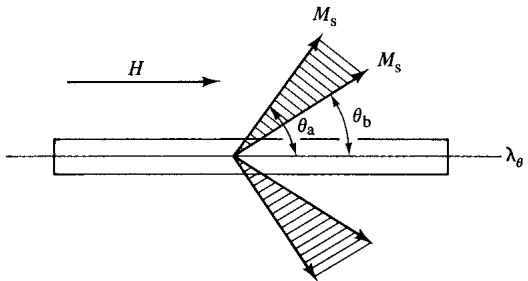

Fig. 8.24 Partial magnetization.

In connection with effect of stress on magnetostriction, it is of interest to enquire into the shape of l, $M$ curves. First, consider an extreme example, nickel under sufficient tension so that all $M_{\mathrm{s}}$ vectors are initially at right angles to the axis. Then Equation 8.27 becomes

$$
\lambda = \frac {3}{2} \lambda_ {\mathrm{si}} \cos^ {2} \theta ,\tag{8.29}
$$

where θ is the angle between $M_{\mathrm{s}}$ vectors and the axis at any particular field strength. But

$$
M = M _ {\mathrm{s}} \cos \theta .\tag{8.30}
$$

Therefore,

$$
\lambda = \frac {3}{2} \lambda_ {\mathrm{si}} \left(\frac {M}{M _ {\mathrm{s}}}\right) ^ {2}.\tag{8.31}
$$

The linear relation between $\lambda$ and $M^{2}$ predicted by this equation has been verified by experiment. Now, in measurements on “ordinary” polycrystalline specimens, it is sometimes impossible to reach magnetic saturation because the field source is not strong enough. Then a plot of $\lambda$ vs $M^{2}$ may be a reasonably straight line in the high-field region, say for values of $M$ greater than about 0.7 or 0.8 $M$ . This line can be extrapolated to saturation to obtain a value of $\lambda_{s}$ The reason for this behavior is that the magnetization of most specimens changes almost entirely by rotation in the high-field region, just as the magnetization of the stressed nickel specimen changes by rotation over the whole range of $M$, from 0 to $M_{\mathrm{s}}$

## 8.7 APPLICATIONS OF MAGNETOSTRICTION

When a material is subjected to an alternating magnetic field, the variation of $B$ (or $M$ ) with $H$ traces out a hysteresis loop. At the same time, the variation of $\lambda$ with $H$ traces out another loop. The latter is actually a double loop, sometimes called a butterfly loop, as illustrated for nickel in Fig. 8.25, because the magnetostrictive strain does not change sign when the field is reversed. The material therefore vibrates at twice the frequency of the field to which it is exposed. This magnetostrictive vibration is one source of the humming sound emitted by transformers. (A transformer contains a “core” of magnetic material subjected to the alternating magnetic field generated by the alternating current in the primary winding.) This sound, sometimes called “60-cycle hum,” actually has a fundamental frequency of twice 60, or 120 Hz. In Europe and other countries where the ac power frequency is 50 Hz, the hum is at 100 Hz.

Conversely, if a partially magnetized body is mechanically vibrated, its magnetization will vary in magnitude about some mean value because of the inverse magnetostrictive effect, and this alternating magnetization will induce an alternating emf in a coil wound around the body.

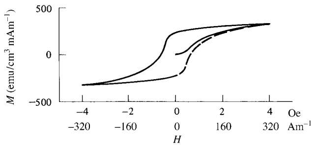

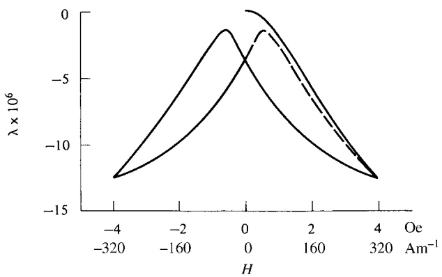

Fig. 8.25 Hysteresis in the magnetization and magnetostriction of nickel. [L. W. McKeehan, J. Franklin Inst., 202 (1926) p. 737.]

These two effects are exploited in the magnetostrictive transducer. It is one of a class of electromechanical transducers which can convert electrical energy into mechanical energy, and vice versa. The shape and size of a magnetostrictive transducer depends on the nature of the application. In early applications, nickel was commonly used as the magnetostrictive material, but this has been replaced by a rare earth-iron compound of the approximate composition $\mathrm{Tb}_{3}\mathrm{Dy}_{7}\mathrm{Fe}_{19}$, known as Terfenol-D, prepared by directional solidification to have a strong crystallographic texture. This compound has a saturation magnetostriction greater than $10^{-3}$ , about 15 times larger than nickel, and can be driven to saturation in an applied field of about 1000 Oe or 80 kA/m . In this case the direct correlation between anisotropy and magnetostriction does not exist; the Tb/Dy ratio is chosen so that positive and negative anisotropy contributions cancel, but the magnetostriction retains the large value characteristic of rare earth elements and compounds.

Magnetostrictive transducers using metallic elements are limited to fairly low frequencies, in the kHz range, by eddy-current effects. They have several applications:

1. Underwater Sound. The detection of an underwater object, such as a submarine or a school of fish, is accomplished by a sonar (sound navigation and ranging) system. An “active” sonar generates a sound signal with a transmitting transducer and listens for the sound reflected from the submerged object with a receiving transducer, called a hydrophone. A “passive” sonar listens for sound, such as engine noise, generated by the submerged object. An echo sounder is an active sonar designed to measure the depth of the ocean bottom.

2. Ultrasonic Sound Generators. These are also sound transducers, but here the emphasis is not on sound as a signal but on sound as a mechanical disturbance, usually in some liquid medium. The most important application of this kind is ultrasonic cleaning of metal and other parts, both in the laboratory and in manufacturing operations. The parts to be cleaned are immersed in a solvent which is agitated by an ultrasonic generator. Removal of dirt and grease is much faster and more complete by this method than by simple immersion or scrubbing, and dirt can be dislodged from crevices that are difficult to reach in other ways.

3. Large Force-Small Displacement Positioners. Terfenol-type transducers are useful when well-controlled small displacements requiring large forces are required, as in making small changes in the shape of very large mirrors in telescopes, or in changing the shape of a mechanical part under load so that it acts as if it had infinite stiffness. In comparison with piezoelectric transducers, which change shape under an applied voltage, magnetostrictive transducers provide much larger forces, but require much greater operating power.

## 8.8 DE EFFECT

Another consequence of magnetostriction is a dependence of Young’s modulus E of a magnetic material on its state of magnetization. When an originally demagnetized specimen is saturated, its modulus increases by an amount $\Delta E.$ The value of $\Delta E / E$ depends greatly on the way in which it is measured, as will be explained below.

When a stress is applied to a demagnetized specimen, two kinds of strain are produced:

1. Elastic $\varepsilon_{\mathrm{el}}$ , such as occurs in any substance, magnetic or not.

2. Magnetoelastic $\varepsilon_{\mathrm{me}}$ due to the reorientation of domain vectors by the applied stress. This strain is zero in the saturated state, because no domain reorientation can occur. For an applied tensile stress, $\varepsilon_{\mathrm{me}}$ is always positive, whatever the sign of $\lambda_{\mathrm{si}}$ (If a rod of positive $\lambda_{si}$ is stressed in tension, $M_{\mathrm{s}}$ vectors will rotate toward the axis, and the rod will lengthen. If $\lambda_{si}$ is negative, Ms vectors will rotate away from the axis, and the rod will lengthen.)

As a result of these two kinds of strain, the modulus in the demagnetized state is

$$
E _ {\mathrm{d}} = \frac {\sigma}{\varepsilon_ {\mathrm{el}} + \varepsilon_ {\mathrm{me}}},\tag{8.32}
$$

and the modulus in the saturated state is

$$
E _ {\mathrm{s}} = \frac {\sigma}{\varepsilon_ {\mathrm{el}}}.\tag{8.33}
$$

These two relations lead to

$$
\frac {\Delta E}{E} = \frac {E _ {\mathrm{s}} - E _ {\mathrm{d}}}{E _ {\mathrm{d}}} = \frac {\varepsilon_ {\mathrm{me}}}{\varepsilon_ {\mathrm{el}}}.\tag{8.34}
$$

We have seen in Section 8.6 that $\varepsilon_{\mathrm{me}}$ depends on the magnitude of the applied stress and on the strength of whatever other anisotropy, such as crystal anisotropy, is present. Figure 8.26 shows three kinds of stress – strain curves, with the differences between them greatly exaggerated. One is for a saturated specimen, and the other two are for demagnetized specimens: (a) one with some strong other anisotropy; and (b) one with weak anisotropy. In (b) the maximum magnetoelastic strain is soon developed, and the curve rapidly becomes parallel to the curve for the saturated specimen. In (a) this occurs only at a higher stress, because of the stronger opposing anisotropy. We see therefore that the DE effect is actually rather complicated, in that E depends, not only on the degree of magnetization, but also on the stress (or strain) and the strength of the other anisotropy present. If DE is measured from a conventional stress – strain curve, the stress level will be reasonably high, and the measured $\Delta E / E$ will be small, typically a few percent. But if DE is measured from the resonant frequency of a small-amplitude vibration, the stress level will be very low, and the value of $\Delta E / E$ may be very large, up to several hundred percent.

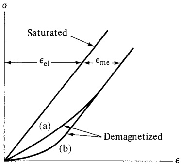

Fig. 8.26 Elastic and magnetoelastic contributions to the stress – strain curve.

The DE effect is a special case of what is more generally called the modulus defect. Whenever any mechanism is present which can contribute an extra strain (inelastic strain) in addition to the elastic strain, the modulus will be smaller than normal. Magnetoelastic strain is just one example of such an extra strain; other examples are the strain contributed by dislocation motion and the strain due to carbon atoms in iron moving into preferred positions in the lattice.

## 8.9 MAGNETORESISTANCE

The magnetoresistance effect is a change in the electrical resistance R of a substance when it is subjected to a magnetic field. The value of $\Delta R / R$ is extremely small for most substances, even at high fields, but is relatively large (a few percent) for strongly magnetic substances. The resistance of nickel increases about 2%, and that of iron about 0.3%, when it passes from the demagnetized to the saturated state. The magnetoresistance effect is mentioned here because of its close similarity to magnetostriction, and because a magnetoresistance measurement, like a magnetostriction measurement, can disclose the presence or absence of preferred domain orientations in the demagnetized state.

As in the case of magnetostriction, we will be interested only in the change in R between the demagnetized and saturated states (the region of domain wall motion and domain rotation), and we will ignore the small change in R that occurs during forced magnetization beyond saturation. A magnetoresistance measurement is usually made on a rod or wire specimen with the measuring current i and the applied field $H$ both parallel to the rod axis. Then, in most ferromagnetics, the observed effect is an increase in R of any domain as the angle $\theta$ between the current i and the $M_{\mathrm{s}}$ vector of that domain decreases. The physical origin of the magnetoresistance effect lies in spin-orbit coupling: as $M_{s}$ rotates, the electron cloud about each nucleus deforms slightly, as shown by the existence of magnetostriction, and this deformation changes the amount of scattering undergone by the conduction electrons in their passage through the lattice.

The relation between the saturation magnetoresistance change $(\Delta R / R)_{\mathrm{s}}$ and the initial domain arrangement is exactly analogous to Equation 8.28 for magnetostriction, namely,

$$
\left(\frac {\Delta R}{R}\right) _ {\mathrm{s}} = \frac {3}{2} \left(\frac {\Delta R}{R}\right) _ {\mathrm{si}} [ 1 - \langle \cos^ {2} \theta \rangle_ {1} ]\tag{8.35}
$$

where $(\Delta R / R)_{\mathrm{si}}$ is the change observed when a specimen is brought from the ideal demagnetized state to saturation.

Two ways of greatly increasing magnetoresistance have been developed. The resistance of a very thin layer of a normal (nonmagnetic) metal sandwiched between two layers of magnetic materials shows a substantial difference (10%) in resisitivity depending on whether the magnetizations in the magnetic layers are parallel or antiparallel. This gives what is known as Giant MagnetoResistance, or GMR; such a structure can be used to read the magnetic fields above a track of stored data in a hard disk drive. And certain perovskite oxides containing manganese and rare earths show an even larger magnetoresistance (100% or more), leading them to be called Colossal MagnetoResistive materials (CMR). They are also candidates for magnetic field detectors in computer drives. In this application, it is not necessary to determine the magnitude of the field above the recorded surface; it is simply necessary to detect the presence (or absence) of a field of a specified magnitude. These effects will be considered in more detail in Chapter 15.

Stress alone can change the resistance, an effect called elastoresistance, because stress alters the orientations of the $M_{\mathrm{s}}$ vectors. Stress can therefore change the observed magnetoresistance, just as it can change magnetostriction.

## PROBLEMS

8.1 Find the saturation magnetostriction of a cubic crystal in the <110> direction, in terms of $\lambda_{100}$ and $\lambda_{111}$

8.2 A single-crystal disk of a cubic material is cut with the plane of the disk parallel to $(1\bar{1}1)$. A strain gage is cemented on one face of the disk, oriented to measure strain in the [001] direction, and another gage is cemented on the opposite face, oriented to measure strain in the [110] direction. The disk is placed in a saturating magnetic field aligned parallel to the [001] direction, and then rotated about an axis normal to its plane. Let $\theta$ be the angle between the [001] direction and the field direction, measured so that positive $\theta$ rotates the field direction from [001] to [110]. Find the equation that describes the strain measured by each gage as a function of $\theta$.

8.3 Compute $\lambda_{si}$ for a cobalt single crystal when the measured strain is parallel to the applied field, and the applied field is at (a) $60^{\circ}$ and (b) $90^{\circ}$ to the easy c-axis. Compare with Fig. 8.9.

8.4 Consider a cubic material, with $\lambda_{100}, \lambda_{111}$ , and $K_{1}$ positive, and $K_{2}=0$ . The magnetization $M_{\mathrm{s}}$ in a single domain lies in the [010] direction, and a tensile stress is applied in the [100] direction. How does the direction of $M_{s}$ change as the stress increases from zero to some large value?

8.5 If $\theta$ is the angle between the local magnetization direction and some arbitrary direction in space, show that the average value of $\cos^2\theta$ is 1/3 if the magnetization directions are random.

