# DOMAINS AND THE MAGNETIZATION PROCESS

## 9.1 INTRODUCTION

The two previous chapters, on anisotropy and magnetostriction, were in a sense a prologue to the present one. There we were concerned only incidentally with the processes of domain wall motion and domain rotation. Now we must examine these processes in detail in order to better understand how they contribute to the magnetization process. To do this requires study of the domain itself, particularly with respect to the structure and orientation of the walls which bound it.

The magnetic domain, in theory and experiment, has had a curious history. Of the two great concepts introduced by Weiss in 1906, the domain hypothesis and the molecular field, Weiss himself stressed only the latter. Later investigators added very little. For a period of 43 years they made virtually no application of the domain idea to the problems of explaining the shape of a magnetization curve or the mechanism of magnetic hysteresis. During this period some isolated, though important, theoretical work was done, but the domain hypothesis was not brought into the mainstream of research on magnetic materials. Not until 1949 was there any direct experimental evidence for, and clear understanding of, the domain structure of a real material; in that year H. J. Williams, R. M. Bozorth, and W. Shockley [Phys. Rev., 74 (1949) p. 155] published their work, performed at the Bell Telephone Laboratories, on domains in silicon-iron single crystals. Since that time, domain theory has become central to any discussion of magnetization processes.

## 9.2 DOMAIN WALL STRUCTURE

Domain walls are interfaces between regions in which the spontaneous magnetization has different directions. At or within the wall the magnetization must change direction, from one easy crystallographic direction to another. We might at first imagine this change to be abrupt, occurring from one atom to the next as in Fig. 9.1. A row of atoms is shown, parallel to x, with the $180^{\circ}$ domain wall lying in the yz plane; the easy axis is ±y. But the exchange energy in a ferromagnetic is a minimum only when adjacent spins are parallel. Therefore, the wall of Fig. 9.1 would have a large exchange energy associated with it, because the spins adjacent to the wall are antiparallel. This exchange energy can be decreased if we allow the $180^{\circ}$ change in spin direction to take place gradually over N atoms, so that the angle φ between adjacent spins, with an average value of $\pi /N,$ is much less than $180^{\circ}$ . Figure 9.2 shows such a wall, drawn for $\phi = 30^{\circ}$ . The total exchange energy is then reduced because, as shown below, it varies as $\phi^{2}$ rather than as $\phi.$

However, the spins within the wall of Fig. 9.2 are pointing away from easy directions, so that the crystal anisotropy energy within the wall is higher than it is in the adjoining domains. While the exchange energy tries to make the wall as wide as possible, in order to make the angle φ between adjacent spins as small as possible, the anisotropy energy tries to make the wall thin, in order to reduce the number of spins pointing in noneasy directions. (The hypothetical wall of Fig. 9.1 has no extra anisotropy energy.) As a result of this competition, the wall in general has a nonzero width and a definite structure. Also, like any other interface (such as a grain, twin, or phase boundary), the wall has an energy per unit area of its surface, because the spins in it are not parallel to one another and not parallel to an easy axis. The first theoretical examination of the structure of a domain wall was made by F. Bloch in 1932 [Z. Physik, 74 (1932) p. 295], and domain walls are accordingly often called Bloch walls.

To calculate the energy and structure of a domain wall, we assume a fairly thick wall and use a continuum model rather than a model of individual atoms. In particular, we replace the exchange energy for a pair of atoms of the same spin S

$$
E _ {\mathrm{ex}} = - 2 J S ^ {2} \cos \phi_ {i j},\tag{9.1a}
$$

with a continuum expression

$$
E _ {\mathrm{ex}} = - 2 A \cos \left(\frac {d \phi}{d x}\right),\tag{9.1b}
$$

where $A = (nJS^{2} / a)$ is called the exchange stiffness or the exchange constant. Here n is the number of atoms per unit cell, and a is the lattice parameter. The exchange stiffness $A$ has units of J/m or erg/cm, and may be regarded as a macroscopic equivalent of the exchange energy J. The quantity $d\phi/dx$ represents the rate at which the direction of local magnetization rotates with position in the wall. The series expansion of cos $\phi$ is

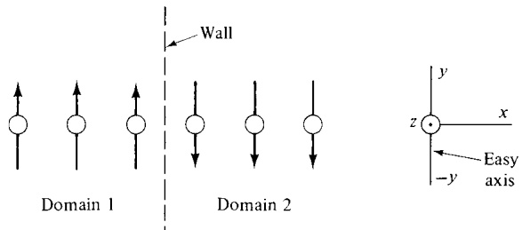

Fig. 9.1 Hypothetical $180^{\circ}$ domain wall of zero thickness.

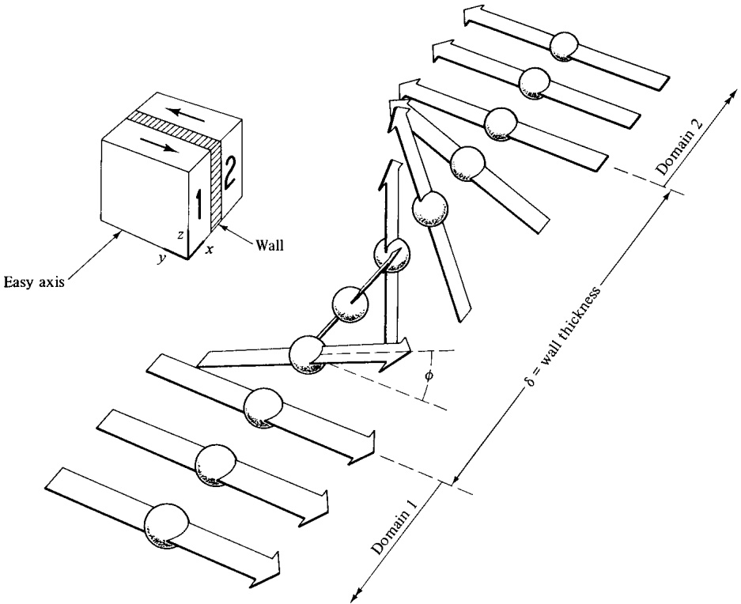

Fig. 9.2 Structure of a $180^{\circ}$ domain wall.

$$
\cos \phi = 1 - \frac {\phi^ {2}}{2} + \frac {\phi^ {4}}{2 4} - \dots .\tag{9.2}
$$

Dropping the terms in $\phi^{4}$ and higher powers because φ is assumed to be small, and substituting into Equation 9.1b, we have

$$
E _ {\mathrm{ex}} = - 2 A + A \left(\frac {d \phi}{d x}\right) ^ {2}.\tag{9.3a}
$$

The first term is independent of angle and can therefore be dropped. The extra exchange energy existing within the wall is given by the second term

$$
E _ {\mathrm{ex}} = A \left(\frac {d \phi}{d x}\right) ^ {2}.\tag{9.3b}
$$

The anisotropy energy is given in the general case by

$$
E _ {K} = g (\phi),\tag{9.4}
$$

where φ is measured from the easy axis. For uniaxial anisotropy, $g(\phi) = K_u \sin^2 \phi,$ and for cubic anisotropy with magnetization confined to a {100} plane, $g(\phi) = K_{1}\sin^{2}\phi \cos^{2}\phi .$

The wall energy is given by the sum of the exchange and anisotropy energies, integrated over the thickness of the wall:

$$
\sigma_ {\mathrm{wall}} = \sigma_ {\mathrm{ex}} + \sigma_ {K} = \int_ {- \infty} ^ {\infty} \left[ A \bigg (\frac {d \phi}{d x} \bigg) ^ {2} + g (\phi) \right] d x.\tag{9.5}
$$

Note that the symbol $\sigma$ is used here to denote the surface energy of a domain wall. Some authors use γ. Greek s has previously been used in this book to denote magnetization per unit mass, and also stress.

We consider the case of a $180^{\circ}$ domain wall lying in the yz plane, with the direction of magnetization rotating about the x-axis while remaining parallel to the yz plane. Then x denotes position in the wall, and φ denotes the direction of the local magnetization. Nature will choose the magnetization pattern $[x = f(\phi)$ or $\phi = f(x)]$ that minimizes the total wall energy σ.

The mathematical treatment of the domain wall is usually handled as a problem in the calculus of variations. It seems conceptually and mathematically easier to think in terms of the torque acting on the local magnetization. The torque resulting from the exchange energy is

$$
L _ {\mathrm{ex}} = \frac {d E _ {\mathrm{ex}}}{d \phi} = A \frac {\partial (\partial \phi / \partial x) ^ {2}}{\partial \phi} = 2 A \frac {\partial \phi}{\partial x} \frac {\partial (\partial \phi / \partial x)}{\partial \phi} = 2 A \frac {\partial \phi}{\partial x} \frac {\partial^ {2} \phi}{\partial x ^ {2}} \frac {\partial x}{\partial \phi} = 2 A \frac {d ^ {2} \phi}{d x ^ {2}}.\tag{9.6}
$$

Physically, we can see that if the angle between neighboring spins is constant $(d\phi / dx =$ const.), the exchange torques acting on each spin due to its neighbors will be equal and opposite, canceling to zero. So only if $d\phi/dx$ is not constant, and $d^{2}\phi/dx^{2}$ is not zero, is there a net exchange torque.

The torque resulting from the anisotropy energy is

$$
L _ {K} = \frac {\partial E _ {K}}{\partial \phi} = \frac {\partial g (\phi)}{\partial \phi}.\tag{9.7}
$$

At equilibrium, these torques must be equal and opposite, giving zero net torque, at each point in the domain wall. Therefore,

$$
\frac {\partial g (\phi)}{\partial \phi} + 2 A \frac {\partial^ {2} \phi}{\partial x ^ {2}} = 0\tag{9.8}
$$

everywhere in the wall.

Multiplying by $\partial \phi /\partial x$ and integrating over x, the first term in Equation 9.8 becomes

$$
\int \frac {\partial \phi}{\partial x} \frac {\partial g (\phi)}{\partial \phi} \mathrm{d} x = \int \partial g (\phi) = g (\phi)\tag{9.9}
$$

and the second term becomes

$$
\int \frac {\partial \phi}{\partial x} 2 A \frac {\partial^ {2} \phi}{\partial x ^ {2}} d x = 2 A \int \frac {\partial \phi}{\partial x} \frac {1}{2} \frac {\partial (\partial \phi / \partial x)}{\partial x} d x = A \left(\frac {d \phi}{d x}\right) ^ {2}\tag{9.10}
$$

and so

$$
A \bigg (\frac {d \phi}{d x} \bigg) ^ {2} = g (\phi).\tag{9.11}
$$

Comparing this with Equation 9.5, we see that the exchange and anisotropy energies are equal everywhere in the wall. This means that where the anisotropy energy is the highest, which is where the magnetization points in a hard direction, the rate of change of magnetization angle $\partial \phi /\partial x$ is the greatest.

From Equation 9.11,

$$
\frac {d \phi}{d x} = \frac {\sqrt {g (\phi)}}{\sqrt {A}}
$$

$$
d x = \sqrt {A} \frac {d \phi}{\sqrt {g (\phi)}}\tag{9.12}
$$

$$
x = \sqrt {A} \int \frac {d \phi}{\sqrt {g (\phi)}}.
$$

This is the general equation relating x and φ in the domain wall. Note that it appears as $x=$ $f(\phi)$ , not $\phi = f(x)$

The simplest case is a $180^{\circ}$ domain wall in a material with uniaxial anisotropy, where $g(\phi) = K_u\sin^2\phi ,\sqrt{[g(\phi)]} = \sqrt{K_u}$ sin $\phi,$ and the local magnetization rotates through $180^{\circ}$ , from 0 to p. Therefore

$$
x = \sqrt {\frac {A}{K _ {u}}} \int \frac {d \phi}{\sin \phi}.\tag{9.13}
$$

This is a standard integral, listed in handbooks; the result is

$$
x = \sqrt {\frac {A}{K _ {u}}} \ln \left(\tan \frac {\phi}{2}\right),\tag{9.14}
$$

which gives the relationship between x and φ through the domain wall. It is shown graphically in Fig. 9.3.

The thickness of the domain wall is formally infinite. An effective wall thickness can be defined as the thickness of a wall with a constant value of $d\phi/dx$ equal to that at the center of the wall. For uniaxial anisotropy, the slope $d\phi/dx$ has its maximum value $\sqrt{(A / K_u)}$ at the center of the wall, so the effective wall thickness is

$$
\delta = \pi \sqrt {\frac {A}{K _ {u}}}\tag{9.15}
$$

as shown by the dashed line in Fig. 9.3.

Turning now to the calculation of the wall energy, we recall Equation 9.5:

$$
\sigma_ {\mathrm{wall}} = \sigma_ {\mathrm{ex}} + \sigma_ {K} = \int_ {- \infty} ^ {\infty} \left[ A \left(\frac {d \phi}{d x}\right) ^ {2} + g (\phi) \right] d x.\tag{9.5}
$$

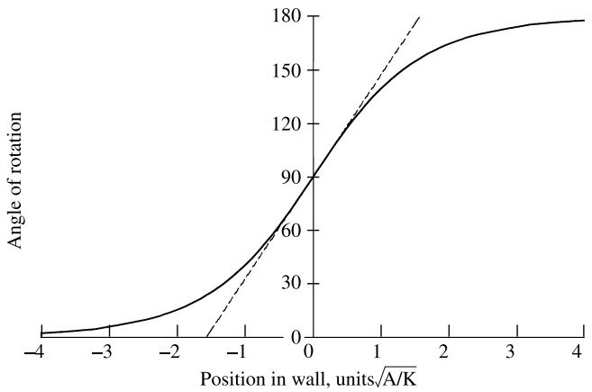

Fig. 9.3 Variation of magnetization direction through a $180^{\circ}$ domain wall. Dashed line shows definition of wall width.

Since the two terms are everywhere equal, we can rewrite this as

$$
\sigma_ {\mathrm{wall}} = \int_ {- \infty} ^ {\infty} 2 g (\phi) d x\tag{9.16}
$$

and from Equation 9.12,

$$
d x = \sqrt {A}   \frac {d \phi}{\sqrt {g (\phi)}}.
$$

So

$$
\sigma^ {1 8 0} = 2 \sqrt {A} \int_ {0} ^ {\pi} \frac {g (\phi)}{\sqrt {g (\phi)}} d \phi = 2 \sqrt {A} \int_ {0} ^ {\pi} \sqrt {g (\phi)} d \phi .\tag{9.17}
$$

For uniaxial anisotropy, $\sqrt{[g(\phi)]} = \sqrt{K_u}$ sin $\phi,$ giving

$$
\begin{array}{r l} \sigma_ {\text {uniaxial}} ^ {1 8 0} & = 2 \sqrt {A K _ {u}} \int_ {0} ^ {\pi} \sin \phi d \phi = 2 \sqrt {A K _ {u}} | - \cos \phi | _ {0} ^ {\pi} \\ & = 4 \sqrt {A K _ {u}}. \end{array}\tag{9.18}
$$

For cubic anisotropy described by a single positive anisotropy constant $K_{1} > 0, g(\phi) =$ $K_{1}\sin^{2}\phi\cos^{2}$ f if the domain wall lies in a {100} plane. Then

$$
\sqrt {g (\phi)} = \sqrt {K _ {1}} \sin \phi \cos \phi = \frac {\sqrt {K _ {1}}}{2} \sin 2 \phi .\tag{9.19}
$$

However, a complication arises when we attempt to calculate the domain wall thickness and energy of a $180^{\circ}$ wall in this case. There is an easy direction halfway through the wall, where $\phi = \pi /2$ , as indicated in Fig. 9.4. We might expect the $180^{\circ}$ wall to separate into two $90^{\circ}$ walls, with a new domain between them. This does not in fact occur, because of magnetostriction. If the original domains, separated by the $180^{\circ}$ wall, were magnetized along [100] and $[\bar{1}00]$ directions in a {001} plane, they would be elongated along the [100] easy axis. The new domain would be magnetized and elongated along a [010] direction. The misfit would create local elastic strains, which would increase the energy associated with the wall. The magnitude of the energy increase will depend primarily on the magnetostriction constants and the elastic constants of the material, and to some extent on the surrounding domain configuration. (B. A. Lilley Phil. Mag., 41 (1950) p. 792] has made this calculation under some simplifying assumptions, and has calculated domain wall energies and thicknesses for various additional cases, including cubic $K_{u}<0$

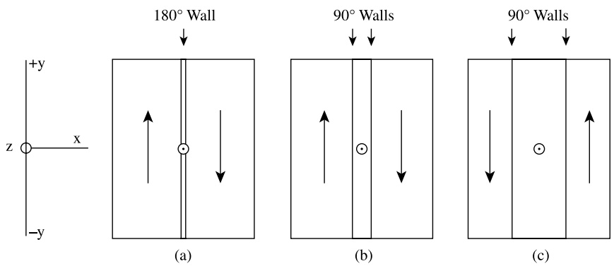

Fig. 9.4 Splitting of a $180^{\circ}$ wall into two $90^{\circ}$ walls.

A simple approach is to calculate the wall energy and thickness for a $90^{\circ}$ wall in a cubic material, and double these values for the $180^{\circ}$ wall. The calculated values will both be too low, but not by a large factor.

Proceeding this way, Equation 9.13 becomes

$$
\begin{array}{l} x = \sqrt {A} \int \frac {\partial \phi}{\sqrt {g (\phi)}} = \sqrt {A} \int \frac {d \phi}{\frac {1}{2} \sqrt {K _ {1}} \sin 2 \phi} = 2 \sqrt {\left(\frac {A}{K _ {1}}\right)} \int \frac {d \phi}{\sin 2 \phi} \\ = \sqrt {\frac {A}{K _ {1}}} \ln (\tan \phi) \end{array}\tag{9.20}
$$

which clearly has the same form as Equations 9.13 and 9.14.

The domain wall energy is given by

$$
\sigma_ {\mathrm{cubic}} ^ {9 0} = 2 \sqrt {A} \int_ {0} ^ {\pi / 2} \sqrt {g (\phi)} d \phi = 2 \sqrt {A K _ {1}} \int_ {0} ^ {\pi / 2} \frac {1}{2} \sin 2 \phi d \phi = 2 \sqrt {A K _ {1}}.\tag{9.21}
$$

The energy of the $180^{\circ}$ is just twice that of the $90^{\circ}$ wall, so

$$
\sigma_ {\mathrm{cubic}} ^ {1 8 0} = 4 \sqrt {A K _ {1}}.\tag{9.22}
$$

Note that for any domain wall, the wall thickness $\delta$ is proportional to $\sqrt{(A / K)}$ and the wall energy $\sigma$ is proportional to $\sqrt{(AK)}$

To calculate numerical values of domain wall energy and thickness, we must have values for the exchange constant $A$ and the anisotropy constant K. Values of K are reasonably well known, but $A = (nJS^{2}) / a$ presents some difficulty. The value of $A$ is directly proportional to the exchange constant J, which is not directly measurable. It is usually estimated from the Curie temperature as $J\approx 0.3kT_{\mathrm{c}},$ as noted in Section 4.3. It can also be estimated from the variation of the saturation magnetization with temperature at low temperatures. For iron, $J\approx 4\times 10^{-14}$ erg, and so

$$
A = \frac {n J S ^ {2}}{a} = \frac {2 \cdot 4 \times 1 0 ^ {- 1 4} \cdot \left(\frac {1}{2}\right) ^ {2}}{2 . 8 7 \times 1 0 ^ {- 8}} \approx 7 \times 1 0 ^ {- 7} \mathrm{erg/cm} = 7 \times 1 0 ^ {- 1 2} \mathrm{J/m}.\tag{9.23}
$$

The wall energy is then

$$
\sigma_ {\mathrm{cubic}} ^ {1 8 0} = 4 \sqrt {A K} = 4 \sqrt {7 \times 1 0 ^ {- 7} \cdot 4 . 5 \times 1 0 ^ {5}} \approx 2 \mathrm{erg/cm} ^ {2} = 2 \times 1 0 ^ {- 3} \mathrm{J/m} ^ {2}.\tag{9.24}
$$

The thickness of a 90° wall in iron is

$$
\delta_ {\mathrm{cubic}} ^ {9 0} = \pi \sqrt {\frac {A}{K _ {1}}} \approx 4 \times 1 0 ^ {- 6} \mathrm{cm} = 4 0 \mathrm{nm} = 4 0 0 \AA\tag{9.25}
$$

which is about 150 atom diameters. The average angle $\Delta\phi$ between adjacent spins is therefore $90^{\circ}/150$ or $0.6^{\circ}$ , much smaller than the value of $30^{\circ}$ shown in Fig. 9.2. The thickness of a $180^{\circ}$ wall will be somewhat more than twice 400 Å, because of the tendency to separate into two $90^{\circ}$ walls as in Fig. 9.4; the degree of separation will depend on the value of the magnetostriction constants as well as on the elastic constants of the material, just as the wall energy does.

Most ferromagnetic metals have domain wall energies of a few $\mathrm{erg/cm^{2}}$ and wall thicknesses of a few hundred atom diameters. This thickness means that domain walls will not interact strongly with point defects, such as vacancies or single interstitial atoms.

Two types of $90^{\circ}$ wall are possible, and they have different structures. One kind is shown in Fig. 9.5a; the spins in the adjoining domains are parallel to the wall, which therefore has a structure identical with half of a $180^{\circ}$ wall. In the other kind, represented in Fig. 9.5b, the spins in the domains are at $45^{\circ}$ to the wall. The structure of this kind is harder to visualize: the spins rotate through the wall in such a way that they make a constant angle of $45^{\circ}$ both with the wall normal and the wall surface.

The energy of a domain wall also depends on the orientation of the wall in the crystal. This point is discussed briefly in Section 9.4.

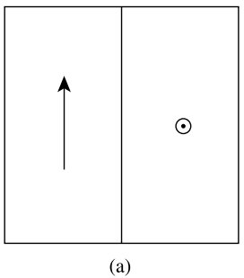

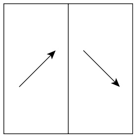

(b)

Fig. 9.5 (a) and (b) Two types of $90^{\circ}$ wall.

In materials with $K_{1}<0$ such as nickel, the easy directions are of the form <111l> The domain wall that separates domains with magnetizations in opposite directions along a <111> axis is then a $180^{\circ}$wall. Instead of $90^{\circ}$ walls, however, there are $70^{\circ}$ and $109^{\circ}$ walls.

Materials with very high values of anisotropy, such as rare-earth metals and their intermetallic compounds, may have domain walls only a few atoms thick, with correspondingly high energy. The continuum approximation used above may no longer be appropriate and a model based on individual atom moments must be used. In this case there may be an energy difference between a wall with an atom located at the midplane and a wall with the midplane between two atoms. This energy difference leads to an inherent obstacle to wall motion, or an intrinsic coercive field, which will exist even in a perfect single crystal. In the cases where this effect has been calculated or measured, the coercive fields are not large enough to be of commercial interest: less than 100 Oe or 8 kA/m

Various methods have been applied to the measurement of the wall energy s. For example, the equilibrium spacing of domain walls in a sample of known geometry depends directly on the wall energy, if there are no barriers to wall nucleation and motion. The resulting values of wall energy are not very accurate because of the simplifying assumptions that must be made, but generally agree well with values calculated by the method given above. Better methods of directly measuring $\sigma$ would be useful, not only because of interest in the wall energy itself, but also because such measurements would lead, through Equation 9.21 or 9.22, to better values of the fundamental constant J, the exchange integral.

The structure of domain walls in ferrimagnetic materials has apparently not been considered in detail. A drawing of such a wall would necessarily be more complicated than Fig. 9.2, because of the presence of chemically different atoms with oppositely directed spins. However, one can still think of the spin axis as slowly rotating through the wall from one domain to the other.

## 9.2.1 Né el Walls

When the thickness of a sample becomes comparable to the thickness of the domain wall, the energy associated with the free poles that arise where a Bloch wall meets the surface (Fig. 9.6) becomes significant. This can lead to a change in wall structure, with the magnetization rotating in the plane of the sample rather than in the plane of the wall (Fig. 9.7). This creates free poles on the wall, since the normal component of magnetization in the wall is no longer constant, but nevertheless gives a lower overall energy. This kind of wall is called a Néel wall, and the term Bloch wall is now reserved for the normal wall structure in Fig. 9.6. There are also calculations and evidence to show that the spin variation in a Bloch wall is modified where the wall meets the surface of the sample. This topic is considered further in Section 11.11.

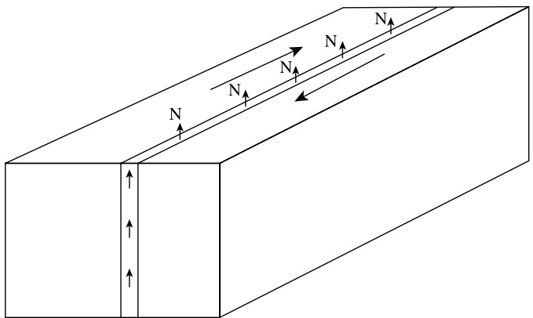

Fig. 9.6 Bloch wall. Note free poles appearing where the wall intersects the surfaces.

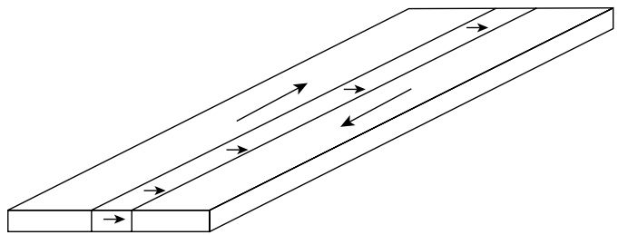

Fig. 9.7 Néel wall in thin sample. Free poles appear along the surface of the wall, but not at the sample surface.

## 9.3 DOMAIN WALL OBSERVATION

Domains are normally so small that one must use some kind of microscope to see them. Exactly what one sees depends on the technique involved. Generally the observation techniques fall into two groups:

1. Those which disclose domain walls (Bitter method, scanning probe microscope, Lorentz microscopy in the Fresnel mode). The individual domains, whatever their direction of magnetization, look more or less the same, but the domain walls are delineated.

2. Those which disclose domains (optical methods involving the Kerr or Faraday effects; polarized electron analysis; differential phase contrast). Here domains magnetized in different directions appear as areas of different color or brightness, and the domain wall separating them appears merely as a line of demarcation where one hue changes to the other.

## 9.3.1 Bitter Method

The first successful observation of domains made use of the Bitter or powder method. This involves the application of a liquid suspension of extremely fine (colloidal) particles of ferrimagnetic magnetite $(Fe_{3}O_{4})$ to the polished surface of the specimen. Imagine a $180^{\circ}$ wall intersecting the surface, as in Fig. 9.8a, where the spins in the wall are represented simply by the one in the center, normal to the surface. A north pole is therefore formed as shown, and this is the origin of an $H$ field gradient above the surface as indicated. The fine particles of magnetite are attracted to this region of nonuniform field, depositing as a band along the edge of the domain wall, normal to the plane of the drawing. If the surface is then examined with a metallurgical (reflecting) microscope under the usual conditions of “bright-field” illumination, as in Fig. 9.8b, the domain wall will show up as a dark line on a light background; the domains on either side of the wall reflect the vertically incident light back into the microscope and so appear light, while the particles on top of the wall scatter the light to the side and appear dark. Better contrast is observed under “dark-field” illumination (Fig. 9.8c), where the incident light strikes the specimen at an angle. The domain wall appears as a light line on a dark background, because only light reflected from the particles along the wall is scattered into the microscope objective. In either case, the arrangement of lines (domain walls) seen under the microscope is commonly called a powder pattern or Bitter pattern.

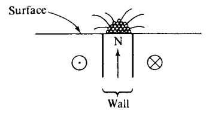

(a)

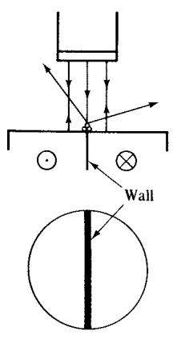

(b)

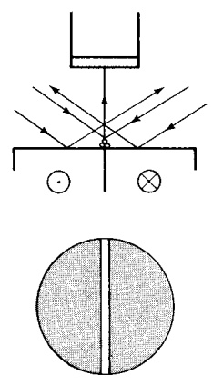

(c)

Fig. 9.8 Bitter method or powder method for observation of domain walls.

Suitable liquid suspensions of colloidal magnetite are available commercially under the name Ferrofluids. A drop of the Ferrofluid suspension is placed on the surface to be examined, and covered with a thin microscope cover glass to spread out the suspension into a uniform film.

Careful specimen preparation is extremely important. The surface of a metallic specimen is first mechanically polished and then electrolytically polished to remove the strained layer produced by the mechanical polishing. Electropolishing is accomplished by making the specimen the anode in a suitable electrolytic cell and passing a fairly heavy current, which removes a significant number of surface atom layers while keeping the surface smooth. This second step is essential. Early workers did not realize this and obtained “maze patterns,” which are determined entirely by the strains left in the surface after mechanical polishing and reveal nothing of the true domain structure. An example of the domain structure observed on a crystal of Fe + 3.8 wt% Si is shown before and after electropolishing in Fig. 9.9. The interpretation of this rather complex structure will be given later. Ferrites, being

(a)

0.1 mm

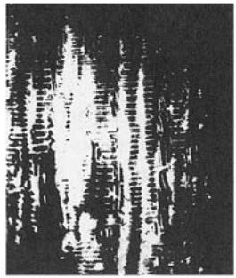

(b)

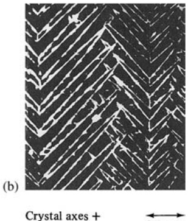

Fig. 9.9 Powder patterns on a single crystal of $\mathrm{Fe} + 3.8\% \mathrm{Si}$ using dark-field illumination. (a) after mechanical polishing, (b) after electropolishing. The area viewed is about $0.5 \times 0.45$ mm.

nonconductors, cannot be electropolished, but strain-free surfaces can be prepared by careful mechanical polishing with diamond powder, followed by heating to about $1200^{\circ}\mathrm{C}$

The essential features of most domain structures can be seen clearly at magnifications of a few hundred diameters. However, simple interpretable domain structures are normally observed only when the sample surface contains an easy direction of magnetization; if anisotropy energy forces the magnetization direction to have a component normal to the surface, a complex closure domain pattern forms, which obscures the simpler basic domain structure of the sample. This qualification is itself subject to qualifications: a sample with vanishingly small anisotropy, such as an amorphous alloy, may show a simple domain structure, and a sample with a very large anisotropy with its easy axis normal to the surface, and a sufficiently small magnetization, may have a stable simple domain structure with the magnetization normal to the surface everywhere except in the domain walls. This occurs in the bubble domain structure, treated briefly in Chapter 14.

The Bitter method can detect slowly moving, as well as stationary, domain walls. When a wall moves in response to an applied field or stress, the line of colloid particles follows the intersection of the wall with the surface, as long as the wall is moving slowly. Observation of the way walls move, causing one domain to grow at the expense of another, can be very fruitful. For this purpose it is desirable to have some means, such as Helmholtz coils or a small electromagnet, to apply a field to the specimen while it is under the microscope.

When greater detail is desired, static Bitter patterns may be examined at the much higher magnification of the electron microscope by a replica technique. A water-soluble plastic is added to the magnetite suspension, which is then spread on the specimen and allowed to dry. The powder particles go to the domain walls, as usual, and are trapped in these positions as the suspension dries. The result is a thin film, containing the powder particles, which can be peeled away from the specimen surface and examined in a transmission electron microscope.

An important step in interpreting an observed domain structure is to determine the directions in which the various domains are magnetized. This can be done by observing the behavior of the colloid particles at accidental or deliberate scratches, or other irregularities, on the specimen surface. Figure 9.10 shows the principle involved. When $M_{\mathrm{s}}$ in a particular domain is parallel to the surface and at right angles to a scratch, as in Fig. 9.10a, the flux lines tend to bow out into the air at the scratch, and this nonuniformity of field attracts the powder particles. This effect does not occur when $M_{\mathrm{s}}$ is parallel to the scratch, as in Fig. 9.10b, and few powder particles are attracted. Thus scratches crossing a domain structure like that of Fig. 9.10c will appear dark when they are at right angles to $M_{\mathrm{s}}$ and light when they are parallel. It remains then to determine the sense of the $M_{s}$ vector in each domain; this is done by applying a field parallel to the $M_{s}$ -axis of a certain domain, and noting whether that domain grows in volume or shrinks. If it grows, then $M_{\mathrm{s}}$ must be parallel, rather than antiparallel, to the applied field.

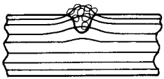

(a)

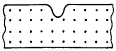

(b)

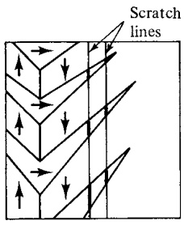

(c)

Fig. 9.10 Effect of surface scratches on colloid collection.

The tendency of powder particles to collect at surface flaws which are transverse to the magnetization is exploited, on a coarser scale, in the Magnaflux method of detecting cracks in steel objects. The object to be inspected is magnetized by a strong field and immersed in a suspension of magnetic particles. When withdrawn, previously invisible cracks are made visible by the powder particles attracted to them.

The Bitter method has several limitations: (1) If the anisotropy constant K of the material becomes less than about $10^{3}\mathrm{erg/cm}^{3}$ or $10^{2}\mathrm{J / m^{3}}$ , the domain walls become so broad that powder particles are only weakly attracted to them; (2) the method can be applied only over a rather restricted temperature range; (3) moving domain walls can be followed only at low velocities; and (4) the colloid suspension, especially if it water-based, dries up fairly quickly, limiting the time period during which domain observations can be made.

## 9.3.2 Transmission Electron Microscopy

This instrument can disclose domain walls in specimens thin enough to transmit electrons, generally about 1000 Å (100 nm) or less. Since a moving electric charge is acted on by a force when it is in a magnetic field, the electrons passing through the specimen will be deviated by an amount and in a direction determined by the magnitude and direction of the local $M_{\mathrm{s}}$ vector. In a domain wall this vector has different orientations at different positions within the wall; the result is that the wall shows up as a line, either dark or light, on the image of the specimen. The microscope must be slightly under- or overfocused in order to make the wall visible. This technique is often called Lorentz microscopy, because the force $F$ on the electron is known as the Lorentz force. This force, on an electron of charge 2e, is given by $-e / c(\mathbf{v} \times \mathbf{B})$ , where v is the electron velocity, $B$ the induction, and c the velocity of light (cgs units). The greater part of $B$ at any point in the specimen is made up of the local value of $M_{\mathrm{s}}$ the balance being due to the vector sum of any applied or demagnetizing $H$ fields present.

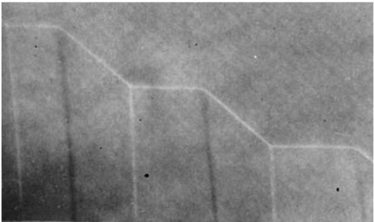

Fig. 9.11 Domain photographs of an iron foil by transmission electron microscopy, $5600\times$ .[J.T. Michalak and R. C. Glenn, J. Appl. Phys., 32 (1961) p. 1261.]

Two kinds of specimen are of interest:

1. Those which are thin already, which will normally have been made by evaporation or sputtering or electrodeposition, and are called “thin films.” Their magnetic properties are of great interest because of the number of current and potential applications in computer technology. Description of these materials is postponed to Chapter 11.

2. Bulk specimens which have been thinned down by grinding and etching. These are usually called “foils.” Figure 9.11 shows an example of domains in a foil of highpurity iron. The domain walls are the light and dark lines. Normally, crystal imperfections such as dislocations and stacking faults are also visible.

Lorentz microscopy has the advantage of high resolution, which allows the examination of the fine detail of domain structure. It also permits the direct observation of interactions between domain walls and crystal imperfections and grain boundaries. In the case of foil samples, there is always a question of the extent to which the domain structure of the foil sample represents that of the bulk material.

The Lorentz microscopy described here is known the Fresnel mode. Other modes are possible, including differential phase contrast and holographic, which have certain advantages [See J. Chapman and M. Scheinfein, J. Magn. Magn. Mater., 200 (1999) p. 729.]

## 9.3.3 Optical Effects

Two magneto-optic effects can distinguish one domain from another, either as a difference in color or in the degree of light and dark.

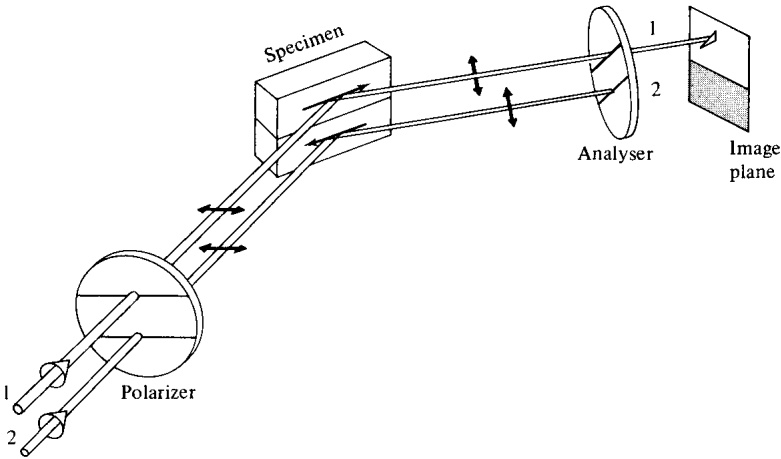

Fig. 9.12 Principle of domain observation by the Kerr effect.

Kerr Effect. This effect is a rotation of the plane of polarization of a light beam during reflection from a magnetized specimen. The amount of rotation is small, generally much less than one degree, and depends the material and on the direction and magnitude of the magnetization relative to the plane of incidence of the light beam. Specifically, the degree of rotation depends on the component of magnetization parallel to the direction of propagation of the light beam. Figure 9.12 shows the experimental arrangement. Light from a source passed through a polarizer which transmits only plane polarized light, or naturally polarized light from a laser, is incident on the specimen. For simplicity the specimen is assumed to contain only two domains, magnetized antiparallel to each other as indicated by the arrows. During reflection the plane of polarization of beam 1 is rotated one way and that of beam 2 the other way, because they have encountered oppositely magnetized domains. The light then passes through an analyzer and into a low-power microscope. The analyzer is now rotated until it is “crossed” with respect to reflected beam 2; this beam is therefore extinguished and the lower domain appears dark. However, the analyzer in this position is not crossed with respect to beam 1, because the plane of polarization of beam 1 has been rotated with respect to that of beam 2. Therefore beam 1 is not extinguished, and the upper domain appears light. Figure 9.13 shows domains in a thin film revealed in this way; the light and dark bands are domains magnetized in opposite directions.

Because of the small angle of rotation of the plane of polarization, the contrast between adjoining domains tends to be low, so all the optical elements must be of high quality and well adjusted. However, the Kerr method is ideal for observation of domain walls in motion and has supplanted the Bitter method for such studies. It has no limitations with respect to specimen temperature beyond the usual ones of thermal insulation and protection against oxidation. It can be applied both to bulk specimens and thin films. However, a component of the magnetization vector must be parallel to the direction of propagation of the light, which means for most materials the light beam strikes the sample surface at a fairly small angle. This limits the area that can be observed, especially at high magnification.

Note that the term “Kerr effect” is also applied to an electro-optic effect. If certain organic liquids are placed in a transparent container, called a Kerr cell, and subjected to an electric field, plane polarized light passing through the cell will be rotated by an amount depending on the applied voltage.

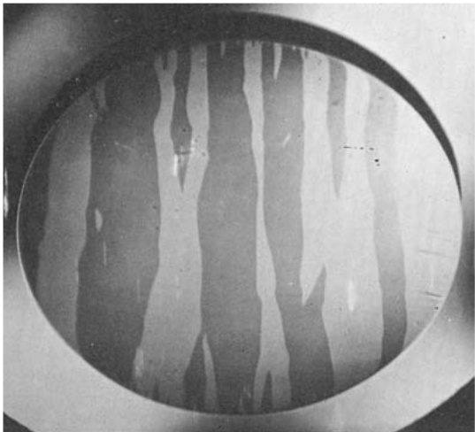

Fig. 9.13 Domains in a film of 81 permalloy observed using the Kerr effect.

Faraday Effect. This effect is a rotation of the plane of polarization of a light beam as it is transmitted through a magnetized specimen. The optical system is the same as the Kerreffect system, except that source, polarizer, specimen, analyzer, and microscope are all in line. The method is, of course, limited to specimens thin enough, or transparent enough, to transmit light; it is applied most often to thin sections of ferrimagnetic oxides, up to about 0.1 mm in thickness, although metallic films less than 400 Å thick have also been examined.

For thin sections of oxides, the amount of the Faraday rotation is a few degrees. This results in high contrast between adjoining domains and yields photographs of remarkable clarity. Like the Kerr method, the Faraday method is unrestricted as to temperature and is excellent for wall motion studies.

## 9.3.4 Scanning Probe; Magnetic Force Microscope

The scanning tunneling microscope (STM) was introduced in 1986. It makes use of the fact that the dimensions of a piezoelectric crystal can be controlled by the application of electric fields down to displacements less than the diameter of an atom. A very sharp-pointed tip can be scanned across a small sample area with a set of xy piezoelectric crystals while its distance above the surface z is controlled by a third piezoelectric crystal, as shown in Fig. 9.14. The original version of the scanning probe microscope applies a voltage between the tip and the sample, and brings the tip close enough to the surface so that a tunneling current flows. Then the tunneling current is measured as the tip is scanned over the sample surface, or (usually) the tip-to-sample distance is varied to keep the tunneling current constant. The variation of tunneling current or tip spacing with position then maps out the geometry of the surface at atomic-scale resolution.

A number of variations on this basic idea quickly followed. One of these uses a tip coated with a thin layer of magnetic material, which experiences a measurable force when it enters the field gradient where a domain wall meets the sample surface. This is the magnetic force microscope, or MFM. The force acting on the tip can be measured optically, by the deflection of the cantilever holding the tip, or from the change in amplitude of

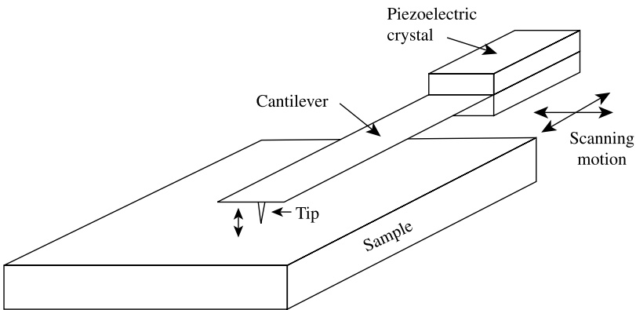

Fig. 9.14 Scanning probe microscope.

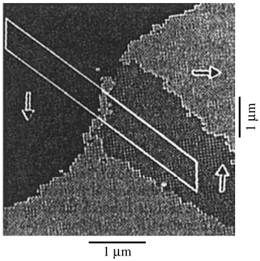

(a)

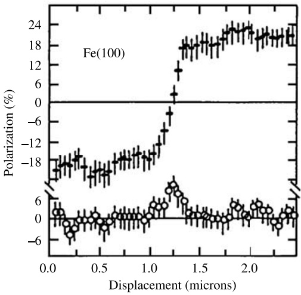

(b)

Fig. 9.15 SEMPA analysis of domain wall structure. This is a scan across a $180^{\circ}$ domain wall in iron. Solid bars show vertical polarization of electrons vs. position; open circles show horizontal polarization. Note that there is no visible separation of the $180^{\circ}$ wall into two $90^{\circ}$ walls. [Data from H. P. Oepen and J. Kirschner, Phys. Rev. Lett., 62 (1989) p. 819.]

the cantilever motion when set into resonant oscillation. MFM requires minimal surface preparation, and works on both conducting and insulating materials. The same instrument can determine the surface contours of the sample, and so can largely separate surface effects from magnetic effects.

The MFM offers the prospect of observing magnetic structures at extremely high resolution, and it has been used successfully in some investigations. However, there are problems in interpreting the results. The magnetic material on the tip is in the form of a hollow cone or a portion of a hollow cone, and it is typically subjected to a highly nonuniform field above the surface of the sample. It is then not clear how to relate the magnetic field above the sample, which is the desired information, to the force on the tip, which is the measured quantity. There is also the possibility that if the domain walls in the sample are highly mobile, they may be displaced by the interaction with the magnetic material of the tip. The tip coating is usually a soft magnetic material, but it may also be a permanent magnet material, in which case the tip magnetization may be regarded as fixed, but the chance of the tip causing motion of the domain walls is increased.

## 9.3.5 Scanning Electron Microscopy with Polarization Analysis

This is another powerful technique for domain observation. A tightly focused electron beam is scanned over the sample surface, and the emitted secondary electrons are analyzed to determine their magnetic polarization, which depends on the direction of magnetization of the region from which they were emitted. The experiment requires special apparatus carefully adjusted, but can give very detailed results, including the variation in magnetization direction across an individual domain wall, as in Fig. 9.15.

## 9.4 MAGNETOSTATIC ENERGY AND DOMAIN STRUCTURE

We turn now from the observation of domains to an examination of the reasons for their formation and their relative arrangement in any given specimen. We will find that magnetostatic energy plays a primary role.

## 9.4.1 Uniaxial Crystals

Consider a large single crystal of a material with uniaxial anisotropy. Suppose it is entirely one domain, spontaneously magnetized parallel to the easy axis, as in Fig. 9.16a. Then free poles form on the ends, and these poles are the source of a large $H$ field. The magnetostatic energy of this crystal is $1 / 8\pi \int H^{2}$ dv (cgs) or $1 / 2\int H^{2}$ dv (SI), evaluated over all space. This considerable energy can be reduced by almost a factor of 2 if the crystal splits into two domains magnetized in opposite directions as in Fig. 9.16b, because this brings north and south poles closer to one another, thus decreasing the spatial extent of the $H$ field. If the crystal splits into four domains as in Fig. 9.16c, the magnetostatic energy again decreases, to about one-fourth of its original value, and so on. But this division into smaller and smaller domains cannot continue indefinitely, because each wall formed in the crystal has a wall energy per unit area, which adds energy to the system. Eventually an equilibrium domain size will be reached.

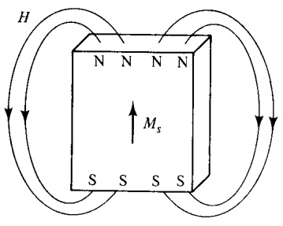

(a)

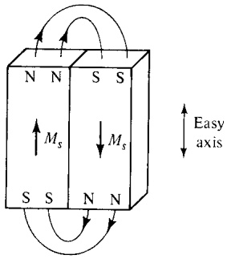

(b)

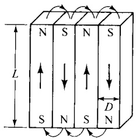

(c)

Fig. 9.16 Division of a crystal into domains. Only external $H$ fields are shown.

The magnetostatic energy of the single-domain crystal is, from Equation 7.59,

$$
E _ {\mathrm{ms}} = \frac {1}{2} N _ {\mathrm{d}} M _ {\mathrm{s}} ^ {2}\tag{9.26}
$$

per unit volume, where $N_{d}$ is the demagnetizing factor. The value of $N_{\mathrm{d}}$ for a cube, in a direction parallel to an edge, is $4\pi /3$ (cgs) or 1/3 (SI) . If we take this value as applying approximately to the crystal of Fig. 9.16, the magnetostatic energy of the crystal per unit area of its top surface is

$$
E _ {\mathrm{ms}} = \frac {2}{3} \pi M _ {\mathrm{s}} ^ {2} L (\mathrm{cgs}) \text {or} \frac {1}{6} M _ {\mathrm{s}} ^ {2} L (\mathrm{SI}),\tag{9.27}
$$

where L is the thickness.

The calculation, which is not easy, of the magnetostatic energy of the multi-domain crystal of Fig. 9.16c has been given by S. Chikazumi [Physics of Ferromagnetism, 2nd ed. Oxford (1997), pp. 434 – 435]. This energy, per unit area of the top surface, is

$$
E _ {\mathrm{ms}} = 0. 8 5 M _ {\mathrm{s}} ^ {2} D,\tag{9.28}
$$

where D is the thickness of the slab-like domains, provided that D is small compared to L. The total energy is the sum of the magnetostatic and wall energies:

$$
\begin{array}{l} E = E _ {\mathrm{ms}} + E _ {\mathrm{wall}}, \\ E = 0. 8 5 M _ {\mathrm{s}} ^ {2} D + \sigma \frac {L}{D} \end{array}\tag{9.29}
$$

where $\sigma$ is the domain wall energy per unit area of wall and L/D is the wall area per unit area of the top surface of the crystal. The minimum energy occurs when

$$
\frac {d E}{d D} = 0. 8 5 M _ {\mathrm{s}} ^ {2} - \frac {\sigma L}{D ^ {2}} = 0,
$$

$$
D = \sqrt {\frac {\sigma L}{0 . 8 5 M _{\mathrm{s}} ^ {2}}}\tag{9.30}
$$

and

$$
E = 2 M _ {\mathrm{s}} \sqrt {0 . 8 5 \sigma L}.\tag{9.31}
$$

For cobalt, taking $\sigma = 7.6 \mathrm{erg} / \mathrm{cm}^{2}$ and $L = 1$ cm, we find

$$
D = \sqrt {\frac {(7 . 6) (1)}{(0 . 8 5) (1 4 2 2) ^ {2}}} \approx 2 \times 1 0 ^ {- 3} \mathrm{cm} = 2 0 \mu \mathrm{m}
$$

which means there will be about $1 / (2\times 10^{-3}) = 500$ domains in a 1 cm cube crystal. The ratio of total energy before and after division into domains is

$$
\begin{array}{c} \frac {E (\text {single - domain})}{E (\text {multi - domain})} = \frac {\frac {2}{3} \pi M _ {\mathrm{s}} ^ {2} L}{2 \sqrt {0 . 8 5 M _ {\mathrm{s}} ^ {2} \sigma L}} \\ \approx M _ {\mathrm{s}} \sqrt {\frac {L}{\sigma}} = 1 4 2 2 \sqrt {\frac {1}{7 . 6}} \approx 5 0 0 \end{array}\tag{9.32}
$$

where the values appropriate to cobalt have been inserted. Thus the creation of domains has lowered the energy by a factor of 500.

A still larger reduction in magnetostatic energy will result if the unlike poles on each end of the crystal are “mixed” more intimately. This can be done if the domain walls become curved rather than flat, although still parallel to the easy axis, as in Fig. 9.17a. A section of such a crystal parallel to the easy axis will show straight lines separating the domains, and a section normal to the easy axis will show curved lines. Curvature of the walls increases the wall area, and this type of domain structure is therefore found mainly in very thin crystals. In thick crystals, wall curvature involves too much extra wall energy, and another method of reducing magnetostatic energy is favored, as in Fig. 9.17b. Here spike-shaped domains of reversed magnetization are formed at the surface. This has the desired effect of producing a fine mixture of opposite poles on the end surfaces without adding too much wall energy, because the spike domains are short. However, there is a discontinuity in the normal component of $M_{\mathrm{s}}$ on the walls of the spike domains, and free north poles must form there in accordance with Equation 2.29. These interior poles are the source of an $H$ field and therefore contribute to the magnetostatic energy. The number and size of the spike domains will be such as to balance the reduction in main magnetostatic energy due to the surface poles against the increase in wall energy and in magnetostatic energy due to interior poles, assuming that there is no barrier to the formation of additional domains.

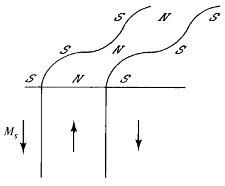

(a)

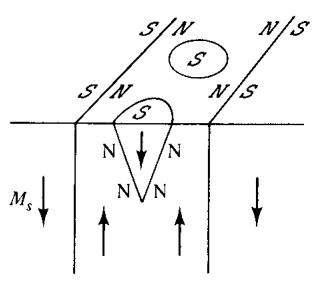

(b)

Fig. 9.17 Curved domain walls and surface spike domains.

## 9.4.2 Cubic Crystals

The domain structure of cubic crystals tends to be more complicated, because there are now three or four easy axes, depending on the sign of the anisotropy constant $K_{1}$ . Furthermore, it is now possible for the flux to follow a closed path within the specimen so that no surface or interior poles are formed, and the magnetostatic energy is reduced to zero. Figure 9.18a shows how this is done. Triangular domains are formed at the ends and, because they are paths by which the flux can close on itself, they are called closure domains. One might think that the domains in such a crystal could be very large, since the only obvious source of energy is wall energy. However, there is also magnetoelastic energy. If $\lambda_{100}$ is positive, as it is in iron, then the [100] closure domain would strain magnetostrictively as shown by the dotted lines in Fig. 9.18b, if not restrained by the main [010] and $[0\bar{1}0]$ domains on either side. The closure domains are therefore strained, and the magnetoelastic energy stored in them is proportional to their volume. The total closure-domain volume can be reduced by decreasing the width D of the main domains. The crystal will therefore split into more and more [010] and $[0\bar{1}0]$ domains, until the sum of the magnetoelastic and domain wall energies becomes a minimum. Closure domains of the type shown in Fig. 9.18 are often been seen at the edge of cubic crystal. Note that a closure-domain structure will ideally have $M_{s}$ parallel to the surface at all free surfaces.

The avoidance of free poles is also the guiding principle controlling the orientation of domain walls. For example, a $180^{\circ}$ wall must be parallel to the $M_{\mathrm{s}}$ vectors in the adjacent domains; if not, as in the spike domains of Fig. 9.17b, free poles will form on the wall, creating magnetostatic energy. For the same reason, a $90^{\circ}$ wall, such as those bounding the closure domains of Fig. 9.18, must lie at $45^{\circ}$ to the adjoining $M_{\mathrm{s}}$ vectors.

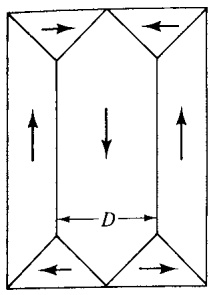

(a)

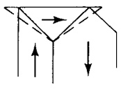

(b)

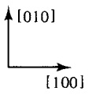

Fig. 9.18 Closure domains in a cubic crystal with <100> easy axes.

The principle of free-pole avoidance does not entirely fix the orientation of a domain wall. For example, suppose a $180^{\circ}$ wall, in a material with <100> easy directions, separates two domains magnetized along [100] and $[\bar{1}00]$. Then the wall could tilt about [100] as an axis through an infinity of orientations and still remain parallel to the $M_{\mathrm{s}}$ vectors on either side of it, thus remaining free of poles. Calculations show that the energy s per unit area of wall varies with the tilt angle and goes through a maximum for some orientations and a minimum for others. Similar conclusions apply to $90^{\circ}$ walls. But the ratio of maximum to minimum values of s is less than 2, and this effect is small compared to the creation of magnetostatic energy by walls so oriented that they have free poles.

Simple domain arrangements, giving rise to a set of parallel $180^{\circ}$ walls, as in the central portion of the crystal of Fig. 9.18, are seen only when the surface of the crystal is accurately parallel to an easy direction. If the surface deviates only a few degrees from a {100} plane, the complex “fir tree” pattern of Fig. 9.9 is formed. It has “branches” jutting out from the main $180^{\circ}$ walls at an angle of about $45^{\circ}$ , as shown in detail in Fig. 9.19. Here the (100) planes make an angle $\theta$ with the crystal surface, and so do the $M_{\mathrm{s}}$ vectors in the two main domains. North and south poles are therefore formed on the top surfaces of these domains. To decrease the resulting magnetostatic energy, the branch domains form. These carry flux parallel to the crystal surface, in the easy y or [010] direction, and therefore have no poles on their top surface. These branch domains are shallow and are bounded on the bottom by curved, nearly $90^{\circ}$ walls which have some free poles distributed on them. Nevertheless, the total energy is reduced by the formation of the branch domains.

The complex tree pattern is instructive, when one considers that well below the surface the domain structure of this crystal is extremely simple. This observation is generally true. Many of the complex domain arrangements seen on some crystal surfaces would not exist if that surface had not been exposed by cutting; they are closure domains which form when the cut is made, in order to reduce magnetostatic energy. Surface domain structures can therefore be very different from the basic domain structure of the interior. On the other hand, domains in very thin specimens, such as films and foils, normally extend completely through the specimen thickness. The domain structure revealed by surface examination, by the Bitter or Kerr techniques, is therefore the same as the interior structure in this case.

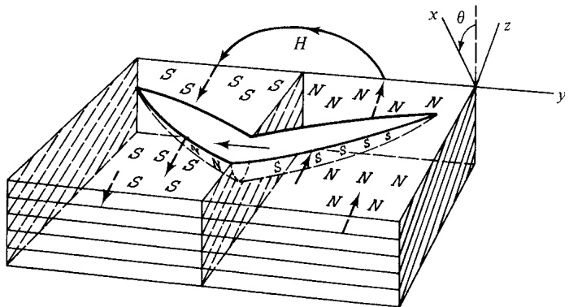

Fig. 9.19 Interpretation of the fir tree pattern. Lines on the sides of the crystal are parallel to {100} planes.

The simplest kinds of domain structure are seen in properly prepared single crystals, and the most complex in polycrystals. The great accomplishment of Williams, Bozorth, and Shockley lies precisely in the fact that they established this conclusion. They succeeded in showing that the complex pattern of Fig. 9.9, for example, was nothing but a surface artifact, caused by the fact that the specimen surface was not accurately parallel to a {100} plane.

The most nearly perfect metal single crystals available are whiskers. These are fine filaments, generally a few millimeters in length and several tens of micrometers thick, grown by the reduction of metal bromide vapor by hydrogen at about $800^{\circ}$C. Whiskers first attracted scientific interest because of their extremely high mechanical strength. Later it was realized that they offered excellent opportunities for magnetic domain studies. Iron whiskers, for example, often grow with a <100> axis and with sides parallel to {100} planes. Moreover, these sides are optically flat, which means that no specimen preparation is needed before the magnetic suspension is added to form a Bitter pattern. Figure 9.20 shows the domain structure observed on a {100} <100> iron whisker and the wall motion that occurs in an applied field. The sketch at the top shows the domain structure through the volume of the whisker, and the Bitter patterns are of the top face. The arrows below

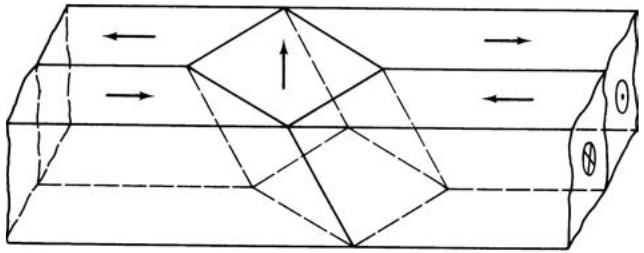

H=0

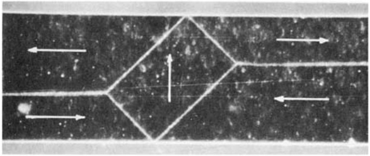

- H

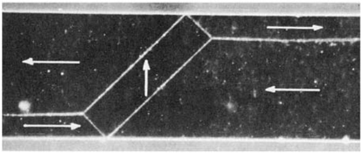

4 H

Fig. 9.20 Reversible wall motion in an iron whisker. Bitter patterns under dark-field illumination.

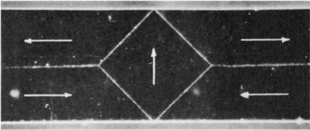

H=0

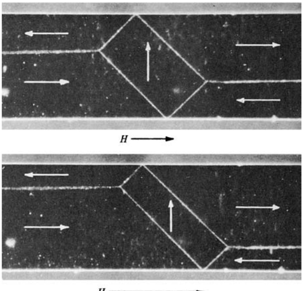

Fig. 9.20 Continued.

each pattern indicate the direction and magnitude of the applied field, which had a maximum value of about 10 Oe. The changes shown are entirely reversible; that is, the configuration at top could be regained at any stage of the magnetization process by reducing the field to zero.

Closely analogous to whiskers are metal “platelets,” which are grown by the same methods and are also single crystals. Here the growth habit is edgewise rather than axial; the result is a platelet hundreds of micrometers in its lateral dimensions and from less than 0.1 μm (1000 Å) to over 10 μm in thickness. The platelet surfaces and edges are crystal planes and directions of low indices, such as {100} and <100>. These platelets are structurally more nearly perfect than the usual thin films formed by evaporation of a metal in vacuum onto a substrate. Figure 9.21 shows an exceptionally simple domain structure in a demagnetized Ni –Co alloy platelet. The crystal structure is face-centered cubic, with <100> easy directions (positive $K_{1})$ . When a field of 3.6 Oe is applied to the right, the domain walls move reversibly to the positions shown in Fig. 9.21b. Here the corners of the platelet have pinned the ends of the $90^{\circ}$ walls, forcing the latter to bend. The normal components of $M_{\mathrm{s}}$ are no longer continuous across these walls, so they are now the sites of free poles. With further increase in field, to 4.1 Oe, the domain structure snaps irreversibly to Fig. 9.21c. The reason that the $180^{\circ}$ walls are so thin, or invisible, in these photographs is that the crystal anisotropy is low in this alloy; the walls are accordingly very broad, produce only a weak field gradient above the surface, and attract little or no colloid. The 908 walls are thinner and attract more colloid.

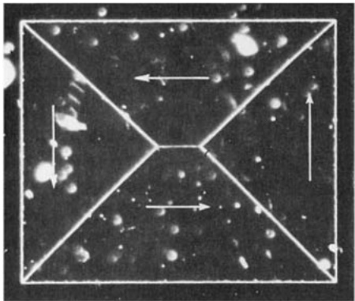

(a)

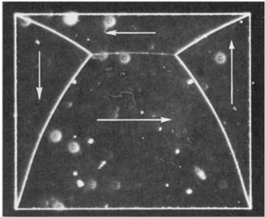

(b)

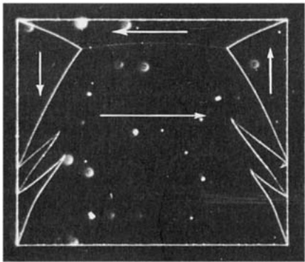

(c)

Fig. 9.21 Wall motion in a Ni–Co alloy platelet 165 mm across. Bitter patterns, dark field illumination.

The domain structure observed on the surface of a polycrystalline specimen is usually quite complex, because (a) the grain surfaces are rarely even approximately parallel to crystal planes of low indices like {100} or {111}, except in certain specimens having a high degree of preferred orientation, and (b) the grain boundaries tend to interrupt the continuity of magnetization from grain to grain. Because the easy directions of magnetization have different orientations in two adjoining grains, the grain boundary between them is also a domain boundary, although not of the usual kind since it cannot move or adjust its orientation. The normal component of $M_{\mathrm{s}}$ is rarely continuous across a grain boundary, which therefore becomes a source of free poles and magnetostatic energy. Although domains are not continuous across a grain boundary, domain walls often are, and Fig. 9.22 shows an example of this. Spike domains often form at grain boundaries to reduce the free pole density there, just as they do at the surface of some single crystals (Fig. 9.17b).

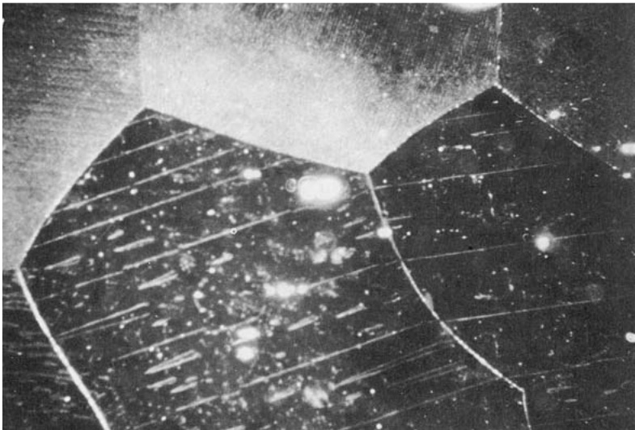

Fig. 9.22 Domains in a polycrystalline sample of $\mathrm{Fe} + 3\% \mathrm{Si}$

## 9.5 SINGLE-DOMAIN PARTICLES

There are good reasons to believe that a sufficiently small magnetic particle will not contain domain walls and so will consist of a single domain. One simple argument is that, if the particle is smaller than the thickness of a domain wall, it cannot consist of two domains separated by a domain wall. Another way to approach the problem is to note that the total magnetostatic energy of a single domain particle of diameter D will vary as the particle volume, which is proportional to $D^{3}$ , while the domain wall area and energy will vary as the cross-sectional area of the particle, which is proportional to $D^{2}$ . If these are the only energies to consider, there must be a critical diameter $D_{c}$ below which the single-domain state is favored.

The calculation of the critical size for single-domain behavior in specific cases turns out to be tricky and uncertain. The magnetostatic energy will depend on the saturation magnetization of the material and on the geometry of the particle. The domain wall energy will depend on the values of the anisotropy constant(s) and the exchange stiffness, and perhaps also the magnetostriction and elastic constants, as well as on the geometry. And the exact magnetization configuration in the tiny particle may not be as simple as a pure ferromagnetic state or two purely ferromagnetic regions separated by a domain wall whose structure and energy were calculated for an infinite solid.

Robert C. O’Handley [Modern Magnetic Materials, Principles and Applications, Wiley-Interscience (2000)] gives formulas for various cases. The solution generally ends up as a function of $\sigma /M_{\mathrm{s}}^{2}$ , where s is the domain wall energy and $M_{s}$ is the saturation magnetization, and the critical size for a single-domain particle is similar to the value of the domain wall thickness. So in general single-domain particles are expected to be less than 1000 atoms in diameter.

Experimental determination of a critical size for single-domain behavior is also uncertain. Particles in this size range are hard to prepare with controlled size and shape, and very difficult to isolate and measure. The particles in an assembly are unlikely to all have exactly the same size and shape, and will interact magnetically unless the individual particles are sufficiently separated. Some theoretical and experimental approaches to this general problem will be discussed in Chapter 14.

## 9.6 MICROMAGNETICS

The two preceding sections have been devoted to understanding the configuration of the local magnetization vector $M_{\mathrm{s}}$ in a specimen subjected to no external field. We reached two conclusions:

1. If the specimen exceeds a certain critical size, it will divide itself into domains, in each of which $M_{\mathrm{s}}$ is everywhere parallel, separated by domain walls, in which the direction of $M_{\mathrm{s}}$ varies with position.

2. If the specimen size is less than a critical value, $M_{\mathrm{s}}$ is everywhere parallel.

As far as large specimens are concerned, the problem is one of finding the domain arrangement of lowest total energy. For example, in considering the cubic crystal of Fig. 9.18, we found that the crystal would not consist solely of slab-like domains magnetized parallel and antiparallel to [010], because the magnetostatic energy of such an arrangement can be eliminated by putting in closure domains at the ends. But these domains contribute magnetoelastic energy. It is then necessary to make the closure domains smaller without, however, adding too much wall energy. Continuing in this manner, we finally arrive at an equilibrium width D of the main domains, which in turn defines the sizes of the other domains and the total amount of wall area. This whole process of devising a domain configuration of minimum energy has been criticized by W. F. Brown Jr [Magnetostatic Principles in Ferromagnetism, North-Holland (1962)] as being insufficiently rigorous. He points out that “the particular configuration devised is dependent on the ingenuity of the theorist who devised it; conceivably a more ingenious theorist could devise one with even lower free energy.”

Brown instead advocates a rigorous approach, called micromagnetics. Here we forget about domains and domain walls. But we allow the Ms vector, of constant magnitude, to have a direction which is a continuous function of its position x, y, z in the crystal. We then express the various energies (exchange, anisotropy, magnetostatic, etc.) in terms of these directions throughout the crystal. The resulting equations are then to be solved for the spin directions at all points. If the crystal is a large one, then the existence of domains (regions of parallel spin) and the positions of domain walls (regions of rapid change of spin direction) should come quite naturally out of the solution. If the crystal is very small, then the solution should indicate that the spins are everywhere parallel, making it a single domain. In each case we must begin with a complete physical description of the crystal; this would include such things as its crystal anisotropy, magnetostrictive behavior, size, shape, and the presence or absence of imperfections.

While there is no doubt that micromagnetics is more rigorous and intellectually satisfying than domain theory, the mathematics involved in the micromagnetics approach is of formidable complexity. As a result, only certain rather limited kinds of problems have been attempted. In passing, we note that the problem of determining the spin structure of a domain wall, treated in Section 9.2, is a simple problem in micromagnetics, because there we allowed the spin direction to be a function of position, subject to certain constraints.

## 9.7 DOMAIN WALL MOTION

Up to this point our attention has been focused on static domain structures. We now consider how domain walls move in response to an applied field. This motion is often observed to be jerky and discontinuous, rather than smooth. This phenomenon, known as the Barkhausen effect, was discovered in 1919 and can be demonstrated with the apparatus shown in Fig. 9.23a. A search coil is wound on a specimen and connected through an amplifier to a loudspeaker or headphones. The specimen is then subjected to a smoothly increasing field. No matter how smoothly and continuously the field is increased, a crackling noise is heard from the speaker. If the search coil is connected to an oscilloscope, instead of a speaker, irregular spikes will be observed on the voltage-time curve, as in Fig. 9.23b. These voltage spikes are known as Barkhausen noise. The emf induced in the search coil is, by Equation 2.6, proportional to the rate of change of flux through it, or to $dB/dt$. But even when $dH/dt$ is constant, and even on those portions of the $B$,$H$ curve which are practically linear, the induced voltage is not constant with time but shows many discontinuous changes. The effect is strongest on the steepest part of the magnetization curve and is evidence for sudden, discontinuous changes in magnetization. This is indicated in Fig. 9.23c, where the magnification factor applied to one portion of the curve is of the order of 109.

The Barkhausen effect was originally thought to be due to sudden rotations of the $M_{\mathrm{s}}$ vector from one orientation to another in various small volumes of the specimen. It is now known to be due mainly to domain walls making sudden jumps from one position to another. Either way, the Barkhausen effect is evidence for the existence of domains, and it was the first evidence in support of Weiss’ hypothesis of 13 years earlier.

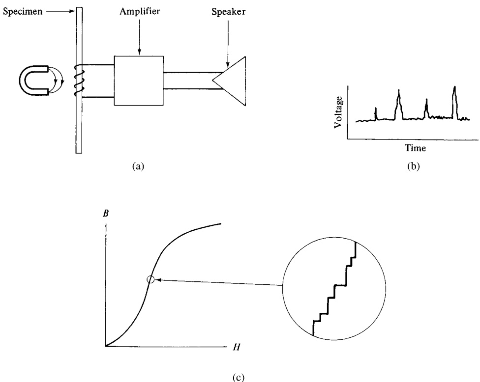

Fig. 9.23 Barkhausen effect.

In a classic paper published in 1949, H. J. Williams and W. Shockley [Phys. Rev. 75 (1949) p. 178] reported direct visual evidence of jerky domain wall motion. They made a single crystal of Fe + 3.8% Si in the form of a hollow rectangle (picture frame) with each side parallel to an easy direction of the form <100> and all faces parallel to {100}. The overall dimensions were 19 x 13 mm, and each side was 1 mm wide and 0.7 mm thick. They examined the whole surface of the polished crystal by the Bitter technique and found the particularly simple domain structure shown in Fig. 9.24a. This shows the demagnetized state, and the crystal contains only eight domains. The domain walls, shown as dashed lines, were found, by observation of the other side, to pass straight through the crystal normal to the plane of the drawing. A magnetizing coil was wound on one leg and a flux-measuring coil on the opposite leg of the sample, marked in the figure as the $H$ and $B$ coils, respectively. When the applied field $H$ was clockwise, the domain wall in each leg moved outward until it reached the edge of the specimen at saturation; each leg of the crystal was then a single domain. While the wall AB, for example, was moving, it could be observed with a microscope focused on the top leg, as indicated in Fig. 9.24a. The wall motion was generally fairly smooth, but now and then jerky when the wall encountered an inclusion. The nature of this interaction will be described in the next section.

However, the Williams–Shockley experiment has an importance much more fundamental than its clarification of the Barkhausen effect. When the applied field was changed from its maximum clockwise value to its maximum counterclockwise value and back again, the crystal went through its hysteresis cycle, and the recorded loop is shown in Fig. 9.24b. At the same time photographs of the wall position in one leg were made through the microscope. It was found (Fig. 9.24c) that there was a direct linear relation between wall position measured on the film and the magnetization $M$ of the specimen, as would be expected from the previous observation that the walls went straight through the crystal. This was the first experimental demonstration of a relation between domain wall motion and change in magnetization. It showed that observation of a domain wall at its intersection with a surface could be correlated with a real volume effect, as measured with the $B$ coil.

Two other points of interest in this experiment are:

1. The hysteresis loop is “square,” where this word refers to the relative squareness of the loop corners rather than to the shape of the whole loop. The coercive field of less than 0.02 Oe (1.6 A/m) is a measure of the extreme magnetic softness of this specimen. And when the magnetization begins to reverse, a field change of less than 0.005 Oe (0.4 A/m) is enough to effect essentially complete reversal. Materials with square hysteresis loops are important in many applications, and we shall return to this subject later.

2. When a magnetized rod-shaped crystal is heated above the Curie point and cooled again, it becomes demagnetized, in order to reduce its demagnetizing field and the associated magnetostatic energy. But when this picture-frame crystal was cooled from the Curie point, it was observed to be saturated, clockwise or counterclockwise, each leg a single domain. Because it forms a closed magnetic circuit, this crystal can have no demagnetizing field. Therefore, its state of minimum energy is one of minimum domain wall area. This is the saturated state, with only four short $90^{\circ}$ domain walls at the corners. Since the crystal anisotropy energy is zero, the only other source of energy is some magnetoelastic energy due to domain misfit at the corners.

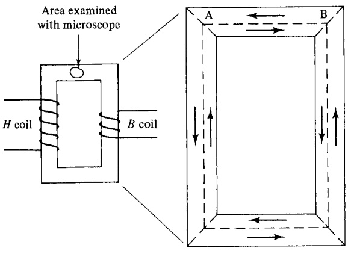

(a)

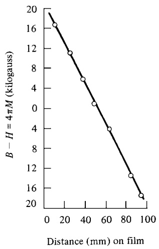

(c)

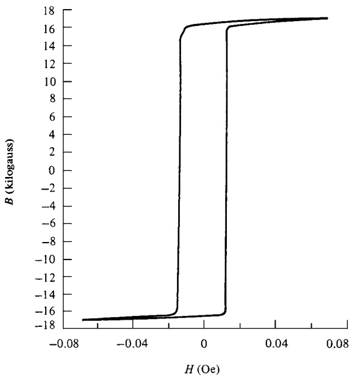

(b)

Fig. 9.24 The picture-frame experiment. [H. J. Willliams and W. Shockley, Phys. Rev., 75 (1949) p. 178.]

In previous chapters we noted that magnetization can change as a result both of domain wall motion and domain rotation. The question then arises: in a typical polycrystalline specimen, what proportion of the total change in $M$ is due to wall motion and what rotation? This question has no precise answer, but a rough division is indicated in Fig. 9.25. Wall motion is the main process up to about the “knee” of the magnetization curve. From there to saturation, rotation predominates; in this region work must be done against the anisotropy forces, and a rather large increase in $H$ is required to produce a relatively small increase in $M$. This division of the magnetization curve is rather arbitrary, because wall motion and rotation are not sharply divisible processes. In fact, at any one level of $M$, wall motion may be occurring in one portion of a specimen and rotation in another. And in certain orientations of a single-crystal specimen relative to the applied field, wall motion and rotation can occur simultaneously in the same part of the specimen. When magnetization occurs entirely by domain rotation, we expect the process to be reversible, with the same $B$ vs $H$ curve followed in both increasing and decreasing fields. Domain wall motion in real materials is irreversible, leading to different curves for increasing and decreasing fields.

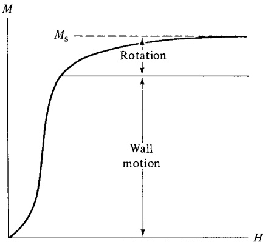

Fig. 9.25 Magnetization processes.

## 9.8 HINDRANCES TO WALL MOTION (INCLUSIONS)

Even in the very special case of the picture-frame crystal, an applied field greater than zero is required to move domain walls through the material. In other specimens, substantial wall motion may require fields of tens or hundreds of oersteds. Evidently real materials contain crystal imperfections of one sort or another which hinder the easy motion of domain walls. These hindrances are generally of two kinds: inclusions and residual microstress.

Inclusions may take many forms. They may be particles of a second phase in an alloy, present because the solubility limit has been exceeded. They may be oxide or sulfide particles and the like, existing as impurities in a metal or alloy. They may be simply holes or cracks. From a magnetic point of view, an “inclusion” in a domain is a region which has a different spontaneous magnetization from the surrounding material, or no magnetization at all. We will regard an inclusion simply as a nonmagnetic region.

One reason that an inclusion might impede wall motion is that the wall might tend to cling to the inclusion in order to decrease the area, and hence the energy, of the wall. When a wall arrives at a position bisecting an inclusion, as from Fig. 9.26a to Fig. 9.26b, the wall area decreases by $\pi r^{2}$ (for a spherical inclusion of radius r) and the wall energy decreases by $\pi r^{2}\sigma .$ But in 1944 Néel pointed out that free poles on an inclusion would be a far greater source of energy. A spherical inclusion entirely within a domain, as in Fig. 9.26c, would have free poles on it and an associated magnetostatic energy of

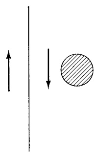

(a)

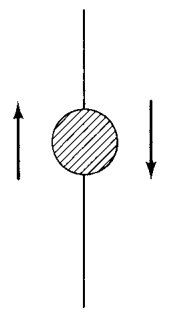

(b)

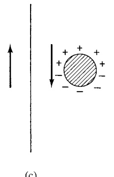

(c)

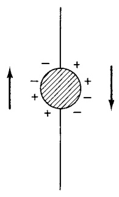

(d)

Fig. 9.26 Interaction of domain wall with inclusion.

$$
\begin{array}{r l} N _ {\mathrm{d}} \frac {M _ {\mathrm{s}} ^ {2}}{2} \mathrm{vol} & = \frac {4 \pi}{3} \frac {M _ {\mathrm{s}} ^ {2}}{2} \frac {4}{3} \pi r ^ {3} = \frac {8}{9} \pi^ {2} M _ {\mathrm{s}} ^ {2} r ^ {3} (\mathrm{cgs}) \\ & = \frac {1}{3} \frac {M _ {\mathrm{s}} ^ {2}}{2} \frac {4}{3} \pi r ^ {3} = \frac {2}{9} \pi M _ {\mathrm{s}} ^ {2} r ^ {3} (\mathrm{SI}). \end{array}\tag{9.33}
$$

When the wall moves to Fig. 9.26d, bisecting the inclusion, the free poles are redistributed as shown, and the magnetostatic energy is approximately halved, just as it is when a singledomain crystal is divided into two oppositely magnetized domains (Fig. 9.16). Therefore, when a wall moves from a position away from an inclusion to a position bisecting it, the ratio of the magnetostatic energy reduction to the wall-energy reduction is, for a 1 mm diameter inclusion in iron, and using cgs units,

$$
\frac {(4 \pi^ {2} M _ {\mathrm{s}} ^ {2} r ^ {3} / 9)}{\pi r ^ {2} \sigma} = \frac {4 \pi M _ {\mathrm{s}} ^ {2} r}{9 \sigma} = \frac {(4 \pi) (1 7 1 4 ^ {2}) (0 . 5 \times 1 0 ^ {- 4})}{(9) (1 . 5)} \approx \frac {1 4 0}{1},\tag{9.34}
$$

when $\sigma$ is taken as 1.5 ergs/cm² . This ratio, being proportional to r, becomes even larger for larger inclusions, showing that the wall-area effect is negligible.

Néel also pointed out that the magnetostatic energy of an inclusion isolated within a domain could be decreased if subsidiary spike domains formed on the inclusion, and reduced to zero by closure domains when a wall bisected the inclusion. Thus an inclusion, taken as a cube for simplicity and wholly within a domain, might have spike domains attached to it as in Fig. 9.27b. The total free pole strength in Fig. 9.27a is spread over a larger surface in Fig. 9.27b, and such “dilution” always decreases magnetostatic energy. If the walls bounding the spike domains were all at exactly $45^{\circ}$ to the magnetization of the surrounding domain, there would be no discontinuity in the normal component of $M_{\mathrm{s}}$ and hence no free poles; however, such walls would extend to infinity and add an infinite amount of wall energy to the system. Spikes of finite length and having walls at nearly, but not exactly, $45^{\circ}$ to the adjacent $M_{\mathrm{s}}$ vectors represent a compromise structure. Spike domains on inclusions were first seen in 1947 by Williams, in an iron-silicon crystal. They differed from those predicted by Néel three years earlier in having two spikes, rather than four, on each inclusion; examples are shown in Fig. 9.28.

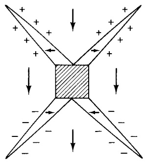

(a)

(b)

(c)

Fig. 9.27 Spike and closure domains at an inclusion., as proposed by L. Néel [Cahiers de Physique 25 (1944) p. 21].

If a wall bisects an inclusion, magnetostatic energy can be reduced to zero, at the cost of a little wall energy, if closure domains form as shown in Fig. 9.27c.

Observation of moving domain walls in crystals has shown that wall motion is impeded by interaction of the moving wall with the spike domains normally attached to inclusions rather than by interaction with the inclusions themselves. A typical sequence is shown in Fig. 9.29. In response to an upward applied field, the wall in Fig. 9.29a moves to the right, as in Fig. 9.29b, dragging out the closure domains into the form of tubes and creating a new domain just to the right of the inclusion. Further motion of the main wall lengthens the tubular domains, as in Fig. 9.29c. The change from (a) to (b) to (c) is reversible, and the domain arrangement of (a) can be regained if the field is reduced. But if the field is further increased, the tubular domains do not continue to lengthen indefinitely, because their increasing surface area adds too much wall energy to the system. A point is reached when the main wall suddenly snaps off the tubular domains irreversibly and jumps a distance to the right, leaving two spike domains attached to the inclusion, as in Fig. 9.29d. This is a Barkhausen jump. If the field is now reduced to zero and reversed, these changes occur in reverse. If the reversed field is strong enough to drive the wall well to the left of the inclusion, the inclusion will be left with spike domains pointing to the left.

Fig. 9.28 Spike domains at inclusions in an Fe + 3% Si crystal.

(b)

(a)

(c)

(d)

Fig. 9.29 Passage of a domain wall through an inclusion.

The magnetostatic energy associated with the “naked” inclusion of Fig. 9.27a is proportional to the volume of the inclusion. The results of Problem 9.2 suggest that, in a material like iron, inclusions with a diameter of about 1 mm or larger will have spike domains attached to then in order to reduce this energy. Smaller inclusions will remain bare, because their magnetostatic energy is small. When the inclusion size is of the order of $0.01\mu \mathrm{m}(= 100\mathring{\mathrm{A}})$ , it is smaller than the usual domain wall thickness. When such an inclusion is within a wall, it reduces the wall energy and hence tends to anchor the wall. Thus both large and small inclusions tend to impede wall motion, large ones because they have subsidiary domains which tend to stick to walls, small ones because they reduce the energy of any walls that contain them. Inclusions are most effective, per unit volume of inclusion, when the inclusion diameter is about equal to the wall thickness.

## 9.8.1 Surface Roughness

If a sample is thin enough so that a single domain wall runs completely through the thickness, extending from the upper to the lower surface, then the roughness of the surfaces can affect domain wall motion. The wall will always seek to minimize its total area, and so will stick in valleys where the sample is thinnest. The fact that domain walls tend to form as plane surfaces will act to average out this effect if the surface roughness is random, but not if there are more or less continuous hills and valleys running parallel to the primary domain walls.

## 9.9 RESIDUAL STRESS

The second kind of hindrance to domain wall motion is residual microstress. Before examining the magnetic effects of such a stress, we will digress in this section to consider residual stress in general, in order to get a clearer notion of what is meant by microstress.

Stresses may be divided into two categories: applied stress (the stress in a body due to external forces) and residual stress (the stress existing in a body after all external forces have been removed). Residual stress is often mistakenly called “internal stress,” which is both uninformative and incorrect. All stress, whether applied or residual, is internal.

Residual stress may in turn be divided into macro and micro, depending on scale. Residual macrostress is reasonably constant in magnitude over distances large compared to the normal grain diameter, while residual microstress varies rapidly in magnitude and sometimes in sign over distances about equal to, or smaller than, the normal grain diameter. Residual macrostress, which is the kind of most concern to the engineer because of its effect on such phenomena as fatigue and fracture, is often due to nonuniform plastic flow that has occurred at some time in the previous history of the material; it can be removed by an appropriate annealing treatment. Residual microstress is caused by crystal imperfections of various kinds, particularly dislocations. Although it may be reduced to quite low levels by annealing, it is never entirely absent.

The distinction between residual macrostress and microstress is not sharp. A more practical distinction can be made on the basis of the effect of the stress on the X-ray diffraction pattern of the material. The depth to which X rays penetrate a metal surface is typically of the order of 20 – 30 mm, while the grain size of most metals lies in the range 10 – 100 mm. Thus a macrostress will be essentially constant over the depth examined by X rays, while a microstress will vary within this depth. As a result, residual macrostress causes an X-ray line shift, a change in direction of the diffracted beam, because the lattice-plane spacing d in Equation 5.31 is essentially constant, but different from the stress-free value, in the region examined. On the other hand, residual microstress causes line broadening, because of the variation of plane spacing within this region.

Residual macro- and microstress are quite often found together. For example, the residual macrostress caused by grinding the opposite faces of a metal strip or plate with an abrasive wheel is shown at the left of Fig. 9.30. Each ground surface is in residual compression in a direction parallel to the surface. This stress rapidly decreases to zero with depth and changes to tension in most of the interior. Residual stresses must form a balanced force system. Regions in residual compression must be balanced by regions in tension. X-ray examination of the material at the surface, or just below (accomplished by etching part of the material away), shows the X-ray lines to be both shifted and broadened. We can then imagine the microstress distribution in one small region to resemble that sketched at the right of Fig. 9.30.

Fig. 9.30 Residual stress distribution due to grinding.

There is, however, an ambiguity in the interpretation of line broadening, because two effects can cause line broadening: microstress and small crystal size, less than about 0.1 mm (1000 Å ). Thus line broadening cannot be interpreted solely in terms of either cause unless the other can be shown to be absent.

As noted above, residual microstress is never entirely absent, even in a well-annealed specimen. Consider these effects:

1. Dislocations. All specimens, except a few of the most carefully grown single crystals, contain a substantial number of dislocations and each has a stress field associated with it, because the dislocation distorts the surrounding material. In a real material, dislocation lines run in many different directions, forming a complex network and a very irregular distribution of microstress. The diameter of the stress field around a dislocation is generally less than the thickness of a domain wall, and dislocation lines will in general not lie parallel to the plane of a domain wall. The result is that the interaction of an isolated or widely spaced dislocations with moving domain walls is expected to be small.

2. Magnetostriction. When a ferro- or ferrimagnetic is cooled below the Curie point, spontaneous magnetostriction acts to distort different domains in different directions. Because the domains are not free to deform independently, microstresses are set up. The same argument shows that the stress inside a domain wall differs from the stress in the adjoining domains. Figure 9.31 shows some examples for a material, like iron, in which the magnetostriction is positive in the direction of the spontaneous magnetization. Three domains are shown in Fig. 9.31a, separated by one $90^{\circ}$ and one $180^{\circ}$ wall. Dashed lines indicate the dimensions of the various portions if they were free to deform in the y direction; strains in the x direction are ignored here. The corresponding variation of the y component of stress, $\sigma_{\mathrm{y}}$ with x is shown in Fig. 9.31b, where the zero-stress level refers to the paramagnetic material above the Curie point. Stresses of magnetostrictive origin are rather small, being of the order of $\lambda_{\mathrm{si}}E.$ where E is Young’s modulus (the stresses are generally less than 1000 lb /in² or 7 MPa). They are large enough, however, to cause interactions between domains, or domain walls, and crystal imperfections. (In fact, if one takes the point of view that anything which sets up microstress is a crystal imperfection, then domains and domain walls are crystal imperfections.) The localized distortion within domain walls can be revealed by special methods of X-ray diffraction.

(a)

(b)

Fig. 9.31 Microstresses due to magnetostriction.

Plastic deformation (cold work) has marked effects on many magnetic properties, and it has often been studied. In this context, two kinds of plastic deformation should be distinguished:

1. Nonuniform, such as the rolling of sheet, the drawing or swaging of wire and rod through a die, bending, or twisting. These processes invariably produce both macro and micro residual stress. The resulting macrostress distribution depends on the kind and amount of working, and its form is not always predictable in advance. Figure 9.32, for example, shows two stress distributions that can be produced by cold drawing, depending on the shape of the die; in Fig. 9.32a the rod is composed of an outer “case” in compression and an inner “core” in tension; in Fig. 9.32b this distribution is reversed. Nonuniform modes of deformation are quite unsuitable for fundamental studies of the effect of cold work, because the inside and outside of the same specimen can have very different magnetic properties.

2. Uniform, such as uniaxial tension and compression. These processes produce only micro residual stress, as indicated in Fig. 9.33 for a stretched rod. However, the microstress distribution is irregular, as shown in the sketch at the right: most of the lattice, estimated at some 90%, is in residual compression, balanced by small regions under high tensile stress. Although the details of this stress distribution are hypothetical, as is true of any microstress distribution in the present state of our knowledge, its general form is supported by both X-ray and magnetic evidence. While tensile deformation has the advantage over swaging, for example, of not introducing macrostress, the amount of uniform tensile deformation that can be achieved is limited by the onset of “necking” (local contraction); this limits the amount of uniform deformation, as measured by the reduction in cross-sectional area, to 25% or less in most materials. Reductions of more than double this amount can usually be achieved by swaging or wire drawing before cracking begins.

(a)

(b)

Fig. 9.32 Possible distributions of longitudinal residual stresses across the diameter of a cold-drawn metal rod.

Fig. 9.33 Distribution of longitudinal residual stress across the diameter of a rod after plastic elongation in the y direction.

The reader should note one simplification running through all the above discussion of residual stress: only the stress acting in one direction has been considered. The real situation may be much more complex. At the surface of a body the residual stress can be, and usually is, biaxial (two stresses at right angles) and, in the interior, triaxial (three stresses at right angles).

## 9.10 HINDRANCES TO WALL MOTION (MICROSTRESS)

Residual microstress hinders domain wall motion because of magnetostriction. The behavior of $90^{\circ}$ walls (non-$180^{\circ}$ walls) and $180^{\circ}$ walls is quite different. When a $90^{\circ}$ wall moves, the direction of magnetization is altered in the volume swept out by the wall motion, and because of magnetostriction there is an elastic distortion of this volume. This distortion interacts with the local stress distribution, generally in a way that tends to keep the domain wall in its original position. When a $180^{\circ}$ wall moves, on the other hand, only the sense of the magnetization direction is altered, and no magnetostrictive strain occurs. The only effect of local microstress is to change the domain wall energy, by adding a stress anisotropy $K_{\sigma} = \frac{3}{2}\lambda \sigma$ to the crystal anisotropy K (here $\sigma$ is the stress, not the wall energy).

It is possible to calculate the effect of an assumed stress distribution on the motion of an isolated $90^{\circ}$ or $180^{\circ}$ domain wall, but this is not a very useful exercise for at least two reasons: First, the actual microscopic stress distribution in real materials is generally unknown, and second, isolated domain walls do not occur in real materials. Domains exist in an interconnected network, in which no single wall can move without influencing the position of its connected walls. Not much can be said beyond the obvious general conclusion that domain walls move most easily when the magnetostriction and the stresses are small.

## 9.11 HINDRANCES TO WALL MOTION (GENERAL)

At zero applied field, a domain wall will be in a position which minimizes the energy of the system, where the “system” means the wall itself and the adjoining domains and domain walls. Thus a $180^{\circ}$ wall will tend to bisect an inclusion and be located at the point where the microstress goes through a minimum. If a small field is then applied, the wall will move, but it moves against a force tending to restore it to its original position. This restoring force, if caused by an inclusion, is due mainly to the increase in wall energy and magnetostatic energy resulting from the wall motion. If caused by microstress, the restoring force is due to an increase in wall and magnetoelastic energy.

Hindered wall motion of either kind may be discussed in terms of the variation of a single energy E with wall position x, where E stands for any or all of the various energies mentioned above. We may suppose that E varies with x as in Fig. 9.34a. The gradient of the energy is shown in Fig. 9.34b, along with the line cH representing the pressure of the field on the wall. The value of the constant c depends on the kind of wall and the orientation of the field. For the case of a $180^{\circ}$ wall, $c = 2M_{\mathrm{s}}$ . At $H=0$ , the wall is at position 1, in an energy minimum. As $H$ is increased from zero, the wall moves reversibly to 2; if the field were removed in this range, the wall would return to 1. But point 2 is a point of maximum energy gradient (maximum restoring force); if the field is sufficient to move the wall to 2, it is sufficient to make the wall take an irreversible jump to 3, which is the only point ahead of the wall with an equally strong restoring force. This is a Barkhausen jump. If the field is then reduced to zero, the wall will go back, not to point 1, but to 4, which is the nearest energy minimum. The wall thus exhibits the phenomena of hysteresis and remanence. A reverse field will then drive the wall reversibly from 4 to 5 and by another Barkhausen jump from 5 to 6. If the diagram in 9.34b is rotated $90^{\circ}$ , it takes the form of the elemental hysteresis loop shown in Fig. 9.34c, because wall motion x is equivalent to change in magnetization $M$, and $dE/dx$ is proportional to $H$.

Fig. 9.34 Reversible and irreversible domain wall motion.

This hysteresis loop refers to only one small region of a specimen and to a restricted range of $H$. The hysteresis loop of a real specimen is the sum of a great number of these elemental loops, of various shapes and sizes, summed over the whole volume of the specimen. Although we are ignorant of the exact form of the E, x curve, diagrams like Fig. 9.34 have proved to be valuable aids to thought in many magnetic problems. And, as will become clear later, Fig. 9.34 can be generalized to include magnetization changes by rotation as well as by wall motion.

One form of energy change not accurately described by Fig. 9.34a is the sudden motion of a wall as it jumps away from the tubular domains connecting it to an inclusion (Fig. 9.29). Further comment on this inherently irreversible process will be made in Section 13.3.

## 9.12 MAGNETIZATION BY ROTATION

We have already made some calculations, in Chapter 7, of magnetization change by rotation in single crystals of particular orientations. We now need to obtain more general results. As it was convenient in the preceding sections on wall motion to consider only one wall, it will now be convenient to consider the rotation process in isolation. We can do this by treating only single-domain particles, in which there are no domain walls. This problem was examined in detail in a classic paper [E. C. Stoner and E. P. Wohlfarth, Phil. Trans. Roy. Soc., A240 (1948) p. 599]. Their calculations have an important bearing on the theory of permanent-magnet materials, because some of these materials consist of single domains.

When an applied field rotates the $M_{s}$ vector of a single domain out of the easy direction, the rotation takes place against the restoring force of some anisotropy, usually the shape, stress, or crystal anisotropy, or some combination of these. We will treat the problem in terms of shape anisotropy, in which most of the other forms can be included. By letting the particle have the shape of an ellipsoid of revolution, we include all the particle shapes of physical interest: rod (prolate spheroid), sphere, and disk (oblate or planetary spheroid).

## 9.12.1 Prolate Spheroid (Cigar)

Let c be the semi-major axis, the axis of revolution, and a the semi-minor axis. Then c is the easy axis of magnetization, and the anisotropy energy is given by

$$
E _ {\mathrm{a}} = K _ {\mathrm{u}} \sin^ {2} \theta ,\tag{9.35}
$$

where $\theta$ is the angle between $M_{\mathrm{s}}$ and c, and the uniaxial anisotropy constant $K_{u}$ can be written in terms of the demagnetizing coefficients along a and c by means of Equation 7.62. For the present, though, we leave Equation 9.35 in its simple form, because it can also represent the anisotropy energy of a spherical crystal subjected to a stress or that of a spherical crystal with uniaxial crystal anisotropy. The values of $K_{u}$ for these three forms of anisotropy have been given in Table 8.2.

Let the applied field $H$ make an angle a with the easy axis, as in Fig. 9.35a. Then the potential energy is

$$
E _ {\mathrm{p}} = - H M _ {\mathrm{s}} \cos (\alpha - \theta),\tag{9.36}
$$

(a)

(b)

Fig. 9.35 Rotation of magnetization by a field applied to a single-domain ellipsoid; h is a reduced field $H/H_{\mathrm{K}}$ (see text).

and the total energy is

$$
E = E _ {\mathrm{a}} + E _ {\mathrm{p}} = K _ {u} \sin^ {2} \theta - H M _ {\mathrm{s}} \cos (\alpha - \theta).\tag{9.37}
$$

The equilibrium position of $M_{s}$ is given by

$$
\frac {d E}{d \theta} = 2 K _ {u} \sin \theta \cos \theta - H M _ {\mathrm{s}} \sin (\alpha - \theta) = 0,\tag{9.38}
$$

and the component of magnetization in the field direction is given by

$$
M = M _ {\mathrm{s}} \cos (\alpha - \theta).\tag{9.39}
$$

Suppose the field is normal to the easy axis, so that a is $90^{\circ}$ . Then

$$
2 K _ {u} \sin \theta \cos \theta = H M _ {\mathrm{s}} \cos \theta ,
$$

and

$$
M = M _ {\mathrm{s}} \sin \theta .
$$

Therefore,

$$
2 K _ {u} \frac {M}{M _ {\mathrm{s}}} = H M _ {\mathrm{s}}.
$$

Let $M / M_{\mathrm{s}} = m =$ normalized magnetization. Then

$$
m = H \frac {M _ {\mathrm{s}}}{2 K _ {u}}.\tag{9.40}
$$

This shows that the magnetization is a linear function of $H$, with no hysteresis. Saturation is achieved when $H = H_{\mathrm{K}} = (2K_{u} / M_{\mathrm{s}})$ = anisotropy field, as we saw in Equation 7.34 for a similar problem. If we put h= normalized field $= H / H_{\mathrm{K}} = H(M_{\mathrm{s}} / 2K_{u})$ , then $m = h$ when a is $90^{\circ}$

For the general case, Equations 9.38 and 9.39 may now be written

$$
\sin \theta \cos \theta - h \sin (\alpha - \theta) = 0,\tag{9.41}
$$

$$
m = \cos (\alpha - \theta),\tag{9.42}
$$

where $\alpha$ is the angle between the field and the easy axis.

Suppose now that the field is along the easy axis $(\alpha = 0^{\circ})$ , and that $H$ and $M_{\mathrm{s}}$ both point along the positive direction of this axis. Then let $H$ be reduced to zero and then increased in the negative direction $(\alpha = 180^{\circ})$ . Although $H$ and $M_{s}$ are now antiparallel and the field exerts no torque on $M_{\mathrm{s}}$ the magnetization will become unstable at $\theta = 0^{\circ}$ and will flip over to $\theta = 180^{\circ}$ (parallel with $H$ ) when $H$ reaches a sufficiently high value in the negative direction. To find this critical value we note that a solution to Equation 9.41 does not necessarily correspond to a minimum in the total energy E, a point of stable equilibrium. It might also correspond to an energy maximum (unstable equilibrium), depending on the sign of the second derivative. If $d^{2}E / d\theta^{2}$ is positive, the equilibrium is stable; if it is negative, the equilibrium is unstable; if it is zero, a condition of stability is just changing to one of instability. Thus the critical field is found by setting

$$
\frac {d ^ {2} E}{d \theta^ {2}} = \cos^ {2} \theta - \sin^ {2} \theta + h \cos (\alpha - \theta) = 0.\tag{9.43}
$$

Simultaneous solution of Equations 9.42 and 9.43 leads to the following equations, from which the critical field $h_{c}$ and the critical angle $\theta_{c}$ , at which the magnetization will flip, may be calculated:

$$
\tan^ {3} \theta_ {\mathrm{c}} = - \tan \alpha,\tag{9.44}
$$

$$
h _ {\mathrm{c}} ^ {2} = 1 - \frac {3}{4} \sin^ {2} 2 \theta_ {\mathrm{c}}.\tag{9.45}
$$

When $a = 180^{\circ},\theta_{c} = 0$ and $h_{c}=1$ , or $H = H_{K}$ . The hysteresis loop is then rectangular, as shown in Fig. 9.38.

The way in which the total energy E varies with the angular position θ of the $M_{\mathrm{s}}$ vector for $\alpha = 180^{\circ}$ is shown in Fig. 9.37b for various field strengths. It is apparent there how the original energy minimum at $\theta = 0$ changes into a maximum when $h = h_{\mathrm{c}}$ . These curves are plotted from Equation 9.37. They are the analogs, for the rotational process, of the curve of Fig. 9.34a, which showed how energy varies with domain wall position.

The reduced magnetization $m$ as a function of reduced field $h$ for an intermediate angle, say $\alpha = 20^{\circ}$ , is calculated as follows. For positive values of h, the angle $\theta$ will vary between 0 and $20^{\circ}$ . For selected values of $\theta$ in this range, corresponding values of $h$ and $m$ are found from Equations 9.41 and 9.42. When h is negative, $\alpha = 180^{\circ} - 20^{\circ} = 160^{\circ}$ , and Equation 9.44 gives the critical value $\theta_{\mathrm{c}}$ at which the magnetization will flip. Values of $h$ and $m$ are again found from Equations 9.41 and 9.42, with a equal to $160^{\circ}$ , for selected values of $\theta$ in the range 0 to $\theta_{c}$

Figure 9.36 shows hysteresis loops calculated for various values of α. In general, these loops consist of reversible and irreversible portions, the latter constituting large single Barkhausen jumps. We see that reversible and irreversible changes in magnetization can occur by domain rotation as well as by domain wall motion. The portion of the total change in $m$ due to irreversible jumps varies from a maximum at $\alpha = 0^{\circ}$ to zero at $\alpha =$ $90^{\circ}$ . The critical value of reduced field $h_{c},$ at which the $M_{\mathrm{s}}$ vector flips from one orientation to another, decreases from 1 at $\alpha = 0^{\circ}$ to a minimum of 0.5 at $\alpha = 45^{\circ}$ and then increases to 1 again as a approaches $90^{\circ}$ . These critical values are equal for any two values of α, such as $20^{\circ}$ and $70^{\circ}$ , symmetrically located about $\alpha = 45^{\circ}$ . On the other hand, the reduced intrinsic coercivity $h_{\mathrm{ci}}$ (the value of $h$ which reduces $m$ to zero) decreases from 1 at $\alpha = 0^{\circ}$ to zero at $\alpha = 90^{\circ}$ . For values of  between 0 and $90^{\circ}$ , cyclic variation of $H$ in a fixed direction has a curious result: $M_{\mathrm{s}}$ makes one complete revolution per cycle, although it does not rotate continuously in the same direction.

Fig. 9.36 Hysteresis loops for single domain particles with uniaxial anisotropy; a is the angle between the field and the easy axis.

Fig. 9.37 Hysteresis loop of an assembly of noninteracting, randomly oriented, uniaxial single domain particles.

Stoner and Wohlfarth also calculated the hysteresis loop of an assembly of noninteracting particles, with their easy axes randomly oriented in space so that the assembly as a whole is magnetically isotropic (Fig. 9.37). This hysteresis loop is characterized by a retentivity $m_{\mathrm{r}}$ of 0.5 and a coercivity $h_{ci}$ of 0.48. The stipulation that the particles are not interacting means that the external field of each particle is assumed to have no effect on the behavior of its neighboring particles. This is a serious restriction, which is discussed in Section 11.3.

We will now translate the results of the above calculations from the rather abstract normalized field h into the more concrete actual field $H$ for three kinds of uniaxial anisotropy (shape, stress, and crystal). By definition, $H = h(2K_u / M_s)$ . Combining this with the values of $K_{u}$ from Table 8.2, we have

$$
(\text {shape}) \quad H = h (N _ {a} - N _ {c}) M _ {\mathrm{s}},\tag{9.46}
$$

$$
(\text {stress}) \quad H = h \bigg (\frac {3 \lambda_ {\mathrm{si}} \sigma}{M _ {\mathrm{s}}} \bigg),\tag{9.47}
$$

$$
(\text {crystal}) \qquad H = h \bigg (\frac {2 K _ {1}}{M _ {\mathrm{s}}} \bigg),\tag{9.48}
$$

where $N_{a}$ and $N_{c}$ are the demagnetizing factors parallel to the a and c axes, $\lambda_{\mathrm{si}}$ the saturation magnetostriction (assumed isotropic), s the stress, and $K_{1}$ the crystal anisotropy constant. If we wish to calculate the coercivity, for example, under similar conditions (same inclination of easy axes to field direction), then h is the same in each of these three equations. This means that the intrinsic coercivity $H_{\mathrm{ci}}$ varies directly as $M_{s}$ for shape anisotropy but inversely with $M_{\mathrm{s}}$ for stress and crystal anisotropy. Thus, to maximize $H_{\mathrm{ci}}$ , both the anisotropy and the saturation magnetization of the material must be considered.

As an indication of the coercivities that result from shape anisotropy alone, Table 9.1 gives values of $(N_a - N_c)$ for various values of c/a , along with calculated $H_{\mathrm{ci}}$ values for iron particles $(M_{\mathrm{s}} = 1714\mathrm{emu / cm}^3 = 1.714\mathrm{MA / m})$ . Crystal anisotropy is taken to be small, so that $H_{\mathrm{ci}}$ for spherical particles is assumed to be zero. We note that the particle shape has to depart only slightly from spherical in order to produce a coercivity of several hundred oersteds or several kA/m. and that an increase in c/a from 1.1 to 1.5 quadruples the coercivity. Increasing c/a beyond 5 produces only moderate increases.

TABLE 9.1 Calculated Coercivities of Single-Domain Particles (Easy Axes Aligned with Field)a

<table><tr><td colspan="3">Shape Anisotropy</td><td colspan="2">Coercive Field</td><td colspan="2">Stress Anisotropy</td><td>Crystal Anisotropy</td></tr><tr><td rowspan="2"> $c/a$ </td><td colspan="2"> $N_a - N_c$ </td><td colspan="2"> $H_{ci}$ ,</td><td colspan="2"> $\sigma$ ,</td><td rowspan="2"> $K_1, 10^5 erg/cm^3 10^4 J/m^3$ </td></tr><tr><td>cgs</td><td>SI</td><td>Oe</td><td>kA/m</td><td> $kIb/in^2$ </td><td>GPa</td></tr><tr><td>1.0</td><td>0</td><td>0</td><td>0</td><td>0</td><td>0</td><td>0</td><td>0</td></tr><tr><td>1.1</td><td>0.472</td><td>0.075</td><td>810</td><td>64.5</td><td>340</td><td>2.3</td><td>7</td></tr><tr><td>1.5</td><td>1.89</td><td>0.301</td><td>3,240</td><td>258</td><td>1,350</td><td>9.3</td><td>28</td></tr><tr><td>5</td><td>5.23</td><td>0.833</td><td>8,950</td><td>712</td><td>3,700</td><td>25</td><td>77</td></tr><tr><td>10</td><td>5.90</td><td>0.939</td><td>10,100</td><td>804</td><td>4,200</td><td>29</td><td>87</td></tr><tr><td>20</td><td>6.16</td><td>0.980</td><td>10,500</td><td>836</td><td>4,400</td><td>30</td><td>90</td></tr><tr><td>∞</td><td>2π</td><td>1</td><td>10,800</td><td>859</td><td>4,500</td><td>31</td><td>93</td></tr></table>

aMs = 1714 emu/cm3 or 1.714 MA/m, lsi = 20  1026.

It is of interest to calculate the stresses which would have to be applied to a spherical particle in order to attain the same coercivities. (These are uniaxial stresses, tensile for positive $\lambda_{\mathrm{si}}$ and compressive for negative $\lambda_{\mathrm{si.}}$ The same value of $M_{\mathrm{s}}$ is assumed, but $\lambda_{si}$ is arbitrarily taken as $20\times10^{-6}$ , which is intermediate between the values for iron and nickel. The results are shown in the central portion of Table 9.1. The required stresses are seen to be very large. For example, a stress of $340,000\mathrm{lb / in}^2 = 2350\mathrm{MPa}$ , which produces the same coercivity as an unstressed nonspherical particle with $c / a = 1.1$ , is above the yield strength of all but the strongest heat-treated steels. The conclusion is that high coercivity is much easier to attain by shape anisotropy than by stress anisotropy.

Finally, in the third part of Table 9.1 are shown values of the uniaxial crystal anisotropy constant $K_{1}$ which would produce in spherical particles the coercivities listed in the first part. The same value of $M_{\mathrm{s}}$ is assumed. Here the required values of $K_{1}$ are of the same order of magnitude as those available in existing materials. Thus, barium ferrite has $K_{1}$ equal to $33 \times 10^{5} \mathrm{ergs/cm}^{3}$ , and cobalt has $K_{1}$ equal to $54 \times 10^{5} \mathrm{ergs/cm}^{3}$ , leading to calculated coercivities of several thousand oersteds. The fact that $M_{\mathrm{s}}$ for these substances is less than the value of 1714 emu/cm³ assumed in the calculations would make the computed values even higher. The calculated value for barium ferrite, with $M_{\mathrm{s}} = 380 \mathrm{emu} / \mathrm{cm}^{3}$ is 17,000 Oe or 1.35 MN/m and for cobalt, with $M_{\mathrm{s}} = 1422 \mathrm{emu} / \mathrm{cm}^{3}$ , it is 6300 Oe or 0.5 MA/m . Although the calculations leading to the stress and crystal anisotropy figures in Table 9.1 are based on arbitrarily selected values of $M_{\mathrm{s}}$ and $\lambda_{\mathrm{si}}$ they serve to fix the order of magnitude of the requirements.

All of the above values apply to an assembly of particles with their easy axes parallel to one another and to the applied field. If the particles are randomly oriented, the calculated coercivities are multiplied by 0.48.

If the crystal structure is cubic, then the rotational processes in an unstressed, spherical particle are much more difficult to calculate. There is now not one easy axis, but three $(K_{1}$ positive) or four $(K_{1}$ negative), and the anisotropy constants are generally low. Stoner and Wohlfarth estimate that, if the easy axes of an assembly of particles are aligned with the field, the maximum value of $H_{\mathrm{ci}}$ will be about 400 Oe (32 kA/m) for iron and about half as much for nickel.

## 9.12.2 Planetary (Oblate) Spheroid

Let a be the semi-minor axis, the axis of revolution, and c the semi-major axis, as in Fig. 9.38a. The a-axis is now a hard axis and cc an easy plane of magnetization. We define a as the angle between $H$ and the easy plane and $\theta$ as the angle between $M_{\mathrm{s}}$ and the easy plane. Then Equations 9.35, 9.40, 9.41, and 9.46 are again valid.

However, a new kind of rotational behavior now occurs: whatever the value of α, there is no hysteresis and the coercivity is zero. This is shown by the sequence of sketches in Fig. 9.38b – e. As $H$ is reduced from a large positive value (Fig. 9.40b) to a small positive value (Fig. 9.38c), $M_{\mathrm{s}}$ rotates reversibly toward the easy plane. Then, as $H$ changes to a small negative value (Fig. 9.38d), $M_{\mathrm{s}}$ rotates by $180^{\circ}$ in the easy plane, changing $m$ abruptly from a positive to a negative value at $h = 0$ . Further increase in $H$ in the negative direction rotates $M_{\mathrm{s}}$ away from the easy plane. Calculated hysteresis “loops” for several angles a are shown in (Fig. 9.38f ). Note that the curve for $\alpha = 0^{\circ}$ is identical with that for a multidomain single crystal magnetized along its easy axis, as shown by Fig. 7.18. There the magnetization change was assumed to occur entirely by unhindered domain wall motion. The dashed lines show the behavior of an assembly of planetary spheroids randomly oriented in space, as calculated by Stoner and Wohlfarth.

(d)

(c)

(e)

(a)

(f)

Fig. 9.38 Hysteresis behavior for planetary (oblate) spheroids.

## 9.12.3 Remarks

The hysteresis loops of Figs 9.36 – 9.38 exhibit a remarkable variety of sizes and shapes. They range from square loops to straight lines to curved-and-straight lines without hysteresis. They offer a challenge to the materials designer, who seemingly has at her fingertips the ability to produce a magnetic material tailored to almost any application. However, for particles with a single easy axis, Fig. 9.36 shows that retentivity and coercivity are not independently variable; if one increases, so does the other.

The great difficulty, of course, is to make particles small enough to be single domains, and then imbed them in some controlled manner in a suitable matrix without sacrificing too much of the potential inherent in a single isolated particle. Considerable success in this direction has already been achieved, as we shall see in Chapter 14 on permanent-magnet materials. These materials must have a high coercivity, and magnets with coercivities of 45 kOe (3.6 MA/m) are in production in the early twenty-first century. Thus the even larger values shown in Table 9.1 as theoretically attainable in small particles are of great practical interest, and the processes of magnetization rotation in small particles have been the subject of much experimental and theoretical research.

Throughout this section the assumption has been made that the rotational process in a single-domain particle is one in which all spins in the particle remain parallel to one another during the rotation. This is not always true, as will be shown in Section 11.4 We will find there that the shape-anisotropy coercivities listed in Table 9.1 cannot be obtained in some particles, even in principle.

## 9.13 MAGNETIZATION IN LOW FIELDS

The magnetization curves and hysteresis loops of real materials have quite variable shapes. Only in three circumstances, however, do we have algebraic expressions to fit the observed curves:

1. High-field magnetization curves of single crystals, like those of Fig. 7.22.

2. High-field magnetization curves of polycrystalline specimens, to be described in the next section. In both (1) and (2) the magnetization change is by domain rotation.

3. Low-field magnetization curves and hysteresis loops of polycrystalline specimens. These are discussed in this section.

By low fields we mean fields from zero to about one oersted or 80 A/m. Since the Earth’s field amounts to a few tenths of an oersted, precautions have to be taken to ensure that this field does not interfere with the measurements. This range of magnetization was first investigated in 1887 by Lord Rayleigh [Phil. Mag., 23 (1887) p. 225] and is known as the Rayleigh region. In this region, magnetization is believed to change entirely by domain wall motion, except, of course, in specimens composed of single-domain particles.

By means of a suspended-magnet magnetometer, Rayleigh measured the lowfield behavior of iron and steel wire. In extremely low fields, $4 \times 10^{-5}$ to $4 \times 10^{-2}$ Oe (3 mA/m) to 3 A/m) , he found that the permeability μ was constant, independent of $H$, which means that $B$ (or $M$ ) varies linearly and reversibly with $H$. At higher fields, in the range 0.08 – 1.2 Oe (6.4–96 A/m) , hysteresis appeared, and μ was no longer constant but increased linearly with H:

$$
\mu = \mu_ {\mathrm{i}} + \nu H (\mathrm{cgs}) \quad \text {or} \quad \mu = \mu_ {\mathrm{i}} + \eta H (\mathrm{SI}),\tag{9.49}
$$

where $\mu_{i}$ , the initial permeability, and n or h are called the Rayleigh constants. This relation is called the Rayleigh law. (In very low fields, the term nH or hH becomes negligibly small with respect to $\mu_{i}$ which explains Rayleigh’s finding of a constant μ. Alternatively stated, the observation of linear, reversible magnetization depends on the sensitivity of the measuring apparatus in detecting, or not detecting, the term nH or ηH. Rayleigh’s experimental method was extremely sensitive.) Equation 9.49 forms the basis of the standard procedure for finding the initial permeability: experimental values of μ are plotted against $H$ and extrapolated to zero field.

If Equation 9.49 is multiplied by $H$, we have

$$
\mu H = B = \mu_ {\mathrm{i}} H + \nu H ^ {2} (\mathrm{cgs}) \quad \text {or} \quad \mu H = B = \mu_ {\mathrm{i}} H + \eta H ^ {2} (\mathrm{SI}),\tag{9.50}
$$

which is the equation of the normal induction curve in the Rayleigh region. The term $\mu_{\mathrm{i}}H$ represents the reversible part, and $\nu H^{2}$ or $\eta H^{2}$ the irreversible part, of the total change in induction. By substituting $(H + 4\pi M)$ or $\mu_0(H + M)$ for $B$, we can obtain the equivalent expression for M:

$$
M = \chi_ {\mathrm{i}} H + \Big (\frac {\nu}{4 \pi} \Big) H ^ {2} (\mathrm{cgs}) \quad \text {or} \quad M = \chi_ {\mathrm{i}} H + \frac {\eta}{\mu_ {0}} H ^ {2} (\mathrm{SI}),\tag{9.51}
$$

where $\chi_{i}$ is the initial susceptibility.

Rayleigh also showed that the hysteresis loop can be described by two parabolas:

$$
\begin{array}{l} B = (\mu_ {\mathrm{i}} + \nu H _ {\mathrm{m}}) H \pm \left(\frac {\nu}{2}\right) (H _ {\mathrm{m}} ^ {2} - H ^ {2}) (\text {cgs}) \\ B = (\mu_ {\mathrm{i}} + \eta H _ {\mathrm{m}}) H \pm \left(\frac {\eta}{2}\right) (H _ {\mathrm{m}} ^ {2} - H ^ {2}) (\text {SI}), \end{array}\tag{9.52}
$$

where $H_{\mathrm{m}}$ is the maximum field applied, and where the plus and minus signs apply to the descending and ascending portions of the loop, respectively. Figure 9.39 shows such a loop, together with the initial curve. The slope of the curve leaving each tip is the same as the initial slope of the normal induction curve, namely $\mu_{i}$ . The hysteresis loss is, from Equation 7.40,

$$
\begin{array}{r l} \text {hysteresis loss} & = \left(\frac {\pi}{4}\right) (\text {area of} B, H \text {loop}) = \frac {\nu}{3 \pi} H _ {\mathrm{m}} ^ {3} \frac {\mathrm{erg}}{\mathrm{cm} ^ {3}} (\mathrm{cgs}) \\ & = \text {area of} B, H \text {loop} = \frac {4}{3} H _ {\mathrm{m}} ^ {3} \frac {\mathrm{J}}{\mathrm{m} ^ {3}} (\mathrm{SI}). \end{array}\tag{9.53}
$$

Fig. 9.39 Normal induction curve and hysteresis loop in the Rayleigh region. Dashed lines indicate where slopes are numerically equal to $\mu_{i}$

The loss increases rapidly with $H_{\mathrm{m}}$ but is independent of $\mu_{i}$ . Hysteresis loss is caused only by irreversible changes in magnetization and therefore depends on n or h; the value of $\mu_{i}$ affects the inclination of the loop but not its area.

The Rayleigh relations have been confirmed for many materials. The constants $\mu_{i}$ and n vary over a wide range: 30 – 100,000 for $\mu_{i}$ and 0.5-12,000,000 for n, according to Bozorth. Any change in the physical condition of a given material, such as a change in temperature or degree of cold work, usually causes $m_{i}$ and n to change in the same direction; sometimes there is a simple linear relation between the two constants. The maximum value of $H$, beyond which the Rayleigh relations no longer hold, can only be found by experiment.

The initial permeability $\mu_{i}$ almost invariably increases with rise in temperature, goes through a maximum just below the Curie point $T_{\mathrm{c}}$ , and decreases abruptly to unity at $T_{\mathrm{c}}$ As previous noted, this is called the Hopkinson effect, and can be used experimentally to obtain an approximate value for the Curie temperature. This behavior is related to the fact that the crystal anisotropy constant K and the magnetostriction $\lambda_{si}$ both decrease to zero at or below $T_{\mathrm{c}}$ Domain wall energy is proportional to $\sqrt{K},$ and wall energy is the main contribution to the hindrance offered to wall motion by inclusions. The hindrance due to microstress depends only on the product $\lambda_{\mathrm{si}}\sigma$ Therefore, whether the hindrances to wall motion are inclusions or microstress or both, they are expected to become less effective as the temperature increases, leading to an increased permeability.

Plastic deformation decreases both Rayleigh constants. Figure 9.40 shows three μ, $H$ curves, linear in accordance with Equation 9.49; the material is a reasonably high-purity iron, annealed in hydrogen to reduce the interstitial content (carbon and nitrogen in interstitial solid solution) to 23 ppm C and 20 ppm N (1 ppm = 1 part per million $= 10^{-4}\%$ . The upper curve is for an annealed specimen and the other two for specimens prestrained in tension. These curves show the great sensitivity of the low-field magnetic behavior to a small amount of plastic deformation. For some materials the μ. $H$ curve bends downward as $H$ approaches zero. Measured values of μ at very low fields are then somewhat less than the value of $\mu_{i}$ found by extrapolating the main linear portion of the curve.

The domain size is important because it determines the domain wall area per unit volume. If that is known, then the average distance a wall moves can be calculated from the observed change in magnetization. This distance may be compared to the scale of the structural irregularities in the specimen. As an example of such a calculation we will take the annealed iron specimen whose μ, $H$ curve appears in Fig. 9.40. At $H = 0.1\mathrm{Oe},\mu =$ 617, $B = 62$ gauss, and $M = 5.0 \mathrm{emu} / \mathrm{cm}^{3}$ , or $H = 8\mathrm{A / m},\mu = 775\times 10^{-6}(\mu_{\mathrm{r}} = 617)$ $B = 62 \times 10^{-4} \mathrm{T}$ and $M = 4900\mathrm{A / m}$ . When unit area of a single $180^{\circ}$ wall is moved a distance x by a field parallel to the $M_{s}$ vector in one of the adjacent domains, the magnetization of that region changes in the direction of the field by an amount $2M_{\mathrm{s}}x$ If the spacing of the walls is d, then the number of walls per unit length is 1/d, and

Fig. 9.40 Permeability μ vs field strength in the Rayleigh region for iron with varying degrees of cold work. Numbers on curves are degree of plastic elongation, in percent. [R. M. Rusak, Ph.D. thesis, University of Notre Dame, South Bend, Indiana.]

$$
M = (2 M _ {\mathrm{s}}) (x) \bigg (\frac {1}{d} \bigg).\tag{9.54}
$$

If the field is almost normal, instead of parallel, to the $M_{s}$ vector, then the factor $2M_{s}$ in this expression, resolved parallel to the field, is almost zero. When we consider the motion of both $180^{\circ}$ and $90^{\circ}$ walls, variously oriented with respect to the applied field and assumed to be present in equal numbers, the factor $2M_{s}$ in Equation 9.54 is reduced to a value of roughly $(3M_{\mathrm{s}} / 4)$ . Then,

$$
x = \frac {4 M d}{3 M _ {\mathrm{s}}}.\tag{9.55}
$$

For the annealed iron specimen referred to, d was estimated as 3 μm from Bitter patterns. Therefore, $x = (4)(5.0)(3 \times 10^{-4}) / (3)(1714) = 1.2 \times 10^{-6} \mathrm{~cm} = 120 \mathrm{~Å}$ Thus the average distance a domain wall moves in a field of 0.1 Oe or 8 A/m is less than half of the domain wall thickness, estimated at 300-400 Å in iron.

Such calculations suggest that the conventional view of wall motion, as in Fig. 9.34, wherein a wall moves reversibly from an energy minimum to a position of maximum energy gradient and then jumps to a new position, is grossly out of scale in the low-field region. Instead, it appears that in the demagnetized specimen many walls are already poised at metastable positions, ready to move irreversibly when even slight fields are applied, because n is nonzero in this region. The above calculation assumes that all walls in the specimen move when a field is applied. An alternative view is that many of the walls are pinned so that they do not move at all in these weak fields; the remainder would then have to move several times the distance calculated above in order to produce the observed magnetization. It is interesting to translate into wall motion the results of W. B. Elwood [Rev. Sci. Instrum., 5 (1934) p. 300], whose measurements of magnetization are possibly the most sensitive ever made. With a special galvanometer operated in a special way, he was able to detect an induction $B$ of $2\times10^{-4}$ gauss or $2\times10^{-8}T$ in a specimen of compressed iron powder. If the domain wall spacing in his specimen was 3 μm , as above, and all the walls moved, then their average distance of motion was $4\times10^{-4}\mathrm{\AA!}$ This distance is not only smaller than the wall thickness but is less than the diameter of an atom, by a factor of $10^{-4}$ . Another alternative is that only a fraction $10^{-4}$ of the walls were unpinned, and these moved an average distance of 4 Å . In either case, the notion of wall motion becomes rather strained, and must be replaced with the image of the spins in the walls being rotated through very small angles by the field.

## 9.14 MAGNETIZATION IN HIGH FIELDS

Between the low-field Raylegh region and the high-field region near saturation there exists a large section of the magnetization curve, comprising most of the change of magnetization between zero and saturation. The main processes occurring here are large Barkhausen jumps, and the shape of this portion of the magnetization curve varies widely from one kind of specimen to another. It is not possible to express $M$ as a simple function of $H$ in this intermediate region.

In the high-field region, on the other hand, domain rotation is the predominant effect, and changes in magnetization with field are relatively small. The relation between $M$ and $H$ in this region is called the “law of approach” to saturation and is usually written as

$$
M = M _ {\mathrm{s}} \left(1 - \frac {a}{H} - \frac {b}{H ^ {2}}\right) + \chi H.\tag{9.56}
$$

The term $\chi H$ represents the field-induced increase in the spontaneous magnetization of the domains, or forced magnetization; this term is usually small at temperatures well below the Curie point and may often be neglected. Constant a is generally interpreted as due to inclusions and/or microstress, and b as due to crystal anisotropy.

There are both practical and theoretical difficulties with this equation. One practical difficulty is in deciding over what range of fields it should be applied. The upper field limit depends on the maximum field available, which may range from a few kilo-oersteds (less than 1 T) to several hundred kilo-oersteds (tens of tesla) in a superconducting or Bitter magnet, or even higher in pulsed fields. The lower field limit is at the discretion of the experimentalist. It should be chosen high enough so that all domain wall motion is complete, and only magnetization rotation is occurring, but there is no clear criterion to determine when this condition is reached. The values of a and b may depend quite strongly on the lower field limit chosen for fitting the equation. Another practical problem is that changes in magnetization with field at high field are small (except near the Curie point), and therefore hard to measure accurately. Some workers have elected to directly measure changes in magnetization with field, rather than the absolute magnetization, to minimize this problem.

The theoretical difficulties are of three kinds. First, a 1/H term leads to an infinite energy of magnetization at infinite field, which means the a/H term is unphysical or that it only applies over some limited range of fields. Second, the physical significance of the a/H term has been variously interpreted, with no consensus. Third, 1/H and $1/H^{2}$ terms are not the only possibilities: $1 / \sqrt{H}$ and $1/H^{3/2}$ have been proposed on various theoretical grounds.

We may conclude that understanding the approach to saturation is in a distinctly unsatisfactory state. However, this has no significant consequences in the engineering applications of magnetic materials.

## 9.15 SHAPES OF HYSTERESIS LOOPS

So far we have examined the shapes of major hysteresis loops of assemblies of singledomain particles and the minor loops, in the Rayleigh region, of polycrystalline specimens. Now we will consider the shapes of major loops of polycrystalline specimens.

Two extreme kinds are sketched in Fig. 9.41. Both apply to a material with a strongly developed uniaxial anisotropy, due, for example, to stress, uniaxial crystal anisotropy together with preferred orientation, or other causes. In Fig. 9.41a the applied field is parallel to the easy axis. The domain walls are predominantly $180^{\circ}$ walls parallel to the easy axis, as idealized, for example, in Fig. 8.21c. Magnetization reversal, from saturation in one direction to saturation in the other, occurs almost entirely by motion of these walls, in the form of large Barkhausen jumps occurring at a field equal to the coercivity $H_{c}$ The magnitude of $H_{c}$ depends on the extent to which crystal imperfections impede the wall motion or on the mechanism discussed in the next paragraph. The result is a “square loop,” with vertical or almost vertical sides and retentivity $B_{\mathrm{r}}$ almost equal to the saturation induction $B_{s}$

In many square-loop materials, the loop shape is not a real characteristic of the material but rather an artifact, due to the usual method of measuring the loop. Normally the saturated specimen is exposed to a constantly increasing reverse field. Essentially no change in $B$ is observed until the point $A$ in Fig. 9.42 is reached; then, when the coercivity $H_{\mathrm{c1}}$ is exceeded, a large change in $B$, practically equal to $2B_{s}$ , is observed as the induction changes along the dashed line. However, feedback circuits can be used which will sense the beginning of this large change in $B$ and quickly reduce the magnitude of the reverse field. Ideally, such a circuit will provide only enough reverse field, at any level of $B$, to cause $B$ to slowly decrease toward zero. In such a case, an irregular line crossing the H-axis at the “true” coercivity $H_{\mathrm{c2}}$ would be traced out, the irregularities reflecting irregular impediments to wall motion. Re-entrant loops of this kind have been observed in a number of soft magnetic materials. Two interpretations of what occurs at point $A$ are possible:

(a)

(b)

Fig. 9.41 Hysteresis loops of uniaxial materials: (a) field parallel to easy axis; (b) field perpendicular to easy axis.

Fig. 9.42 Re-entrant hysteresis loop.

1. The specimen is truly saturated, in the sense of consisting of a single domain. If the magnetization is to reverse by wall motion, the reversal can be initiated only if one or more small reverse domains are nucleated. This is a relatively difficult process, requiring the field $H_{\mathrm{c1}}$

2. The specimen is not truly saturated. Some small reverse domains persist, but their walls are so strongly pinned that the field $H_{\mathrm{c1}}$ is required to free them.

Interpretations 1 and 2 are known as the nucleation model and the pinning model of coercivity; the play an important part in discussions of coercivity mechanisms of permanent magnet materials. In either case, mobile walls suddenly appear at point A; these walls can then be made to keep on moving by a field weaker than the field required to initiate their motion.

The other extreme kind of loop is shown in Fig. 9.41b. Here the applied field is at right angles to the easy axis. The change of $B$ with $H$ is nearly linear over most of its range, which is an advantage for some applications but is obviously obtained at the cost of decreased permeability. The retentivity and coercivity both approach zero.

Between these extremes of square loops and almost linear loops lie those for specimens with more or less randomly oriented easy axes. Certain parameters of such loops can sometimes be calculated. Consider, for example, a uniaxial material like cobalt in which each grain has a single easy axis and in which the grains are randomly oriented. Then Fig. 9.43 illustrates several states of magnetization. The arrangements of $M_{s}$ vectors in space is represented by a set of vectors drawn from a common origin, each vector representing a group of domains. The ideal demagnetized state is shown at point O. When a positive field is applied, domains magnetized in the minus direction are eliminated first, by $180^{\circ}$ wall motion, leading to the distribution shown at point $B$. Further increase in field rotates vectors into the state of saturation shown at C. When the field is now removed, the domain vectors fall back to the easy direction in each grain nearest to the +H direction. Because the easy axes are assumed to be randomly distributed, the domain vectors are then uniformly spread over one half of a sphere, as indicated at D. If $M_{\mathrm{s}}$ in any one domain makes an angle $\theta$ with the +H direction, the magnetization of that domain is $M_{\mathrm{s}}$ cos θ, and the retentivity $M_{\mathrm{r}}$ of the specimen as a whole is given by the average of $M_{\mathrm{s}}$ cos $\theta$ over all domains. This average is found by the method of Fig. 3.2b to be

Fig. 9.43 Domain arrangements for various states of magnetization. [S. Chikazumi, Physics of Ferromagnetism, Oxford University Press (1997).]

$$
M _ {\mathrm{r}} = \int_ {0} ^ {\pi / 2} M _ {\mathrm{s}} \cos \theta \sin \theta d \theta = \frac {M _ {\mathrm{s}}}{2}\tag{9.57}
$$

Thus $M_{\mathrm{r}} / M_{\mathrm{s}}$ , which is usually called the remanence ratio, is 0.5. S. Chikazumi [Physics of Ferromagnetism, 2nd edn, Oxford University Press (1997)] has shown how this ratio can be calculated for other kinds of materials, with the following results, where random grain orientation is assumed throughout:

1. Cubic crystal anisotropy, $K_{1}$ positive (three <100> easy axes). $M_{\mathrm{r}} / M_{\mathrm{s}} = 0.83$

2. Cubic crystal anisotropy, $K_{1}$ negative (four <111> easy axes). $M_{\mathrm{r}} / M_{\mathrm{s}} = 0.87$

However, Chikazumi points out that such calculations ignore the free poles that form on most grain boundaries. These free poles set up demagnetizing fields which can cause the actual value of $M_{\mathrm{r}} / M_{\mathrm{s}}$ to be substantially lower than the calculated value.

Returning to Fig. 9.43, we note that the effect of applying a negative field to the remanent state is to first reverse the domain magnetizations pointing in the +H direction, leading to state E at the coercivity point. We note also that states E, O, and $E'$ all have $M = 0$ but quite different domain distributions; of these, E and $E'$ are unstable in the sense that an applied field of one sign or the other is necessary to maintain these distributions.

Although not a hysteresis loop, it is convenient to mention here the ideal or anhysteretic (= without hysteresis) magnetization curve. A point on this curve is obtained by subjecting the specimen to a constant unidirectional field $H_{1}$ together with an alternating field of amplitude large enough to saturate the specimen. The amplitude of the alternating field is then slowly reduced to zero while the constant field remains applied. The magnetization $M_{1}$ or induction $B_{1}$ resulting from this treatment is then measured. Figure 9.44 shows how the final state is arrived at. This process is repeated for a series of values of $H_{1}$ , and the resulting anhysteretic curve, shown by the dashed line, is then plotted.

Fig. 9.44 Method for establishing a point on the anhysteretic magnetization curve. Dashed line shows the full curve.

An alternate method is to produce a series of symmetrical minor hysteresis loops, and then draw a line joining the tips of these loops. Although the two methods are not equivalent, they lead to very similar results except near the origin.

The anhysteretic curve has no points of inflection, lies above the normal magnetization curve, passes approximately through the midpoints of horizontal chords of the major loop, and is independent of the previous magnetic history of the specimen. It has an important bearing on the behavior of magnetic tapes for sound recording (Section 15.3).

## 9.16 EFFECT OF PLASTIC DEFORMATION (COLD WORK)

Plastic deformation makes magnetization more difficult. The $M$, $H$ (or $B$, $H$ ) curve is lower than that for the fully annealed condition. The hysteresis loop rotates clockwise, becomes wider (larger coercivity), and has a bigger area (larger hysteresis loss) for the same maximum value of $M$ (or $B$). The mechanical strength and hardness also increase. Cold-working is generally possible only for metals and alloys; ceramics are brittle materials and will break rather than deform under stress.

These several changes are caused by the increased numbers of dislocations and other lattice defects. In polycrystalline materials, severe cold work multiplies the dislocation density by a factor of about $10^{4}$ . The resulting microstress impedes both domain wall motion and domain rotation, increasing the magnetic hardness. It also impedes the motion of the dislocations themselves and the generation of new dislocations, thus increasing the mechanical hardness.

In the low-field region the effect of cold work is illustrated by Fig. 9.45, which applies to the hydrogen-annealed ingot iron mentioned earlier. The hysteresis curves shown were calculated by Equation 9.52 from values of $\mu_{i}$ and n derived from the μ. $H$ curves of Fig. 9.40. Note that the coercive field $H_{c}$ is the same for both the annealed and prestrained specimens, which is unusual. This agrees with the fact that $m_{\mathrm{i}} / \nu$ was found to be independent of strain in this material. The Rayleigh equations predict that $H_{c},$ for a given value of $H_{\mathrm{m}}$ depends only on the ratio of $\mu_{i}$ to n and not on the individual values of these constants.

Fig. 9.45 Hysteresis loops for polycrystalline iron, calculated from measured Rayleigh constants.

It is instructive to consider the changes in magnetic and other properties caused by still larger amounts of cold work, and how these properties change during subsequent annealing. Figure 9.46a shows how the hardness of commercially pure nickel increases with tensile deformation, up to 35% elongation (26% reduction in area). The X-ray line width β increases similarly, because of increased microstress and grain fragmentation. Conversely, the maximum permeability $\mu_{\mathrm{m}}$ (see Fig. 1.14) precipitously decreases with even a small amount of cold work.

Specimens elongated 35% were then annealed for 1 h at various temperatures up to $800^{\circ}\mathrm{C}$ , with the results shown in Fig. 9.46b. Three phenomena occur, depending on the temperature.

1. Recovery, up to about $600^{\circ}\mathrm{C}$ The main process taking place here is dislocation rearrangement, leading to partial relief of residual stress (macro and micro). As a result, at the higher temperatures in this range, β begins to decrease and $\mu_{m}$ to increase. However, the dislocation density remains high and so does the hardness.

2. Recrystallization, in the range 600-700°C The cold-worked structure is replaced by an entirely new, almost stress-free, grain structure, and many properties change abruptly. The hardness and dislocation density drop to low values, and β continues to decrease. There is a moderate increase in $\mu_{\mathrm{m}}$

3. Grain growth, above about $700^{\circ}\mathrm{C}$ . The average grain size increases as larger grains grow at the expense of smaller ones, causing a further small decrease in hardness due to the reduction in the amount of grain boundary material per unit volume. Residual stress, as evidenced by β, decreases to its minimum level. The increase in grain size, permitting more extensive motion of domain walls, and the decrease in stress, result in an abrupt increase in $\mu_{\mathrm{m}}$ and magnetic softness is restored. The fact that the hardness, for example, of the material annealed at $800^{\circ}\mathrm{C}$ is less than that of the unworked material, shown at the extreme left of Fig. 9.46a, shows that this material had been incompletely annealed before the cold-working experiments were begun.

Percent reduction in area

(a)

(b)

Fig. 9.46 Changes in physical properties of nickel during tensile deformation and subsequent annealing. $R_{F} =$ hardness on Rockwell $F$ scale; $\beta =$ width (degrees) of the (420) X-ray line, using Cu $\mathrm{K}_{\alpha 1}$ radiation; $\mu_{\mathrm{m}} =$ maximum permeability. [H. Chou and B. D. Cullity, unpublished.]

It is clear from these measurements that a cold-worked material can be restored to a condition of maximum magnetic softness only by annealing above the recrystallization temperature. This temperature depends on the material, and, for a given material, it is lower the greater the purity and the greater the amount of previous cold work. Figure 4.6 shows the approximate recrystallization temperatures of iron, cobalt, and nickel.

Plastic deformation, in addition to lowering the permeability, can also produce magnetic anisotropy, particularly in certain alloys. This effect will be described in Sections 10.5 and 10.6

The results in Fig. 9.46 and similar studies are evidence of the close connection between magnetic and mechanical hardness, in that both increase when a metal is cold worked. And when carbon is added to iron to form steel, both the magnetic and mechanical hardness increase with the carbon content. In general, anything that increases mechanical hardness in metals and alloys also increases magnetic hardness. While this is a fairly good rule, it does have important exceptions.

1. Any element that goes into solid solution in a metal will increase the mechanical hardness, because the solute atoms interfere with dislocation motion. However, the effect on magnetic behavior is not predictable. The addition of silicon to iron, for example, makes the material magnetically softer, because the silicon addition decreases the crystal anisotropy constant $K_{1}$ and the magnetostriction $\lambda$ (Section 13.4).

2. If elongated single-domain particles of, for example, pure iron, itself rather soft mechanically, are dispersed in a matrix of lead, the resulting composite material is magnetically hard and mechanically soft (Section 14.10).

3. Magnetic oxides, which are ceramic materials and therefore inherently hard and brittle, may be magnetically soft or hard, depending on the crystal structure. Generalizations about correlations between mechanical and magnetic hardness do not apply to ceramic materials.

4. Similarly, amorphous magnetic alloys are mechanically hard, but magnetically soft.

## PROBLEMS

9.1 Calculate the domain wall energy and thickness in a hypothetical material, which is cubic with $K_{1} = 60\times 10^{6}\mathrm{erg / cm^{3}},K_{2} = 0,M_{\mathrm{s}} = 900\mathrm{emu / cm^{3}},T_{\mathrm{c}} = 480\mathrm{K}$ Also find $L_{\mathrm{C}}$ (from Equation 9.20) for this material. What value of $K_{1}$ would be needed to make the wall thickness equal to 10 atom diameters, which would make the continuum magnetization approximation questionable? Assume an atom diameter of 30 nm.

(a)

9.2 The magnetostatic energy of an inclusion within a domain, as in part (a) of the figure, can be reduced if subsidiary domains attach to it. In a material with uniaxial anisotropy, the domains might appear as in part (b). The overall length of the structure is kd, where d is the edge of the cube-shaped inclusion. We can approximate this domain arrangement by an ellipsoid of revolution, as in part (c). The ellipsoid has length kd, and a cross-sectional area at its midpoint equal to half to area of the face of the cube. The three axes of the ellipse are then $2d / \sqrt{2\pi}, 2d / \sqrt{2\pi},$ and kd. If S is the surface area of the and V is the volume of the ellipsoid, and N is its axial

demagnetizing factor, show that

$$
\begin{array}{l} S = (\pi^ {3} / 8) ^ {1 / 2} k d ^ {2}, \\ V = k d ^ {3} / 3, \\ N = (8 / k ^ {2}) (\ln k \sqrt {2 \pi} - 1). \end{array}
$$

where the expressions for S and N are better approximations for larger values of k. The total energy is

$$
E _ {\mathrm{t}} = S \gamma + 2 N M _ {s} ^ {2} V.
$$

(If the ellipsoid were isolated in a nonmagnetic medium, its magnetostatic energy would be $NM_{\mathrm{s}}^{2}V / 2$ , but here it is embedded in a medium of magnetization, $M_{\mathrm{s}}$ which doubles the surface pole strength and quadruples the energy.) Show that the value of $k$ that minimizes the total energy is given by

$$
\frac {3}{3 2} \sqrt {\frac {\pi^ {2}}{2}} \frac {\gamma}{d M _ {\mathrm{s}} ^ {2}}.
$$

Verify the values given below for iron $(\gamma = 1.5 \mathrm{erg} / \mathrm{cm}^2, M_{\mathrm{s}} = 1714 \mathrm{emu} / \mathrm{cm}^3)$ . Here $E_{0}$ is the magnetostatic energy of the isolated cube, taken as equal to the magnetostatic energy of a sphere of the same volume.

| k | d (mm) | Et (erg) | Et/E0 |
| --- | --- | --- | --- |
| 10 | 0.15 | 1.91028 | 0.88 |
| 50 | 1.7 | 9.51026 | 0.34 |
| 100 | 5.4 | 1.91024 | 0.21 |

These values show that for particles a few tenths of a mm in size, the formation of spike domains reduces the total energy only slightly. However, for particles in the size range of a few mm, the formation of spike domains is strongly favored.

9.3 Consider magnetization by rotation in a single domain particle with uniaxial anisotropy, as illustrated by the hysteresis loops of Fig. 9.36.

a. Compute and plot the loop when the angle a between the easy axis and the field is $20^{\circ}$

b. Show that the reduced intrinsic coercivity (the field $h$ that makes $m$ zero) is equal to $h_{c}$ for a less than $45^{\circ}$ and equal to $-( \sin 2\alpha ) / 2$ for a greater than $45^{\circ}$

9.4 Find γ, δ, and L for barium ferrite, with $K = 33 \times 10^{5} \mathrm{erg/cm}^{3}, T_{\mathrm{c}} = 450^{\circ} \mathrm{C},$ and $M_{\mathrm{s}} = 380 \mathrm{emu} / \mathrm{cm}^{3}$ . Find d from Equation 9.11 with a set equal to 30 nm. This calculation is approximate, because Equation 9.11 was derived for a simple cubic structure, and because the appropriate value of a is uncertain.

