# INDUCED MAGNETIC ANISOTROPY

## 10.1 INTRODUCTION

So far in this book we have encountered three kinds of magnetic anisotropy: magnetocrystalline, shape, and stress. Various other anisotropies may be induced in certain materials, chiefly solid solutions, by appropriate treatments. These induced anisotropies are of interest both to the physicist, for the light they throw on basic magnetic phenomena, and to the technologist, who may exploit them in the design of magnetic materials for specific applications.

The following treatments can induce magnetic anisotropy:

1. Magnetic annealing. This means heat treatment in a magnetic field, sometimes called a thermomagnetic treatment. This treatment can induce anisotropy in certain alloys. (Here the term “alloys” includes not only metallic alloys but also mixed ferrites.) The results depend on the kind of alloy:

a. Two-phase alloys. Here the cause of anisotropy is the shape anisotropy of one of the phases and is therefore not basically new. However, it is industrially important because it affects the behavior of some of the alnico permanent-magnet alloys. It will be described in Chapter 14.

b. Single-phase solid-solution alloys. Here it will be convenient to discuss substitutional and interstitial alloys in separate sections.

2. Stress annealing. This means heat treatment of a material that is simultaneously subjected to an applied stress.

3. Plastic deformation. This can cause anisotropy both in solid solutions and in pure metals, but by quite different mechanisms.

4. Magnetic irradiation. This means irradiation with high-energy particles of a sample in a magnetic field.

## 10.2 MAGNETIC ANNEALING (SUBSTITUTIONAL SOLID SOLUTIONS)

When certain alloys are heat treated in a magnetic field and then cooled to room temperature, they develop a permanent uniaxial anisotropy with the easy axis parallel to the direction of the field during heat treatment. They are then magnetically softer along this axis than they were before treatment. The heat treatment may consist only of cooling through a certain temperature range in a field, rather than prolonged annealing; the cooling range or annealing temperature must be below the Curie point of the material and yet high enough, usually above $400^{\circ}\mathrm{C},$ so that substantial atomic diffusion can occur. Unidirectional and alternating fields are equally effective, since the field determines an axis, rather than a direction, of easy magnetization. The field must be large enough to saturate the specimen during the magnetic anneal if the resulting anisotropy is to develop to its maximum extent. Usually a field of a few oersteds or a few hundred A/m is sufficient, since the material is magnetically soft to begin with, and its permeability at the magneticannealing temperature is higher than at room temperature. The term “magnetic annealing” is applied both to the treatment itself and to the phenomenon which occurs during the treatment; i.e., an alloy is often said to magnetically anneal if it develops a magnetic anisotropy during such an anneal.

The phenomenon of magnetic annealing was first reported in 1913 [H. Pender and R. L. Jones, Phys. Rev., 1 (1913) p. 259] in an alloy of $\mathrm{Fe} + 3.5$ wt% Si. They found that cooling the alloy from about $800^{\circ}\mathrm{C}$ to room temperature in an alternating field of 20 Oe peak caused a substantial increase in maximum permeability. Many years later M. Goertz [J. Appl. Phys., 22 (1951) p. 964] made measurements on a picture-frame single crystal, with <100> sides, of an alloy of $\mathrm{Fe} + 6.5\% \mathrm{Si}$ ; heat treatment in a field increased its maximum permeability from $50\times10^{3}$ to $3.8\times10^{6}$

However, most of the research on magnetic annealing has been devoted to the binary and ternary alloys of Fe, Co, and Ni. Compositions which respond well to magnetic annealing are 65– 85% Ni in Fe, 30– 85% Ni in Co, 45– 60% Co in Fe, and ternary alloys containing 20– 60% Ni, 15 –35% Fe, balance Co. Magnetic annealing has been studied most often in binary Fe –Ni alloys, for which the equilibrium phase diagram is shown in Fig. 10.1. Both the a (body-centered cubic) and the g (face-centered cubic) phases are ferromagnetic. There is a large thermal hysteresis in the a ! g and $\gamma \rightarrow \alpha$ transformations because of low diffusion rates below about $500^{\circ}\mathrm{C}$ and the equilibrium state shown in Fig. 10.1 is very difficult to achieve. For example, the $\gamma \rightarrow \alpha$ transformation on cooling is so sluggish that it is easy to obtain 100% g at room temperature in alloys containing more than about 35% Ni, by air cooling g from an elevated temperature.

Typical of the magnetic-annealing results obtained on Fe –Ni alloys are those shown for 65 Permalloy in Fig. 10.2. Comparison of the hysteresis loop of Fig. 10.2c with Fig. 10.2a or b shows the dramatic effect of field annealing: the sides of the loop become essentially vertical, as expected for a material with a single easy axis. Conversely, if the loop is measured parallel to the hard axis, i.e., at right angles to the annealing field, the shearedover, almost linear loop shown in Fig. 10.2d is obtained, where the change in the $H$ scale should be noted. Alloys which show the magnetic-annealing effect commonly have the peculiar, “constricted” loop shown in Fig. 10.2b when they are slowly cooled in the absence of a field; this kind of loop will be discussed later.

A note on experimental techniques: magnetic annealing of sheet samples is usually done with a coil, or system of coils, located outside the annealing furnace. The field produced by the heating elements of the furnace may be significant, and must then be taken into account in finding the field acting on the sample. The annealing field may be applied in different directions either by providing two sets of coils, or by rotating the sample in the furnace. If the specimen is in the form of a disk, the annealing field can be applied in any direction in the plane of the disk. Specimens the form of rods are difficult to magnetize in a direction perpendicular to the rod axis, because of the large demagnetizing field. Instead, a current is passed along the rod axis during the anneal, producing a circular field around the axis (Section 1.6). This field can easily be made strong enough to saturate the specimen circumferentially, except for a small volume near the axis. If a magnetic measurement is subsequently made parallel to the rod axis in the usual way, the measurement direction is at right angles to the annealing field. A ring sample, or a picture-frame sample, can be magnetized circumferentially by running a large current through a single conductor that passes through the ring. It is much easier to provide electrical insulation at high temperatures for a single conductor than for a multi-turn winding on a toroidal sample. It is generally difficult to anneal a ring sample in a field oriented perpendicular to the circumference, because of the large demagnetizing field.

WEIGHT PER CENT NICKEL

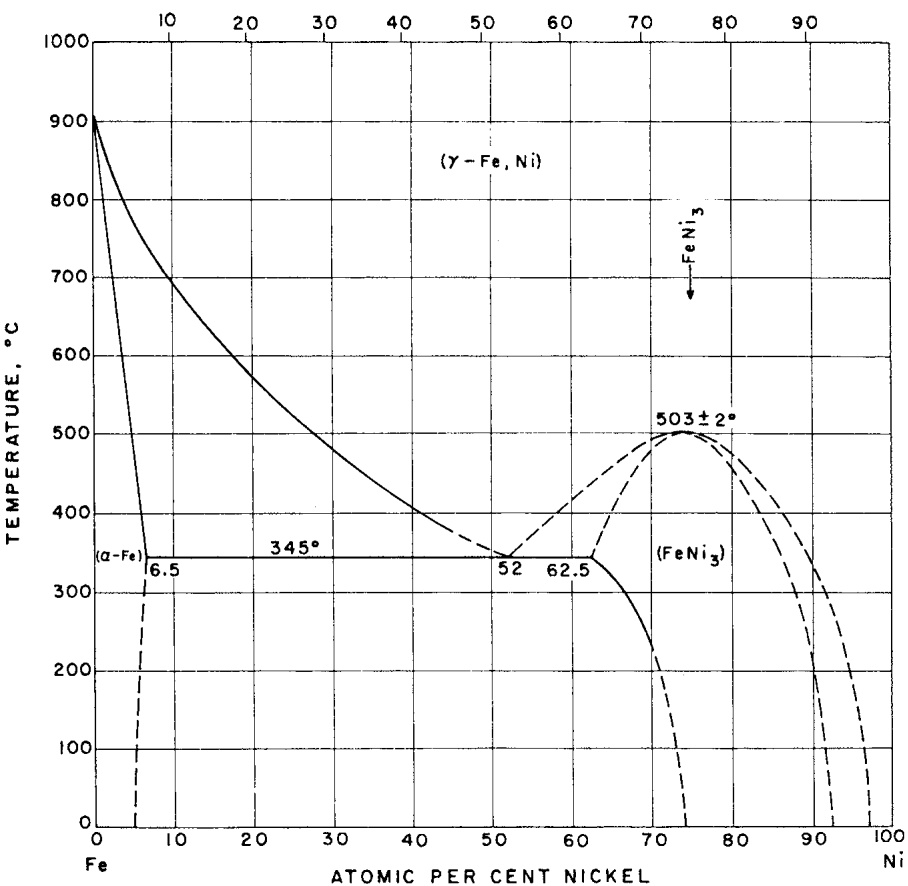

Fig. 10.1 Equilibrium phase diagram of Fe – Ni alloys. [E. J. Swartzendruber, V. P. Itkin, and C. B. Alcock, ASM Handbook, Volume 3 (1992).]

Magnetic annealing evidently creates a preferred domain orientation in the demagnetized state, with the direction of magnetization in each domain tending to lie parallel to the axis of the annealing field. Subsequent magnetization in this direction can then take place preferentially by $180^{\circ}$ wall motion. As a result, magnetostriction and magnetoresistance measured in the annealing direction are reduced to very small values. Figure 10.3 illustrates this point for a Ni – Fe alloy of slightly different composition. The central curve is for a specimen cooled slowly from $1000^{\circ}\mathrm{C}$ in the absence of a field; slow cooling from $600^{\circ}\mathrm{C}$ in a longitudinal field (lower curve) greatly decreases the longitudinal magnetostriction and the same treatment in a transverse field increases it. Furthermore, when the data for the upper curve are replotted in the form of $\lambda$ vs $(B - H)^{2} = (4\pi M)^{2}$ (cgs) or $\lambda$ vs $(B - \mu_0H)^2 = (\mu_0M)^2$ (SI), the result is a straight line in agreement with Equation 8.31. The magnetization process for this specimen (annealing field transverse to axis) is therefore one of pure rotation of the domain vectors through $90^{\circ}$ from their initial positions transverse to the axis.

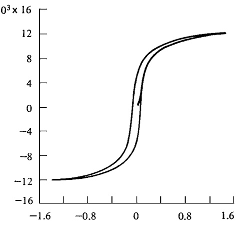

(a)

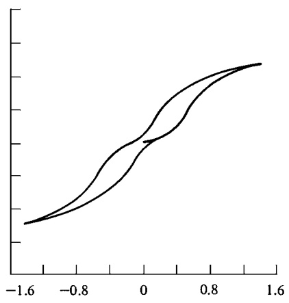

(b)

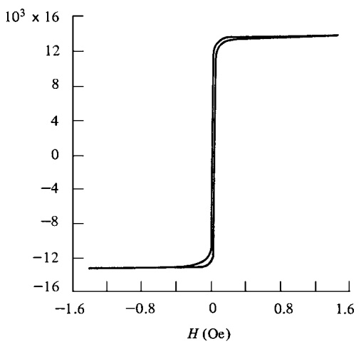

(c)

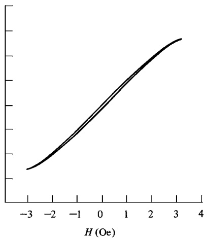

(d)

Fig. 10.2 Hysteresis loops of a 65 Ni – 35 Fe alloy after various heat treatments: (a) annealed at $1000^{\circ}\mathrm{C}$ and cooled quickly, (b) annealed at $425^{\circ}\mathrm{C}$ or cooled slowly from $1000^{\circ}\mathrm{C}$ (c) annealed at $1000^{\circ}\mathrm{C}$ and cooled in a longitudinal field, (d) same as (c) but with a transverse field. [R. M. Bozorth, Ferromagnetism, reprinted by IEEE Press (1993).]

The anisotropy created by magnetic annealing is due to directional order in the solid solution, an idea originated by S. Chikazumi [J. Phys. Soc. Japan, 5 (1950) p. 327]. The theory of this effect was described independently by several authors [L. Néel, J. de Physique et Radium, 15 (1954) p. 225; S. Taniguchi and M. Yamamoto, Sci. Rep. Tohoku Univ., A6 (1954) p. 330; S. Taniguchi, Sci. Rep. Tohoku Univ., A7 (1955) p. 269; S. Chikazumi and T. Oomura, J. Phys. Soc. Japan, 10 (1955) p. 842]. By directional order is meant a preferred orientation of the axes of like-atom pairs. An example, for atoms arranged on a two-dimensional square lattice, is shown in Fig. 10.4. The arrangement in Fig. 10.4a approximates a random solid solution of a 50 – 50 “alloy” of $A$ and B; the atom positions were determined by drawing black and white balls from a box. If the solution were ideally random, there would be 56 black-white (AB) nearest-neighbor pairs, 28 AA pairs, and 28 BB pairs; the arrangement in Fig. 10.4a comes close to this, since it has 54 AB, 28 AA, and 30 BB pairs. Perfect ordering is shown in Fig. 10.4b; all nearest-neighbor pairs are AB, and no AA or BB pairs exist. The arrangement in Fig. 10.4c has directional order in the vertical direction. It has the same 28 AA pairs as Fig. 10.4a, but in Fig. 10.4c 20 of these have vertical axes and only eight have horizontal axes. The same kind of preferred orientation is shown by BB pairs; 19 are vertical and nine horizontal.

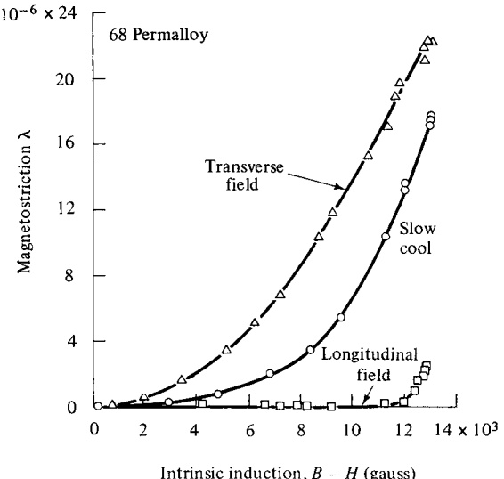

Intrinsic induction, $B$ – $H$ (gauss)

Fig. 10.3 Magnetostriction of a 68 Ni – 32 Fe alloy after various treatments. [H. J. Williams et al. Phys. Rev., 59 (1941) p. 1005.]

Note that directional order can be achieved in a solid solution which is perfectly random in the usual crystallographic sense. Thus, in terms of nearest neighbors only, a 50– 50 solution is random if the neighbors of any given $A$ atom, for example, are on the average half $A$ and half $B$. This solution can deviate from randomness in either of two ways: (1) short-range order, in which more than half of the neighbors of an $A$ atom would be $B$ atoms; and (2) clustering, in which more than half of the neighbors would be $A$ atoms. The solution of Fig. 10.4c shows neither a tendency to short-range order (a preponderance of AB pairs) nor to clustering (a preponderance of AA and BB pairs); it has 56 unlike-atom pairs and 56 like-atom pairs. The like-atom pairs are, however, pre-ferentially oriented. The word “order” in the term “directional order” should therefore not be misconstrued. Whether short-range order or clustering exists depends on the number and kind of atoms surrounding a given atom but not on their relative positions.

How does directional order create magnetic anisotropy? The basic hypothesis of the theory is that there is a magnetic interaction between the axis of like-atom pairs and the direction of the local magnetization such that the two tend to be parallel. (The exact physical nature of this interaction is not specified; presumably it is related, like magnetocrystalline anisotropy, to spin – orbit coupling.) Thus, if a saturating field is applied at a high temperature, the magnetization will be everywhere in one direction and diffusion will occur until there is a preferred orientation of like-atom pairs parallel to the magnetization and the field. On cooling to room temperature, this directional order will be frozen in; the domains that form when the annealing field is removed will then have their local magnetization bound to the axis of the directional order. The anisotropy energy, for random polycrystals, is then of the same form as for other uniaxial anisotropies:

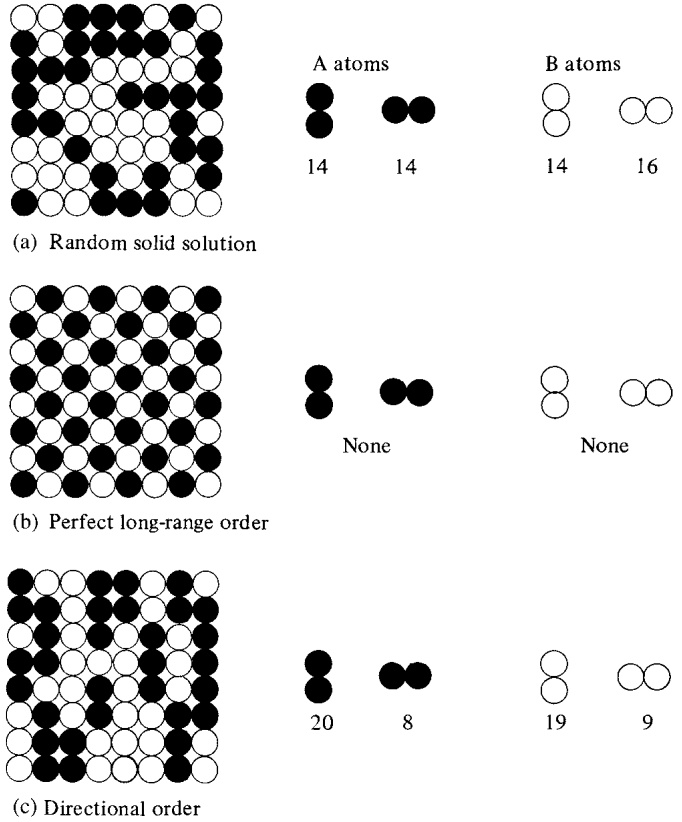

Fig. 10.4 Possible atom arrangements in a square lattice.

$$
E = K _ {\mathrm{u}} \sin^ {2} \theta ,\tag{10.1}
$$

where $K_{u}$ is the anisotropy constant and $\theta$ is the angle between the direction of magnetization and the direction of the annealing field.

The value of $K_{u}$ for polycrystals may be determined by measuring the area between magnetization curves measured in the easy and hard directions, or by the analysis of torque curves, if due allowance is made for the possible contribution of preferred orientation to the observed anisotropy. For single crystals, $K_{u}$ may be found from torque curves, if these are Fourier analysed to separate the field-induced anisotropy from the crystal anisotropy. The values of $K_{u}$ so found are not particularly large. They are typically of the order of a few thousand ergs/cm³ or a few hundred $\mathrm{J / m^3}$ , or no more than 10% of the magnetocrystalline anisotropy energy. The variation of $K_{\mathrm{u}}$ with composition and heat treatment is qualitatively what would be expected from the theory.

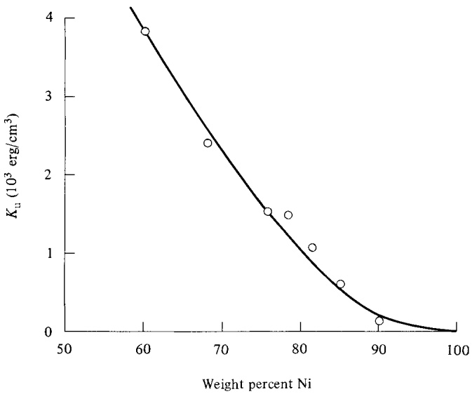

Fig. 10.5 Uniaxial anisotropy constant $K_{u}$ of polycrystalline Ni –Fe alloys, cooled in a field from 600 to $80^{\circ}\mathrm{C}$ at $10^{\circ}\mathrm{C / h}$ . [S. Chikazumi and T. Oomura, J. Phys. Soc. Japan, 10 (1955) p. 842.]

1. $K_{u}$ decreases as the alloy composition approaches a pure metal, since in a pure metal all pairs are like-atom pairs and there can be no directional order. Figure 10.5 shows the results for the Fe – Ni system.

2. $K_{u}$ is zero if long-range order is fully developed, because all pairs are then unlike-atom pairs and no directional order is possible. This can occur at 75 atom% Ni in the Fe–Ni system (Fig. 10.1), where the $\mathrm{FeNi}_{3}$ superlattice shown in Fig. 10.6 can form below a critical ordering temperature of $503^{\circ}\mathrm{C};$ the nearest neighbors in this structure are the corner atoms and those at the centers of the faces. The reader may then wonder how directional order can be produced at this composition. The reason is that crystallographic long-range ordering of this alloy is very sluggish, requiring some 160 h for completion; field annealing of a random solid solution can produce directional order before much long-range order is established. The fact that many alloys which show magnetic annealing are also capable of long-range ordering is a complication that must be kept in mind in the experimental study of magnetic annealing.

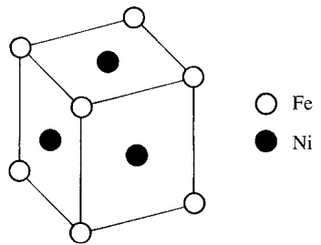

Fig. 10.6 The ordered form of FeNi3.

3. When magnetic annealing is carried out at constant temperature rather than by continuous cooling, $K_{u}$ is found to decrease as the field-annealing temperature is increased. The higher the temperature, the greater is the randomizing effect of thermal energy and the smaller the degree of directional order.

As noted above, the anisotropy induced by field annealing is not particularly strong. This suggests that the directional order is not very strong, certainly not as pronounced as that shown in Fig. 10.4c. If it were, such properties as lattice parameter and elastic constants should be detectibly different in directions parallel and perpendicular to the directionalorder axis in a single crystal; such differences have not been observed. Nor has X-ray or neutron diffraction ever furnished any direct evidence for the existence of directional order. Calculations indicate that the degree of directional order attained in practice is something like 1% of the theoretical maximum.

The behavior of field-annealed single crystals is more complex than that of polycrystals, and Equation 10.1 is not adequate to describe all the phenomena observed. Whereas the annealing field may be made parallel to any crystallographic direction that the experimenter chooses, the axis of directional order is determined by the structure of the crystal. If directional order is due to an interaction between the local magnetization and the axis of nearest-neighbor pairs, as is usually assumed, then the ordering axis must be a crystallographic direction on which nearest neighbors are located, i.e., a direction of close-packing for the structure involved. This direction is the face diagonal <110> for the face-centered cubic structure and the body diagonal <111> for the body-centered cubic structure. If the local magnetization, which we can label as $M_{\mathrm{s}}$ since in a domain the magnetization is saturated, is not parallel to a close-packed direction, directional order can still occur and create an easy axis, but this axis may or may not be parallel to $M_{\mathrm{s}}$ . For example, suppose the annealing field is parallel to [001] in an fcc crystal. Then directional order is equally favored along four of the six <110> directions, namely, [011], [1¯01], [ 01¯1], and [101], which are all equally inclined at $45^{\circ}$ to $M_{\mathrm{s}}$ but not along the [110] and [1¯10] directions, which are at right angles to $M_{\mathrm{s}}$ As a result, an easy axis is created parallel to $M_{\mathrm{s}}$ If the annealing field is along [001] in a bcc crystal, then all four <111> directions are equally inclined to [001] and no anisotropy should result, because none of the four close-packed directions is favored over the others.

The experimental results on single crystals are as follows. When the annealing field is parallel to a simple crystallographic direction like <100>, <110>, or <111> in a cubic crystal, the resulting easy axis is parallel to the annealing field direction, but the value of $K_{u}$ is different for each of these directions. When the annealing field is parallel to <100> in a bcc crystal, $K_{u}$ is observed to be small, but not zero as predicted by theory. Presumably, directional order of second-nearest neighbors, which lie on <100> axes, is taking place. Or maybe the annealing field was not exactly parallel to <100>. When the annealing field is not parallel to one of these simple directions, an easy axis results, but it is not parallel to the annealing field direction; in fact, it can deviate from it by as much as $20^{\circ}$ . For a fuller account of single-crystal behavior and a summary of directionalorder theory, the reader should consult S. Chikazumi [Physics of Ferromagnetism, Oxford University Press (1997)].

Magnetic annealing has also been observed in solid solutions of cobalt ferrite and iron ferrite (called cobalt-substituted magnetite) and in some other mixed ferrites containing cobalt. The effect depends on, but is not caused by, the presence of metal-ion vacancies in the lattice. (Such vacancies can be created by heating the ferrite in oxygen.) The $\mathrm{Co}^{2+}$ ion in a cubic spinel occupies an octahedral site (Table 6.2, Fig. 6.2) lying on a <111> axis of the crystal, and, for reasons described by Chikazumi, this ion creates a local uniaxial anisotropy parallel to that <111> axis on which it resides. In a non-field-annealed crystal all four <111> axes will be equally populated by $\mathrm{Co}^{2+}$ ions and the local anisotropies will cancel out, leaving only the cubic crystal anisotropy. In the presence of an annealing field, however, the $\mathrm{Co}^{2+}$ ions will tend to occupy the <111> axis closest to the field, producing an observable and rather large uniaxial anisotropy. Directional order of $\mathrm{Co}^{2+}-\mathrm{Co}^{2+}$ pairs is thought to be a contributing factor. The role of vacancies is to insure enough diffusion of the metal ions for substantial ordering to take place.

It is important to realize that directional order, whether of like-atom pairs in an alloy or $\mathrm{Co}^{2+}$ ions in a cobalt-containing ferrite, is not due to the field applied during annealing, but to the local magnetization. All that the applied field does is to saturate the specimen, thereby making the direction of spontaneous magnetization uniform throughout. It follows that a material that responds to magnetic annealing will undergo local self-magnetic-annealing if it is heated, in the demagnetized state and in the absence of a field, to a temperature where substantial diffusion is possible. Directional ordering will then take place in each domain, parallel to the $M_{\mathrm{s}}$ vector of that domain, and in each domain wall, parallel to the local spin direction at any place inside the wall. [Strictly, the directional ordering will take place along the close-packed direction(s) nearest to $M_{\mathrm{s}}$ in the domains and in the domain wall.] This directional order, differing in orientation from one domain to another, is then frozen in when the specimen is cooled to room temperature. The result is that domain walls tend to be stabilized in the positions they occupied during the anneal.

The effect differs in kind for $90^{\circ}$ and $180^{\circ}$ walls. When a $90^{\circ}$ wall is moved a distance x by an applied field, it sweeps out a certain volume. In the volume swept out, the $M_{\mathrm{s}}$ vector is now at $90^{\circ}$ to the axis of directional order. The potential energy of the system, which is just the anisotropy energy, must therefore increase from 0 to $K_{u}$ per unit volume swept out, according to Equation 10.1. The potential energy then varies with x as shown by the dashed line of Fig. 10.7a. The slope of this curve is the force on the wall which the field must exert to move the wall. This force soon becomes constant, as shown in Fig. 10.7b, and so does the restoring force tending to move the wall back to its original position. A $180^{\circ}$ wall, on the other hand, separates domains in which the directional order is identical. But the directional order axes within the wall itself differ from the axis in the adjoining domains. The energy of the system therefore increases as the wall is moved from its original position, but soon becomes constant when the wall is wholly within one of the original domains. The force to move the wall, and the balancing restoring force, increases to a maximum and then returns to zero. Each kind of wall is stabilized by the potential well built up around it by directional order, but the shape of the well depends on the type of wall.

These considerations explain the constricted or “wasp-waisted” hysteresis loops found in self-magnetically annealed alloys and ferrites. Such a loop was first observed in Perminvar and is sometimes called a “Perminvar loop.” This alloy usually contains 25% Co, 45% Ni, and 30% Fe, but the composition may vary over wide limits. It has the remarkable and useful property of constant permeability (hence its name) and almost zero hysteresis loss at low field strengths, as shown in Fig. 10.8a. As the field is cycled between increasingly larger limits, the $B$, $H$ line progressively opens up into a loop but with essentially zero remanence and coercive force, as in Fig. 10.8c. The “Perminvar loop” is shown in Fig. 10.8d. Its fundamental characteristic is near-zero remanence. The loop for a sample driven nearly to saturation is shown in Fig. 10.8e; the remanence is no longer near zero, but is still abnormally low. If the alloy is annealed at $600^{\circ}\mathrm{C},$ a temperature too high for directional order to be established, and then quickly cooled, minor hysteresis loops of normal shape are observed at all field strengths.

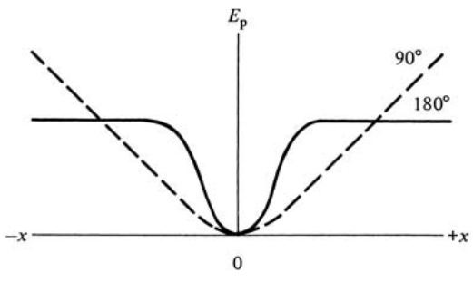

(a)

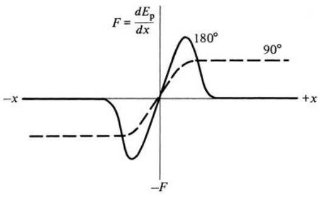

(b)

Fig. 10.7 (a) Potential energy $E_{\mathrm{p}}$ as a function of the displacement x of $90^{\circ}$ and $180^{\circ}$ walls from a stabilized position. (b) Force $F$ required to move the wall (schematic).

The magnetic behavior shown in Fig. 10.8 can be qualitatively understood in terms of the potential wells of Fig. 10.7. There is the added complication that in a real material $90^{\circ}$ and $180^{\circ}$ walls form a complex network, so that one kind of wall cannot move independently of the other. But at sufficiently low fields, neither kind of wall moves out of its potential well, and the reversible behavior of Fig. 10.8a results. Higher fields cause larger wall displacements, some of which are irreversible. However, when the field is reduced to zero, most of the walls return to their original positions, leading to the abnormally low remanence characteristic of the Perminvar loop in Fig. 10.8d. It will be noted in Fig. 10.8d that the permeability is small up to a field of about 3 Oe and then more or less abruptly becomes larger. This is the critical field (often called the stabilization field) required to move $180^{\circ}$ walls out of their potential wells; after they are out, subsequent motion becomes much easier and the permeability increases. Finally, if the material is driven to near saturation, as in Fig. 10.8e, the original domain structure is destroyed. Then when the field is reduced to zero, a new domain structure forms with many walls in positions unrelated to the existing potential wells. The hysteresis loop then approaches a normal shape, but with an abnormally low remanence because some domain walls (presumably mostly $90^{\circ}$ walls) have returned to their original positions.

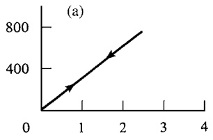

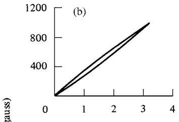

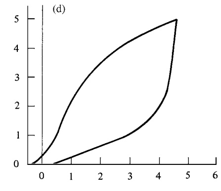

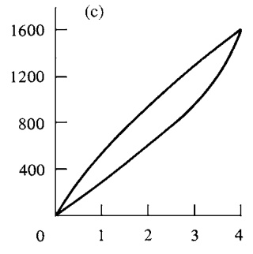

H (Oe)

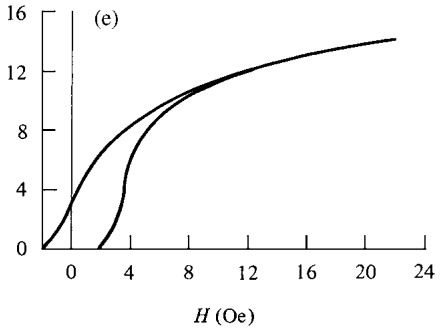

Fig. 10.8 Hysteresis loops of Perminvar annealed at $425^{\circ}\mathrm{C}$ [R. M. Bozorth, Ferromagnetism, reprinted by IEEE Press (1993).]

## 10.3 MAGNETIC ANNEALING (INTERSTITIAL SOLID SOLUTIONS)

The only common examples of interstitial solid solutions in magnetic materials are carbon and nitrogen in body-centered-cubic a iron or iron alloys. The C and N atoms are so small that they can fit into the spaces between the iron atoms, either at the centers of the edges or at the centers of the faces of the unit cell (Fig. 10.9), without producing too much distortion. We can distinguish x, y, and z sites for the interstitial atoms; an x site, for example, is one on a [100] edge. A face-centered site such as f is entirely equivalent to an edge site. The one shown is on a [100] line joining the body-centered iron atom to a similar atom in the next cell (not shown); this f site is therefore equivalent to an x site.

The solubility of C or N in iron is so low that not more than one of these available sites is occupied in any one unit cell. The equilibrium solubility of C, for example, ranges from nearly zero at room temperature to a maximum of about 0.025 wt% at $723^{\circ}\mathrm{C}$ The latter figure corresponds to only one C atom in 500 unit cells, about the number of cells contained in a cube of eight cells on each edge. The solubility of N is larger, but still small.

For experimental purposes it may be necessary to control the amount of C and N in solution. This is done by heat treatment in an appropriate gaseous atmosphere. Both C and N can be removed from iron by annealing for several hours at $800^{\circ}\mathrm{C}$ in hydrogen containing a small amount of water vapor. These interstitials can then be added in controlled amounts by heating the iron at $725^{\circ}\mathrm{C}$ in a mixture of hydrogen and a carbonbearing gas like carbon monoxide or methane (to add C) or in a mixture of hydrogen and ammonia (to add N). The amount introduced at high temperature can be retained in solution at room temperature by quenching.

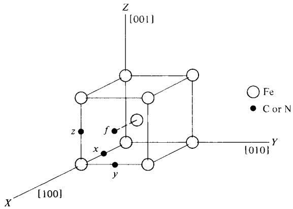

Fig. 10.9 Positions of carbon or nitrogen atoms in the unit cell of iron.

In paramagnetic a-iron, the x, y, and z sites are crystallographically equivalent and equally populated by any C or N in solution. (We will consider only C from now on. Both interstitials have the same effect.) Below the Curie point, however, in the presence or absence of an applied field, some sites will be preferred over others, depending on the direction of the local magnetization. This preference was first suggested by Néel [J. Phys. Radium, 12 (1951) p. 339; 13 (1952) p. 249], who was following up an earlier idea due to J. L. Snoek [Physica, 8 (1941) p. 711]. Just what sites are preferred was demonstrated by G. DeVries et al. [Physica, 25 (1959) p. 1131] by means of an ingenious experiment which is described here in a slightly simplified form. They took a single-crystal disk of iron cut parallel to (001) and containing 0.008 wt% C (80 ppm C) in solution, and cemented a strain gage on it to measure strain in the [010] direction, as indicated in Fig. 10.10a. The strain gage was connected to a recorder which plotted strain vs time. The disk was placed in a saturating field parallel to [100] and maintained at a temperature of $-23^{\circ}C$ . After the C atoms had reached equilibrium positions with $H$ parallel to [100], the disk was quickly rotated $90^{\circ}$ at time $t_{1}$ to make [010], and the strain gage, parallel to the field. What happened is shown in Fig. 10.10b. Because the magnetostriction $\lambda_{100}$ is positive in iron, the gage was contracted before the rotation. When rotated, the gage showed an instantaneous elongation because of the positive magnetostrictive strain along its length, followed immediately by a slow contraction, amounting to about 4% of $\lambda_{100}$ Now the C atoms in iron are somewhat too big for the holes they occupy, so they cause a slight expansion of the lattice. The observed contraction shows that C atoms originally in y sites began to diffuse away from these sites as soon as the Y-axis became parallel to the magnetization. Evidently, before the rotation when $H$ was parallel to X, there were more C atoms in y and z sites than in x sites. The C atoms therefore preferentially occupy sites in a plane normal to $M_{s}$

This result was unexpected. Because each domain in iron is spontaneously elongated parallel to $M_{s}$ , and contracted at right angles, there should be more room for a C atom in an x site than in a y or z site in a domain that is magnetized in the [100] or X direction. The converse is true. This result can be understood in a general way by assuming that the electron cloud around an iron atom is elongated parallel to the spontaneous magnetization, as indicated in Fig. 10.11. This assumption explains both the positive value of $\lambda_{100}$ and the greater amount of room for C atoms in y or z sites when $M_{\mathrm{s}}$ is parallel to X.

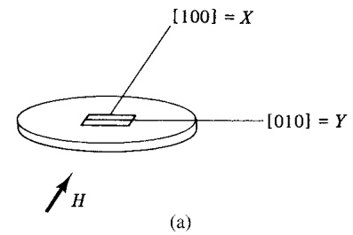

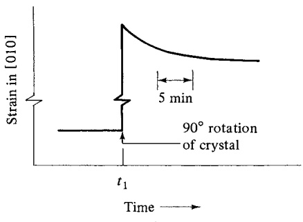

(b)

Fig. 10.10 Experiment to determine the preferred interstitial sites in iron. [After DeVries et al. Physica, 25 (1959) p. 1131.]

There is no direct evidence to support the assumption that like-atom pairs in a substitutional solid solution have their axes parallel to the local direction of $M_{\mathrm{s}}$ The other possibility is that these pair axes lie in a plane normal to $M_{\mathrm{s}}$ which would make the axes of unlike-atom pairs preferentially parallel to $M_{\mathrm{s}}$ An experiment on substitutional alloys to decide between these possibilities, analogous to the experiment of DeVries et al., has not yet been done.

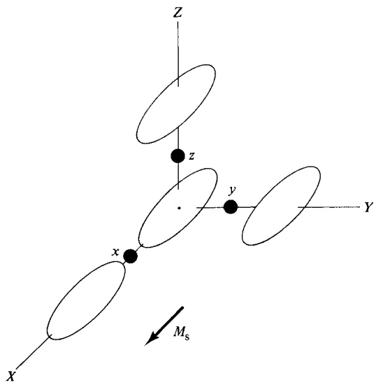

Fig. 10.11 Relation of interstitial sites x, y, z to iron atoms elongated in the magnetization direction.

We see then that the interstitial sites in iron are preferentially occupied by C atoms in a manner governed by the local magnetization, namely, in a plane normal to the $M_{\mathrm{s}}$ direction. This direction becomes an easy axis, and the resulting anisotropy is described by Equation 10.1. The value of $K_{u}$ is quite small, being 166 ergs/cm³ [1660 J/m³] for C at $-34^{\circ}\mathrm{C}$ and $71\mathrm{ergs / cm^3}$ $[710\mathrm{J / m^3}]$ for N at $-47^{\circ}\mathrm{C}$ [J. C. Slonczewski, Magnetism, Volume I, p. 205, G. T. Rado and H. Suhl, eds., Academic Press (1963)]. The cause of this anisotropy, like that due to directional order of solute – atom pairs, is assumed to be entirely magnetic, i.e., if the local magnetization $M_{\mathrm{s}}$ is in, say, the X direction, then the energy of a C atom in an x site is larger than it is in a y or z site.

Although the induced anisotropy in an Fe –Ni alloy and the induced anisotropy in iron containing C are formally the same (both are due to an anisotropic distribution of solute atoms), there is a large difference in the kinetics of the two, because interstitial atoms diffuse much faster than substitutional atoms. For example, the frequency at which C atoms jump from one interstitial site to a neighboring one in iron at room temperature is about once a second. This means that it is impossible to set up a preferred distribution of C atoms by magnetic annealing at an elevated temperature and preserve it by fast cooling to room temperature with or without a field, because soon after the annealing field is removed, diffusion destroys the anisotropy. It also means that iron containing C will self-magnetically anneal at room temperature and that domain-wall stabilization will occur by virtue of the potential wells of Fig. 10.7. Although the potential wells due to directional order of solute – atom pairs and those due to substitutional atoms are of slightly different shape, domain wall stabilization due to either cause can be qualitatively discussed in terms of Fig. 10.7.

All quantitative measurements mentioned in this section were made at subzero temperatures, in order to slow down the diffusion of carbon to a point where the measurement can be made in a convenient time. Even then the measurement is dynamic, rather than static, in character. For example, in the experiment of Fig. 10.10, the disturbed distribution of C atoms immediately began to change to a new distribution and the change was complete in about 20 minutes at $-23^{\circ}C$

Domain-wall stabilization does nevertheless lead to observable magnetic effects at room temperature, but the experiments required are of a different nature than those we have so far encountered. The effects are called “time effects,” and we shall postpone their discussion to Chapter 12.

## 10.4 STRESS ANNEALING

When a uniaxial stress is applied to a solid solution, magnetic or not, interstitial or substitutional, the distribution of solute atoms will become anisotropic if the temperature is high enough for rapid diffusion. In an interstitial solution, for example, x sites will be preferred if a tensile stress is applied along the X axis, simply because of the elongation along that axis. In a substitutional solution, the axes of like-atom pairs may be oriented parallel or perpendicular to the axis of tension, depending on the alloy. In either case, the resulting anisotropic distribution of solute can be frozen in by cooling to a temperature where diffusion is negligible.

If the material is magnetic, the effect becomes more complicated. Because of the magnetoelastic interaction, the stress s will change the domain structure by reorienting the domain vectors. If $\lambda_{\mathrm{si}}\sigma$ is large enough and positive, the local magnetization in each domain will be parallel to the stress axis; if it is negative, the magnetization will be at right angles to the stress. If the alloy is one that responds to magnetic annealing, then the solute distribution will change in response to the local direction of magnetization. Two independent forces, stress and magnetization, are thus acting to change the solute distribution. These may favor the same or different distributions, depending on the alloy, and the result is not predictable. The resulting magnetic anisotropy, if any, is uniaxial.

Stress annealing has been studied only in a few substitutional alloys. There is an experimental problem: soft magnetic alloys are mechanically weak, especially at elevated temperatures, so only small stresses can be applied during annealing if the deformation is to be purely elastic. In 50 Ni – 50 Co the easy axis is parallel to the tension axis; in 45 Ni – 55 Fe it is at right angles; $K_{u}$ is less than $10^{3}\mathrm{ergs/cm}^{3}$ or $10^{4} \mathrm{~J} / \mathrm{m}^{3}$ for a stress of $2.5\mathrm{kg/mm^{2}}$ (3600 lb /in² or 25 MPa). In Fe + 22 atom%Al, cooling from $550^{\circ}\mathrm{C}$ under a tensile stress of 14 kg/mm2 (20,000 lb /in² or 140 MPa) produces an easy axis parallel to the stress, with $K_{u}$ equal to about $17 \times 10^{2} \mathrm{ergs/cm}^{3} (170 \times 10^{3} \mathrm{J/m}^{3})$ ; this is almost double the value of $K_{u}$ obtained by cooling in a field [H. J. Birkenbeil and R. W. Cahn, J. Appl. Phys., 32 (1961) p. 362S].

## 10.5 PLASTIC DEFORMATION (ALLOYS)

A uniaxial anisotropy can be induced in certain substitutional alloys simply by plastic deformation at room temperature. Ni –Fe alloys have received the most attention. The usual method of deformation has been by rolling, and the effect is often called roll magnetic anisotropy. Equation 10.1 still applies, where u, measured in the plane of the sheet, is now the angle between the local magnetization and the rolling direction (RD). The magnitude of $K_{u}$ can be considerable, more than $2 \times 10^{5} \mathrm{erg/cm}^{3} (2 \times 10^{6} \mathrm{~J/m}^{3})$ . This is larger than the crystal anisotropy constant of nickel, of any high-Ni alloy in the Ni – Fe system, and of most cubic ferrites, but smaller than that of iron (Table 7.4). Depending on the crystallographic orientation of the specimen before rolling, the easy axis can be parallel to the RD (positive $K_{\mathrm{u}})$ or at right angles to the RD and parallel to the transverse direction (TD) (negative $K_{u}$ The main observations on rolled Ni –Fe alloys can be grouped as follows:

1. Polycrystals with randomly oriented grains. When this material is rolled, the easy axis is parallel to the RD and $K_{\mathrm{u}}$ varies with Ni content according to curve (a) of Fig. 10.12.

2. Polycrystals with {100} <001> preferred orientation. By heavy cold rolling followed by recrystallization, the cube texture {100} <001> can be obtained. When this material is again rolled, an easy axis at right angles to the RD develops. $K_{u}$ is therefore negative; its magnitude is shown by curve (b) in Fig. 10.12. A 50 Ni – 50 Fe alloy so treated is called Isoperm, because its permeability in the RD is constant right up to saturation; in the demagnetized state, its Ms vectors lie at $90^{\circ}$ to the RD, and magnetization in the RD is accomplished entirely by domain rotation.

3. Single crystals. The easy axis of a rolled single crystal may be either parallel or at right angles to the RD, depending on the crystal orientation. Examples are given later.

The anisotropy induced by plastic deformation has been explained by in terms of directional order; the theory is summarized by Chikazumi [Physics of Ferromagnetism, Oxford University Press (1997)], who has done much of the basic work in this field. This directional order is created not by diffusion, as in magnetic annealing, but by slip.

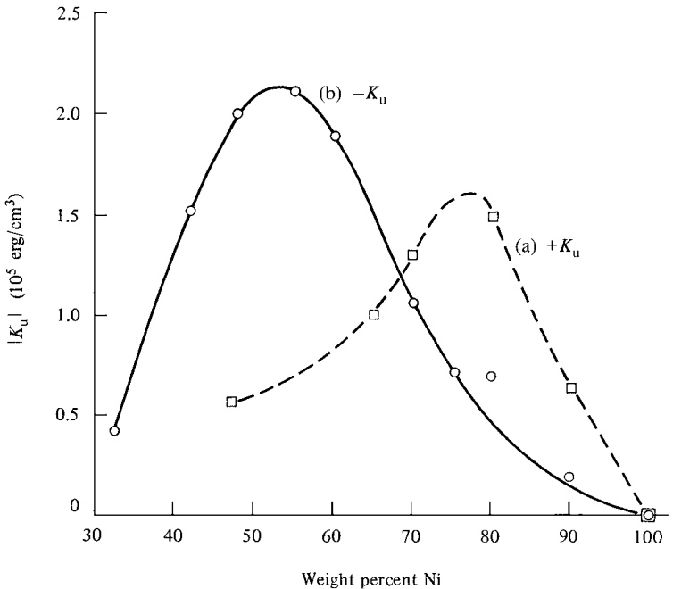

Fig. 10.12 Uniaxial anisotropy constant $K_{u}$ of rolled polycrystalline Ni –Fe alloys. (a) Randomly oriented grains rolled to 33% reduction in thickness. (b) Cube-texture material rolled to 55% reduction. [After G. W. Rathenau and J. L. Snoek, Physica, 8 (1941) p. 555.]

How this can occur is shown in Fig. 10.13 for a perfectly ordered superlattice like FeNi3. Slip by unit distance on the (111) plane in the [011¯] direction, resulting from the passage of a single dislocation, has created like-atom pairs across the slip plane where none existed before; the double lines indicate BB pairs, with axes in the [011] direction. This direction therefore becomes a local easy axis. If a second dislocation passes, the crystal becomes perfectly ordered again, with no like-atom pairs. Thus directional order is created only if an odd number of dislocations pass along the slip plane. When a face-centered cubic crystal is deformed by rolling, at least two slip systems (combination of a slip plane of the form {111} and a slip direction of the form <110>) must operate to accomplish the observed change in shape, which is a lengthening in the rolling direction, a reduction in thickness, and little or no increase in width. There are thus at least two orientations of the local easy axes, corresponding to the two orientations of active slip planes.

A further complication is that an ordered crystal is never completely ordered throughout its volume, but is made up of a number of “antiphase” regions. In order – disorder language, these are called domains, but the word “region” will be substituted here to avoid confusion with magnetic domains. The crystal structure is out of step at the boundaries of these regions, and only within them is the order perfect. When the slip distance is large enough to bring a substantial portion of one antiphase region into contact with another across the slip plane, new orientations of like-atom pairs become possible. In this way slip on the (111) plane, for example, can create BB pairs not only in the [011] direction shown in Fig. 10.13 but also in [110] and [101]. The same result is expected when only short-range order exists. The various orientations of like-atom-pair axes in the deformed crystal then combine to give a single easy axis for the whole specimen.

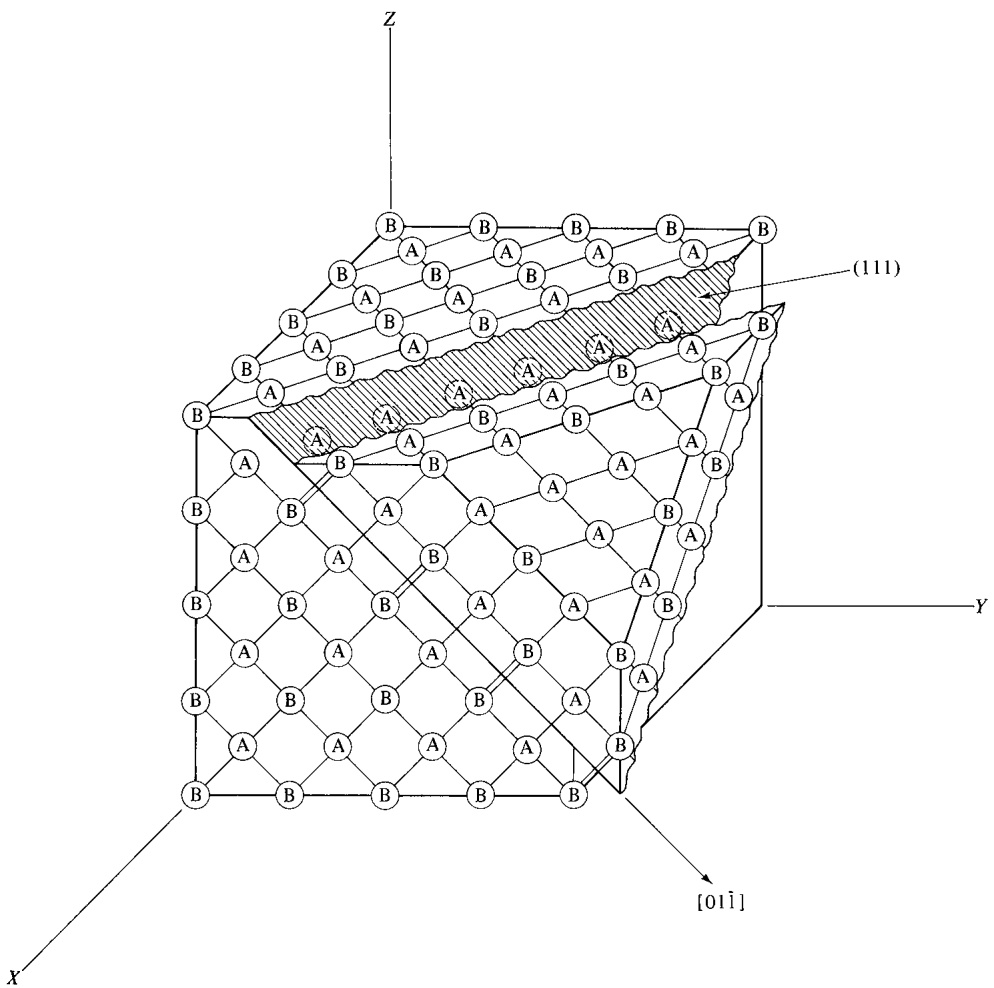

Fig. 10.13 Formation of AA and BB pairs by slip in an $A_{3}B$ superlattice. [S. Chikazumi, Physics of Magnetism, Oxford University Press (1997).]

The theory of Chikazumi et al. takes into account the orientations of the active slip systems when a crystal of a particular orientation is rolled, together with the orientations of like-atom pairs created by slip on these systems, and it yields a prediction of the easy axis of the rolled crystal. Chikazumi and his co-workers tested such predictions by rolling single crystals of the $\mathrm{FeNi}_{3}$ composition and measuring the resultant anisotropy; the agreement with theory was very good.

If we leave aside the complex details of the theory, we can still understand, in a qualitative way, why rolling an alloy single crystal should induce in it a magnetic anisotropy. Given the facts (1) that directional order of like-atom pairs creates an easy axis in some alloys, (2) that slip can create like-atom pairs where none existed before, (3) that the axes of such pairs must be oriented in particular ways with respect to the slip planes, and, finally, (4) that the slip planes which operate have particular orientations in the crystal, it follows that the local easy axes due to like-atom pairs must have particular orientations throughout the crystal. These local easy axes then combine to give a net overall anisotropy to the crystal as a whole. This general argument cannot, of course, predict the orientation of the resultant easy axis, or, for that matter, even show that the resultant anisotropy should be uniaxial rather than, say, biaxial.

When an Ni –Fe polycrystal with randomly oriented grains is rolled, the RD becomes an easy direction (Fig. 10.12). This result is not understood. Bitter-pattern examination of the rolled material shows that the direction of the easy axis, as judged by the orientation of $180^{\circ}$ walls, varies from one grain to another; the observed anisotropy is thus an average over all the grains in the specimen. Theoretical analysis is forbiddingly complex. When a polycrystal is deformed, as many as five slip systems can operate within a single grain, because the change in shape of that grain must conform to the changes in shape of all the neighboring grains, a requirement not imposed on a rolled single crystal.

There is little doubt that slip-induced anisotropy is due to directional order, because the magnitude of $K_{u}$ varies with composition, and thus with the likelihood of having like-atom pairs, in much the same way after rolling (Fig. 10.12) as after magnetic annealing (Fig. 10.5). However, it is not clear why the two curves in Fig. 10.12 should peak at different compositions. The magnitude of $K_{u}$ after rolling is some 50 times larger than after magnetic annealing, which shows that slip can produce a far larger concentration of like-atom pairs.

Roll magnetic anisotropy has also been observed in Fe –Al, Ni –Co, and Ni –Mn alloys. Chin et al. [G. Y. Chin, J. Appl. Phys., 36 (1965) p. 2915; G. Y. Chin, E. A. Nesbitt, J. H. Wernick, and L. L. Vanskike, ibid., 38 (1967) p. 2623] have extended the theory and experiments to deformation by wire drawing, roll flattening (rolling of wire), flat drawing (drawing through a rectangular die), and plane strain compression. The last of these simulates rolling, but the compression is carried out in a die which prevents the lateral spreading which occurs when single crystals of certain orientations are rolled.

## 10.6 PLASTIC DEFORMATION (PURE METALS)

Krause and Cullity [R. F. Krause and B. D. Cullity, J. Appl. Phys., 39 (1968) p. 5532] cut disk specimens from a flat strip of annealed, polycrystalline nickel and measured torque curves in an applied field of 9 kOe or 72 kA/m. The result is shown in Fig. 10.14 (curve labeled “Annealed”), where $\theta$ is the angle between the applied field and the long axis of the strip, which is the direction in which the strip was rolled before being annealed. There is a very weak, biaxial anisotropy, like that described by Equation 7.8, due to a small amount of preferred orientation; the easy axes are at 0 and $90^{\circ}$ to the strip axis.

If the strip is now stretched a few percent, the torque curve is radically changed. The maxima are now some ten times higher and occur at different values of $\theta$. A fairly strong uniaxial anisotropy has been created, with the easy axis parallel to the direction of elongation. Compression has the reverse effect; the anisotropy is again uniaxial, but the easy axis is at $90^{\circ}$ to the direction of compression. This anisotropy is also governed by Equation 10.1, where $\theta$ is the angle between the magnetization and the deformation axis (tensile or compressive). Fourier analysis of the torque curves for deformed specimens permits the separation of the uniaxial anisotropy caused by deformation from the weak biaxial anisotropy caused by texture. The value of $K_{u}$ was found to increase rapidly with tensile strain up to a maximum of 2700 ergs/cm³ (27 kJ/m³) at 2.5% strain; it then decreased slowly with further deformation. After 2.5% compression, $K_{u}$ was $-2400 \mathrm{ergs} / \mathrm{cm}^{3} (-24 \mathrm{kJ} / \mathrm{m}^{3})$

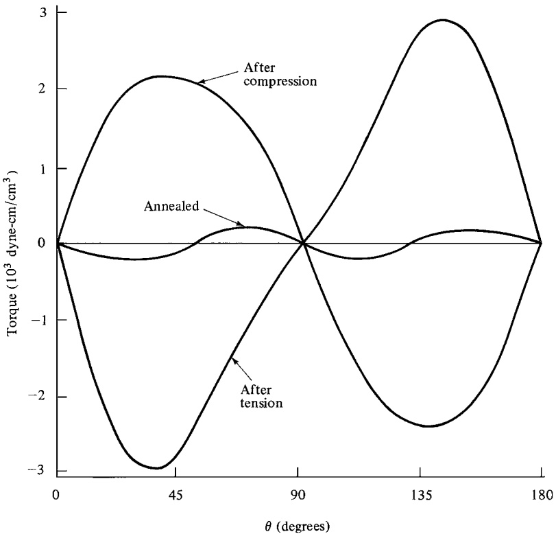

Fig. 10.14 Torque curves for annealed nickel and for nickel after plastic tension and compression of 2.5%. [After R. F. Krause and B. D. Cullity, J. Appl. Phys., 39 (1968) p. 5532.]

Examination of the deformed specimens by X-ray diffraction revealed the presence of residual stress, because the X-ray lines were both shifted and broadened. The line shift, as mentioned in Section 9.9, indicates a stress which is more or less constant over most of the specimen volume, and the broadening reflects stress variations about the mean in this volume. The X-ray observations are consistent with the assumed stress distribution of Fig. 9.35, for a specimen previously deformed in tension. The material can then be viewed as consisting of regions in longitudinal compression (C regions) and regions in tension (T regions). The C regions comprise most of the specimen volume and are responsible for the X-ray effects, while the smaller T regions add nothing observable to the X-ray pattern. The C regions have been tentatively identified with the subgrains which form within each plastically deformed grain, and the T regions with the subgrain boundaries. After plastic compression, the stress distribution of Fig. 9.35 is inverted; most of the specimen is then in a state of tensile stress in the direction of previous compression. These conditions are not peculiar to nickel but have been observed in a number of metals and alloys. Actually, the stress state at the surface of the deformed nickel was found to be one of biaxial compression after plastic tension and biaxial tension after plastic compression. This complication does not invalidate the argument given below and will be ignored in what follows.

The observed magnetic anisotropy after plastic deformation is attributed to the residual stress described above. Because residual stresses must form a balanced-force system, a simple argument leads to the conclusion that they could not cause any net anisotropy. To see this, we take Equation 8.23, which governs stress anisotropy, and write the magnetoelastic energy as

$$
E _ {\mathrm{me}} = 3 / 2 \lambda_ {\mathrm{si}} \sigma \sin^ {2} \theta .\tag{10.2}
$$

Suppose that a residual tensile stress $\sigma_{\mathrm{T}}$ exists, in certain portions of the specimen, parallel to a particular axis from which $\theta$ is measured, and a residual compressive stress $\sigma_{\mathrm{C}}$ exists in other portions, parallel to the same axis. Let $f_{\mathrm{T}}$ and $f_{\mathrm{C}}$ be the volume fractions of the specimen in residual tension and compression, respectively. Then the magnetoelastic energy per unit volume of such a specimen becomes

$$
E _ {\mathrm{me}} = 3 / 2 \lambda_ {\mathrm{si}} (f _ {\mathrm{T}} \sigma_ {\mathrm{T}} + f _ {\mathrm{C}} \sigma_ {\mathrm{C}}) \sin^ {2} \theta .\tag{10.3}
$$

If relative cross-sectional areas of the regions under tension and compression are assumed equal to their relative volumes, a balance of forces requires that

$$
f _ {\mathrm{T}} \sigma_ {\mathrm{T}} + f _ {\mathrm{C}} \sigma_ {\mathrm{C}} = 0,\tag{10.4}
$$

where $\sigma_{\mathrm{T}}$ is taken as positive and $\sigma_{\mathrm{C}}$ as negative. The magnetoelastic energy is therefore zero, provided that the specimen is completely saturated at all values of $\theta$. Then $M_{s}$ in the tensile regions, $M_{\mathrm{s}}$ in the compressive regions, and the applied field are all parallel to one another, and it is then justifiable to write Equation 10.3 in terms of a single angle $\theta$ between $M_{\mathrm{s}}$ and the stress axis. Then, whatever the nature of the residual stress state, no magnetic anisotropy will result. Physically, for any value of u, the torque on $M_{\mathrm{s}}$ due to the regions in tension is exactly balanced by an opposing torque on $M_{s}$ due to the regions in compression.

Some portions of the specimen, however, are not fully saturated at all angles u, and this condition causes the observed anisotropy. After plastic tension, for example, most of the specimen volume is in compression parallel to the deformation axis; these regions (the C regions) are therefore easy to magnetize along this axis, because $\lambda_{\mathrm{si}}$ is negative for nickel. The average stress in the T regions is necessarily larger than that in the C regions, because the cross section of the T regions is smaller. Therefore, the $M_{\mathrm{s}}$ vectors in the T regions, initially at right angles to the deformation axis, strongly resist rotation by a field applied along that axis. The T regions are thus difficult to saturate, but they comprise such a small fraction of the total volume, estimated at about one-tenth, that the specimen as a whole acts as though it had an easy axis parallel to the deformation axis. The same argument in reverse will account for the easy axis at right angles to the axis of previous compression.

Presumably plastic tension or compression would produce the same kind of anisotropy in other polycrystalline ferromagnetic metals, or in alloys. In alloys this anisotropy would be superimposed on any anisotropy that might result from deformation-induced directional order.

## 10.7 MAGNETIC IRRADIATION

The physical and mechanical properties of any material are usually changed when it is bombarded with neutrons, ions, electrons, or gamma rays. These property changes are due to the atomic rearrangements, called radiation damage, brought about by the radiation, and the kind of rearrangement depends on the kind of radiation. For example, neutrons, being uncharged particles, are highly penetrating. When incident on a solid, they can travel relatively large distances between collisions with atoms of the solid. Each collision, however, causes displacement of one or more atoms into interstitial positions, leaving vacancies behind. (Interstitials and vacancies are collectively called point defects to distinguish them from a line imperfection like a dislocation.) Neutron bombardment is therefore expected to create point defects distributed rather widely through the irradiated material.

A curious aspect of radiation damage is the fact that it can produce a substantial increase in the mechanical strength and hardness of many metals and alloys, just as cold work can, but without a corresponding increase in magnetic hardness. In fact, irradiation can make some materials magnetically softer, as described below. Radiation-induced defects are apparently more effective in impeding dislocations than in impeding domain walls. The effect of radiation damage on magnetic properties has been studied mainly in Ni –Fe alloys subjected to fast neutron bombardment.

Schindler et al. [A. I. Schindler and E. I. Salkovitz, J. Appl. Phys., 31 (1960) p. 245S; A. I. Schindler, R. H. Kernohan, and J. Weertman, J. Appl. Phys., 35 (1964) p. 2640] investigated polycrystalline Ni –Fe alloys containing from 50 to 80% Ni. When these alloys, which already had fairly square hysteresis loops, were irradiated with neutrons at room temperature and without a magnetic field, the coercive force $H_{c}$ increased, the remanence $B_{r}$ decreased, and the hysteresis loop became constricted at top and bottom. These results were ascribed to radiation-induced directional order in each domain; this can occur at room temperature because the vacancies created by irradiation speed up diffusion. (Why the hysteresis loop becomes constricted at top and bottom, rather than in the center like the Perminvar loop of Fig. 10.8d, is not clear. Possibly a central constriction would have been observed in a loop measured at a lower maximum field.) When the irradiation was carried out in the presence of a saturating magnetic field, $H_{c}$ was somewhat larger that that of an unirradiated specimen, but $B_{r}$ became considerably larger, i.e., the loop became even more square. These results are consistent with the assumption that directional order was created parallel to the field applied during irradiation, again because of the diffusion-enhancing effect of radiation.

Néel et al. [L. Néel, J. Pauleve, R. Pauthenet, J. Laughier, and D. Dautreppe, J. Appl. Phys., 35 (1964) p. 873] found that a very large uniaxial anisotropy could be created in a single crystal of 50 Ni – 50 Fe (atomic percent) by subjecting it simultaneously to (1) heat (a $295^{\circ}\mathrm{C}$ anneal), (2) fast neutron irradiation, and (3) a magnetic field. When the field is parallel to [100], that direction becomes an easy axis with an anisotropy energy given by

$$
E = K _ {1} \sin^ {2} \theta + K _ {2} \sin^ {4} \theta ,\tag{10.5}
$$

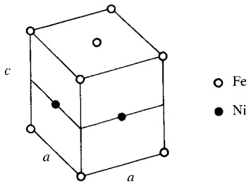

Fig. 10.15 Ordered FeNi, which has the same structure as ordered AuCu.

where $K_{1}$ and $K_{2}$ are equal to $3.2\times10^{6}$ and $2.3 \times 10^{6} \mathrm{ergs/cm}^{3} (32 \times 10^{6}$ and $23 \times 10^{6} \mathrm{~J/m}^{3}$) respectively, and $\theta$ is the angle between the magnetization and [100]. X-ray diffraction showed that the face-centered-cubic random solid solution had undergone long-range ordering by changing to the “AuCu structure” shown in Fig. 10.15. This structure consists of alternate layers of iron and nickel atoms, parallel to (001). The unit cell is very slightly tetragonal, with the c axis normal to the layers. Moreover, the FeNi “crystal” was found to have changed into three sets of crystallites, with their c-axes distributed among the three cube axes of the original crystal. This distribution is not uniform, however; 60% of the crystallites had their c axes parallel to [100], the direction of the field during treatment, 20% along [010], and 20% along [001], where these directions refer to the original cubic crystal. The function of the field is to promote the formation of one of the three kinds of crystallites and thus create a uniaxial anisotropy, while the function of the thermal energy and neutron kinetic energy is to cause long-range ordering to take place rapidly.

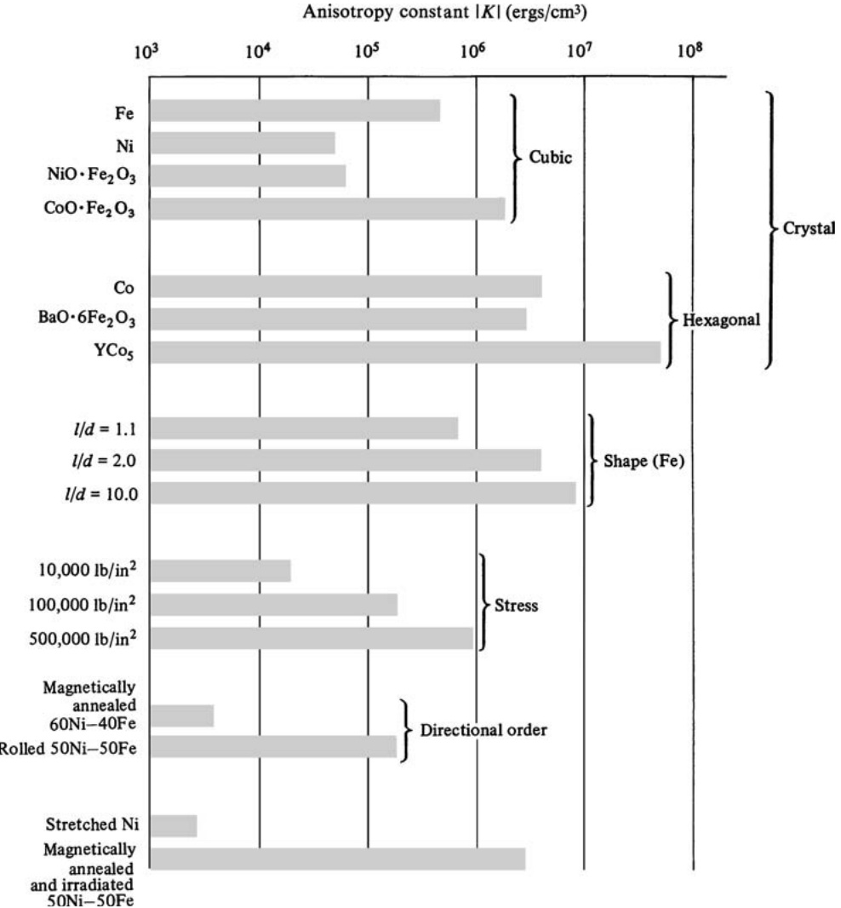

Fig. 10.16 Comparison of anisotropy strengths.

The anisotropy here is not due to directional order in a solid solution, but to three superimposed crystal anisotropies, with one stronger, per unit volume of specimen, than the other two. These results of Néel et al. are remarkable, not only for the large anisotropy produced, but also for the fact that long-range ordering had never before been observed in this system at the composition FeNi.

## 10.8 SUMMARY OF ANISOTROPIES

The magnitudes $|K|$ of the anisotropy constants at room temperature are compared in Fig. 10.16 for the various anisotropies we have considered:

1. Grouped in the upper part of the figure are the magnetocrystalline anisotropies of Fe, Ni, and Co, of some ferrites, and of $\mathrm{YCo}_{5}$ . The last is typical of the huge anisotropy found in the $\mathrm{RCo}_{5}$ compounds, where R is yttrium or certain of the rare earths.

2. Next are some anisotropies due to shape, for prolate ellipsoids. Shape anisotropy not only depends on the length/diameter ratio l/d, but also is proportional to $M_{\mathrm{s}}^{2}$ The values shown were calculated for iron $(M_{\mathrm{s}} = 1714$ emu/cm3 or $1.717\times 10^{6}\mathrm{A / m})$ .

3. The stress anisotropy constant is proportional to the product of stress and the magnetostriction $\lambda_{si}$ . The anisotropies shown were calculated for $\lambda_{\mathrm{si}} = 20\times 10^{-6}$ , taken as typical of many materials.

4. The two examples of anisotropy due to directional order are (a) polycrystalline, magnetically annealed 60 Ni –40 Fe (Fig. 10.5), and (b) polycrystalline 50 Ni – 50 Fe with a cube texture, rolled 55% (Fig. 10.12).

5. “Stretched Ni” refers to the uniaxial anisotropy found in polycrystalline nickel plastically elongated 2.5% (Section 10.6).

6. The final entry in the figure shows the anisotropy developed in a single crystal of 50 Ni – 50 Fe by the treatment described in Section 10.7.

