# FINE PARTICLES AND THIN FILMS

## 11.1 INTRODUCTION

When the measured value of some physical or mechanical property is found to depend on the size of the specimen, that property is said to exhibit a size effect. Thus the yield stress in tension of an iron whisker 50 mm in diameter is more than a thousand times that of the same iron in the form of a single-crystal rod 1 cm in diameter. On the other hand, both specimens have the same density. In general, only structure-sensitive properties show a size effect.

Among magnetic properties, the saturation magnetization $M_{s},$ for example, is independent of specimen size, at least until the number of atoms on the surface becomes significant compared to the total number of atoms in the sample volume. On the other hand, the coercivity $H_{c}$ shows a marked size effect. The coercivity of elongated iron particles 150 Å in diameter is some $10^{4}$ times that of iron in bulk. In this chapter we will examine some of the magnetic properties of specimens which have been made very small in one dimension (thin films), two dimensions (fine wires), or three dimensions (small particles). Of these, thin films are important in computer applications, and fine particles in permanent magnets. Fine wires are of less importance and will be treated in the last section.

This chapter begins with a discussion of the fundamental properties of fine particles; the more practical aspect of their application in magnets is reserved for Chapter 14. Similarly, the material on thin films is divided mainly between this chapter and Chapter 12, where the mechanism of flux reversal (switching) is described; computer applications are postponed to Chapter 15.

## 11.2 SINGLE-DOMAIN VS MULTI-DOMAIN BEHAVIOR

We have already examined, in Section 9.5, the theoretical reasons for believing that a single crystal will become a single domain when its size is reduced below a critical value $L_{c}$ of a few hundred angstroms. There is ample experimental evidence of various kinds that single-domain particles do exist, and can have high values of coercivity.

An originally multi-domain particle can be kept in a saturated state only by a field larger than the demagnetizing field; once this field is removed, the magnetostatic energy associated with the saturated state breaks the particle into domains and reduces $M$, and the demagnetizing field, to some lower value. (But see Section 11.5 for some possible exceptions.) A single-domain particle is by definition always saturated in the sense of being spontaneously magnetized in one direction throughout its volume, but not in the sense of having its $M_{\mathrm{s}}$ vector necessarily parallel to an applied field. An applied field does not have to overcome the demagnetizing field in order to rotate $M_{\mathrm{s}}$ in the limit of zero anisotropy, $M_{\mathrm{s}}$ can be rotated by an infinitesimally small field. A well-pivoted compass needle is an exact analog to the $M_{\mathrm{s}}$ vector of a lowanisotropy single-domain particle. The needle is a permanent magnet with a demagnetizing field of more than 50 Oe, but the Earth’s field, of a few tenths of an oersted, can easily rotate it.

Another way of viewing this experiment is to focus on the energies involved. A saturated sphere of magnetic material, whatever its size, must always have a magnetostatic energy $E_{ms}$ of $(1 / 2)(4\pi /3)(M_{\mathrm{s}}^{2})$ per unit volume (cgs units), according to Equation 7.59. If the sphere is originally multidomain, this energy must be supplied by the applied field; if it is a single domain, this energy is always present, at all field strengths including zero.

## 11.3 COERCIVITY OF FINE PARTICLES

In magnetic studies on fine particles the single property of most interest is the coercivity, for two reasons: (1) it must be high, at least exceeding a few hundred oersteds, to be of any value for permanent-magnet applications, and (2) it is a quantity which comes quite naturally out of theoretical calculations of the hysteresis loop.

The coercivity of fine particles has a striking dependence on their size. As the particle size is reduced, it is typically found that the coercivity increases, goes through a maximum, and then tends toward zero. This is clearly shown for three different materials in Fig. 11.1; for the other three the maximum in coercivity has not yet been reached. The very large range of the variables should be noted: the coercivities vary over three orders of magnitude and the particle sizes over five. The smallest particles are less than 10 unit cells across, while the largest are 0.1 mm in diameter.

The mechanism by which the magnetization of a particle reverses is different in different parts of the curves of Fig. 11.1. Much of this chapter is devoted to an examination of these different mechanisms. In anticipation of the results of later sections, Fig. 11.2 shows schematically how the size range is divided, in relation to the variation of coercivity with particle diameter D. Beginning at large sizes, we can distinguish the following regions:

1. Multidomain. Magnetization changes by domain wall motion (Section 11.5). For some, but not all, materials the size dependence of the coercivity is experimentally

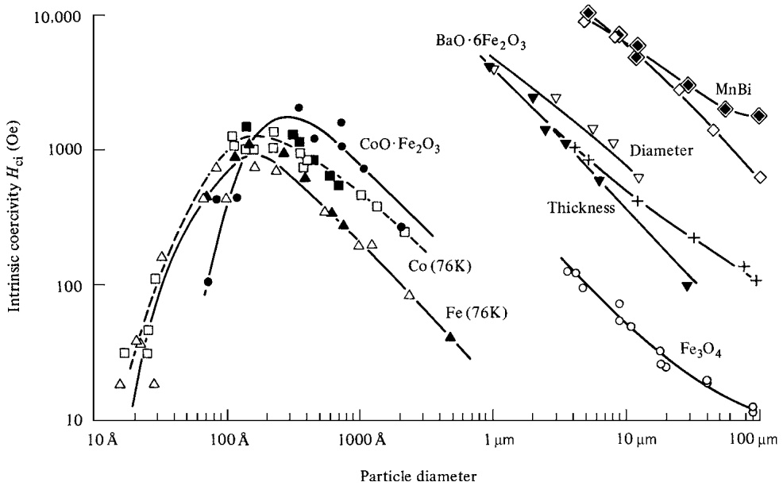

Fig. 11.1 Variation of coercivity with particle size, for particles whose coercivity depends on crystal anisotropy. [F. E. Luborsky, J. Appl. Phys., 32 (1961) p. 171S.]

found to be given approximately by

$$
H _ {\mathrm{ci}} = a + \frac {b}{D},\tag{11.1}
$$

where a and b are constants. This relation has no theoretical foundation.

2. Single-domain. Below a critical diameter $D_{s}$ the particles become single domains, and in this size range the coercivity reaches a maximum. (The quantity $D_{s}$ is equivalent to $L_{c}$ of Chapter 9.) Particles of size $D_{s}$ and smaller change their magnetization by spin rotation, but more than one mechanism of rotation can be involved (Section 11.4).

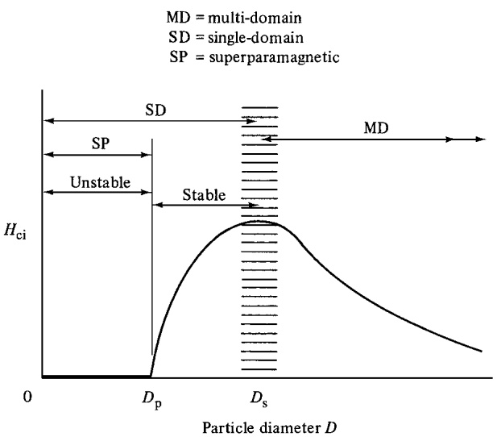

Fig. 11.2 Variation of intrinsic coercivity $H_{\mathrm{ci}}$ with particle diameter D (schematic).

3. As the particle size decreases below $D_{\mathrm{s}}$ the coercivity decreases, because of thermal effects, according to

$$
H _ {\mathrm{ci}} = g - \frac {h}{D ^ {3 / 2}},\tag{11.2}
$$

where g and h are constants. This relation is well understood (Section 11.6).

4. Below a critical diameter $D_{\mathrm{p}}$ the coercivity is zero, again because of thermal effects, which are now strong enough to spontaneously demagnetize a previously saturated assembly of particles. Such particles are called superparamagnetic (Section 11.6).

The magnetic hardness of most fine particles is due to the influence of shape and/or magnetocrystalline anisotropy. In order to study the effect of either of these alone, one can try to eliminate shape anisotropy by making spherical particles, or make elongated particles of a material having low or zero crystal anisotropy. In order to form a practical magnet, the fine magnetic particles must be compacted, with or without a nonmagnetic binder, into a rigid assembly. An important variable is then the packing fraction p, defined as the volume fraction of magnetic particles in the assembly. The variation of coercivity with p may depend on the kind of anisotropy present.

When shape anisotropy prevails, the coercivity $H_{\mathrm{ci}}$ decreases as p increases, because of particle interactions. The following relation has been proposed:

$$
H _ {\mathrm{ci}} (p) = H _ {\mathrm{ci}} (0) (1 - p),\tag{11.3}
$$

where $H_{\mathrm{ci}}(0)$ is the coercivity of an isolated particle $(p = 0)$ . However, the theoretical basis for this expression is unclear. Some materials obey this relation but many do not. Figure 11.3 shows the behavior of elongated Fe –Co alloy particles having an axial ratio greater than 10 and an average diameter of 305 Å or 30.5 nm.

The nature of the particle-interaction problem is indicated in Fig. 11.4, for elongated single-domain particles. In (a), part of the external field of particle $A$ is sketched, and this field is seen to act in the +z direction on particle $B$ below it, but in the 2z direction on particle C beside it. Thus the “interaction field” depends not only on the separation of the two particles but also on their positions relative to the magnetization direction of the particle considered as the source of the field. Suppose the $M_{\mathrm{s}}$ vectors of these particles had all been turned upward by a strong field in the +z direction. This field is then reduced to zero and increased in the 2z direction. The field of $A$ at C now aids the applied field, and C would reverse its magnetization at a lower applied field than if $A$ were absent; the coercivity would therefore be lowered. The opposite conclusion would be reached if we considered only the pair of $A$ and $B$ particles. In either case we have a relatively easy two-body problem to deal with. A quantitative study of the interactions of three particles is very difficult, and the exact solution of the many-body problem represented by Fig. 11.4b, a cylindrical compact of a large number of particles, is virtually impossible. If a reversing field $H_{\mathrm{a}}$ is applied in the -z direction, what is the true field acting on the shaded particle in the interior of the compact? Note that it is not enough to correct $H_{\mathrm{a}}$ for the demagnetizing field of the whole compact. In order to compute the coercivity we would have to know, in addition, the field at the interior particle due to all the other particles, both at the start of and during the reversal. As p increases, the particles come closer together, the interactions become stronger, and the coercivity continues to decrease. Finally, at $p = 1$ , all particles are everywhere in contact, shape anisotropy is lost, and the coercivity becomes zero, if other forms of anisotropy are absent.

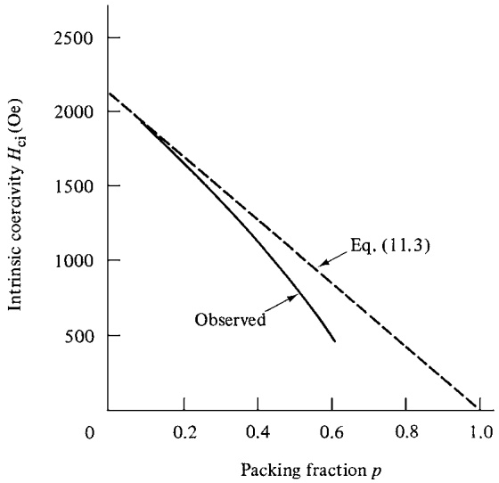

Fig. 11.3 Variation of $H_{\mathrm{ci}}$ with p for elongated Fe–Co particles. [After F. E. Luborsky J. Appl. Phys., 32 (1961) p. 171S.]

On the other hand, when magnetocrystalline anisotropy prevails, the coercivity is expected to be independent of p, and this view is supported by experiment. This kind of anisotropy is due to forces (spin-orbit coupling) which are “internal” to the particle and not, like shape anisotropy, to magnetostatic fields external to the particle. At any value of p, including unity, the crystal anisotropy forces remain constant. However, at $p = 1$ individual particles no longer exist. They become grains or crystallites in a polycrystalline material, and their magnetic behavior will depend the coupling between them. This topic will be considered further in Chapter 14.

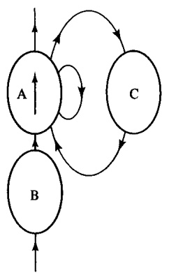

(a)

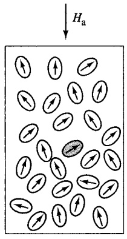

(b)

Fig. 11.4 Particle interactions.

## 11.4 MAGNETIZATION REVERSAL BY SPIN ROTATION

In Section 9.12 we examined the hysteresis loops of uniaxial single-domain particles reversing their magnetization by rotation, as calculated by Stoner and Wohlfarth. The assumption made there was that the spins of all the atoms in the particle remained parallel to one another during the rotation. This mode of reversal is called coherent rotation, or the Stoner–Wohlfarth mode.

For spherical single-domain particles of iron, with their easy axes aligned with the field, the intrinsic coercivity $H_{\mathrm{ci}}$ due to crystal anisotropy is equal to

$$
\frac {2 K}{M _ {\mathrm{s}}} = \frac {2 (4 . 8 \times 1 0 ^ {5})}{1 7 1 4} = 5 6 0 \mathrm{Oe} = 4 5 \mathrm{kA/m}, \text {from Equation 9.51}.
$$

Aligned elongated particles, reversing by coherent rotation, have a coercivity due to shape anisotropy given by Equation 9.46, namely,

$$
H _ {\mathrm{ci}} = (N _ {a} - N _ {c}) M _ {\mathrm{s}},\tag{11.4}
$$

where $N_{a}$ is the demagnetizing factor along the short axis and $N_{c}$ along the long axis. The maximum value of $(N_{a} - N_{c})$ for infinite elongation is 2p (cgs) or 0.5 (SI), so that the maximum attainable coercivity from shape anisotropy is 2pMs (cgs) or 0.5 Ms (SI). For aligned iron particles we calculated, in Table 9.2, that $H_{\mathrm{ci}}$ should be 10,100 Oe (800 kA/m) for an axial ratio c/a of 10, and 10,800 Oe (865 kA m) for infinite elongation. About 1955 a method was developed for making very thin, elongated, iron particles with axial ratios from about 1 to well over 10 by electrodeposition on a mercury cathode. (Details of the method are given in Section 14.10.) Measurements on aligned, dilute compacts of these particles showed that $H_{\mathrm{ci}}$ increased with c/a but did not exceed about 1800 Oe for c/a larger than 10 [F. E. Luborsky, J. Appl. Phys., 32 (1961) p. 171S]. These results showed that the observed coercivity was larger than could be explained by crystal anisotropy, but not as large as expected for shape anisotropy. In fact, it was less than 20% of the theoretical value. This discrepancy forced theoreticians to question the assumption on which Equation 11.4 is based, namely, coherent rotation of the spins. They therefore examined possible modes of incoherent rotation, in which all spins do not remain parallel, to see if such modes would give coercivities in better accord with experiment. The two most important of these incoherent modes are magnetization fanning and curling.

## 11.4.1 Fanning

This mode was suggested by the shape of the electrodeposited iron particles observed with the electron microscope. Figure 11.5a shows that these particles have a kind of “peanut shape,” characterized by periodic bulges rather than smooth sides. This suggests that they can be approximated by the “chain of spheres” model shown at $A$ and $B$ of Fig. 11.5b for two-sphere chains. I. S. Jacobs and C. P. Bean [Phys. Rev., 100 (1955)

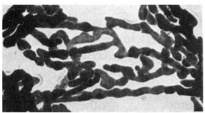

(a)

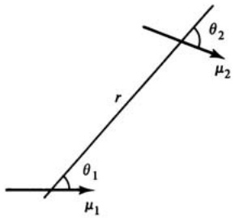

(c)

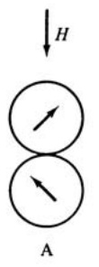

Fanning

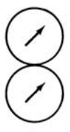

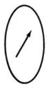

(b)

Coherent

Fig. 11.5 (a) Electron micrograph of electrodeposited iron particles [F. E. Luborsky, J. Appl. Phys., 32 (1961) p. 171S]. (b) Models of particle shape and reversal modes. (c) Dipole –dipole interactions.

p. 1060] considered two possible reversal mechanisms: (1) symmetric fanning (A), in which the $M_{s}$ vectors of successive spheres in the chain fan out in a plane by rotating in alternate directions in alternate spheres, and (2) coherent rotation (B) in which the $M_{\mathrm{s}}$ vectors of all the spheres are always parallel. The coercivities calculated for these mechanisms were then compared with that calculated for coherent rotation in a prolate spheroid (C) of the same axial ratio as the chain of spheres.

It is assumed that each sphere is a single domain with no anisotropy of its own and that the spins in each one reverse coherently. Each sphere is treated as a dipole of magnetic moment μ and diameter a. The mutual potential energy of two dipoles, which is basically magnetostatic energy, is shown by Equation A.7 of Appendix 1 to be

$$
E _ {\mathrm{ms}} = \frac {\mu_ {1} \mu_ {2}}{r ^ {3}} [ \cos (\theta_ {1} - \theta_ {2}) - 3 \cos \theta_ {1} \cos \theta_ {2} ],\tag{11.5}
$$

where r is their distance apart and $\theta_{1}$ and $\theta_{2}$ are defined in Fig. 11.5c. For a two-sphere chain-reversing by fanning, $\mu_{1} = \mu_{2} = \mu, r = a, \theta_{1} = \theta, \theta_{2} = -\theta.$ and Equation 11.5 reduces to

$$
(\text {fanning, A}) \quad E _ {\mathrm{ms}} = - \frac {\mu^ {2}}{a ^ {3}} (1 + \cos^ {2} \theta).\tag{11.6}
$$

This energy depends on θ in exactly the same way as the various forms of uniaxial anisotropy energy we have previously encountered. The magnetostatic coupling between two dipoles therefore causes the pair to have a uniaxial anisotropy with an easy axis along the line joining the dipoles. This has been called interaction anisotropy.

In the fanning mode, the spins in one sphere are not parallel to those in the adjacent sphere at the point of contact. Some exchange energy is therefore introduced. But exchange energy is essentially short range, which means that the spins contributing to this energy in the fanning mode form only a small fraction of the total. Thus the total exchange energy is considered to be small, and it can be made still smaller by imagining the spheres to be slightly separated. It is neglected in these calculations.

To find the coercivity of the two-sphere chain in a field $H$ parallel to the chain axis, we note that the potential energy $E_{\mathrm{p}}$ in the field is $2\mu H$ cos u, when $H$ is antiparallel to μ. The total energy is then

$$
E = E _ {\mathrm{ms}} + E _ {\mathrm{p}} = - \frac {\mu^ {2}}{a ^ {3}} (1 + \cos^ {2} \theta) + 2 \mu H \cos \theta .\tag{11.7}
$$

This equation is of the same form as Equation 9.37 for a uniaxial particle reversing coherently. Therefore, a fanning reversal is also characterized by a rectangular hysteresis loop, and the coercivity is the field at which the moments will flip from $\theta = 0$ to $\theta =$ $180^{\circ}$ . To find it we set $d^{2}E / d\theta^{2}$ equal to zero and proceed in exactly the same way as in Section 9.12 The result, for the intrinsic coercivity, is

$$
(\text {fanning, A}) \quad H _ {\mathrm{ci}} = \frac {\mu}{a ^ {3}} = \frac {\pi M _ {\mathrm{s}}}{6},\tag{11.8}
$$

because

$$
\mu = M _ {\mathrm{s}} \bigg (\frac {4 \pi}{3} \bigg) \bigg (\frac {a}{2} \bigg) ^ {3}.
$$

For a two-sphere chain rotating coherently (B), $\theta_{1} = \theta_{2} = \theta,$ with the result that

$$
(\text {coherent, B}) \quad E _ {\mathrm{ms}} = \frac {\mu^ {2}}{a ^ {3}} (1 - 3 \cos^ {2} \theta).\tag{11.9}
$$

The coercivity is then, for $H$ parallel to the chain axis,

$$
(\text {coherent, B}) \quad H _ {\mathrm{ci}} = \frac {3 \mu}{a ^ {3}} = \frac {\pi M _ {\mathrm{s}}}{2}\tag{11.10}
$$

or three times as large as $H_{\mathrm{ci}}$ for fanning. The easier reversal for the fanning mode is due to the fact that the field must overcome an energy barrier for reversal only one-third as high for fanning as for coherent rotation (Problem 11.1). The physical reason is suggested in Fig. 11.6. Fanning brings north and south poles closer together, thus reducing the spatial extent of the external fields of the spheres and hence the total magnetostatic energy.

Jacobs and Bean also computed the coercivity for linear chains longer than $n = 2$ , where n is the number of spheres in the chain, both for chains aligned with the field and for chains randomly oriented. Similar calculations were made for reversal mechanism C, where n is now the axial ratio of the prolate spheroid, by means of Equation 11.4. The results, for chains aligned with the field, are shown in Fig. 11.7 both in terms of the intrinsic coercivity

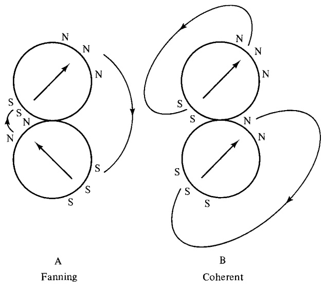

Fig. 11.6 External fields of spheres reversing by fanning and by coherent rotation.

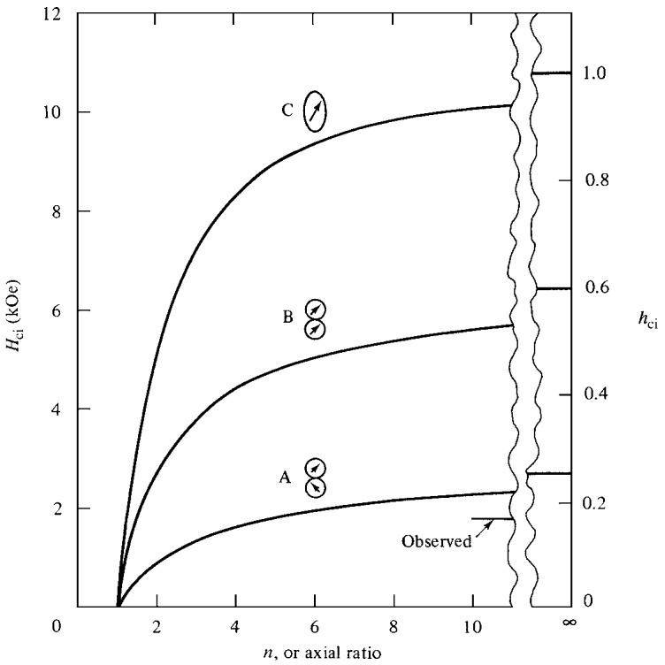

Fig. 11.7 Calculated coercivities for aligned n-sphere chains (A and B) and prolate spheroids of axial ratio n (C). The observed values are for elongated iron particles. [F. E. Luborsky, J. Appl. Phys., 32 (1961) p. 171S.]

$H_{\mathrm{ci}}$ of iron particles and in terms of the reduced intrinsic coercivity, defined as

$$
h _ {\mathrm{ci}} = \frac {H _ {\mathrm{ci}}}{2 \pi M _ {\mathrm{s}}},\tag{11.11}
$$

which gives $H_{\mathrm{ci}}$ as a fraction of the maximum attainable coercivity in a prolate spheroid undergoing coherent rotation. The predictions of the fanning theory are seen to be in rather close accord with the experimental results on highly elongated iron particles, suggesting that the reversal mechanism is incoherent rotation. This agreement is somewhat surprising, since fanning mechanism $A$ assumes negligible exchange interaction between adjacent spheres because of their minimal contact. But if the contact area between spheres is large, the exchange forces would favor coherent-rotation mechanism $B$. The actual shape of these particles, seen in Fig. 11.5a, is that of a cylinder with periodic bulges, which is closer to a chain of squashed-together spheres than to a chain of spheres in point contact. Nevertheless, there must be something in the structure of these particles that forces them to reverse incoherently rather than coherently.

## 11.4.2 Curling

This mode of incoherent reversal was investigated theoretically by the methods of micromagnetics. The calculations are too intricate to reproduce here, and only the main results will be given. Consider a single-domain particle in the shape of a prolate spheroid, initially magnetized in the +z direction parallel to its long axis. Suppose a field is then applied in the 2z direction, causing each spin to rotate about the radius, parallel to the xy plane, on which it is located. This curling mode is illustrated in perspective in Fig. 11.8a, where the reversal is shown as about one-fourth completed. When the reversal has gone half way, the spins are all parallel to the xy plane and form closed circles of flux in all cross sections, as shown in Fig. 11.8b. If the axial ratio of the spheroid approaches infinity, so that it approximates an infinite cylinder, the spins are always parallel to the surface during a curling reversal, so that no free poles are formed and no magnetostatic energy is involved. The energy barrier to a curling reversal is then entirely exchange energy, because the spins are not all parallel to one another during the reversal. In contrast, the coherent rotation shown in Fig. 11.8c and d produces free poles on the surface, and therefore magnetostatic energy, but no exchange energy. We can also conclude that, if highly elongated particles in an assembly reverse by curling, the coercivity should be independent of the packing fraction, because no magnetostatic energy is involved, again in sharp contrast to coherent rotation.

As the axial ratio c/a of the spheroid (c = semi-major axis, a = semi-minor axis) changes from infinity (for the very long cylinder) to unity (for the sphere), some magnetostatic energy will be generated during a curling reversal, because the spins are no longer always parallel to the particle surface. The energy barrier then includes exchange and magnetostatic energy, and the importance of the latter increases as c/a decreases. For values of c/a less than infinite the coercivity will therefore depend on the packing fraction.

The calculations show that the coercivity in the curling mode is markedly sizedependent. A convenient and fundamental unit of length with which to measure size is

$$
D _ {0} = \frac {2 A ^ {1 / 2}}{M _ {\mathrm{s}}},\tag{11.12}
$$

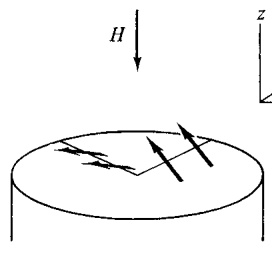

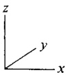

(a)

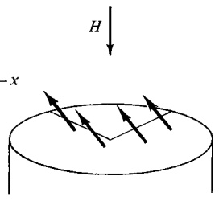

(c)

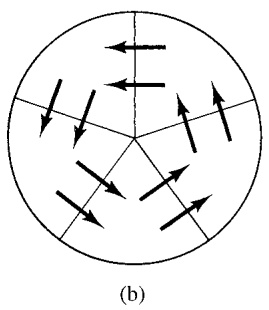

Curling

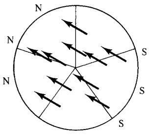

(d)

Coherent rotation

Fig. 11.8 (a) and (c) are curling and coherent-rotation modes. (b) and (d) are cross sections normal to the z axis after a $90^{\circ}$ rotation from the +z direction.

where $A$ is the exchange stiffness or exchange constant. It is a measure of the force tending to keep adjacent spins parallel to one another, i.e., of the torsional stiffness of the spin – spin coupling; it is related to the exchange integral $J_{ex}$ of Equation 4.31 by

$$
A = \frac {n J _ {\mathrm{ex}} S ^ {2}}{a},\tag{11.13}
$$

where S is the spin, a the lattice parameter, and n is the number of atoms in the unit cell (2 for bcc, 4 for fcc).

The micromagnetics calculation of shape anisotropy begins with the assumption that the particle is a single domain with all spins initially parallel to the +z direction in zero field. Crystal anisotropy is ignored and so are thermal effects. The coercivity is then found by calculating the field in the -z direction that is just enough to supply the energy required for a reversal by curling. The result is found to depend both on particle size and shape, as follows:

1. Infinite Cylinder. If the diameter of the cylinder is D, then the reduced coercivity is

$$
h _ {\mathrm{ci}} = \frac {H _ {\mathrm{ci}}}{2 \pi M _ {\mathrm{s}}} = \frac {1 . 0 8}{(D / D _ {0}) ^ {2}}.\tag{11.14}
$$

2. Prolate Spheroid. If $N_{c}$ is the demagnetizing factor along the long axis c, and $D = 2a$ where a is the semi-minor axis, then

$$
h _ {\mathrm{ci}} \geq \frac {N _ {c}}{2 \pi} - \frac {k}{(D / D _ {0}) ^ {2}},\tag{11.15}
$$

where $k$ depends on the axial ratio c/a and varies from 1.08 for the infinite cylinder to 1.39 for the sphere. The dependence of $k$ on c/a is given in graphical form by A. Aharoni [J. Appl. Phys., 30 (1959) p. 70S].

3. Sphere.

$$
h _ {\mathrm{ci}} \geq \frac {2}{3} - \frac {1 . 3 9}{(D / D _ {0}) ^ {2}}.\tag{11.16}
$$

This equation is valid only for $D / D_{0}$ values greater than 1.44. The inequality signs in Equations 11.16 and 11.17 mean that the coercivities are expected to be somewhat larger than the values given by these expressions but definitely smaller than the coercivity of the infinite cylinder.

Figure 11.9 shows, for the infinite cylinder, the size dependence of $h_{ci}$ for curling and the size independence for coherent rotation. The particle will reverse by the mechanism which has the lower coercivity. Thus below a critical diameter $D = (1.08)^{1 / 2}D_{0} = 1.04D_{0}$ coherent rotation is favored, while larger particles will reverse by curling. If Fig. 11.9 is replotted for a finite value of c/a (prolate spheroid), both curves will move to lower $h_{\mathrm{ci}}$ values and their intersection to larger $D / D_{0}$ values. For a sphere, the critical diameter separating the two modes of reversal is 1.44 $D_{0}$ In Fig. 11.10 the theoretical curves for the infinite cylinder are plotted in a different way; the scales are now linear, rather than logarithmic, and the contribution of crystal anisotropy, which is the same for either reversal mode, is included. The easy crystal axis is assumed to be parallel to the cylinder axis.

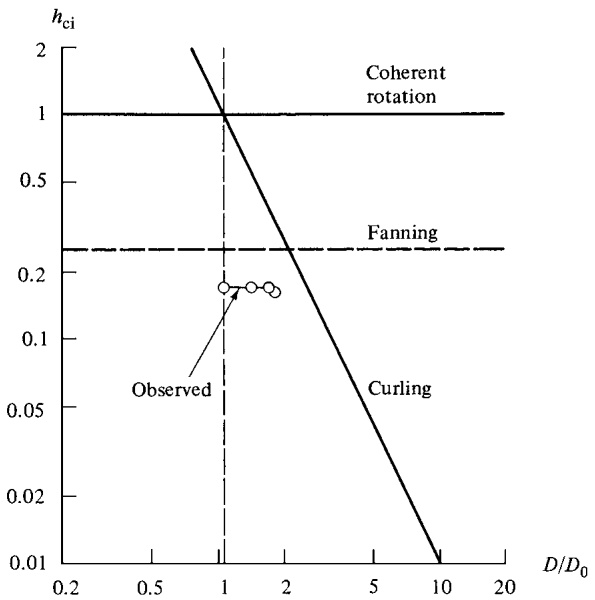

Fig. 11.9 Calculated reduced coercivities for coherent and curling reversals in an infinite cylinder, and for fanning reversal in an infinite chain of spheres, as a function of the reduced diameter $D / D_0.$ Crystal anisotropy is neglected. The observed values are for elongated iron particles. [F. E. Luborsky, J. Appl. Phys., 32 (1961) p. 171S.]

Another possible incoherent reversal mode, called magnetization buckling, was also investigated by E. H. Frei, S. Shtrikman and D. Treves [Phys. Rev., 106 (1957) p. 446]. It was found to give a coercivity lower than that by coherent rotation or curling only over a very narrow range of $D / D_{0}$ values near unity. For that reason details of this mechanism are ignored here.

It has also been suggested that particles with large values of c/a might reverse by the propagation of a transverse domain wall, nucleating at one end and running the length of the particle [J. E. Knowles, IEEE Trans. Mag., MAG-20 (1984) p. 84].

The main conclusion of the theory, then, is that small particles will reverse coherently and large particles by curling. The main reason is the rapid increase of magnetostatic energy with particle size for coherent rotation, because this energy is directly proportional to particle volume. But so is the potential energy available from the reversing field, and the result is that the coercivity is independent of particle size. In a curling reversal, on the other hand, the mean angle between adjacent spins, averaged over the cross section of the particle (Fig. 11.8b), is less, and the exchange energy per unit volume is smaller, the larger the diameter of the particle. The total exchange energy during reversal therefore increases with particle volume at a less than linear rate, with the result that the coercivity decreases as particle diameter increases. Large particles can therefore reverse by curling, which involves exchange energy but complete flux closure and no magnetostatic energy during reversal (infinite cylinder) or partial flux closure and low magnetostatic energy (prolate spheroid or sphere). In very small particles, the magnetostatic energy required for coherent reversal is less than the exchange energy required for curling, so that coherent reversal is preferred.

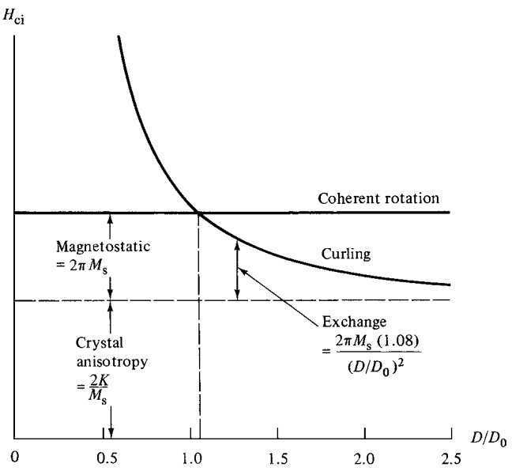

Fig. 11.10 Calculated coercivities, with the effect of crystal anisotropy included, for coherent and curling reversals in an infinite cylinder as a function of the reduced diameter $D / D_0.$ [After W. F. Brown, Magnetostatic Principles in Ferromagnetism, North Holland (1962).]

To what actual sizes do the critical diameter ratios $D / D_{0}$ calculated above correspond? This question is difficult to answer precisely because of uncertainty in the value of the exchange constant $A$. For iron, for example, estimates of $A$ range from $0.3 \times 10^{-6}$ to $2\times10^{-6}$ erg/cm. If we take $A$ as $1 \times 10^{-6} \mathrm{erg/cm}$ , then $D_{0}$ for iron is 120 Å , and the critical diameters vary from (1.04)(120) = 120 Å for the infinite cylinder to (1.44)(120) = 170 Å for the sphere.

An experimental problem that occurs in almost all small particle work is that it is extraordinarily difficult to produce a three-dimensional assembly of very small particles, each of which has exactly the same size and shape. Trying to work with single particles, instead of assemblies of particles, is at least equally difficult, both because of the small magnetic moments involved and because of the problems in isolating and mounting a single particle about 100 atoms in diameter.

We see from the preceding discussion that a magnetic particle may have all its atomic moments parallel in zero field, but that during the reversal process the magnetization may be nonuniform. Some workers in the field of micromagnetics have taken the position that a particle is truly a single domain only when its spins are always parallel, both before and during a reversal. Thus there can be two definitions of critical size:

1. Static. A particle is a single domain when all its spins are parallel in zero field. If it spontaneously breaks up into domains in zero field, then the critical size $D_{s}$ has been exceeded. This is the sense of the term “single domain” as it has been used in this book. With this criterion we estimated, in Section 9.5, that the critical size for single-domain particles was generally several hundred angstroms, and that the critical size would be larger, the larger the crystal anisotropy K.

2. Dynamic. A particle is a single domain only when its spins are all parallel at all times, both in zero field and during reversal in an applied field. Thus, according to this micromagnetic definition, only particles which reverse coherently are single domain, and the critical size for single-domain behavior is to be found from the intersection of curves like those shown in Figs. 11.9 and 11.10. For spherical iron particles this critical size was estimated above as 170 Å , which is certainly smaller than the size estimated according to static definition (1) above.

What experimental evidence is there for reversal by curling? The electro-deposited, elongated iron particles examined by Luborsky, and mentioned earlier, had c/a values larger than 10 and diameters $D(= 2a)$ ranging from 125 to 215 Å , corresponding to $D / D_{0}$ values of 1.04 – 1.79. Their coercivities $H_{\mathrm{ci}}$ were all about 1800 Oe $(h_{\mathrm{ci}} = 0.17)$ , as shown in Fig. 11.9. This size independence of the coercivity suggests that these particles reverse by fanning rather than curling. This is not unexpected, because the peanut-like shape of these particles is not a good approximation of a cylinder.

In order to deal with particles more nearly resembling the idealized models of micromagnetics, F. E. Luborsky and C. R. Morelock [J. Appl. Phys., 35 (1964) p. 2055] examined the properties of iron and iron –cobalt alloy whiskers. These have straight, smooth sides and are structurally the most nearly perfect of all crystals. The coercivities were found to be very size dependent over the large range of whisker diameters investigated, from about 200 to

$10^{6}\mathrm{\AA}(100\mu \mathrm{m})$ , and Luborsky and Morelock concluded from the nature of this size dependence that whiskers thinner than 1000 Å reversed by curling. The behavior of thicker whiskers deviated from the predictions of curling theory, so that some other reversal mechanism must be acting instead of, or in addition to, curling.

The discussion of incoherent reversal mechanisms in this section hardly does justice to the large amount of theoretical and experimental work done, by the authors cited and others, to examine and test these hypotheses. In particular, two lines of investigation in addition to those mentioned above have been pursued:

1. Angular variation of the coercivity. The way which $h_{ci}$ varies with the angle a between the applied field and the axis of the specimen depends in a predictable way on the mode of reversal. Therefore, a measurement of this variation offers a means of distinguishing between various possible modes. We have so far considered only the case of $\alpha = 0$

2. Rotational hysteresis. (See also Section 13.3.) Suppose a specimen is rotated $360^{\circ}$ in an applied field $H$ of constant magnitude. Then, if any irreversible processes of spin rotation or domain wall motion occur during this rotation, there will be a rotational hysteresis loss $W_{\mathrm{r}}$ The value of $W_{\mathrm{r}}$ which is a function of $H$, can be found from a torque curve; Wr is equal to $2\pi$ times the average value of the torque during a full rotation of the sample. The rotational hysteresis integral R is defined by

$$
R = \int_ {0} ^ {\infty} \frac {W _ {\mathrm{r}}}{M _ {\mathrm{s}}} d \left(\frac {1}{H}\right)\tag{11.17}
$$

The quantity R is dimensionless and, for single-domain particles, the value of R depends in a predictable way on the mode of reversal. The measurement of R thus affords still another means of distinguishing one mode from another. Details are given by I. S. Jacobs and F. E. Luborsky [J. Appl. Phys., 28 (1957) p. 457].

Although the idea that small ferromagnetic particles should show single-domain behavior and have high coercivity has led to a great deal of important theoretical and experimental work, and also led directly to a new class of permanent magnet materials, it has gradually become clear that real permanent magnet materials do not represent a direct embodiment of the simple single-domain particle model. The Stoner –Wohlfarth model, and its various derivatives and developments, guided permanent magnet research for many years, and must be regarded as a success even if they fail to correspond exactly to the structure and behavior of the latest and best permanent magnets.

## 11.5 MAGNETIZATION REVERSAL BY WALL MOTION

Relatively large particles can have quite substantial coercivities, if their magnetocrystalline anisotropy constant K is large. For example, the curves for barium ferrite $(K = 3.3 \times 10^{6}$ $\mathrm{erg / cm^3)}$ in Fig. 11.1 show that a coercivity $H_{\mathrm{ci}}$ of about 3000 Oe can be obtained in particles 1 μm in diameter. Yet we estimated, in Problem 9.4, that the critical size $D_{s}$ for single domains in barium ferrite was 730 Å. Therefore, 1 mm (10,000 Å) particles must surely be multidomain. Two problems then arise:

1. Why are the coercivities so high, if domain-wall motion is a relatively easy process, as is usually assumed?

2. Why does the coercivity decrease as the particle size increases?

We shall look for answers to these questions in this section. Note that the discussion is restricted to particles owing their coercivity to crystal, rather than shape, anisotropy.

The two questions posed above are made even more pointed by some micro-magnetics calculations made by Brown. Consider a perfect crystal in the form of a spheroid, with the spheroid axis and the easy crystal axis parallel to the z-axis. Let it be saturated in the +z direction and therefore a single domain. A reversing field is then applied in the 2z direction. Brown showed that the field required for reversal is given by

$$
H _ {\mathrm{ci}} = \frac {2 K}{M _ {\mathrm{s}}},\tag{11.18}
$$

for a crystal of any size, whether larger or smaller than $D_{s}$ (Here $H_{\mathrm{ci}}$ is a particular value of the true field $H$ acting on the crystal, where $H$ is the sum of the applied field $H_{\mathrm{a}}$ and the demagnetizing field $H_{\mathrm{d}}$ . Both of these are acting in the 2z direction, and negative signs are understood.) This value of $H_{\mathrm{ci}}$ is just the value obtained in Section 9.12 for coherent rotation. For barium ferrite,

$$
\frac {2 K}{M _ {\mathrm{s}}} = \frac {2 (3 . 3 \times 1 0 ^ {6})}{3 8 0} = 1 7 \mathrm{kOe} = 1. 4 \mathrm{MA/m}.
$$

It would not be surprising to find this value approached in single-domain particles smaller than $D_{s}$ for example, in 100 $\text{\AA}$ particles. In fact, coercivities as large as 11 kOe have been observed in barium ferrite. But in particles larger than $D_{s}$ the coercivities are much less than expected; in 1 mm particles $H_{\mathrm{ci}}$ is only 3 kOe, and it decreases still further as the particle size increases (Fig. 11.1). This large discrepancy between theory and experiment for large particles is known as “Brown’s paradox.”

What is the mechanism of magnetization reversal in particles larger than $D_{s}$ i.e., in particles large enough to contain domain walls? It cannot be coherent rotation, because the observed coercivities are much less than $2\mathrm{i}/M_{\mathrm{s}}$ . The only other alternative is that one or more domain walls are nucleated in the particle; the wall then moves through the particle and reverses its magnetization. We may consider this wall nucleation process in some detail, with reference to the perfect spheroidal crystal mentioned earlier, now assumed to be larger than $D_{\mathrm{s}}$ . When saturated in the +z direction, it is a single domain with all spins parallel. When a reversing field $H$ acts in the -z direction, wall formation presumably begins at the surface, say at the point $B$ of Fig. 11.11a. The spins along a line AB intersecting the surface are shown in Fig. 11.11b, with the spin on the surface atom rotated $45^{\circ}$ out of the xz plane by the field. This rotation tends to rotate the spin on the next atom, because of exchange coupling, and Fig. 11.11c –e shows successive steps in the rotation. In Fig. 11.11e a complete wall, assumed for simplicity to be only four atoms thick, has been formed. In Fig. 11.11f the wall has moved inward, producing a new domain 2 magnetized antiparallel to the original domain 1. Because the crystal has been assumed perfect, there are no hindrances to the motion of the newly formed wall; under pressure of the nucleating field, it flashes across the crystal in a single Barkhausen jump, and the magnetization reversal is completed. (The just-nucleated wall will move entirely across the crystal only if the applied field exceeds the demagnetizing field. See the discussion of Fig. 11.16.) The hysteresis loop is rectangular, just as it would be if all the spins reversed coherently. But this whole process of wall nucleation and wall motion has its beginnings in spin rotation, on a few atoms at the surface, against the crystal anisotropy forces, and this requires a field equal to $2K/M_{s}$

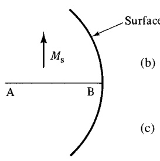

(a)

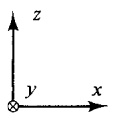

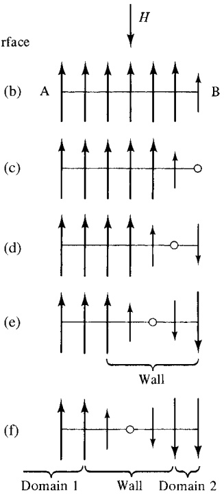

Fig. 11.11 Domain wall nucleation at a crystal surface. Only the projections of the spins on the xz plane are shown.

The essential point is that the process of nucleating a domain wall in a perfect crystal is just as difficult as coherent rotation. Either process requires spin rotation against the same anisotropy forces.

The assumption made in earlier parts of this book is that a saturated crystal larger than $D_{s}$ will break up into domains when the saturating field is reduced to zero, in order to lower its magnetostatic energy. In a perfect crystal this may not be true, because the difficulty of wall nucleation is an energy barrier between the single-domain state and the lower-energy, multidomain state. The perfect crystal will spontaneously divide into domains only if

$$
H _ {\mathrm{d}} = N _ {\mathrm{d}} M _ {\mathrm{s}} > \frac {2 K}{M _ {\mathrm{s}}},\tag{11.19}
$$

or

$$
M _ {\mathrm{s}} > \left(\frac {2 K}{N _ {\mathrm{d}}}\right) ^ {1 / 2},\tag{11.20}
$$

where $N_{\mathrm{d}}$ is the demagnetizing factor along the axis of magnetization z. For a given material in the form of a spheroid, the process of subdivision into domains is easiest when $N_{d}$ has a maximum value of $4\pi$ (cgs) or 1 (SI), in a thin oblate spheroid (disk) with the plane of the disk normal to z. For such a disk of barium ferrite,

$$
\left(\frac {2 K}{N _ {\mathrm{d}}}\right) ^ {1 / 2} = \left[ \frac {(2) (3 . 3 \times 1 0 ^ {6})}{4 \pi} \right] ^ {1 / 2} = 7 2 0 \mathrm{emu/cm} ^ {3} \text {or kA / m}.
$$

Because this is larger than $M_{\mathrm{s}} (= 380 \mathrm{emu} / \mathrm{cm}^{3})$ , a perfect crystal of barium ferrite in the form of a spheroid cannot spontaneously break up into domains, whatever its size or shape. The same is not true of a high-$M_{\mathrm{s}}$ low-K material like iron. A perfect iron crystal in the shape of a sphere will form domains, but one in the form of a prolate spheroid of sufficiently high axial ratio will not.

The demagnetizing field of a thin disk of barium ferrite $[H_{\mathrm{d}} = 4\pi M_{\mathrm{s}} = 4800\mathrm{Oe}$ (cgs) $H_{\mathrm{d}} = M_{\mathrm{s}} = 365 \mathrm{kA} / \mathrm{m}$ (SI)] amounts to a substantial fraction of the theoretical coercivity of 17,000 Oe (1.4 MA/m) . Thus the applied field required to reverse the magnetization is 17,000 - 4800 = 12,000 Oe (960 kA/m) . Inasmuch as actual crystals of barium ferrite tend to be plate-shaped, with easy axis normal to the plate, the figure of 12,000 Oe is a more realistic value of the theoretical upper limit of coercivity for reversal by wall motion than 17,000 Oe, which applies to a crystal that has a negligible demagnetizing field.

Brown’s paradox is based on calculations assuming a perfect crystal in the form of a perfect spheroid. Real crystals contain imperfections and are not perfect spheroids. Interior imperfections include such defects as dislocations, solute atoms, interstitials, and vacancies; not only may the shape depart from spheroidal in various ways, but the surface may be marred by pits, bumps, steps, cracks, and scratches. Brown’s paradox is resolved by invoking the action of some of these imperfections in lowering the field required to nucleate a domain wall. The condition for wall nucleation in a single particle is that

$$
H _ {\mathrm{a}} + H _ {\mathrm{d}} > \frac {2 K}{M _ {\mathrm{s}}}.\tag{11.21}
$$

The applied field required may be much less than expected if (a) $H_{\mathrm{d}}$ or $M_{s}$ is larger than normal, or (b) K is smaller than normal. The maximum value of $H_{\mathrm{d}}$ is $4\pi M$s (cgs) or $M_{\mathrm{s}}$ (SI) only in a perfect spheroid; near sharp corners, for example, $H_{\mathrm{d}}$ can become very much larger. Because the value of $M_{s}$ is determined by the magnetic moment per atom and the exchange coupling between adjacent atoms, it may change locally, up or down, in the vicinity of vacancies, interstitials, or the core of dislocations where the strains are very large. Similarly, the local value of K, which is due to spin-orbit coupling, may be changed by imperfections or small-scale inhomogeneities in the chemical composition of the particle.

Of these several possibilities, local variations in the demagnetizing field $H_{\mathrm{d}}$ are usually assumed to be the most likely nucleators of domain walls. Among surface imperfections, pits are no help at all. As shown in Fig. 11.12a, the field at the base of the pit, due to the poles on the pit walls, acts to increase the magnetization at the base of the pit and to counteract the field $H_{\mathrm{a}}$ which is acting to reverse the magnetization. On the other hand, a surface bump, shown in Fig. 11.12b, produces local fields which act to demagnetize the particle and aid $H_{a}$

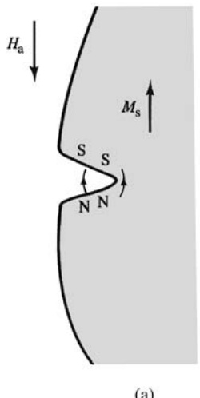

(a)

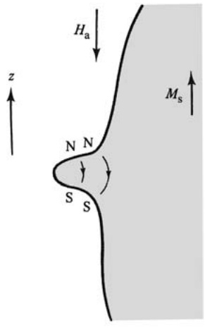

(b)

Fig. 11.12 Local fields near pits and bumps.

The magnetostatic energy associated with these local fields may be so large that the system is more likely to form closure domains instead, as suggested by Fig. 11.13a; the domain arrangement indicated would decrease the density of, but not eliminate, the free poles on the surface of the bump. Similarly, closure domains may be formed at sharp corners, as in Fig. 11.13b. In fact, closure domains have been observed by C. A. Fowler, E. M. Fryer, and D. Treves [J. Appl. Phys., 32 (1961) p. 296S] at the square tips of iron whiskers held in a “saturated” state by a field applied along their axis, and these domains persisted even at applied fields of several thousand oersteds.

These considerations suggest that small domains of reversed magnetization may always be present near imperfections, even in specimens nominally “saturated.” It is difficult to determine experimentally the difference between $M=M_{s}$ and $M = 0.995M_{\mathrm{s}},$ so that reverse domains occupying a volume fraction of the order of a few tenths of a percent can easily remain undetected in a measurement of magnetization. If so, then magnetization reversal becomes a question, not of nucleating walls, but of freeing or “unpinning” walls that already exist.

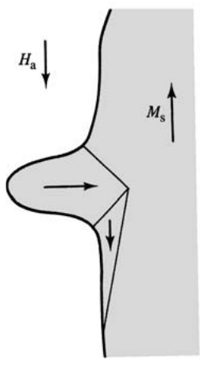

(a)

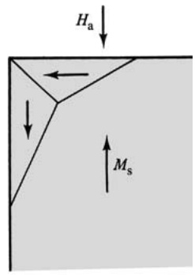

(b)

Fig. 11.13 Closure domains near bumps and sharp corners.

The role of imperfections in nucleating magnetization reversals was nicely demonstrated by experiments of R. W. DeBlois and C. P. Bean [J. Appl. Phys., 30 (1959) p. 225S] on single whiskers of iron. These whiskers were about 1 cm long, from 1 to 20 mm thick, and had <100> axes. Each whisker was enclosed for protection in a quartz capillary which was then inserted in a tiny solenoid, scarcely longer than 1 cm, as shown in Fig. 11.14a. An isolated whisker appears just above the solenoid, and the bits of graph paper with 1-mm squares give the scale. An even shorter reversing coil, 13 turns and 0.8 mm long, was wound on the center of the solenoid. The whisker is initially saturated in one direction by applying a 50-Oe pulse with the solenoid; it remains saturated in that direction after the field has returned to zero. A large pulse field is then applied in the opposite direction with the short central coil. If the region of the whisker inside this coil reverses its magnetization, an emf will be induced in the solenoid and can be detected with an oscilloscope. If no reversal is observed, the magnitude of the reverse pulse field is increased until one is observed. The capillary and whisker is then moved a short distance in the solenoid to place another portion of the whisker in the central coil. An example of such measurements along the length of an 8 mm whisker, which varies in thickness from 19 to 1 mm along its length, is shown in Fig. 11.14b. The coercivity is extremely variable along the length, ranging from less than 50 to a maximum of 504 Oe (4-40 kA/m) at a point where the whisker is 12.4 μm thick. Microscopic examination of the whisker showed that visible surface defects corresponded to the positions of the local minima in the nucleating field, but not all field minima had a matching visible surface defect.

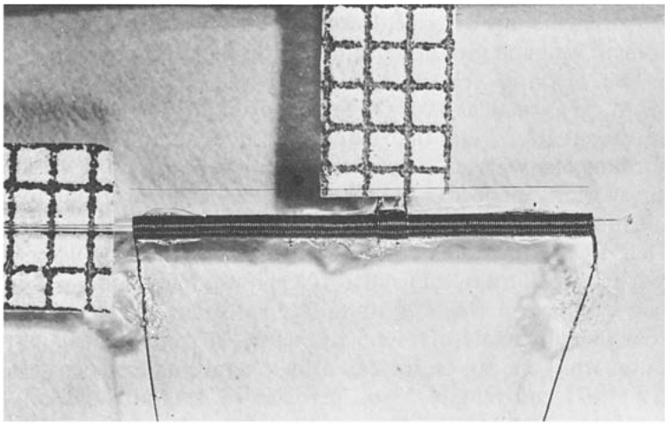

(a)

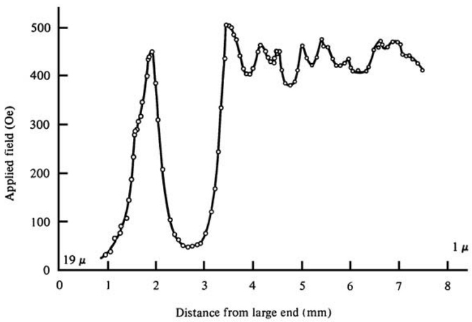

(b)

Fig. 11.14 Measurement of magnetization reversal in iron whiskers. (a) Apparatus. (b) Applied field required for reversal at various points along the length of the whisker. [R. W. DeBlois and C. P. Bean, J. Appl. Phys., 30 (1959) p. 225S.]

The theoretical coercivity of iron is

$$
\frac {2 K}{M _ {\mathrm{s}}} = \frac {2 (4 . 8 \times 1 0 ^ {5})}{1 7 1 4} = 5 6 0 \mathrm{Oe} = 4 5 \mathrm{kA/m}.
$$

The maximum observed value of 504 Oe is 90% of the theoretical maximum. These experiments therefore support the view that a perfect crystal does have a coercivity of $2K/M_{\mathrm{s}}$ and that imperfections can drastically lower this value.

The experiments just described relate to the difficulty of nucleating, or unpinning, a domain wall and give no information on the field required to move a wall once it is free, or on its velocity. In other work, however, DeBlois [J. Appl. Phys., 29 (1959) p. 459] observed that a field as small as 0.008 Oe (0.6 A/m) could move a domain wall in an iron whisker. This field is about $10^{-5}$ times that required to nucleate a wall in the more nearly perfect portions of a whisker. This result is not surprising; because whiskers are the most nearly perfect crystals known, they offer minimal resistance to wall motion. DeBlois also measured domain wall velocity and found it very high. The velocity depends on the applied field, and at 10 Oe (800 A/m) it was about 1 km/sec or 2200 mph.

Further evidence of the role of surface imperfections as nucleating points comes from measurements of coercivity before and after polishing. The coercivity of iron whiskers can be increased by several hundred oersteds by electropolishing and that of $\mathrm{YCo}_{5}$ particles by several thousand oersteds by chemical polishing. This means that there is not a single curve relating coercivity to particle size for a given material, as in Fig. 11.1, but a whole family of curves, each for a different degree of surface roughness.

A further effect was uncovered by Becker, who showed that the coercivity of particles increased, not only with increasing surface smoothness, but also with increasing magnitude of the field used to magnetize the particles [J. J. Becker, IEEE Trans. Mag., 5 (1969) p. 211]. Now a dependence of the coercive field, as defined in Section 1.8, on the maximum magnetizing field $H_{\mathrm{m}}$ is quite normal, because the coercive field is the reverse field required to reduce $M$ or $B$ to zero after the specimen has been partially magnetized in the forward direction. Thus in Fig. 11.15a, an increase in $H_{\mathrm{m}}$ from 1 to 2 increases the intrinsic coercive force $H_{\mathrm{ci}}$ from 1 to 2. But that the coercivity, measured after saturation in the forward direction, should depend on $H_{\mathrm{m}}$ is quite unexpected; whether $H_{\mathrm{m}}$ has the value 3 or 4, the coercivity should have the value 3. Actually, the coercivity is found to increase from 3 to 4 when $H_{\mathrm{m}}$ is increased from 3 to 4. The experimental data are shown in Fig. 11.15b for assemblies of particles of $\mathrm{SmCo}_{5}$ in various size ranges. The easy axes of these particles (the c-axes of their hexagonal unit cells) were aligned with the field, and saturation is essentially complete for fields of 10 kOe and above. Yet substantial increases in $H_{\mathrm{ci}}$ are observed, even for changes in $H_{\mathrm{m}}$ beyond 20 kOe. If coercivity is defined as the limiting value of the coercive field as $H_{\mathrm{m}}$ is increased, then the quantity plotted in Fig. 11.15b is coercive field, and the fields $H_{\mathrm{m}}$ are not really saturating the material. The retentivity $M_{r}$ also increases with $H_{\mathrm{m}}$ but the effect is relatively small. Thus, when $H_{\mathrm{ci}}$ doubles in magnitude, the increase in $M_{\mathrm{r}}$ is only about 10%.

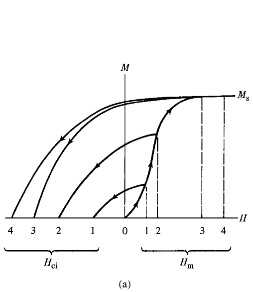

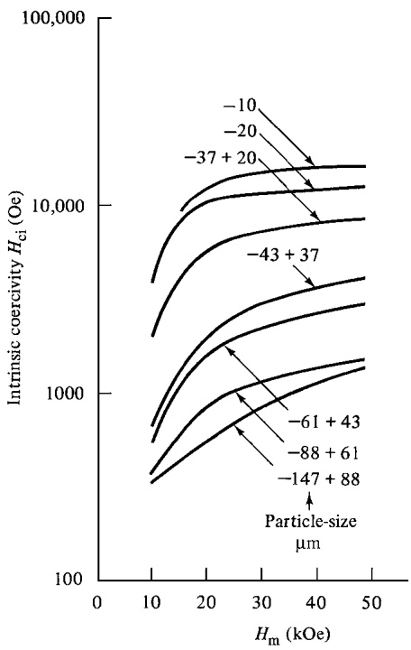

(b)

Fig. 11.15 Dependence of coercivity on maximum value $H_{\mathrm{m}}$ of magnetizing field. (a) Schematic. (b) Experimental results on aligned particles of SmCo5. [J. J. Becker, J. Appl. Phys., 39 (1968) p. 1270.]

If the high coercivity of particles such as these is due to the difficulty of freeing domain walls that are pinned or trapped at imperfections, then the dependence of coercivity on $H_{\mathrm{m}}$ must mean that the “strength” of a pinning site depends on how hard the domain wall is driven into it by the magnetizing field in the forward direction. The mechanism of this behavior is not understood. (In terms of Fig. 9.36, where wall motion was discussed in terms of energy changes in the system, pinning sites must correspond to potential energy wells with almost vertical sides, and the sides must become more nearly vertical as $H_{\mathrm{m}}$ increases.) If a pinning site is an arrangement of closure domains near an imperfection, as suggested in Fig. 11.13, it is conceivable that the particular configuration of the closure domains, and therefore the strength of the pinning site, could depend on the magnitude $H_{\mathrm{m}}$ of the field that originally drove the main wall into the vicinity of the imperfection.

Becker has suggested [J. Appl. Phys., 39 (1969) p. 1270] that a single particle can have a number of pinning sites, each characterized by the field $H_{\mathrm{n}}$ necessary to nucleate, or unpin, a domain wall, and that the particular site that operates depends on the value of the pre-viously applied field $H_{\mathrm{m}}$ The predicted behavior of a single particle is shown in Fig. 11.16a where $M$ is plotted against the applied field $H_{a}$ If walls are present and free to move, the hysteresis loop will have a low coercivity $H_{w},$ the wall-motion coercivity. If the interior defect concentration is so low that there is negligible resistance to wall motion, then the loop will have a negligible width and a slope of $1 / N_{\mathrm{d}}$ , where $N_{d}$ is the demagnetizing factor of the particle. Saturation is achieved at $H_{a}=H_{d}$ . If the field is increased to $H_{\mathrm{m}}$ , walls are pinned so strongly that nucleating fields $H_{n}$ , which depend on $H_{\mathrm{m}}$ are needed to cause reverse wall motion. If a wall nucleates at $H_{\mathrm{n1}}$ , it would immediately move until $M$ drops to the upper branch of the wall-motion hysteresis loop, which would then describe the magnetization as $H_{\mathrm{a}}$ was further decreased. If a wall did not nucleate until $H_{\mathrm{n2}}$ , this field would also be the coercivity. If the wall nucleated at $H_{\mathrm{n3}}$ , the loop would be square.

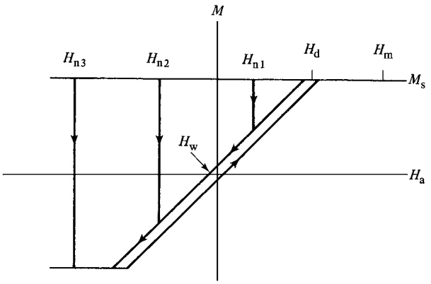

(a)

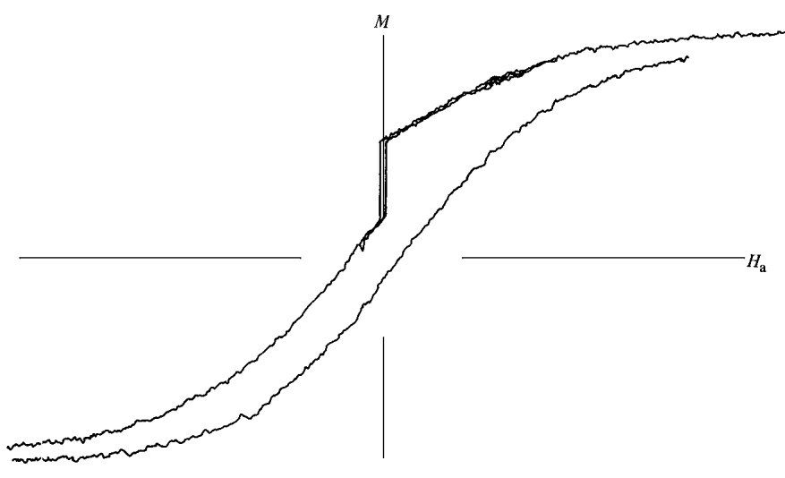

(b)

Fig. 11.16 Hysteresis loops of a single particle. (a) Theoretical. (b) Observed for a particle of SmCo5. [J. J. Becker, IEEE Trans. Mag., 5 (1969) p. 211.]

With a vibrating-sample magnetometer, Becker was able to measure the hysteresis loop of a single particle of $\mathrm{SmCo}_{5}$ , about 0.2 by 0.5 mm in size, and the result is shown in Fig. 11.16b. A field of 18 kOe was applied before drawing the curves shown. The narrow portion of the loop is due to wall motion, and it is curved because of the irregular shape of the sample. The four closely spaced vertical lines are four magnetization jumps that took place after four successive magnetizations to a field of +18 kOe. If $H_{\mathrm{m}}$ was less than 13 kOe, no such jumps were observed. When $H_{\mathrm{m}}$ was between 17 and 28 kOe, jumps occurred at $H_{\mathrm{a}}$ equal to about zero, as shown. When $H_{\mathrm{m}}$ was increased to 30 kOe, the jump did not take place until $H_{\mathrm{a}}$ was $-2000\mathrm{Oe}$. (These values refer to the upper branch of the loop; the values for the lower loop were similar but not exactly the same; in fact, for the loop shown, no jumps are evident for $H_{\mathrm{m}} = -19 \mathrm{kOe.}$ These observations demonstrate that the strong dependence of $H_{ci}$ on $H_{\mathrm{m}}$ for assemblies of particles (Fig. 11.15b) is an inherent property of the individual particles, caused by a variation in the strength of pinning sites with $H_{m}$ . The fact that a crystal can have more than one wall-nucleating field, for a constant value of $H_{m},$ has been demonstrated for barium ferrite by C. Kooy and U. Enz [Philips Res. Rep. , 15 (1960) p. 7].

As mentioned in Section 11.3, the coercivity of an assembly of multidomain particles varies inversely with the diameter D of the particles, in accordance with Equation 11.1. This variation can be understood, at least qualitatively, with the following assumptions:

1. The particles are uniaxial, with their easy axes all parallel to the reversing field.

2. When a free $180^{\circ}$ wall is formed by a reverse field $H_{n},$ either by nucleation or unpinning, it moves completely through the particle and reverses its magnetization, which means that $H_{n}$ must exceed $H_{\mathrm{d}}$

3. Walls are nucleated only at surface defects.

4. The “strength” of these defects varies in such a way that all values of $H_{\mathrm{n}}$ from zero up to an upper limit of $2K/M_{s}$ are equally probable. (A defect is strong if a small field can nucleate or unpin a wall at the defect.)

5. The probability of a defect existing, per unit surface area of particle, is constant.

If the particles are large, the probability that a particular particle has a strong defect is high, because of the large surface area per particle. That particle will therefore reverse at a low $H_{n}$ . The particle can be expected to have strong defects with a range of strengths, but the strongest defect present determines the reversing field $H_{\mathrm{n}}$ Moreover, the reversal of a large particle will cause a relatively large change in the magnetization $M$ of the assembly of particles. For example, if there are only eight particles, the reversal of one of them would cause $M$ to decrease from $M_{\mathrm{s}}$ to $3/4M_{s}$ as in Fig. 11.17a. The coercivity $H_{\mathrm{ci}}$ of the assembly (the field required to reverse half the particles) is expected to be low because of the high probability that many particles will contain strong defects. Small particles, on the other hand, each have a small surface area and therefore fewer defects. The range of probable $H_{\mathrm{n}}$ values per particle is thus more restricted; some particles will contain only weak defects and some only strong ones. The demagnetization curve is therefore expected to resemble Fig. 11.17b, with a large coercivity.

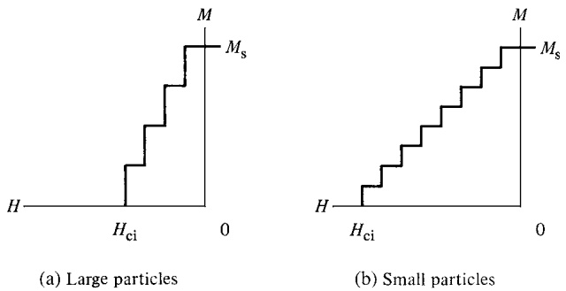

Fig. 11.17 Demagnetization curves of assemblies of particles.

## 11.6 SUPERPARAMAGNETISM IN FINE PARTICLES

Consider an assembly of uniaxial, single-domain particles, each with an anisotropy energy density $E = K \sin^{2} \theta.$ where K is the anisotropy constant and θ the angle between $M_{\mathrm{s}}$ and the easy axis. If the volume of each particle is V, then the energy barrier $\Delta E$ that must be overcome before a particle can reverse its magnetization is KV. Now in any material, fluctuations of thermal energy are continually occurring on a microscopic scale. In 1949 Néel pointed out that if single-domain particles became small enough, KV would become so small that energy fluctuations could overcome the anisotropy forces and spontaneously reverse the magnetization of a particle from one easy direction to the other, even in the absence of an applied field. Each particle has a magnetic moment $\mu = M_{\mathrm{s}}V$ and, if a field is applied, the field will tend to align the moments of the particles, whereas thermal energy will tend to disalign them. This is just like the behavior of a normal paramagnetic, with one notable exception. The magnetic moment per atom or ion in a normal paramagnetic is only a few Bohr magnetons. But a spherical particle of iron 50 Å in diameter contains 5560 atoms and has the relatively enormous moment of (5560)(2.2) = 12,000 $\mu_{\mathrm{B}}$ As a result, Bean coined the very apt term superparamagnetism to describe the magnetic behavior of such particles. This subject has been reviewed by C. P. Bean and J. M. Livingston [J. Appl. Phys., 30 (1959) p. 120S].

If K = 0, so that each particle in the assembly has no anisotropy, then the moment of each particle can point in any direction, and the classical theory of paramagnetism will apply. Then the magnetization curve of the assembly, consisting of magnetic particles in a nonmagnetic matrix, will be given by Equation 3.13, or

$$
M = n \mu \mathrm{L} (a).\tag{11.22}
$$

Here $M$ is the magnetization of the assembly, n the number of particles per unit volume of the assembly, $\mu(=M_{\mathrm{s}}V)$ the magnetic moment per particle, $a = \mu H / kT,$ and. $n\mu = M_{\mathrm{sa}}$ is the saturation magnetization of the assembly. As a consequence of the large value of μ, the variable $a = \mu H / kT$ can assume large values at ordinary fields and temperatures. Thus the full magnetization curve, up to saturation, of superparamagnetic particles can be easily observed, whereas very high fields and low temperatures are required for ordinary paramagnetic materials, as we saw in Chapter 3. At the other extreme, if K is nonzero and the particles are aligned with their easy axes parallel to one another and to the field, then the moment directions are severely quantized, either parallel or antiparallel to the field, and quantum theory will apply. Then, in accordance with Equation 3.36,

$$
M = n \mu \tanh a,\tag{11.23}
$$

where the hyperbolic tangent is just a special case of the Brillouin function. In the intermediate case of nonaligned particles of nonzero K, neither Equation 11.23 nor Equation 11.24 will apply. Nor will these equations be obeyed if, as is usually true, all particles in the assembly are not of the same size, because then the moment per particle is not constant. Nevertheless, two aspects of superparamagnetic behavior are always true:

1. Magnetization curves measured at different temperatures superimpose when $M$ is plotted as a function of H/T.

2. There is no hysteresis, so that both the retentivity and coercivity are zero. We are therefore dealing with particles having diameters smaller than the critical value $D_{p}$ of Fig. 11.2.

Both of these features are illustrated by the measurements on fine iron particles dispersed in solid mercury shown in Fig. 11.18. The curves for 77 and 200K in Fig. 11.18a show typical superparamagnetic behavior, and they superimpose when plotted as a function of H/T, as shown in Fig. 11.18b. But at 4.2K, the particles do not have enough thermal energy to come to complete thermal equilibrium with the applied field during the time required for the measurement, and hysteresis appears. (The 4.2K curve is only half of the complete hysteresis loop.)

Hysteresis will appear and superparamagnetism will disappear when particles of a certain size are cooled to a particular temperature, or when the particle size, at constant temperature, increases beyond a particular diameter $D_{\mathrm{p}}$ To determine these critical values of temperature or size, we must consider the rate at which thermal equilibrium is approached. Consider first the case of zero applied field. Suppose an assembly of uniaxial particles has been brought to some initial state of magnetization $M_{\mathrm{i}}$ by an applied field, and the field is then turned off at time $t = 0$ . Some particles in the assembly will immediately reverse their magnetization, because their thermal energy is larger than average, and the magnetization of the assembly will begin to decrease. The rate of decrease at any time will be proportional to the magnetization existing at that time and to the Boltzmann factor $\mathrm{e}^{-KV / kT}$ , because this exponential gives the probability that a particle has enough thermal energy to surmount the energy gap $\Delta E = KV$ required for reversal. Therefore,

$$
- \frac {d M}{d t} = f _ {0} M \mathrm{e} ^ {- K V / k T} = \frac {M}{\tau}.\tag{11.24}
$$

Here the proportionality constant $f_{0}$ is called the frequency factor and has a value of about $10^{9}\sec^{-1}$ . This value is only slightly field dependent and can be taken as constant. The constant $\tau$ is called the relaxation time. (For spherical particles with cubic anisotropy the energy barrier is not KV but $\frac{1}{4} KV$ if K is positive with <100> easy directions, or $\frac{1}{12} KV$ if $K$ is negative with <111> easy directions.) To find how the remanence $M_{r}$ decreases with time we rearrange the terms of Equation 11.24 and integrate:

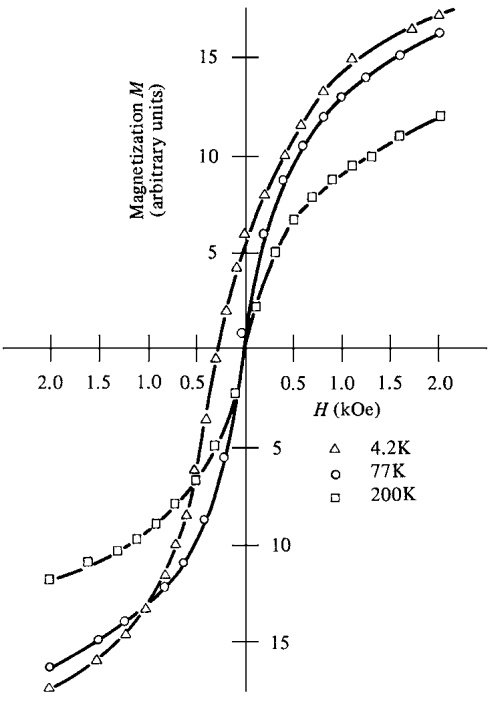

(a)

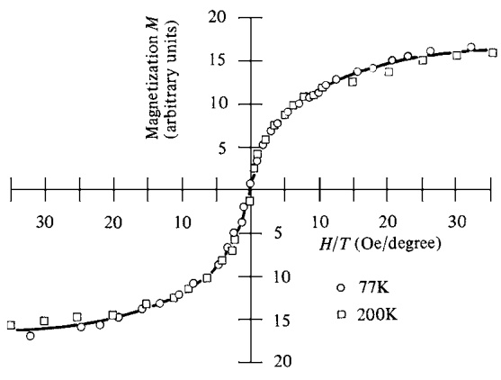

(b)

Fig. 11.18 Magnetization curves of iron particles 44 $A$ in diameter. [I. S. Jacobs and C. P. Bean, Magnetism, Volume 3, G. T. Rado and H. Suhl, eds., Academic Press (1966).]

$$
\int_ {M _ {\mathrm{i}}} ^ {M _ {\mathrm{r}}} \frac {d M}{M} = - \int_ {0} ^ {t} \frac {d t}{\tau}\tag{11.25}
$$

$$
\ln \left(\frac {M _ {\mathrm{r}}}{M _ {\mathrm{i}}}\right) = - \frac {t}{\tau},\tag{11.26}
$$

$$
M _ {\mathrm{r}} = M _ {\mathrm{i}} \mathrm{e} ^ {- t / \tau}.\tag{11.27}
$$

The value of $\tau$ is the time for $M_{r}$ to decrease to 1/e or 37% of its initial value. (If the initial state is the saturated state, then $M_{\mathrm{i}} = M_{\mathrm{s.}}$ From Equation 11.24 we have

$$
\frac {1}{\tau} = f _ {0} \mathrm{e} ^ {- K V / k T}.\tag{11.28}
$$

Because the particle volume V and the temperature T are both in the exponent, the value of $\tau$ is strongly dependent on these quantities. For example, a spherical particle of cobalt which is 68 $\overset{\circ}{\mathrm{A}}$ in diameter has a relaxation time t at room temperature, given by Equation 11.28, of only 0.1 sec. An assembly of such particles would therefore reach thermal equilibrium $(M_{\mathrm{r}} = 0)$ almost instantaneously; $M_{r}$ would appear to be zero in any normal measurement and the assembly would be superparamagnetic. On the other hand, if the particle diameter is increased to only 90 Å , the value of t jumps to $3.2\times10^{9}$ sec or 100 years. An assembly of such particles would be very stable, with $M_{r}$ essentially fixed at its initial value.

Because t varies so very rapidly with V, it follows that relatively small changes in $\tau$ do not produce much change in the corresponding value of V. Thus it becomes possible to specify rather closely an upper limit $V_{f}$ for superparamagnetic behavior by letting $\tau =$ 100 sec define the transition to stable behavior. The value of 100 sec is chosen because it is roughly the time required to measure the remanence of a specimen. If this time were increased to 1000 sec, the corresponding value of $V_{\mathrm{f}}$ would be only slightly increased. With $\tau = 100 \, \mathrm{sec}$ , Equation 11.28 becomes

$$
1 0 ^ {- 2} = 1 0 ^ {9} \mathrm{e} ^ {- K V \mathrm{p} / k T},\tag{11.29}
$$

whence $KV_{p}/kT$ equals 25. Therefore, the transition to stable behavior occurs when the energy barrier becomes equal to 25 kT. For uniaxial particles,

$$
V _ {\mathrm{p}} = \frac {2 5 k T}{K},\tag{11.30}
$$

and the corresponding diameter $D_{\mathrm{p}}$ can be calculated for any given particle shape. It is this value which in Fig. 11.2 marks the upper limit of superparamagnetism, and the terms “stable” and “unstable” in that diagram refer to particles which have relaxation times longer and shorter, respectively, than 100 sec. The value of $D_{p}$ for spherical cobalt particles is 76 Å or 7.6 nm at room temperature.

For particles of constant size there will be a temperature $T_{\mathrm{B}}$ called the blocking temperature, below which the magnetization will be stable. For uniaxial particles and the same criterion of stability,

$$
T _ {\mathrm{B}} = \frac {K V}{2 5 k}.\tag{11.31}
$$

The iron particles of Fig. 11.18 must have a blocking temperature between 77 and 4.2K, because they ceased to behave superparamagnetically on cooling through this range. The results of Problem 11.5 show that these particles must have been slightly elongated, rather than spherical.

Figure 11.19 summarizes some of these relations for spherical cobalt particles. The variation of $D_{\mathrm{p}}$ with temperature shows that $20^{\circ}\mathrm{C}$ is the blocking temperature for particles 76 Å in diameter; above this temperature particles of this size have enough thermal energy to be superparamagnetic, while below this temperature they are stable and show hysteresis. The other curve shows how the relaxation time of 76 $\text{Å}$ particles varies with temperature; at $20^{\circ}\mathrm{C}\tau$ is 100 sec.

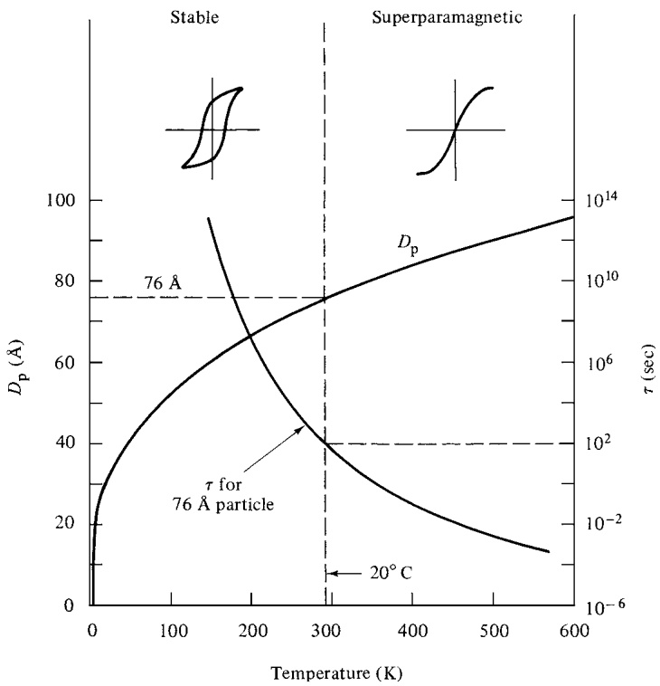

Fig. 11.19 Temperature dependence of the relaxation time $\tau$ for spherical cobalt particles 76 Å in diameter and of the critical diameter $D_{\mathrm{p}}$ of spherical cobalt particles.

The next point to consider is the effect of an applied field on the approach to equilibrium. Assume an assembly of uniaxial particles with their easy axes parallel to the z axis. Let the assembly be initially saturated in the +z direction. A field $H$ is then applied in the -z direction, so that $M_{\mathrm{s}}$ in each particle makes an angle $\theta$ with +z The total energy per particle is then

$$
E = V (K \sin^ {2} \theta + H M _ {\mathrm{s}} \cos \theta),\tag{11.32}
$$

which is the same as Equation 9.37 with $\alpha = 180^{\circ}$ . The energy barrier for reversal is the difference between the maximum and minimum values of E, and it is left to the reader to show that this barrier is

$$
\Delta E = K V \bigg (1 - \frac {H M _ {\mathrm{s}}}{2 K} \bigg) ^ {2}.\tag{11.33}
$$

The barrier is therefore reduced by the field, as shown by the curves of Fig. 9.37. Particles larger than $D_{\mathrm{p}}$ are stable in zero field and will not thermally reverse in 100 seconds. But when a field is applied, the energy barrier can be reduced to 25 kT, which will permit thermally activated reversal in 100 sec. This field will be the coercivity $H_{\mathrm{ci}}$ given by

$$
\Delta E = K V \bigg (1 - \frac {H _ {\mathrm{ci}} M _ {\mathrm{s}}}{2 K} \bigg) ^ {2} = 2 5 k T.\tag{11.34}
$$

Solving for $H_{\mathrm{ci}}$ gives

$$
H _ {\mathrm{ci}} = \frac {2 K}{M _ {\mathrm{s}}} \left[ 1 - \left(\frac {2 5 k T}{K V}\right) ^ {1 / 2} \right].\tag{11.35}
$$

When V becomes very large or T approaches zero, $H_{\mathrm{ci}}$ approaches $2K/M_{s}$ as it should, because $2K/M_{s}$ is the coercivity when the field is unaided by thermal energy. If we put this limiting value equal to $H_{\mathrm{ci,0}}$ and substitute Equation 11.30 into Equation 11.35, we obtain the reduced coercivity

$$
h _ {\mathrm{ci}} = \frac {H _ {\mathrm{ci}}}{H _ {\mathrm{ci,0}}} = 1 - \left(\frac {V _ {\mathrm{p}}}{V}\right) ^ {1 / 2} = 1 - \left(\frac {D _ {\mathrm{p}}}{D}\right) ^ {3 / 2}.\tag{11.36}
$$

The coercivity therefore increases as the particle diameter D increases beyond $D_{\mathrm{p}}$ as indicated qualitatively in Fig. 11.2. A quantitative comparison of Equation 11.36 with experiment appears in the lower part of Fig. 11.20 for slightly elongated, randomly oriented particles of a 60 Co – 40 Fe alloy dispersed in mercury. The agreement is very good. (Measurements were made at three different temperatures, as indicated. The curve is independent of temperature, however, because both coordinates are normalized.) The experimental curve tails off at $D/D_{p}$ values less than 1; this is due to the particles having a range of sizes, instead of a single size, in each specimen. For these alloy particles $D_{s}$ equals about $5D_{p};$ larger particles are therefore multidomain, and the coercivity decreases as the size increases.

Equation 11.35 also predicts the variation of coercivity with temperature, for particles of constant size. Particles of the critical size $V_{\mathrm{p}}$ have zero coercivity at their blocking temperature $T_{\mathrm{B}}$ and above, where $T_{\mathrm{B}}$ is given by Equation 11.32. Therefore

$$
h _ {\mathrm{ci}} = \frac {H _ {\mathrm{ci}}}{H _ {\mathrm{ci,0}}} = 1 - \left(\frac {T}{T _ {\mathrm{B}}}\right) ^ {1 / 2}.\tag{11.37}
$$

This relation is plotted in Fig. 11.21. Similar curves have been found experimentally. However, too much generality should not be attached to Equation 11.37. The value of $T_{\mathrm{B}}$ is so extremely large for the particles in ordinary permanent magnets that any observed variation of $H_{\mathrm{ci}}$ with temperature is due, not to the thermal effects discussed here, but to other causes, such as the variation of K and/or $M_{\mathrm{s}}$ with temperature.

Particles larger than $V_{p}$ have a nonzero retentivity, because thermal energy cannot reverse their magnetization in 100 sec. To find the relation between retentivity and size we combine Equations 11.27 and 11.28 to obtain

$$
\ln \left(\frac {M _ {\mathrm{r}}}{M _ {\mathrm{i}}}\right) = - \frac {t}{\tau} = - 1 0 ^ {9} t \mathrm{e} ^ {- K \mathrm{V} / k T}.\tag{11.38}
$$

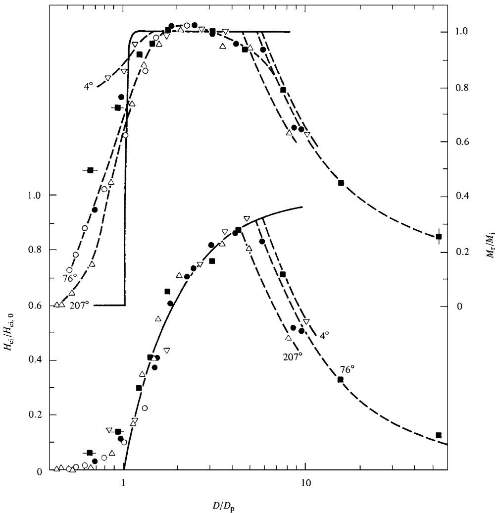

Fig. 11.20 Particle size dependence of the coercivity (lower curve) and retentivity (upper curve) of a Co –Fe alloy. Solid lines are calculated. [E. F. Kneller and F. E. Luborsky, J. Appl. Phys., 34 (1963) p. 656.]

Substituting Equation 11.31 into this and putting t = 100 sec, we obtain

$$
\ln \left(\frac {M _ {\mathrm{r}}}{M _ {\mathrm{i}}}\right) = - 1 0 ^ {1 1} \mathrm{e} ^ {- 2 5 V / V _ {\mathrm{p}}}.\tag{11.39}
$$

The variation of $M_{\mathrm{r}} / M_{\mathrm{i}}$ with $V / V_{\mathrm{p}},$ or $D / D_{\mathrm{p}},$ predicted by this equation, is extremely rapid, as illustrated by Problem 11.7. It is plotted as the upper curve of Fig. 11.20, and its slope is so large that it appears vertical. The experimental retentivities do not agree with theory as well as the coercivities, because the retentivities, which vary so rapidly with size, are more sensitive to the presence of a distribution of sizes. When particles of size $V_{p}$ are cooled below $T_{\mathrm{B}}$ , the retentivity rises very rapidly to its maximum value.

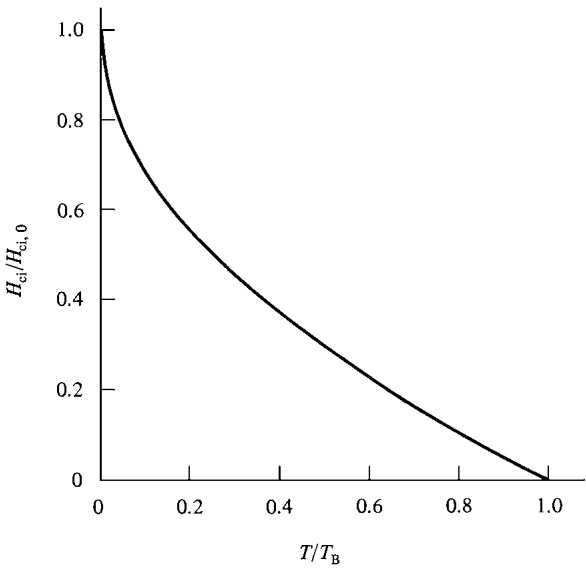

Fig. 11.21 Theoretical temperature dependence of the coercivity of single-domain fine particles. $T_{\mathrm{B}} =$ blocking temperature.

The marked dependence of the magnetic properties of very fine particles on their size means that particle sizes can be measured magnetically. An example is given in the next section.

## 11.7 SUPERPARAMAGNETISM IN ALLOYS

To produce specimens suitable for magnetic studies, fine particles of magnetic metals, alloys, and nonmetals may be prepared by a variety of methods and then dispersed in a nonmagnetic medium to avoid particle interactions,. Alternatively, some alloys can be heat treated so that fine particles of a magnetic phase are precipitated out of a nonmagnetic matrix. Magnetic measurements on such a material can furnish valuable information about the very early stages of precipitation, before the precipitate is visible in the optical microscope.

An alloy of copper with 2 wt% cobalt has received the most attention. The Cu –Co equilibrium diagram is shown in Fig. 11.22. The copper-rich phase is nonmagnetic, and the Co phase, which contains about 90% Co, is magnetic. In the experiments of J. J. Becker [Trans. AIME, 209 (1957) p. 59] the alloy was heated to $1010^{\circ}\mathrm{C}$ , where the solubility of cobalt in copper exceeds 2%. The homogeneous a solid solution was then quenched to room temperature. Subsequent aging treatments at 650 and $700^{\circ}\mathrm{C}$ allowed the magnetic phase to precipitate in reasonable time periods. The magnetic properties of the alloy were measured after each treatment.

Magnetization curves measured after aging up to 100 min at $650^{\circ}\mathrm{C}$ had the typical superparamagnetic shape, with zero coercivity. The size of the precipitate particles was determined from the initial susceptibility x of the alloy and its saturation magnetization $M_{\mathrm{sa}}$ The Langevin law will apply either for particles with no anisotropy or for a random distribution of particles with uniaxial anisotropy. The initial susceptibility will therefore be given by Equation 3.15:

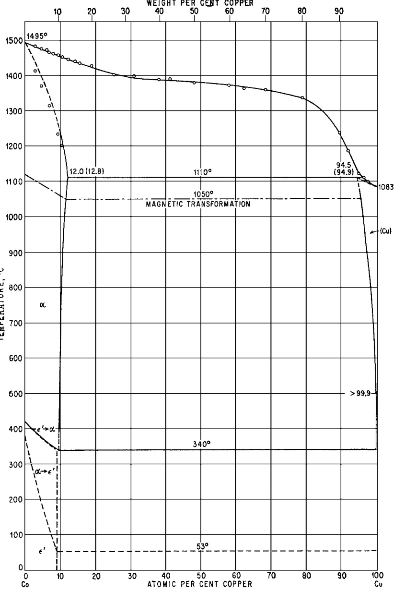

Fig. 11.22 Copper–cobalt equilibrium diagram (ASM Handbook).

$$
\chi = \frac {M}{H} = \frac {n \mu^ {2}}{3 k T} = \frac {(n \mu) (\mu)}{3 k T} = \frac {(M _ {\mathrm{sa}}) (M _ {\mathrm{s}} V)}{3 k T},\tag{11.40}
$$

$$
V = \frac {3 k T \chi}{M _ {\mathrm{sa}} M _ {\mathrm{s}}}.\tag{11.41}
$$

This equation applies to materials which obey the Curie law (Equation 3.7). However, susceptibility vs temperature measurements showed that the Cu–Co alloy obeyed the Curie –Weiss law (Equation 3.8) with a small value of the constant u, about 5 – 10 K. There is, therefore, a small interaction between the precipitate particles. Because of the observed Curie –Weiss behavior, Equation 11.41 was modified to

$$
V = \frac {3 k (T - \theta) \chi}{M _ {\mathrm{sa}} M _ {\mathrm{s}}}.\tag{11.42}
$$

The value of $M_{\mathrm{s}}$ in this equation was taken as the value for pure cobalt (1422 emu/cm³ or kA/m) . From the particle volumes V given by Equation 11.43, the radius R of the particles, assumed spherical, could be calculated. These values are shown by the lower curve of Fig. 11.23, which shows how the particle size increases with aging time. These particles are very small. They are invisible with the light microscope, and could be seen only with great difficulty in the electron microscopes available at the time. At the shortest aging time of 3 min, their diameter is only about 25 Å, or less than 10 unit cells. Probably no other experimental tool could have disclosed this information as readily as these rather simple magnetic measurements.

The observed value of the saturation magnetization $M_{\mathrm{sa}}$ of the alloy disclosed the amount of the magnetic phase present, independent of its particle size. The upper curve of Fig. 11.23 therefore shows that precipitation of β is essentially complete in only 3 min at $650^{\circ}\mathrm{C}$ . Thereafter, the changes that occur in the alloy consist solely of an increase in particle size and a decrease in the number of particles, with a nearly constant total volume of precipitate. This process, called coarsening or ripening, occurs by the dissolving into solid solution of some particles and the growth of others, in order to decrease the total surface energy of the precipitate. This kind of behavior, initial rapid nucleation followed by a decrease in the nucleation rate to zero, is typical of precipitation from a supersaturated solid solution and is technically known as continuous precipitation. The cobalt-rich precipitate particles are believed to have the fcc crystal structure, rather than hcp, and to owe their uniaxial nature to shape anisotropy. If the particles are actually egg-shaped, then the radius R shown in Fig. 11.23 is an average radius.

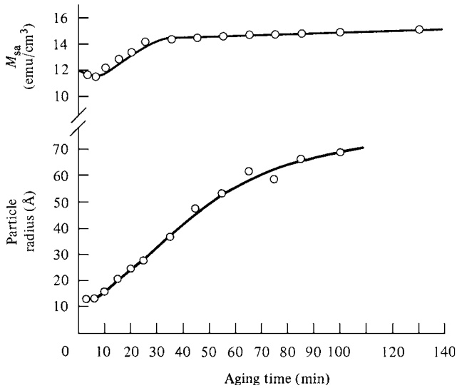

Fig. 11.23 Effect of aging at $650^{\circ}\mathrm{C}$ on the saturation magnetization $M_{\mathrm{sa}}$ of a Cu –Co alloy and on the effective radius R of the precipitate particles. [J. J. Becker, Trans. AIME, 209 (1957) p. 59.]

After about 100 min at $650^{\circ}\mathrm{C}$ , the particle volume increased beyond the critical value $V_{\mathrm{p}}$ appropriate to the measuring temperature (room temperature), and hysteresis appeared. The time to grow particles larger than $V_{\mathrm{p}}$ can be shortened from 100 to about 10 min by raising the aging temperature from 650 to $700^{\circ}\mathrm{C},$ as shown by Fig. 11.24. Hysteresis, as evidenced by a nonzero value of the coercivity, begins to appear after about 10 min. Figure 11.24 is interesting because it shows in one single curve, on a time base, all the changes that are schematically displayed in Fig. 11.2 on a particle-size base. Up to about 10 min, the particles behave superparamagnetically. At longer times the particles have grown to such a size that thermal energy alone can no longer rapidly overcome the energy barrier KV for reversal, and a nonzero coercive field $H_{ci}$ is needed in addition. With further growth, $H_{\mathrm{ci}}$ increases to a maximum at about 800 min. The particles then become multidomain, and $H_{\mathrm{ci}}$ decreases.

Fine magnetic particles dispersed in a nonmagnetic matrix also exist in many kinds of rocks. The magnetic phase is usually a ferrimagnetic oxide. Studies in rock magnetism often involve the problem of determining the direction and magnitude of the earth’s field in the remote past when the rock was formed. This brings up the question of the stability of the original magnetization. Has it been altered by subsequent changes in the earth’s field? One must then consider the possibility of magnetization relaxation, not over a period of the order of 100 sec, but over geological times.

In the copper–cobalt alloy cited in this section and in most rocks, the magnetic particles responsible for the superparamagnetic behavior of the material are discrete particles of a second phase. This condition is not essential, because a single-phase solid solution can also be superparamagnetic if it has local inhomogeneities of the right kind. For example, in a solid solution containing 90 mol% Zn ferrite and 10% Ni ferrite, there may be small clusters containing more than the average number of magnetic ions (Fe and Ni), surrounded by nonmagnetic ions (Zn). These magnetic clusters within the solid solution then act superparamagnetically.

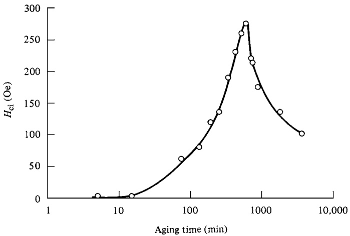

Fig. 11.24 Effect of aging at $700^{\circ}\mathrm{C}$ on the coercivity $H_{\mathrm{ci}}$ of a Cu – Co alloy. [J. J. Becker, Trans. AIME, 209 (1957) p. 59.]

## 11.8 EXCHANGE ANISOTROPY

Another interesting small-particle effect was discovered in 1956 by W. H. Meiklejohn and C. P. Bean [Phys. Rev., 105 (1957) p. 904], who called it exchange anisotropy. They took fine, single-domain particles of cobalt and partially oxidized them, so that each cobalt particle was covered with a layer of CoO. A compact of these particles was then cooled in a strong field to 77K, and its hysteresis loop was measured at that temperature. This loop, shown by the full curve of Fig. 11.25, is not symmetrical about the origin but shifted to the left. If the material is not cooled in a field, the loop is symmetrical and entirely normal (dashed curve). The field-cooled material has another unusual characteristic: its rotational hysteresis loss $W_{\mathrm{r}}$ measured at 77K, remains high even at fields as large as 16 kOe, whereas $W_{\mathrm{r}}$ decreases to zero at high fields in most materials.

These two features of exchange anisotropy, a shifted loop and high-field rotational hysteresis, have since been found in other materials, including alloys. For example, disordered nickel-manganese alloys at and near the composition $Ni_{3}Mn$ are paramagnetic at room temperature but show exchange anisotropy when field-cooled to low temperatures (Fig. 11.26). The hysteresis loop is then shifted so far that the remanence is positive,

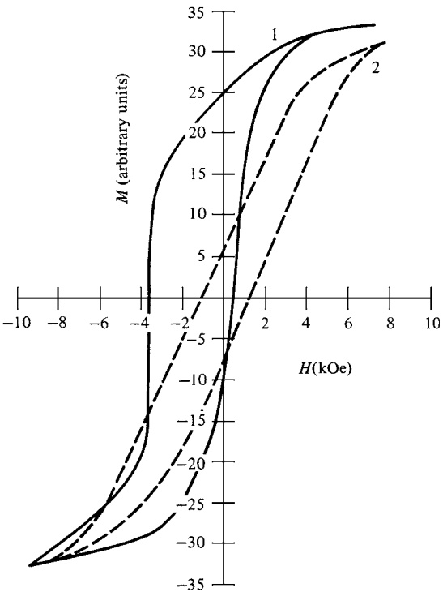

Fig. 11.25 Hysteresis loops measured at 77K of oxide-coated cobalt particles. Loop (1) results from cooling in a 10 kOe field in the positive direction, and loop (2) from cooling in zero field. [W. H. Meiklejohn and C. P. Bean, Phys. Rev., 105 (1957) p. 904.]

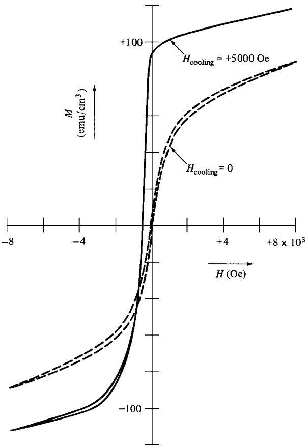

Fig. 11.26 Hysteresis loops measured at 4.2K of an alloy of Ni + 26.5 atomic percent Mn after cooling with and without a field of 5 kOe in the positive direction. [J. S. Kouvel, C. D. Graham, and I. S. Jacobs, J. Phys. Rad., 20 (1959) p. 198.]

after cooling in a field in the positive direction, whether the previous saturating field was applied in the positive or negative direction. (Note that we are dealing here with shifted major loops, representing saturation in both directions. A shifted minor loop, in which saturation is not achieved in one or both directions, is not evidence for exchange anisotropy and can be obtained in any material.)

Both the Co–CoO particles and the $\mathrm{Ni}_{3}\mathrm{M}$ Mn alloy display unidirectional, rather than uniaxial, anisotropy. The anisotropy energy is therefore proportional to the first power, rather than the square, of the cosine:

$$
E = - K \cos \theta ,\tag{11.43}
$$

where K is the anisotropy constant and $\theta$ is the angle between $M_{\mathrm{s}}$ and the direction of the cooling field. For oxidized cobalt particles 200 $\text{\AA}$ in diameter, K is $4 \times 10^{6} \mathrm{ergs/cm}^{3}$ (cm³) of metallic cobalt). This dependence of energy on $\theta$ is just the same as that of a magnet in a field (Equation 1.5).

The unusual properties of field-cooled Co –CoO particles are due to exchange coupling between the spins of ferromagnetic Co and antiferromagnetic CoO at the interface between them. The Néel temperature $T_{N}$ of CoO is about $20^{\circ}\mathrm{C}$ When a strong field is applied at $20^{\circ}\mathrm{C},$ the cobalt is magnetically saturated but the oxide, being paramagnetic, is little affected. However, the spins of the first layer of Co ions in the oxide are forced to be parallel to the adjoining spins in the metal, because of the positive exchange force between the spins of adjacent cobalt atoms. When the particles are cooled, still in the field, far below $T_{\mathrm{N}}$ the antiferromagnetic ordering that occurs in the oxide will then have to take on the form sketched in Fig. 11.27a. Furthermore, this spin arrangement will persist when the field is removed. If now a strong field is applied in the downward (negative) direction, as in Fig. 11.27b, the spins in the cobalt will reverse, and the exchange coupling at the interface will try to reverse the spin system of the oxide. This rotation is resisted by the strong crystal anisotropy of the antiferromagnet, with the result that only, partial rotation of a few spins near the interface occurs, as indicated. Finally, when the downward field is removed, the “up” spins in the oxide at the interface force the spins in the metal to turn up, restoring the particle to state (a), with a positive retentivity. This ideal behavior is achieved in the observed loop of $\mathrm{Ni}_{3}\mathrm{Mn}$ (Fig. 11.26) but not in the Co –CoO loop (Fig. 11.25).

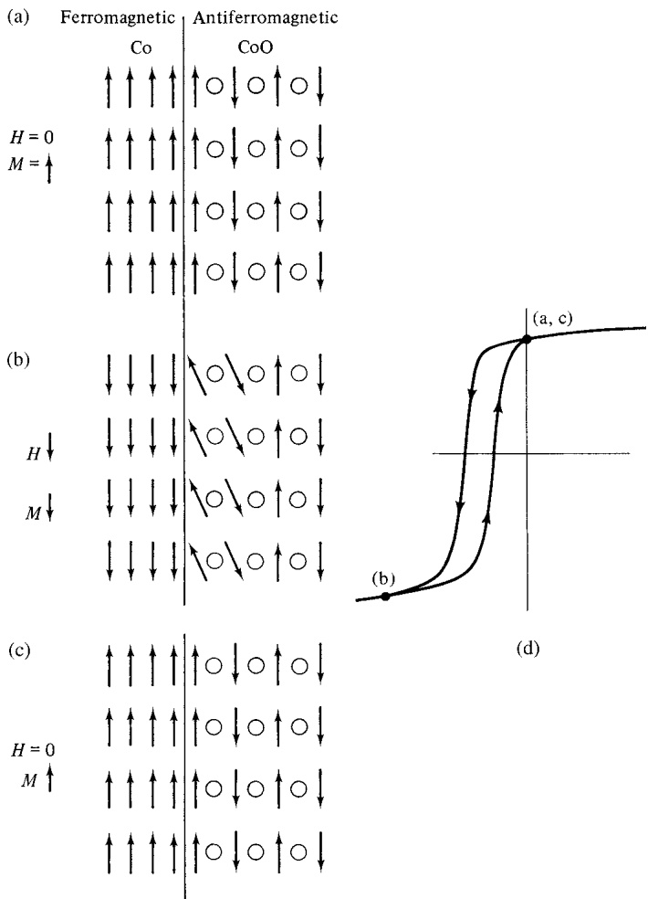

Fig. 11.27 Mechanism of the shifted loop in Co–CoO. Arrows represent spins on cobalt atoms or ions, and open circles are oxygen ions. Points (a) – (c) on the loop correspond to the three states at the left.

There are evidently three requirements for the establishment of exchange anisotropy: (1) field-cooling through $T_{\mathrm{N}}$ , (2) intimate contact between ferromagnetic and antiferromagnetic, so that exchange coupling can occur across the interface, and (3) strong crystal anisotropy in the antiferromagnetic. Actually, the role of field-cooling is only to give the specimen as a whole a single easy direction. If it is cooled in zero field, the exchange interaction occurs at all interfaces, leading, in the ideal case, to a random distribution of easy directions in space and zero retentivity, as shown in Fig. 11.26.

The exchange anisotropy exhibited by disordered $\mathrm{Ni}_{3}\mathrm{Mn}$ is believed to be due to composition fluctuations in the solid solution, leading to the formation of Mn-rich clusters. These clusters would be antiferromagnetic, because the exchange force between Mn –Mn nearest neighbors is negative, as in pure manganese. Just outside the cluster the solution would be richer in nickel than the average composition, and the preponderance of Ni –Ni and Ni –Mn nearest neighbors would cause ferromagnetism there. (Ordered $\mathrm{Ni}_{3}\mathrm{Mn}$ in which all nearest neighbor pairs are Ni –Mn, is ferromagnetic.) We may therefore conclude that the establishment of exchange anisotropy does not require a two-phase system like Co-CoO; it can also occur in a single-phase solid solution having the right kind of inhomogeneity. The latter behavior resembles that described in the last paragraph of Section 11.7.

Exchange anisotropy remained a scientific curiosity for many years, but has found widespread use in the data-reading heads of hard disk drives. In the spin valve, considered in more detail in Chapter 15, a thin ferromagnetic layer is held with its magnetization in a fixed direction by being placed in exchange contact with an antiferromagnetic layer. In this application, the effect is sometimes known as spin bias. This application has led to considerable additional theoretical and experimental work on exchange coupling and exchange anisotropy. For further details, see R. M. O’Handley [Modern Magnetic Materials, Principles and Applications, Wiley (2000) p. 437ff ].

## 11.9 PREPARATION AND STRUCTURE OF THIN FILMS

We turn now to thin films. Much of the early research on magnetic thin films was done because of their prospective application as memory elements in digital computers. This application was never commercially successful, but was followed by the intense development of bubble domain memories, which also required the use of patterned magnetic thin films to control the motion of the bubbles. This development, too, eventually came to naught. But a rich variety of other uses, mainly related to various aspects of computer technology, have arisen. These include the original idea of magnetic memory, although in a somewhat different form from the earlier ideas. Some of these will be discussed in Chapter 15.

Here we will consider some of the basic behavior of magnetic thin films, dealing primarily with the widely used alloy called 80 permalloy (80 wt% Ni, 20% Fe), which has low anisotropy and low magnetostriction combined with reasonably high magnetization, and is easily made in thin-film form. It is the obvious choice when a soft magnetic thin film is required.

Thin films are made by depositing atoms onto a substrate, and are almost always measured and used while bonded to the substrate. Interactions between the substrate and the film are therefore important, and the surface condition and temperature of the substrate during the deposition of the film are variables to be controlled. Thin films may be made in a variety of ways: chemical vapor deposition, electrodeposition from a liquid electrolyte, thermal evaporation (using one of several different heat sources), and sputtering. Of these, sputtering is the most widely used, mostly because it permits almost any combination of elements to be deposited. Sputtering is a physical rather than a chemical or thermal process. Atoms are physically ejected from a target material by high-energy gas ions, usually argon. The arrangement is shown in Fig. 11.28. It is necessary to create a plasma of ionized gas in the deposition chamber. The presence of this plasma, and the gas atoms needed to create it, means that the deposition conditions are much less pure than in the case of thermal evaporation, which can be carried out under very high vacuum conditions, as suggested by Fig. 11.29. Despite these difficulties, thin film production by sputtering can be done in a highly reproducible way, and sputtering is used, for example, in the production of the various layers on the disk surface of hard disk drives.

There is a voluminous literature on thin film production. The American Vacuum Society offers a series of practically oriented books on specialized topics related to the production and measurement of vacuum, and of various film deposition techniques.

The structure of thin films is complex and hard to characterize. The grain size of films is usually small, of the order of 1000 Å or less, which is about 1/100th the grain size of most bulk materials. Since the grain size is comparable to the domain wall thickness, domain walls may extend through many grains and the domain walls lose their crystallographic identity. Preferred orientation (texture) may or may not be present, depending on deposition conditions and nature of the substrate. If a texture is present, it is a single or multiple fiber texture, with fiber axes such as <100>,<111>, etc., usually normal to the plane of the film. Such a texture introduces no crystallographic anisotropy in the plane of the film. Even if it did, little magnetic anisotropy would result in the case of 80 Permalloy in which the magnetocrystalline anisotropy is close to zero.

Directional structures can be produced in a film if the deposition conditions are arranged so that the direction of the incoming atoms makes an angle with respect to the film plane. This directionality may be the result of crystallographic texture in materials with significant crystal anisotropy, or of geometrical structures produced in the film.

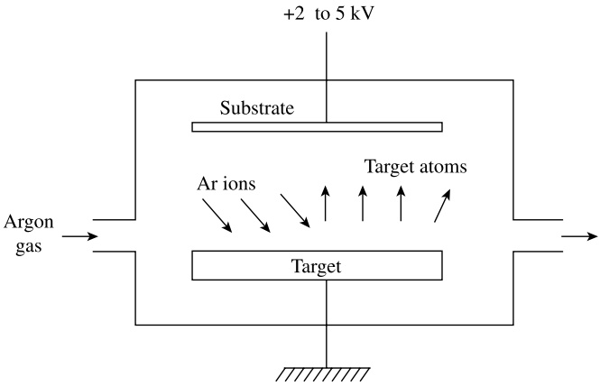

Fig. 11.28 Thin-film preparation by sputtering.

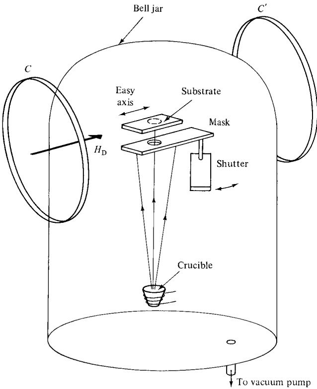

Fig. 11.29 Thin-film preparation by thermal evaporation.

The difference in thermal expansion coefficients between film and substrate leads to stresses in the film (and small stresses in the substrate), and the film itself has microstress due to various imperfections. The effect of these stresses is minimized by choosing a film composition with magnetostriction is as close as possible to zero. Stress anisotropy is therefore avoided because magneto-elastic effects are always proportional to the product of the magnetostriction $\lambda$ and the stress s.

## 11.10 INDUCED ANISOTROPY IN FILMS

A uniaxial anisotropy can often be produced in a magnetic thin film if the deposition is carried out in the presence of an applied magnetic field as in Fig. 11.29. The induced anisotropy is described by the energy relation

$$
E = K _ {\mathrm{u}} \sin^ {2} \theta ,\tag{11.44}
$$

where θ is the angle between $M_{\mathrm{s}}$ and the easy axis, which is the direction of the applied field during deposition. The value of $K_{u}$ is generally of the order of 1000-3000 ergs/cm³ or $100-300\ J/m^{3}$ for 80 permalloy, which is similar to the value observed for magnetically annealed bulk alloys (Fig. 10.5).

The measurement of $K_{u}$ is difficult, because the specimen size is so very small. Two methods are available:

1. Measurement of the Torque Curve. This is done in the usual way, but the torque magnetometer has to be extremely sensitive. The volume of a circular film specimen 1 cm in diameter and 1000 Å thick is only $10^{-5}\mathrm{cm}^{3}$ , and the torque on the specimen is proportional to the volume. A typical bulk specimen would have about the same diameter and be about 0.1 cm thick. Thus the film specimen has a volume of only $10^{-4}$ that of the bulk specimen, and the torque magnetometer must have a sensitivity $10^{4}$ times higher than usual.

2. Measurement of the Hysteresis Loop. An 80 permalloy film 1 cm in diameter and 1000 Å thick has a total magnetic moment of about $6\times10^{-3}$ emu, which is easily measured with a vibrating-sample magnetometer. From measurements of the loop in the easy and hard directions, the anisotropy field $H_{\mathrm{K}}$ can be determined. The value of $K_{u}$ is then calculated from the relation $H_{\mathrm{K}} = 2K_{u} / M_{\mathrm{s}}$ . (Details are given in Section 12.4). The origin of the induced anisotropy in magnetic thin films is presumably directional order, the same as in bulk alloys.

## 11.11 DOMAIN WALLS IN FILMS

Except in special cases. the magnetization in thin films lies in the plane of the film, because a huge demagnetizing field would act normal to the plane of the film if $M_{\mathrm{s}}$ were turned in that direction. Domains in the film extend completely through the film thickness, and the walls between them are mainly of the $180^{\circ}$ kind, roughly parallel to the easy axis of the film.

However, two new kinds of domain walls can exist in thin films. The first is the Néel wall, first suggested on theoretical grounds by Néel (see Section 9.2.1). Ordinary walls such as those found in bulk materials can also exist in thin films; they are then specifically called Bloch walls to distinguish them from Néel walls.

Néel showed that the energy per unit area g of a Bloch wall is not a constant of the material but depends also on the thickness of the specimen, when the thickness is less than a few thousand angstroms. The magnetostatic energy of the wall them becomes appreciable, relative to the usual exchange and anisotropy energy. Free poles are formed where the wall intersects the surface, as indicated in Fig. 11.30a where only the central spin in the wall is shown. When the specimen thickness t is of the same order of magnitude as the wall thickness δ, the field created by these poles constitutes an appreciable magnetostatic energy. To calculate this energy Néel approximated the actual wall, a nonuniformly magnetized rectangular block in which the spins continuously rotate from the direction +y to -y , by a uniformly magnetized elliptic cylinder. This is sketched in Fig. 11.30b; its major axis c is infinite. When magnetized along the a-axis, its demagnetizing coefficient is

$$
N _ {\mathrm{a}} = C \frac {b}{a + b},\tag{11.45}
$$

and when magnetized along b.

$$
N _ {\mathrm{b}} = C \frac {a}{a + b},\tag{11.46}
$$

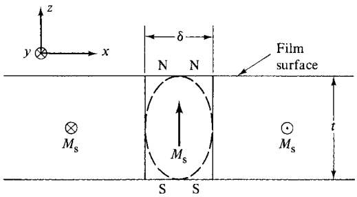

(a)

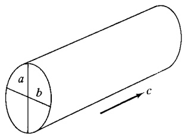

(b)

Fig. 11.30 (a) Cross section of $180^{\circ}$ Bloch wall in thin film. (b) Elliptic cylinder.

where $C = 4\pi (\mathrm{cgs})$ or 1 (SI). The magnetostatic energy density of the wall is then

$$
\begin{array}{r l} \mathrm {E_ {ms}} & = \frac {1}{2} N _ {\mathrm{t}} M _ {\mathrm{s}} ^ {2} \\ & = \frac {1}{2} \left(\frac {C \delta}{\mathrm{t} + \delta}\right) M _ {\mathrm{s}} ^ {2}. \end{array}\tag{11.47}
$$

This must be multiplied by $\delta$ to obtain the magnetostatic energy per unit area of wall in the yz plane:

$$
\gamma_ {\mathrm{ms,B}} = \frac {C}{2} \frac {\delta^ {2} M _ {\mathrm{s}} ^ {2}}{t + \delta}.\tag{11.48}
$$

This energy is negligible when $t / \delta$ is large, as in bulk specimens, but not when it is of the order of unity or less.

When the film thickness t is small, the magnetostatic energy of the wall can be reduced if the spins in the wall rotate, not about the wall normal x, but about the film normal z. The result is a Néel wall. Free poles are then formed, not on the film surface, but on the wall surface, and spins everywhere in the film, both within the domains and within the walls, are parallel to the film surface (Fig. 11.31).

If we again approximate the wall by an elliptic cylinder, its magnetostatic energy per unit area is

$$
\gamma_ {\mathrm{ms,N}} = \frac {C}{2} \frac {t \delta M _ {\mathrm{s}} ^ {2}}{t + \delta}.\tag{11.49}
$$

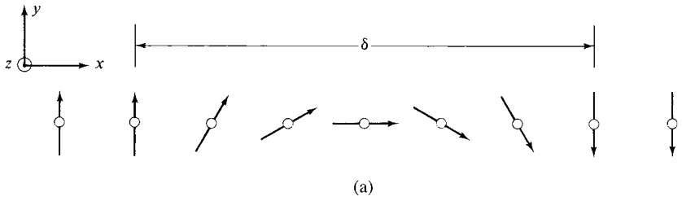

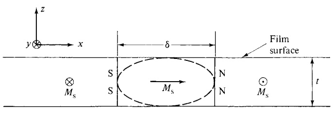

(b)

Fig. 11.31 Structure of Néel wall. (a) Section parallel to film surface. (b) Cross section of wall.

The ratio of the magnetostatic energies of the two kinds of wall is then

$$
\frac {\gamma_ {\mathrm{ms,B}}}{\gamma_ {\mathrm{ms,N}}} = \frac {\delta}{t}.\tag{11.50}
$$

The magnetostatic energy of a Néel wall is less than that of a Bloch wall when the film thickness t becomes less than the wall thickness d. This relation is inexact, not only because of the approximations involved in its derivation, but also because d varies with film thickness. And to know with confidence which kind of wall is more stable at a given thickness, one must calculate the total wall energy g, which contains magnetostatic, exchange, and anisotropy terms. The result of such a calculation is shown in Fig. 11.32, which has been carried out with the values appropriate to 80 permalloy. We see that the total energy of a Néel wall, as well as the magnetostatic energy, is less that of a Bloch wall when the film is very thin, less than about 500 Å . (Actually, for thicknesses of a few hundred angstroms, the total energy of either kind of wall is almost entirely magnetostatic.) The widths of Bloch and Néel walls also vary in different ways with film thickness: the thinner the film, the narrower the Bloch wall and the wider the Néel wall.

The second new kind of wall observed in thin films is the cross-tie wall. It consists of a special kind of Néel wall, crossed at regular intervals by Néel wall segments. As shown in Fig. 11.32, its energy is less than that of a Bloch wall or a Néel wall in a certain range of film thickness; the cross-tie wall therefore constitutes a transition form between the Bloch walls of thick films and the Néel walls of very thin films. Figure 11.33 shows the appearance of a cross-tie wall, and Fig. 11.34b its structure. In Fig. 11.34a a Néel wall is shown, separating two oppositely magnetized domains. It is not a normal Néel wall because it consists of segments of opposite polarity; these have formed in an attempt to mix the north and south poles on the wall surface more intimately and thus reduce magnetostatic energy. The regions within the wall where the polarity changes, marked with small circles, and where the magnetization is normal to the film surface, are called Bloch lines. However, this hypothetical wall would have very large energy, because the fields due to

Fig. 11.32 Variation of wall energy with film thickness for various kinds of wall in 80 Permalloy, calculated for exchange constant $A = 10 - 6 \, \text{erg/cm}$ , anisotropy constant $K = 1500\mathrm{ergs / cm}^3$ , bulkwall width = 20,000 Å, and bulk-wall $\mathrm{energy} = 0.1 \, \mathrm{erg/cm}^2$ . [M. Prutton, Thin Ferromagnetic Films, Butterworth (1964).]

Fig. 11.33 Bitter pattern of a cross-tie wall in an 80 Permalloy film, 300 Å thick. Modified brightfield illumination. [R. M. Moon, J. Appl. Phys., 30 (1959) p. 82S.]

(b)

Fig. 11.34 Sections parallel to film surface of (a) hypothetical Néel wall with sections of opposite polarity, and (b) cross-tie wall.

the poles on the wall, sometimes called stray fields, are antiparallel to the domain magnetization in the regions opposite the Bloch lines marked $A$. As a result, spike walls form in these regions, as shown in Fig. 11.34b, and the stray fields close in a clockwise direction between the cross ties.

By proper manipulation of a mask during the deposition of an evaporated film, a film can be deposited whose its thickness varies continuously from one end to the other. The Bitter pattern of such a film is shown in Fig. 11.35. At the thin end on the left the walls are of the Néel type, and as the thickness increases, cross-tie and then Bloch walls appear. The film thicknesses at which transitions occur from one type to another are in good agreement with the curves of Fig. 11.32. (Néel walls are more easily visible than Bloch walls, which sometimes appear only as a series of dots. This is due to the different modes of flux closure where each type of wall intersects the film surface. At the edge of a Néel wall the stray fields are parallel to the film surface, and these fields attract chains of colloid particles, transverse to the wall, which close the flux. The stray fields at the edge of a Bloch wall are normal to the film surface, have a larger spatial extent, and attract the colloid less strongly.)

Fig. 11.35 Domain walls in a tapered film of 80 permalloy. Easy axis horizontal. Dark-field Bitter pattern. [S. Methfessel et al., J. Appl. Phys., 31 (1960) p. 302S.]

## 11.12 DOMAINS IN FILMS

One does not expect a polycrystalline specimen to be a single domain in zero field. It would normally break up into domains arranged in conformity with the easy-axis direction in each grain. A thin film of 80 permalloy, however, if saturated in the easy direction, can remain a single domain after the saturating field is removed, as shown in Fig. 11.36a. The reason is that the demagnetizing field in the plane of the film is nearly zero, because the film is so thin; in addition, the grain size is very small. If each grain became a domain, large numbers of free poles would form at grain boundaries, and the magnetostatic energy would be high.

If a small reverse field is applied, reverse domains are nucleated at the ends of the film, as in Fig. 11.36b. It is also common to see small reverse domains in the remanent state $(H = 0)$ , nucleated by demagnetizing fields due to imperfections at the film edges; these fields need not be large, because this alloy is magnetically so soft that a reverse field of only 2 or 3 oersteds (160 or 240 A/m), applied along the easy axis, is enough to reverse the magnetization completely.

When the film is demagnetized by an alternating easy-axis field of decreasing amplitude, the resulting domain structure is shown in Fig. 11.36c. This structure is typical. It consists of elongated domains more or less parallel to the easy axis, bounded by gently curved, rather than straight, $180^{\circ}$ walls. The domain wall thickness is generally larger than the grain size. A film can also be demagnetized by saturating it in a hard direction, in the plane of the film and at right angles to the easy axis, and then removing the saturating field. The film then breaks up into the much narrower domains shown in Fig. 11.36d. The width of these domains varies from about 2 to 50 mm from one film to another.

(a)

(b)

(c)

(d)

Fig. 11.36 Domains in an 81 permalloy film observed by the Kerr effect. The film is 8 mm in diameter, 2000 Å thick, and the easy axis is vertical. (a) Single-domain remanent state, $H=0.$ (b) Domains nucleated at edges by a reverse easy-axis field of $0.2H_{c}$ (c) After demagnetizing in a 60 Hz alternating field of decreasing amplitude. (d) After demagnetizing by a transverse field equal to 1.5 $H_{K}$ or more. [Courtesy of R. W. Olmen, Sperry Rand Univac Division, St. Paul, Minnesota.]

This structure (Fig. 11.36d) is due to anisotropy dispersion. By this is meant a variation, from place to place in the film, of the direction of the easy axis and/or the magnitude of the anisotropy constant, because of inhomogeneities in the structure of the film. As a result the direction of the local magnetization $M_{\mathrm{s}}$ varies slightly from one point to another even within a domain. The nonparallelism of the $M_{s}$ vectors adds exchange energy to the system; in addition, free poles are created within the domain because of the divergence of $M$ (Section 2.6), causing stray fields and magnetostatic energy. In order to minimize this exchange and magnetostatic energy, the $M_{\mathrm{s}}$ direction varies in a wavelike manner, called

(a)

(b)

(c)

Fig. 11.37 Domain formation in a thin film after magnetization in a hard direction.

Fig. 11.38 Transmission electron micrograph of a cobalt film, 500 Å thick. [Courtesy of E. J. Torok, Sperry Rand Univac Division, St. Paul, Minnesota.]

magnetization ripple, rather than randomly, even though the film inhomogeneities which cause the effect are themselves randomly distributed. This ripple is illustrated in Fig. 11.37a, where the film is shown in the single-domain remanent state after saturation in an easy direction. When a field is now applied in a hard direction, as in Fig. 11.37b, the ripple still persists, and its relation to the local easy-axis directions is indicated. When the hard-axis field is removed, half of the $M_{s}$ vectors rotate clockwise toward the local easy axis and half counterclockwise, forming the domain structure of the demagnetized state shown in Fig. 11.37c. The vectors indicated in Fig. 11.37b and c apply only to a narrow horizontal strip; the ripple persists in the vertical direction in each domain. The easy-axis dispersion is much exaggerated in these drawings; it is typically only 1 or $2^{\circ}$

Magnetization ripple is evidenced in transmission electron micrographs by fine striations which are everywhere normal to the local direction of $M_{\mathrm{s}}$ as in Fig. 11.38. The easy axis is roughly vertical in this photograph, and three $180^{\circ}$ walls (two light and one dark) run from top to bottom. Cross ties are also visible.

## PROBLEMS

11.1 Show that the ratio of the energy barriers $\Delta E_{ms}$ that must be overcome in reversing the moments of a two-sphere chain from $\theta = 0$ to $180^{\circ}$ by fanning and by incoherent rotation is

$$
\frac {\Delta E _ {\text {fanning}}}{\Delta E _ {\text {coherent}}} = \frac {\mu^ {2} a ^ {3}}{3 \mu^ {2} / a ^ {3}} = \frac {1}{3}.
$$

11.2 For a prolate spheroid of axial ratio $c / a = 5.$ plot $h_{ci}$ vs $D / D_{0}$ for coherent rotation and for curling, and find the critical value of $D / D_{0}$ that separates the two modes. Assume $k = 1.2$

11.3 Consider single crystal of iron, in the form of a perfect sphere 1.0 cm in diameter, initially magnetized to saturation in an easy direction. Find the values of $H_{\mathrm{d}}$ and of $2K/M_{s}$

a. Will the sphere spontaneously demagnetize by forming multiple domains?

b. Let the magnetized sphere magically grow along the axis of magnetization, becoming a prolate ellipsoid, keeping the same diameter. Is there a length at which the sample will stayed magnetized, i.e., not break up into domains? If so, find this length.

11.4 Calculate the critical diameter $D_{\mathrm{p}}$ of iron particles for superparamagnetic behavior at room temperature, if the particles are (a) spheres or (b) prolate spheroids with an axial ratio of 1.5. Take the diameter of the spheroids as the length of the minor axis.

11.5 Find the blocking temperature $T_{\mathrm{B}}$ for iron particles 440 nm in diameter for the shapes (a) and (b) of the previous problem.

11.6 Derive Equation 11.34.

11.7 Calculate the values of $D / D_{\mathrm{p}}$ corresponding to the following values of reduced magnetization $M_{\mathrm{r}} / M_{\mathrm{i}}$ : 0.50, 0.90, and 0.99.

