# MAGNETIZATION DYNAMICS

## 12.1 INTRODUCTION

We now consider the dynamics, or kinetics, of magnetization. Does $M$ reach its final value quickly or slowly? What controls the rate of change of M? How does $M$ behave when the applied field $H$ is itself varying with time?

We begin with the effect of eddy currents. These not only affect the operation of many kinds of magnetic devices and machines; they can also influence magnetic measurements. It is therefore important that the nature of eddy currents be thoroughly understood. We will then consider the velocity of magnetization change by domain wall motion and spin rotation. Other topics include a group of phenomena loosely known as “time effects,” and the internal friction (damping) of magnetic materials, because the latter involves the oscillatory motion of domain walls. In the final section of the chapter, the various forms of magnetic resonance are briefly described.

## 12.2 EDDY CURRENTS

We shall consider mostly the qualitative aspects of eddy currents in this chapter and leave the more difficult quantitative problems to the next.

Suppose a rod of magnetic material is wound with a wire, as in Fig. 12.1, connected by a switch to a dc source. When the switch is suddenly closed, a current $i_{w}$ is established in the wire which creates an applied field $H_{\mathrm{a}}$ along the rod axis and uniform across the rod cross section. This field magnetizes the rod, and the induction $B$ immediately increases from its original value of zero. Therefore, by Faraday’s law, Equation 2.6, an electromotive force e will be induced in the rod proportional to dB/dt.

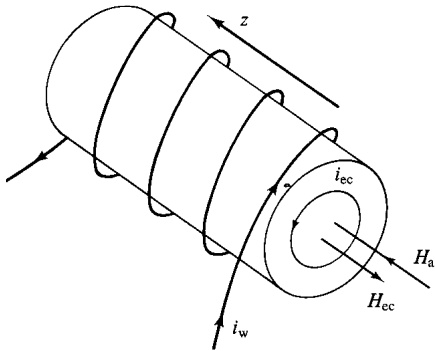

Fig. 12.1 Eddy currents in a rod.

When the current $i_{w}$ is increasing, the direction of e is such as to set up an eddy current $i_{ec}$ in the circular path shown. The direction of e and $i_{ec}$ is known from Lenz’s law, which states that the direction of the induced emf is such as to oppose the cause producing it. Thus, e and $i_{ec}$ are antiparallel to $i_{\mathrm{w}}$ when $i_{\mathrm{w}}$ is increasing. Correspondingly, the field $H_{ec}$ due to the eddy current is antiparallel to the field $H_{\mathrm{a}}$ due to $i_{\mathrm{w}}$ When the current $i_{\mathrm{w}}$ is in the same direction as shown but decreasing, as when the switch is opened, then $i_{ec}$ and $H_{ec}$ reverse directions because they now try to maintain $H_{\mathrm{a}}$ at its former value. The magnitude of the emf acting around a circular path of radius r is given by

$$
e = - 1 0 ^ {- 8} \frac {d \phi}{d t} = - 1 0 ^ {- 8} A \frac {d B}{d t} \text { volts (cgs)}\tag{12.1a}
$$

$$
e = - \frac {d \phi}{d t} = - A \frac {d B}{d t} \text {volts (SI)}\tag{12.1b}
$$

where $A = \pi r^{2}$ is the cross-sectional area of the rod within the path considered (cm²) or $\mathrm{m}^2)$ , $B$ is the induction (gauss or tesla), φ the flux (maxwells or webers), and t the time (sec). Several points should be noted:

1. This emf will be induced in any material, magnetic or not.

2. For a given $dH_{\mathrm{a}} / dt,$ the induced emf will be larger, the larger the permeability μ, because e depends on dB/dt and $B = \mu H.$ Thus the eddy-current effect is much stronger for magnetic materials, with μ values of several hundred or thousand, than for nonmagnetics with $\mu \approx 1$

3. For a given dB/dt and e, the eddy currents will be larger, the lower the electrical resistivity ρ of the material. In ferrites, which are practically insulators, the eddycurrent effect is virtually absent.

In Fig. 12.1 only one ring of eddy current is shown. Actually, circular eddy currents are flowing all over the cross section of the rod in a series of concentric rings. Inside each ring the eddy current produces a field $H_{ec}$ in the -z direction and outside it in the +z direction. It follows that the eddy-current field is strongest at the center of the rod, where the contributions of all the current rings add, and that it becomes weaker toward the surface. The variation of $H_{ec}$ across the bar diameter at one particular instant is sketched in Fig. 12.2a. Because the true field $H$ acting in the material is equal to the vector sum of $H_{\mathrm{a}}$ and $H_{ec}$ , the true field decreases below the surface and is a minimum at the center. Thus, as soon as the current $i_{w}$ is established in the winding, eddy currents are set up which temporarily shield the interior of the rod from the applied field.

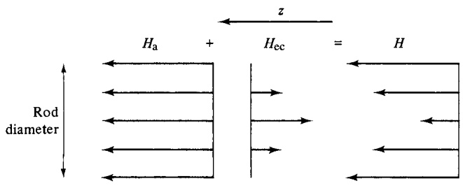

(a)

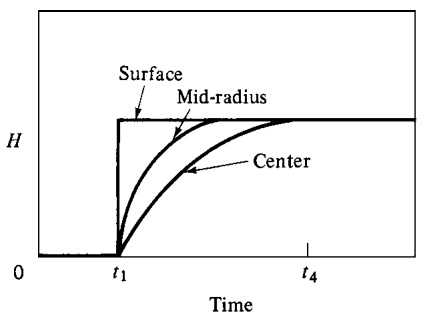

(b)

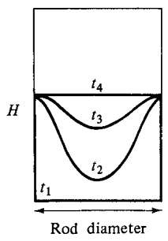

(c)

Fig. 12.2 Fields in a rod due to eddy currents (schematic).

This effect is illustrated in another way in Fig. 12.2b, which shows how $H$ changes with time at various points along the radius of the rod. The switch is closed at time $t_{1}$ and the true field is immediately established at its full value at the rod surface. The field at mid-radius takes some time to reach this value, and the field at the center takes longer still, becoming equal to the surface field at time $t_4$ The field profile in the rod interior is sketched in Fig. 12.2c for various times. The variation of $B$ with time at any point in the rod is similar to that of H; however the $B$, t curves do not simply differ from the $H$, t curves by a constant factor μ, because μ itself is a function of $H$ or $B$.

The time required for the eddy-current effect to disappear, i.e., for $B$ to reach a stationary value at the center of the rod $(t_{4}$ in Fig. 12.2c), depends on $\mu,\rho,$ and the rod diameter. In an annealed iron rod about $\frac { 1 } { 4 }$ inch or 6 mm in diameter, the effect is over in a fraction of a second. But in thick pieces of high-m, low-r material, such as the frame of an electromagnet, eddy currents may not die out for several seconds.

There is an additional complication. When the switch is closed, the field does not instantaneously attain its final value at the rod surface. The current $i_{w}$ in the wire and the field $H_{a}$ which it creates require some time to reach their final values, the exact time depending on the resistance and inductance of the circuit.

In all of the above we have assumed a rod so long that demagnetizing effects could be neglected. If the rod is short, a substantial demagnetizing field $H_{\mathrm{d}}$ will exist, and the true field at the rod surface will be given by

$$
H = H _ {\mathrm{a}} - H _ {\mathrm{d}} = H _ {\mathrm{a}} - N _ {\mathrm{d}} M,\tag{12.2}
$$

where $N_{d}$ is the demagnetizing factor. Rewriting this for the changes that occur after the switch in the magnetizing circuit is closed, we have

$$
\Delta H = \Delta H _ {\mathrm{a}} - N _ {\mathrm{d}} M.\tag{12.3}
$$

But the change DM in the rod interior is slowed by eddy currents. Therefore, $H_{\mathrm{d}}$ is initially less than its final value, and $H$ at the rod surface, which is not shielded by eddy currents, is initially larger than its final value. We can reach the same conclusion if we write the equation as

$$
\Delta H = \Delta H _ {\mathrm{a}} - M \Delta N _ {\mathrm{d}}.\tag{12.4}
$$

The surface layer becomes very quickly magnetized, and $N_{d}$ has an initial low value characteristic of a hollow tube, rather than a solid rod. $H_{\mathrm{d}}$ is again less than its final value, and $H$ larger at the rod surface.

It follows then that, after a sudden increase in $H_{a},$ the rod surface finds itself first on an ascending portion of the magnetization curve (or hysteresis loop) and then on a descending loop, whereas the interior is always on an ascending portion. The total change in $B$, as measured with an integrating fluxmeter, may then not agree with that measured for a slow change in $H_{\mathrm{a}}$ of the same amount. In practice, measurements requiring rapid changes in field are usually made on samples in closed magnetic circuits, where demagnetizing effects are minimized. And samples of practical materials are made in a form (usually thin sheets) that minimizes eddy currents.

If the field applied to the rod is alternating, and at a frequency such that $H_{\mathrm{a}}$ goes through a maximum and begins to decrease before $B$ at the center can attain the same maximum value that was reached by $B$ at the surface, then the maximum value of $B$ at the center will always be less than the maximum of $B$ at the surface. Furthermore, the two will differ in phase, so that, at certain times in the cycle, $B$ at the center can point in the 2z direction of the rod axis while $B$ at the surface is in the +z direction. Eddy currents then circulate continuously, in opposite directions during each half cycle, and are a continuous source of heat. This heat is exploited in induction heating, where eddy currents are deliberately induced in a material to be heated. At sufficiently high frequency, the eddy currents are confined to a thin surface layer and it is possible to heat the surface while the interior remains cool. But in a transformer core or an electric motor, eddy-current heating represents a power loss, and should be minimized. We will return to this question of power loss in the next chapter.

## 12.3 DOMAIN WALL VELOCITY

Magnetization change can occur by domain wall motion and/or rotation of magnetization. In some specimens and in certain ranges of applied field, only one of these mechanisms is operative; in others, both mechanisms occur. In this section we will examine only the wall-motion mechanism and the factors that influence wall velocity. This subject is treated in detail in the book by Giorgio Bertotti [Hysteresis in Magnetism, Academic Press (1988)].

Let a field $H$ be applied parallel to a $180^{\circ}$ wall and to the $M_{\mathrm{s}}$ vector in one of the adjacent domains. Then, as noted in Section 9.11, the field exerts a force per unit area, or pressure, on the wall equal to $2HM_{s}$ . Suppose that, when $H=0$ , the wall is initially located at a potential energy minimum, like position 1 of Fig. 9.36. Then the equation of motion of the wall (per unit area) is

$$
m \frac {d ^ {2} x}{d t ^ {2}} + \beta \frac {d x}{d t} + \alpha x = 2 M _ {\mathrm{s}} H,\tag{12.5}
$$

where x describes the position of the wall. If $H$ is a weak alternating field, the wall will oscillate back and forth about its initial position. In fact, it will behave just like a mass on a spring acted on by an alternating force or like charge in an electric circuit acted on by an alternating emf; the equations describing these mechanical or electrical oscillations are exactly similar in form to Equation 12.5.

The first term in this equation, the product of the mass per unit area $m$ of the wall and its acceleration, represents the inertia of the wall, or the resistance of the spins to sudden rotation. This term is not usually important except at very high frequencies; for $\mathrm{Fe_{3}O_{4}}$ the value of $m$ has been calculated to be only $10^{-10} \mathrm{~g/cm}^{2}$ or $10^{-9} \mathrm{~kg/m}^{2}$. The second term represents a resistance to motion which is proportional to velocity, and β is accordingly called the viscous damping parameter. (Any force on a moving body which is proportional to velocity is, by definition, a viscous force.) The physical origin of β will be dealt with later. The third term ax represents a force due to crystal imperfections such as microstress or inclusions, and a is related to the shape of the potential-energy minimum in which the wall is located. For example, if only microstress is present, then a is equal to $6\delta\lambda_{100}k$ . The value of $\alpha$ determines the field required to move the wall out of the energy minimum, and the ensemble of a values for the whole specimen determines the coercive field $H_{c}$ which is the field required for extensive wall movement.

Suppose the field $H$ is now constant rather than alternating and large enough to cause extensive wall motion at constant velocity. Then the first term of Equation 12.5 drops out because the acceleration is zero, and the third term must be modified because the wall is now moving large distances and is not affected by the value of a at one particular energy minimum. Instead, the third term will become a constant representing the average resistance to wall motion caused by crystal imperfections. Equation 12.5 becomes

$$
\beta v + \text {constant} = 2 M _ {\mathrm{s}} H,\tag{12.6}
$$

where v is the wall velocity. This may be written as

$$
\beta v = 2 M _ {\mathrm{s}} (H - H _ {0}),
$$

$$
v = C (H - H _ {0}),\tag{12.7}
$$

(12.8)

where $H_{0}$ is a constant and $C = 2(M_{\mathrm{s}} / \beta)$ is another constant called the domain wall mobility . The constant $H_{0}$ is the field which must be exceeded before extensive wall motion can occur; it is approximately equal to $H_{c},$ but is measured differently, by extrapolating a v vs $H$ plot to zero velocity. The mobility is simply the velocity per unit of excess driving field.

Equation 12.8 is in good agreement with most of the experimental data. Wall velocities have been measured in two ways, both of which depend on having a specimen in which magnetization reversal is accomplished by motion of a single wall:

1. In whiskers and in polycrystalline ferromagnetic wires with positive magnetostriction loaded in tension, a single reverse domain can be nucleated at one end of a previously saturated specimen. The resulting wall can be driven along the length of the wire by an axial field from a solenoid, as in Fig. 12.3a. Two pickup coils, a known distance apart, also surround the wire and are connected to an oscilloscope or data recorder. As the wall passes each coil, the flux reversal induces a voltage pulse. The time between the two pulses gives the time required for the wall to move from one coil to the other, from which the velocity can be calculated.

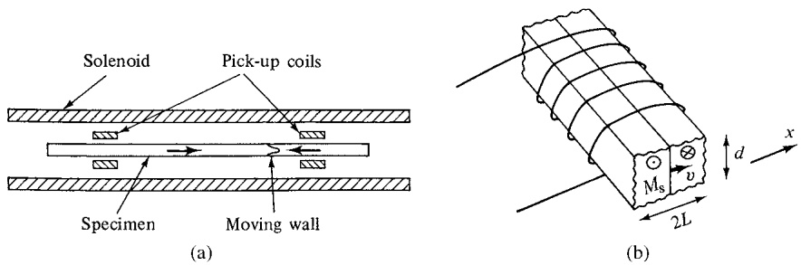

Fig. 12.3 Measurement of domain wall velocity. (a) Wire or whisker specimen. (b) Portion of one leg of a picture-frame specimen wound with secondary coil.

2. Picture-frame specimens, like that of Fig. 9.26, can be cut from large single crystals so that each leg is an easy axis and contains only one domain wall. The specimen is wound with a primary (magnetizing) and a secondary coil. The hysteresis loop can be recorded and the time required for the wall to move over the distance 2L in Fig. 12.3b can be measured, from which the wall velocity can immediately be found subject to the assumption that the domain wall remains flat as it moves. This assumption is not always valid, as we shall see later.

H. J. Williams, W. Shockley, and C. Kittel [Phys. Rev., 80 (1950) p. 1090] determined wall velocity in the same Fe–Si picture-frame crystal previously studied by Williams and Shockley and shown in Fig. 9.26. At very low excess fields, $(H - H_{0})$ less than 0.003 Oe (0.24 A/m) , they found v equal to about 0.017 cm/sec, corresponding to a mobility C of about 5.5 cm/(sec Oe) $[7 \times 10^{-4} \mathrm{~m/(sec A/m)}]$ . At higher fields of 2 – 80 Oe (160 – 6400 A/m) the domain wall no longer remains flat as in Fig. 12.4a but assumes the successive positions shown in Fig. 12.4b. The wall is retarded more at the center than at the top and bottom, until it curls around on itself to enclose a cylindrical domain which shrinks and finally vanishes. The same effect occurs in a wire but in a less extreme form because of the difference in specimen shape, as suggested in the sketch of Fig. 12.3a; there the domain wall, moving from right to left, has the form of a cone, much more elongated than shown, with the tip of the cone lagging behind.

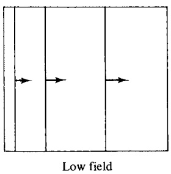

(a)

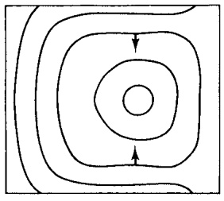

(b)

Fig. 12.4 Cross sections of leg of picture-frame crystal, showing wall motion in low and high fields. The magnetization directions are normal to the page.

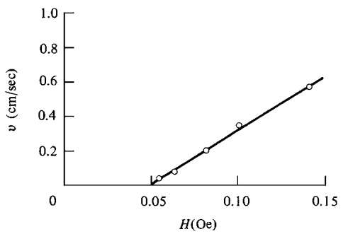

(a)

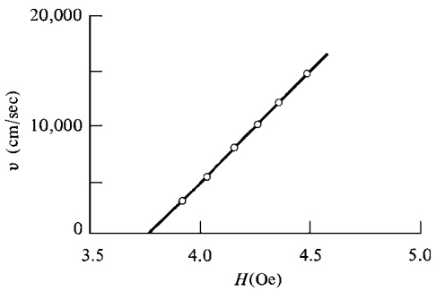

(b)

Fig. 12.5 Domain wall velocity v as a function of applied field $H$. (a) In an Fe + 3% Si single-crystal picture frame. Data from K. H. Stewart, J. Phys. Rad., 12 (1951) p. 325. (b) In an Fe + 14% Ni wire, 0.038 cm diameter, under $92\mathrm{kg/mm^{2}}$ tension. Data from K. J. Sixtus and L. Tonks, Phys. Rev., 37 (1931) p. 930.

K. H. Stewart [J. Phys. Rad., 12 (1951) p. 325] also determined wall velocity in a picture-frame Fe –Si crystal with the results shown in Fig. 12.5a. The mobility C is 6.3 $\mathrm{cm / (secOe)[7.9\times 10^{-4}m / (secA / m)]}$

In sharp contrast to these data are the results of J. K. Galt [Bell Syst. Tech. J., 33 (1954) p. 1023] on a single-crystal picture-frame specimen of a mixed ferrite (75 mol% Ni ferrite, 25 mol% Fe ferrite), which of course has high electrical resistivity. The mobility was about $30,000\mathrm{cm / (secOe)} = 4\mathrm{m / (secA / m)}$

Mobilities of this high order have also been found in metals and alloys, but only in the form of fine wires, whiskers, and thin films. For example, K. J. Sixtus and L. Tonks [Phys. Rev., 37 (1931), p. 930], who were the first to measure wall velocity in any material, observed a mobility of $20,000\mathrm{cm / (secOe)} = 2.5\mathrm{m / (secA / m)}$ in an Fe –Ni wire under tension; some of their extensive data are shown in Fig. 12.5b. For the iron whiskers examined by R. W. DeBlois [J. Appl. Phys., 29 (1958) p. 459], the v, $H$ relation was not strictly linear; instead, the points fell approximately on two straight lines, with the higher-field segment having a higher slope. At low fields the mobility was of the order of $10,000\mathrm{cm / (secOe)} = 1.3\mathrm{m / (secA / m)}$ . The highest observed velocity was 49 km/sec at 135 Oe (10.8 kA/m). These experiments on wires and whiskers are complicated by the fact that the moving wall is very far from perpendicular to the specimen axis. As a result the axial wall mobilities or velocities quoted above are 100 or more times the true velocity of the wall normal to itself, called the normal velocity. The true shape of the moving wall may be hard to determine from the experimental observations.

The various mobilities C noted above are a measure of the viscous damping parameter β, because $\beta = 2M_{\mathrm{s}} / C$ . Two causes of viscous damping have been identified: (1) eddy currents, characterized by a parameter $\beta_{\mathrm{e}};$ and (2) an intrinsic or relaxation effect, characterized by $\beta_{\mathrm{r}}$ . The observed β is the sum of $\beta_{e}$ and $\beta_{\mathrm{r}}$

## 12.3.1 Eddy-Current Damping

This is due to the field $H_{ec}$ set up locally by eddy currents around a moving domain wall, as indicated in Fig. 12.6. When the applied field $H_{\mathrm{a}}$ moves the wall from 1 to 2, the flux change in the region swept out induces an emf which causes eddy currents in the direction shown, namely, the direction which causes an eddy-current field $H_{ec}$ opposed to the applied field. Because the true field actually acting on the wall is now less than $H_{a},$ the velocity v of the wall is less than it would be if the eddy currents did not exist; that is, the wall motion is damped. (Another way of looking at this effect is to note that the heat developed by the eddy currents per unit of time represents a power loss, and the input power required to move the wall with a particular velocity must be increased to replace this loss.) To distinguish the scale, the large-scale eddy currents in the rod of Fig. 12.1 are usually called macro eddy currents, while those associated with a moving domain wall are known as micro eddy currents. However, the two are not inherently different. The rod of Fig. 12.1 is assumed to be polycrystalline and to contain a great many domains, so its macroeddy-current system is simply the vector sum of all the tiny whirls of micro eddy currents associated with its moving domain walls. Micro eddy currents are an important aspect of domain wall motion.

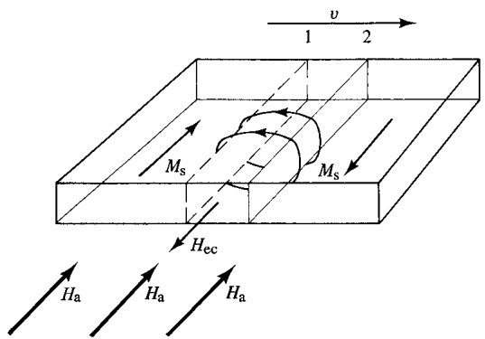

Fig. 12.6 Micro eddy currents associated with a moving domain wall.

Eddy-current damping can be accurately calculated only in simple cases. One example is a single wall moving in the specimen of Fig. 12.3b, which has a cross section of 2L by d. The drive field is assumed to be low enough that the moving wall remains flat. Crystal imperfections are ignored, so that the only force resisting wall motion is eddy-current damping; the constant $H_{0}$ in Equation 12.8 is then zero and the mobility is simply $C = v / H.$ The power dissipated by eddy currents can then be equated to the rate at which the applied field does work on the moving wall. With these assumptions and after a complex calculation, Williams et al. found that

$$
C = \frac {v}{H} = \frac {\pi^ {2} \rho c ^ {2}}{3 2 D B _ {\mathrm{s}} d},\tag{12.9}
$$

where ρ is the resistivity, c the velocity of light, and D a numerical constant whose value (Problem 12.2) depends only on the ratio 2L/d and equals 0.97 for a square rod (2L = d) . The units in this equation are Gaussian. These are mixed units, in which electrical quantities like ρ are in cgs electrostatic units and magnetic quantities like $B$ are in cgs electromagnetic units. (A major advantage of the SI system, in dealing with electrical problems or mixed electrical-magnetic problems, like eddy currents, is that it replaces this confusing system of mixed units with a single system.) To restate this equation in ordinary mixed practical-electromagnetic units, we note that 1 statohm, the electrostatic unit of resistance, equals $1 / (9 \times 10^{11})$ ohm. Inserting this factor and the value of $c(= 3\times 10^{10}\mathrm{cm / sec})$ and replacing $B_{s}$ with $4\pi M_{s},$ because $H$ is normally negligible, we have

$$
C = \frac {v}{H} = \frac {1 0 ^ {9} \pi \rho}{1 2 8 D M _ {\mathrm{s}} d},\tag{12.10}
$$

where C is in cm/sec Oe, ρ in ohm-cm, $M_{\mathrm{s}}$ in emu/cm³ , and d in cm. The larger the resistivity ρ and the smaller d, the more restricted are the eddy currents and the larger the mobility. This conclusion agrees with the experimental results previously described: mobility is high even in thick specimens of ferrites because ρ is so very large, and in metallic fine wires and whiskers because d is so small. Note that the quantities D and d, specifying the specimen shape and size, appear in the above equation. Eddy currents are always a function of specimen size and shape as well as of the intrinsic properties of the material.

When the values appropriate to the Fe-Si specimen of Fig. 12.3b are inserted into Equation 12.10, the calculated value of C agrees very well with the experimental value of Williams et al., namely, 5.5 cm/sec.Oe. This shows that the observed mobility can be explained entirely by eddy-current damping and that the intrinsic damping is negligible. This is generally true, even when the drive field is so high that the wall does not remain flat. Because of their low electrical resistivity, wall motion in metallic materials is damped only by eddy currents except in samples in which one or more dimensions approaches the thickness of a domain wall, i.e., in thin films, whiskers, etc.

When the drive field is high, the flat wall becomes distorted, as in Fig. 12.4, because eddy currents slow down the wall more in the interior of the specimen than at the surface, as sketched in Fig. 12.2. The wall finally becomes a collapsing cylinder, and the eddy currents associated with its motion have also been treated quantitatively by Williams et al.

Ferrimagnetic oxides are electrical insulators, so that eddy-current effects are absent, or at least of secondary importance. At high frequencies, domain wall motion is restricted, because the rate of angular rotation of the spins in a moving domain wall becomes so high that the domain wall mass (the first term in Equation 12.5) severely limits wall motion. In use, these materials are not normally driven to magnetic saturation, and the quantity of interest is the permeability $\mu$ (or $\mu_{\mathrm{r}}$) . The permeability typically remains fairly constant with increasing frequency, up to the frequency where resonance effects occur (in the MHz range). The magnetic flux $B$ in the sample lags behind the field $H$ by a phase angle δ, because there is some energy loss. The real and imaginary, or in-phase and out-of-phase, permeabilities are defined as

$$
\begin{array}{l} \mu^ {\prime} = \frac {B}{H} \cos \delta \\ \mu^ {\prime \prime} = \frac {B}{H} \sin \delta \end{array}\tag{12.11}
$$

If there are no losses, $B$ and $H$ are in-phase, $\mu^{\prime}$ is the normal permeability μ, and $\mu''$ is zero. If there are losses, both $\mu'$ and $\mu''$ are nonzero and the ratio of $\mu''$ to $\mu'$ is

$$
\frac {\mu^ {\prime \prime}}{\mu^ {\prime}} = \frac {\sin \delta}{\cos \delta} = \tan \delta .
$$

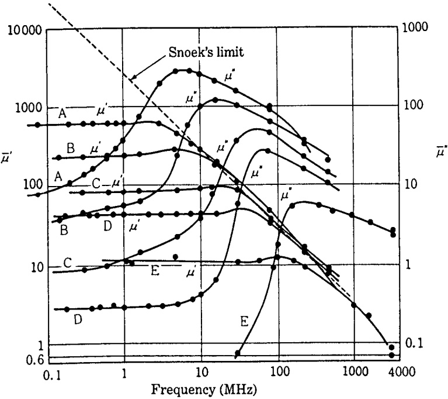

Fig. 12.7 Real and imaginary permeabilities as a function of frequency for a series of Ni–Zn ferrites. The ratio ZnO/NiO decreases from 1.9 for sample $A$ to 0.01 for sample E, with $\mathrm{ZnO}+$ $\mathrm{NiO}\approx 0.5$ for all samples. [S. Chikazumi, Physics of Ferromagnetism, Oxford University Press (1997).]

The quantity tan d is called the loss factor. It is generally desirable to have a high value of $\mu(= \mu' + i\mu'')$ and a low value of loss, so the quality of a high-frequency material can be specified by the value of μ/ tan d.

At a frequency where resonance effects become important, $\mu'$ decreases to a low value, and $\mu^{\prime \prime}$ shows a peak. Figure 12.7 shows curves of $\mu'$ and $\mu''$ for a series of different Ni – Zn ferrites. Arguing that both the resonance frequency and the (real) permeability are controlled by the value of the anisotropy constant, with a high value of K acting to increase the resonance frequency but to lower the permeability, J. L. Snoek [Physica, 14 (1948) p. 207] predicted that the product $\mu f_{\mathrm{res}}$ should be a constant. This is known as the Snoek limit, and is drawn as a dashed line in Fig. 12.7.

## 12.4 SWITCHING IN THIN FILMS

High-speed switching was first studied in small ferrite toroids or rings (called cores), which were used as binary memory elements in early digital computers. Attention then shifted to switching of magnetic thin films of various geometries, which were developed as replacements for magnetic cores that would be smaller, cheaper, and faster. This research in turn gave way to the development of magnetic bubble domain memories (which will be briefly discussed in the next chapter). At the time of writing this revision, interest in magnetic memories has revived, although in a different configuration from that originally envisioned. We therefore review some of the early work on switching of magnetic thin films.

The basic problem is to understand by what mechanism, and at what speed, the magnetization of a magnetic thin film can be reversed. The direction of magnetization may be used to define a binary value of 0 or 1, and the speed of reversal, or switching, limits the speed at which the computer can record information. Because a film is so thin, the demagnetizing factor is negligible in any direction in the plane of the film. Thus magnetization can rotate in this plane without going through any high-energy state. It is also possible in a film to superimpose on the main easy-axis drive field another field at right angles to this axis in the plane of the film. This transverse field causes faster switching.

We depart briefly from the topic of switching speed to examine the effect of two fields at right angles on the quasi-static hysteresis loop. We assume that the film is a single domain and that its magnetization changes only by coherent rotation. This is sometimes called Stoner–Wohlfarth behavior, since it exactly the behavior of a single-domain particle. The film has a uniaxial anisotropy energy given by

$$
E _ {\mathrm{a}} = K _ {\mathrm{u}} \sin^ {2} \theta ,
$$

or, equivalently, an anisotropy field

$$
H _ {\mathrm{K}} = \frac {2 K _ {\mathrm{u}}}{M _ {\mathrm{s}}}.
$$

We express the applied easy-axis field $H_{e}$ and the applied transverse, hard-axis field $H_{\mathrm{t}}$ Ht in terms of reduced fields h, just as in Section 9.12:

$$
h _ {\mathrm{e}} = \frac {H _ {\mathrm{e}}}{H _ {\mathrm{K}}} = \frac {H _ {\mathrm{e}} M _ {\mathrm{s}}}{2 K _ {\mathrm{u}}} \quad \text {and} \quad h _ {\mathrm{t}} = \frac {H _ {\mathrm{t}}}{H _ {\mathrm{K}}} = \frac {H _ {\mathrm{t}} M _ {\mathrm{s}}}{2 K _ {\mathrm{u}}}.
$$

Similarly, the reduced magnetization in the easy direction is given by $m = M / M_{\mathrm{s}} = \cos\theta$. When $h_{e}=0$ , the transverse hysteresis loop is merely a straight line, shown dashed in Fig. 12.8b and as a full line in Fig. 9.40. When $h_{\mathrm{t}} = 0$ , the longitudinal loop is square, with a reduced intrinsic coercivity of $h_{ec}=0$ , again as we found in Fig. 9.40. To find the effect of both fields acting together, we write the equation for the total energy:

(b)

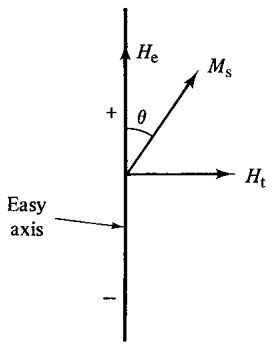

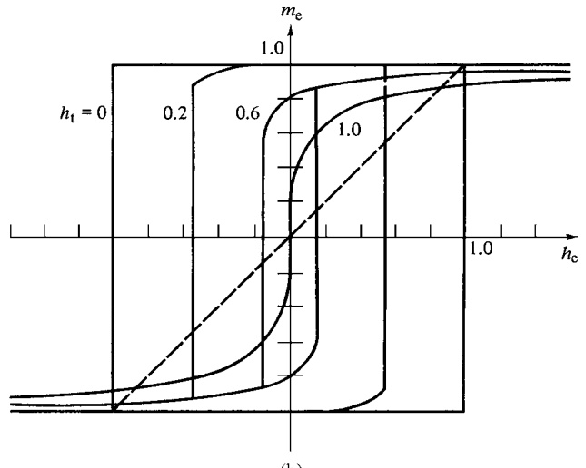

Fig. 12.8 Calculated hysteresis loops as a function of reduced transverse field ht. [D. O. Smith, J. Appl. Phys., 29 (1958) p. 264.]

$$
E = K _ {\mathrm{u}} \sin^ {2} \theta - H _ {\mathrm{e}} M _ {\mathrm{s}} \cos \theta - H _ {\mathrm{t}} M _ {\mathrm{s}} \cos (9 0 ^ {\circ} - \theta),\tag{12.12}
$$

where the positive direction of $H_{e}$ is indicated in Fig. 12.7a. The first term in this equation is the anisotropy energy and the next two are the potential energy of the magnetization in the easy-axis and transverse fields. Proceeding as in Section 9.12, we take the first derivative to find the equilibrium position of $M_{s}$

$$
\frac {d E}{d \theta} = 2 K _ {\mathrm{u}} \sin \theta \cos \theta + H _ {\mathrm{e}} M _ {\mathrm{s}} \sin \theta - H _ {\mathrm{t}} M _ {\mathrm{s}} \cos \theta = 0,\tag{12.13}
$$

$$
\sin \theta \cos \theta + h _ {\mathrm{e}} \sin \theta - h _ {\mathrm{t}} \cos \theta = 0.\tag{12.14}
$$

To find the critical field $h_{ec}$ at which the magnetization will irreversibly flip, which is also the coercivity, we set the second derivative equal to zero:

$$
\frac {d ^ {2} E}{d \theta^ {2}} = \cos^ {2} \theta - \sin^ {2} \theta + h _ {\mathrm{e}} \cos \theta + h _ {\mathrm{t}} \sin \theta = 0.\tag{12.15}
$$

Solving Equations 12.14 and 12.15 together, we find $h_{ec}$ in terms of the parametric equations

$$
h _ {\mathrm{t}} = \sin^ {3} \theta , \quad h _ {\mathrm{ec}} = - \cos^ {3} \theta .\tag{12.16}
$$

To plot the hysteresis loop for a given value of $h_{\mathrm{t}}$ we find $h_{ec}$ from Equation 12.16, thus locating the vertical sides of the loop, and we find points on the remainder of the loop from Equation 12.15. Loops calculated in this way are shown in Fig. 12.8b for $h_{\mathrm{t}} = 0.2$ 0.6, and 1.0; the last is merely a line, indicating reversible but nonlinear magnetization, with $h_{ec}=0$ . The effect of a transverse field is seen to be a decrease in the easy-axis coercivity, because the transverse field supplies some of the energy needed to overcome the anisotropy energy. A plot of $h_{ec}$ vs $h_{\mathrm{t}}$ including both positive and negative values for both quantities, is known as the switching asteroid (or astroid); it can provide useful information about switching mechanisms. The switching asteroid for an ideal Stoner –Wohlfarth particle, or an ideal thin film, is shown in Fig. 12.9.

The easy-axis coercivity $H_{c}$ is usually considerably less than $H_{\mathrm{K}}$ , in disagreement with the theoretical loops of Fig. 12.8. The reason is that reversal is occurring by wall motion rather than rotation, and the field necessary to nucleate or unpin walls is less than the field required for rotation. On the other hand, magnetization along the hard axis produces the linear $M$, $H$ relation predicted by rotation theory, as long as the field does not exceed about $0.5H_{\mathrm{K}}$ . But if the field is large enough to produce saturation in the hard direction, the film will break up into domains when the field is reduced, as shown in Fig. 11.36d, because of the magnetization ripple illustrated in Fig. 11.37. Wall motion is accompanied by hysteresis, and the $M$, $H$ line opens up into a loop.

Switching mechanisms in thin films of various compositions and geometries were extensively studied in the 1970s, and comparisons of the measured with the ideal switching asteroid were often used to understand the details of switching behavior. When magnetic computer memories were replaced with semiconductor arrays, research on magnetic films turned to magnetic data storage materials, and to heads for writing and reading digital information. Since about 2000, various new forms of magnetic random access memory (MRAM) have been proposed and developed (see Chapter 15), and the switching behavior of magnetic films is again a subject of research. In the new devices, often a magnetic film is biased to be magnetized in a specific direction by an exchange interaction with an adjacent antiferromagnetic film. As a result the measured switching asteroid does not have its origin at zero field.

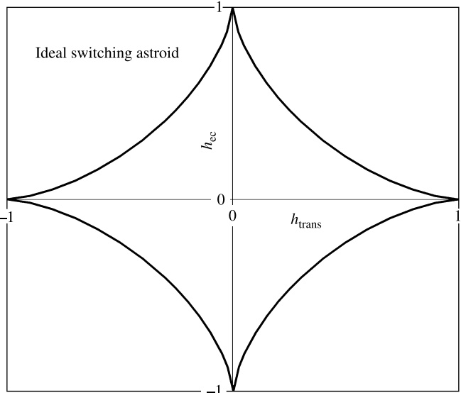

Fig. 12.9 Ideal switching astroid.

## 12.5 TIME EFFECTS

We turn now to a group of phenomena loosely known as “time effects,” which manifest themselves on a time scale ranging from seconds to days. The most important of these effects, which have been given a bewildering variety of names, can be classified as follows:

1. Time decrease (or time decay) of permeability or disaccommodation.

2. Magnetic after-effect or magnetic viscosity. Two different kinds have been observed:

(a) Diffusion after-effect or reversible after-effect or Richter after-effect.

(b) Thermal fluctuation after-effect or irreversible after-effect or Jordan after-effect.

This discussion excludes time-dependent magnetic changes caused by metallurgical phase changes. The magnetic properties of some alloys will change with time if the alloy is in an unstable state, such that a second phase is being precipitated; an example is the aging of steel, in which carbon is withdrawn from solution in the iron to precipitate as cementite $\mathrm{Fe}_{3}\mathrm{C}$ Or a magnetic phase may precipitate from a nonmagnetic alloy, causing pronounced changes in the magnetic properties; an example is the Cu–Co alloy described in Section 11.7. Usually such changes are so slow as to be unmeasurable at room temperature, but they may become significant at temperatures of a few hundred degrees Celsius. These effects are not included in this section, which is restricted to time effects occurring in pure substances or single-phase solid solutions.

## 12.5.1 Time Decrease of Permeability

This effect has been most often studied in iron containing interstitial carbon and/or nitrogen in solution. The effect is dependent on these interstitials and does not occur in pure iron. If a specimen of iron containing some carbon in solution is demagnetized with a gradually decreasing alternating field, its initial permeability $\mu_{i}$ decreases with the time elapsed since demagnetization. The measurement must be made at field levels so low that no long-range domain wall motion occurs. This process is shown schematically in Fig. 12.10a and by actual measurements in Fig. 12.10b. This effect is substantial, in that the drop in permeability can amount to more than 50% of the initial value.

This decrease in permeability is due to the preferential distribution of carbon atoms with respect to the local direction of the magnetization, specifically, in a plane at right angles to the magnetization in iron, as described in Section 10.3. Once this distribution is set up, the domain walls tend to become stabilized. The kind of potential wells caused by the carbon atoms, and the forces required to free domain walls from these wells, have been sketched in Fig. 10.7. During demagnetization, domain walls are in continual motion over large distances, and in any local region there is no preferred direction of magnetization for any length of time and therefore no preferred distribution of carbon atoms; x, y, and z sites are equally populated. When demagnetization ceases, at time $t = 0.$ , the permeability is high, because the isotropic carbon distribution does not stabilize domain walls. But the carbon atoms immediately begin to distribute themselves preferentially in each domain, i.e., the material self-magnetically anneals, and potential wells begin to build up with time at each domain wall, somewhat as sketched in Fig. 12.11. The walls become increasingly difficult to move, so the permeability $\mu_{i}$ decreases.

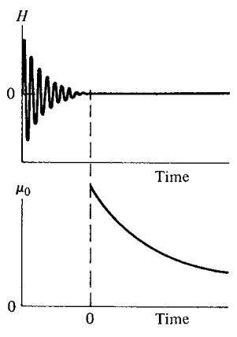

(a)

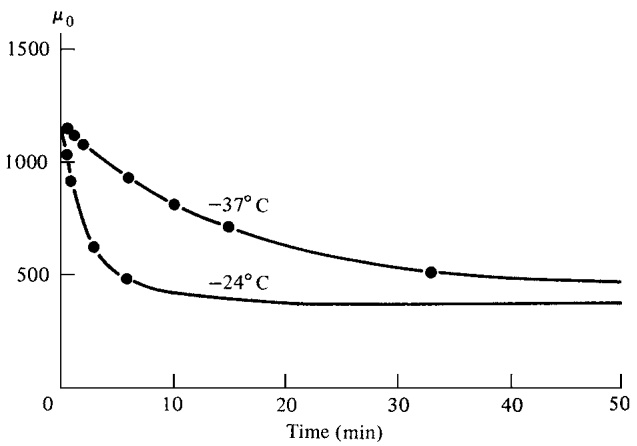

(b)

Fig. 12.10 Time decrease of permeability. (a) Schematic. (b) Measurements on iron containing carbon. [J. L. Snoek, Physica, 5 (1938) p. 663.]

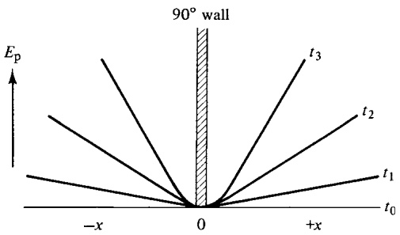

Fig. 12.11 Build-up of a potential well at the position of a $90^{\circ}$ domain wall as a function of time t. Demagnetization ceased at time $t_{0}$ (schematic).

Domain wall stabilization can be demonstrated in another way. Instead of measuring just $\mu_{i}$ P. Brissonneau [J. Phys. Chem. Solids, 7 (1958) p. 22] determined the initial portion of the $B$, $H$ curve for 17 time periods after demagnetization, ranging from 0.7 to 1000 min. Two of his extreme curves, for $t = 0$ and $t = \infty$ (both obtained by extrapolation), are shown in Fig. 12.12. The horizontal separation of the two curves is called the stabilization field $H_{s};$ this is the extra field that must be applied a long time after demagnetization to produce the same induction $B$ that a smaller field would produce immediately after demagnetization. It has already been alluded to in Section 10.2 with reference to Perminvar. The value of $H_{s}$ measures the strength of the wall stabilization, and it is itself a function of the induction $B$. As $B$ increases, Brissonneau found that $H_{\mathrm{s}}$ increases, goes through a maximum at about 100 gauss (0.01 T), and then decreases to a constant value at about 2500 gauss (0.25 T) and beyond. The maximum in $H_{\mathrm{s}}$ is associated with the freeing of $180^{\circ}$ walls from their potential wells, because the force – distance curve of Fig. 12.7b goes through a maximum for $180^{\circ}$ walls; the constant value of $H_{s}$ at higher inductions is associated with the motion of 908 walls over large distances, in conformity with the corresponding force – distance curve.

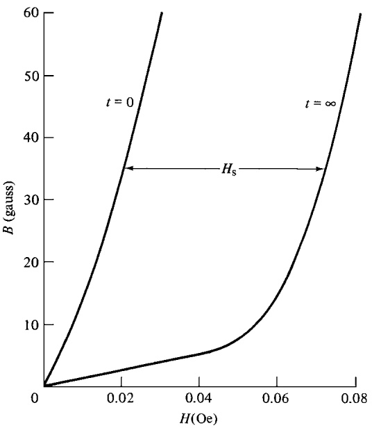

Fig. 12.12 Normal induction curves, at time t after demagnetization, of iron containing 46 ppm C. Temperature $= -27.3^{\circ}\mathrm{C}$ . [P. Brissonneau, J. Phys. Chem. Solids, 7 (1958) p. 22.]

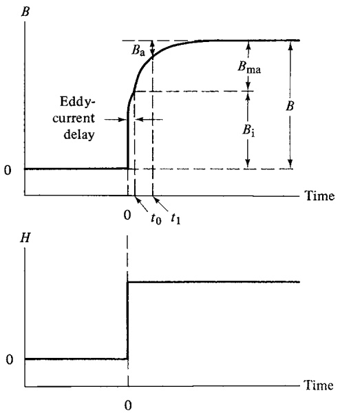

Fig. 12.13 Magnetic after-effect.

The rate of wall stabilization is strongly dependent on temperature, because it depends on the diffusion rate of carbon and diffusion is an exponential function of temperature. At room temperature, an interstitial carbon atom changes position about once per second. The experiments reported in Figs. 12.10 and 12.11 had to be made at subzero temperatures to slow the effect to a pace at which it could be conveniently measured.

Time decay of permeability is also found in substitutional solid solutions like Fe – Si and Fe – Ni. Wall stabilization in such alloys is due to directional order of like-atom pairs, which, when fully established, tends to keep the local magnetization parallel to a particular direction in the lattice, as described in Section 10.2.

Many ferrites show a time decay of permeability. The permeability of Mn –Zn ferrites can decrease in 24 h at room temperature by amounts ranging up to 2.5%, which is enough to be a problem in certain device applications where long-term stability is required. The effect is thought to be due to directional order of $\mathrm{Mn}^{2+}-\mathrm{Fe}^{2+}$ pairs. In ferrites containing cobalt, the preferential occupation of a particular <111> axis by $\mathrm{Co}^{2+}$ ions, as described in Section 10.2, can cause wall stabilization. These time effects are greater when the concentration of metal-ion vacancies is high, since vacancies promote rapid diffusion. The vacancy concentration can be kept low by ensuring that the atmosphere during sintering does not contain excess oxygen.

## 12.5.2 Magnetic After-Effect

The nature of the magnetic after-effect is sketched in Fig. 12.13. When a field $H$ is suddenly applied to a magnetic material, $B$ (or $M$ ) does not always reach its final value instantaneously. First there is an “instantaneous” change Bi, followed by a slower change, the after-effect induction, which reaches a maximum value of $B_{ma}$ ; the two together make up the total change $B$. The effect has also been called magnetic viscosity. The converse effect occurs when $H$ is suddenly reduced to zero from some higher value; $B$ then decreases slowly to its final value.

It is important to ensure that eddy currents do not interfere with the effect to be measured. Even in materials which do not show an after-effect, $B$ is delayed by eddy currents in reaching its final value, as described in Section 12.2 and as illustrated in an exaggerated way in Fig. 12.12. A rather unrealistic break in the $B$, t curve is there indicated. Actually the two portions of the curve run smoothly together, so that it may be difficult to establish an origin for the measurement of the after-effect. The eddy-current delay should be made as small as possible, by reducing the specimen thickness.

In iron containing carbon, permeability decay and the diffusion after-effect have the same basic cause: the tendency of carbon atoms to take up preferred positions and thus stabilize domain walls. But the two effects are not the same. To measure permeability decay, we measure a time-dependent change in the ease of magnetization with a small temporarily applied ac field; wall motion is very restricted. To measure the after-effect, we measure a time-dependent change in the magnetization itself under a constant applied field; wall motion proceeds as far as it can. The after-effect is the more complex of the two, because the domain walls are in continuing motion until the effect ceases. When the fast change $B_{i}$ is over, carbon atoms immediately start to arrange themselves so as to stabilize walls at their new positions. The stabilization is at first weak, and the stillapplied field is able to push the walls on at a fairly high velocity. But the slight slowing down allows the carbon atoms more time for stabilization at the later position of the wall, the effect becomes cumulative, and wall motion finally ceases. Despite the very rapid diffusion rate of carbon at room temperature, wall motion can persist for 10 to 15 sec, simply because of the difficulty of stabilizing a moving wall.

In the simplest case the rate of change of $B_{a}$ is governed by a single time constant t:

$$
B _ {\mathrm{a}} = B _ {\mathrm{ma}} \mathrm{e} ^ {- t / \tau}\tag{12.17}
$$

and a plot of log $B_{a}$ against t will be a straight line. This behavior has been found at very low applied fields, but generally more complex results are obtained, suggesting the presence of a range of relaxation times. S. Chikazumi [Physics of Ferromagnetism, Oxford University Press (1997) Chapter 20] deals with the mathematics of this situation. The problem is that fitting experimental results to a mathematical model with several adjustable parameters provides little physical insight.

The diffusion after-effect is strongly dependent on temperature. The relaxation time or times are proportional to $\mathrm{e}^{Q / kT}$ , where Q is the activation energy for diffusion of the interstitials.

The quasi-static experiment of Fig. 12.13 is one way of demonstrating the effect of dissolved carbon, say, on wall motion. Another quite different way is to apply a small alternating field and vary the frequency over a wide range. If the frequency is so low that the carbon atoms always have time to reach their equilibrium positions with respect to the local magnetization, $B$ and $H$ will be in phase and there will be no power loss due to the diffusion after-effect. At the other extreme, if the frequency is so high that the carbon atoms never have time to reach equilibrium positions; again $B$ and $H$ will be in phase. At intermediate frequencies, the carbon atoms are mobile enough to make $B$ lag behind $H$ by a phase angle φ. There is then an energy loss per cycle proportional to tan $\phi,$ which is called the loss factor. If the after-effect is characterized by a single relaxation time t and if we put $B_{\mathrm{ma}} / B_{\mathrm{i}} = R$ , then

$$
\tan \phi = \frac {\omega \tau R}{\omega^ {2} \tau^ {2} + (1 + R)},\tag{12.18}
$$

where v is the angular frequency, equal to $2\pi$ times the frequency in Hz. This function has a maximum value of

$$
\frac {R}{2 \sqrt {1 + R}}
$$

when

$$
\omega = \frac {\sqrt {1 + R}}{\tau}.
$$

Because R is of the order of 0.1– 0.4, the frequency that maximizes tan φ is not much larger than $1 / \tau .$ Y. Tomono [J. Phys. Soc. Japan, 7 (1952) p. 174] measured the total losses of iron specimens under alternating magnetization at various frequencies and temperatures. By subtracting the losses due to hysteresis and to eddy currents, he obtained the loss factor due to the after-effect. From the observed variation of tan φ with ω, the values of $\tau$ and R can be found from the relations given above. At constant frequency, tan φ also goes through a maximum as a function of temperature; at 200 Hz, for example, this maximum occurred at about $100^{\circ}\mathrm{C}$ while at 4000 Hz it occurred at $150^{\circ}\mathrm{C}$ This behavior is due to the temperature dependence of the relaxation time, given by

$$
t = t _ {0} \mathrm{e} ^ {Q / k T},\tag{12.19}
$$

where Q is the activation energy of the process that controls the rate of the after-effect. At low temperatures, $\tau$ is so large that the after-effect essentially does not exist (carbon atoms cannot reach equilibrium positions); $B$ and $H$ are in phase. At high temperatures, the after-effect is so fast that $B$ and $H$ are again in phase. At intermediate temperatures, losses will occur, and tan φ will have its maximum value when

$$
T = \frac {2 Q}{k \ln \left(\frac {1 + R}{\omega^ {2} \tau_ {0} ^ {2}}\right)}.\tag{12.20}
$$

The temperature at which the maximum in tan φ occurs should increase with increasing frequency ω, in agreement with experiment. From values of t determined at different temperatures, the value of Q was found to be 0.99 eV/atom or 23 kcal/mol, which is in reasonable agreement with the value of Q for diffusion of carbon in alpha iron (20.1 kcal/mol).

This result gives a satisfying explanation of the observed single relaxation time and establishes carbon diffusion as the rate-controlling process of the after-effect in the reversible range of magnetization. In the irreversible range other processes must play an additional role.

## 12.5.3 Thermal Fluctuation After-Effect

This effect differs from the diffusion after-effect in three respects: (1) it does not require the diffusion of anything and therefore can occur in pure metals or other pure substances; (2) it is much less sensitive to temperature; and (3) it causes a loss factor tan φ in alternating fields which does not depend on frequency. The magnitude of the fluctuation after-effect is larger in magnetically hard than in magnetically soft materials, and has mostly been measured in permanent magnet materials.

The original paper in this field is by R. Street and J.C. Woolley [Proc. Phys. Soc., A62 (1949) p. 562]. They studied an alnico permanent-magnet alloy. The after-effect was measured on the descending part of the hysteresis loop. The abrupt change in field $\Delta \mathrm{H}$ was such that the final value of $H$ was near the coercive field, and this $\Delta H$ produced an instantaneous magnetization change $\Delta M_{\mathrm{i}}$ of about $200\mathrm{emu/cm^{3}~o~kA/m}$ . This was followed by the after-effect change DM shown in Fig. 12.14, where the curves have been shifted vertically and drawn from arbitrary origins for clarity. Near room temperature, the after-effect change in 20 min is about 35 emu/cm³ or kA/m. about 17% of the instantaneous change. The results of Fig. 12.14, including the temperature dependence, conform to the relation

$$
M = a T \ln t + b,\tag{12.21}
$$

where a and b are constants. Street and Woolley ascribed the after-effect to fluctuations of thermal energy sufficient to cause irreversible rotations in small volumes of the material. This view is consistent with the current opinion that alnico contains single-domain regions. The probability that the energy of a particular volume will fluctuate by an amount Q above the average is proportional to $\mathrm{e}^{-Q / kT}$ . One would therefore expect the after-effect DM to vary in the same way, whereas it is found to vary linearly with T, and would expect the rate of the after-effect $d(\Delta M)/dt$ to vary as $\mathrm{e}^{-t / \tau}$ , whereas actually it varies as 1/t (see Equations 11.24 and 11.27). However, Street and Woolley showed that Equation 12.21 could be accounted for by assuming that the activation energy Q was not a single value but a continuous range of values from 0 to 1. This is equivalent, because of Equation 12.19, to a similar range of relaxation times t.

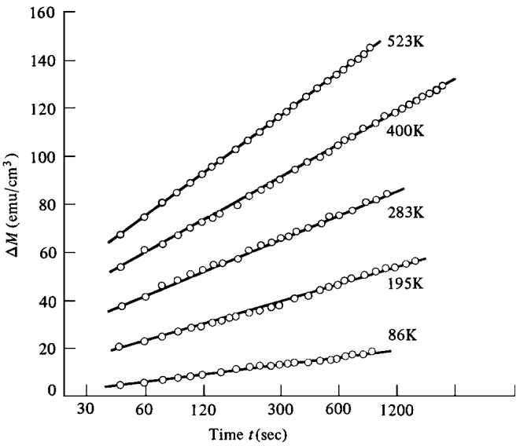

Fig. 12.14 Fluctuation after-effect in alnico [R. Street and J. C. Woolley, Proc. Phys. Soc., A62 (1949) p. 562].

Equation 12.21 cannot be literally true, because it predicts an infinite value of DM at infinite time. However, the equation does accurately represent experimental data over the duration of the measurements. Street and Woolley show how it can be modified to keep DM finite, by allowing the activation energies Q to range from zero up to a finite limit rather than to infinity.

Street and Woolley thought in terms of irreversible magnetization rotations, but their description applies equally well to domain wall sections facing an array of barriers to motion of varying heights. Thermal energy can help enable a single-domain region to reverse direction, or a section of domain wall to surmount a barrier, as in Figs 9.37 and 9.36. Either action results in a small jump in the net magnetization of the sample.

The situation discussed here is related to the phenomenon of superparamagnetism, since both involve magnetization jumps caused by thermal fluctuations. The difference lies in the fact that the simple theory of superparamagnetism applies to an array of identical particles, whose relaxation time varies rapidly with particle size. At a given temperature, an assembly of small particles of the same size will show magnetic viscosity only if their size corresponds to a relaxation time of the same order of magnitude as the time of the experiment. If there is a large range of particle size, then an after-effect can be expected.

## 12.6 MAGNETIC DAMPING

Suppose a weight is hung on a helical spring, then pulled downward and released. The spring will contract, then lengthen, then contract, etc. If the displacement of the weight is plotted as a function of time, the result will look like the curves of Fig. 12.15. Frictional forces make the oscillations die out eventually. What frictional forces? Air resistance is one, and there may be some friction at the point of support of the spring. But when the greatest care is taken to reduce these sources to a minimum, the oscillations still die out eventually. Evidently, there are some frictional processes within the material of the spring itself. This “internal friction,” or damping, occurs in any vibrating material.

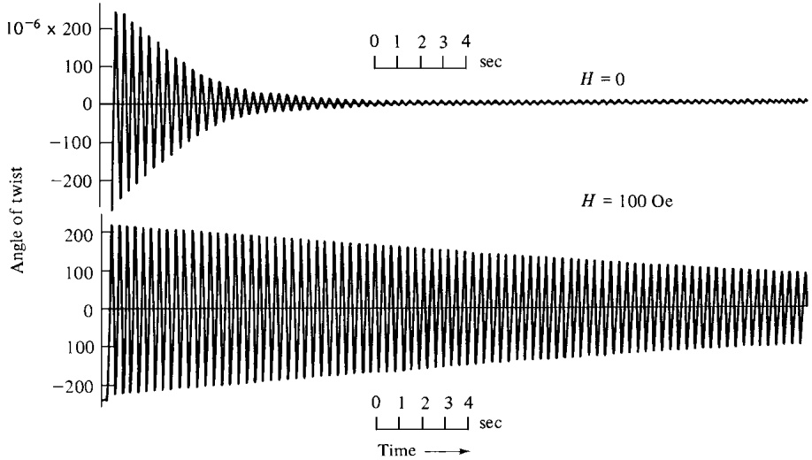

Fig. 12.15 Trace of the angle of twist of an iron wire in a torsion pendulum, when the wire is unmagnetized (above) and magnetized (below). Frequency = 2.6 Hz. [R. Becker and M. Kornetski, Z. Phys., 88 (1934) p. 634.]

Internal friction may be measured and specified in various ways. The most fundamental is the fractional energy loss per cycle, also called the specific damping capacity:

$$
\frac {\Delta W}{W} = \frac {\text { energy   loss   per   cycle }}{\text { total   vibrational   energy }}.\tag{12.22}
$$

For the weight on the spring, the value of W is the elastic strain energy stored in the spring at either extreme extension of the cycle. A value of $\Delta W / W = 0.1$ is considered large, and values as low as $10^{-5}$ have been measured.

Another way to measure damping is to measure how rapidly the oscillations of the system die out. If $A_{n}$ is the amplitude of any one oscillation and $A_{n + 1}$ that of the next, then the damping is characterized by the logarithmic decrement δ, defined by

$$
\delta = \ln \frac {A _ {n}}{A _ {n + 1}}\tag{12.23}
$$

If d is small, $\delta = \Delta A / A$ , where $\Delta A$ is the difference between successive amplitudes and $A$ is their mean. If DW/W is 0.1, the amplitude will decrease to one-tenth of its original value in about 46 cycles; if DW/W is $10^{-5}$ , about 460,000 cycles will be required. The vibrational energy W is always proportional to $A^{2}$ , no matter how complex the stress system. For example, suppose a rod is stretched by a stress s to a strain, or amplitude, 1. Then the stored energy = work done $= \frac{1}{2}\sigma \varepsilon = \frac{1}{2} (\varepsilon E)(\varepsilon) = \frac{1}{2} E\varepsilon^2$ where E is the elastic modulus. Therefore, if c is a constant,

$$
\begin{array}{c} W = c A ^ {2}, \\ \Delta W = 2 c A \Delta A, \\ \frac {\Delta W}{W} = \frac {2 c A \Delta A}{c A ^ {2}} = 2 \frac {\Delta A}{A} = 2 \delta . \end{array}\tag{12.24}
$$

The spring-weight system described above is a freely vibrating system. Alternatively, we may choose to drive the system at constant amplitude, with the input power balancing the losses. The strain will then lag behind the applied stress by a phase angle f, and tan f, which equals f when f is small, is a measure of the damping. This is entirely analogous to the loss resulting from $B$ lagging behind $H$ in alternating magnetization, as described in the previous section. In an electrical circuit, “vibration” consists in the oscillation of charge back and forth, and a quantity $Q^{-1}$ describes the damping of these oscillations. These various measures of damping are related as follows, when the damping is small:

$$
\frac {\Delta W}{2 W} = \delta , \quad \tan \phi \approx \phi = Q ^ {- 1} = \frac {\delta}{\pi}.\tag{12.25}
$$

When an alternating stress is applied to a solid, the various imperfections within the solid move in particular ways, each according to its own nature and the kind of stress imposed. Dislocations move back and forth in slip planes in response to a shear stress parallel to those planes. Solute atoms jump from crystal axes that are shortened by the applied stress to nearby positions on elongated axes, where they have more room, and back again when the stress reverses. If the solid is polycrystalline, a kind of rubbing action occurs at the grain boundaries. In addition, if the material is magnetic, domain walls will move when the material is stressed. The work done in moving these imperfections during a quarter cycle of stress is not returned to the system during the next quarter cycle, as is the work of purely elastic deformation. The work done in moving these imperfections back and forth during a cycle constitutes the internal friction loss DW. It is converted into heat.

The relative magnitude of any one of these damping mechanisms (dislocations, solute atoms, grain boundaries, domain walls) depends markedly on the frequency and amplitude of the vibration imposed on the solid, and may depend strongly on temperature. One mechanism can make a far greater contribution to the total damping in a certain frequency or amplitude range than some other mechanism, and yet be practically negligible in some other range.

Internal friction has been studied at frequencies ranging from about one Hz to a few MHz. The nature of the apparatus required differs from one frequency range to another and, for the lowest range, usually takes the simple form of a torsion pendulum. The specimen is a wire suspended vertically from a fixed support. The lower end of the wire is attached to a fairly heavy weight, either a horizontal rod called an inertia bar or a disk as discussed in Section 7.5.3. The weight is turned a few degrees, so as to twist the wire, and then released. The resulting torsional oscillations of the wire are indicated by a light beam reflected from a mirror, fixed to the lower end of the wire, onto a graduated scale or a photodetector.

Some adjustment of the torsional frequency is possible by altering the moment of inertia of the suspended weight or the diameter of the wire, but the range of adjustment is not very large. If the specimen is made thick enough to be called a rod, rather than a wire, and other parts of the apparatus are made more robust, frequencies of some tens of Hz can be attained. Higher frequencies generally require different experimental methods.

Domain wall damping, often called magneto-mechanical damping, is easily separated from other effects. The specimen is enclosed in a solenoid capable of producing a saturating magnetic field. Damping is then measured with the specimen first demagnetized, then saturated to remove domain walls. The difference between the two measurements gives the magnetic contribution. Figure 12.15 vividly demonstrates the large difference in damping between the two states.

At extremely low amplitudes magnetic damping is small and independent of amplitude, as shown by the data of Fig. 12.16 for longitudinal vibration of a rod. In these measurements any one region of the rod is alternately in states of axial tension and compression. This is accomplished by cementing a quartz “driver” crystal to the end of the rod and applying an alternating voltage to opposite faces of the quartz. Because quartz is piezoelectric, this voltage causes the quartz to vibrate, and the vibrations are transmitted to the specimen rod. Another quartz crystal cemented to the rod senses the vibrations and generates a voltage between opposite faces proportional to the vibrational amplitude. The specimen will vibrate substantially (resonate) only at its natural frequency, which is determined by its dimensions, or at integral multiples (harmonics) of this frequency. The vibration frequency is determined by the frequency of the applied voltage. At each selected frequency, the damping is found by measuring the shape of the resonance peak, i.e., the curve of vibrational amplitude (proportional to voltage output of the gage crystal) vs frequency (equal to frequency of the applied voltage). The smaller the damping, the sharper is the resonance peak, according to the relation

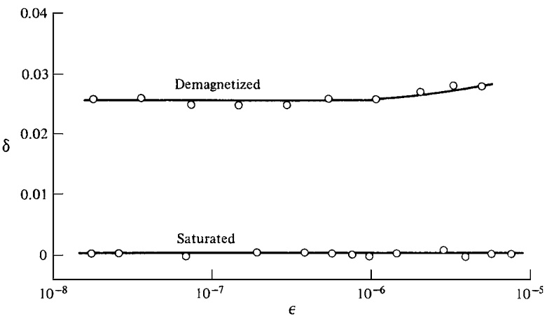

Fig. 12.16 Damping d (logarithmic decrement) as a function of strain amplitude 1 in a nickel singlecrystal rod with a <100> axis. Room temperature. Vibrated in the longitudinal mode at 50 kHz. [H. Ganganna, N. F. Fiore, and B. D. Cullity, J. Appl. Phys., 42 (1971) p. 5792.]

$$
\delta = \frac {\pi}{\sqrt {3}} \frac {\Delta f}{f _ {0}},\tag{12.26}
$$

where $f_{0}$ is the frequency of the resonance and $\Delta f$ the width of the resonance peak at half its maximum height. To make the measurement at various amplitudes requires only a change in the applied voltage.

The nonmagnetic damping exhibited by the saturated crystal of Fig. 12.16 is so nearly zero that the damping of the demagnetized crystal is virtually all magnetic damping. The behavior of a <111> crystal is quite similar except that its magnetic damping is much smaller, about 30% of that of a <100> crystal, at the same frequency of 50 kHz.

At higher amplitudes, magnetic damping becomes very large and dependent on amplitude, as shown by Fig. 12.17. (In these torsion-pendulum measurements the maximum amplitude is varied simply by varying the initial twist given to the wire.) The nonmagnetic damping is shown by open circles in Fig. 12.17. If an annealed specimen is cold worked, the magnetic damping decreases, usually by a large amount.

Magnetic damping in metals is chiefly due to the micro eddy currents set up by moving domain walls. We can understand the main features of the experimental results, at least qualitatively, if we consider the kind of wall motion an applied alternating stress can produce.

Since the magnetostrictive strains on either side of a $90^{\mathrm{o}}$ domain wall are in different directions, and applied stress will favor the growth of one domain at the expense of the pother, and so will act to move the domain wall. This does not apply to 180º walls, since in this case the magnetostrictive strains are the same in both neighboring domains. Therefore the major effect of an applied stress is to move $90^{\mathrm{o}}$ domain walls.

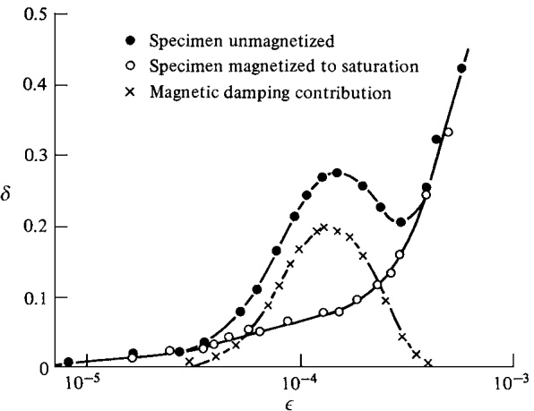

Fig. 12.17 Damping d (logarithmic decrement) as a function of maximum shear strain amplitude 1 at the surface of polycrystalline nickel at $-40^{\circ}\mathrm{C}$ Torsion pendulum measurements at about 1 Hz [J. T. A. Roberts and P. Barrand, Acta. Metallurg. 15 (1967) p. 1685.]

An alternating stress, as in the torsion pendulum experiment, will cause alternating wall motion. If the level of stress is low, the wall motion will be reversible. Under these conditions, the loss (which is defined as the ratio of the energy lost to the total elastic energy stored), is independent of the stress level, as seen in Fig. 12.16. The mechanism that produces this loss is the flow of eddy-currents, which generate heat, around the moving domain wall.

At higher stress levels the domain walls will move in Barkhausen jumps. During a jump, the wall motion is rapid, limited mainly by the eddy-current damping. Since the eddycurrent loss associated with the motion of a domain wall increases as the square of the wall velocity, the energy loss expressed as a fraction of the total strain energy increases, as shown in Fig. 12.17. Further increases in the stress level mean that the moving wall must move further in the time interval defined by the stress frequency, and so leads to higher domain velocities. Eventually, the wall geometry is changed by the fields produced by the eddy currents, or the inertial term $m(d^{2}x / dt^{2})$ in Equation 12.5 becomes important, or both. Then the magnetic losses decrease, as shown in Fig. 12.17.

This discussion has treated the $90^{\mathrm{o}}$ domain walls as moving in isolation, not influenced by their surroundings. In fact, the $90^{\mathrm{o}}$ walls are part of a network of domain walls; they are connected to $180^{\mathrm{o}}$ walls, as well as to other $90^{\mathrm{o}}$ walls. So relatively large-scale motion of $90^{\mathrm{o}}$ walls under the influence of an applied stress will cause motion of $180^{\circ}$ walls, leading to an additional contribution to the energy loss.

A point to keep in mind is that in a torsion pendulum experiment, the stress in the sample wire is highly nonuniform. The stress is highest at the wire surface, and drops to zero on the center line.

From the perspective of engineering applications, a high value of damping is desirable to minimize vibrations in mechanical devices that are subject to oscillating or impact loads. Conversely, low damping is essential in bells and gongs and other devices that need to “ring.” Bells and gongs are usually made from nonmagnetic alloys for this reason.

## 12.6.1 General

In summary, magnetic damping in pure metals is mainly due to the dissipation of heat caused by the micro eddy currents associated with moving domain walls. The greatest contribution is made by $90^{\circ}$ walls. The role of $180^{\circ}$ walls is negligible at small strains and probably minor at large strains. In support of these conclusions is the observation that magnetic damping in nickel single-crystal rods is much larger for a rod with a <100> axis than for one with a <111> axis. The easy direction of magnetization in nickel is <111>. A <100> rod can therefore be expected to contain a great many $90^{\circ}$ walls, while a <111> rod should contain a preponderance of $180^{\circ}$ walls, inasmuch as its domain structure is expected to consist mainly of long, columnar domains magnetized parallel to the rod axis.

In impure metals and in alloys, solute atoms can make a contribution to magnetic damping entirely independent of the eddy-current and phonon effects. Consider, for example, iron containing interstitial carbon and/or nitrogen. As we saw in Section 10.3, these interstitials have preferred positions in the lattice relative to the direction of the local $M_{\mathrm{s}}$ vector. When a $90^{\circ}$ domain wall moves back and forth in response to an applied alternating stress, the region swept out has its magnetization rotated by $90^{\circ}$ once in each half-cycle. The interstitials therefore move back and forth, trying at all times to take up positions dictated by the orientation of the magnetization at that time. This motion of the interstitials causes a loss and contributes to the damping.

The situation is complicated by the fact that these interstitials can cause damping even in magnetically saturated iron that contains no domain walls. The interstitials then have preferred positions dictated solely by the stress. They prefer to be in sites lying on crystal directions which are elongated by the applied stress, simply because there is more room there. When the stress reverses, they then avoid these sites. This back-and-forth motion of the interstitials causes a peak in the damping versus temperature curve at constant frequency. It is known as the Snoek peak after its discoverer. The interstitials in demagnetized iron undergoing mechanical vibration therefore have divided loyalties. In a region, for example, where the stress, at a certain instant, is tensile and parallel to $M_{\mathrm{s}}$ and both are parallel to the x direction, the interstitials would rather be in y or z sites for magnetic reasons but in x sites for mechanical reasons.

## 12.7 MAGNETIC RESONANCE

When a high frequency alternating magnetic field is applied to a substance, certain resonance effects are observed at particular values of the frequency and magnitude of the field. There are two effects: one involves the magnetic moment of the electron, and the other that of the nucleus. The subject of magnetic resonance is somewhat out of the mainstream of this book, and only brief descriptions of resonance effects are given here. However, magnetic resonance is of great importance in many fields, particularly chemistry, and many books and papers deal with the subject.

## 12.7.1 Electron Paramagnetic Resonance

This effect, also called electron spin resonance (ESR), is a resonance between the applied field and the net magnetic moment of the atom, which is usually due only to electron spin. It can therefore be observed in all substances except those which are diamagnetic. However, as the name electron paramagnetic resonance (EPR) implies, the effect was first observed in paramagnetic materials and these have received the most study.

To observe spin resonance experimentally, the specimen is placed in a constant field $H$ of a few thousand oersteds or several tenths of a tesla in the air gap of an electromagnet. Doing this causes the spins to precess about the direction of $H$ at a frequency n proportional to $H$. This frequency is known as the Larmor frequency. At the same time the specimen is subjected to an alternating field at right angles to $H$ in the form of a microwave traveling in a waveguide. When the frequency of the microwave field equals the frequency n of precession, the system is in resonance, and a sharp drop in transmitted microwave power is indicated by a receiver placed on the other side of the specimen. The condition for resonance can be found as follows. The potential energy of each atomic moment in the field is $-\mu_{\mathrm{H}}H,$ and $\mu_{H}$ is given by Equation 3.27:

$$
\mu_ {\mathrm{H}} = g M _ {J} \mu_ {\mathrm{B}}.\tag{12.27}
$$

where g is the spectroscopic splitting factor (1 for orbital motion, 2 for spin) and $M_{J}$ is the quantum number associated with J. Whatever the value of J, adjacent values of the quantum number $M_{J}$ always differ by unity. If one thinks of the magnetic state of the material in the field $H$ as a distribution of the atomic moments among a set of $(2J + 1)$ energy levels, each distinguished by a particular value of $\mu_{\mathrm{H}}$ , then the separation between adjacent levels is given by

$$
\Delta E = \Delta (\mu_ {\mathrm{H}} H) = g \mu_ {\mathrm{B}} H.\tag{12.28}
$$

The condition for resonance is that the energy per quantum hn of the microwave beam be equal to DE, because this energy will then be absorbed by the specimen in raising an atom from one energy level to the next higher one. Therefore,

$$
h \nu = g \mu_ {\mathrm{B}} H.\tag{12.29}
$$

The resonant state is usually found by varying $H$ at a fixed frequency v and plotting power absorbed versus $H$. The wavelength $\lambda$ of the microwaves is usually a few centimeters. If $\lambda$ = 3 cm, then

$$
\nu = \frac {c}{\lambda} = \frac {3 \times 1 0 ^ {1 0}}{3} = 1 0 ^ {1 0} \mathrm{Hz} = 1 0 \mathrm{GHz}.
$$

If g is 2, then the field at resonance is

$$
H = \frac {h \nu}{2 \mu_ {\mathrm{B}}} = \frac {(6 . 6 2 \times 1 0 ^ {- 2 7}) (1 0 ^ {1 0})}{2 (0 . 9 2 7 \times 1 0 ^ {- 2 0})} = 3 5 7 0 \mathrm{Oe} = 0. 3 5 7 \mathrm{T} = 2. 8 5 \mathrm{kA/m}\tag{12.30}
$$

If the field $H$ at resonance is found experimentally, then Equation 12.28 can be solved for g. Thus EPR measurements can determine the g value of the specimen, as mentioned in Section 3.7.

Spin resonance can also be observed in ferro-, antiferro-, and ferrimagnetic substances, where the spins are coupled by exchange forces. Here resonance measurements can reveal not only the g factor but also the magnetcrystalline anisotropy constant(s), or strictly the anisotropy fields $H_{K}$ Suppose the constant field $H$ is directed parallel to the easy axis of a uniaxial crystal. Then two forces act to turn the spins toward the easy axis: the applied field $H$ and the crystal anisotropy, which can be regarded as an anisotropy field $H_{K}$ (Section 7.6). The resonance condition then becomes

$$
h \nu = g \mu_ {\mathrm{B}} (H + H _ {K}),\tag{12.31}
$$

and $H_{K}$ is related to $K_{1}$ , as previously shown, by

$$
H _ {K} = \frac {2 K _ {1}}{M _ {\mathrm{s}}}.
$$

If resonance measurements are made parallel to several crystal directions in a cubic crystal, the value of both $K_{1}$ and $K_{2}$ may be found. The demagnetizing field, if any, also acts on the sample and may need to be included in Equation 12.30.

## 12.7.2 Ferromagnetic Resonance

Spin resonance in ferromagnetic metals, called simply ferromagnetic resonance, is complicated by eddy-current effects. At frequencies of about $10^{10}$ Hz, eddy-current shielding of the interior of the specimen is so nearly complete that the depth of penetration of the alternating field is only about 1000 Å or 300 atom diameters. The specimen is therefore usually composed of powder particles of about this diameter, or of a thin film.

If the applied field is not large enough to saturate a ferromagnetic sample, resonance phenomena may still occur. Various nonuniform resonance modes may arise, by which different parts of the sample are magnetized in slightly different directions, each oscillating in resonance. There can also be domain wall resonance associated with small-scale oscillatory motion of domain walls. Many of these phenomena are discussed by C. Kittel [Introduction to Solid State Physics, 7th Ed., Wiley (1996)].

Energy losses at resonance frequencies, by which the oscillatory motion of the electron spins is converted to heat in the sample, determine the width of the resonance peak(s), The peaks in insulating samples can be very narrow: less than 1 Oe or 89 A/m. In metals the peaks may be 1000 times broader. The energy losses also control the speed with which a ferromagnetic material can reverse its direction of magnetization. This was a critical parameter in early magnetic computer memories, and is a subject of renewed interest in the development of new forms of magnetic memory.

If there are no losses at all, or zero damping in the usual terminology, then the magnetization only precesses around the applied field and never becomes parallel to the field. And if the damping is very large, the magnetization approaches the field direction very slowly, and switching time is hopelessly slow. An intermediate level of losses, called critical damping, leads to the fastest switching.

Curiously, the form of the equation that describes the damping is not obvious. If the damping is small compared to the precession, a formulation called the Landau-Lifshitz

equation was proposed as early as 1935:

$$
\frac {\partial \vec {M}}{\partial t} = - \gamma (\vec {M} \times \vec {H}) - \lambda \frac {\vec {M} \times (\vec {M} \times \vec {H})}{M ^ {2}}.\tag{12.32}
$$

The first term is the precession motion, and the second term is the damping, with $\lambda$ as an adjustable damping parameter. The constant $\gamma = ge / 2mc$ , where $e$ and $m$ are the charge and mass of the electron, $c$ is the velocity of light, and $g$ is the spectroscopic splitting factor (=2 for electron spin).

An alternativee damping term was proposed by Gilbert [see T. L. Gilbert, IEEE Trans. Mag., 40 (2004) p. 3443], namely

$$
- \frac {\alpha}{M} \left(\vec {M} \times \frac {d \vec {M}}{d t}\right), \quad \text {where} \quad \alpha = \frac {\lambda}{\gamma M}.
$$

A. H. Morrish [The Physical Principles of Magnetism, Wiley (1965) p. 539ff ] shows that the Landau –Lifshitz equation can be written in the form

$$
\frac {d \vec {M}}{d t} = \gamma (\vec {M} \times \vec {H}) - \frac {\alpha}{M} \left(\vec {M} \times \frac {d \vec {M}}{d t}\right) + \gamma \alpha^ {2} (\vec {M} \times \vec {H}).\tag{12.33}
$$

If a is small, the third term is negligible and Equation 12.33 becomes the Gilbert equation. The full form of Equation 12.33 can be called the Landau –Lifshitz –Gilbert equation.

## 12.7.3 Nuclear Magnetic Resonance

This effect is a resonance between the applied field and the magnetic moment of the nucleus. The moment of the nucleus is due to its spin, depends on the size of the nucleus, and is spatially quantized in a way similar to the quantization of atomic moments. But nuclear moments are much smaller than atomic moments and are measured in terms of the nuclear magneton $\mu_{\mathrm{n}}$ , defined similarly to the Bohr magneton:

$$
\mu_ {\mathrm{n}} = \frac {e h}{4 \pi M c},\tag{12.34}
$$

where $M$ is the mass of the proton. Because the proton mass is 1840 times the electron mass, we have

$$
\mu_ {\mathrm{n}} = \frac {\mu_ {\mathrm{B}}}{1 8 4 0} = \frac {0 . 9 2 7 \times 1 0 ^ {- 2 0}}{1 8 4 0} = 0. 5 0 5 \times 1 0 ^ {- 2 3} \frac {\mathrm{erg}}{\mathrm{Oe}} = 0. 5 0 5 \times 1 0 ^ {- 2 6} \frac {\mathrm{J}}{\mathrm{T}}.\tag{12.35}
$$

The magnetic moment of a nucleus in the direction of the field is given by

$$
\mu_ {\mathrm{H}} = g m \mu_ {\mathrm{n}},\tag{12.36}
$$

where $g$ is the $g$ factor of the nucleus and $m$ can have the values $I, I - 1, \dots, -(I - 1), -I,$ where $I$ is the quantum number describing the nuclear spin. Because adjacent values of $m$ must differ by unity, the separation $\Delta E$ of adjacent energy levels and the condition for resonance are given by

$$
h v = \Delta E = g \mu_ {\mathrm{n}} H.\tag{12.37}
$$

The simplest nucleus is the proton, the nucleus of the hydrogen atom. Its spin $I\mathrm{is}\frac{1}{2}$ and $g =$ 5.58, so that $\mu_{H}$ is $2.79m_{\mathrm{n}}$ If $H$ is 10,000 Oe (1 T), the resonant frequency is

$$
v = \frac {(5 . 5 8) (0 . 5 0 5 \times 1 0 ^ {- 2 3}) (1 0 ^ {4})}{6 . 6 2 \times 1 0 ^ {- 2 7}} = 4 2. 6 \mathrm{MHz}.\tag{12.38}
$$

This frequency is in the radio region of the electromagnetic spectrum, which means that the resonant circuit can be made of coils rather than waveguides. The constant field $H$ is supplied by an electromagnet or a superconducting magnet.

Because hydrogen is an almost universal constituent of organic substances, observation of the proton resonance has proved so helpful to organic chemists that nuclear magnetic resonance (NMR) measurements are routine in chemistry laboratories. The precise value of the resonant frequency depends slightly on the chemical surroundings of the proton and, with apparatus of high resolution, the resonance peak is seen to split into two or more peaks. By such measurements the chemist can reach certain conclusions about the structure of the molecule being examined.

By a complex process that combines localized high-frequency fields and computerized manipulation of the recorded data, it is possible to produce accurate cross-sectional views of three-dimensional objects such as the human body. This has become a valuable routine (although expensive) diagnostic technique, known in medicine as MRI (magnetic resonance imaging). The nuclear part of the name was quietly dropped because of its negative association with nuclear weapons. The steady field $H$ is usually provided by a superconducting magnet, although lower cost and lower resolution units can be made with large arrays of permanent magnets.

Proton resonance is also the basis of the proton precession magnetometer, an instrument used primarily for the measurement of the earth’s field. The sensor is simply a bottle of water, or other hydrogen-bearing substance, wound with a coil whose axis is roughly at right angles to the earth’s field. A direct current in this coil produces a field of about 100 Oe or 8 kA/m; this aligns a certain fraction of the proton moments with the coil axis. After a second or so this field is turned off. The moments then begin to precess around the only field then acting, the earth’s field, at a rate proportional to that field. As they precess, they induce a weak alternating emf in the coil around the bottle, and the frequency of this emf, equal to the precession frequency, is measured electronically. The relation between the precession frequency, which is of the order of a few kilohertz, and the field strength is known with much more accuracy than the rough calculation of Equation 12.38 suggests. The field strength in gammas $(1\gamma = 10^{-5}$ Oe) equals 23.4874 times the frequency in Hz. This magnetometer needs no calibration, because it is an absolute instrument, and it measures the earth’s field, which is of the order of 50,000 γ, to an accuracy of 1g. It is widely used, both in magnetic observatories and as a portable instrument. By towing the sensor behind an aircraft, geologists can make rapid magnetic surveys of large areas in their search for the magnetic “anomalies,” slight irregularities in the

Earth’s field, that may disclose ore bodies or oil deposits. The proton magnetometer is also used for the measurement of laboratory magnetic fields.

## PROBLEMS

12.1 Domain wall velocity is to be measured on a picture frame crystal of a mixed Ni –Fe ferrite as in Fig. 12.3b. Take $M = 350$ emu /cm³ and $2L = d = 2.0$ mm. If the wall velocity at a certain drive field is 300 cm/sec , how many turns must the secondary coil have to obtain a measured induced voltage of 1 V?

12.2 The constant D of Equations 12.9 and 12.10 is given by

$$
D = \sum_ {n \text {odd}} n ^ {- 3} \tanh \left(\frac {n \pi L}{d}\right)
$$

This series converges rapidly.

a. Show that $D = 0.97$ for $2L = d$ (square rod)

b. When L/d is very large, as in a thin film, show that $D = 1.05$ , independent of the actual values of L and d.

12.3 What would be the value of the domain wall mobility in an 80 permalloy film, 500 nm thick, if wall motion were damped only by eddy currents? Take $M_{\mathrm{s}} = 800 \times$ $10^{3}\mathrm{A / m}$ and $\rho = 1.5\times 10^{-3}$ ohm m.

12.4 Derive Equation 12.19.

