# SOFT MAGNETIC MATERIALS

## 13.1 INTRODUCTION

In this chapter and the next two we will examine the main applications of magnetic materials, the requirements which these applications impose on the materials, and finally the materials themselves. The wide variety of magnetic materials can be rather sharply divided into two groups, the magnetically soft (easy to magnetize and demagnetize) and the magnetically hard (hard to magnetize and demagnetize). The distinguishing characteristic of the first group is high permeability, and it is chiefly this flux-multiplying power of the magnetically soft materials that fits them for their job in machines and devices. Magnetically hard materials, on the other hand, are made into permanent magnets; here a high coercivity is a primary requirement because a permanent magnet, once magnetized, must be able to resist the demagnetizing action of stray fields, including its own. The materials used for analog and digital magnetic recording can be regarded as a special category of permanent magnet materials, sometime called semi-hard magnets. Some other special magnetic materials and magnetic structures are used in other parts of digital computers. All these will be considered in Chapter 15.

Most of the soft magnetic materials in regular industrial use have been known and manufactured for more than 50 years. Bozorth’s monumental book Ferromagnetism, published in 1952 and reprinted in 1993, contains substantial technical information about them. Although incremental improvements in manufacturing methods and the resulting properties have continued, no new soft magnetic materials have been developed, with one exception: amorphous alloys, also known as metallic glasses, and their derivatives called nanocrystalline materials. These materials first became available in the 1970s, and despite much early excitement, have had a fairly modest impact on the industry. They are discussed toward the end of this chapter.

The uses of soft magnetic materials may be categorized as follows:

1. Heavy-duty Flux Multipliers. These are the cores of transformers, generators, and motors. These machines are often large and heavy. A material with high working flux density is needed to keep the size and weight down, and low cost per pound is essential. Therefore iron is the magnetic material of choice. The industrial name is electrical steel; it is a very low-carbon steel either with no alloying additions or with up to about 3% of silicon, which primarily acts to increase the electrical resistivity. It is used in the form of sheets in the thickness range 0.1 –1 mm (0.004 – 0.04 inch). These materials are used almost exclusively at power frequencies (50 or 60 Hz).

2. Light-duty Flux Multipliers. These are the cores of small, special-purpose transformers, inductors, etc., used mainly in electronic equipment. Here the cost of magnetic material is usually secondary to some particular magnetic requirement. Frequencies may range up to the megahertz region. Nickel – iron alloys and soft ferrites fall in this class, with metallic alloys used at lower frequencies. Alloy sheet thicknesses may be as small as 6 mm (0.00025 inch).

3. Microwave System Components. These comprise soft ferrites and garnets.

Electrical steels will be considered first. These cores are magnetized by alternating and/or rotating magnetic fields, and minimum energy loss per cycle is a major design objective. This loss is known as the core loss, and it is specified in watt/pound or watt/kilogram at a specified frequency and maximum flux density. Because this loss is primarily due to eddy currents, we begin by treating this subject more quantitatively than was done in Section 12.2.

## 13.2 EDDY CURRENTS

A simple transformer is shown in Fig. 13.1a. It consists of a rectangular core of magnetic material, with a primary winding on one leg and a secondary on the opposite leg. An alternating current in the primary magnetizes the core along the dashed lines, alternately clockwise and counterclockwise. The change of flux through the secondary coil induces an emf in it that is proportional at any instant to the rate of change of flux dB/dt through that coil. The ratio of the output voltage to the input depends on the ratio of the number of turns in the secondary coil to the number in the primary. A transformer is a simple device with no moving parts that allows the voltage level of ac electrical power to be varied up or down over a very wide range. Transformers are a necessary part of electric power grids around the world.

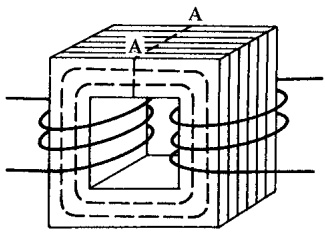

(a)

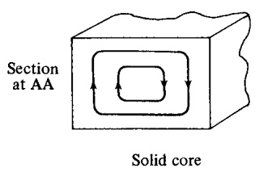

(b)

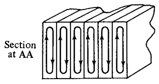

(c)

Fig. 13.1 Eddy currents in a transformer core.

The alternating flux induces an emf, not only in the secondary coil, but also in the core itself and, if the core is a conductor, this emf will cause eddy currents. At a time when the flux is increasing from left to right in the top leg, the eddy currents in the section AA will have the direction shown in Fig. 13.1b, i.e., the direction which will produce an eddycurrent field from right to left, opposing the main field. Eddy currents are objectionable, not only because they decrease the flux, but also because they produce heat, a direct power loss, proportional to $i^{2}R.$ where i is the eddy current and R the resistance of its path. The primary way to decrease this loss is to make the core out of thin sheets, or laminations, as in Fig. 13.1c, rather than from a solid piece. If these sheets are electrically insulated from one another, the eddy currents are forced to circulate within each lamination. The path length in each lamination is now shorter, thus decreasing R, but the cross-sectional area $A$ of the path is also reduced. The induced emf e is therefore reduced, according to Equation 12.1, and the net effect is a decrease in the current i and in the eddy-current power loss $(= ei = i^{2}R)$ The effect is a strong one (Problem 13.3), and laminated construction is standard for the cores of transformers, motors, and generators made from metallic (conducting) materials.

How thin should the laminations be made? We saw in Section 12.2 that, when a body is exposed to an alternating field, eddy currents are generated which partially shield the interior of the body from the field. Thus the value of $H$ and hence $B$ inside the body can be much less than the value at the surface. This phenomenon is referred to as the skin effect, which is the confinement of the flux to the surface layers of a body at a “high” frequency. This effect can be very strong in a material like transformer steel at ordinary power frequencies (50 or 60 Hz), which are normally considered “low.” Figure 13.2 shows that the flux density $B$ at the center of a sheet of transformer steel containing 3.25% silicon, 1.6 mm or $\frac{1}{16}$ inch thick, is only about half the value at the surface at 60 Hz. Extrapolating the data of Fig. 13.2 to a sheet 6.4 mm or $\frac{1}{4}$ inch thick, one can conclude that the flux at its center is virtually zero. The material at the center of such a sheet is contributing nothing to the desired multiplication of the applied field and might as well not be there; it is simply wasted material.

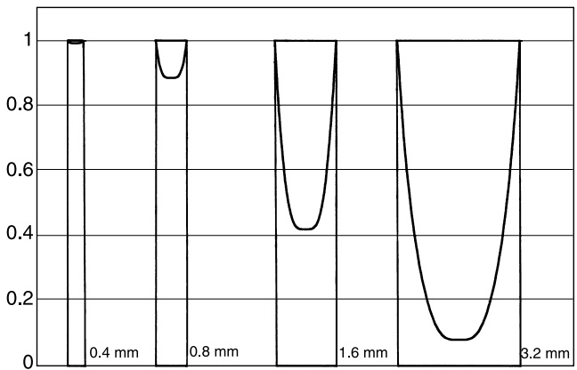

Fig. 13.2 Calculated amplitude of alternating flux in transformer steel sheets of various thicknesses as a fraction of the value at the surface. Frequency = 60 Hz, skin depth $\delta = 0.5$ mm, sheet thicknesses as indicated.

Eddy-current shielding can be convincingly demonstrated by a simple experiment. A cylindrical tube is made of annealed steel. The tube is 5 inches long, 0.707 inches outside diameter, and 0.5 inch inside diameter. Into this tube can be inserted a solid rod, 0.5 inch outside diameter, made of the same steel. The tube and rod dimensions are such that the cross-sectional area of the central rod is the same as that of the tube. If the parts are made of medium-carbon steel (0.35 wt% C), the permeability will be about 2000 at a field of 10 Oe (800 A/m): any steel with similar or higher permeability can be used. The tube is wound with primary and secondary coils, and an ac voltage is applied to the primary. At frequencies of 25, 60, and 100 Hz, the output voltage from the secondary coil will be exactly the same, whether or not the inner rod is present in the tube. So the value of $B$ falls to zero within the thickness of the tube wall $[(0.707 - 0.50) = 0.207$ inch = 5.26 mm]. The central rod is completely shielded even at 25 Hz.

The way in which the flux decreases with depth below the surface of a sheet sample can be calculated exactly only by making certain simplifying assumptions: that the permeability μ is constant, independent of $H$, and that it has the same value in all parts of the sheet. The field is applied parallel to the surface of the sheet and is assumed to vary sinusoidally with time t, so that $H = H_{0}$ cos $2\pi ft.$ where f is the frequency in Hz. Then the field amplitude $H_{x}$ and the flux density amplitude $B_{x}\left(= \mu H_{x}\right)$ at a distance x from the center of the sheet are given by

$$
\frac {H _ {x}}{H _ {0}} = \frac {B _ {x}}{B _ {0}} = \left[ \frac {\cosh (2 x / \delta) + \cos (2 x / \delta)}{\cosh (d / \delta) + \cos (d / \delta)} \right] ^ {1 / 2}\tag{13.1}
$$

where d is the sheet thickness in cm, and $\delta$ is given by

$$
\delta = 5 0 3 0 \sqrt {\frac {\rho}{\mu f}} \mathrm{cm},\tag{13.2}
$$

where ρ is the resistivity in ohm-cm. With the assumptions given, $H_{x}$ and $B_{x}$ vary sinusoidally with time, but they lag in time behind $H_{0}$ and $B_{0}$ at the surface. Equation 13.1 does not give the ratio of the interior value of $H$ or $B$ to the surface value at a given time, but rather the ratio of the amplitude of the interior value to the amplitude of the surface value. These amplitudes (maximum values) are reached at different times.

Flux penetration increases as μ and f decrease and as ρ increases, for a constant plate thickness. (Note that μ and f enter as the product μf. Thus the flux penetration for $\mu =$ 1000 and $f = 60\mathrm{Hz}$ is the same as for $\mu = 100$ and $f = 600\mathrm{Hz.}$ The quantity d is called the skin depth and is the depth under the surface at which $H$ or $B$ falls to 1/e (=37%) of its value at the surface. A sheet is “thick” if $\delta$ is small compared to the sheet thickness d. (Note that d is measured from the sheet surface, whereas x is measured from the center of the sheet.)

The curves of Fig. 13.2 were calculated from Equation 13.1 with $\mu = 6750$ and $\rho =$ $40\times10^{-6}$ ohm-cm, which are appropriate for Fe with 3.25% Si, and they apply for a frequency of 60 Hz. This gives a skin depth d of 0.5 mm. Alternatively, they apply to any material, thickness, or frequency for which the dimensionless constant $d / \delta$ has the values 0.8, 1.6, 3.2, and 6.4, respectively. The flux penetration in each sheet of a stack of sheets, as in the laminated core of a transformer, is the same as in a single sheet, provided the sheets are electrically insulated from one another. This point is illustrated in Fig. 13.3.

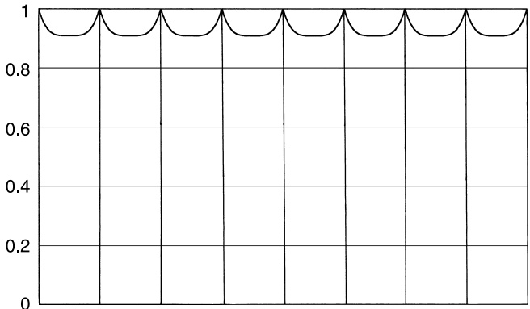

Fig. 13.3 Calculated relative flux amplitude in a stack of insulated sheets, each 0.75 mm thick, for the same conditions as in Fig. 13.2.

Flux penetration in cylindrical rods is given by the following relation, equivalent to Equation 13.1:

$$
\frac {H _ {x}}{H _ {0}} = \frac {B _ {x}}{B _ {0}} = \left[ \frac {b e r ^ {2} (\sqrt {2} x / \delta) + b e i ^ {2} (\sqrt {2} x / \delta)}{b e r ^ {2} (\sqrt {2} r / \delta) + b e i ^ {2} (\sqrt {2} r / \delta)} \right] ^ {1 / 2},\tag{13.3}
$$

where x is the distance from the rod axis, r is the rod radius, and d is given by Equation 13.2 as before. The functions ber and bei are particular kinds of Bessel functions defined in mathematical handbooks. Rods are not used in transformer cores, but Equation 13.3 is given here because magnetic measurements may be made on rod specimens, and it is sometimes necessary to estimate flux penetration in such specimens in alternating fields.

The eddy-current power loss P per unit volume of sheet can be calculated by integrating $I^{2}\rho,$ where I is the current density, over the volume of the sheet and the length of a cycle. The result is

$$
P = \frac {1 0 ^ {- 9} \pi^ {2} d ^ {2} B _ {0} ^ {2} f ^ {2}}{6 \rho} \frac {\mathrm{erg}}{\sec \mathrm{cm} ^ {3}}.\tag{13.4}
$$

This is the “classical” eddy-current loss equation; it assumes complete flux penetration, or $d / \delta$ less than 1, and constant permeability. The thickness d is in cm, the flux amplitude at the surface $B_{0}$ in gauss, the frequency f in Hz, and the resistivity ρ in ohm-cm. To obtain the power loss in watts/cm3, multiply Equation 13.4 by $10^{-7}$ . The strong dependence of the eddy-current loss on d, f, and $B_{0}$ should be noted. However, the loss is independent of, because complete flux penetration is assumed.

Equations 13.1, 13.3, and 13.4 are all “classical,” in that the permeability μ is assumed to be constant both in time and in space. The permeability does not depend on the magnitude of $H$ as $H$ changes with time, and is the same everywhere in the sample—which is to say that the domain structure is ignored. These assumptions are strictly valid only for para-, dia-, and antiferromagnetic materials. They are certainly not true for strongly magnetic substances, which are made up of self-saturated domains and in which μ varies with $H$ as shown in Fig. 1.13b. And μ depends strongly on position, on the scale of the domains. Suppose a field $H$ is applied parallel to a $180^{\circ}$ wall in a demagnetized sample, causing the wall to move a certain distance. What is the permeability? On the domain scale the only definition of μ that has much physical meaning is (ΔB)/H. In the two domains adjacent to the displaced wall, but not including the swept-out region, DB is simply $H$, because the magnetization $M_{s}$ has not changed, and μ is 1. Within the swept-out region, however, $\Delta B$ is $H + 2(4\pi M_{\mathrm{s}})$ , and μ is $1 + [2(4\pi M_{\mathrm{s}}) / H]$ or about 43,000 for iron if $H$ is 1 Oe.

The dependence of μ on $H$ and on position in strongly magnetic substances has two effects:

1. If the applied field $H$ varies sinusoidally with time, the variation of $B$ will not be sinusoidal, as we previously assumed. F. Brailsford [Magnetic Materials, 3rd edn, Wiley (1960)] shows how the $B$ wave form is distorted and how the distortion varies with depth below the surface of a sheet.

2. Equation 13.4 underestimates the eddy-current loss except when the domain size is extremely small.

The effect of domain structure on eddy-current loss has been calculated in an often-cited paper by R. H. Pry and C. P. Bean [J. Appl. Phys., 29 (1958) p. 532]. They assumed the specimen to be an infinite sheet of thickness d, made up of domains of width 2L magnetized antiparallel to one another, as shown in the upper sketch of Fig. 13.4. Their result for the power loss $P_{\mathrm{ed}}$ is complicated and will not be given here, but the quantity of most interest is the ratio $P_{\mathrm{ed}} / P_{\mathrm{ec}}$ where $P_{ec}$ is the classical eddy-current loss given by Equation 13.4. This ratio is shown in Fig. 13.4 as a function of 2L/d. The solid line refers to small magnetization, such that the amplitude of the induction $B_{0}$ is small compared to the saturation induction $B_{s}$ The dashed line shows the higher losses that occur when the domain walls move so far that the sheet is saturated once in each half cycle. The walls are assumed to remain flat, so that the calculation applies only to low frequencies where the walls do not bow out. (The lower the frequency, the lower is the average wall velocity, for constant $B_{0.}$ We see from this calculation that $P_{ed}$ becomes equal to the classical value $P_{ec}$ as the domain size approaches zero; this is reasonable in that μ then becomes homogeneous on a microscopic scale. But when the domain size becomes equal to the sheet thickness, as it does in some electrical steels, the eddy-current loss can become almost double the value calculated on a classical model.

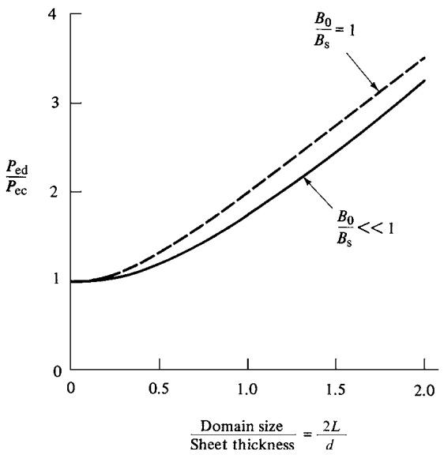

Fig. 13.4 Ratio of the domain-model eddy-current power loss $P_{ed}$ to the classical eddy-current power loss $P_{ec}$ as a function of domain size 2L relative to sheet thickness d. [R. H. Pry and C. P. Bean, J. Appl. Phys., 29 (1958) p. 532.]

The calculation of Pry and Bean was made for a very special arrangement of domain walls, but their qualitative conclusions are generally true, namely, that the spatial inhomogeneity of μ, which is the inevitable result of a domain structure, must lead to higher eddy-current losses than those calculated classically. In a material containing domains, the eddy currents are localized at the moving domain walls, as indicated in Fig. 12.6, and the eddy-current density I can reach very large values at the walls. The average value of $I^{2}\rho$ over the specimen is then larger than if the eddy currents were evenly distributed throughout. A larger domain size means more widely spaced domain walls, so each wall must move faster to produce a given flux change at a given frequency. Since the losses depend on the square of the domain wall velocity, the total losses increase as the number of domain walls decreases.

## 13.3 LOSSES IN ELECTRICAL MACHINES

The machines to be considered here are transformers, motors, and generators.

## 13.3.1 Transformers

These are among the most efficient machines ever made. Efficiency generally increases with size, and large transformers have efficiencies exceeding 98%. Efficiency is defined as

$$
\frac {\text {output}}{\text {input}} = \frac {\text {input} - \text {losses}}{\text {input}}.
$$

Transformer losses are mainly composed of:

1. Core losses, sometimes called iron losses, occurring in the magnetic core, as discussed above.

2. Copper losses, occurring in the windings and given simply by $i^{2}R.$

The ratio of core loss to copper loss in a transformer can be varied over a fairly wide range, by such things as choice of magnetic material, peak flux density, diameter of copper wire, etc. Usually the two losses are more or less equal. The core losses occur continuously as long as the transformer is connected to a power supply, whether or not any power is drawn from the secondary winding. The copper losses, on the other hand, vary as the square of the power output. So a transformer that is lightly or intermittently loaded should be designed to minimize core losses, while a transformer for continuous operation at full power should be designed for equal core and copper losses.

Although core losses in a transformer might appear insignificant, in that they constitute less than 2% of the output of a large transformer, they add up to a very large amount, because almost all generated electric power passes through multiple transformers before reaching the consumer. In the early twenty-first century, the annual electrical energy consumption in the United States was about $4\times10^{12}\mathrm{kW-h}$ . If all this power passed through four transformers (one step-up transformer at the power plant, three successive step-down transformers in the local distribution system), each extracting 1.5% of the power as heat, the lost power is about $240\times10^{9}\mathrm{kW-h}$ . This is electric power generated by the power company but not paid for by consumers. At a wholesale price of \$0.05 per kW-h, its value is something like \$12 billion. This cost is borne almost entirely by the electricity producers (or distributors, since the two are now often separated). There is a strong incentive to reduce core losses by even fractions of a percent. However, lower losses generally mean increased capital cost—better magnetic material, thicker copper wires, etc. The balance between power savings and capital costs is influenced by more than engineering considerations: tax laws and utility regulations are also significant.

The standard method of measuring core loss is the Epstein test, which simulates the operation of a transformer at zero load. This test has been standardized by national and international organizations. The test material is in the form of strips 28 cm long and 3 cm wide, having a total weight of 2 kg. (This amounts to a total of 88 strips, if they are cut from sheet 0.014 inch or 0.36 mm thick). The strips are inserted into four solenoids arranged in a square, and mounted on a base with the strips interleaved at the corners to form a square core, as shown in Fig. 13.5. The solenoids form a square 25 cm (10 inch) on each side. Each solenoid has an inner, secondary winding S of 175 turns and an outer, primary (magnetizing) winding P of 175 turns; the four primary windings are connected in series and so are the four secondary windings. The normal oxide skin on the steel strips usually offers enough electrical resistance to prevent eddy-current flow from one strip to another. Moderate pressure may be applied at the corners of the assembled stack of strips to improve magnetic continuity at these points where the strips overlap.

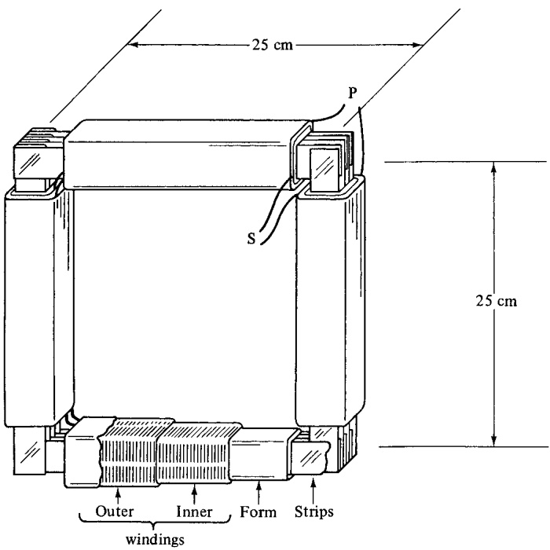

Fig. 13.5 Epstein test frame with strips inserted.

The measuring circuit consists of a wattmeter, connected as shown in Fig. 13.6, plus a flux voltmeter used to set the maximum flux density in the sample. The use of a modern electronic wattmeter removes the need for certain correction factors required for analog instruments. The flux waveform should be sinusoidal; if it is not, a correction factor needs to be applied. The experimental arrangement measures only core loss, with no contribution from the copper losses. The absolute losses are measured at one or more maximum flux densities, and usually at a single frequency (60 Hz in the United States, 50 Hz in Europe, other countries one or the other). The total weight of the sample strips is recorded, and the losses are reported in W/lb or W/kg . In materials with directional properties, measurements may be made parallel or perpendicular to the rolling direction, or half-and-half.

The Epstein test requires a large heavy sample, and many individual strips which have to be carefully inserted in the test frame. There have been many attempts to develop a simpler test procedure using a smaller sample, ideally a single strip or square. Such testers are not difficult to design and build; the problem is that their results do not agree perfectly with Epstein results. The Epstein test has other faults: the magnetic path length and the flux density are not well-defined in the corners of the frame, where the test strips overlap. But the Epstein test has been used universally for so long that it is difficult to get acceptance of a replacement test that fails to match the Epstein results.

Conventionally, the total core losses measured by the Epstein test are divided into two parts, hysteresis loss and eddy-current loss. The hysteresis loss is determined from the area of the static or direct-current hysteresis loop as determined using a fluxmeter (Section 2.5). The area of this loop in units of gauss-oersted, divided by $4\pi,$ equals the hysteresis loss $W_{\mathrm{h}}$ in ergs/cm³ (Section 7.6). Knowing the density of the material and the conversion $10^{7}\mathrm{ergs}=1$ joule, we can find the hysteresis loss $W_{\mathrm{h}}$ in joules /kg . This loss is assumed to be independent of frequency. The hysteresis power loss $P_{\mathrm{h}}$ is therefore given by $W_{\mathrm{h}}f$ watts/lb or watts /kg. where f is the frequency (1 watt = 1 joule/sec). On the other hand, the classical eddy-current power loss $P_{ec}$ is proportional to $f^{2}$ , according to Equation 13.4. Therefore, the total power loss $P_{\mathrm{t}}$ in the core, as measured by the Epstein test, should be given by

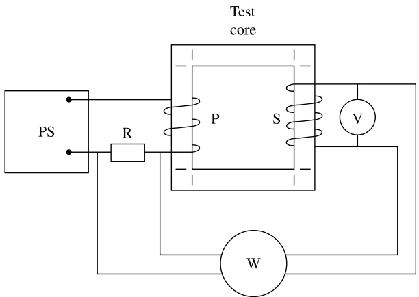

Fig. 13.6 Simplified circuit for core-loss measurement on Epstein specimens. PS = power supply, R = resistor, P = primary winding, S = secondary winding, V = voltmeter, W = wattmeter.

$$
P _ {\mathrm{t}} = P _ {\mathrm{h}} + P _ {\mathrm{ec}} = W _ {\mathrm{h}} f + k f ^ {2} \frac {\text { watts }}{\text { unit   mass }},\tag{13.5}
$$

and the total energy loss per cycle will be

$$
\frac {P _ {\mathrm{t}}}{f} = W _ {\mathrm{h}} + k f \frac {\text {joules}}{\text {unit mass}}.\tag{13.6}
$$

Here $k$ is a constant. We therefore expect that $P_{\mathrm{t}} / f$ will vary linearly with frequency and equal $W_{\mathrm{h}}$ at zero frequency.

Losses are not regularly measured as a function of frequency, and the cases for which data are available show considerable variation in behavior. One example is shown in Fig. 13.7. The loss per cycle increases with frequency, as expected, but not linearly. (The measurements cannot be carried to higher frequencies because the skin effect prevents the sample from being fully magnetized.) There is also a substantial discrepancy between the measured eddy-current loss and the value calculated classically. The difference between the two is called the anomalous loss, and may be as large or larger than the calculated eddy-current loss.

The “anomalous loss” is anomalous in name only. It appears only because the classical calculation of eddy-current loss ignores the presence of domains and domain wall motion, and is therefore too low. It is unreasonable to compare an observed loss with the calculated classical loss and call the difference an anomaly. When the domain structure of the material is taken into account, the calculated eddy-current loss exceeds the classical loss, and the difference between the two is larger the larger the domain size, as shown by Fig. 13.4. The difficulty is that the details of the domain structure and of the domain wall motion are not known in an actual sample, so that calculations can only be made for assumed and simplified models.

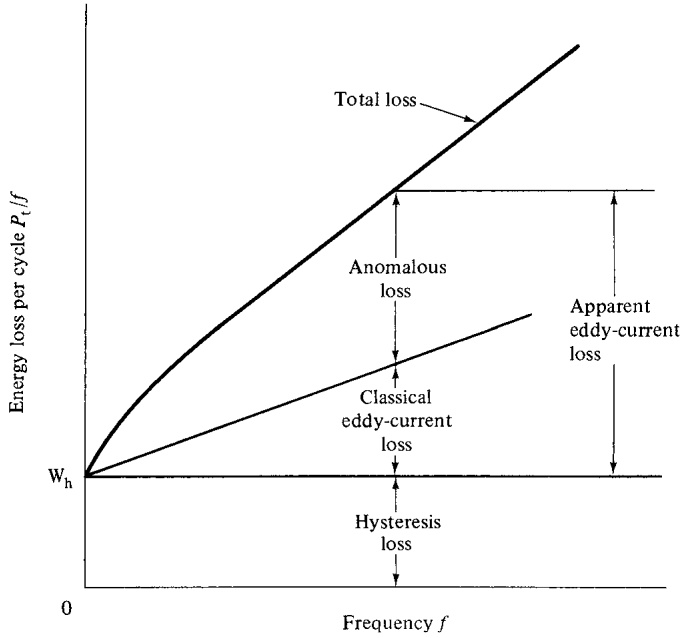

Fig. 13.7 Conventional separation of losses in transformer cores.

A physical approach to core losses not only rejects the “anomalous loss” as a fiction, but it also rejects the conventional separation of the total loss into hysteresis and eddy-current components as artificial. This separation is based on the idea that the static or dc hysteresis arises from a different source than the ac eddy-current losses. This is incorrect; the magnetization process under dc conditions consists of domain wall motion in low fields and domain rotation at high fields, with an intermediate region where both mechanisms occur. Nothing in this basic picture changes as the frequency of magnetization reversal is increased. The detailed configuration of domain walls may change, as domain walls are annihilated and new domains nucleated, and at sufficiently high frequency the skin effect may shield the interior of the sample and confine magnetization changes to the surface. But there is no physical distinction between the processes that occur when a magnetic material is magnetized under dc conditions and under ac conditions: the distinction between hysteresis loss and ac or eddy-current loss is imaginary. Despite the general acceptance of this picture of losses based on domain wall motion, the “separation of losses” dogma continues to appear in the engineering literature.

In a transformer steel lamination made of oriented 3% Si –Fe, the domain structure may be reasonably represented as an array of equally spaced parallel $180^{\circ}$ walls. If all the domain walls move, magnetic saturation is reached when each wall has moved a distance equal to half the domain wall spacing distance d. When the wall has moved this distance, it meets another wall moving the other way, and the two walls annihilate. This happens in the time of one-quarter cycle $\Delta t = (1 / 4 \cdot 1 / f)$ , where f is the frequency, as the field goes from zero to maximum. The average velocity of a domain wall is then

$$
\bar {v} = \frac {d / 2}{1 / 4 f} = 2 d f.
$$

The voltage induced by the moving domain wall is proportional to $\mathrm{dB / dt}$ and hence to v¯. The power dissipated by the moving wall, which is the source of core loss, is proportional to the voltage squared $[P = E^2 /R]$ and therefore is proportional to $\bar{v}^{2}$ or to $(df)^{2}$ . The loss per cycle P/f should then be proportional to f, or more specifically to $d^{2}f.$

What is usually observed is that the loss per cycle rises less rapidly than linearly with increasing frequency f, giving a concave-downward curve, as in Fig. 13.7. The simplest explanation is that the domain spacing d is not constant, but decreases with increasing frequency. That is, more domain walls are nucleated and move; the distance moved by each wall in a quarter-cycle is less, the average velocity v¯ is reduced, and the loss increases less rapidly than it would for a fixed number of domain walls. There is clear experimental evidence for this, at least in the case of simple parallel-wall domain structures [G. L. Houze, J. Appl. Phys., 38 (1967) p. 1089; T. R. Haller and J. J. Kramer, J. Appl. Phys. 41 (1971) p. 1034].

It is also observed that domain wall motion tends to be jerky, not smooth, as the walls are pinned by various internal obstacles. This means the wall velocity during a Barkhausen jump is higher than the average velocity. And since the loss depends on the square of the velocity, jerky wall motion produces higher losses than smooth wall motion.

Some of the data reported by Houze is shown in Table 13.1. Note that the magnetization was not driven to saturation, but to $B_{\mathrm{max}} / B_{\mathrm{s}} \approx 0.45$ , or less than half of saturation. When the frequency is increased by a factor of 4 (30 – 120 Hz), the average wall velocity increases by a factor of $10.3 / 3.5 \approx 3.$ , and the average wall spacing decreases by a factor of $0.071 / 0.128 \approx 0.55$

TABLE 13.1 Domain-Wall Spacings and Velocities Measured During Alternating Magnetization of a {110} <001> Crystal of $\mathrm{Fe} + 3\%$ Si

| Frequency, Hz | Hmax, Oe | Bmax/Bs | -v, cm/sec | d, cm |
| --- | --- | --- | --- | --- |
| 30 | 2.1 | 0.43 | 3.5 | 0.128 |
| 60 | 1.7 | 0.38 | 6.4 | 0.083 |
| 120 | 2.2 | 0.48 | 10.3 | 0.071 |

## 13.3.2 Motors and Generators

The subject of core losses in these machines is more complex than in transformers, because the conditions of magnetization are more complicated. These are rotating machines, which means that the core of magnetic material is subjected to fields which may not only alternate in magnitude and sign along a given axis, as in a transformer, but also change direction in space. Furthermore, the maximum value of the magnetization, as well as the variation of its magnitude with time, can vary greatly from one part of the machine to another. In the limit we can examine the behavior of a circular specimen which is rotated through $360^{\circ}$ in a constant field. It is easier to visualize the equivalent behavior of a fixed specimen in a rotating field, as in Fig. 13.8, which is drawn for a field only large enough to cause partial saturation. As the field makes one complete revolution, the domain walls simply move back and forth. Even if the rotation is infinitesimally slow, Barkhausen jumps will occur generating micro eddy currents and heat; the sum of these losses for one revolution is the rotational hysteresis loss $W_{r};$ in the general case, $W_{\mathrm{r}}$ will also include losses due to irreversible rotations of the magnetization vector.

Rotational hysteresis can be measured with a torque magnetometer on disk-shaped specimens, and Fig. 13.9 shows representative curves. If Equation 7.5 is integrated, we have

$$
W _ {\mathrm{r}} = - \int_ {0} ^ {2 \pi} L d \theta ,\tag{13.7}
$$

where L is the torque on the specimen when $M$ makes an angle $\theta$ with some reference line on the specimen. The quantity on the right is just 2p times the average torque required to rotate the specimen in the field; it is also the net (algebraic) area between the L, $\theta$ curve and the $L = 0$ axis. In Fig. 13.9 the torque in a field of 50 Oe is practically constant. At 170 Oe the overall anisotropy of the specimen has become evident, but there is still rotational hysteresis because the net area between the curve and axis is still negative. At 1500 Oe, however, the curve is symmetrical about the axis, no net torque is required to rotate the specimen, and $W_{\mathrm{r}}$ is zero. The specimen is then saturated and its $M_{\mathrm{s}}$ vector rotates reversibly with the field; the torque curve is simply an expression of the anisotropy, just as the curve of Fig. 7.15, for example.

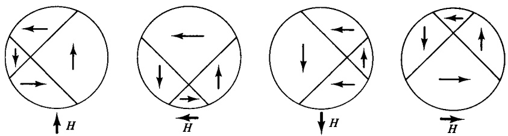

Fig. 13.8 Wall motion in a rotating field (schematic).

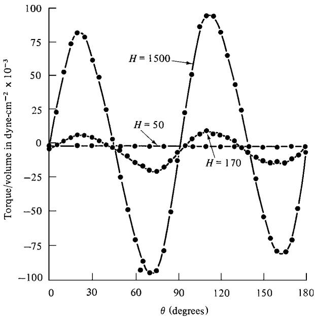

Fig. 13.9 Torque curves for a disk of cold-rolled iron at different values of the applied field. [H. J. Williams, Rev. Sci. Instrum., 8 (1937) p. 56.]

There is a real difference between the alternating hysteresis loss $W_{\mathrm{h}}$ and the rotational hysteresis loss $W_{\mathrm{r}}$ The value of $W_{\mathrm{h}}$ steadily increases with field until the specimen is saturated, but $W_{\mathrm{r}}$ goes through a maximum and becomes zero at saturation. Figure 13.10 illustrates this point for silicon steel. The reason for the difference is that a specimen rotated in a saturating field is always saturated, but a specimen subjected to alternating magnetization passes through the demagnetized state twice in each cycle of magnetization. The behavior of the rotational hysteresis as a function of the applied field can be characterized by a quantity called the rotational hysteresis integral, defined by I. S Jacobs and C. P. Bean [J. Appl. Phys., 28 (1957) p. 467] as

$$
I _ {\mathrm{r}} = \int_ {0} ^ {\infty} \frac {W _ {\mathrm{r}}}{M _ {\mathrm{s}}} d \left(\frac {1}{H}\right).\tag{13.8}
$$

Although alternating and rotational hysteresis losses are conceptually different and separately measurable, both are due to the same fundamental processes, irreversible wall movements and irreversible rotations.

The conditions of the Epstein test correspond quite closely to the conditions in a working transformer. The major differences are that in a working transformer there are mechanical stresses acting on the magnetic laminations as a result of the need to hold everything firmly in place, and the corner joints are designed so that there are no gaps between the laminations in the transformer legs. The transformer losses predicted from the Epstein test results are always too low by a factor called the build factor or the construction factor, which is known only from experience.

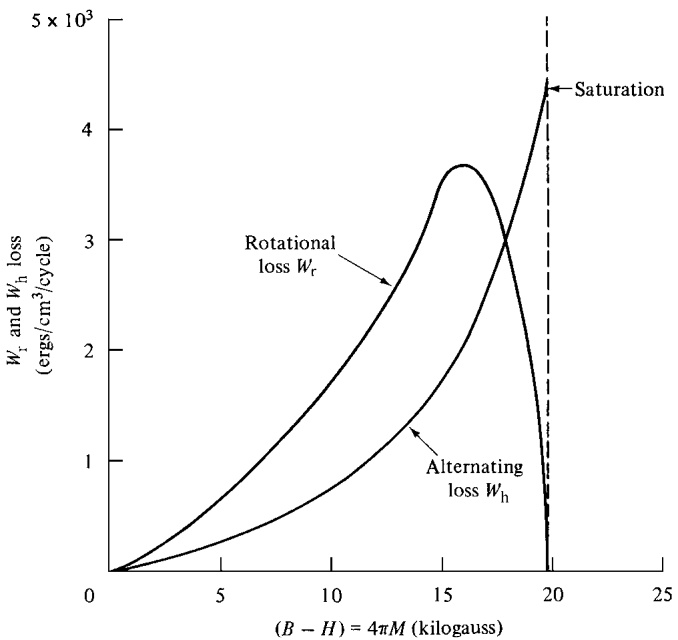

Fig. 13.10 Dependence on $4\pi M$ of the rotational hysteresis loss Wr and the alternating hysteresis loss $W_{\mathrm{h}}$ in the rolling direction for grain-oriented 3.13% silicon steel. [F. Brailsford, J. Inst. Elect. Engrs, 84 (1939) p. 399.]

Measurements of rotational loss are much less useful in practice, because in a motor or generator different parts of the steel laminations are subjected to different mixtures of alternating and rotational magnetization; furthermore the alternating flux is usually not sinusoidal and the rotating flux is not rotating at a constant rate. Therefore it is not possible to specify a set of test conditions that are generally applicable.

## 13.4 ELECTRICAL STEEL

Three kinds of materials are used for the cores of most electrical machines: (1) low-carbon steel, (2) nonoriented silicon steel, and (3) grain-oriented silicon steel. These materials are usually called electrical steel or transformer steel; sometimes all of them are referred to simply as “iron,” regardless of composition. The magnetic quality and the price increase in the order listed.

Before we examine these three grades, some general remarks on texture (preferred orientation) are in order. This subject was introduced in Section 7.8, where we saw that a crystallographic texture could result in a polycrystalline specimen having an easy axis of magnetization. In an iron or iron-silicon crystal the easy axis is <100> and the hard axis is <111>. In a transformer, the magnetization direction is always parallel to the long edges of the laminations. If the sheet can be made with an fhklg <100> texture, there will be an easy <100> direction in the direction of magnetization, which will increase permeability and decrease losses. This kind of texture can be made in silicon steel. The actual texture is {110} <001>, and such material is called “grain-oriented” steel.

In cores for rotating machines, on the other hand, the field is in the plane of the sheet, but the angle between the field and rolling direction is variable. Here there is no point in having the easy direction in the rolling direction, and a satisfactory texture would be {100} kuvwl, which keeps the hard <111> direction out of the plane of the sheet. A <100> fiber texture would be even better, i.e., a texture in which all grains had a <100> direction normal to the sheet surface and all possible rotational positions about this normal, because the sheet would then be isotropic in its own plane. A {100} <100> texture, known as the cube texture, has been made on a trial basis, but has never been produced in quantity in iron-silicon alloys.

Electrical steel for cores must be in the fully recrystallized, magnetically soft condition. There are two kinds of recrystallization, primary and secondary. These will be distinguished later on. It is enough to note here that magnetically desirable textures have been achieved only by secondary recrystallization and that this process requires a rather high annealing temperature. After these preliminaries we can turn to the materials themselves.

## 13.4.1 Low-Carbon Steel

This was the original core material for transformers, motors, and generators, but it is limited today mainly to the cores of small motors where energy loss is not a major consideration. [An example is the household vacuum cleaner motor, which typically runs for short times and is well-cooled by the air flow. These motors are advertised on the basis of power consumption (“powerful 600 W motor”), not on the basis of power output. High power losses and low efficiency thus are turned into a sales advantage.]

This is basically the same material as that used for automobile bodies, washing machines, refrigerators, and the like, with the carbon content reduced as low as practical in normal steelmaking operations. Low-carbon sheet steel is one of the cheapest steel products made and is produced in large tonnages; the portion used for motor cores forms a small fraction of the total.

The carbon content is about 0.03 wt%. The core loss at 15 kilogauss, 60 Hz, 0.020 inch (0.5 mm) thickness is about 5 – 7 W/lb or 3 W/kg, which is nearly 10 times the loss for grain-oriented silicon steel. But core loss is of small importance to the manufacturer of small motors, since low cost rather than efficiency is the chief object. The market is very large. A typical home in an advanced country contains dozens of small electric motors, in large and small appliances, power tools, toys, clocks, etc., plus many more in the family car(s), e.g., heater, engine fan, seat adjusters, power roof, power windows, and retractable radio antenna.

The normal (primary) recrystallization texture of sheet steel is complex, not very strong, and magnetically unattractive. Attempts to develop strong and useful textures have not been successful. Strong textures usually result from secondary recrystallization, which requires high temperatures, and at temperatures no higher than $910^{\circ}\mathrm{C},$ low-carbon steel undergoes a phase transformation. Any texture existing below this temperature is effectively destroyed by heating, and any texture existing above this temperature is destroyed by cooling.

Low-carbon steel has another class of magnetic applications which require only constant or slowly changing magnetization. These are regarded as dc applications, and they include lifting and holding magnets, laboratory electromagnets, and beam-bending magnets in high-energy particle accelerators (although for the latter use, superconducting magnets are now used). For dc uses, the steel need not be laminated, and castings may be used.

Low-carbon steel regarded as a magnetic material is commercially pure iron with a small amount of unwanted carbon impurity (which is actually present mostly as the iron carbide $\mathrm{Fe}_{3}\mathrm{C)}$ . Such steel has a maximum permeability of 1000 – 2000, which can be greatly increased by careful purification treatments. A special grade of relatively high purity, low carbon iron was made and sold for many years as “Armco” iron. This is no longer made, but similar material is commercially available. Typical carbon content is 0.015 wt% carbon, and maximum permeability after annealing is about 10,000.

## 13.4.2 Nonoriented Silicon Steel

This steel was developed by the English metallurgist Robert Hadfield in 1900 and soon became the preferred core material for large transformers, motors, and generators. The addition of silicon to iron profoundly modifies the phase diagram, as shown by Fig. 13.11. The temperature of the $\alpha \rightarrow \gamma$ transformation is raised and that of the!  transformation is lowered until the two meet at about 2.5% Si, forming a closed “gamma loop.” As a result, an alloy containing more than about 2.5% Si is body-centered cubic at all temperatures up to the melting point. This means that (1) such an alloy may be recrystallized at any temperature without concern for phase changes, and (2) single crystals of such an alloy can be made by slow solidification from the liquid or by recrystallization at any desired temperature. These operations are difficult in the case of pure iron or at lower Si contents, because of the $\gamma \rightarrow \alpha$ transformation on cooling to room temperature. The a solid solution of silicon in iron is often called silicon ferrite by metallurgists, and the magnetic Si – Fe alloys are often called silicon iron.

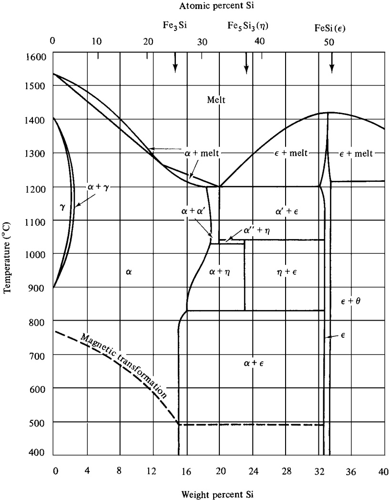

Fig. 13.11 Portion of iron– silicon equilibrium diagram.

The preceding remarks apply to pure Fe –Si alloys. The presence of carbon widens the $(\alpha + \gamma)$ region, and only 0.07% C is enough to shift the nose of the gamma loop over to about 6% Si. In practice, the carbon content of silicon steel varies from about 0.03% (non-oriented) to less than 0.01% (oriented), and it would be reduced to even lower levels if it were economically feasible to do so. Iron carbide and nitride precipitates degrade the magnetic properties by interfering with wall motion, and the slow precipitation of carbides during service, called “aging,” can cause a substantial increase in core losses.

The addition of silicon to iron has the following beneficial effects on magnetic properties:

1. The electrical resistivity increases, causing a marked reduction in eddy currents and therefore in losses.

2. The magnetocrystalline anisotropy decreases, causing an increase in permeability.

3. The magnetostriction decreases, leading to smaller dimensional changes with magnetization and demagnetization, and to lower stress-sensitivity of magnetic properties.

On the debit side, silicon additions decrease the saturation induction and tend to make the alloy brittle, so that it becomes difficult to roll into sheet when the silicon content is much higher than 3%. Figure 13.12 shows the effect of silicon on these various properties; the percentage elongation in the tensile test is a measure of ductility.

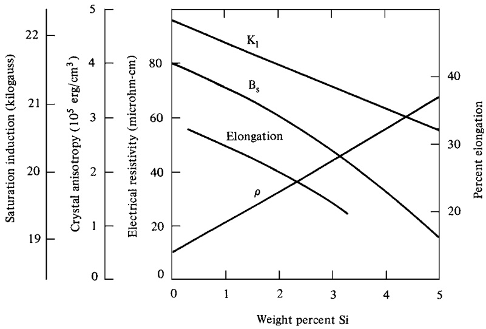

Fig. 13.12 Data on iron-silicon alloys: magnetocrystalline anisotropy constant $K_{1}$ saturation induction $B_{s},$ electrical resistivity ρ and percentage elongation for nonoriented, polycrystalline sheet, 0.0185 inch or 0.47 mm thick.

Core loss increases rapidly with the maximum induction reached in the cycle, and is normally not measured above 17 kG (1.7 T). Core loss also increases with sheet thickness, and there has been a clear trend to use thinner gages as a way to decreases core loss.

Nonoriented silicon steel sheet is made by hot rolling to near-final thickness, pickling in acid to remove the oxide scale, and cold rolling to final thickness, which gives the best surface finish and sheet flatness. It may be sold in this state, called semiprocessed, which is good for punching finished shapes with little deformation but requires a subsequent annealing treatment for best magnetic properties. Or it may be annealed at the steel mill to a fully processed state. The final annealing may be done in a decarburizing atmosphere to lower the carbon content.

The use of other alloying elements instead of, or in addition to, silicon has been investigated at various times and places. The most obvious candidate is aluminum, which affects the magnetic properties of iron very much as silicon does. The presence of aluminum oxide particles in aluminum-iron alloys increases the rate of wear of the punching dies used to stamp out motor and transformer laminations, and aluminum appears to offer no compensating advantages over silicon.

## 13.4.3 Grain-Oriented Silicon Steel

This material was developed by the American metallurgist Norman Goss in 1933. He discovered that cold rolling a silicon iron with intermediate anneals, plus a final hightemperature anneal, produced sheet with much better magnetic properties in the rolling direction than hot-rolled sheet. This improvement was due to a magnetically favorable texture produced by secondary recrystallization during high-temperature annealing. Grain-oriented sheet went into commercial production about 1945, and its properties have since been continually improved. Material with a core loss about 0.5 W/lb or 1W/kg (at $B_{\mathrm{max}} = 17 \mathrm{kG}$ or 1.7 T, power frequency, 0.009 inch or 0.23 mm thickness) is now routinely produced, and such sheet is the standard core material for large transformers.

Secondary recrystallization differs markedly from primary. Primary recrystallization occurs when a cold-worked metal is heated to a temperature at which new, strain-free grains can nucleate and grow throughout the cold-worked matrix. It is truly a recrystallization. Secondary recrystallization, on the other hand, is a particular kind of grain growth and is sometimes called discontinuous, exaggerated, or abnormal grain growth. It occurs in some, but not all, materials when (a) normal grain growth is inhibited, and (b) the material is annealed, usually for a long time, at a temperature much higher than that required for primary recrystallization. The result is the preferential growth of a relatively few grains at the expense of the others, leading to extremely large grains. The grains are no longer microscopic in size, with grain diameters of some tens of micrometers, but they are now visible to the naked eye, having diameters of the order of millimeters or even centimeters. The grain size has therefore increased by a factor of several hundred (Fig. 13.13), and such grains extend through the thickness of the sheet.

In order for secondary recrystallization to occur, something must prevent normal grain growth. This is usually a second-phase precipitate at the primary grain boundaries, which either disappears by solid state solution at high temperatures, or is removed by a chemical reaction at the sample surface.

The feature of secondary recrystallization that is of interest here is the fact that a secondaryrecrystallization texture is usually quite different from the primary-recrystallization texture. In silicon steel the primary texture is weak and complex, whereas the secondary texture is a quite sharp single-component texture, namely, {110} <100>. This texture is illustrated in Fig. 13.14. In Fig. 13.14a is shown the stereographic projection of the principal directions in a single crystal, with the plane of the sheet taken as the projection plane; (011) is parallel to the sheet surface and [100] parallel to the rolling direction. The sketch in Fig. 13.14b of the orientation of the unit cell of each grain relative to the sheet shows why this is called the cube-on-edge texture. The schematic {100} pole figure in Fig. 13.14c shows where the <100> directions are concentrated for a large number of grains in polycrystalline sheet; the texture is sharper, i.e., has less scatter about the ideal orientation shown in Fig. 13.14a, the smaller the areas of the high-density regions on the pole figure. Pole figures are the result of X-ray diffraction measurements and are the most direct description of a texture. Useful information about texture in magnetic materials can also be obtained from torque curves, subject to the limitations mentioned in Section 7.8; Fig. 13.15 shows how closely the torque curve for a grain-oriented polycrystalline sheet can approach that of a single crystal.

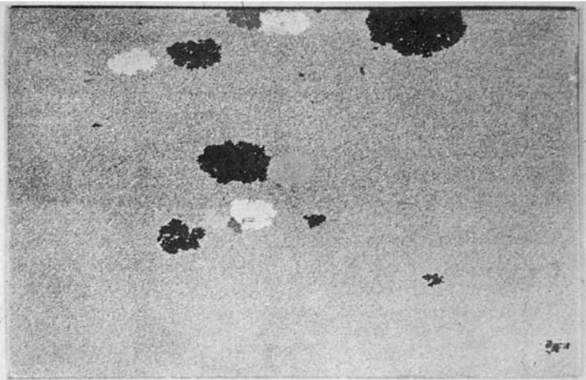

Fig. 13.13 Partial secondary recrystallization in silicon iron. A few large secondary grains are growing in a matrix of primary grains during a 9008C anneal. About actual size. [C. G. Dunn, Cold Working of Metals, ASM (1949) p. 113.]

The details of the manufacturing process for oriented silicon steel are proprietary, and presumably are not identical for all manufacturers. However, the important steps appear to be the following:

1. Heavy cold-rolling (more than 50% reduction in area), to final thickness, which may actually be done above room temperature.

2. Recrystallization and decarburization at about 8008C in moist hydrogen.

3. Annealing in dry hydrogen at 1100 –12008C to produce the secondary recrystallization texture.

The particles inhibiting normal grain growth were believed to be MnS in the original grain-oriented material. Other compounds, such as AlN, have been used more recently. It is important that the particles be removed in the final heat treatment, since if they remained in the alloy they would act as domain wall pinning sites and increase the coercive field.

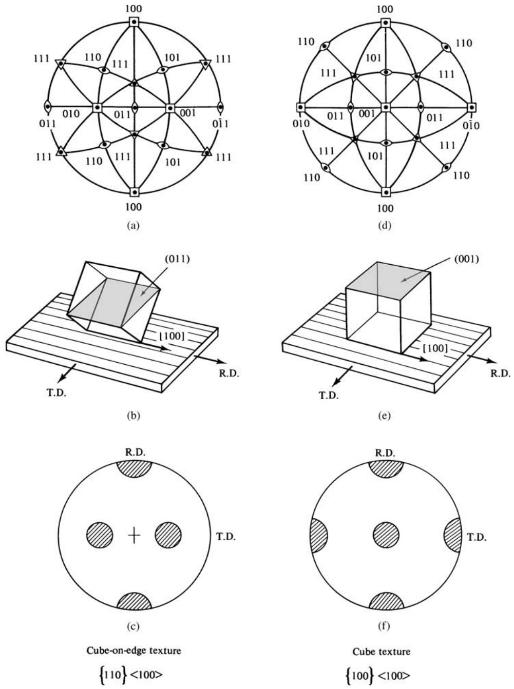

Fig. 13.14 Single-crystal projections (top), unit-cell orientations (center), and {100} pole figures (below). RD = rolling direction; TD = transverse direction.

Treatments that give the best crystallographic texture tend to produce very large grain sizes, and large grains tend to have relatively few domain walls. As seen previously, closely spaced domain walls are desirable to reduce eddy-current losses. Therefore various methods have been employed to provide nucleation sites for domain walls: mechanical scratches, chemical etches, spark erosion, and laser scribing. The best and most practical procedure seems to be laser scribing to produce a series of parallel lines arrayed perpendicular to the rolling direction of the sheet, spaced a few millimeters apart.

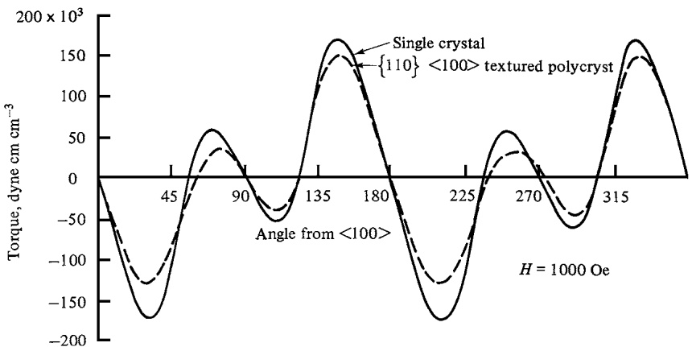

Fig. 13.15 Torque curves of a single crystal in the {110} plane and of a disk cut from a sheet of grain-oriented silicon steel having a strong cube-on-edge, {110} <100> texture. [C. D. Graham, Magnetism and Metallurgy, Volume 2, Academic Press (1969).]

The cube-on-edge texture makes the easy <100> directions in all grains almost parallel to one another and to the rolling direction of the sheet. The magnetic properties in this direction are therefore excellent, and all properties quoted for grain-oriented sheet refer to this direction. Epstein strips for core-loss measurements of grain-oriented material are all cut parallel to the rolling direction of the sheet. In nonoriented sheet, on the other hand, properties are measured as an average for the rolling and transverse directions, and the Epstein square is built up of strips cut half in one direction and half in the other. The magnetic properties in the other directions in grain-oriented sheet are drastically inferior to those in the rolling direction; for example, the permeability at 15 kG (1.5 T) in the transverse direction is less than 2% of the permeability in the rolling direction. The reason is not far to seek: as Fig. 13.14a shows, both the hard <111> direction and the medium-hard <110> direction lie in the plane of the sheet, the former at 558 to the rolling direction and the latter at 908. The ductility also differs markedly: the percent elongation in tension is only 8% in the rolling direction compared to 28% in the transverse.

Because the magnetic properties are so directional, care must be taken in the construction of transformers to make the rolling direction of the sheet parallel, as far as possible, to the direction of flux travel. This is no problem in the largest transformers, because each leg is formed of separate pieces of sheet. This kind of construction is illustrated in Fig. 13.16a, where the striations indicate the rolling direction of each piece. (The largest transformers are called power transformers. They are located at the generating plant and at large substations, and have cores weighing up to 250 tons, limited mainly by considerations of transportation. Distribution transformers are much smaller, and are seen mounted on poles in residential neighborhoods.) In smaller transformers this construction is not economical; one solution is to make E– I laminations, as in Fig. 13.16b, where the core is made of two sets of sheets, cut in the form of these letters. Flux travel is in the easy direction except in the top leg, where it is in the transverse direction of the sheet; this leg may be widened to decrease the flux density and thus compensate for the lower permeability in this direction. (Both primary and secondary windings are placed on the central leg. These are only schematically indicated; the windings actually occupy most of the space between the legs.) Still another solution is to roll up a long length of strip on itself to form the tapewound or strip-wound core shown in Fig. 13.16c, with windings (not shown) placed on opposite sides. Here the entire flux path is in the easy (rolling) direction. The tapewound design presents problems in assembly: the magnetic strip must be wound through the prewound coils, or the coils must be wound on the prewound core, or the core must be cut in half to install the prewound coils.

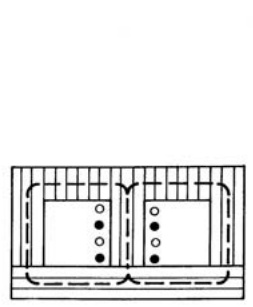

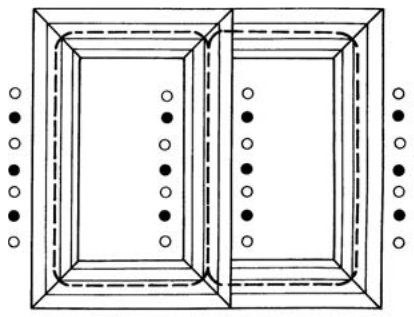

(a)

(b)

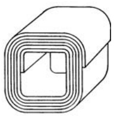

(c)

Fig. 13.16 Transformer cores. Open and closed circles represent primary and secondary windings; parallel lines denote rolling direction of sheet material.

The magnetic properties of sheet steel are degraded to some extent by mechanical deformation, so usually the sheets are given a stress-relief anneal at about 8008C in a protective atmosphere after any shearing or punching operations. During actual construction of a transformer, care must be exercised so minimize strains introduced into the sheets by handling and assembly.

ASTM International (formerly the American Society for Testing and Materials) has established a standard specification system for electrical steels. It is based on a minimum core loss value, and does not explicitly define the alloy content. Each grade of steel is identified by a number that consists of two digits, followed by a single letter, followed by three digits, such as 35H056. The first two digits specify the sheet thickness in units of 0.01 mm, so 35 means 0.35 mm thick material. The letter specifies a class of material, including the magnetic flux density at which the core loss is measured. The final three digits specify the maximum core loss, in watt/pound (with a decimal point added after the first digit), at 60 Hz. Only a limited range of thicknesses and loss values are regarded as standard, and for these a table gives equivalent thicknesses in inches, loss in watt/kg, and also loss at 50 Hz. The International Electrotechnical Commission (IEC) publishes a similar system as an international standard. Table 13.2 gives some representative values of core loss in electrical steels.

## 13.4.4 Six Percent Silicon Steel

The upper limit of silicon content in steel produced by normal production techniques is about 3.25%. Higher silicon contents make the steel too brittle to be cold-rolled into sheet. However, a higher silicon content would increase electrical resistivity and decrease magnetic anisotropy, at the cost of somewhat lower magnetic saturation. Various methods have been investigated to produce silicon contents above 3.25%; usually 6% silicon is the goal. Very thin sheet can be frozen directly from the liquid by planar flow casting, the same method used to make amorphous alloys (see Section 13.5.2). Or silicon can be added to the surface of a conventional 3% silicon steel by electrolysis, direct vapor deposition, or chemical vapor deposition, and then diffused into the sheet in a hightemperature anneal. The diffusion step is naturally easier and faster in very thin sheet material. None of these possible methods has led to commercial production of this material.

TABLE 13.2 Properties of Some Electrical Steels. Losses Measured at 60 Hz

|  | ASTM | Thickness, | Thickness, | Maximum | Loss, | Loss, |
| --- | --- | --- | --- | --- | --- | --- |
| Category | no. | 0.001 inch | mm | B, kG | W/lb | W/kg |
| Lamination steel | 47D17579D610 | 18.531 | 0.470.79 | 1515 | 1.756.10 | 3.8513.4 |
| Grain-oriented | 18G041 | 0.007 | 0.18 | 15 | 0.41 | 0.90 |
| (GO) electrical | 35G066 | 0.0138 | 0.35 | 15 | 0.66 | 1.46 |
| steel |  |  |  |  |  |  |
| GO high- | 23P060 | 0.009 | 0.23 | 17 | 0.60 | 1.32 |
| permeability | 27P066 | 0.106 | 0.27 | 17 | 0.66 | 1.46 |
| electrical steel |  |  |  |  |  |  |
| GO high- | 23Q054 | 0.009 | 0.23 | 17 | 0.54 | 1.19 |
| permeability | 27Q057 | 0.106 | 0.27 | 17 | 0.58 | 1.28 |
| laser-scribed |  |  |  |  |  |  |
| electrical steel |  |  |  |  |  |  |

## 13.4.5 General

We consider here several points of general importance in the application of electrical sheet steel.

Lamination Insulation The sheets that make up a core must be electrically insulated from one another to prevent large-scale eddy-current circulation in the core. The sheets may be coated with an organic varnish, but this will not withstand stress-relief annealing. More usually the insulation is simply a film of tightly adherent iron oxide, formed by means of a slightly oxidizing annealing atmosphere. Grain-oriented steel is often coated with MgO powder before the high-temperature anneal. This combines with $\mathrm{SiO}_{2}$ from the silicon in the steel to form a glassy magnesium silicate. This not only acts as an insulator but, having a smaller coefficient of thermal contraction, tends to put the steel in tension when the coated steel has cooled to room temperature. As a result, core losses decrease. The residual tensile stress is predominantly longitudinal, tending to form $180^{\circ}$ domain walls parallel to the rolling direction.

Cooling Both the core and copper losses show up as heat in the device. Core loss alone can lead to a temperature rise of the order of $0.2-1.5^{\circ}\mathrm{C}/\mathrm{min}$ , if all the generated heat remains in the core (Problem 13.4). Transformers are more difficult to cool than motors or generators. The spinning rotor of a motor or generator acts to circulate cooling air, and fan blades can be placed on the shaft to increase the air flow. Small transformers, such as are used in consumer electronics, need no forced cooling. Larger transformers, rated at 1 kW or above, are usually mounted in a tank filled with oil so that convection currents bring heat out to the tank surface. The tank may be fitted with cooling fins or tubes, and sometimes with auxiliary fans to provide additional air flow. In some transformers, core losses are required to be low, not to increase electrical efficiency but simply to minimize heat generation. This is accomplished by using a lower-loss grade of electrical steel, or reducing the flux density, or using heavier copper windings, or some combination of these.

Noise Transformer “hum” is due to magnetostrictive vibration of the core and to the motion of the laminations as the material is alternately magnetized and demagnetized. This noise, whose basic frequency is twice the line frequency, becomes objectionable when large transformers are near residential areas, and transformer manufacturers have made considerable efforts to reduce noise. The magnetostriction of grain-oriented sheet in the rolling direction is remarkably low, sometimes positive and sometimes negative, as shown in Fig. 13.17. Since $\lambda_{100}$ is about $23\times10^{-6}$ for 3.2% Si–Fe, the low values indicated in Fig. 13.17 mean that magnetization occurs mainly by the motion of $180^{\circ}$ domain walls. This is expected from the observed domain structure in grain-oriented material. The tensile stress provided by the glassy surface coating also favors $180^{\circ}$ domain walls aligned in the direction of magnetization.

Stacking Factor The need to use soft magnetic material in the form of stacks of relatively thin sheets, each with an electrically insulating surface layer, means that in a magnetic device a fraction of the volume is not magnetic material, but is empty space and electrical insulation. This decrease in the effective density of magnetic material is expressed by the stacking factor (ASTM uses the term lamination factor), a number less than unity which is the fraction of the stack area that is composed of magnetic material. The stacking factor decreases for very thin sheets, for sheets of nonuniform thickness, and for heavy insulating coatings.

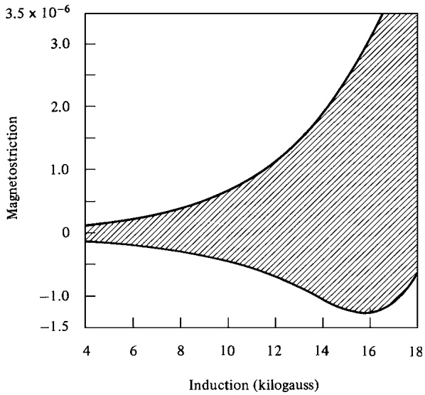

Fig. 13.17 Limits of static longitudinal magnetostriction as a function of induction for several grades and thicknesses of grain-oriented silicon steel sheet. Data from U.S. Steel.

Loss Reduction Improvements in the magnetic properties of grain-oriented steel have come about largely though increases in the degree of texture formation by increased purity and careful control of critical alloying additions. Improved texture is usually accompanied by larger grains, and very large grains are a cause of increased losses, because of the large domain size. Then some form of surface treatment, such as laser scribing, may be used to increase the number of domain walls. Losses have also been reduced by decreasing the thickness of the laminations. At one time, 0.014 inch or 0.36 mm was a standard thickness; now (in 2007) 0.007 inch or 0.175 mm sheet is produced and used.

## 13.5 SPECIAL ALLOYS

These are mainly nickel –iron alloys containing either about 50 or 80% Ni, known generically as permalloys. This is a former trade name, but is now used for any Ni – Fe alloy. If a number precedes the name (79 permalloy), it denotes the Ni content. The permalloys have high permeability in low fields and low losses, and can be rolled to very small thicknesses. They are the materials of choice when excellent magnetic properties are required, and cost is not the primary consideration. The alloys were developed as commercial materials for use in the telephone system, mainly in the period 1913 – 1921, and are described fully in Bozorth’s book Ferromagnetism. There has been relatively little change or improvement in these materials for the last 50 years, although better manufacturing methods have increased purity and permeability to some degree. Permalloys are made and sold under a variety of trade names.

The equilibrium diagram of the iron – nickel system has been given in Fig. 10.1 and discussed in Section 10.2. In the range of 50 – 80% Ni the alloys are all face-centered cubic. At and near the composition $\mathrm{FeNi}_{3}$ the alloys can undergo long-range ordering below a temperature of $503^{\circ}\mathrm{C}$ The ordered unit cell is shown in Fig. 10.6. The magnetic properties of the ordered alloys are inferior to those of the disordered. The disorder-to-order transformation is fortunately sluggish and can be avoided simply by fairly rapid cooling through the $500-400^{\circ}\mathrm{C}$ range; water quenching is unnecessary.

The variation of saturation magnetization and Curie temperature with composition is shown in Fig. 13.18. Alloys near 30% Ni contain two phases, bcc a and fcc g. The phase mixture, and the resulting magnetic and other properties, depend very strongly on the composition, impurity level, and thermal history of the sample.

Figure 13.18 also shows the variation of the magnetocrystalline anisotropy, and $K_{1}$ is seen to pass through zero at about 75% Ni. The magnetostriction constants are given in Fig. 13.19. The value of $\lambda_{100}$ is zero at two compositions, near 46 and 83% Ni, while $\lambda_{111}$ is zero at about 80%. (The solid lines denote alloys given a normal furnace cool and correspond to “the more-nearly disordered state.” The dashed line denotes alloys cooled at $1.2^{\circ}\mathrm{C}/\mathrm{h}$ , corresponding to “the more-nearly ordered state.” The course of these two branches of the $\lambda_{111}$ curve suggest that both cooling rates have produced nearly the same state, the disordered state, because the results are in good agreement with those of Bozorth for quenched alloys.) Note also that the magnetostriction becomes isotropic $(\lambda_{100} = \lambda_{111})$ near 60 and 86% Ni.

We expect high permeability when K and $\lambda$ are small. A low value of K decreases domain-wall energy and increases domain wall thickness, so that inclusions become less effective hindrances to wall motion. A low value of $\lambda$ means that microstress becomes similarly less effective. Figure 13.19 shows that both $K_{1}$ and $\lambda_{111}$ are near zero just below 80% Ni, and $\lambda_{100}$ is not very large. This is the composition of 78 permalloy, and Fig. 13.20 shows the remarkable effect of heat treatment on the maximum permeability of this alloy.

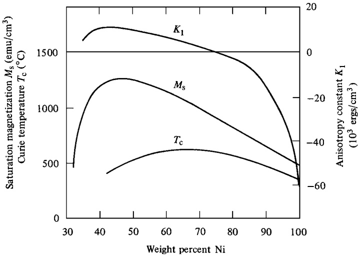

Fig. 13.18 Iron –nickel alloys. Variation with nickel content of saturation magnetization $M_{\mathrm{s}}$ Curie temperature $T_{c}$ , and magnetocrystalline anisotropy $K_{1}$ (quenched alloys). [R. M. Bozorth, Ferromagnetism, reprinted by IEEE Press (1993).]

The maxima in μ near 50 and 80% Ni are due to near-zero values of $K_{1}$ and/or l. Note that it is the value of $\lambda$ in the easy direction of magnetization that determines the effect of microstress on wall motion; near 50% Ni, the value of $K_{1}$ is positive, <100> are easy directions, and $\lambda_{100}$ is zero; at 80% Ni the value of $K_{1}$ is negative, <111> are easy directions, and $\lambda_{111}$ is zero.

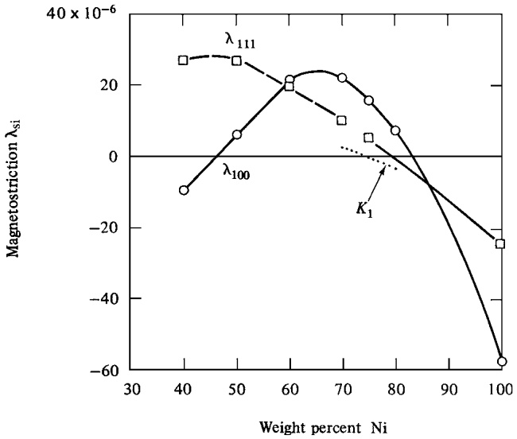

Fig. 13.19 Iron –nickel alloys. Variation of saturation magnetostriction with nickel content. See text for details. The dotted line shows $K_{1}$ from Fig. 13.18. [Data from R. C. Hall, J. Appl. Phys., 30 (1959) p. 816.]

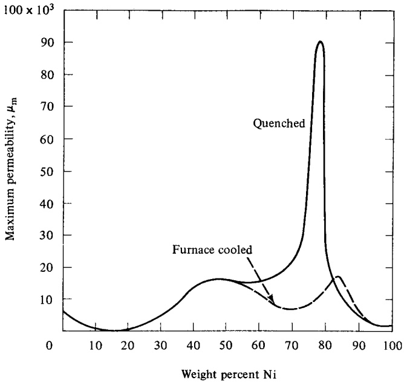

Fig. 13.20 Maximum permeabilities of iron –nickel alloys.

The great sensitivity of 78 permalloy to heat treatment is due to the variation of $K_{1},$ which has a value of about -2000 ergs/cm³ after quenching and -18,000 ergs/cm³ after slow cooling; the values of $\lambda_{100}$ and $\lambda_{111}$ change hardly at all with heat treatment. Slow cooling or annealing below $500^{\circ}\mathrm{C}$ produce partial long-range order, which has a larger effect on $K_{1}$ than on l. Ordering is usually detected by X-ray diffraction, but this technique has limited utility in the case of Fe –Ni alloys because Fe and Ni are near neighbors in the periodic table and have almost the same scattering power for X-rays. Neutron diffraction, however, does not suffer from this limitation.

The soft magnetic properties of all the permalloys can be improved, in some cases dramatically, by a long high-temperature (1000°C) treatment in hydrogen to remove impurities such as C and S. This is a costly process, rarely used for commercial material. The electrical resistivity is increased, and heat treatment made less critical, by small additions of nonmagnetic elements, usually Mo, Cu, and/or Cr.

The 50 permalloy alloys have higher saturation magnetization, but the 78 permalloys have higher permeability and lower coercive field. Similar but not identical materials of both families are made under various trade names. As fiber optics have replaced copper in long-distance telephony, the production of permalloy, as well as the number of manufacturers, has decreased. However, a large number of uses remain, including ground fault interrupters (which protect people from electrical shock) and magnetic shielding.

The cube texture is fairly easy to produce in 50 permalloys by primary recrystallization after heavy cold rolling. The result is a square hysteresis loop, and such materials are produced under a variety of trade names.

A constant value of permeability over some range of applied field is a requirement for some specialized applications. An alloy called Isoperm was developed in Germany by making a cube-textured 50 Fe – 50 Ni alloy and then cold rolling it to a 50% reduction in thickness. The resulting material has an easy axis in the transverse direction, as described in Section 10.5. Along the hard-axis rolling direction the permeability is low (100 or less) and constant. A range of Ni –Fe –Co ternary alloys, of which the original was 25 Co, 45 Ni, 30 Fe, develop relatively strong anisotropy when annealed in a magnetic field. When these alloys are annealed in the demagnetized state, the domain walls are strongly pinned, as described in 10.2. Over the range of $H$ and $M$ where the wall motion is reversible, the permeability is almost constant and reasonably high, approaching a value of 1000. These alloys are called Perminvars, for invariant permeability.

## 13.5.1 Iron –Cobalt Alloys

Cobalt is the only alloying element that substantially increases the Curie temperature and the saturation magnetization of iron. The alloys from about 30 to 50% Co all have roomtemperature saturation magnetization about 10% higher than iron, and Curie temperatures limited by a bcc to fcc phase transformation just under $1000^{\circ}\mathrm{C}$ The 50 – 50 alloy, sold under various names, has low anisotropy and relatively high permeability, but quickly develops long-range order which makes it brittle. The addition of 2% V slows the ordering and allows the resulting alloy to be rolled into sheet form after rapid cooling from above the ordering temperature. Lower cobalt content alloys have less desirable soft magnetic properties, but cost less. The Fe –Co alloys are used where the highest saturation magnetization and/or a high Curie point is important: in the pole pieces of electromagnets, in beam-focusing lenses for electron microscopes, and in aircraft motors, generators, and transformers operating usually at 400 Hz.

## 13.5.2 Amorphous and Nanocrystalline Alloys

In the 1960s, it was discovered that certain families of alloys, when cooled from the liquid state at very high cooling rates, solidified as noncrystalline materials. These became known as amorphous alloys or metallic glasses. The usual production method is called melt spinning: a jet of liquid metal alloy is forced through a small nozzle by gas pressure onto a rapidly rotating metal wheel, where it flattens to a thin strip, loses heat to the wheel, solidifies, and is thrown from the wheel by centrifugal force. The cooling rate is estimated to be in the range $10^{5}-10^{6}\mathrm{K/sec}$ . The product resulting from this simple apparatus is a ribbon a few millimeters wide, 25–35 μm thick, and meters to kilometers in length. If the process is carried out in air, the wheel side of the ribbon typically contains elongated depressions attributed to air bubbles trapped between the melt and the wheel; these can be largely eliminated by casting in vacuum. With special nozzles and casting techniques, known as planar flow casting, strip widths of several inches can be attained.

The alloys of magnetic importance contain about 80 atom% $\mathrm{Fe} + \mathrm{Ni} + \mathrm{Co}$ and 20 atom% metalloid or glass-forming elements, mostly $B$ and Si. The compositions generally correspond to a low melting point eutectic when the alloy is cooled at normal rates. Maximum saturation magnetization is in the range 15–19 kG (1.5–1.9 T) , magnetic anisotropy is very low, and magnetostriction is $20-30\times10^{-6}$ except in alloys containing mostly Co, where it is low or slightly negative. Electrical resistivity is very high for metallic materials, generally over 100 μΩ-cm . In the as-cast state the alloys are very strong and hard, but also ductile.

The soft magnetic properties are substantially improved by a low-temperature anneal (300-400°C) , and if the anneal is carried out in a magnetic field a significant anisotropy can be induced. In this condition the alloys have outstanding low-frequency soft magnetic properties, equal to or better than the best permalloys. However, the annealing treatment makes the material brittle, and needs to be the final step in processing. The losses under ac excitation are also higher than expected from the dc properties, because of the large domain size resulting from the absence of grain boundaries. Various methods have been used to refine the domain size, such as deliberately including small nonmagnetic particles as domain nuclei, and annealing to produce an array of small crystallites for the same purpose.

A related class of nanocrystalline magnetic materials is made by adding small amounts of Cu and Nb to an Fe –Si –B amorphous alloy. The most-studied composition is $\mathrm{Fe_{74}Si_{15}B_7Cu_1Nb_3}$ . The Cu is believed to enhance nucleation of crystallites and the Nb to inhibit their growth. The amorphous alloy is annealed at about $550^{\circ}\mathrm{C}$ for 60 min, which results in an array of magnetic $\mathrm{Fe}_{3}\mathrm{Si}$ nanoparticles, 10 – 15 nm in diameter, in a magnetic amorphous matrix. The soft magnetic properties are outstanding, but the material is extremely brittle.

The largest use of amorphous alloys is in low-loss transformers up to several kilowatts in power capacity. Their use is economically justified in locations where fuel costs are high. Amorphous alloys are also used in antitheft systems, which are discussed later.

More recently, a range of alloy compositions has been found that can be made amorphous in bulk, by freezing the liquid in a mold of high thermal conductivity. Some of these alloys can be made amorphous in thicknesses up to several centimeters. Only a few of these alloy families are strongly magnetic, and their usefulness as industrial magnetic materials remains to be seen.

## 13.5.3 Temperature Compensation Alloys

Materials with Curie temperature just above room temperature have a strong temperature dependence of saturation magnetization. This behavior can be used to correct for the temperature dependence of permanent magnet materials. The technique is to use a strip of the compensation alloy to divert or “shunt” part of the flux away from the working region of the magnet. As the temperature increases, the shunt becomes less effective, so more flux passes through the working space; this offsets the decrease in flux due to the temperature increase in the permanent magnet material. Nickel –iron alloys near 30% Ni can be used as compensator alloys, as can certain Ni –Cu alloys. The geometry of permanent magnet designs using high-coercivity ferrites and rare-earth magnets makes the use of magnetic shunts more difficult than in designs using Alnico magnets.

## 13.5.4 Uses of Soft Magnetic Materials

The magnetically soft special alloys are used mainly in the form of cores, of varying shape and with external diameters from several inches to less than 0.25 inch (10 – 0.5 cm). They can be of three forms (Fig. 13.21). In stacked laminations the flux travels in all possible directions in relation to the original rolling direction of the sheet from which the laminations were cut; only the average magnetic properties in the plane of the sheet are of interest. In contrast, the flux in a tape-wound core travels only in the rolling direction of the strip (tape). To minimize core losses, the tape should be thinner the higher the frequency;

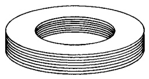

(a) Stacked laminations

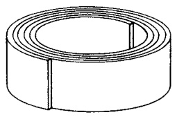

(b) Tape-wound core

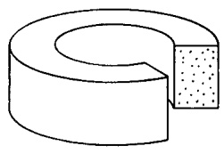

(c) Powder core

Fig. 13.21 Types of cores. The powder core has been sectioned to indicate its internal structure.

tape-wound cores are available made from material ranging from 0.014 to 0.000125 inch (0.36 – 0.0032 mm) thick. Powder (dust) cores are made of iron powder or iron-nickel alloy powder, about 50 –100 mm in diameter and therefore multidomain, each particle electrically insulated by a suitable coating, and the whole pressed into a solid form, often a ring. Powder cores are intended for high-frequency applications, up to about 100 kHz. At these frequencies, losses would be intolerable in bulk metallic materials, but subdivision of the metal into fine powder effectively eliminates the eddy currents that cause the loss. This result is achieved at the expense of a very large decrease in permeability, to values of the order of 10 – 100, even when the powder is made of high-permeability alloy particles. The reason is simply that each particle is effectively surrounded by an “air gap” of insulating material, and the internal demagnetizing fields are therefore large. As a result the hysteresis loop is sheared over, resembling Fig. 9.43b, and the permeability becomes constant over a considerable range of field. At still higher frequencies, in the megahertz range, ferrite cores have better properties than any metal powder cores because of their inherently high electrical resistivity. The major applications of soft magnetic alloys are the following.

Special Transformers Permalloy-type or amorphous alloys are used as transformer cores in cases where high permeability, low losses, or constant permeability are required. A case of special importance is the transformer used in ground-fault interrupters, which are circuit breakers designed to cut off power to a device if a potentially dangerous amount of current is leaking to ground. Both the current supply wire and the return wire pass through the core of a miniature transformer, and act as the primary winding (see Fig. 13.22). If there is no leakage current in the device, the two currents are equal and opposite, so no field is applied to the core and no flux change occurs. If there is a leakage current, the supply current is greater than the return current, and the net current applies a nonzero ac field to the core. This generates a voltage in the secondary winding, which opens the circuit. An unbalanced current of 5 mA, corresponding to a power of 0.6 watt at 120 V, trips the circuit breaker.

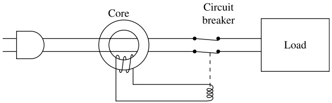

Fig. 13.22 Ground-fault interrupter circuit (schematic). If the current to the load is not equal to the current from the load, a signal voltage appears on the sensor winding and trips the circuit breaker.

For frequencies above the kilohertz region, metallic materials are generally unsuitable, and magnetic oxides (ferrites or garnets) are used instead. These have much lower magnetization values than metallic materials, but are electrical insulators and so do not undergo eddy-current heating and need not be laminated. There are loss mechanisms in these materials as well, so they do have frequency limitations.

Magnetic Shielding Many electronic devices need to be shielded from unwanted ac and dc magnetic fields, and permalloy-type alloys are used for this purpose. A practical problem is that the shielding is often required to have a complex shape, and the optimum soft magnetic properties are degraded by mechanical deformation. For best results, the shielding material must be given a high-temperature anneal after being formed into its final shape.

Sensitive Relays $A$ relay is a control device consisting of a small electromagnet which, when energized by a current in its winding, attracts a piece of magnetic material, thus operating a switch in another circuit. Most relay cores are made of low-carbon steel, but sensitive, fast-acting types have high permeability cores that can be activated by a small control current.

A variant of the usual relay is the reed switch or reed relay. It consists of two narrow strips (reeds) of permalloy sealed into opposite ends of a glass tube, with the ends of the strips within the tube overlapping by a small amount but not touching (see Fig. 13.23). The strips form part of an electrical circuit, which is closed when the overlapping ends of the strips touch and open when they are apart. When the strips are magnetized by an external coil or a permanent magnet, the ends of the strips attract one another and close the circuit. The space inside the glass tube is evacuated or filled with an inert gas, so the strips are protected against oxidation. Reed relays are inexpensive and reliable, but are limited to switching small currents.

Fluxgate Magnetometers These are instruments for accurate measurement of fields comparable in magnitude to the Earth’s field. They are used for geomagnetic surveys, magnetic prospecting, archeological surveying, and as sensors in feedback systems to cancel the Earth’s field in an experimental space. In its simplest form (Fig. 13.24), the fluxgate magnetometer consists of a thin strip or wire of a high-permeability soft magnetic material, placed inside two concentric solenoids. An ac current in the drive winding drives the strip to positive and negative saturation, and the sense winding picks up the dB/dt voltage signal. If there is no external dc field along the length of the strip, the positive and negative voltage pulses are equally spaced, but if there is a parallel applied field, the pulses become unevenly spaced. If the drive field is a triangular wave, the change in pulse spacing is proportional to the applied field and gives a direct measure of this field. The device can also be operated as a null detector: a third concentric coil is provided, and a dc current in this coil is used to cancel the (unknown) applied field and return the pulses to equal spacing. The field produced by this canceling coil can be calculated

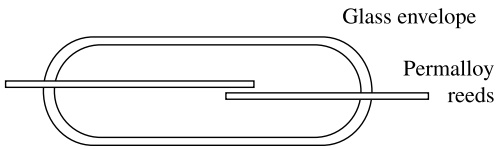

Fig. 13.23 Reed relay.

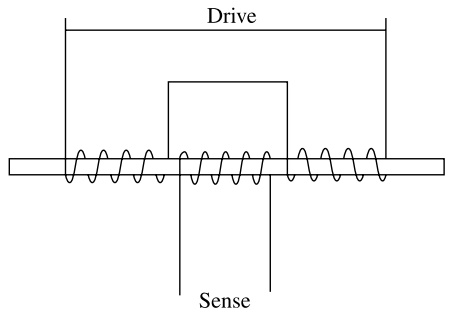

(a)

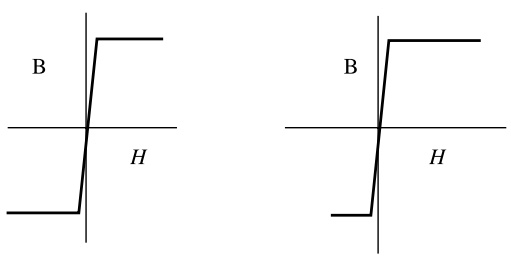

(b)

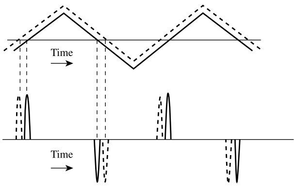

(c)

Fig. 13.24 Simple form of fluxgate magnetometer. (a) High-permeability strip or wire with drive coil and sense coil; (b) idealized hysteresis loops in zero applied field (left) and positive applied field (right); (c) upper curve is triangular current vs time in drive coil, lower curve is resulting dB/dt signal in sense coil, both on the same time axis. Solid lines correspond to zero applied field, dashed lines to small positive applied field.

exactly from its length, current, and number of turns, and is equal and opposite to the unknown applied field. The fluxgate magnetometer measures just the component of the magnetic field parallel to the axis of the device, which is sometimes an advantage, sometimes not. Various elaborations of the fluxgate magnetometer design have been proposed and built, some of which use alternate detection systems. All are limited to the measurement of low fields, typically 1 or 2 Oe (80 or 160 A/m) maximum, by heating in the drive coil or the canceling coil.

Antitheft Systems One class of antitheft, or antishoplifting, system uses a short length of high-permeability ribbon or wire as the tag or target which is attached to the article to be protected. When the article, and the tag, are carried through a detection gate they are subjected to an ac field in the kilohertz frequency range, which magnetizes the tag. The ac field of the tag (or sometimes the acoustic signal due to its magnetostriction) is detected and used to activate an alarm. If the article has been paid for, the tag is deactivated, usually by causing it to be permanently magnetized by an adjacent strip of permanent magnet material. Permalloys and amorphous alloys are both used to make the tags, which must be very low in cost.

## 13.6 SOFT FERRITES

The magnetically soft ferrites first came into commercial production in 1948. Their many applications will be briefly examined here, as well as the methods of making ferrites and the effects of such variables as porosity and grain size on their magnetic properties.

The soft ferrites have a cubic crystal structure and the general formula MO . $\mathrm{Fe_{2}O_{3}}$ where $M$ is a divalent metal such as Mg, Mn, or Ni. Nonmagnetic Zn ferrite is often added to increase $M_{\mathrm{s}}$ (Section 6.3) and all the commercial ferrites are mixed ferrites (solid solutions of one ferrite in another). The intrinsic properties of the pure ferrites have been given in Table 6.4. Their densities are a little over $5\mathrm{g/cm^{3}}$ , Curie points range from about 300 to 6008C, and $M_{\mathrm{s}}$ from about 100 to 500 emu $/cm^{3}$ (100 – 500 kA/ m). Almost all of them have <111> easy directions of magnetization, low magnetocrystalline anisotropy, and low to moderate magnetostriction.

The ferrites are distinctly inferior to magnetic metals and alloys for applications involving static or moderate-frequency (power-frequency) fields, because they have $M_{\mathrm{s}}$ values less than a third of iron and its alloys and far lower de permeabilities. But the outstanding fact about the ferrites is that they combine extremely high electrical resistivity with reasonably good magnetic properties. This means that they can operate with virtually no eddy-current loss at high frequencies, where metal cores, even those made of extremely thin tape or fine particles, would be useless. This fact accounts for virtually all the applications of soft ferrites.

Ferrites are made in the following way:

1. Starting Material. Ferric oxide $\mathrm{Fe_{2}O_{3}}$ and whatever oxides MO are required, in powder form. Metal carbonates may also be used; during the later firing, $CO_{2}$ will be given off and they will be converted to oxides.

2. Grinding. Prolonged wet grinding of the powder mixture in steel ball mills produces good mixing and a smaller particle size, which in turn decreases the porosity of the final product. After grinding, the water is removed in a filter press, and the ferrite is loosely pressed into blocks and dried.

3. Presintering. This is done in air, and the temperature goes up to about $1000^{\circ}\mathrm{C}$ and down to $200^{\circ}\mathrm{C}$ in about 20 h. In this step at least partial formation of the ferrite takes place: $\mathrm{MO} + \mathrm{Fe}_2\mathrm{O}_3 \rightarrow \mathrm{MO} \cdot \mathrm{Fe}_2\mathrm{O}_3$ . This step produces a more uniform final product and reduces the shrinkage that occurs during final sintering.

4. Grinding. The material is ground again to promote mixing of any unreacted oxides and to reduce the particle size.

5. Pressing or Extrusion. The dry powder is mixed with an organic binder and formed into its final shape. Most shapes, such as toroidal cores, are pressed (at $1 - 10\mathrm{ton / in}^2$ 14 –140 MPa), but rods and tubes are extruded.

6. Sintering. This is the final and critical step. The heating and cooling cycle typically extends over 8 h or more, during which the temperature reaches 1200-1400°C . Any unreacted oxides form ferrite, interdiffusion occurs between adjacent particles so that they stick (sinter) together, and porosity is reduced by the diffusion of vacancies to the surface of the part. Strict control of the furnace temperature and atmosphere is very important, because these variables have marked effects on the magnetic properties of the product. Ideally, the partial pressure of oxygen in the furnace atmosphere should equal the equilibrium oxygen pressure of the ferrite, which changes with temperature. Iron and some other ions can exist in more than one valency state; too little oxygen, then, will change $\mathrm{Fe}^{3+}$ to $\mathrm{Fe}^{2+}$ and too much will change $\mathrm{Mn}^{2+}$ , for example, to $\mathrm{Mn}^{3+}$

The final product is a hard and brittle ceramic, so hard that smooth flat surfaces can only be produced by grinding. During sintering, all linear dimensions of a part shrink from 10 to 25%, and allowance for this must be made in designing the pressing mold or extrusion die.

The grain size of commercial ferrites ranges from about 5 to 40 μm , and as is true of most sintered products, metallic or nonmetallic, they are not completely dense. The percentage porosity is defined as $100(\rho_{x}-\rho_{a})/\rho_{x}$ , where $\rho_{a}$ is the apparent density and $\rho_{x}$ the true density in the absence of porosity. The true density is the mass of all the atoms in the unit cell divided by the volume of the unit cell. The cell volume is in turn found from the cell dimensions measured by X-ray diffraction. The density determined in this way is sometimes called the “X-ray density.” The porosity in ferrites can range from about 1 to 50%; a more typical range is 5 –25%. Figure 13.25 shows how an increase in sintering temperature increases the grain size and decreases the porosity; the black areas are voids. Permeability increases as the grains become larger and as the porosity decreases. The grain-size effect is the stronger of the two. Porosity at the grain boundaries is less damaging to the permeability than porosity within the grains, because boundary porosity causes less hindrance to domain wall motion. Both kinds of porosity can be seen in Fig. 13.25.

It is not easy to perform clear-cut experiments on ferrites to isolate the effect of a single variable. A mixed ferrite like (Mn, $\mathrm{Zn)O\cdot Fe_{2}O_{3}}$ is a complex system; it contains, or can contain, six kinds of ions: $\mathrm{Mn}^{2+}$ $\mathrm{Mn}^{3+}$ $\mathrm{Zn^{2+}}$ $\mathrm{Fe}^{2+}, \mathrm{Fe}^{3+}$ , and $O^{2-}$ . The oxygen content of the sintering atmosphere can not only change the valence of some of these ions but also alter the stoichiometry, by creating oxygen or metal-ion vacancies in the lattice. And variations in sintering temperature or time normally cause simultaneous changes in both grain size and porosity.

Commercial ferrites are sold under various trade names. Manufacturers rarely give the chemical composition of their products, preferring instead to specify the magnetic properties; these are adjustable over a rather wide range by varying the composition and the sintering conditions. Two broad classes of ferrites are produced:

1. Mn–Zn Ferrites. These have initial permeabilities of the order of 1000– 2000, coercivities of less than 1 Oe, and are usable without serious losses up to frequencies of about 1 MHz. Resistivity is about 20 – 100 ohm-cm.

2. Ni–Zn Ferrites. These are intended for very high frequency operation, to more than 100 MHz. Initial permeabilities are about 10 – 1000, and coercivities are several oersteds. At the highest frequencies, losses are found to be lower if domain wall motion is inhibited and the magnetization forced to change by rotation. For this reason some grades of Ni-Zn ferrites are deliberately underfired. The resulting porosity interferes with wall motion and decreases both losses and permeability. The Ni-Zn ferrites have very high resistivity, about $10^{5}$ ohm-cm.

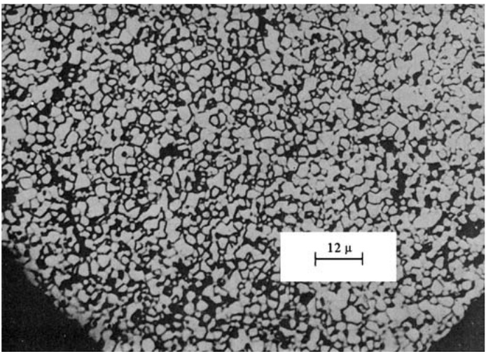

(a)

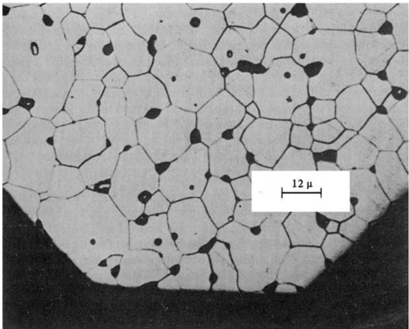

(b)

Fig. 13.25 Microstructure of a Mn – Zn ferrite. (a) After sintering 5 min at $1375^{\circ}\mathrm{C}$ (10% porosity). (b) After sintering 1 min at $1435^{\circ}\mathrm{C}$ (5% porosity). [Figures 13.25, 13.26, and 13.27 are from J. Smit and H. P. J. Wijn, Ferrites, Wiley (1959).]

Both of these main classes of materials contain zinc ferrite. As we saw in Fig. 6.4, the addition of zinc ferrite increases the value of $M_{\mathrm{s}}$ at 0K. It also weakens the exchange interaction between ions on $A$ and $B$ sites, with the result that the Curie point decreases. The curves of $M_{\mathrm{s}}$ (or $\sigma_{\mathrm{s}}$) vs temperature must therefore cross over, as shown in Fig. 13.26 for a series of Mn – Zn ferrites. In any magnetic material it is usual for the initial permeability $\mu_{0}$ to increase with temperature to a maximum just below the Curie point, because the magnetocrystaline anisotropy and magnetostriction normally decrease with rising temperature. This effect is shown for the Mn-Zn ferrites in Fig. 13.27. Not only do zinc additions shift $T_{c}$ and the accompanying peak in $\mu_{i}$ to lower temperatures, but they increase the height of the peak; as a result the room-temperature value of $\mu_{i}$ also increases with the zinc content. Ni-Zn ferrites behave in the same way.

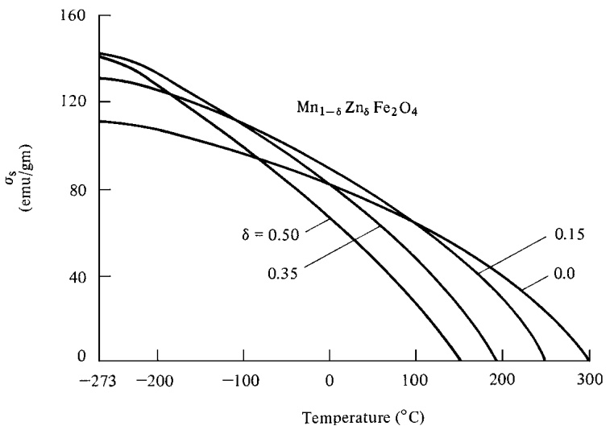

Fig. 13.26 Variation with temperature of the saturation magnetization $\sigma_{s}$ of Mn– Zn ferrites.

Figure 13.28 shows how the initial permeability $\mu_{i}$ varies with frequency in the megahertz range for three different ferrites. The first is a Mn – Zn ferrite of unspecified composition, the second a 50 – 50 mixture of Ni and Zn ferrites, and the third is pure Ni ferrite. The shape of these curves is typical. As the frequency increases, $\mu_{i}$ remains equal to its static (dc) value until a critical frequency is reached and then decreases rapidly, as may be seen more clearly if the data are plotted on linear rather than logarithmic scales. The larger the static value of $\mu_{i}$ the lower is the frequency at which this decrease occurs. Therefore, if a particular ferrite core must have constant inductance, which requires constant permeability, at all frequencies up to several hundred megahertz, there is no option but to choose a material with low permeability.

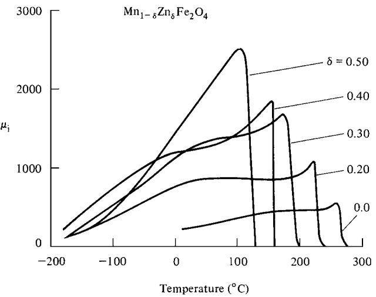

Fig. 13.27 Variation with temperature of the initial permeability $\mu_{\mathrm{i}}$ of Mn– Zn ferrites. These specimens also contain a small ferrous $(\mathrm{Fe}^{2+})$ ion content.

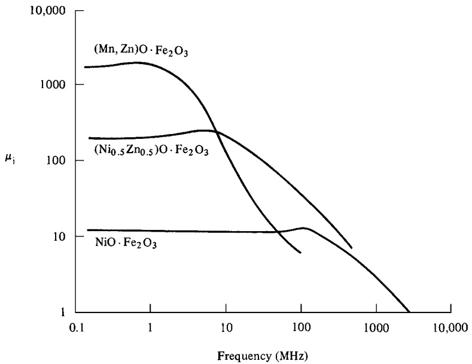

Fig. 13.28 Variation of initial permeability $\mu_{i}$ with frequency for three ferrites.

The decrease in $\mu_{i}$ at a particular frequency is due to the onset of ferrimagnetic resonance. As mentioned in Section 12.7, electron spin resonance can occur in ferrimagnetics and is normally studied by applying a strong field to wipe out the domain structure and align the magnetization throughout the specimen with the easy axis. The spins then precess about this axis. But in a multidomain ferrite with no applied field, the spins are still precessing about the easy axis, which is the Ms direction, in each domain. The frequency of this precession depends on how strongly the magnetization is bound to the easy axis; the stronger the coupling, the higher is the natural frequency of precession. The strength of this coupling is described by the value of the magnetocrystalline anisotropy K or by the anisotropy field $H_{K}$ which is proportional to K.

Suppose that the natural frequency of this spin precession is 1 MHz for a particular ferrite. Suppose also that the material is now exposed to a weak alternating field $H$ of frequency, say, 60 Hz. Then the induction $B$ developed in each cycle is governed by $H$ and the initial permeability $\mu_{i}$ (High-frequency ferrites are usually operated at low fields, which is why we are mainly interested in the initial permeability.) Let the drive frequency now be increased to, say, 1 kHz. The value of $\mu_{i}$ will remain the same, because of the great disparity between the drive frequency and the precession frequency. But when the drive frequency reaches 1 MHz, the two frequencies are matched and the precessing spins absorb power from the drive field. As a result the induction $B$ produced in each cycle decreases, which means that $\mu_{i}$ decreases. Now the static value of $\mu_{i}$ is generally higher, the lower the value of K, or $H_{\mathrm{K}}$ . A low value of $H_{\mathrm{K}}$ means a low precession frequency. We therefore expect that $\mu_{i}$ will begin to decrease at a lower frequency if $\mu_{i}$ is large than if $\mu_{\mathrm{i}}$ is small, in agreement with experiment (Fig. 13.28). This argument implies that spin resonance is the only loss mechanism in ferrites. This is not quite true, but the theory outlined does explain the general features of ferrite behavior.

When losses occur, $B$ lags behind $H$ in time, and the permeability becomes a complex number that can be written $\mu = \mu^{\prime} - i\mu^{\prime \prime}$ , where $\mu'$ is the real part (B in phase with $H$ ) and $\mu^{\prime \prime}$ the imaginary part (B $90^{\circ}$ out of phase). It is the real part $\mu'$ which is plotted in Fig. 13.28. The imaginary part $\mu''$ is very small until $\mu'$ begins to decrease. Then $\mu''$ and the losses increase.

The high-frequency applications of soft ferrites are mainly as cores for special transformers or inductors. Certain communication equipment requires broadband transformers; as the name implies, they must have cores that show the same behavior over a broad range of frequencies. Another application is in pulse transformers. Because the Fourier components of a square pulse extend over a wide range of frequencies; excessive distortion of the pulse shape occurs if the permeability of the core varies with frequency.

Built-in ferrite antennas are much used in modern radio receivers. Such an antenna is merely a ferrite rod wound with a coil. It responds to the magnetic component of the incident electromagnetic wave, and the alternating flux in the ferrite induces an emf in the coil; the ferrite core in effect multiplies the area enclosed by the coil by a factor equal to the permeability.

Finally, there are important microwave applications of ferrites, both in communications and in radar circuits. These involve frequencies of some $10^{10}$ Hz and fundamental effects not considered in this book.

## PROBLEMS

13.1 Verify the point at the center of the third curve from the left of Fig. 13.2 by showing that $B_{x} / B_{0} = 0.46$ at the center of the sheet.

13.2 Calculate the field penetration ratio $H_{x}/H_{0}$ at the center of a nickel rod of 1.28 cm diameter for frequencies of 20, 50 and 60 Hz. Take $\mu_{\mathrm{r}} = 100$ and $\rho = 0.95\times 10^{-3}$ ohm m.

13.3 Suppose a solid transformer core is divided into n laminations of equal thickness. Show that the laminated core has a classical eddy-current loss, which is approached if the domain size is small, equal to $1 / n^{2}$ times the loss of the solid core. This would suggest the laminations should be made as thin as possible. Why are very thin laminations, say 1000 nm, not used in practice?

13.4 If the core loss of plain carbon steel sheet is 11.1 W/kg at 15 kG and 60 Hz, what is the temperature rise in $^{\circ}$ C/ min if no heat is lost from the material? The specific heat is 0.113 cal/g °C

