# HARD MAGNETIC MATERIALS

## 14.1 INTRODUCTION

The purpose of a permanent magnet is to provide a magnetic field in a particular volume of space. A magnetic field can be produced by current in a conductor or by poles in a magnet. For many applications a permanent magnet is the better choice, because it provides a constant field without the continuous expenditure of electric power and without the generation of heat. A magnet can be regarded as an energy-storage device. This energy is put into it when it is first magnetized and it remains in the magnet, if properly made and properly handled, indefinitely. In short, the magnetism is permanent. Moreover, the energy of a magnet, which is chiefly the energy of its external field, is always available for use and is not drained away by repeated use, like the energy of a battery, because a magnet does no net work on its surroundings.

The earliest, and for centuries the only, use for a permanent magnet was the needle of a magnetic compass. Today the applications of permanent magnets, in industry, in the home, in the automobile, and in space, form a list so long as to astonish the uninitiated. Loudspeaker magnets form a large part of the market, because of the pervasive use of radio, television, and home and commercial sound systems. Another large market is in small motors, used for many purposes in automobiles: cooling and heating fans, seat and window adjusters, windshield wipers, etc. Very small motors and positioning devices in computers, printers, scanners, and similar devices use magnets of small size but high quality. The fascination of magnetic forces for young and old alike means that there is steady sale of magnetic toys and novelties. A remarkable number of magnets are sold for various magnetic medical therapies, although the evidence for their effectiveness is purely anecdotal.

## 14.2 OPERATION OF PERMANENT MAGNETS

Before considering the materials of which magnets are made, we must examine the conditions under which a magnet operates, in order to determine what material properties are important. Because the only function of a magnet is to provide an external field, it must have free poles. A circumferentially magnetized ring, forming a closed magnetic circuit, produces no external field and so has no practical use. A permanent magnet always operates on open circuit. The resulting free poles create a demagnetizing field $H_{\mathrm{d}}$ which makes the induction lower than the remanence value $B_{r}$ found in a closed ring, a point that was illustrated in Fig. 2.33.

After a magnet is manufactured, a strong field $H_{1}$ is applied to it and removed, causing the induction $B$ to follow the path shown in Fig. 14.1. The operating point P of the magnet is determined by the intersection of the line OC with the second quadrant of the hysteresis loop. This quadrant is called the demagnetization curve of the material. The values of $H_{c}$ and $B_{r}$ and the shape of this curve determine the usefulness of a material as a permanent magnet.

The line OC is called the load line. From Fig. 2.33, its slope is given by

$$
- \frac {(4 \pi - N _ {\mathrm{d}})}{N _ {\mathrm{d}}} [ \mathrm{cgs} ] \quad \text {or} \quad - \frac {(1 - N _ {\mathrm{d}})}{N _ {\mathrm{d}}} [ \mathrm{SI} ],
$$

where $N_{d}$ is the demagnetizing factor of the magnet. Because $N_{d}$ depends on the geometry of the magnet, it can be altered by the magnet designer, who has the freedom to choose the slope of OC and therefore put the operating point P almost anywhere on the demagnetization curve. The question then arises: What is the best operating point P?

Consider the specific case of the gapped ring of Fig. 14.2, which is similar to some actual magnetic circuits. This could be the magnet for a moving-coil meter, with the moving coil located in the air gap. The magnet must provide a field $H_{\mathrm{g}}$ of constant strength in the air gap. The induction in the magnet is $B_{\mathrm{d}}$ which we will now call $B_{\mathrm{m}}$ and the field is $H_{\mathrm{d}}$ which we will now call $H_{\mathrm{m}}$ According to Ampere’s law, Equation 2.55, the line integral of $H$ around the ring of Fig. 14.2 must be zero, because there is no current flowing:

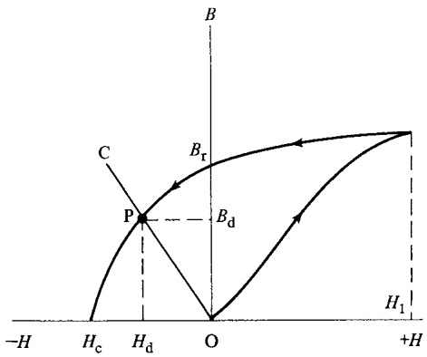

Fig. 14.1 Initial magnetization and demagnetization curve of a permanent magnet. $B_{r}$ is the residual induction; point P is the operating point.

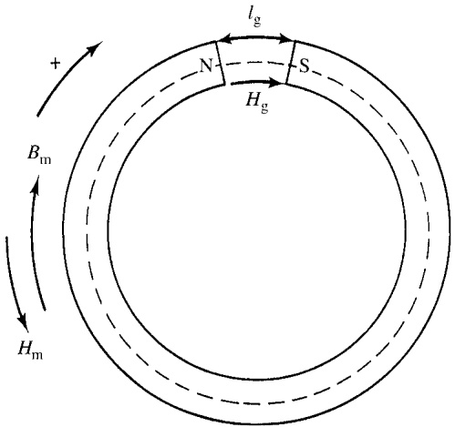

Fig. 14.2 Open magnetic circuit.

$$
\oint H d l = 0,\tag{14.1}
$$

$$
H _ {\mathrm{g}} l _ {\mathrm{g}} - H _ {\mathrm{m}} l _ {\mathrm{m}} = 0,\tag{14.2}
$$

where $l_{\mathrm{m}}$ is the length of the magnet and $l_{\mathrm{g}}$ is the length of the gap. (Note that concept of magnetomotive force, as defined in Section 2.6, here loses most of its meaning, of a force that “drives” magnetic flux in a circuit. In the circuit of Fig. 14.2 the flux φ is everywhere clockwise and positive, but the net magnetomotive force is zero.) The continuity of the lines of $B$ furnishes us with a second equation:

$$
\begin{array}{l} \phi = B _ {\mathrm{g}} A _ {\mathrm{g}} = H _ {\mathrm{g}} A _ {\mathrm{g}} = B _ {\mathrm{m}} A _ {\mathrm{m}} (\mathrm{cgs}) \\ \phi = B _ {\mathrm{g}} A _ {\mathrm{g}} = \mu_ {0} H _ {\mathrm{g}} A _ {\mathrm{g}} = B _ {\mathrm{m}} A _ {\mathrm{m}} (\mathrm{SI}) \end{array}\tag{14.3}
$$

because $B$ = $H$ (cgs) or $\mu_{0}H$ (SI) in the air gap. Here $A_{\mathrm{g}}$ and $A_{\mathrm{m}}$ are the cross-sectional areas of the air gap and the magnet. In Fig. 14.2 these are equal, because fringing (widening) of the flux in the gap is ignored. Generally, however, $A_{g}$ and $A_{\mathrm{m}}$ are unequal, because of fringing flux. The problem of the magnet designer is to choose $l_{\mathrm{m}}$ and $A_{m}$ so as to best use the material.

If Equations 14.2 and 14.3 are each solved for $H_{\mathrm{g}}$ and multiplied together, we find

$$
\begin{array}{c} H _ {\mathrm{g}} ^ {2} = \frac {B _ {\mathrm{m}} H _ {\mathrm{m}} l _ {\mathrm{m}} A _ {\mathrm{m}}}{l _ {\mathrm{g}} A _ {\mathrm{g}}}, \\ H _ {\mathrm{g}} ^ {2} V _ {\mathrm{g}} = (B _ {\mathrm{m}} H _ {\mathrm{m}}) V _ {\mathrm{m}}, \end{array}\tag{14.4}
$$

where V stands for volume. This result shows that the volume $V_{\mathrm{m}} = A_{\mathrm{m}}l_{\mathrm{m}}$ of magnet that is required to produce a given field in a given gap is a minimum when the product BH in the magnet is a maximum. Furthermore, Equation 7.43 shows that the energy stored in the field in the air gap is $H_{\mathrm{g}}^{2}V_{\mathrm{g}} / 8\pi$ ergs (cgs) or $\mu_0H_{\mathrm{g}}^2 V / 2$ joule (SI). For a magnet of any volume, this energy is directly proportional to BH, which is accordingly called the energy product. Figure 14.3 shows how BH varies with $B$ over the demagnetization curve, going through a maximum value $(BH)_{\mathrm{max}}$ for a particular value of $B$. For most efficient use of material, the magnet should be so shaped that the load line passes through the point at which (BH) has its maximum value $(BH)_{\mathrm{max}}$ . Evidently, the magnet of Fig. 14.3 should be made thicker, or shorter, to bring its operating point P down to the $(BH)_{\mathrm{max}}$ point.

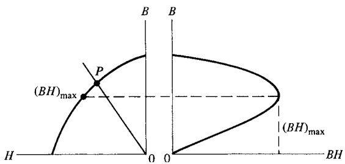

Fig. 14.3 Left: demagnetization curve; right: corresponding values of energy product (BH) plotted on the same $B$ scale. Maximum value of (BH) is shown on both plots.

The demagnetization curves of permanent-magnet materials are often presented on graphs on which lines of constant BH are lightly drawn, as in Fig. 14.4. The viewer can then see at once the approximate value of $(BH)_{\mathrm{max}}$ and where that point lies on the demagnetization curve. The units of $(BH)_{\mathrm{max}}$ are $10^{6}$ gauss-oersteds or megagauss-oersteds (MGOe) in cgs units, or kilojoules/cubic meter (kJ/m³) in SI

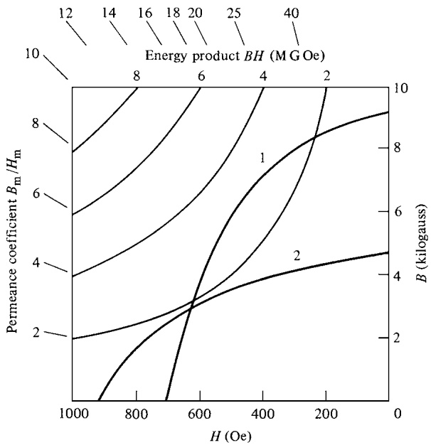

Fig. 14.4 Demagnetization curves (schematic) of two permanent magnet materials denoted 1 and 2. The graph shows also contour lines of constant (BH), and perimeter marks to allow values of the permeance coefficient to be drawn. Material 1 has $(BH)_{\mathrm{max}}$ about 3 MGOe; the value for material 2 is just below 2 MGOe.

$$
\left[ \frac {\mathrm{MG} \cdot \mathrm{Oe}}{\mathrm{kJ} \cdot \mathrm{m} ^ {- 3}} = \frac {1 0 0}{4 \pi} = 7. 9 6 \right].
$$

The operating point of a magnet depends on the slope of the load line, which in turn depends on the demagnetizing factor $N_{\mathrm{d}}$ But the magnet designer prefers to work, not with the demagnetizing factor, but with the permeance coefficient. This is defined as the slope of the load line or $B_{\mathrm{m}} / H_{\mathrm{m}}$ , with the negative sign understood, and it is given, from Equations 14.2 and 14.3 by

$$
\frac {B _ {\mathrm{m}}}{H _ {\mathrm{m}}} = \frac {A _ {\mathrm{g}} l _ {\mathrm{m}}}{A _ {\mathrm{m}} l _ {\mathrm{g}}}.\tag{14.5}
$$

This is equivalent to the expression previously given in terms of $N_{d}$ (see Problem 14.1). To aid the designer, values of $B_{\mathrm{m}} / H_{\mathrm{m}}$ which depend only on the dimensions of the magnetic circuit, are often indicated at the left and top of the demagnetization curve, as in Fig. 14.4. A straight line drawn from the origin to the appropriate value of $B_{m}/H_{m}$ will then intersect the demagnetization curve at the operating point.

The gapped ring of Fig. 14.2, like almost all magnetic circuits, is considerably idealized. Not only has fringing at the air gap been neglected, but so has flux leakage from the sides of the magnet itself. These two are illustrated separately in Fig. 14.5. Leakage can be a large effect, and the chief design problem is to allow for the leakage flux. It is difficult to calculate and the designer usually relies on empirical rules derived from experience, although computer modeling programs that allow the input of real material properties are increasingly effective. Formally, fringing and leakage can be allowed for by introducing leakage factors $C_{1}$ and $C_{2}$ into the design equations:

$$
C _ {1} H _ {\mathrm{g}} A _ {\mathrm{g}} = B _ {\mathrm{m}} A _ {\mathrm{m}},\tag{14.6}
$$

$$
C _ {2} H _ {\mathrm{g}} l _ {\mathrm{g}} = H _ {\mathrm{m}} l _ {\mathrm{m}}.\tag{14.7}
$$

For a magnet of given volume the maximum attainable gap energy $H_{\mathrm{g}}^{2}V_{\mathrm{g}} / 8\pi$ (cgs) or $\mu_{0}H_{\mathrm{g}}^{2}V_{\mathrm{g}}$ (SI) is larger, the larger the energy product $(BH)_{\mathrm{max}}$ of the magnet material. For this reason, the maximum energy product is considered to be the best single index of quality of a permanent magnet material, and it is always included in any list of permanent magnet properties.

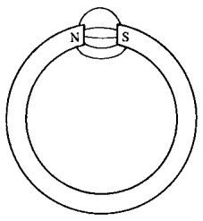

(a)

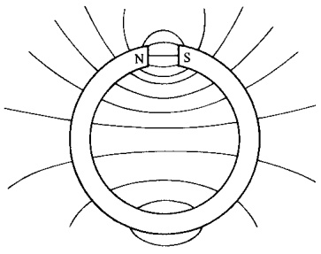

(b)

Fig. 14.5 Ring magnet showing (a) fringing and (b) leakage flux.

When dealing with magnetic materials of high coercivity, the difference between a plot of $B$ vs $H$ and $M$ vs $H$ becomes important. Remembering that $B$ is defined as $4\pi M + H$ (cgs) or $\mu_0M + \mu_0H$ (SI), we can see that when the $H$ term is small relative to $M$, as is the case for soft magnetic materials, the shape of a plot of $B$ vs $H$ is almost the same as that of a plot of $M$ vs $H$. For example, the maximum field applied to measure a ring sample of Ni –Fe alloy might be 100 Oe (0.01 T), and the saturation flux density would be near 10,000 G (1 T). In this case the field $H$ contributes no more than 1% of the flux density $B$.

Even in a material like alnico, with relatively low coercive field, a plot of $B$ vs $H$ is significantly different from a plot of $M$ vs $H$. [Units cause difficulty here. In cgs units, the usual procedure is to plot $B$ in gauss or kilogauss, and $M$ as $4\pi M$, which has the same units as $B$. The field $H$ is plotted in oersted, which is numerically equal to gauss in air. Thus $B$, $M$, and $H$ are all plotted in the same units. In SI, $B$ and $\mu_{0}M$ are both plotted in tesla, and $H$ is plotted as $\mu_0H$ also in tesla. Field units of A/m are usually not used in the permanent magnet literature.] Figure 14.6 shows graphs of the demagnetizing curves of an alnico and a hard ferrite, showing both the $B$ vs $H$ and $4\pi M$ vs $H$ plots; the differences are obvious, especially in the case of the hard ferrite. In particular, the coercive field required to reduce $B$ to zero, generally labeled $H_{c},$ is significantly lower than the coercive field required to reduce $M$ to zero. This latter quantity is called the intrinsic coercive field, and is usually written as $H_{\mathrm{ci}}$ , although a variety of other notations have been used. Note that the plots coincide at $B_{r}$ where $H$ is zero. Figure 14.6 also shows the relative advantages and disadvantages of the two materials: alnico has high magnetizaton but low coercive field, hard ferrite has low magnetization and high coercive field.

Many of the newer permanent magnetic materials display a behavior previously unknown: The remanent magnetization remains almost unchanged in magnitude as increasing negative field $H$ is applied, and remains unchanged up to a value substantially greater than $H_{c}$ Then, as seen in Fig. 14.7, the $B$ vs $H$ curve becomes a straight line passing through the points $B_{\mathrm{r}}$ and $H_{\mathrm{c}} = B_{\mathrm{r}}$ The magnetization reverses fairly suddenly at a field $H_{\mathrm{ci}}$ which may be considerably larger than $H_{c}$ Under these conditions, the maximum energy product $(BH)_{\mathrm{max}}$ is given by

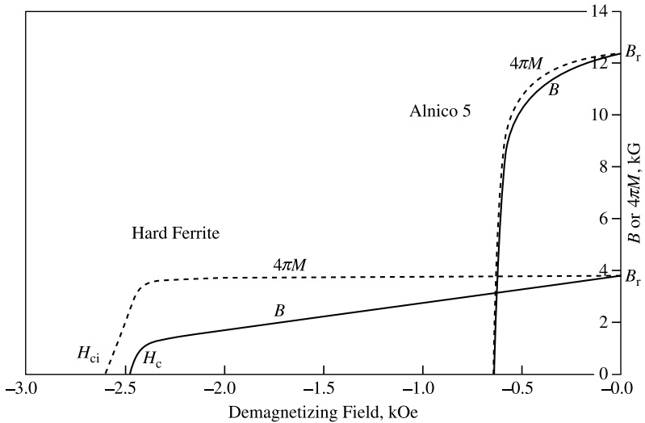

Fig. 14.6 Demagnetizing curves of alnico and hard ferrite. Solid lines are $B$ vs H; dotted lines are $4\pi M$ vs $H$. Note the difference between $H_{c}$ and $H_{ci}$ in the case of hard ferrite.

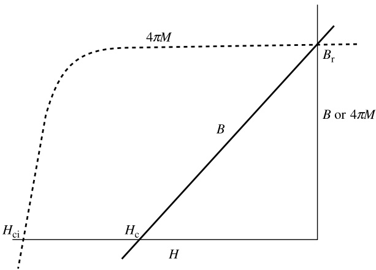

Fig. 14.7 Demagnetizing behavior of a high $H_{ci}$ permanent magnet. The magnetization is unchanged by negative fields less than $H_{c},$ so $H_{\mathrm{c}} = B_{\mathrm{r}}$ (in cgs units).

$$
\frac {B _ {\mathrm{m}}}{2} \cdot \frac {H _ {\mathrm{m}}}{2} = \frac {B _ {\mathrm{m}} ^ {2}}{4}.\tag{14.8}
$$

It does not depend on $H_{\mathrm{ci}}$

For most permanent magnet uses, there is no advantage in having $H_{\mathrm{ci}}$ much larger than $H_{c},$ and there may be a disadvantage: a magnet with a high value of $H_{\mathrm{ci}}$ may be difficult to magnetize, although this is not a universal rule. For the first time in the history of magnetic materials, there may be a reason to deliberately lower $H_{\mathrm{ci}}$ , or to trade a lower $H_{\mathrm{ci}}$ for a higher $B_{r}$

Although $(BH)_{\mathrm{max}}$ is an index of material quality, it is not the only index or even the most suitable one for all applications. Magnets may operate under either static or dynamic conditions. A magnet supplying a field for a moving-coil ammeter exemplifies a static application. But the field in the gap of a holding or lifting magnet changes during operation, and the magnet “works” in a quite different way.

In Fig. 14.8a the iron armature represents the piece being lifted. When this is far away, the magnet is open-circuited and at point P on the demagnetization curve. As the iron approaches, part of the flux is diverted from the leakage gap to the useful gap. When contact is made, the demagnetizing field is reduced and the operating point moves to D. If the armature is pulled away, the point returns to P. The minor hysteresis loop thus traced out is very thin, and is often approximated by a straight line through the tips of the loop; the slope of this line, which is approximately equal to the slope of the major hysteresis loop at the $B_{\mathrm{r}}$ point, is called the recoil permeability $\mu_{\mathrm{rec}}$ . Under these dynamic conditions the best location for P does not correspond to $(BH)_{\mathrm{max}}$ but to a more complex condition that depends on the details of the geometry. Of course, in a material like that in Fig. 14.7, the minor hysteresis loop is just a line coinciding with the demagnetizing curve, and the recoil permeability is zero.

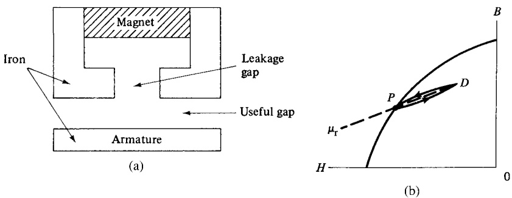

Fig. 14.8 (a) Lifting magnet. (b) Path followed on $B$, $H$ curve.

In some applications, especially permanent-magnet motors, parts of the magnet may be subject to quite large demagnetizing fields from currents in the windings or from magnetized soft magnetic materials, or both. If these fields are large enough, they may cause significant permanent demagnetization of the permanent magnet material, so that it may be necessary to change the design to locate the static operating point at a lower field than that of the maximum energy product.

## 14.3 MAGNET STEELS

We turn now to the magnet materials themselves. The earliest of these was the lodestone, sometimes “armed” by attaching soft iron at each end to concentrate the flux. This is the origin of the term “armature” for a part of a magnetic circuit. Next came high-carbon steel magnets, hardened by quenching (rapid cooling from high temperature), which were used for centuries as compass needles.

In the later 1800s, alloy steels were developed for cutting tools and for structural purposes, and the magnetic properties of alloy steels became of interest. By 1885 a steel containing about 5% tungsten was in use for magnets. This was supplanted by the cheaper chromium steel during World War I. Neither type had coercivity as much as 100 Oe (8 kA/m). The next advance was made in 1917 by the Japanese investigators Honda and Takagi, who showed that a steel containing 30 – 40% cobalt, plus tungsten and chromium, had a coercivity of 230 Oe. This is still the best magnet steel; it has an energy product approaching 1 MGOe or $8\mathrm{kJ/m^{3}}$

Steel magnets always contain carbon, and are used in the hardened state; that is, they are quenched to produce the metastable tetragonal martensitic structure. In steels, magnetic hardness (high coercivity) accompanies physical hardness, although this is emphatically not true of magnetic materials generally. The origin of the magnetic hardness of steels, such as it is, is something of a mystery. Isolated single crystals of martensite are unobtainable, so its magnetic anisotropy is unknown. A martensitic steel is in a complex state of internal stress, and metal carbide particles may also be present; presumably both of these make domain wall motion difficult.

Magnet steels are no longer made or used, since much better materials are available. The cheapest magnet steels have very poor permanent magnetic properties, and the best ones are relatively expensive because of their high cobalt content.

## 14.4 ALNICO

Alnico is now a generic name for a family of alloys, known by several trade names, containing substantial amounts of all three of the ferromagnetic metals, Fe, Co, and Ni, plus smaller amounts of Al, Cu, and sometimes other elements. The name comes from the chemical symbols for aluminum, nickel, and cobalt, even though all alnicos have iron as a major constituent. They were at one time the most widely used permanentmagnet materials, but have now been largely replaced by permanent magnet ferrites and rare earth-transition metal alloys. Alnicos have relatively high Curie temperatures and therefore relatively small temperature dependence of magnetic properties near room temperature, which is a major advantage in some applications.

The development of alnico dates from 1931, when Mishima in Japan discovered that an alloy of 58% Fe, 30% Ni, and 12% Al had a coercivity of over 400 Oe, nearly double that of the best magnet steel. It was soon discovered that the addition of Co and Cu improved the properties of the Mishima alloy, and many related alloys have been tested and manufactured. Producers of alnico and other permanent magnet materials do not usually specify the compositions of their alloys, but only their magnetic properties.

The alnicos are not steels. They are essentially carbon-free, do not form or contain martensite, and the mechanism of their magnetic hardness is quite different from that of steel.

All the alnicos are hard and brittle, much too brittle to be cold worked. (Hot working is possible but is not done commercially.) All production is therefore by casting of the liquid alloy or by pressing and sintering metal powders. The cast alloys have very coarse grains, of the order of 1 mm diameter. The sintered alloys are finer grained and mechanically stronger, with better surface finish but with somewhat inferior magnetic properties. They are usually limited to small magnets with cylindrical symmetry, for which the pressing operation is well suited. Surface grinding is the only finishing operation possible on either type of alnico.

The permanent magnetic properties of as-cast or as-sintered alnico are poor. A special, three-stage heat treatment is necessary to produce optimum properties:

1. Heat to $1250^{\circ}\mathrm{C}$ for a time sufficient to produce a homogeneous solid solution.

2. Cool at a rate of the order of $1^{\circ}\mathrm{C}/$ sec to about $500^{\circ}\mathrm{C}$ or lower.

3. Reheat (temper) at $600^{\circ}\mathrm{C}$ for a few hours.

Most alnicos are cooled (step 2 above) in a magnetic field of 1 kOe or more, or held in a magnetic field for 10 – 20 min at a temperature in this range. The field treatment increases the remanence measured in the direction of the applied field, and may slightly increase the coercive field. The final reheat (step 3) is not done in an applied field.

The alnicos achieve their permanent magnet properties by the precipitation of a ferromagnetic phase in a weakly magnetic matrix. Both phases are body centered cubic, and the phase separation occurs by spinodal decomposition, which results in a very regular array of ferromagnetic rods about 300 Å in diameter lying along <100> directions. Applying a strong magnetic field during the precipitation process causes the rods to form preferentially along the [100] direction most nearly parallel to the field, rather than equally along all three possible <100> directions. Figure 14.9 shows the remarkable degree of alignment and uniformity that can be attained in a single crystal.

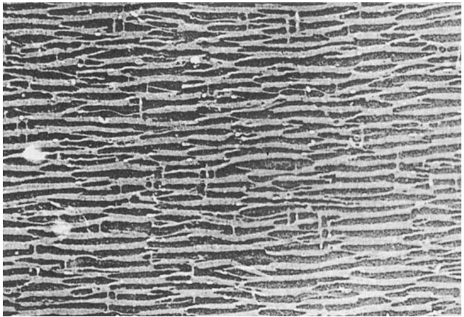

Fig. 14.9 Electron micrograph (oxide replica) from a single crystal of field-annealed alnico. The field during annealing was directed horizontally; 50,000 [K. J. De Vos, Magnetism and Metallurgy, Volume 2, Academic Press (1969)].

A further improvement in properties can be created by producing a crystallographic texture in which all the grains are aligned with a common <001> direction. This can be done by directional solidification (see Fig. 14.10), since under these conditions all the grains grow with a <100> direction parallel to the direction of heat flow. Magnets made in this way may be identified by the letters “DG” for directional grain added to the alloy type number.

The permanent magnet properties of alnico result from the shape anisotropy of singledomain particles. The final anneal (step 3) increases the difference in magnetization between the two phases, and so increases the magnitude of the anisotropy.

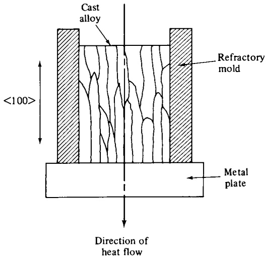

Fig. 14.10 Directional solidification of alnico to produce columnar grains oriented in the <100> direction.

Research on alnico largely ended about 1970, when the remarkable properties of rareearth-transition metal compounds were discovered. The properties of alnico have improved only marginally since that time.

## 14.5 BARIUM AND STRONTIUM FERRITE

Barium ferrite has the formula $\mathrm{BaO}\cdot6\mathrm{Fe}_{2}\mathrm{O}_{3}$ , a hexagonal crystal structure, and a fairly large uniaxial crystal anisotropy. Its intrinsic properties were described in Section 6.5. The hexagonal c axis is the easy axis and the crystal anisotropy constant K is $3.3\times10^{6}$ ergs/ $\mathrm{cm}^{3}$ or $330\mathrm{kJ/m^{3}}$ . The value of $M_{s}$ is low, $380\mathrm{emu/cm^{3}}$ or $380\mathrm{kA/m}$ . The Curie point is $450^{\circ}\mathrm{C}$ . Strontium ferrite $\mathrm{SrO}\cdot 6\mathrm{Fe}_{2}\mathrm{O}_{3}$ has almost identical properties except that K is somewhat larger.

Barium ferrite was developed into a commercial magnet material in 1952 in the Netherlands by the Philips Company, which called it Ferroxdure. A number of other trade names have been used, but with the expiration of patents, these materials are usually just called ceramic magnets or ferrite magnets. The composition is generally not specified, but better properties and higher prices usually mean more strontium. In the following account, the term “barium ferrite” can be understood to mean either material, or a mixture. Sometimes the general term hexaferrite is used for both materials.

Barium ferrite is made by practically the same method as the soft ferrites. Barium carbonate is mixed with $\mathrm{Fe_{2}O_{3}}$ and fired at about $1200^{\circ}\mathrm{C}$ to form the ferrite. This material is then ball milled to reduce the particle size, pressed dry in a die, and sintered at about $1200^{\circ}\mathrm{C}$ The resulting magnet has a grain size of about 1 mm and is very brittle. Anisotropic grades are made by wet pressing in a magnetic field to align the c-axes of the particles with the field, which is along the compression axis; the usual product is a cylindrical magnet with the easy axis parallel to the cylinder axis. Figure 14.11 shows the microstructure of a coarse-grained specimen with field-oriented grains. Barium ferrite has a tabular “habit,” as a mineralogist would say; i.e., it habitually crystallizes in the form of flat plates with the basal plane of the unit cell parallel to, and the c-axis at right angles to, the plate surface. In Fig. 14.11a these plates are parallel to the surface examined; in Fig. 14.11b the plates are in profile, with the c-axes more or less vertical and in the plane of the page. Even when a field is not applied during pressing, some preferred orientation will result because of the tendency for the particles to pack together with their flat surfaces parallel to one another and at right angles to the pressing direction.

Barium ferrite owes its magnetic hardness to crystal anisotropy. If it were in the form of aligned, spherical, single-domain particles, its intrinsic coercivity should be

$$
\begin{array}{r l} & H _ {\mathrm{ci}} = H _ {\mathrm{K}} = \frac {2 K}{M _ {\mathrm{s}}} = \frac {2 (3 . 3 \times 1 0 ^ {6})}{3 8 0} = 1 7, 0 0 0 \mathrm{Oe(cgs)} \\ & \mu_ {0} H _ {\mathrm{ci}} = \mu_ {0} H _ {\mathrm{K}} = 1. 7 \mathrm{T(SI)}. \end{array}\tag{14.9}
$$

Actually, the particles are plate-shaped, which introduces shape anisotropy. And the shape is wrong, because the easy axis due to shape is perpendicular to the easy axis due to crystal anisotropy. It is difficult to allow for this effect exactly. For an isolated particle, the shape effect reduces $H_{\mathrm{ci}}$ by 4800 Oe to a value of about 12,000 Oe, as mentioned in Section 11.5; for commercial magnets with 5– 10% porosity, the reduction would not be nearly as much, although the pores are the source of internal demagnetizing fields.

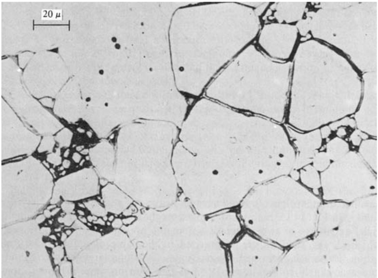

(a)

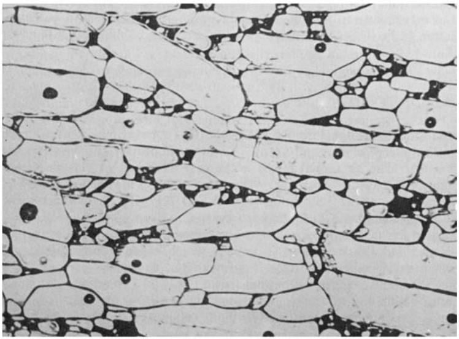

(b)

Fig. 14.11 Photomicrographs of sintered barium ferrite with oriented grains. (a) Section normal to c-axes; (b) section parallel to c-axes [J. Smit and H. P. J. Wijn, Ferrites, Wiley (1959)].

The observed values of $H_{\mathrm{ci}}$ are no more than one-third the lower theoretical limit. It follows that ferrite magnets are not composed of single-domain particles reversing coherently. The typical grain size of 1 mm is too large; we estimated (Problem 9.4) the critical size for single-domain behavior to be of the order of 1000 $\mathring{\mathrm{A}}(=0.1\mu \mathrm{m})$ . Magnetization reversal in ferrite magnets must therefore take place by wall nucleation and motion (Section 11.5). The coercivity could in principle be increased by making the particles smaller and/or smoother and with fewer crystal imperfections, in order to decrease the number of sites for wall nucleation.

The maximum value of $(BH)_{\mathrm{max}}$ for commercial ferrite magnets is about 3.5 MGOe or $28\mathrm{kJ/m^{3}}$ , and has not increased significantly for many years.

## 14.6 RARE EARTH MAGNETS

Many of the rare-earth elements (atomic numbers 59 – 70) are ferromagnetic with very strong magnetic anisotropy, but all with Curie temperatures below room temperature. They form a series of intermetallic compounds with the transition metals such as Fe, Co, and Ni, and many of these compounds have Curie temperatures well above room temperature. The compounds tend to retain the strong anisotropy of the rare-earth element, which arises in the 4f electron shell and is to a large extent intrinsic to the atom rather than dependent on its surroundings. This behavior is often referred to as single-ion anisotropy.

Widespread interest in these compounds as permanent magnet materials dates from 1966, when K. J. Strnat and G. Hoffer of the U.S. Air Force Materials Laboratory reported that $\mathrm{YCo}_{5}$ has an anisotropy constant of $5.5 \times 10^{7} \mathrm{ergs/cm}^{3}$ or $5.5 \times 10^{6} \mathrm{~J/m}^{3}$. , by far the largest value for any material then known. Since then, a wide range of rare-earth/transition metal compounds have been investigated, and their crystal structures, magnetizations, anisotropies, and Curie temperatures are known. For use as a permanent magnet material, the necessary properties are a high and positive uniaxial anisotropy, giving an easy axis of magnetization rather than an easy plane; Curie temperature well above room temperature; and reasonably high saturation magnetization. Low cost, low density, good mechanical properties, and resistance to corrosion are also desirable.

Three families of useful permanent magnet materials have emerged from this extensive scientific and technological work. Each of them is greatly superior to all previously known permanent magnets, and the best of them is more than ten times better than the best alnico or ferrite, as measured by the maximum energy product. They are generally known as $\mathrm{SmCo}_5, \mathrm{Sm}_2\mathrm{Co}_{17}$ , and $\mathrm{Nd}_{2}\mathrm{Fe}_{14}\mathrm{B}$ or NdFeB. We will consider them in the order of their historical development.

## 14.6.1 SmCo5

This compound has a hexagonal crystal structure, and an anisotropy constant of about 7.7 × $10^{7}\mathrm{erg/cm^{3}}$ or $7.7\times 10^{6}\mathrm{J / m^{3}}$ , with the easy axis along the c-axis of the unit cell. The basic production method consists of melting and casting the alloy, crushing and grinding to produce a powder with particle size near 10 mm, and with each particle consisting of a single crystal of $\mathrm{SmCo}_{5}$ . The powder is aligned in a magnetic field so that the easy axes of all the particles are parallel, and then compressed in a die. Usually the alignment and compression are done sequentially in the same apparatus. The compressed powder is then sintered at a temperature above $1000^{\circ}\mathrm{C}$ to make a final magnet.

To obtain high density and good magnetic properties, a small amount of powder made with an excess Sm content is added before compaction. This material melts at the sintering temperature, and greatly aides in attaining high density. The process is referred to as liquidphase sintering. The particle size of the powder before sintering corresponds to the grain size after sintering, and is about an order or magnitude larger than the calculated size of single-domain particles. So these are not in fact single-domain particle magnets, although they were originally developed on the basis of single-domain theory.

SmCo5 magnets have an unusual and useful property: they can be magnetized initially by a field much smaller than their intrinsic coercive field $H_{\mathrm{ci}}$ . This behavior is illustrated in Fig. 14.12. The rule of thumb for permanent magnets is that the field required to satisfactorily magnetize the material is several times larger than the coercive field; this rule clearly does not apply to $\mathrm{SmCo}_{5}$ . This behavior is a distinct production advantage, since reaching fields several times larger than the coercive field is difficult and expensive.

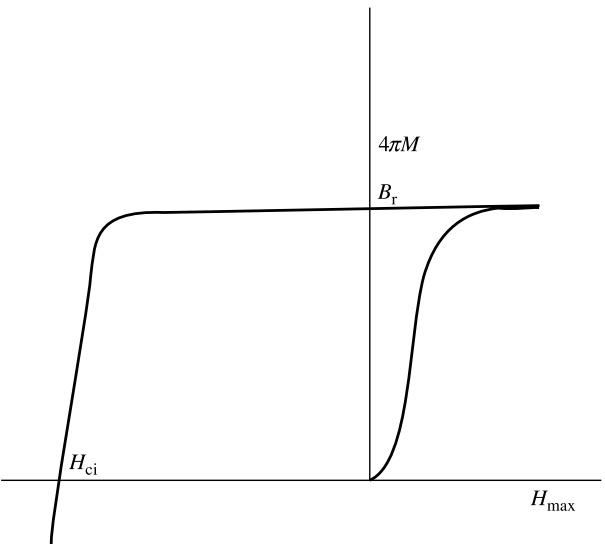

Fig. 14.12 Magnetization and demagnetization behavior of $\mathrm{SmCo}_{5}$ (schematic).

This phenomenon of easy magnetization but difficult demagnetization is interpreted to mean that the as-prepared magnet grains contain domain walls that move relatively easily in an applied field; this allows the magnet to be magnetized to saturation in relatively low fields. Once the grains have been magnetically saturated, and the domain walls driven out, reversing the magnetization requires the nucleation of new reverse domains, and there is a strong barrier to this nucleation. When the nucleating field is reached, the field is high enough to drive the domain walls completely through the grains and into saturation in the opposite direction. A magnet that behaves in this way is said to show nucleation-controlled coercivity.

SmCo5 magnets were the first to attain an energy product of 20 MGOe $(\sim 160\mathrm{kJ / m^3})$ and they continue to be made and used.

## 14.6.2 Sm2Co17

The notation $\mathrm{Sm}_{2}\mathrm{Co}_{17}$ is shorthand for a family of complex compositions that may be expressed as $\mathrm{Sm}_2(\mathrm{Co},\mathrm{Fe},\mathrm{Cu},\mathrm{Zr})_{\approx 15}$ . The microstructure is very fine-scale, and appears to consist basically of bands of $\mathrm{SmCo}_{5}$ separating regions of $\mathrm{Sm}_{2}\mathrm{Co}_{17}$ . The high coercive field in this case results from domain wall pinning rather than domain nucleation; this is indicated by the fact that fields larger than the coercive field are required for this initial magnetization of the magnet. The production method is basically the same as $\mathrm{SmCo}_{5}$ except that a fairly complex heat treatment is needed to develop the necessary microstructure.

Some alternative production methods have evolved for producing rare-earth/transitionmetal compounds. One approach combines the reduction of a rare-earth oxide such as $\mathrm{Sm}_{2}\mathrm{O}_{3}$ with introduction of Co, usually using Ca as the reducing agent. This is known as the reduction/diffusion process. Another variant is the use of hydrogen to produce powders. The rare-earth compounds characteristically can absorb large quantities of hydrogen at modest pressure and temperatures near room temperature, with a resulting change in crystal structure. The hydrogen can be easily removed by reducing the pressure, and the resulting reverse phase transformation converts the material to a fine powder. This is known as hydrogen decrepitation.

## 14.6.3 FeNdB1

Efforts to find better and/or cheaper permanent magnet materials led to two essentially simultaneous discoveries of $\mathrm{Fe_{14}Nd_2B}$ , a previously unknown tetragonal crystal with strong uniaxial anisotropy and a Curie temperature slightly above $300^{\circ}\mathrm{C}$ . Magnets made using methods very similar to those used for $\mathrm{SmCo}_{5}$ were announced by Sumitomo Special Metals Co. in Japan in 1984. At almost the same time, magnets of approximately the same composition but made by a rapid solidification technique, like that used for amorphous alloys, were announced by General Motors Corp. Extensive and complicated patent disputes ensued, but both products are in large-scale commercial production, and have to a large extent replaced the Sm –Co materials, because FeNdB is cheaper. Fe is cheaper than Co, Nd is cheaper than Sm, and FeNdB contains relatively little rare earth.

As noted above, conventional FeNdB is made using the same processes and equipment as Sm –Co, which helped to makes its adoption quite rapid. Some of the Fe may be replaced with Co, which increases the Curie temperature and improves the temperature stability. Some of the Nd may be replaced with a heavy rare earth, usually dysprosium, which increases coercivity, but lowers magnetization. Often both are added. FeNdB magnets are available in a range of magnetic properties, with energy products from 20 to 40 MGOe, and magnets have been made with energy products of 50 MGOe or more. (Multiply these values by 7.96 to get SI units of $\mathrm{kJ / m^3}$ ) They are the materials of choice when small size is important, as in many computer-related devices.

Rapidly quenched FeNdB is produced in a partially amorphous state, and annealed to produce a very fine-grained crystalline material. This is ground into a coarse flake, which can be hot-pressed to full density. Since each flake contains many grains, oriented at random, magnets made in this way are unoriented, with isotropic magnetic properties. It is possible to align the easy axes by a process of hot deformation known as die-upsetting. A cylindrical sample is placed in a die whose inside diameter is about twice the sample diameter, and the sample is compressed at a temperature of about $725^{\circ}\mathrm{C}$ to fill the die. After this treatment the easy axes are predominantly aligned parallel to the compression axis.

The principal disadvantages of the FeNdB family are a relatively low Curie temperature, near $300^{\circ}\mathrm{C}$ which means a fairly strong temperature dependence of magnetic properties at room temperature, and susceptibility to severe corrosion in moist atmospheres. The corrosion problem is largely overcome with various metallic and nonmetallic coatings.

The properties of examples of the three kinds of rare-earth permanent magnet materials are shown in Fig. 14.13. These can be compared with the older alnico and hard ferrite magnets shown in Fig. 14.6. Magnets today (except alnico) can be made and used in the form of disks or plates magnetized through the thickness, because the coercivity is large enough to resist the large demagnetizing fields associated with such shapes. Alnico magnets need to be magnetized along their long dimension, so that the demagnetizing field is relatively small. Stated in another way, the permeance coefficient $B_{m}/H_{m}$ at the $(BH)_{\mathrm{max}}$ point is about 1 for barium ferrite or rare-earth magnets, compared to about 20 for Alnico 5. The rare-earth magnets are clearly far superior to either alnico or ferrite, and would replace them entirely except for their high cost.

An important variable not shown by the demagnetizing curve is the Curie temperature, which largely controls the temperature dependence of magnetic properties near room temperature. Alnico has the highest Curie temperature, and therefore the lowest temperature coefficient of $B_{r}$

<small>1FeNdB is more commonly written NdFeB, although iron is the major constituent.</small>

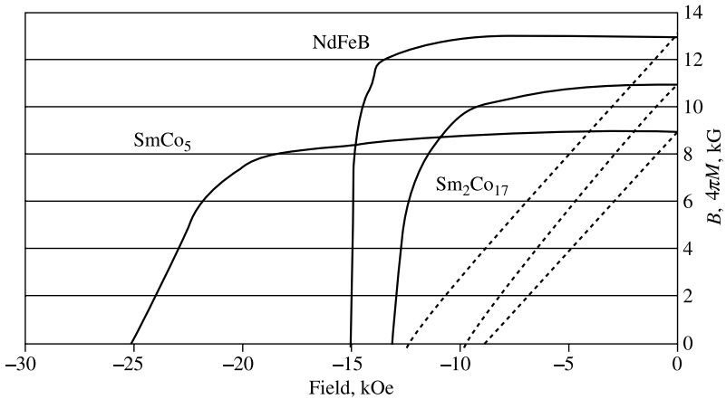

Fig. 14.13 Demagnetization curves of typical rare-earth permanent magnets.

## 14.7 EXCHANGE-SPRING MAGNETS

It was suggested in 1991 by E. Kneller and R. Hawig [IEEE Trans. Mag., 27 (1991) p. 3588] that, if the spaces between the high-coercivity particles in a fine-particle permanent magnet deriving its coercivity from crystal anisotropy could be filled with a highmagnetization, low-coercivity material such as iron or a cobalt-iron alloy, and if the high-moment alloy were exchanged-coupled to the permanent magnet particles, the result should be a material with a significantly higher net magnetization but the same coercive field, and therefore a higher energy product, than the original fine-particle material. One condition would be that the soft magnetic layers would have to be thin enough so that no domain walls could form. The original paper called this an exchange-spring magnet; the term exchange-coupled magnet has also been used. There has been considerable interest in this idea, but no commercial products have yet resulted.

## 14.8 NITRIDE MAGNETS

In 1991, J. M. D. Cooey and H. Sun [J. Mag. Magn., Mater., 87 (1991) p. L251] reported that nitrogen can be added to $\mathrm{Sm}_{2}\mathrm{Co}_{17}$ , causing an expansion of the lattice, an increase in magnetization and anisotropy, and also a higher Curie temperature. There is a stable compound corresponding to the composition $\mathrm{Sm}_{2}\mathrm{Co}_{17}\mathrm{N}_{3}$ . The improvement in properties is substantial, and a burst of research activity, both basic and applied, resulted. However, no commercial magnets have yet appeared. One of the problems is that the materials are not stable at conventional sintering temperatures.

## 14.9 DUCTILE PERMANENT MAGNETS

Most permanent-magnet materials are so extremely brittle that they can be put into usable form only by casting or by pressing and sintering a powder. But there are a few exceptional alloys which are magnetically hard and yet ductile enough to be hot or cold worked into wire, sheet, and other forms. Of these, Cunife (60% Cu, 20% Ni, 20% Fe) and Remalloy or Comol (68% Fe, 17% Mo, 12% Co) are no longer made.

Vicalloy II (52% Co, 38% Fe, 10% V), when rapidly cooled from $1180^{\circ}\mathrm{C},$ is ductile. After producing the desired shape, it is given a precipitation heat treatment of several hours at $600^{\circ}\mathrm{C}$ after which it is hard and brittle, with a maximum energy product of about 1.5 MGOe. Another version of Vicalloy, with more vanadium and requiring severe deformation to develop its magnetic properties, was used for audio recording in the early days of that industry.

Chromindur (61.5% Fe, 28% Cr, 10.5% Co) has properties similar to Vicalloy, but contains less cobalt. Its precipitate forms by spinodal decomposition, which requires a slow, carefully controlled cooling from 6808C.

Arnokrome (26 – 30% Cr, 7 – 10% Co, balance Fe) is a proprietary alloy whose permanent magnet properties can be controlled over a fairly wide range by varying the heat treatment.

The maximum energy product of these alloys is a few MGOe, much inferior to other permanent magnet materials. A major use for materials such as these is for activating and deactivating magnetic sensors used as antishoplifting tags. The need is for a material that can be made in thin strip form, and can be magnetized and demagnetized in the fields available from permanent magnet assemblies.

## 14.9.1 Cobalt Platinum

The equiatomic alloy CoPt is the most expensive magnetic material ever made commercially. Like the alloys listed above, when heat treated to produce a single-phase solid solution, it is ductile. It is then heat treated to develop a two-phase, partially ordered structure, which can have an energy product approaching 10 MGOe. Until the development of the rare-earth permanent magnets, CoPt was the best permanent magnet available, and was used in miniature devices such as hearing aids and watches, and in some military and space applications where cost was not a major consideration. It now has only a few special-purpose uses, some due to its good corrosion resistance.

## 14.10 ARTIFICIAL SINGLE DOMAIN PARTICLE MAGNETS (LODEX)

Field-treated alnico with excellent properties had been made some ten years before publication of the classic paper of Stoner and Wohlfarth in 1948 on single-domain particles or the direct observation of domain walls and wall motion, i.e., years before any one had any clear idea of how the magnetization of a body actually changed. In fact, far from theory guiding practice, it was the other way around, because it is fair to say that the development of alnico stimulated theorists to search for an explanation of its high coercivity.

By about 1950, however, there was sufficient understanding of fine-particle theory to allow magneticians to proceed, for the first time, with the development of a synthetic magnet material. What was required was an assembly of elongated single-domain particles of, for example, iron, dispersed in a suitable matrix. The particles themselves could have negligible crystal anisotropy, because their shape alone would lead to high coercivity (Table 9.1). It is not easy to make such particles. The initial development work was done in France but did not lead to a commercially successful material, chiefly because the particles produced were not sufficiently elongated. Finally, in 1955, L. I. Mendelsohn, F. E. Luborsky, and T. O. Paine [J. Appl. Phys., 26 (1955) p. 1274] of the U.S. General Electric Company announced the successful development of fine-particle magnets. They were produced under the trade name of Lodex, and were also called ESD (elongated single-domain) magnets. They were made by electrodepositing iron or cobalt-iron from an aqueous solution onto a liquid mercury cathode. The resulting particles were dendritic (branched) but were converted into bumpy cylinders 150– 300 Å in diameter by a low-temperature anneal. A series of processing steps replaced the mercury by lead, so the final magnets consisted of single-domain magnetic particles in a lead matrix. Even in their final form, the magnets were mechanically soft and easily shaped and cut.

Lodex was a nice example of science leading the way to a new and useful product, but its magnetic properties were never good enough (maximum energy product about 3.5 MGOe in the anisotropic version) to make it a major competitor of alnico or ferrite magnets. The increasing strictness of environmental regulations on the use of mercury were largely responsible for driving Lodex from the market after about 25 years of production.

## 14.11 BONDED MAGNETS

For many applications, it is useful to grind a permanent magnet material into relatively fine particles and imbed the particles in a matrix of a plastic, rubber, or even a low-melting metallic alloy. Such a material is called a bonded magnet. The magnetization of a bonded magnet is about half that of the starting material, because of the dilution by the nonmagnetic matrix, but the coercive field is largely unchanged. Bonded magnets can be made into shapes, such as extruded tubes, that could not be created from the original solids. They can have a wide range of mechanical properties, including the flexibility of rubber. Complex geometries of the magnetization are also possible, by applying an appropriate magnetic field pattern while the matrix material is hot and semiliquid, so that the magnetic particles can physically rotate, or by applying a high (usually pulsed) field to the finished bonded material. A common example is the flexible “refrigerator” magnet, used to hold a printed message to a steel surface such as a refrigerator. The pattern of magnetization is a series of shallow “U” shapes, with the closed ends of the Us under the printed surface (see Fig. 14.14). Such a magnet will stick to the refrigerator with the printed surface exposed and visible, but not with the printed surface facing the steel.

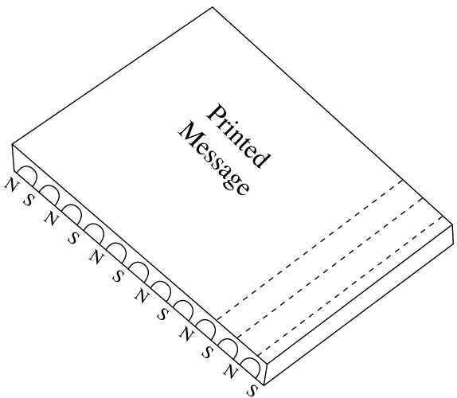

Fig. 14.14 “One-sided” magnet. Only the nonprinted side will stick to a steel surface.

An early and valuable use of bonded magnets was in refrigerator door gasket seals. Making the flexible door seal magnetic produces an air-tight seal around the entire door, even if the door is not perfectly flat. The magnetic gasket is also much simpler and cheaper than the mechanical latch it replaced, and greatly reduces the danger of a child being trapped in an abandoned refrigerator.

Most bonded magnets contain ferrite magnet particles as the magnetic component. Conventional sintered FeNdB loses much of its coercivity when ground into small particles, presumably because oxidation changes the surface condition, and therefore is not suitable for bonded magnets. Rapidly quenched NdFeB, however, does not suffer from this defect since its grain size is much smaller than the particle size, so most of the grains are not exposed to air.

## 14.12 MAGNET STABILITY

If a permanent magnet is to be useful in service, it must be stable: it must deliver the same flux in the air gap at all times. This condition is not difficult to meet if the magnet operates in an unchanging environment. More often, however, the magnet is exposed to disturbing influences such as external magnetic fields and temperature changes.

## 14.12.1 External Fields

These normally are a problem only for alnico magnets and for the lower-coercivity grades of hard ferrites. Suppose that the magnet of Fig. 14.15a has a load line such that it operates at point a. What is the result of external fields that may increase or decrease the field acting on the magnet by an amount DH? If the true field changes from $H_{\mathrm{d}}$ to $H_{1}$ and back again, the operating point moves from a to b and back to a along the recoil line defined in Fig. 14.6b. The change in induction $B$ during this reversible excursion is small, and the magnet is back at its original operating point. But if the true field changes from $H_{\mathrm{d}}$ to $H_{2}$ and back, the operating point moves from a to c to d, causing a large permanent drop in induction. However, once the magnet is at d, temporary external fields in either direction merely move it reversibly back and forth along the recoil line through d. The resulting changes in $B$ are small and temporary.

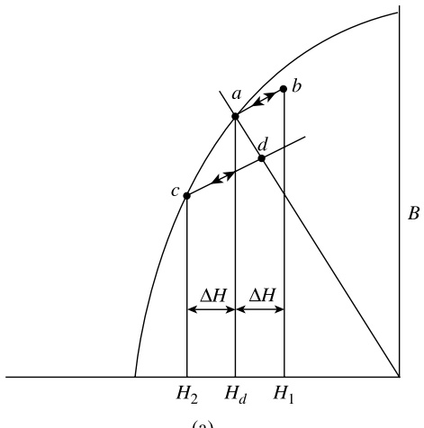

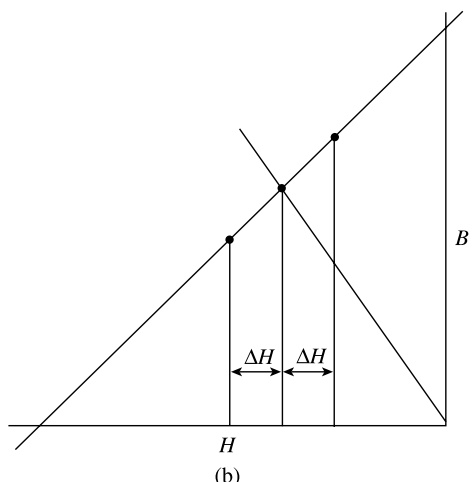

Fig. 14.15 Stabilization of a permanent magnet.

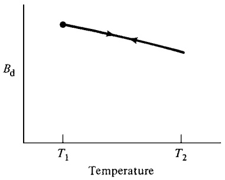

(a)

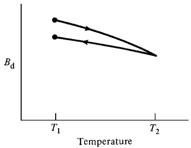

(b)

Fig. 14.16 Effects of increased temperature on the induction at the operating point. (a) Reversible; (b) irreversible.

This suggests a method for stabilizing a magnet against the effects of external fields. After magnetization the magnet is subjected to a temporary demagnetizing field that moves its operating point from a to d. This treatment increases stability at the cost of decreased induction and is called “knockdown.” An ac field is usually preferred over dc for stabilization, because it will cycle the material many times over the recoil line.

A material with a demagnetization curve like that in Fig. 14.15b is stable against demagnetizing fields, because its recoil line has the same slope as the demagnetization curve. Permanent demagnetization can occur only if the negative field approaches the value of the intrinsic coercive field $H_{\mathrm{ci}}$ which is generally unlikely. The high-coercivity ferrite magnets and all the rare-earth magnets have linear demagnetizing curves like Fig. 14.15b.

## 14.12.2 Temperature Changes

These can produce three effects. One is reversible and two are irreversible, in different ways. The property of interest is the flux $B_{d}$ at the operating point, because this determines the flux in the air gap.

Reversible Changes. An increase in temperature will normally lower $B_{\mathrm{d}}$ because both $M_{\mathrm{s}}$ and K generally decrease with temperature. If the value of $B_{d}$ returns to its original value when the temperature returns to its original value, as in Fig. 14.16a, the change is by definition reversible. Manufacturers specify a maximum operating temperature for each of their permanent magnet materials; this is temperature below which only reversible changes occur. A temperature coefficient of magnetization is also specified, which applies in the temperature interval between room temperature and the maximum operating temperature. This quantity may be important if the permanent magnet will be used in a hightemperature environment: under the hood of an automobile or near a jet engine.

TABLE 14.1 Properties of Some Permanent Magnet Materials

|  |  |  |  | (BH)max, | Max T, | Temperature |
| --- | --- | --- | --- | --- | --- | --- |
| Product | Br, kG | Hc, kOe | Hci, kOe | MGOe | 8C | Coefficient, %/8C |
| Hard ferrite 1 | 3.8 | 2.4 | 2.55 | 3.4 | 200 | 20.2 |
| Hard ferrite 2 | 4.0 | 3.65 | 4.0 | 4.0 | 200 | 20.2 |
| Alnico 5 | 12.5 | 0.680 |  | 5.5 | 450 | 20.02 |
| Alnico 9 | 11.2 | 1.375 |  | 10.5 | 450 | 20.02 |
| SmCo5 | 8.7 | 8.50 | 30.0 | 18.0 | 250 | 20.04 |
| Sm2Co17 | 10.7 | 9.75 | 26.0 | 26.0 | 300-350 | 20.03 |
| NdFeB 1 | 10.0 | 9.60 | 41.0 | 24.0 | 150-200 | 20.1 |
| NdFeB 2 | 12.9 | 12.40 | 23.0 | 40.0 | 150-200 | 20.1 |

Table 14.1 gives some typical values for reversible temperature coefficients of common permanent magnet materials. The values for FeNdB are relatively high because the Curie temperature of this material is near $300^{\circ}\mathrm{C}$ , and the values for alnico are low because its Curie temperature is high.

Irreversible Changes. If $B_{d}$ does not return to its original value after a temperature cycle, as in Fig. 14.16b, the change is by definition irreversible. Two cases arise: either the magnetization can be restored to its original value by remagnetization, or it cannot. In the latter case, some permanent change in the structure of the material must have occurred and the magnet can be restored only by a complete new heat treating cycle. In the former case, it is usually found that the loss in $B_{d}$ at constant temperature occurs rapidly at first, then at a decreasing rate, so that holding the material at or slightly above the maximum expected operating temperature for a few days will lead to a decrease in $B_{\mathrm{d}}$ but will largely eliminate any further changes with time at the same or lower temperature.

## 14.13 SUMMARY OF MAGNETICALLY HARD MATERIALS

It may be useful at this point to look back over all the magnetically hard materials and attempt to classify them into broad groups and make some generalizations. Of the permanent magnet materials in general use today (alnico, hexagonal ferrite, rare-earth compounds), all can be considered fine-particle magnets, although in several cases the fine particles are not single-domain particles. Not only are the particles often above the size limit for single domains, but direct observation shows the presence of domain walls within the particles. It therefore appears that the Stoner – Wohlfarth model of single-domain particles, which initiated a long and highly successful series of developments in permanent magnet materials, does not actually apply to the resulting materials. The necessity for small particles is attributed to the reduced number of domain nucleation sites in a small particle, plus the fact that in magnetically isolated particles a freely moving domain wall can reverse the magnetization direction of only a single particle.

In alnico, the precipitate particles are believed to be single domain, with their coercivity arising from the shape anisotropy of the particles. In the other common permanent magnet materials, the coercivity arises from crystal anisotropy plus the barriers to domain nucleation in $\mathrm{SmCo}_{5}$ the barriers to domain wall motion in $\mathrm{Sm}_{2}\mathrm{Co}_{17}$ , and some combination of the two in FeNdB.

## 14.14 APPLICATIONS

The applications of magnetically hard materials can be classified in various ways. One straightforward system defines three major categories: (1) electrical-to-mechanical energy conversion; (2) mechanical-to-electrical energy conversion; and (3) force applications.

## 14.14.1 Electrical-to-Mechanical

If a current flows in a conductor located in the magnetic field of a permanent magnet, a force will be exerted on that conductor. This is the operating principle of such devices as the loudspeaker, permanent-magnet motor, moving-coil electrical instruments, and headpositioners for hard disk drives.

Loudspeakers. These form probably the largest single application of permanent magnets. One design is shown in Fig. 14.17. The base of the speaker cone carries a coil which fits in the annular gap of the magnet circuit. Flux travels from the magnet into the iron pole piece, radially across the gap, and back through the outer return path of iron. A varying current in the coil causes a varying axial force on the coil, which therefore vibrates axially, as does the cone attached to it, thus generating sound.

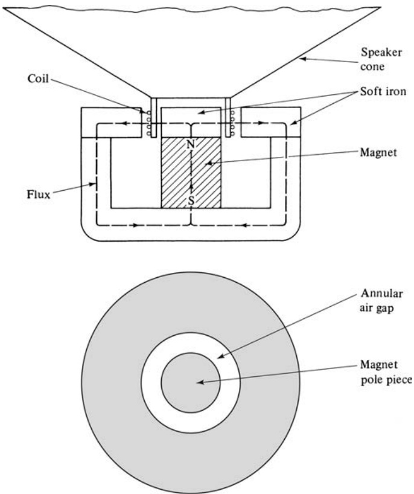

Fig. 14.17 Loudspeaker construction.

Permanent-Magnet Motors. The rotor (armature) of an electric motor is wound with copper wire carrying a current. The turns of the winding are at the same time located in a magnetic field. The result is a force on the conductors and rotation of the rotor. The necessary magnetic field is supplied, in most motors, by an electromagnet; this is the stator, an iron (i.e., low-carbon steel or silicon steel) core wound with another winding. For small dc motors, there has been an increasing preference for a permanent magnet as a field source rather than an electromagnet. This means replacement of the woundfield stator at the left of Fig. 14.18a by the permanent-magnet stator at the right. The result is a cheaper, more compact, and lighter motor. Such motors have many applications in the automobile (windshield-wipers, heater fans, etc.) and in the home (electric can openers, toothbrushes, etc.). The magnetic circuit is shown in Fig. 14.18b. The usual material is hard ferrite, because the fairly thin sections involved can be magnetized in the thickness direction.

(a)

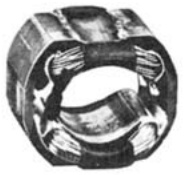

Woundfield stator

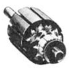

Rotor

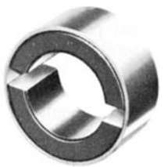

Permanentmagnet stator

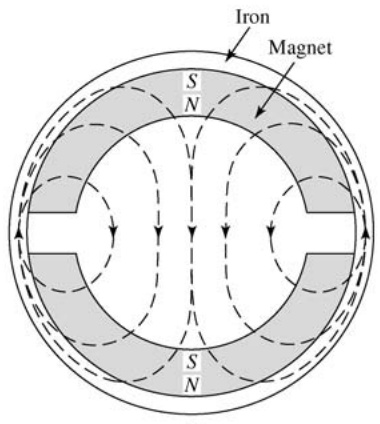

(b)

Fig. 14.18 Permanent magnet motor. (a) Comparison of a wound-field stator with a permanent magnet stator, with the same rotor; (b) the construction of the permanent magnet stator.

Head Positioners. The read/write heads of a computer hard disk drive are moved from track to track by a head positioner which incorporates a special permanent magnet configuration. As shown in Fig. 14.19a, two arc-shaped permanent magnets create a field between them that varies smoothly from a maximum positive value at one end of the arc to a maximum negative value at the other end. A current-carrying loop mounted on one end of a pivoted arm is located in this magnetic field. The equilibrium position of the loop depends on the current in the loop. The equilibrium condition can be stated in various ways: when the force on leg $A$ of the loop is equal and opposite to the force on leg $B$, or when the total magnetic flux through the loop (the sum of the magnet flux and the loop flux) is minimum. The result is that the equilibrium position of the loop varies directly with the current through the loop, allowing the read/write heads on the opposite end of the pivoted arm to be accurately moved from track to track.

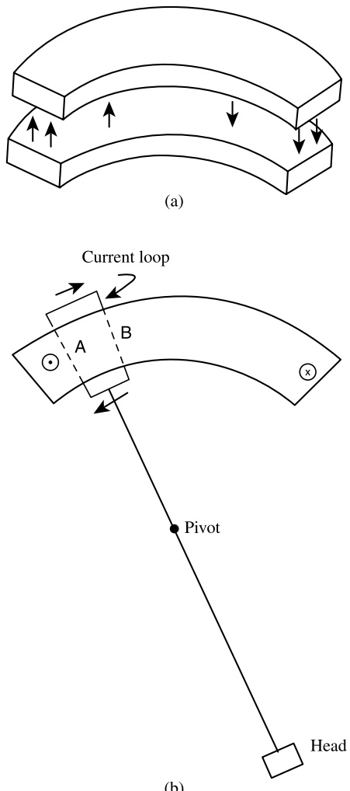

(b)

Fig. 14.19 Hard drive head positioner. (a) Magnet configuration; (b) current loop in magnet field, with head at the other end of the pivoted arm.

## 14.14.2 Mechanical-to-Electrical

If the flux through a winding is changed, an emf will be induced in that winding. The flux change can be effected by any mechanically produced relative motion of a magnet and the winding. This principle is the basis for devices like the magneto and the microphone. The magneto consists of a magnet rotating within an iron core carrying a winding. It is used to produce the sparks for ignition in small gasoline engines, such as those used in power lawn mowers and outboard motors.

The magnetic microphone is simply the inverse of the loudspeaker. It is rarely used, except in some simple communication systems where the loudspeaker also serves as the microphone.

## 14.14.3 Microwave Equipment

Included here is equipment both for communications and radar. The devices involved bear such names as magnetron and traveling wave tube, and the details of their operation are matters for a specialist. In some traveling wave tubes for military and radar applications, the requirements are so severe that only materials of very high coercivity, like PtCo and $\mathrm{SmCo}_{5}$ , are suitable.

## 14.14.4 Wigglers and Undulators

The electron current in a synchrotron emits radiation when it is accelerated into a curved path. This synchrotron radiation is an unwanted power loss and radiation hazard to the people using the electrons, but a valuable source of high-intensity X-radiation of adjustable frequency to the solid-state physicist and similar scientific workers. The intensity and characteristics of the synchrotron radiation can be enhanced by passing the electron beam through an array of permanent magnets that force the electron beam to accelerate up and down or side to side. Such arrays are known as wigglers and undulators.

## 14.14.5 Force Applications

If either pole of a permanent magnet is brought near a piece of iron, the field of the magnet will magnetize the iron in such a direction that an opposite pole will be, to use the ancient term, “induced” in the iron, and attraction will occur. On the other hand, if like poles of two permanent magnets are brought together, repulsion will result. The calculation of these forces is not easy.

Attraction. If the flat end of a magnet makes good contact with a material of high permeability or with the flat end of a magnet of opposite polarity, the force of attraction between the two is

$$
F = \frac {A B ^ {2}}{2 C _ {4}},\tag{14.11}
$$

where in SI units the force $F$ is in newtons, $A$ is the area of contact in $\mathrm{m}^{2}$ $B$ is the flux density in tesla, and $C_4 = 1$ . In cgs units, $F$ is in dynes, $A$ in $\mathrm{cm}^2$ , $B$ in gauss, and $C_{4}=$ $4\pi .$ This equation can be derived by summing the Coulomb forces between all the poles assumed to lie on the two surfaces. But it can be understood more simply in another way. Suppose the two pieces are pulled apart to a small distance d, creating a very thin gap. If there is no fringing, the field in this gap is $B$, and the energy density of the field is $B^{2}/8\pi$ (cgs units), from Equation 7.43. The work done is Fd and the field energy is $(B^{2} / 8\pi)(Ad)$ . If the two are equated, Equation 14.11 follows. This equation holds only when the two pieces are very close together; the attractive force falls off very rapidly as the two are separated.

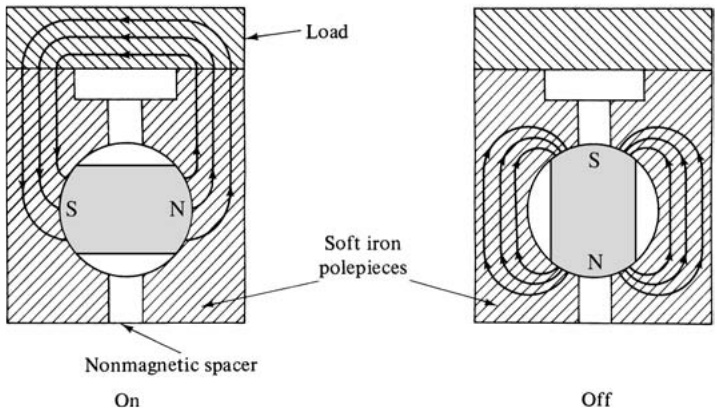

Fig. 14.20 Permanent magnet chuck.

Attractive forces are exploited in permanent-magnet chucks, which are gripping devices that can be used, for example, to hold steel objects in place for a machining or grinding operation. Naturally, there must be some means of turning off the holding force, and many ingenious ways of doing so have been contrived. The simplest is shown in Fig. 14.20. When the magnet is rotated into the vertical position, the flux is short-circuited by the pole pieces, which have a lower reluctance than the path through the load. Another holding application is the magnetic latch, widely used on kitchen cupboard doors. These are made in large volume at low cost, using ferrite magnets.

Magnets are used as separators. The most common application is the removal of scrap iron and steel from liquids and powdered or granular materials, such as grain or sugar. Loose nuts, bolts, nails, and wire are ubiquitous in any environment inhabited by modern man. Other uses are in the separation of ferromagnetic items from trash, and the separation of mineral ores on the basis of their magnetic permeabilities. A related use is the protection of cattle from ingested iron. Cattle can pick up along with their food bits of baling wire, nails, and other pieces of iron. This sharp-edged material lodges in the cow’s second stomach, which it can irritate or puncture, leading to infection and other complications, a malady known as “hardware disease.” The remedy is a cylindrical magnet of alnico or ferrite, 2 – 3 inches (5 – 7.5 cm) long and $\frac{1}{2}$ inch (1.25 cm) in diameter, with rounded ends, and protected with a thin plastic coating. It is simply dropped down the cow’s throat; it lodges in the second stomach and remains there for the life of the cow, attracting and holding any iron that enters.

Magnets can be used as large-scale positioners to transmit linear or rotary motion across a solid barrier. This is useful for positioning equipment inside a sealed space, such as a vacuum or controlled atmosphere chamber. Many designs have been proposed and constructed.

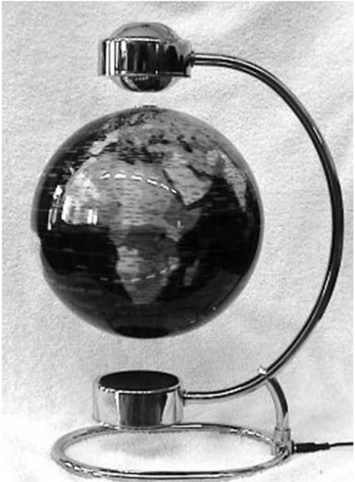

Fig. 14.21 Floating globe using magnetic suspension with feedback.

## 14.14.6 Magnetic Levitation

For centuries there had been dreams of magnetic levitation, i.e., the stable suspension in the air of a body made of iron or other magnetic material, without physical contact, by an artful arrangement of magnets exerting the proper attraction and repulsion. But such hopes were dashed in 1839 when S. Earnshaw [Trans. Cambridge Phil. Soc., 7 (1837– 1842) p. 97] proved that it could not be done. His theorem relates to both electrostatic and magnetostatic forces, or to any system of particles which exert forces on one another varying inversely as the square of the distance. For magnetic systems, Earnshaw’s theorem may be stated as follows: Stable levitation of one body by one or more other bodies is impossible, if all bodies in the system have a permeability greater than 1.

Stable levitation can be achieved for a positive permeability material if a position detector and feedback system are employed so that the force acting on the floating object is continuously adjusted, usually by varying the current through an electromagnet. This is the basis for various floating novelty items (see Fig. 14.21) as well as for nearly zero-friction suspensions for various kinds of rotating instruments and machines.

If diamagnetic materials are included in the system, stable levitation becomes possible without power input. Levitation of this kind is easiest with a perfect diamagnet, namely, a superconductor (Chapter 16). Figure 14.22 shows a bar magnet floating over the slightly concave surface of superconducting lead at 4K. The magnet is in effect supported by its own field, which cannot penetrate into the lead.

The permeability of a superconductor is zero, and there are many diamagnetic materials with permeabilities slightly less than unity. But there are no diamagnetic materials with intermediate values of μ, like 20.5. This means that only very light bodies, a few grams in weight, can be stably levitated at room temperature with the help of ordinary diamagnetic materials, like graphite or bismuth, because their flux-repelling powers are so feeble.

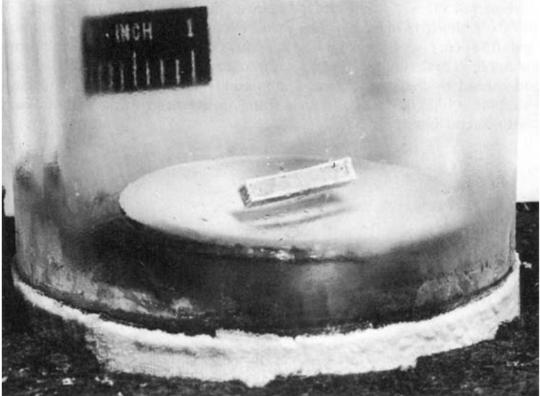

Fig. 14.22 Bar magnet suspended over a superconducting plate.

Quite large weights can be supported by the repulsion between permanent magnets, the lower one fixed to a base and the upper one to the underside of the load. Some lateral constraint is needed to make the load stable, but it need not be strong. The magnets must have high coercivity. Barium ferrite and rare-earth magnets are well suited to this application since they can be made in flat pieces of fairly large area, magnetized in the thickness direction. G. R. Polgreen has written a book mainly devoted to this subject [New Applications of Permanent Magnets, MacDonald (1966)].

## PROBLEMS

14.1 Show that the slope of the load line of a permanent magnet circuit is given by

$$
\frac {B _ {\mathrm{m}}}{H _ {\mathrm{m}}} = \frac {1 - N _ {\mathrm{d}}}{N _ {\mathrm{d}}} (\mathrm{SI}).
$$

14.2 Given two iron rods, identical except that one is magnetized lengthwise and the other is demagnetized, how could you tell them apart without using any experimental apparatus?

14.3 A cobalt steel magnet with $(BH)_{\mathrm{max}} = 1.0 \mathrm{MGOe}$ is $12 \mathrm{~cm}^{3}$ in volume. If the steel is replaced by an alnico magnet with $(BH)_{\mathrm{max}} = 7.5 \mathrm{MGOe}$, what volume of alnico will be required to produce the same field in the same air gap? What volume of material is required if the alnico is replaced by FeNdB, with $(BH)_{\mathrm{max}} = 40 \mathrm{MGOe}$? (This is actually not a very useful comparison, because the very high coercive fields of rare-earth magnets permit geometries not possible with steel or alnico.)

