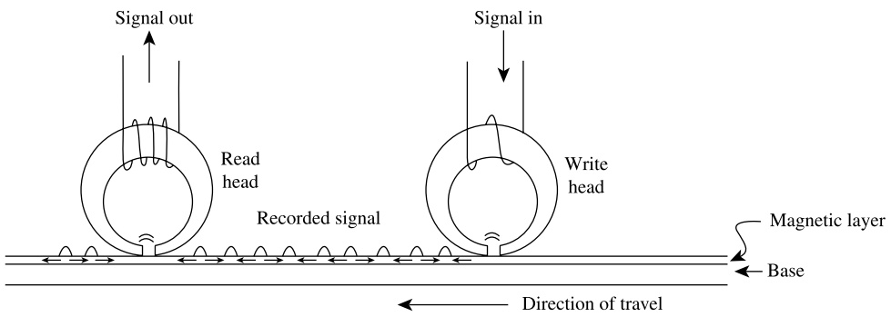
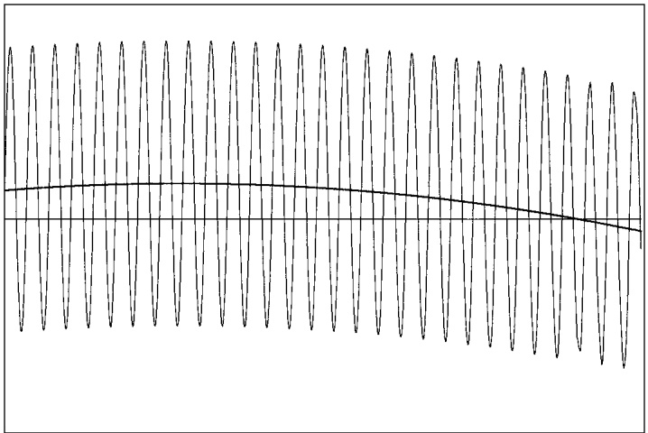
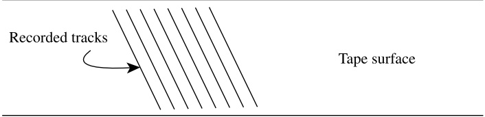
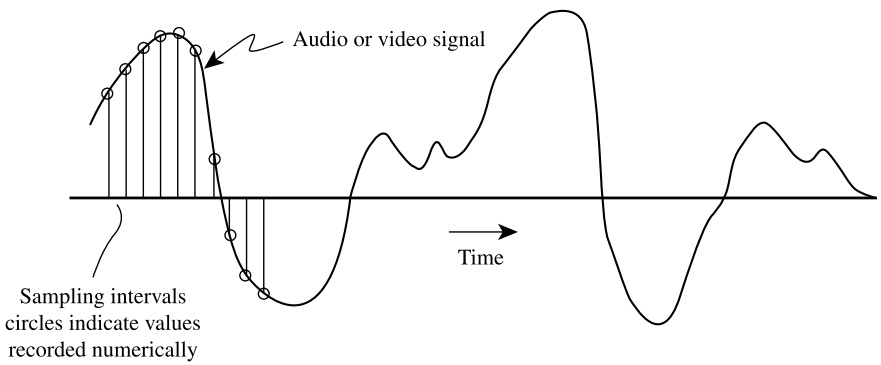
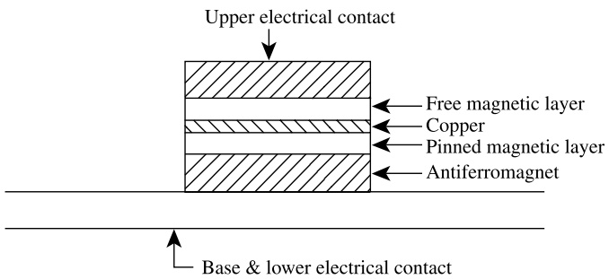
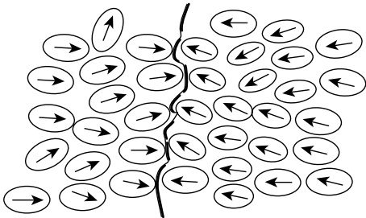
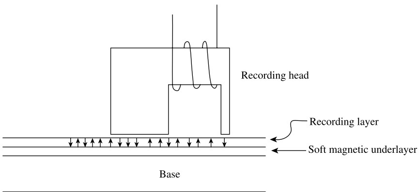
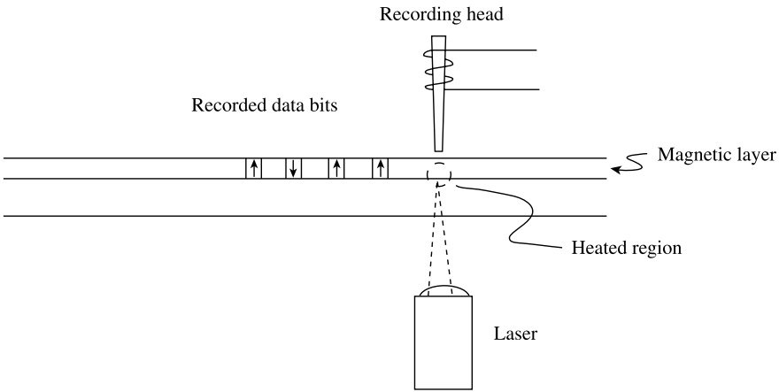
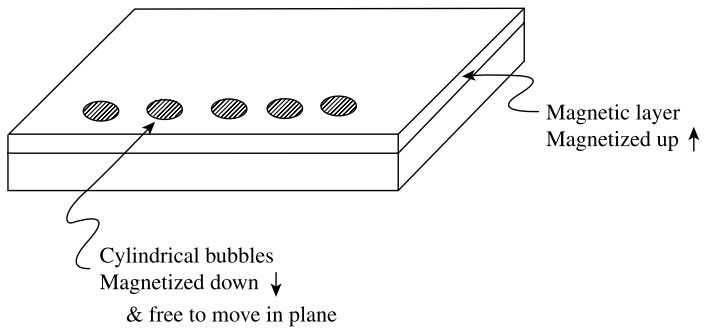

# MAGNETIC MATERIALS FOR RECORDING AND COMPUTERS

## 15.1 INTRODUCTION

Magnetic materials are an essential feature of digital data storage, and have served as the basis for systems of analog audio and video recording. Magnetic materials have been used in the central processing units of computers, and although for many years magnetic CPUs have been replaced by semiconductor materials in this role, magnetic materials may be making a return.

The materials and properties that are useful in these applications do not generally fall neatly into the usual categories of soft and hard magnetics. Furthermore, the increasing miniaturization of computer components means that the magnetic materials in computer and recording devices are commonly made and used in the form of thin films. For these reasons, it seems appropriate to consider magnetic materials for recording and computers in a separate chapter.

Nicola Spaldin has written a text on magnetic materials emphasizing computer applications: Magnetic Materials, Fundamentals and Device Applications, Cambridge University Press (2003).

## 15.2 MAGNETIC RECORDING

## 15.2.1 Analog Audio and Video Recording

Sound was first recorded on a magnetic medium—a steel wire—in 1898, but magnetic audio recording was not seriously developed until the 1930s. This early work was done mostly in Germany, especially during World War II. The recording medium was no longer wire or metal ribbon, but a plastic tape coated with a flexible magnetic layer. In addition to better sound quality, magnetic tape recordings could extend over much longer unbroken time periods, and were less subject to mechanical damage, and occupied less space than the gramophone-style (disk and needle) recordings they replaced. Magnetic tape can also be rerecorded.

<small>Introduction to Magnetic Materials, Second Edition. By B. D. Cullity and C. D. Graham</small>

<small>Copyright # 2009 the Institute of Electrical and Electronics Engineers, Inc.</small>

Tape recording equipment rapidly came into use by radio studios and networks in the 1950s. Not only could entire programs be prerecorded, but errors could be edited out. Magnetic recording as a consumer product only became popular with the introduction of the audio tape cassette in 1963. Prerecorded music tape cassettes as well as blank tape cassettes on which the user could make recordings were sold in large quantities and remain available in 2007. However, starting about 1980, the digital audio compact disk, or CD, began to replace the cassette tape as a medium for prerecorded music, and recordable CDs are now (2007) also common.

Video recording required modifications in tape recording technology, because of the much greater amount of information to be stored per unit of time. Both the magnetic material used for recording and the geometry of the recording path were changed, and there was a famous and destructive battle between two different video cassette formats, Betamax and VHS, which was won by VHS largely because it provided longer recording times in its early versions.

## 15.3 PRINCIPLES OF MAGNETIC RECORDING

The basic arrangement for analog magnetic recording on tape, as well as for digital magnetic recording on tape and on disk, is shown in Fig. 15.1. A flexible or rigid substrate coated with a magnetic layer is moved past a write head, which is effectively a miniature electromagnet. A current in the winding of the write head magnetizes the head material, which creates a magnetic field in the head gap. The fringing field from the gap magnetizes the tape material in a pattern that reproduces the information to be recorded. The information is recorded in a stripe, called a track, running parallel to the length of the tape or in a circular path on a disk.

To read back the recorded information, the recorded track passes under a read head, which is similar to the write head. In low-cost audio recorders, the same head may be used for both reading and writing. The fringing magnetic field from the recorded tape magnetizes the read head as it passes by the head gap, and the changing magnetization in the head generates a signal voltage in the head winding. This voltage contains the recorded information, and can be amplified to recreate the recorded sound or video. Note that since the read head coil voltage is proportional to the time derivative of the flux change in the head, the amplification must include an integration step.

Fig. 15.1 Principle of magnetic recording.

## 15.3.1 Materials Considerations

The write and read heads must be high-permeability, low-coercivity magnetic materials capable of operating at reasonably high frequencies. Originally, very thin permalloy laminations were used, and amorphous alloys have been tried. The usual choice for analog recording, however, is a magnetically soft ferrite.

The recording medium must have low enough coercivity to be written on, high enough coercivity to resist local demagnetizing fields and retain a recorded pattern indefinitely, and high enough magnetization to provide a readable signal to the read head. The usual choice for audio recording is $\gamma-\mathrm{Fe}_{2}\mathrm{O}_{3}$ (maghemite) particles in a flexible matrix. The packing fraction of the particles in the coating is about 0.4. The crystal and spin structure of $\gamma-\mathrm{Fe}_{2}\mathrm{O}_{3}$ have already been described (Section 6.6); it is a ferrimagnetic spinel with $\sigma_{s}=$ 76 emu/g or $\mathrm{A m^{2}/kg. (M_{s}=390 emu/cm^{3} or 3.9\times10^{4} A/m)}$ . The oxide is in the form of elongated single-domain particles, about 0.1 mm in diameter and with a length/ diameter ratio near 6. They owe their coercivity, 250– 300 Oe, to shape anisotropy. Since this value is only about a tenth of that expected for coherent rotation $(2\pi M_{\mathrm{s}} = 2450$ Oe), the magnetization of these particles must reverse incoherently. The particles in the tape coating are aligned by a field during the coating process so that their long axes are aligned parallel with the length of the tape; this is done in order to make the remanence, after magnetization in that direction, as large as possible.

The elongated oxide particles are made from hydrated ferric oxide (a-FeO . OH) particles, which are already elongated, in the following steps: (1) dehydration to hematite $(\alpha-\mathrm{Fe}_{2}\mathrm{O}_{3})$ (2) reduction by hydrogen at $400^{\circ}\mathrm{C}$ to magnetite $(Fe_{3}O_{4})$ ; and (3) careful oxidation at about $250^{\circ}\mathrm{C}$ to $\gamma-\mathrm{Fe}_{2}\mathrm{O}_{3}$ . The addition of cobalt, either in solid solution or as an adsorbed surface layer, has beneficial effects on the magnetic properties.

Chromium dioxide $(CrO_{2})$ is commonly used for video recording tape, and also for higher grades of audio recording tape. This material is one of nature’s rarities, a ferromagnetic oxide (Section 4.5). It has $\sigma_{s}$ equal to 90 – 100 emu/g or $\mathrm{A m^{2}/kg}$ , depending on how it is made, and fine particles can be prepared with greater elongations and smoother surfaces than $\gamma-\mathrm{Fe}_{2}\mathrm{O}_{3}$ . Its coercivity is therefore higher, about 400 Oe.

Audio tape has been made using Fe or FeCo particles instead of oxide particles, and also using a continuous magnetic metal alloy layer, usually based on Co.

## 15.3.2 ac Bias

To minimize distortion due to the nonlinear and irreversible nature of the hysteresis loop of the recording medium, a sinusoidal current at about 100 kHz is superimposed on the recording signal current, and the combined signal is fed to the recording head. Figure 15.2 illustrates this combined signal. The ac bias field is at a higher frequency than the highest frequency to be recorded, and of sufficient magnitude to drive the material of the tape near magnetic saturation. Under these conditions, a section of tape passing under the write head sees a strong ac field superimposed on an almost constant dc field, which is the signal to be recorded. The resulting remanent magnetization in the tape, after the tape has left the head, is very nearly proportional to the value of the signal to be recorded. The strength of the ac bias current must be adjusted to match the properties of the magnetic material of the tape; some recorders provide a manual switch to adjust the bias and some use a system of coded notches in the audio cassette to automatically set the correct bias.

Fig. 15.2 Combined bias signal (light line) and recorded signal (heavy line) fed to the write head. This signal corresponds to the field in the head gap, which magnetizes the tape.

## 15.3.3 Video Recording

The recording of analog video signals requires much higher recording density than audio. Successful video recording required the use of better recording material, usually $\mathrm{CrO_{2}}$ , as well as a different recording geometry. By the use of a fairly complex tape path through the machine, and a pair of write heads mounted in a rapidly rotating drum, video information is recorded in a series of diagonal tracks across the tape, as in Fig. 15.3. Each diagonal track carries the information for one sweep of the electron beam across the face of the picture tube.

Just as analog audio recording was largely replaced by digital audio recording in the form of the CD, the same thing happened about ten years later to video recording, in the form of the digital video (or versatile) disk (DVD). Both the CD and the DVD exist in three forms, the nonwriteable, prerecorded; the writeable but not rewritable; and the rewriteable or rerecordable versions.

Magnetic recording on tape and on disk are physically almost identical processes. On tape (except video tape), the recorded tracks run parallel to the tape axis, so skipping over unwanted information requires speeding up and then slowing down the tape drive—a slow operation. On disks, the recorded tracks are a series of concentric circles, and the heads can jump very quickly from track to track in order to recover a desired string of data.

Fig. 15.3 Recorded pattern on a video tape, produced by a pair of rotating write heads.

## 15.4 MAGNETIC DIGITAL RECORDING

It is first necessary to distinguish between the digital recording of analog data, and the digital recording of digital data. In the former, the analog signal is sampled at a frequency higher than the maximum frequency to be recorded, and each sample point is converted to a numerical value, as suggested in Fig. 15.4. This string of numbers, coded in 1s and 0s, must be recorded, and must be retrievable at a rate that exactly matches the original signal. It is desirable to make the recorded data occupy the smallest possible space, but not to increase the speed of the playback. The recorded data is usually in the form of fairly long unbroken stretches (complete songs or video sequences).

Direct recording of digital data is somewhat different. In addition to the motivation to minimize the volume occupied by the recording, there is pressure to speed up the recording and the reading processes. Whether the recorded information is a program or data or a picture, the user wants it to be loaded and ready to use in the shortest possible time. The information may be in very short strings, very long strings, or anything in between.

In either case, the information is recorded as a string of 1s and 0s, which greatly simplifies the recording process. An ac bias signal is no longer needed, and the recorded signal need not be proportional to the input signal. The standard method is to simply magnetize short bits of the recording surface, approximately equal in length to the gap in the recording head, in a direction parallel or antiparallel to the track length. This is known as longitudinal recording. In reading back the information, the magnetic flux at the boundary between bits magnetized in opposite directions is detected; these are called flux reversals.

In the following sections, we will deal with digital recording of digital data.

## 15.4.1 Magnetoresistive Read Heads

As recorded track widths grew narrower and bit lengths got shorter, the flux available at a flux reversal was no longer sufficient to produce a reliable signal in a conventional inductive read head. The solution lay in the phenomenon of magnetoresistance, which is the change in resistance of a material when subjected to a magnetic field. All materials show magnetoresistance, but the effect is largest, and also anisotropic (depending on the relative directions of the field and the current) in ferromagnets. So thin films of Ni –Fe alloy were used to detect flux reversals in the first magnetoresistive read heads. The change in resistance of the magnetic layer when a saturating field is applied is about 2%.

Fig. 15.4 Digitizing of analog information.

A different head structure evolved after the discovery of the giant magnetoresistive effect, or GMR. This phenomenon was first studied in multilayer films of alternating layers of Fe and Cr. There is a long-range exchange through the Cr layer, which acts to couple the moments of the Fe layers either parallel or antiparallel, depending on the thickness of the Cr. If the coupling is antiparallel, or antiferromagnetic, the Fe layers will be magnetized in alternating opposite directions in zero field, but a sufficiently strong applied field can align all the moments in one direction. The electrical resistance of the stack is substantially lowered when the moments are forced to lie parallel. This is the giant magnetoresistive effect; it is not a property of a material, but of a stack of thin films of alternating composition.

The first GMR experiments were done with the samples at low temperature, and required strong applied fields (kOe) to switch the magnetization directions. Extensive development work, drawing on both thin-film deposition technology and on the quantum theory of solids, led to a relatively simple practical device, operating at room temperature, which is known as the spin valve. An example is shown in Fig. 15.5. Two ferromagnetic NiFe layers are separated by a layer of copper, which provides weak anitferromagnetic coupling between the two NiFe layers. One of the NiFe layers is in exchange contact with an antiferromagnetic layer (FeMn or IrMn), which holds the magnetization direction of the adjacent NiFe fixed in fields up to about 100 Oe (8 kA/m). This is called the fixed layer or the reference layer and the other NiFe layer is the free layer. A small field applied to this composite structure will rotate the direction of magnetization of the free layer, which will change the electrical resistance of the device.

The GMR spin valves used as read heads in hard disk drives are more complex. The ferromagnetic layers are themselves layered and there may be a permanent magnet layer to hold the magnetic direction of the fixed layer in a desired direction. The reference layer is actually a triple layer of CoFe –Ru –CoFe, with the Ru layer thickness chosen to provide strong antiferromagnetic coupling between the CoFe layers. This results in a strongly directional CoFe layer in a substructure with no net magnetization. There are also layers to carry the current through the head to measure the resistance change, and “seed” layers to assure good adhesion of the films. The structure may have up to a dozen distinct layers, not counting the magnetic shield layers that provide magnetic isolation from the write head and from the neighboring bits.

Fig. 15.5 Basic structure of a spin valve.

In the final structure, the reference layer is magnetized perpendicular to the recorded surface, and the free layer is normally oriented perpendicular to the reference layer. The magnetic flux from the flux transition in the recorded track rotates the direction of the free layer by about $10^{\circ}$ , resulting in a resistance change of a few percent. It is not desirable to have the magnetization in the free layer jump by 90 or $180^{\circ}$ in the presence of a flux reversal. This would give a bigger signal, but a noisier one.

The write head is also prepared using thin film technology, and is deposited on top of the read head in a continuous operation. More than 10,000 head assemblies are made simultaneously on a single substrate.

## 15.4.2 Colossal Magnetoresistance

Even larger values of magnetoresistance, amounting to a transition from an insulating to a conducting state, have been observed in perovskites containing Mn. Since the term giant magnetoresistance was already taken, this effect is called colossal magnetoresistance. However, very large fields are required to drive the transition, and no applications have yet been announced.

## 15.4.3 Digital Recording Media

Here it is necessary to distinguish between recording on flexible media and on rigid media. That is, between recording on magnetic tape, which can be removed from the recording device and read by a different machine, and recording on a hard disk which is permanently installed in a sealed unit so that the recording and reading are always performed by the same mechanical system. Recording on flexible or “floppy” disks is similar to recording on tape, with the recorded tracks forming a series of concentric circles on the disk. Floppy disks have been substantially replaced by small semiconductor storage units (flash memory) or by magneto-optic disk recording.

For high-density magnetic tape recording, $\gamma-\mathrm{Fe}_{2}\mathrm{O}_{3}$ particles have been replaced by metal particles (Fe or CoFe) and inductive read heads have been replaced by magnetoresistive heads. Smoother tape surfaces let the writing and reading heads pass closer to the magnetic media; in tape systems, the heads are in physical contact with the tape surface. Improved positioning systems allow narrower recorded tracks. For a variety of reasons—the flexibility of the magnetic media, the requirement for the tape to be removable and playable in multiple units, and so to be exposed to varying conditions, dust, etc., —the recording density of magnetic tape is typically a factor of 10 – 100 lower than that of hard disk drives. However, tape remains useful for long-term storage of large amounts of data, e.g. business and medical records, census and weather information, or scientific data from spacecraft. A severe problem with long-term data storage on magnetic tape is that the tape and the data may survive, but the machines to read the tape may disappear as new and better machines are developed. The only obvious solution is to rerecord the data onto newer media before the old machines expire, which can be a very expensive operation.

The density of recorded information on hard disk drives has increased steadily and rapidly by about a factor of $10^{8}$ since the first hard disk drive was introduced in 1956, and the cost per unit of storage has dropped similarly. A major contribution to this remarkable increase has been the improvement in the recording medium. The disk in a hard disk drive consists of a polished aluminum alloy or glass substrate. The earliest disk drives used $\gamma-\mathrm{Fe}_{2}\mathrm{O}_{3}$ particles borrowed directly from the technology of magnetic tape. A variety of other materials has been used, including both crystalline and amorphous metallic layers, mostly based on cobalt because of its relatively high magnetization, high anisotropy, and good corrosion resistance.

Fig. 15.6 Structure of the magnetic layer of a hard disk drive. The heavy line is the boundary between two recorded data bits.

The current material of choice is cobalt, with additions of Pt to increase the anisotropy and of Cr to lower the magnetization. Control of the seed layer and of the growth conditions allows the magnetic material to form in columnar grains about 10 mm in diameter, separated by nonmagnetic low-density oxide-filled spaces only a few nm thick. Each magnetic particle acts as a single domain, so that the boundary between recorded bits follows an irregular line between the particles, as in Fig. 15.6. The irregularity of this boundary increases the width of the flux reversal, and sets a limit to the minimum length of a recorded bit.

A careful balance is required to keep the anisotropy high enough so that the recorded bits are stable against thermal demagnetization but low enough so that bits can be written with the available field from the write head, while the level of magnetization is high enough so that the recorded bits can be reliably read with the available head technology.

The heads in a hard disk drive are not in contact with the recorded surface, but “fly” just above the surface on a flowing air layer trapped between the head and the disk surface. The flying height must be comparable to the bit length, which means the disk surface must be highly polished and flat. The positioning of the heads with respect to the recorded track also requires an elaborate and fast-acting control system.

## 15.5 PERPENDICULAR RECORDING

For many years, there have been advocates of perpendicular recording; that is, of redesigning the recording system so that the magnetized bits are perpendicular rather than parallel to the disk surface. The arguments for perpendicular recording were plausible, and were taken seriously, but advances in longitudinal recording were so successful that a basic change in the system was unnecessary. Early in the twenty-first century, the situation changed, and perpendicular recording was finally brought into production. The geometry of the recording head is indicated in Fig. 15.7; the read head is a GMR design essentially the same as that used for longitudinal recording.

The major advantages of perpendicular recording are that higher magnetizing fields can be applied to the recording medium, allowing the use of material with higher anisotropy and greater stability, and that the bit length can be reduced, packing more bits per unit length of track. A requirement, in addition to the redesign of the write head, is the addition of a soft magnetic underlayer to the disk, between the actual recording layer and the nonmagnetic support layer. This layer provides a path for the magnetic flux to return to the head, as indicated in the figure. The return flux is spread over a much larger area than the area of the writing gap, so the field strength is much lower and is insufficient to disturb the recorded bits.

Fig. 15.7 Perpendicular recording geometry.

## 15.6 POSSIBLE FUTURE DEVELOPMENTS

Two methods have been suggested to permit even higher recording densities: thermally assisted writing and patterned media. If the temperature of the recording medium is increased, its anisotropy will be lowered. Therefore a medium with anisotropy too high to be recorded at room temperature could be recordable at say $200^{\circ}\mathrm{C},$ and the recorded data would be highly stable when the temperature returns to normal. Local heating could be produced with a laser beam. Patterned media would replace the macroscopically homogeneous recording surface, magnetized locally by the write head, with magnetic tracks or even individual magnetic bits isolated from the rest of the media surface by physical gaps or by nonmagnetic materials. In principle this would allow the tracks to be narrower or the bits smaller, or both. The two approaches are not mutually exclusive.

## 15.7 MAGNETO-OPTIC RECORDING

Most recording on compact disks and digital versatile disks (CDs and DVDs) is purely optical. Single-write disks use a dye layer whose optical properties are changed by highintensity laser illumination and read by low-intensity laser light. Disks capable of multiple writing and rewriting replace the dye layer with a phase-change layer. In both cases no magnetic phenomena are involved. There are, however, also magneto-optic disk recording systems. Typically the magnetic layer is an amorphous alloy of terbium and iron –cobalt, which has a high anisotropy and can be magnetized perpendicular to the disk surface. Digital bits are recorded by simultaneously applying a perpendicular magnetic field to one side of the disk and a thermal pulse from a laser to the other side of the disk, as indicated in Fig. 15.8. The coercive field of the amorphous layer decreases with increasing temperature, so a bit is easier to write at elevated temperature, and will be stable against demagnetizing fields back at room temperature. This is an example of thermo-magnetic writing. The recorded information could be read by an inductive or a magnetoresistive read head, but in practice the Kerr effect is used. The plane of polarization of a reflected laser light beam is rotated in opposite directions, depending on the direction of magnetization of the reflecting surface. This change in polarization direction can be detected and used to read the recorded information.

Fig. 15.8 Magneto-optic recording.

## 15.8 MAGNETIC MEMORY

## 15.8.1 Brief History

The first large-scale computers after the vacuum-tube era used magnetic memory. Each bit of information was stored as clockwise or counterclockwise magnetization of a small ferrite ring, threaded with wires to provide the fields for writing and reading. The ferrite rings were called cores, and the memory unit was called core memory, a term sometimes still heard. This system did not lend itself to scaling down in size or in cost, and a variety of replacement technologies based on magnetic thin films were suggested and investigated. However, semiconductor technology intervened, and semiconductor random-access memory (RAM) replaced magnetic memory.

In the 1970s, a great deal of research and development was devoted to magnetic bubble memory technology, which was seen as a replacement for semiconductor memory. A large area of single crystal magnetic garnet grown epitaxially on a nonmagnetic garnet substrate can be magnetized perpendicular to the substrate surface. When a reverse field is applied, cylindrical domains of reverse magnetization appear. When viewed from above, these domains look and act somewhat like bubbles, which explains their name (see Fig. 15.9). In a suitably defect-free crystal, the bubbles can move easily in the plane of the device, and the addition of ferromagnetic surface “tracks,” usually thin-film NiFe layers, can confine the bubbles to predefined paths. Finally, the application of an in-plane rotating magnetic field can move the bubbles in a stepwise fashion, one step per revolution of the field, along a closed path. With the addition of facilities to create and destroy individual bubbles, and an optical or magnetic bubble sensor, a bubble domain chip can store and process information. It has the great virtue of being nonvolatile, meaning that the stored information remains safely in place when the power is turned off, eliminating the annoying lengthy start-up sequence required with volatile semiconductor memory. However, bubble memory was never able to compete with semiconductor memory in storage density or cost, and it quietly disappeared after about 10 years of intense effort.

Fig. 15.9 Magnetic bubbles.

## 15.8.2 Magnetic Random Access Memory

The discovery and exploitation of the giant magnetoresistance (GMR) effect, beginning in the late 1980s, rekindled interest in the possibility of a magnetic random access memory (MRAM). The first commercial MRAM units, available in 2006, made use of magnetic tunnel junctions: two ferromagnetic layers separated by a very thin dielectric tunneling layer, usually magnesium oxide. The physics of the device differs from that of the GMR read head, in that the current between the two magnetic layers tunnels through the barrier layer, but the result is basically the same: The resistance to current flow depends on the relative orientation of the directions of magnetization in the two outer layers. When the magnetizations are parallel, the resistance is minimum. Also in the MRAM device, the magnetization of the free layer is either parallel or antiparallel to that of the fixed layer except during switching. In the GMR head, the free layer magnetization rotates away from its stable orientation, but does not reverse direction. Various ingenious refinements are added to make the device operate reliably, and almost certainly additional changes will be made.

## 15.8.3 Future Possibilities

Information storage using the presence or absence of domain walls in a magnetic channel has been proposed as a way to increase the density of stored information. Furthermore, it may be possible to move domain walls by a current flow, which could eliminate the need for magnetic fields to read and write information. A variety of other (nonmagnetic) high-density information storage systems have been suggested.

