# MAGNETIC PROPERTIES OF SUPERCONDUCTORS

## 16.1 INTRODUCTION

The phenomenon of superconductivity has been known since 1911, but serious interest in superconductors as engineering materials dates to the discovery of type II superconductors capable of carrying high current densities in the presence of high fields. This began about 1960, and led to the development of useful superconducting magnets for service in laboratories, in high-energy particle accelerators, and (later) in magnetic resonance imaging devices for medical use. Then in 1986, a new class of superconductors was discovered with transition temperatures much higher than those known previously. These high $T_{c}$ superconductors (where $T_{c}$ means critical temperature, not Curie temperature) continue to present a theoretical challenge as well as a technological opportunity.

Superconductivity and magnetism interact and overlap in various ways. Superconducting magnets offer a relatively inexpensive way to attain high magnetic fields for experimental work, so clearly the behavior of the superconducting materials used in magnets is of practical importance. In the scientific study of superconductors, their behavior in magnetic fields, and their apparent magnetization, are often important. We therefore consider briefly the magnetic properties of superconductors, and some special considerations that arise when magnetic instrumentation is used to study superconductors.

One of the fundamental properties of superconductors is the Meissner effect, which states that inside a superconductor (in the superconducting state) the magnetic flux density is zero. This is not a consequence of zero electrical resistance, but an additional characteristic of superconductivity. From the basic equation of magnetism $B = H + 4\pi M$ $[B = \mu_0(H + M)]$ , if $B$ = 0 and $H > 0$ , then $M <   0$ . That is, a superconductor subjected to a positive magnetic field develops a negative magnetization. The negative magnetization is not caused by the alignment or creation of magnetic moments on the constituent atoms. It results from a real electric current flowing (without resistance) in a thin shell around the outer surface of the superconductor. But, as noted in Chapter 1, a magnetic moment and a current shell are indistinguishable by any external measurement.

An interesting reciprocal relationship thus exists between the representation of magnetic and superconducting behavior. In a magnetic material, the magnetization arises from the alignment of local magnetic moments, or of electron spins, throughout the volume of the material. However, the magnetization may be considered to result from a current flowing in a shell around the outside of the sample; this representation is used in many textbook treatments of magnetization. In a superconductor, the magnetic flux in the sample is cancelled $(B = 0)$ by an actual supercurrent flowing around the surface of the sample. However, the external effects of this current may be represented by a (negative) bulk magnetization of the entire sample; it is therefore customary to attribute a magnetization to a superconductor in a magnetic field. Note that the condition $B=0$ in the superconducting state requires that permeability $(\mu = B / H)$ also be zero, and the condition $H + 4\pi M = 0$ or $\mu_0(H + M) = 0$ requires that susceptibility $(\chi = M / H)$ be $-1 / 4\pi (\mathrm{cgs})$ or $-1$ (SI)

The superconducting magnetization can be measured by any of the measurement techniques applicable to magnetic materials. Three special considerations apply:

1. The superconducting magnetization is generally fairly small, less than 1 kG or 0.1 T or 800 kA/m. This is not a major problem except when dealing with very small samples, thin films, etc.

2. The measurements must be carried out below room temperature, since no known superconductor remains superconducting much above 130K. Also it is common to make measurements as a function of temperature over a wide temperature range.

3. Because the magnetization is negative, the demagnetizing field adds to the applied field rather than subtracting from it. This takes some mental adjustment, and leads to some magnetic behavior that would not otherwise occur.

Although some important basic measurements on superconductors have been made using ring samples (thus avoiding demagnetizing effects), ring samples are not regularly used. There are several reasons for this: engineering applications of superconductors rarely use a ring geometry; many high-field, high-temperature superconductors are brittle and difficult to make in the form of rings; applying windings to a ring sample is tedious; and it is not easily possible to apply large fields to a ring sample.

Magnetic measurements have significant advantages over direct resistance measurements on superconductors for materials characterization. Magnetic measurements avoid the attaching of voltage and current leads to the sample, which are frequent sources of trouble. Some superconducting materials are difficult to produce in reasonably long lengths with small, uniform cross-sections, as required for resistance measurements, whereas magnetic measurements can be made on small pellets of various shapes.

It the literature of superconductivity negative magnetization is sometimes plotted as a positive quantity, so the initial magnetization curve has positive slope. However, in a book on magnetic materials, it seems preferable to plot negative magnetization as a negative quantity, to emphasize the difference in the behavior of magnetic and superconducting materials.

## 16.2 TYPE I SUPERCONDUCTORS

Most elemental superconductors and a few alloy superconductors show type I behavior. The magnetization curve of a type I superconductor with a demagnetizing factor N = 0 is shown in Fig. 16.1. Such a sample in practice would be either a thin ring, or a long thin rod. The (negative) magnetization increases linearly with field up to a critical field $H_{c}$ and then drops abruptly to zero as the superconducting state is destroyed and the sample becomes a normal conductor. When the field is lowered, the curve is retraced (in the ideal case with no hysteresis). A negative field produces a positive magnetization.

The critical field corresponds to a critical current in the rod; the Silsbee rule (also known as the Silsbee hypothesis) says that the maximum current that can be carried in a superconductor is the current that produces the critical field at the surface. For a cylindrical sample, $H_{\mathrm{c}} = i_{\mathrm{c}} / 5r$ (H in Oersted, r in cm) or $H_{\mathrm{c}} = i_{\mathrm{c}} / 2\pi r$ (H in A/m, r in m). When the critical field or the critical current is exceeded, the surface layer carrying the supercurrent becomes normal. This decreases the superconducting diameter r, which increases the surface field (if i remains constant). This further shrinks the superconducting diameter, which therefore collapses to zero so the wire becomes completely normal.

If the sample is not a ring or an infinite rod, and therefore has a non-zero demagnetizing factor, the field acting on the sample becomes $H = H_{\mathrm{a}} - NM,$ and since $M$ is negative, the field acting on the sample is increased by the magnetization of the sample. The (negative) magnetization therefore rises more steeply with applied field, as indicated in Fig. 16.2. The critical field/critical current limit is reached at the same value of magnetization, but above this field the sample enters the intermediate state, which is a mixture of superconducting and normal regions, in a proportion that adjusts the net magnetization so as to keep the average field in the sample just equal to $H_{c}$ The increasing (negative) magnetization curve is given simply by

$$
- M = \frac {H _ {\mathrm{a}}}{(1 - \mathrm{N})},
$$

and the decreasing (negative) magnetization is given by

$$
- M = \frac {(H _ {\mathrm{a}} - H _ {\mathrm{c}})}{\mathrm{N}} (\text { both   SI }).
$$

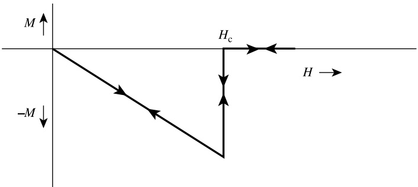

Fig. 16.1 Magnetic behavior of an ideal type I superconductor.

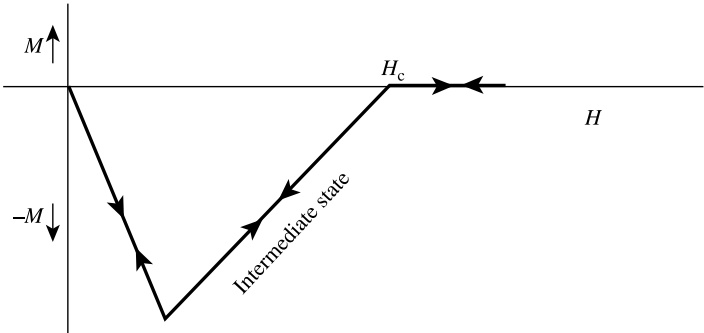

Fig. 16.2 Magnetic behavior of an ideal type I superconductor with nonzero demagnetizing factor N.

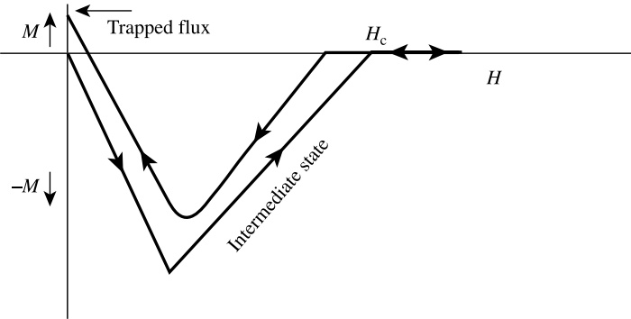

Fig. 16.3 Hysteretic behavior of a type I superconductor $(N \neq 0)$

When the field is decreased, in an ideal sample the curves are exactly retraced. In real samples, there may be some hysteresis, resulting a small amount of trapped flux at $H_{a}=0$ which results in a small positive magnetization, as indicated in Fig. 16.3.

The topography of the intermediate state is variable, and is different at the sample surface and in the interior. There is a positive surface energy associated with the boundary between the superconducting and the normal state, and the magnitude of this energy naturally influences the structure of the intermediate state. There are some parallels between the development of the domain structure of a ferromagnetic sample and the superconducting/normal structure of the intermediate state.

## 16.3 TYPE II SUPERCONDUCTORS

The essential difference between a type I and a type II superconductor is that, in a type II, the surface energy of the superconducting/normal interface is negative. When a field is applied to a type II superconductor, a negative magnetization is produced by a surface current, just as in a type I, but only up to a lower critical field $H_{\mathrm{c1}}$ . At this field, flux enters the sample in the form of individual flux lines, or fluxoids, each carrying a single flux quantum, of magnitude $\phi_0 = hc / 2e$ , where h is Planck’s constant, c is the velocity of light, and e is the charge on the electron. The numerical value of $\phi_{0}$ is $2.07 \times 10^{-7} \mathrm{~G cm}^{2}$ (Maxwell) or $2.07 \times 10^{-15} \mathrm{~Wb}$ . A type II superconductor containing flux lines is said to be in the mixed state, which is to be distinguished from the intermediate state of a type I superconductor. If the flux lines can move freely, they will enter the sample at $H = H_{\mathrm{c1}}$ and pack together until they are spaced closely enough to begin to repel one another. The (negative) magnetization thus drops sharply at first, then more slowly as the flux lines are packed more and more tightly together. Finally, at the upper critical field $H_{\mathrm{c2}}$ , the sample becomes completely normal. The magnetization curve has the general shape shown in Fig. 16.4. The curve is retraced on lowering the field back to zero.

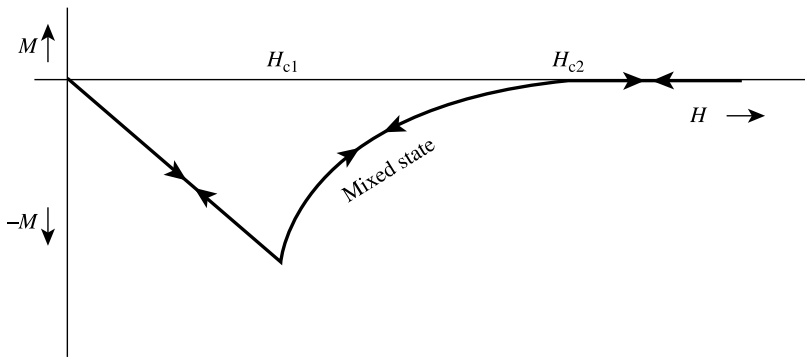

Fig. 16.4 Magnetic behavior of an ideal type II superconductor $(N = 0)$

However, the flux lines generally do not move freely in practical type II superconductors such as NbTi and $\mathrm{Nb}_{3}\mathrm{Sn}$ . For engineering applications, it is desirable that the flux lines are pinned by interactions with defects in the structure. If the flux lines are completely pinned, the behavior of the sample is given by the Bean critical state model [C. P. Bean, Phys. Rev. Lett., 8 (1962) p. 250]. In this case, as an external field is applied to a slab of superconductor, the surface shielding current density rises to a maximum value $J_{C}$ characteristic of the material. As the field is increased, this current density extends more and more deeply into the slab, until it occupies the entire volume. The (negative) magnetization produced by this current distribution increases with applied field and reaches a maximum when full current flows throughout the sample (condition $H_{2}$ in Fig. 16.5a). When the field is reversed, the current density at the surface reverses, giving a field distribution as shown in Fig. 16.5b. The behavior is, of course, highly hysteretic, with large values of “trapped flux” in the sample when the field is reduced to zero, as in Fig. 16.5c. Equations giving the form of the magnetization vs. field behavior for samples of various geometries according to the Bean model are given by R. B. Goldfarb, M. Lelental, and C. A. Thompson, in Magnetic Susceptibility of Superconductors and Other Spin Systems [R. A. Hein, T. L. Francavilla, and D. H. Liebenberg, eds., Plenum Press (1992)].

For most applications of type II superconductors, specifically to create high magnetic fields, complete flux pinning is desirable, and the Bean model is a reasonable approximation. However, perfect pinning is an ideal case, and often there is some degree of flux creep due to motion of the flux lines. Flux creep appears as a resistance, and therefore as the production of heat, in a superconducting coil. The phenomenon was first clearly identified in a series of experiments by Kim et al., using a superconducting hollow cylinder as a sample, and comparing the magnetic field measured inside and outside the cylinder (see Fig. 16.6).

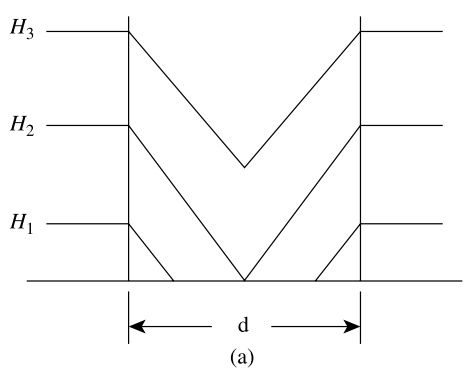

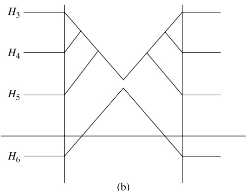

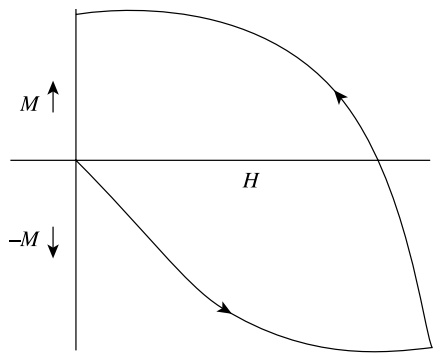

(c)

Fig. 16.5 Field penetration in a type II hard (flux-pinned) superconductor slab of thickness d, according to the Bean model. (a) Applied field increasing in steps $H_{1}$ , $H_{2}$ $H_{3}$ . (b) Field decreasing in steps $H_{3}$ $H_{4}$ $H_{5}$ $H_{6}$ (c) Resulting magnetization behavior.

In a superconducting solenoid used to create a high field, the magnetic field at the midplane of the coil is directed along the axis of the solenoid, but in opposite directions at the inside and outside diameters. At the end-plane of the solenoid, however, the field direction is radial (Fig. 16.7). In both cases, the field is perpendicular to the direction of current flow, so superconductors for use in high-field solenoids must be tested in an appropriate field geometry. A short length of the conductor is placed across the inside diameter of a Bitter-type resistive magnet or a superconducting solenoid, connected to an appropriate current source, and anchored securely to resist the large lateral force resulting from the flow of a large current perpendicular to a large magnetic field. Then at a series of fixed fields, the current is increased until a voltage drop across the short test length is first detected.

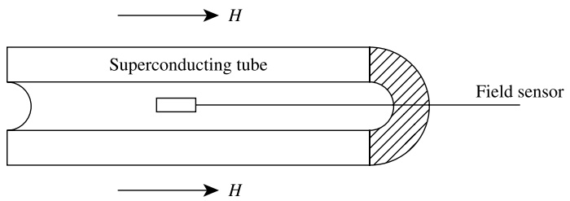

Fig. 16.6 Geometry of the Kim experiments.

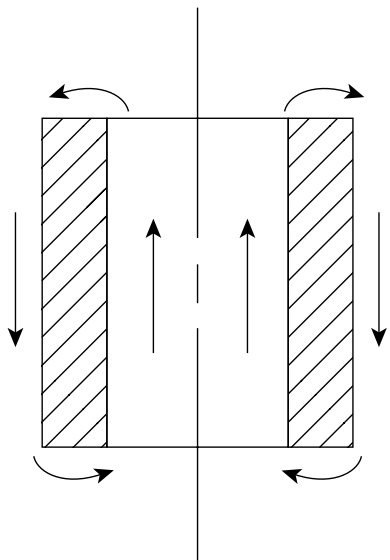

Fig. 16.7 Field distribution around a superconducting solenoid.

Note that if the superconducting conductor is a wire, there is no difference in the geometry of a conductor at the central plane or at the end-plane of the solenoid. In the case of superconducting tapes, the two geometries are not the same. At the midplane, the field is parallel to the tape surface, while at the end of the solenoid, the field is perpendicular to the tape surface. In this case, two tests may be necessary. In practice, the highest fields occur at the inside diameter of the coil, and at the midplane, so only this configuration may need to be tested.

## 16.4 SUSCEPTIBILITY MEASUREMENTS

Low-field measurements are often useful in the study of superconductors, since they provide information on critical temperature approaching the condition $H = 0, J = 0$ (J denotes current density). A low-field magnetization measurement is effectively a measurement of susceptibility. Usually it is easiest to measure ac susceptibility, since it can provide a continuous signal (usually as a function of temperature) without requiring any relative motion of the sample and measuring coil. A common arrangement uses two identical pickup coils symmetrically located in a larger field coil. The two pickup coils are connected in series opposition, so their output is zero when no sample is in place. The sample is placed in one of the two coils, and the resulting signal is a direct measure of the sample moment. For greater accuracy, the sample can be moved between the two coils and the difference in signal recorded.

Since measurements over a range of temperature are usually required, a decision must be made between locating the pickup coils in the variable-temperature region, which gives good coupling to the sample and high sensitivity but means the pickup coil resistance will change with temperature, or locating the pickup coils outside the controlled temperature region, which keeps them at constant temperature and resistance but substantially lowers the coupling and the sensitivity. The voltage sensor is normally a lock-in amplifier locked to the frequency of the drive field or one of its harmonics.

Samples of the high-temperature cuprate materials often turn out to be granular superconductors; they consist of small superconducting regions or grains separated by boundary layers of different properties that act to couple the grains together. The properties of the grains are termed intrinsic properties, and those of the boundary layers are called coupling properties. Susceptibility measurements as a function of temperature are wellsuited to determine the critical temperature (or temperatures) $T_{c}$ of a sample. The inphase susceptibility shows a sharp drop at $T_{c}$ of the intrinsic material, and a further, more gradual drop beginning at a somewhat lower temperature as the grains are further shielded by superconductivity in the coupling regions. A resistivity measurement on the same sample will show zero resistance only when there is a continuous superconducting path through the entire length of the sample.

The out-of-phase susceptibility ideally shows a small but sharp peak at $T_{\mathrm{c}}$ of the intrinsic phase, corresponding to a power dissipation, and a larger, broader maximum at a slightly lower temperature, corresponding to the development of superconductivity in the coupling regions.

If a granular sample is mechanically pulverized, so that the grains are physically separated, the coupling effects disappear and the susceptibility shows only the intrinsic properties of the grains.

The susceptibility behavior of granular superconductors depends on the magnitude of the field applied during the measurement, and also to some extent on the frequency of the measurement. Some exploratory measurements are often needed to establish satisfactory measurement conditions.

Superconducting materials have a characteristic quantity $\lambda$ called the magnetic penetration depth, which is the equivalent thickness of the surface supercurrent-carrying layer. If the grains of a granular superconductor are small enough so that the volume of this surface layer is not negligible compared to the volume of a grain, then the physical size of the grain is larger than the size of the superconducting part, and results intended to show the total volume of superconductor will need to be corrected.

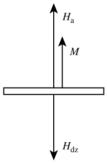

(a)

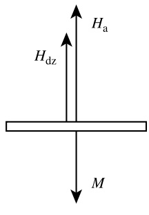

(b)

Fig. 16.8 Demagnetizing fields acting on a thin film sample with the applied field $H_{\mathrm{a}}$ perpendicular to the sample plane. $H_{\mathrm{dz}}$ is the demagnetizing field perpendicular to the sample plane. (a) Ferromagnet $(\chi >> 1)$ . The perpendicular demagnetizing field $H_{dz}$ is large because of the large perpendicular demagnetizing factor, and this field acts to decrease the magnetization of the sample. (b) Superconductor $(\chi = -1)$ . The large perpendicular demagnetizing field in this case acts to increase the perpendicular component of magnetization.

## 16.5 DEMAGNETIZING EFFECTS

Demagnetizing fields are important in many magnetic measurements, and are not only important but non-intuitive in the case of superconducting samples. When dealing with magnetic materials, it is often reasonable to regard the magnetization $M$ as a constant quantity, whose direction but not magnitude is influenced by the demagnetizing field. Superconducting materials do not have a saturation magnetization; in the fully superconducting state, the magnetization is always a function of the total field, which is the applied field plus the demagnetizing field. A magnetic thin film is difficult to magnetize perpendicular to the film surface, because the large demagnetizing field opposes the applied field. In a superconducting thin film, the large demagnetizing field aids the applied field, and magnetization is easier in the perpendicular direction than in the parallel direction. These two cases are illustrated in Fig. 16.8.

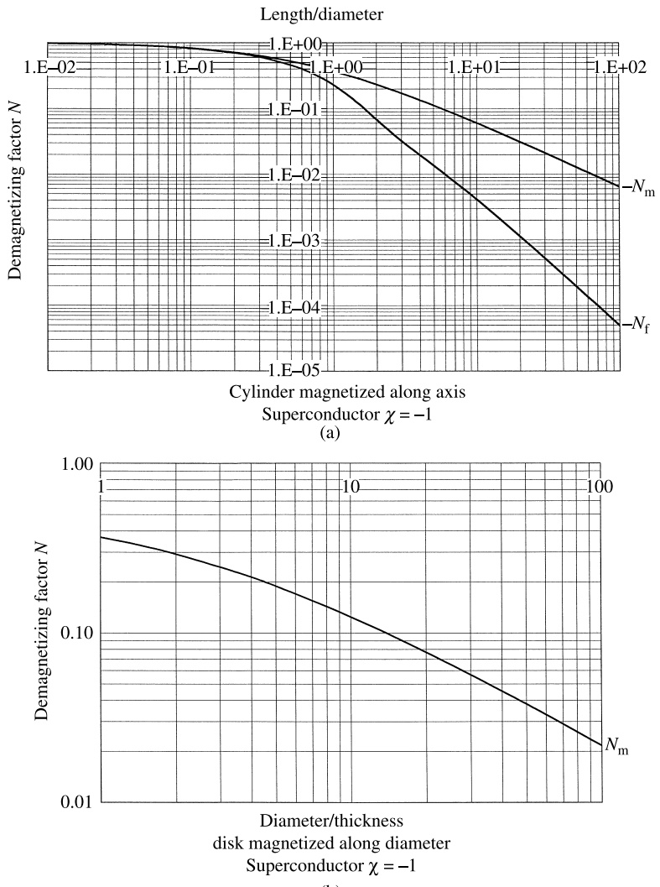

(b)

Fig. 16.9 Calculated demagnetizing factors for superconducting cylinders $(\chi = -1)$ . (a) cylinder magnetized along the axis. Lower curve is fluxmetric demagnetizing factor $N_{f};$ upper curve is magnetometric factor $N_{\mathrm{m}}.$ (b) Magnetometric factor $N_{\mathrm{m}}$ for cylinder magnetized along a diameter. Note that in (a) the x-axis is length/diameter and in (b) it is diameter/thickness.

As noted in Chapter 2, demagnetizing factors depend on the susceptibility x of the sample material, as well as on the shape of the sample. Demagnetizing factors for cylinders with $\chi = -1$ , corresponding to the fully-shielded superconducting state, have been calculated by D.-X. Chen, E. Pardo, and A. Sanchez [J. Magn. Mag. Mater., 306 (2006) p. 135]. Figure 16.9 gives the results. As in Chapter 2, $N_{f}$ is the fluxmetric demagnetizing factor, appropriate when the sample magnetization is measured with a tightly fitting coil around the midplane, and $N_{\mathrm{m}}$ is the magnetometric factor, which applies when the total sample moment is measured. The paper also lists values of $N_{\mathrm{f}}$ and $N_{\mathrm{m}}$ for axially magnetized cylinders with χ between 21 and 0, but these are of limited practical utility since in the intermediate or the mixed state, the effective susceptibility depends strongly on the applied field.

