# INTRODUCTION TO MAGNETIC MATERIALS

Second Edition

B. D. Cullity • C. D. Graham

# DEFINITIONS AND UNITS

## 1.1 INTRODUCTION

The story of magnetism begins with a mineral called magnetite $(Fe_{3}O_{4})$ , the first magnetic material known to man. Its early history is obscure, but its power of attracting iron was certainly known 2500 years ago. Magnetite is widely distributed. In the ancient world the most plentiful deposits occurred in the district of Magnesia, in what is now modern Turkey, and our word magnet is derived from a similar Greek word, said to come from the name of this district. It was also known to the Greeks that a piece of iron would itself become magnetic if it were touched, or, better, rubbed with magnetite.

Later on, but at an unknown date, it was found that a properly shaped piece of magnetite, if supported so as to float on water, would turn until it pointed approximately north and south. So would a pivoted iron needle, if previously rubbed with magnetite. Thus was the mariner’s compass born. This north-pointing property of magnetite accounts for the old English word lodestone for this substance; it means “waystone,” because it points the way.

The first truly scientific study of magnetism was made by the Englishman William Gilbert (1540 – 1603), who published his classic book On the Magnet in 1600. He experimented with lodestones and iron magnets, formed a clear picture of the Earth’s magnetic field, and cleared away many superstitions that had clouded the subject. For more than a century and a half after Gilbert, no discoveries of any fundamental importance were made, although there were many practical improvements in the manufacture of magnets. Thus, in the eighteenth century, compound steel magnets were made, composed of many magnetized steel strips fastened together, which could lift 28 times their own weight of iron. This is all the more remarkable when we realize that there was only one way of making magnets at that time: the iron or steel had to be rubbed with a lodestone, or with another magnet which in turn had been rubbed with a lodestone. There was no other way until the first electromagnet was made in 1825, following the great discovery made in 1820 by Hans Christian Oersted (1775– 1851) that an electric current produces a magnetic field. Research on magnetic materials can be said to date from the invention of the electromagnet, which made available much more powerful fields than those produced by lodestones, or magnets made from them.

In this book we shall consider basic magnetic quantities and the units in which they are expressed, ways of making magnetic measurements, theories of magnetism, magnetic behavior of materials, and, finally, the properties of commercially important magnetic materials. The study of this subject is complicated by the existence of two different systems of units: the SI (International System) or mks, and the cgs (electromagnetic or emu) systems. The SI system, currently taught in all physics courses, is standard for scientific work throughout the world. It has not, however, been enthusiastically accepted by workers in magnetism. Although both systems describe the same physical reality, they start from somewhat different ways of visualizing that reality. As a consequence, converting from one system to the other sometimes involves more than multiplication by a simple numerical factor. In addition, the designers of the SI system left open the possibility of expressing some magnetic quantities in more than one way, which has not helped in speeding its adoption.

The SI system has a clear advantage when electrical and magnetic behavior must be considered together, as when dealing with electric currents generated inside a material by magnetic effects (eddy currents). Combining electromagnetic and electrostatic cgs units gets very messy, whereas using SI it is straightforward.

At present (early twenty-first century), the SI system is widely used in Europe, especially for soft magnetic materials (i.e., materials other than permanent magnets). In the USA and Japan, the cgs – emu system is still used by the majority of research workers, although the use of SI is slowly increasing. Both systems are found in reference works, research papers, materials and instrument specifications, so this book will use both sets of units. In Chapter 1, the basic equations of each system will be developed sequentially; in subsequent chapters the two systems will be used in parallel. However, not every equation or numerical value will be duplicated; the aim is to provide conversions in cases where they are not obvious or where they are needed for clarity.

Many of the equations in this introductory chapter and the next are stated without proof because their derivations can be found in most physics textbooks.

## 1.2 THE cgs –emu SYSTEM OF UNITS

## 1.2.1 Magnetic Poles

Almost everyone as a child has played with magnets and felt the mysterious forces of attraction and repulsion between them. These forces appear to originate in regions called poles, located near the ends of the magnet. The end of a pivoted bar magnet which points approximately toward the north geographic pole of the Earth is called the northseeking pole, or, more briefly, the north pole. Since unlike poles attract, and like poles repel, this convention means that there is a region of south polarity near the north geographic pole. The law governing the forces between poles was discovered independently in England in 1750 by John Michell (1724 – 1793) and in France in 1785 by Charles Coulomb (1736– 1806). This law states that the force F between two poles is proportional to the product of their pole strengths $p_{1}$ and $p_{2}$ and inversely proportional to the square of the distance d between them:

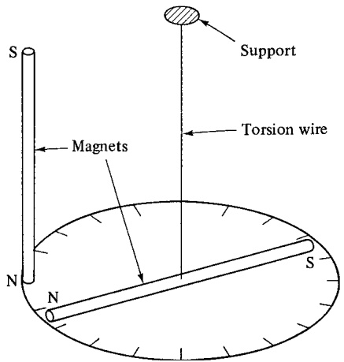

Fig. 1.1 Torsion balance for measuring the forces between poles.

$$
F = k \frac {p _ {1} p _ {2}}{d ^ {2}}.\tag{1.1}
$$

If the proportionality constant k is put equal to 1, and we measure F in dynes and d in centimeters, then this equation becomes the definition of pole strength in the cgs–emu system. A unit pole, or pole of unit strength, is one which exerts a force of 1 dyne on another unit pole located at a distance of 1 cm. The dyne is in turn defined as that force which gives a mass of 1 g an acceleration of 1 $\mathrm{cm / sec^2}$ . The weight of a 1 g mass is 981 dynes. No name has been assigned to the unit of pole strength.

Poles always occur in pairs in magnetized bodies, and it is impossible to separate them.1 If a bar magnet is cut in two transversely, new poles appear on the cut surfaces and two magnets result. The experiments on which Equation 1.1 is based were performed with magnetized needles that were so long that the poles at each end could be considered approximately as isolated poles, and the torsion balance sketched in Fig. 1.1. If the stiffness of the torsion-wire suspension is known, the force of repulsion between the two north poles can be calculated from the angle of deviation of the horizontal needle. The arrangement shown minimizes the effects of the two south poles.

A magnetic pole creates a magnetic field around it, and it is this field which produces a force on a second pole nearby. Experiment shows that this force is directly proportional to the product of the pole strength and field strength or field intensity H:

$$
F = k p H.\tag{1.2}
$$

If the proportionality constant k is again put equal to 1, this equation then defines H: a field of unit strength is one which exerts a force of 1 dyne on a unit pole. If an unmagnetized piece of iron is brought near a magnet, it will become magnetized, again through the agency of the field created by the magnet. For this reason H is also sometimes called the magnetizing force. A field of unit strength has an intensity of one oersted (Oe). How large is an oersted? The magnetic field of the Earth in most places amounts to less than 0.5 Oe, that of a bar magnet (Fig. 1.2) near one end is about 5000 Oe, that of a powerful electromagnet is about 20,000 Oe, and that of a superconducting magnet can be 100,000 Oe or more. Strong fields may be measured in kilo-oersteds (kOe). Another cgs unit of field strength, used in describing the Earth’s field, is the gamma $(1\gamma = 10^{-5}\mathrm{Oe})$

<small>1The existence of isolated magnetic poles, or monopoles, is not forbidden by any known law of nature, and serious efforts to find monopoles have been made [P. A. M. Dirac, Proc. R. Soc. Lond., A133 (1931) p. 60; H. Jeon and M. J. Longo, Phys. Rev. Lett., 75 (1995) pp. 1443–1446]. The search has not so far been successful.</small>

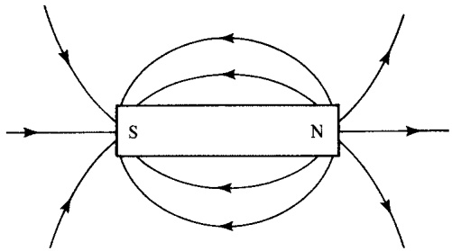

Fig. 1.2 External field of a bar magnet.

A unit pole in a field of one oersted is acted on by a force of one dyne. But a unit pole is also subjected to a force of 1 dyne when it is 1 cm away from another unit pole. Therefore, the field created by a unit pole must have an intensity of one oersted at a distance of 1 cm from the pole. It also follows from Equations 1.1 and 1.2 that this field decreases as the inverse square of the distance d from the pole:

$$
H = \frac {p}{d ^ {2}}.\tag{1.3}
$$

Michael Faraday (1791 – 1867) had the very fruitful idea of representing a magnetic field by “lines of force.” These are directed lines along which a single north pole would move, or to which a small compass needle would be tangent. Evidently, lines of force radiate outward from a single north pole. Outside a bar magnet, the lines of force leave the north pole and return at the south pole. (Inside the magnet, the situation is more complicated and will be discussed in Section 2.9) The resulting field (Fig. 1.3) can be made visible in two dimensions by sprinkling iron filings or powder on a card placed directly above the magnet. Each iron particle becomes magnetized and acts like a small compass needle, with its long axis parallel to the lines of force.

The notion of lines of force can be made quantitative by defining the field strength H as the number of lines of force passing through unit area perpendicular to the field. A line of force, in this quantitative sense, is called a maxwell.2 Thus

$$
1 \mathrm{Oe} = 1 \text {line of force / cm} ^ {2} = 1 \mathrm{maxwell/cm} ^ {2}.
$$

<small>2James Clerk Maxwell (1831–1879), Scottish physicist, who developed the classical theory of electromagnetic fields described by the set of equations known as Maxwell’s equations.</small>

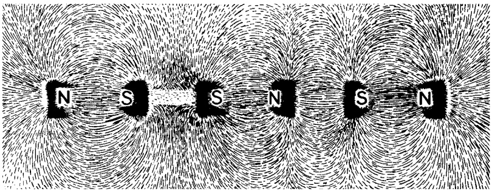

Fig. 1.3 Fields of bar magnets revealed by iron filings.

Imagine a sphere with a radius of 1 cm centered on a unit pole. Its surface area is $4\pi\mathrm{cm}^{2}$ Since the field strength at this surface is 1 Oe, or 1 line of force/cm² there must be a total of $4\pi$ lines of force passing through it. In general, $4\pi p$ lines of force issue from a pole of strength p.

## 1.3 MAGNETIC MOMENT

Consider a magnet with poles of strength p located near each end and separated by a distance l. Suppose the magnet is placed at an angle $\theta$ to a uniform field H (Fig. 1.4). Then a torque acts on the magnet, tending to turn it parallel to the field. The moment of this torque is

$$
(p H \sin \theta) \left(\frac {l}{2}\right) + (p H \sin \theta) \left(\frac {l}{2}\right) = p H l \sin \theta
$$

When $H = 1$ Oe and $\theta = 90^{\circ}$ , the moment is given by

$$
m = p l,\tag{1.4}
$$

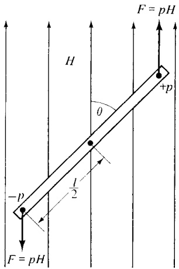

Fig. 1.4 Bar magnet in a uniform field. (Note use of plus and minus signs to designate north and south poles.)

where m is the magnetic moment of the magnet. It is the moment of the torque exerted on the magnet when it is at right angles to a uniform field of 1 Oe. (If the field is nonuniform, a translational force will also act on the magnet. See Section 2.13.)

Magnetic moment is an important and fundamental quantity, whether applied to a bar magnet or to the “electronic magnets” we will meet later in this chapter. Magnetic poles, on the other hand, represent a mathematical concept rather than physical reality; they cannot be separated for measurement and are not localized at a point, which means that the distance l between them is indeterminate. Although p and l are uncertain quantities individually, their product is the magnetic moment m, which can be precisely measured. Despite its lack of precision, the concept of the magnetic pole is useful in visualizing many magnetic interactions, and helpful in the solution of magnetic problems.

Returning to Fig. 1.4, we note that a magnet not parallel to the field must have a certain potential energy $E_{p}$ relative to the parallel position. The work done (in ergs) in turning it through an angle du against the field is

$$
d E _ {\mathrm{p}} = 2 (p H \sin \theta) \left(\frac {l}{2}\right) d \theta = m H \sin \theta d \theta .
$$

It is conventional to take the zero of energy as the $\theta = 90^{\circ}$ position. Therefore,

$$
E _ {\mathrm{p}} = \int_ {9 0 ^ {\circ}} ^ {\theta} m H \sin \theta d \theta = - m H \cos \theta .\tag{1.5}
$$

Thus $E_{\mathrm{p}}$ is 2mH when the magnet is parallel to the field, zero when it is at right angles, and +mH when it is antiparallel. The magnetic moment m is a vector which is drawn from the south pole to the north. In vector notation, Equation 1.5 becomes

$$
E _ {\mathrm{p}} = - \mathbf {m} \cdot \mathbf {H}\tag{1.6}
$$

Equation 1.5 or 1.6 is an important relation which we will need frequently in later sections.

Because the energy $E_{\mathrm{p}}$ is in ergs, the unit of magnetic moment m is erg/oersted. This quantity is the electromagnetic unit of magnetic moment, generally but unofficially called simply the emu.

## 1.4 INTENSITY OF MAGNETIZATION

When a piece of iron is subjected to a magnetic field, it becomes magnetized, and the level of its magnetism depends on the strength of the field. We therefore need a quantity to describe the degree to which a body is magnetized.

Consider two bar magnets of the same size and shape, each having the same pole strength p and interpolar distance l. If placed side by side, as in Fig. 1.5a, the poles add, and the magnetic moment $m = (2p)l = 2pl.$ which is double the moment of each individual magnet. If the two magnets are placed end to end, as in Fig. 1.5b, the adjacent poles cancel and $m = p(2l) = 2pl.$ , as before. Evidently, the total magnetic moment is the sum of the magnetic moments of the individual magnets.

In these examples, we double the magnetic moment by doubling the volume. The magnetic moment per unit volume has not changed and is therefore a quantity that describes the degree to which the magnets are magnetized. It is called the intensity of magnetization, or simply the magnetization, and is written M (or I or J by some authors). Since

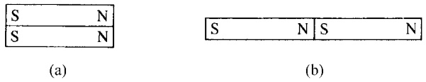

Fig. 1.5 Compound magnets.

$$
M = \frac {m}{v},\tag{1.7}
$$

where v is the volume; we can also write

$$
M = \frac {p l}{v} = \frac {p}{v / l} = \frac {p}{A},\tag{1.8}
$$

where A is the cross-sectional area of the magnet. We therefore have an alternative definition of the magnetization M as the pole strength per unit area of cross section.

Since the unit of magnetic moment m is erg/oersted, the unit of magnetization M is erg/oersted cm3. However, it is more often written simply as emu/cm3, where “emu” is understood to mean the electromagnetic unit of magnetic moment. However, emu is sometimes used to mean “electromagnetic cgs units” generically.

It is sometimes convenient to refer the value of magnetization to unit mass rather than unit volume. The mass of a small sample can be measured more accurately than its volume, and the mass is independent of temperature whereas the volume changes with temperature due to thermal expansion. The specific magnetization s is defined as

$$
\sigma = \frac {m}{w} = \frac {m}{v \rho} = \frac {M}{\rho} \mathrm{emu/g},\tag{1.9}
$$

where w is the mass and ρ the density.

Magnetization can also be expressed per mole, per unit cell, per formula unit, etc. When dealing with small volumes like the unit cell, the magnetic moment is often given in units called Bohr magnetons, $\mu_{B}$ , where 1 Bohr magn $\mathrm{e}$eton $= 9.27\times 10^{-21}\mathrm{erg / Oe}$ . The Bohr magneton will be considered further in Chapter 3.

## 1.5 MAGNETIC DIPOLES

As shown in Appendix 1, the field of a magnet of pole strength p and length l, at a distance r from the magnet, depends only on the moment pl of the magnet and not on the separate values of p and l, provided r is large relative to l. Thus the field is the same if we halve the length of the magnet and double its pole strength. Continuing this process, we obtain in the limit a very short magnet of finite moment called a magnetic dipole. Its field is sketched in Fig. 1.6. We can therefore think of any magnet, as far as its external field is concerned, as being made up of a number of dipoles; the total moment of the magnet is the sum of the moments, called dipole moments, of its constituent dipoles.

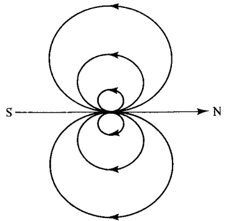

Fig. 1.6 Field of a magnetic dipole.

## 1.6 MAGNETIC EFFECTS OF CURRENTS

A current in a straight wire produces a magnetic field which is circular around the wire axis in a plane normal to the axis. Outside the wire the magnitude of this field, at a distance r cm from the wire axis, is given by

$$
H = \frac {2 i}{1 0 r} \mathrm{Oe},\tag{1.10}
$$

where i is the current in amperes. Inside the wire,

$$
H = \frac {2 i r}{1 0 r _ {0} ^ {2}} \mathrm{Oe},
$$

where $r_{0}$ is the wire radius (this assumes the current density is uniform). The direction of the field is that in which a right-hand screw would rotate if driven in the direction of the current (Fig. 1.7a). In Equation 1.10 and other equations for the magnetic effects of currents, we are using “mixed” practical and cgs electromagnetic units. The electromagnetic unit of current, the absolute ampere or abampere, equals 10 international or “ordinary” amperes, which accounts for the factor 10 in these equations.

If the wire is curved into a circular loop of radius _R_ cm, as in Fig. 1.7b, then the field at the center along the axis is

$$
H = \frac {2 \pi i}{1 0 R} \mathrm{Oe}.\tag{1.11}
$$

The field of such a current loop is sketched in (c). Experiment shows that a current loop, suspended in a uniform magnetic field and free to rotate, turns until the plane of the loop is normal to the field. It therefore has a magnetic moment, which is given by

$$
m (\text {loop}) = \frac {\pi R ^ {2} i}{1 0} = \frac {A i}{1 0} = \mathrm{amp} \cdot \mathrm{cm} ^ {2} \text {or erg / Oe},\tag{1.12}
$$

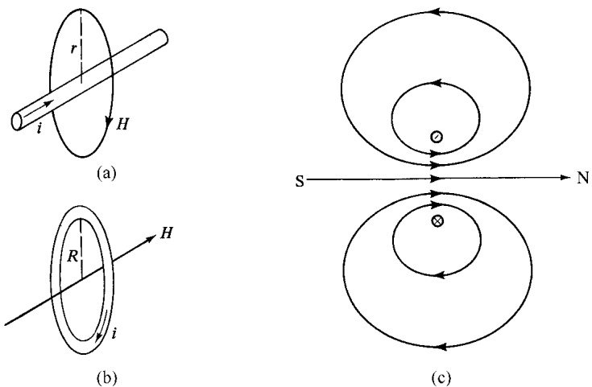

Fig. 1.7 Magnetic fields of currents.

where A is the area of the loop in $\mathrm{cm}^2$ The direction of m is the same as that of the axial field H due to the loop itself (Fig. 1.7b).

A helical winding (Fig. 1.8) produces a much more uniform field than a single loop. Such a winding is called a solenoid, after the Greek word for a tube or pipe. The field along its axis at the midpoint is given by

$$
H = \frac {4 \pi n i}{1 0 L} \mathrm{Oe},\tag{1.13}
$$

where n is the number of turns and L the length of the winding in centimeters. Note that the field is independent of the solenoid radius as long as the radius is small compared to the length. Inside the solenoid the field is quite uniform, except near the ends, and outside it resembles that of a bar magnet (Fig. 1.2). The magnetic moment of a solenoid is given by

$$
m (\text {solenoid}) = \frac {n A i}{1 0} \frac {\text {erg}}{\text {Oe}},\tag{1.14}
$$

where A is the cross-sectional area.

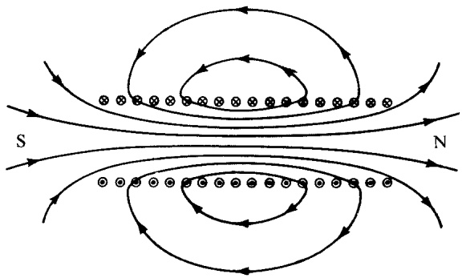

Fig. 1.8 Magnetic field of a solenoid.

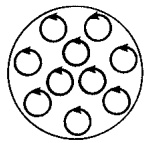

(a)

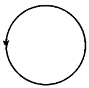

(b)

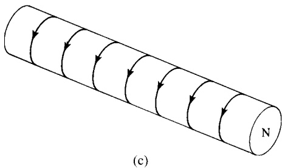

Fig. 1.9 Amperian current loops in a magnetized bar.

As the diameter of a current loop becomes smaller and smaller, the field of the loop (Fig. 1.7c) approaches that of a magnetic dipole (Fig. 1.6). Thus it is possible to regard a magnet as being a collection of current loops rather than a collection of dipoles. In fact, André-Marie Ampère (1775 – 1836) suggested that the magnetism of a body was due to “molecular currents” circulating in it. These were later called Amperian currents. Figure 1.9a shows schematically the current loops on the cross section of a uniformly magnetized bar. At interior points the currents are in opposite directions and cancel one another, leaving the net, uncanceled loop shown in Fig. 1.9b. On a short section of the bar these current loops, called equivalent surface currents, would appear as in Fig. 1.9c. In the language of poles, this section of the bar would have a north pole at the forward end, labeled N. The similarity to a solenoid is evident. In fact, given the magnetic moment and cross-sectional area of the bar, we can calculate the equivalent surface current in terms of the product ni from Equation 1.14. However, it must be remembered that, in the case of the solenoid, we are dealing with a real current, called a conduction current, whereas the equivalent surface currents, with which we replace the magnetized bar, are imaginary (except in the case of superconductors; see Chapter 16.)

## 1.7 MAGNETIC MATERIALS

We are now in a position to consider how magnetization can be measured and what the measurement reveals about the magnetic behavior of various kinds of substances. Figure 1.10 shows one method of measurement. The specimen is in the form of a ring, wound with a large number of closely spaced turns of insulated wire, connected through a switch S and ammeter A to a source of variable current. This winding is called the primary, or magnetizing, winding. It forms an endless solenoid, and the field inside it is given by Equation 1.13; this field is, for all practical purposes, entirely confined to the region within the coil. This arrangement has the advantage that the material of the ring becomes magnetized without the formation of poles, which simplifies the interpretation of the measurement. Another winding, called the secondary winding or search coil, is placed on all or a part of the ring and connected to an electronic integrator or fluxmeter. Some practical aspects of this measurement are discussed in Chapter 2.

<small>3Sometimes called a Rowland ring, after the American physicist H. A. Rowland (1848– 1901), who first used this kind of specimen in his early research on magnetic materials. He is better known for the production of ruled diffraction gratings for the study of optical spectra.</small>

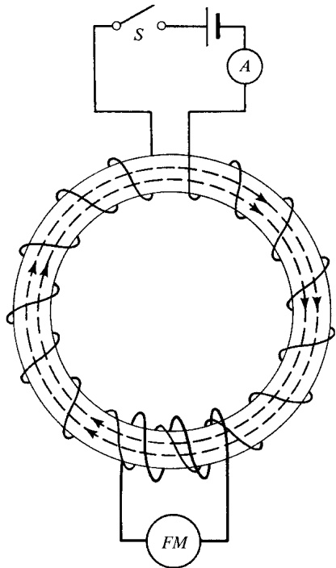

Fig. 1.10 Circuit for magnetization of a ring. Dashed lines indicate flux.

Let us start with the case where the ring contains nothing but empty space. If the switch S is closed, a current i is established in the primary, producing a field of H oersteds, or maxwells/cm2, within the ring. If the cross-sectional area of the ring is A $\mathrm{cm}^2$ , then the total number of lines of force in the ring is $HA = \Phi$ maxwells, which is called the magnetic flux . (It follows that H may be referred to as a flux density.) The change in flux $\Delta \Phi$ through the search coil, from 0 to F, induces an electromotive force (emf ) in the search coil according to Faraday’s law:

$$
E = - 1 0 ^ {- 8} n \bigg (\frac {d \Phi}{d t} \bigg) \quad \text {or} \quad \int E   d t = - 1 0 ^ {- 8} n   \Delta \Phi ,
$$

where n is the number of turns in the secondary winding, t is time in seconds, and E is in volts.

The (calibrated) output of the voltage integrator ÐE dt is a measure of $\Delta\Phi,$ which in this case is simply F. When the ring contains empty space, it is found that $\Phi_{\mathrm{observed}}$ obtained from the integrator reading, is exactly equal to $\Phi_{\mathrm{current}}$ which is the flux produced by the current in the primary winding, i.e., the product A and H calculated from Equation 1.13.

However, if there is any material substance in the ring, $\Phi_{\mathrm{observed}}$ is found to differ from $\Phi_{\mathrm{current}}$ This means that the substance in the ring has added to, or subtracted from, the number of lines of force due to the field H. The relative magnitudes of these two quantities, $\Phi_{\mathrm{observed}}$ and $\Phi_{\mathrm{current}}$ enable us to classify all substances according to the kind of magnetism they exhibit:

$$
\begin{array}{ll}
\Phi_{\text{observed}} \lt \Phi_{\text{current}}, & \text{diamagnetic (i.e., Cu, He)} \\
\Phi_{\text{observed}} \gt \Phi_{\text{current}}, & \text{paramagnetic (i.e., Na, Al)} \\
& \text{or antiferromagnetic (i.e., MnO, FeO)} \\
\Phi_{\text{observed}} \gg \Phi_{\text{current}}, & \text{ferromagnetic (i.e., Fe, Co, Ni)} \\
& \text{or ferrimagnetic (i.e., } \mathrm{Fe_3O_4} \text{)}
\end{array}
$$

Paramagnetic and antiferromagnetic substances can be distinguished from one another by magnetic measurement only if the measurements extend over a range of temperature. The same is true of ferromagnetic and ferrimagnetic substances.

All substances are magnetic to some extent. However, examples of the first three types listed above are so feebly magnetic that they are usually called “nonmagnetic,” both by the layman and by the engineer or scientist. The observed flux in a typical paramagnetic, for example, is only about 0.02% greater than the flux due to the current. The experimental method outlined above is not capable of accurately measuring such small differences, and entirely different methods have to be used. In ferromagnetic and ferrimagnetic materials, on the other hand, the observed flux may be thousands of times larger than the flux due to the current.

We can formally understand how the material of the ring causes a change in flux if we consider the fields which actually exist inside the ring. Imagine a very thin, transverse cavity cut out of the material of the ring, as shown in Fig. 1.11. Then H lines/cm2 cross this gap, due to the current in the magnetizing winding, in accordance with Equation 1.13. This flux density is the same whether or not there is any material in the ring. In addition, the applied field H, acting from left to right, magnetizes the material, and north and south poles are produced on the surface of the cavity, just as poles are produced on the ends of a magnetized bar. If the material is ferromagnetic, the north poles will be on the left-hand surface and south poles on the right. If the intensity of magnetization is M, then each square centimeter of the surface of the cavity has a pole strength of M, and 4pM lines issue from it. These are sometimes called lines of magnetization. They add to the lines of force due to the applied field H, and the combined group of lines crossing the gap are called lines of magnetic flux or lines of induction. The total number of lines per $\mathrm{cm}^2$ is called the magnetic flux density or the induction B. Therefore,

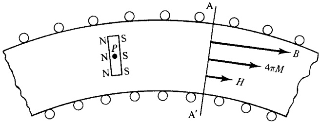

Fig. 1.11 Transverse cavity in a portion of a Rowland ring.

$$
B = H + 4 \pi M.\tag{1.15}
$$

The word “induction” is a relic from an earlier age: if an unmagnetized piece of iron were brought near a magnet, then magnetic poles were said to be “induced” in the iron, which was, in consequence, attracted to the magnet. Later the word took on the quantitative sense, defined above, of the total flux density in a material, denoted by B. Flux density is now the preferred term.

Because lines of B are always continuous, Equation 1.15 gives the value of B, not only in the gap, but also in the material on either side of the gap and throughout the ring. Although B, H, and M are vectors, they are usually parallel, so that Equation 1.15 is normally written in scalar form. These are vectors indicated at the right of Fig. 1.11, for a hypothetical case where B is about three times H. They indicate the values of B, H, and 4pM at the section $AA'$ or at any other section of the ring.

Although B, H, and M must necessarily have the same units (lines or maxwells $/cm^{2})$ different names are given to these quantities. A maxwell per $\mathrm{cm}^2$ is customarily called a gauss (G), $^{4}$ when it refers to B, and an oersted when it refers to H. However, since in free space or (for practical purposes) in air, $M = 0$ and therefore $B = H,$ it is not uncommon to see H expressed in gauss. The units for magnetization raise further difficulties. As we have seen, the units for M are erg/Oe cm³ , commonly written emu $/cm^{3}$ , but $4\pi M,$ from Equation 1.15, must have units of maxwells $/cm^{2}$ , which could with equal justification be called either gauss or oersteds. In this book when using cgs units we will write M in emu/cm3, but 4pM in gauss, to emphasize that the latter forms a contribution to the total flux density B. Note that this discussion concerns only the names of these units (B, H, and 4pM ). There is no need for any numerical conversion of one to the other, as they are all numerically equal. It may also be noted that it is not usual to refer, as is done above, to H as a flux density and to HA as a flux, although there would seem to be no logical objection to these designations. Instead, most writers restrict the terms “flux density” and “flux” to B and BA, respectively.

Returning to the Rowland ring, we now see that $\Phi_{\mathrm{observed}} = BA$ , because the integrator measures the change in the total number of lines enclosed by the search coil. On the other hand, $\Phi_{\mathrm{current}} = HA$ . The difference between them is 4pMA. The magnetization M is zero only for empty space. The magnetization, even for applied fields H of many thousands of oersteds, is very small and negative for diamagnetics, very small and positive for paramagnetics and antiferromagnetics, and large and positive for ferro- and ferrimagnetics. The negative value of M for diamagnetic materials means that south poles are produced on the left side of the gap in Fig. 1.11 and north poles on the right.

Workers in magnetic materials generally take the view that H is the “fundamental” magnetic field, which produces magnetization M in magnetic materials. The flux density B is a useful quantity primarily because changes in B generate voltages through Faraday’s law.

The magnetic properties of a material are characterized not only by the magnitude and sign of M but also by the way in which M varies with H. The ratio of these two

<small>4Carl Friedrich Gauss (1777–1855), German mathematician was renowned for his genius in mathematics. He also developed magnetostatic theory, devised a system of electrical and magnetic units, designed instruments for magnetic measurements, and investigated terrestrial magnetism.</small>

quantities is called the susceptibility $\chi$:

$$
\chi = \frac {M}{H} \frac {\mathrm{emu}}{\mathrm{Oe} \cdot \mathrm{cm} ^ {3}}.\tag{1.16}
$$

Note that, since M has units $\mathrm{A}\cdot\mathrm{cm}^{2}/\mathrm{cm}^{3}$ , and H has units A/cm, χ is actually dimensionless. Since M is the magnetic moment per unit volume, χ also refers to unit volume and is sometimes called the volume susceptibility and given the symbol $\chi_{\mathrm{v}}$ to emphasize this fact. Other susceptibilities can be defined, as follows:

$\chi_{\mathrm{m}} = \chi_{\mathrm{v}} / \rho =$ mass susceptibility (emu/Oe g), where $\rho =$ density,

$\chi_{A} = \chi_{v}A = atomic\ susceptibility (emu/Oe\ g\ atom), \quad where\ A = atomic\ weight,$

$\chi_{\mathrm{M}} = \chi_{\mathrm{v}}M^{\prime}$ = molar susceptibility (emu=Oe mol), where M0 = molecular weight:

Typical curves of M vs H, called magnetization curves, are shown in Fig. 1.12 for various kinds of substances. Curves (a) and (b) refer to substances having volume susceptibilities of $-2 \times 10^{-6}$ and $+20 \times 10^{-6}$ , respectively. These substances (dia-, para-, or antiferromagnetic) have linear M, H curves under normal circumstances and retain no magnetism when the field is removed. The behavior shown in curve (c), of a typical ferro- or ferrimagnetic, is quite different. The magnetization curve is nonlinear, so that x varies with H and passes through a maximum value (about 40 for the curve shown). Two other phenomena appear:

1. Saturation. At large enough values of H, the magnetization M becomes constant at its saturation value of $M_{\mathrm{s}}$

2. Hysteresis, or irreversibility. After saturation, a decrease in H to zero does not reduce M to zero. Ferro- and ferrimagnetic materials can thus be made into permanent magnets. The word hysteresis is from a Greek word meaning “to lag behind,” and is today applied to any phenomenon in which the effect lags behind the cause, leading to irreversible behavior. Its first use in science was by Ewing$^{5}$ in 1881, to describe the magnetic behavior of iron.

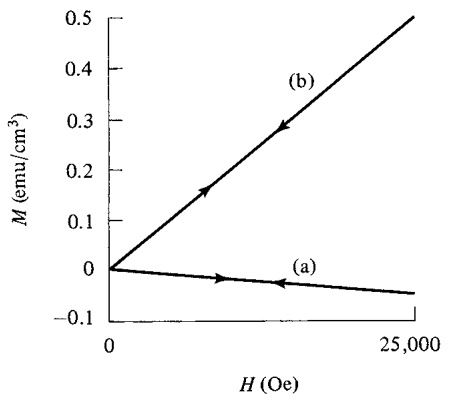

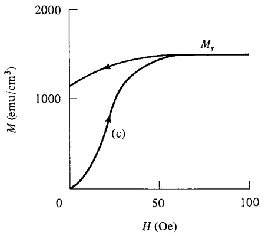

Fig. 1.12 Typical magnetization curves of (a) a diamagnetic; (b) a paramagnetic or antiferromagnetic; and (c) a ferromagnetic of ferrimagnetic.

In practice, susceptibility is primarily measured and quoted only in connection with diaand paramagnetic materials, where χ is independent of H (except possibly at very low temperatures and high fields). Since these materials are very weakly magnetic, susceptibility is of little engineering importance. Susceptibility is, however, important in the study and use of superconductors.

Engineers are usually concerned only with ferro- and ferrimagnetic materials and need to know the total flux density B produced by a given field. They therefore often find the B, H curve, also called a magnetization curve, more useful than the M, H curve. The ratio of B to H is called the permeability μ:

$$
\mu = \frac {B}{H} (\text {dimensionless}).\tag{1.17}
$$

Since $B = H + 4\pi M,$ we have

$$
\begin{array}{l} \frac {B}{H} = 1 + 4 \pi \bigg (\frac {M}{H} \bigg), \\ \mu = 1 + 4 \pi \chi . \end{array}\tag{1.18}
$$

Note that μ is not the slope $dB/dH$ of the B, H curve, but rather the slope of a line from the origin to a particular point on the curve. Two special values are often quoted, the initial permeability $\mu_{0}$ and the maximum permeability $\mu_{\mathrm{max}}$ These are illustrated in Fig. 1.13, which also shows the typical variation of μ with H for a ferro- or ferrimagnetic. If not otherwise specified, permeability μ is taken to be the maximum permeability $\mu_{\mathrm{max}}$ . The local slope of the B, H curve $dB/dH$ is called the differential permeability, and is sometimes

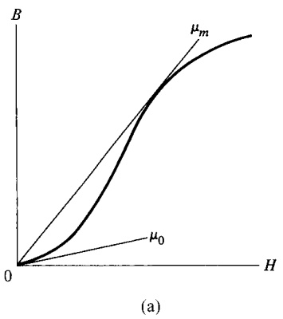

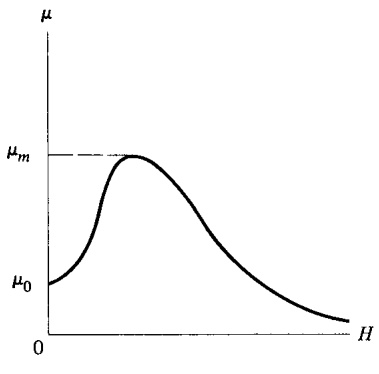

Fig. 1.13 (a) B vs H curve of a ferro- or ferrimagnetic, and (b) corresponding variation of μ with H.

5J. A. Ewing (1855–1935), British educator and engineer taught at Tokyo, Dundee, and Cambridge and did research on magnetism, steam engines, and metallurgy. During World War I, he organized the cryptography section of the British Admiralty. During his five-year tenure of a professorship at the University of Tokyo (1878–1883), he introduced his students to research on magnetism, and Japanese research in this field has flourished ever since.

used. Permeabilities are frequently quoted for soft magnetic materials, but they are mainly of qualitative significance, for two reasons:

1. Permeability varies greatly with the level of the applied field, and soft magnetic materials are almost never used at constant field.

2. Permeability is strongly structure-sensitive, and so depends on purity, heat treatment, deformation, etc.

We can now characterize the magnetic behavior of various kinds of substances by their corresponding values of χ and μ:

1. Empty space; $\chi = 0$ , since there is no matter to magnetize, and $\mu = 1$

2. Diamagnetic; χ is small and negative, and μ slightly less than 1.

3. Para- and antiferromagnetic; χ is small and positive, and μ slightly greater than 1.

4. Ferro- and ferrimagnetic; χ and μ are large and positive, and both are functions of H.

The permeability of air is about 1.000,000,37. The difference between this and the permeability of empty space is negligible, relative to the permeabilities of ferro- and ferrimagnetics, which typically have values of μ of several hundreds or thousands. We can therefore deal with these substances in air as though they existed in a vacuum. In particular, we can say that B equals H in air, with negligible error.

## 1.8 SI UNITS

The SI system of units uses the meter, kilogram, and second as its base units, plus the international electrical units, specifically the ampere. The concept of magnetic poles is generally ignored (although it need not be), and magnetization is regarded as arising from current loops.

The magnetic field at the center of a solenoid of length l, n turns, carrying current i, is given simply by

$$
H = \frac {n i}{l} \frac {\text {ampere turns}}{\text {meter}}.\tag{1.19}
$$

Since n turns each carrying current i are equivalent to a single turn carrying current ni, the unit of magnetic field is taken as A/m (amperes per meter). It has no simpler name. Note that the factor $4\pi$ does not appear in Equation 1.19. Since the factor 4p arises from solid geometry (it is the area of a sphere of unit radius), it cannot be eliminated, but it can be moved elsewhere in a system of units. This process (in the case of magnetic units) is called rationalization, and the SI units of magnetism are rationalized mks units. We will see shortly where the 4p reappears.

If a loop of wire of area $A(\mathrm{m}^{2})$ is placed perpendicular to a magnetic field $H(\mathrm{A / m})$ , and the field is changed at a uniform rate $dH / dt = \text{const.}$ , a voltage is generated in the loop according to Faraday’s law:

$$
E = - k A \left(\frac {d H}{d t}\right) \text {volt}.\tag{1.20}
$$

The negative sign means that the voltage would drive a current in the direction that would generate a field opposing the change in field. Examination of the dimensions of Equation 1.20 shows that the proportionality constant k has units

$$
\frac {\mathrm{V} \cdot \sec}{\mathrm{m} ^ {2} \cdot (\mathrm{A} \cdot \mathrm{m} ^ {- 1})} = \frac {\mathrm{V} \cdot \sec}{\mathrm{A} \cdot \mathrm{m}}.
$$

Since

$$
\frac {\mathrm{V}}{\mathrm{A} \cdot \sec^ {- 1}}
$$

is the unit of inductance, the henry (H), the units of k are usually given as H/m (henry per meter). The numerical value of k is $4\pi \times 10^{-7}H / m;$ it is given the symbol $\mu_{0}$ (or sometimes G), and has various names: the permeability of free space, the permeability of vacuum, the magnetic constant, or the permeability constant. This is where the factor 4p appears in rationalized units.

Equation 1.20 can alternatively be written

$$
E = - A \left(\frac {d B}{d t}\right) \quad \text {or} \quad \int E d t = - A \Delta B.\tag{1.21}
$$

Here B is the magnetic flux density (V sec/m²) . A line of magnetic flux in the SI system is called a weber (Wb = V sec), so flux density can also be expressed in $\mathrm{Wb/m^{2}}$ , which is given the special name of the tesla (T).6

In SI units, then, we have a magnetic field H defined from the ampere, and a magnetic flux density B, defined from the volt. The ratio between these two quantities (in empty space), B/H, is the magnetic constant $\mu_{0}$

A magnetic moment m is produced by a current i flowing around a loop of area A, and so has units $\mathrm{A}\cdot\mathrm{m}^{2}$ . Magnetic moment per unit volume $M = m / V$ then has units

$$
\frac {\mathrm{A} \cdot \mathrm{m} ^ {2}}{\mathrm{m} ^ {3}} = \mathrm{A} \cdot \mathrm{m} ^ {- 1},
$$

the same as the units of magnetic field. Magnetization per unit mass becomes

$$
\sigma = \frac {\mathrm{A} \cdot \mathrm{m} ^ {2}}{\mathrm{w}} \left(\frac {\mathrm{A} \cdot \mathrm{m} ^ {2}}{\mathrm{kg}} \text {or} \mathrm{A} \cdot \mathrm{m} ^ {- 1} \frac {\mathrm{m} ^ {3}}{\mathrm{kg}}\right)
$$

The SI equivalent of Equation 1.15 is

$$
B = \mu_ {0} (H + M),\tag{1.22}
$$

with B in tesla and H and M in A/m . This is known as the Sommerfeld convention. It is equally possible to express magnetization in units of tesla, or $\mu_0(\mathrm{A / m})$ . This is known as the Kennelly convention, under which Equation 1.15 becomes

<small>6Nicola Tesla (1856– 1943), Serbian-American inventor, engineer, and scientist is largely responsible for the development of alternating current (ac) technology.</small>

$$
B = \mu_ {0} H + I\tag{1.23}
$$

and $I$ (or $J$) is called the magnetic polarization. The Sommerfeld convention is “recognized” in the SI system, and will be used henceforth in this book.

Volume susceptibility $\chi_V$ is defined as $M / H,$ and is dimensionless. Mass susceptibility $\chi_{m}$ has units

$$
\frac {\mathrm{A} \cdot \mathrm{m} ^ {2}}{\mathrm{kg}} \cdot \frac {1}{\mathrm{A} \cdot \mathrm{m} ^ {- 1}} = \frac {\mathrm{m} ^ {3}}{\mathrm{kg}},
$$

or reciprocal density. Other susceptibilities are similarly defined.

Permeability μ is defined as B/H, and so has the units of $\mu_{0}$ . It is customary to use instead the relative permeability

$$
\mu_ {\mathrm{r}} = \frac {\mu}{\mu_ {0}},
$$

which is dimensionless, and is numerically the same as the cgs permeability μ.

Appendix 3 gives a table of conversions between cgs and SI units.

## 1.9 MAGNETIZATION CURVES AND HYSTERESIS LOOPS

Both ferro- and ferrimagnetic materials differ widely in the ease with which they can be magnetized. If a small applied field suffices to produce saturation, the material is said to be magnetically soft (Fig. 1.14a). Saturation of some other material, which will in general have a different value of $M_{\mathrm{s}}$ may require very large fields, as shown by curve (c). Such a material is magnetically hard. Sometimes the same material may be either magnetically soft or hard, depending on its physical condition: thus curve (a) might relate to a well-annealed material, and curve (b) to the heavily cold-worked state.

Figure 1.15 shows magnetization curves both in terms of B (full line from the origin in first quadrant) and M (dashed line). Although M is constant after saturation is achieved, B continues to increase with H, because H forms part of B. Equation 1.15 shows that the slope $\mathrm{dB / dH}$ is unity beyond the point $B_{s},$ called the saturation induction; however, the slope of this line does not normally appear to be unity, because the B and H scales are usually quite different. Continued increase of H beyond saturation will cause $\mu (\mathrm{cgs})$ or $\mu_{\mathrm{r}}(\mathrm{SI})$ to approach 1 as H approaches infinity. The curve of B vs H from the demagnetized state to saturation is called the normal magnetization or normal induction curve. It may be measured in two different ways, and the demagnetized state also may be achieved in two different ways, as will be noted later in this chapter. The differences are not practically significant in most cases.

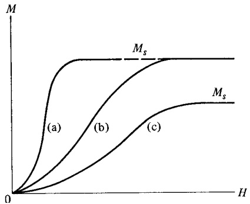

Fig. 1.14 Magnetization curves of different materials.

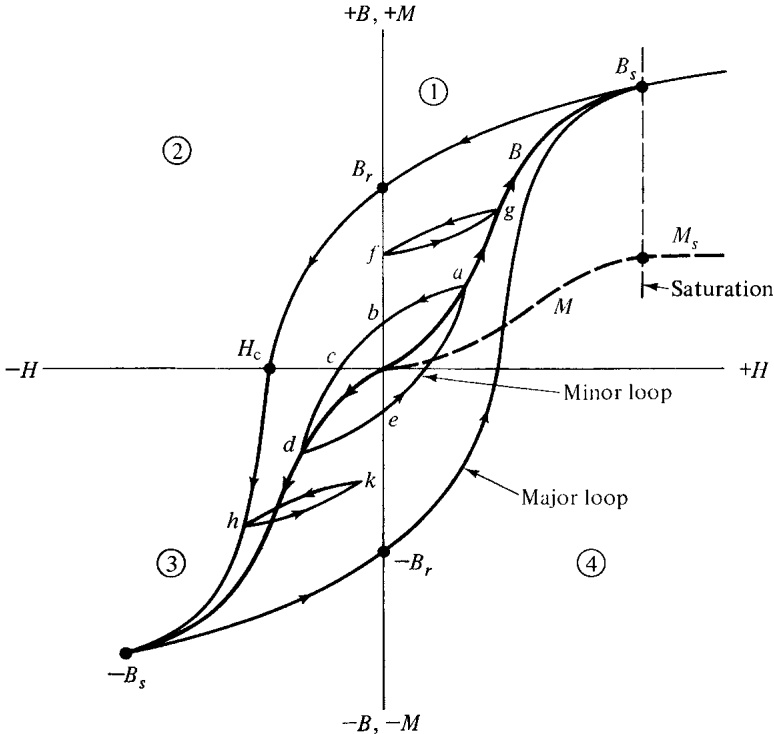

Fig. 1.15 Magnetization curves and hysteresis loops. (The height of the M curve is exaggerated relative to that of the B curve.)

Sometimes in cgs units the intrinsic induction, or ferric induction, $B_{i}=B-H,$ is plotted as a function of H. Since $B - H = 4\pi M,$ such a curve will differ from an M, H curve only by a factor of 4p applied to the ordinate. $B_{i}$ measures the number of lines of magnetization $/cm^{2}$ , not counting the flux lines due to the applied field.

If H is reduced to zero after saturation has been reached in the positive direction, the induction in a ring specimen will decrease from $B_{s}$ to $B_{r}$ called the retentivity or residual induction. If the applied field is then reversed, by reversing the current in the magnetizing winding, the induction will decrease to zero when the negative applied field equals the coercivity $H_{c}$ . This is the reverse field necessary to “coerce” the material back to zero induction; it is usually written as a positive quantity, the negative sign being understood. At this point, M is still positive and is given by $\left|H_{\mathrm{C}} / 4\pi \right|$ (cgs) or $H_{\mathrm{C}}$ (SI). The reverse field required to reduce M to zero is called the intrinsic coercivity $H_{\mathrm{ci}}$ (or sometimes $\mathrm{i}H_{\mathrm{c}}$ or $H_{\mathrm{c}}^{\mathrm{i}})$ . To emphasize the difference between the two coercivities, some authors write $B H_{c}$ for the coercivity and $M\mathrm{H}_{\mathrm{c}}$ for the intrinsic coercivity. The difference between $H_{c}$ and $H_{\mathrm{ci}}$ is usually negligible for soft magnetic materials, but may be substantial for permanent magnet materials. This point will be considered further in our consideration of permanent magnet materials in Chapter 14.

If the reversed field is further increased, saturation in the reverse direction will be reached at $-B_{s}$ If the field is then reduced to zero and applied in the original direction, the induction will follow the curve $-B_{\mathrm{s}}, - B_{\mathrm{r}}, + B_{\mathrm{s}}$ The loop traced out is known as the major hysteresis loop, when both tips represent saturation. It is symmetrical about the origin as a point of inversion, i.e., if the right-hand half of the loop is rotated $180^{\circ}$ about the H axis, it will be the mirror image of the left-hand half. The loop quadrants are numbered 1–4 (or sometimes I – IV) counterclockwise, as shown in Fig. 1.15, since this is the order in which they are usually traversed.

If the process of initial magnetization is interrupted at some intermediate point such as a and the corresponding field is reversed and then reapplied, the induction will travel around the minor hysteresis loop abcdea. Here b is called the remanence and c the coercive field (or in older literature the coercive force). (Despite the definitions given here, the terms remanence and retentivity, and coercive field and coercivity, are often used interchangeably. In particular, the term coercive field is often loosely applied to any field, including $H_{c},$ which reduces B to zero, whether the specimen has been previously saturated or not. When “coercive field” is used without any other qualification, it is usually safe to assume that “coercivity” is actually meant.)

There are an infinite number of symmetrical minor hysteresis loops inside the major loop, and the curve produced by joining their tips gives one version of the normal induction curve. There are also an infinite number of nonsymmetrical minor loops, some of which are shown at fg and hk.

If a specimen is being cycled on a symmetrical loop, it will always be magnetized in one direction or the other when H is reduced to zero. Demagnetization is accomplished by subjecting the sample to a series of alternating fields of slowly decreasing amplitude. In this way the induction is made to traverse smaller and smaller loops until it finally arrives at the origin (Fig. 1.16). This process is known as cyclic or field demagnetization. An alternative demagnetization method is to heat the sample above its Curie point, at which it becomes paramagnetic, and then to cool it in the absence of a magnetic field. This is called thermal demagnetization. The two demagnetization methods will not in general lead to identical internal magnetic structures, but the difference is inconsequential for most practical purposes. Some practical aspects of demagnetization are considered in the next chapter.

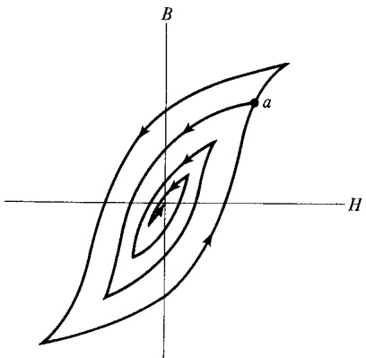

Fig. 1.16 Demagnetization by cycling with decreasing field amplitude.

## PROBLEMS

1.1 Magnetization M and field strength H have the same units (A/m) in SI units. Show that they have the same dimensional units (length, mass, time, current) in cgs.

1.2 A cylinder of ferromagnetic material is 6.0 cm long and 1.25 cm in diameter, and has a magnetic moment of $7.45\times 10^{3}$ emu.

a. Find the magnetization of the material.

b. What current would have to be passed through a coil of 200 turns, 6.0 cm long and 1.25 cm in diameter, to produce the same magnetic moment?

c. If a more reasonable current of 1.5 ampere is passed through this coil, what is the resulting magnetic moment?

1.3 A cylinder of paramagnetic material, with the same dimensions as in the previous problem, has a volume susceptibility $\chi_V$ of $2.0\times10^{-6}$ (SI). What is its magnetic moment and its magnetization in an applied field of 1.2 T?

1.4 A ring sample of iron has a mean diameter of 5.5 cm and a cross-sectional area of 1.2 $\mathrm{cm}^2$ . It is wound with a uniformly distributed winding of 250 turns. The ring is initially demagnetized, and then a current of 1.5 ampere is passed through the winding. A fluxmeter connected to a secondary winding on the ring measures a flux change of $8.25\times10^{-3}$ weber.

a. What magnetic field is acting on the material of the ring?

b. What is the magnetization of the ring material?

c. What is the relative permeability of the ring material in this field?

# EXPERIMENTAL METHODS

## 2.1 INTRODUCTION

No clear understanding of magnetism can be attained without a sound knowledge of the way in which magnetic properties are measured. Such a statement, of course, applies to any branch of science, but it seems to be particularly true of magnetism. The beginner is therefore urged to make some simple, quantitative experiments early in her study of the subject. Quite informative measurements on an iron rod, which will vividly demonstrate the difference between B and H, for example, can be made with inexpensive apparatus: an electronic integrator (an integrator adequate for demonstration purposes can be made as described in Section 2.5), an easily made solenoid, some wire, and a variable-output dc power supply. Most books on magnetism contain some information on experimental methods. The text by Crangle [J. Crangle, The Magnetic Properties of Solids, Edward Arnold (1977)] provides more detailed information than most. Books and papers devoted entirely to magnetic measurements are those of Zijlstra [H. Zijlstra, Experimental Methods in Magnetism (2 vols), North-Holland (1967)], and McGuire and Flanders [T. R. McGuire and P. J. Flanders, Direct Current Magnetic Measurements, Magnetism and Metallurgy, Volume 1, Ami E. Berkowitz and Eckart Kneller, Eds., Academic Press (1969)]. The standards of the ASTM (originally the American Society for Testing and Materials) Committee A06 specify equipment and procedures for various magnetic measurements, mainly but not exclusively of soft magnetic materials under dc or power frequency conditions.

The experimental study of magnetic materials requires (a) a means of producing the field which will magnetize the material, and (b) a means of measuring the resulting effect on the material. We will therefore first consider ways of producing magnetic fields, by solenoids, by electromagnets, and by permanent magnets. Then we will take up the various methods of measuring the magnetization curve and the hysteresis loop of a strongly magnetic substance, and finally, in the last section of this chapter, the methods of measuring the susceptibility of a weakly magnetic substance. Methods of measuring more specialized magnetic properties (e.g. anisotropy, magnetostriction, and core losses) will be dealt with at the appropriate place in later chapters.

The student who wishes to gain a good understanding of magnetic materials cannot afford to slight the contents of this chapter, even if she is not particularly interested in measurements, because some quite basic magnetic phenomena are first introduced here. For example, the demagnetizing fields discussed in Section 2.9 have an importance not restricted to measurements; these fields can affect the magnetic state and magnetic behavior of many specimens.

## 2.2 FIELD PRODUCTION BY SOLENOIDS

Solenoids are useful for measurements on specimens of almost any shape, but are particularly suited to rods and wires. They can be designed to produce fields ranging up to more than 200 kilo-oersteds (kOe) or 16 MA/m or 20 tesla (T), although simple solenoids are limited to fields below about 1 kOe or 0.1 T. [Although the SI unit of field is the A/m. it is common to express field strengths, especially large field strengths, in units of $\mu_{0}H = B$ (tesla).] Two types of solenoids can be distinguished, normal and superconducting.

## 2.2.1 Normal Solenoids

These are usually made with insulated copper wire, wound on a tube of any electrically insulating material, such as polyvinyl chloride (PVC) pipe. For the dimensions shown in Fig. 2.1, the field H at a point P on the axis, distant x from the center, is given by

$$
H = C _ {1} \frac {n i}{L} \left[ \frac {L + 2 x}{2 \sqrt {D ^ {2} + (L + 2 x) ^ {2}}} + \frac {L - 2 x}{2 \sqrt {D ^ {2} + (L - 2 x) ^ {2}}} \right],\tag{2.1}
$$

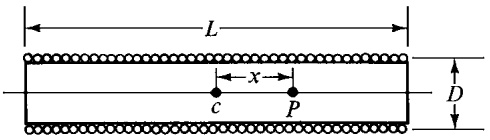

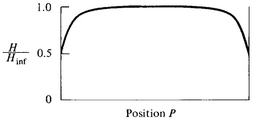

Fig. 2.1 Single-layer solenoid and its field distribution. The axial field at point P is expressed as the fraction of the field at the center of an infinitely long solenoid.

where n is the number of turns and i is the current in amperes. With $C_1 = 1$ and L measured in meters, the field is in A/m; with $C_1 = 4\pi /10$ and L measured in centimeters, the field is in oersteds. The terms inside the brackets are dimensionless when all quantities are measured in the same units. Note that the coil diameter is measured to the center of the winding; that is, the value of D is the outer diameter of the tube plus twice the radius of the wire.

At the center of the solenoid $(x = 0)$ , this reduces to

$$
H = C _ {1} \frac {n i}{L} \left[ \frac {L}{\sqrt {D ^ {2} + L ^ {2}}} \right]\tag{2.2}
$$

and, when $L^{2}\gg D^{2}$ , to

$$
H = C _ {1} \frac {n i}{L}.\tag{2.3}
$$

In any solenoid, the field is highest at the center and decreases towards the ends. The field at the end of a long solenoid is just one-half of the field at the center. But the field over the middle half is quite uniform, as shown by Fig. 2.1, and the values in Table 2.1, which are derived from Equation 2.1. In this table, $H_{\mathrm{inf}}$ is the field, given by Equation 2.3, at the center of an infinitely long solenoid. When the L/D ratio is 20, for example, the field over the middle half is uniform to within 0.15% and is only about 0.13% less than that produced by an infinitely long solenoid. The field variation in the radial direction is generally negligible.

To achieve a higher field, it is preferable to increase n/L by winding the wire in two or more layers rather than to increase the current. Although H is proportional to i, the heat developed in the winding is proportional to $i^{2}R.$ where R is its resistance. Thus doubling the number of layers and keeping the current constant will double H, R, and the amount of heat; whereas doubling the current will double H, but quadruple the heat. Solenoids consisting of relatively few layers can be treated mathematically as a series of concentric solenoids of increasing diameter whose fields add together. Very thick solenoids (many layers) are the subject of an extensive literature, which is well summarized by Montgomery [E. Bruce Montgomery, Solenoid Magnet Design, Wiley-Interscience (1969)].

Cooling of the winding becomes necessary for continuous fields larger than about 1 kOe or 0.1 T. This can be accomplished in a variety of ways, such as by blowing air over the solenoid with a fan, by immersing the solenoid in a cooling liquid, usually water but possibly liquid nitrogen, by winding the wire on a water-cooled tube; or by forming the winding from copper tubing so that it can carry both electric current and cooling water.

TABLE 2.1 Field Uniformity in Solenoids

|  L/D | H at Center | H at Edge of Middle Half |
| --- | --- | --- |
| 5 | 0.9806 Hinf | 0.9598 Hinf |
| 10 | 0.9950 | 0.9892 |
| 20 | 0.9987 | 0.9972 |
| 50 | 0.9996 | 0.9994 |

Solenoids are usually made from high-purity copper wire insulated with a thin, flexible enamel insulating coating. Such wire is made and sold as magnet wire; it is available in a wide range of diameters, and with various types and thicknesses of insulating coatings. The thinnest coating is generally adequate for solenoid construction, but a high-temperature insulation may be desirable. The enamel insulations are organic materials, and are limited to working temperatures of $240^{\circ}\mathrm{C}$ or lower. For higher temperatures, braided fiberglass tubing may be used, although it is bulky compared to enamel coatings. Also available, but expensive, is nickel-plated copper wire with a bonded surface layer of very small insulating ceramic particles. Its operating temperature is limited by oxidation of the wire rather than failure of the insulating layer.

Solenoid design is a matter of balancing several conflicting requirements, and the following points should be kept in mind:

1. D is determined by the working space required within the solenoid.

2. The ratio L/D is fixed by the distance over which field uniformity is required. Because the specimen to be tested must normally be subjected to a reasonably uniform field, this means that the maximum specimen length effectively determines the ratio L/D , with the coil length L 1.5 – 2 times the length of the sample. Specimen length is in turn governed by the factors discussed in Section 2.6.

3. For a given L, the field is proportional to the number of ampere-turns ni, and the power required (which is equal to the rate of heat generated) is proportional to $i^{2}R$

4. For a given current, the voltage required from the power source is proportional to R, which in turn is proportional to n. For the most effective use of a given power supply, the solenoid resistance R should be chosen so that at maximum field the power supply operates at both its maximum current and maximum voltage ratings.

Helmholtz coils will produce an almost uniform field over a much larger volume than a solenoid. Two identical thin parallel coils, ideally with square cross-section, are placed at a distance apart equal to their common radius r (Fig. 2.2). The field parallel to the axis of the coils at a point P on the axis a distance z from the midpoint is given by

$$
H = \frac {C _ {1}}{2} n i \left[ \frac {r ^ {2}}{\left(r ^ {2} + \left(\frac {L}{2} + z\right) ^ {2}\right) ^ {3 / 2}} + \frac {r ^ {2}}{\left(r ^ {2} + \left(\frac {L}{2} - z\right) ^ {2}\right) ^ {3 / 2}} \right].\tag{2.4}
$$

The distance between the two coils is L, so for the Helmholtz configuration $L = r.$ Here $C_{1}$ is defined as in Equation 2.1, dimensions are in centimeters for cgs and meters for SI, and n is the number of turns in each coil. At the center of the coil system $(z = 0)$

$$
H = \frac {8}{5 \sqrt {5}} C _ {1} \frac {n i}{r} = 0. 7 1 6 C _ {1} \frac {n i}{r}.\tag{2.5}
$$

Figure 2.3 shows the field from each of the individual coils (normalized to unity), and the total field from both. G. G. Scott [J. Appl. Phys. , 28 (1957) pp. 270– 272] gives equations for both components of the field at points off the axis. For the same power consumption, Helmholtz coils produce a field which is only a few percent of that produced by a solenoid of length r. They are thus confined to low-field applications.

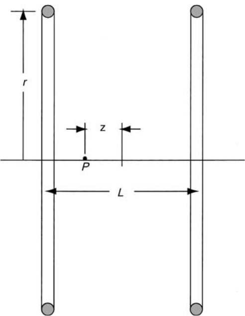

Fig. 2.2 Helmholtz coils. The spacing between coils L is equal to the coil radius r.

By increasing the coil spacing slightly, the length of the uniform field region can be increased at the cost of a slight dip in field at the center. Figure 2.4 compares the computed fields of a “pure” Helmholtz coil with one where the coil spacing has been increased by 10%. The arrows show the distance over which the field is within 0.7% of the maximum field. Increasing the coil spacing by 10% lowers the maximum field by about 5%, but increases the length of the uniform field by almost 50%. Equation 2.4 is written in a form than permits the effect of changing the coil spacing L to be easily calculated.

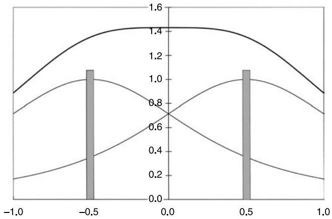

Fig. 2.3 Field distribution in Helmholtz coils. Position is specified in units of the coil radius r. The light lines show the field (normalized to unity) from the individual coils (gray bars), located at +0.5 r, and the heavy line is the total field.

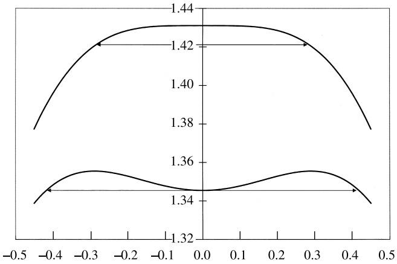

Fig. 2.4 Field distribution in a “pure” Helmholtz coil (upper curve) compared with field distribution in a Helmholtz coil pair whose coil spacing has been increased by 10%. The dimension lines show the distance over which the field is uniform within 0.7% of the maximum field.

The power supply to a solenoid or Helmholtz coil pair must normally provide variable direct current. Variable dc power supplies, dry cells, lead-acid storage batteries, or alternating current rectifiers (with suitable filtering) can all be used. If the field needs to be reversed during the measurement, so as to record a hysteresis loop, either a reversing switch is needed or a bipolar power supply can be used. The bipolar supply permits a smooth and unbroken reversal of the field, which is often a significant advantage. Solenoids may be driven with alternating current (ac) when required. The inductance of the solenoid must be considered, which may require balancing capacitors and can lead to high voltages appearing across the terminals of the solenoid.

## 2.2.2 High Field Solenoids

To produce very high fields with normal solenoids requires very large power input, and two major design problems must be addressed. The first is the removal of large amounts of heat. (Note that maintaining a steady magnetic field by means of an electric current is a process of exactly zero efficiency. All the input power goes into heat.) The second is providing sufficient mechanical strength to resist the large forces acting on current carriers in the presence of large fields.

Beginning about 1936, Francis Bitter [Rev. Sci. Instrum., 10 (1939) pp. 373– 381] began the development of high-field solenoids of a new type. The coil of a Bitter magnet is sketched in Fig. 2.5, and a photograph of two partly assembled coils in shown in Fig. 2.6. (Any device which produces a field is commonly referred to as a “magnet,” whether or not it contains iron.) The winding is composed, not of wire, but of thin disks of copper or a copper alloy. These disks, usually 1 ft (30 cm) or more in diameter and about 0.04 in (1 mm) thick, have a central hole and a narrow radial slot and are insulated from each other by similarly cut sheets of thin insulating material. Each copper disk is rotated about $20^{\circ}$ with respect to its neighbor, so that the region of overlap provides a conducting path for the current to flow from one disk to the next. The current path through the entire stack of disks is therefore helical, and the stack of disks acts as a solenoid. The disks are clamped tightly together and enclosed

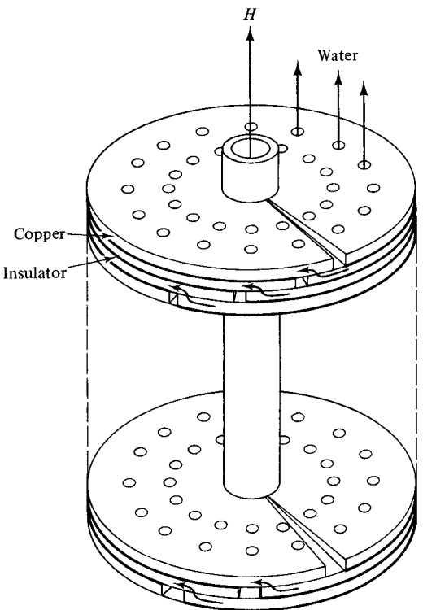

Fig. 2.5 Sketch of a Bitter magnet solenoid. Arrows indicate the current path from one disk to another.

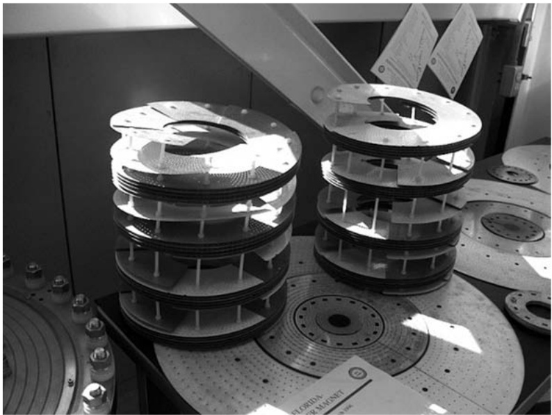

Fig. 2.6 Photograph of partially-assembled Bitter magnets. Figures 2.6 and 2.7 are by Walter Thorner, National High Magnetic Field Laboratory.

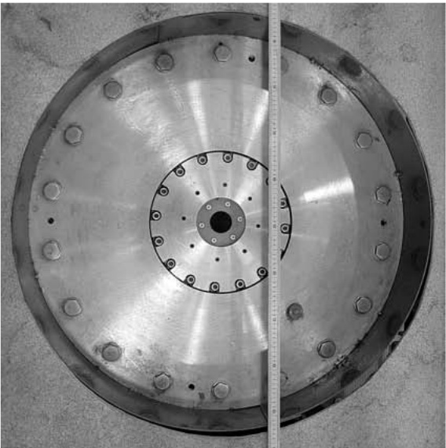

(a)

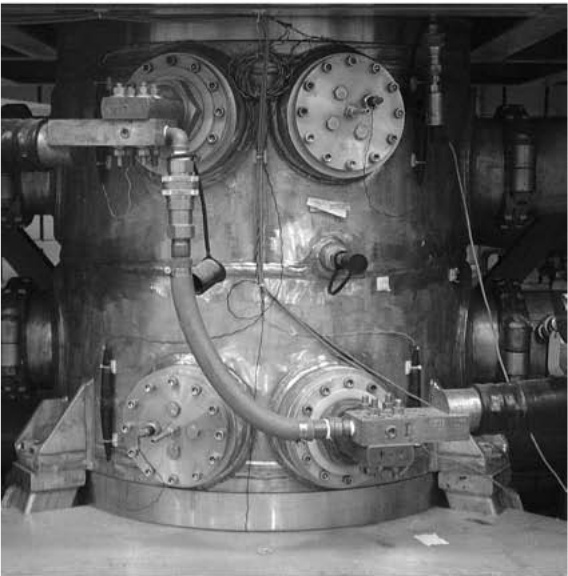

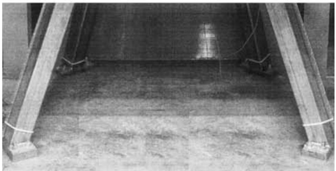

(b)

Fig. 2.7 Assembled Bitter magnet. (a) Top view with meter stick; (b) front view.

in a case (not shown in the sketch). Cooling water is pumped axially through the magnet, through a large number of small holes or slots cut in each disk. At the National High Magnetic Field Laboratory (NHMFL) in Florida, dc fields of 45 T (450 kOe) can be produced in a magnet with a bore of 32 mm (1.25 in), requiring dc current up to 67,000 amperes and power inputs of about 20 MW. The NHFML operates Bitter magnets of various sizes, maximum field, and field uniformity. The photographs in Fig. 2.7 show top and side views of a Bitter magnet ready for use.

Many aspects of the design of high-field Bitter magnets are treated in the book by Montgomery, previously cited. Bitter magnets require large motor-generator sets, consisting of an ac motor driving a dc generator, or else high power rectifier systems, to provide the necessary large variable dc currents. Such installations, together with the necessary cooling water supply and pumps, are expensive and only a few exist in the world.

Pulsed fields offer a less costly approach to the problem of measurements in high fields. If the measurement can be made quickly, by means of high-speed data collection, then only a transient field is needed. This is most commonly done by slowly charging a bank of capacitors and then abruptly discharging them through a solenoid. A large pulse of current, lasting a fraction of a second, is produced, and the problem of heat removal is thus greatly minimized or even eliminated, depending on the magnitude of the field required. Pulsed fields up to 200 kOe (20 T) or more can be attained in special watercooled or cryogenically-cooled solenoids, and pulsed fields of moderate strength (10 – 30 kOe, 1 – 3 T) in conventional, wire-wound, uncooled solenoids are easily obtained. Even higher fields and longer pulse durations of 0.5 s or more are reached by extracting the stored rotational energy of a large dc generator in a relatively long current pulse. The design of pulsed field solenoids must also take into account the large forces acting on the current carriers.

For even higher fields, flux compression devices can be used. A large field is created inside a heavy copper tube, which is then compressed radially inward, usually by explosive charges. A large induced current flows around the tube, which effectively keeps all the flux lines within the tube. As the tube area shrinks, the flux density, or field, increases. In this case, the sample is destroyed as the experiment is carried out.

## 2.2.3 Superconducting Solenoids

The phenomenon of superconductivity provides a radically different approach to the highfield problem. When a normal metal is cooled near 0K, its electrical resistivity decreases to a low but nonzero value $\rho_{\mathrm{r}}$ called the residual resistivity (Fig. 2.8a). However, the resistivity of some metals and alloys decreases abruptly to zero at a critical temperature $T_{\mathrm{c}}$ These materials are called superconductors; lead $(T_{\mathrm{c}} = 7.2\mathrm{K})$ and tin $(T_{\mathrm{c}} = 3.7\mathrm{K})$ are examples. (The magnetic properties of superconductors are also important; see Chapter 16.) If a current is once started in a circuit formed of a superconductor maintained below $T_{\mathrm{c}}$ it will persist indefinitely without any power input or heat generation, because the resistance is zero. The attractive possibility at once presents itself of producing very large magnetic fields by making a solenoid of, for example, lead wire and operating it below $T_{\mathrm{c}}$ by immersing the windings in liquid helium (4.2K). However, soon after the discovery of superconductivity in 1911, it was found that an applied magnetic field decreased $T_{c}$ and a field of a few hundred oersteds or several tens of milli-tesla destroyed the superconductivity completely (Fig. 2.8b). Thus, when the field produced by the solenoid itself exceeds a critical value $H_{\mathrm{cr}}$ the normal resistivity of the wire returns, along with the attendant problems of heating and power consumption.

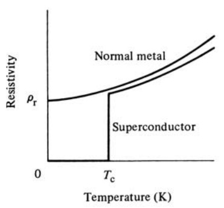

(a)

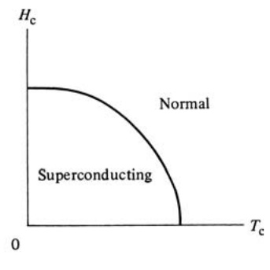

(b)

Fig. 2.8 (a) Variation of electrical resistivity with temperature for a normal metal and a superconductor. (b) Dependence of critical temperature on magnetic field.

The solution to this problem was not found until 1961 when Kunzler et al. [J. E. Kuntzler, E. Buehler, F. S. L. Hsu, and J. H. Wernick, Phys. Rev. Lett., 6 (1961) pp. 89 – 91] discovered that the niobium-tin intermetallic compound $\mathrm{Nb}_{3}\mathrm{Sn}$ remains superconducting even at a field of 88 kOe or 8.8 T or 7 MA m. It was later found that the critical field of this alloy at 4.2K, the temperature of liquid helium, is 220 kOe or 17.6 MA/m $\mathrm{Nb}_{3}\mathrm{Sn}$ is very brittle, and various metallurgical problems had to be solved before it was successfully made in the form of a composite tape suitable for a solenoid winding. It was later found that Nb-Zr and Nb –Ti alloys, which are reasonably ductile, are superconducting up to fields of about 80 kOe or 6.4 MA/m at 4.2K. Superconducting solenoids of all three of these materials have been constructed.

Once current is flowing in a superconducting solenoid, no power input is required for the solenoid itself. However, a superconducting short-circuit link must be provided while the field is constant, and opened when the field needs to be altered. For this reason, superconducting solenoids in which the field needs to be swept, or frequently changed, are commonly operated with external power supplies and with nonsuperconducting leads carrying the current to the magnet.

A superconducting solenoid must be maintained at or near the temperature of liquid helium, which means that liquid helium must be purchased or a helium liquifier must be operated. The sample environment is therefore naturally at liquid helium temperature, but can be maintained at temperatures up to room temperature or even higher with appropriate equipment. Temperatures significantly above room temperature are hard to obtain. Superconducting solenoids are the common choice when fields above about 20 kOe or 2 T are required, up to a maximum of about 200 kOe or 20 T (unless the sample needs to be at high temperature). Superconducting materials with much higher critical temperatures have been discovered, but have not yet (2007) been made into successful high-field magnets.

The great interest in high magnetic fields extends beyond studies of their effects on the magnetic properties of materials. They are needed for a wide range of experiments in solidstate physics and biology, and for magnetic resonance imaging (MRI) systems.

## 2.3 FIELD PRODUCTION BY ELECTROMAGNETS

In the ordinary laboratory, the need for fields larger than those obtainable from conventional solenoids is met with electromagnets. These usually produce fields up to about 20 kOe or 2 T, although some are capable of 3 T in a small volume.

An electromagnet consists essentially of an iron “core” around which is wrapped a coil of wire carrying a direct current. Figure 2.9 illustrates its development. A simple solenoid is shown in Fig. 2.9a; the field H at its center C is proportional to the number of ampere-turns per unit length of its winding, in accordance with Equation 2.3. If an iron rod is inserted in the coil, as in Fig. 2.9b, the field at its center C, inside the iron, is now very much larger, because the field is now given by B, which is the sum of H due to the current and M due to the iron (in appropriate units; Equation 1.15). We cannot, of course, make any use of the field at a point inside the iron. However, the field at the point P, just outside the end of the rod, is also equal to B. Further away, the lines of force diverge and the flux density, or field strength, decreases rapidly. The iron has, in effect, multiplied the field due to the current, and the multiplying factor is simply the permeability μ or $\mu_{r}$ , because $B = \mu H.$ Thus, if the permeability is 2000 for $H = 10\mathrm{Oe}$ or 1 mT, the field inside and just outside the iron is 20,000 Oe or 2 T. In this way quite a large field can be obtained with a relatively low current. Here we have ignored the fact that B inside the rod near one end is much less than B in the center of the rod, as we shall see in Section 2.6. When this effect is taken into account, we find that the current in the coil has to produce a field H many times larger than 10 Oe or 1 mT if the flux density B at the end of the rod is to be 20,000 G or 2 T. Even so, this current will still be very much less than if the iron were absent.

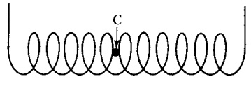

(a)

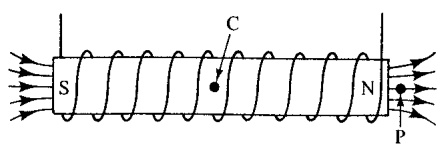

(b)

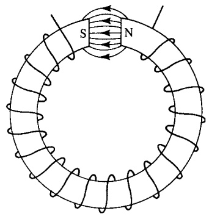

(c)

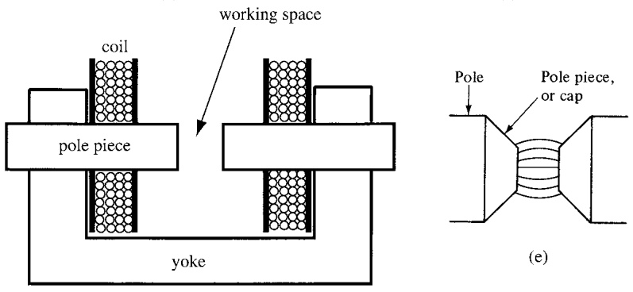

(d)

Fig. 2.9 Evolution of the electromagnet.

The rotor of an ordinary electric motor or generator is fundamentally a rotating electromagnet, composed of an iron core wound with copper wire. If these machines are to do any useful work, they must operate at high flux densities; without the flux-multiplying power of iron they would be not much more than scientific toys. It is a most remarkable fact of technological history that, when Faraday and Henry and their successors needed this power, they found it readily available in ordinary cheap iron, which later work has shown to be the best element for this purpose in the whole periodic table. One wonders what direction the development of technology would have taken if the only strongly ferromagnetic element had a price like that of gold or platinum.

The divergence of the lines of force near the ends of a straight iron rod can be reduced by bending the rod into a circle so that the ends nearly touch, as in Fig. 2.9c. The flux then travels directly from one pole to the other across the air gap. As the current in the winding is increased, the magnetization of the iron increases to its saturation value $M_{\mathrm{s}}$ . The maximum contribution of the iron to the field in the air gap is therefore about 21.5 kG or 2.15 T, if the pole faces are flat. Any further increase is due only to an increased current in the winding. To make this contribution more effective, the turns of the winding are brought close to the air gap, and the magnet assumes the final form shown in Fig. 2.9d. The flux generated by the winding passes through the core into the yoke, and back through the other core. Both core and yoke are made of iron or low-carbon steel, annealed to produce high permeability. The yoke must also be massive enough to resist the strong force of attraction between the two poles. The windings are usually water-cooled. The size of a magnet is specified in terms of the diameter of its poles, and electromagnets are made in a range of sizes from 3 to 12 inches (7.5 to 30 cm) or more. Figure 2.10 shows a commercial electromagnet with its power supply and measuring equipment.

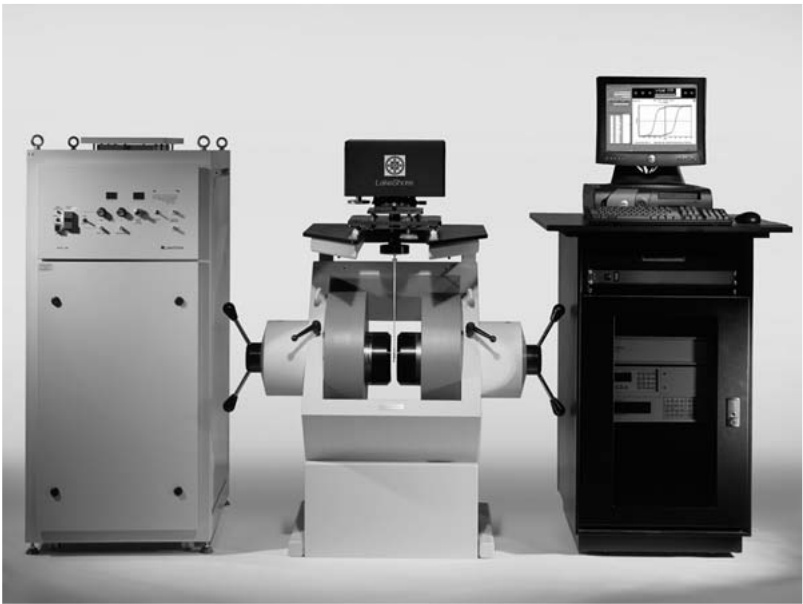

Fig. 2.10 Commercial electromagnet (center). Power supply at left, control and measurement equipment on right. Courtesy Lake Shore Cryotronics, Inc.

When a field uniform over a fairly large volume is required, flat pole faces are used. To achieve higher fields, tapered pole pieces (pole caps) can be installed. The free poles formed on the tapered surfaces contribute to the field at the center of the gap, as suggested by Fig. 2.9e. This contribution can be comparable to Ms [Y. Ishikawa and S. Chikazumi, Jap. J. Appl. Phys., 1 (1962) p. 155], but this higher field is achieved only in a smaller volume and it is not very uniform. A still further increase in field can be obtained by making the pole pieces of an Fe–Co alloy, which has a saturation magnetization about 10% higher than that of Fe.

In many electromagnets the size of the air gap (distance between poles) can be adjusted by a screw mechanism or by interchangeable pole caps of varying size. The larger the gap, the smaller the field, because the larger air gap increases the reluctance of the magnetic circuit (see Section 2.8) and because much of the flux then leaves the volume of the gap proper and forms the “fringing flux” indicated in Fig. 2.9c and e. Figure 2.11a shows how the field in the gap depends on gap size and the current in the winding for an

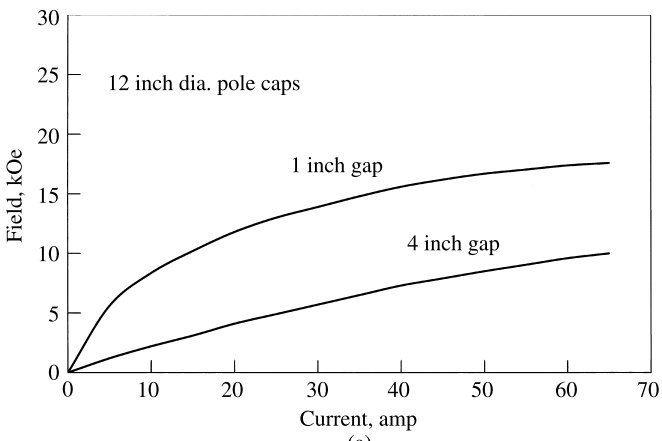

(a)

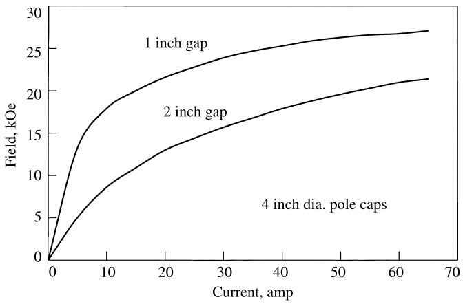

(b)

Fig. 2.11 Magnetic field (kOe) vs current in a 12-inch electromagnet: (a) 4-inch and 1-inch gaps; (b) with 4-inch tapered pole caps, 2-inch and 1-inch gaps.

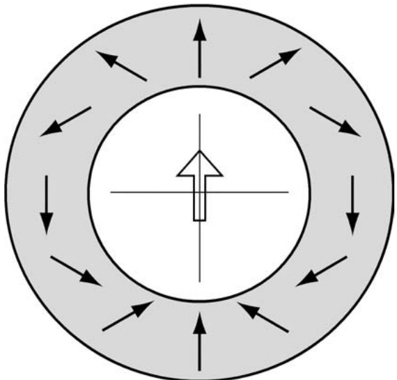

Fig. 2.12 Halbach cylinder. Solid arrows show direction of local magnetization. The open arrow is the resulting field.

electromagnet with flat 12-inch diameter pole pieces; Fig. 2.11b shows the increase in field that results if pole caps tapering to 4-inch diameter are installed in the same magnet.

## 2.4 FIELD PRODUCTION BY PERMANENT MAGNETS

A constant magnetic field up to some limiting value can be produced by an appropriate geometrical arrangement of one or more permanent magnets. This is frequently useful, in meters, motors, loudspeakers, and other devices, but a fixed field is generally not appropriate for experimental work. However, the development of rare earth permanent magnets has led to materials that can retain their magnetization in very large reverse fields, and this makes possible an arrangement of rotating permanent magnets that can provide magnetic fields in the working space varying continuously from +20 to -20 kOe or +2 to -2 T. No cooling water is required, and the only power is that needed to physically rotate the magnets [O. Cugat, P. Hansson, and J. M. D. Coey, IEEE Trans. Magn., 30 (1994) p. 4602].

The device is based on an arrangement called the Halbach cylinder (Fig. 2.12). The direction of local magnetization in a permanent magnet ring at any angular position $\theta$ is rotated by an angle $2\theta$ from its original orientation at $\theta$ = 0. The result is a uniform field across a diameter of the cylinder, as shown by the large open arrow. In practice, the cylinder is replaced with an array of uniformly-magnetized blocks arranged in an octagon, as shown in Fig. 2.13. If two Halbach arrays are arranged concentrically, as in Fig. 2.14, and if the inner array is made of a material whose state of magnetization is not altered significantly by the field of the outer array, then the field at the center is simply the sum of the field from each of the individual arrays. In Fig. 2.14, the fields of the two arrays are in opposite directions, so if both arrays produce the same central field, the net field is zero. If either array is rotated through $180^{\circ}$, the fields add, and the net field is the sum of the two individual fields. By appropriate rotation of the two arrays, the central field can have any value and

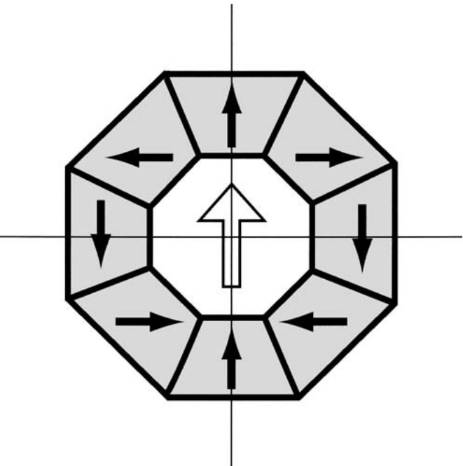

Fig. 2.13 Halbach magnet array.

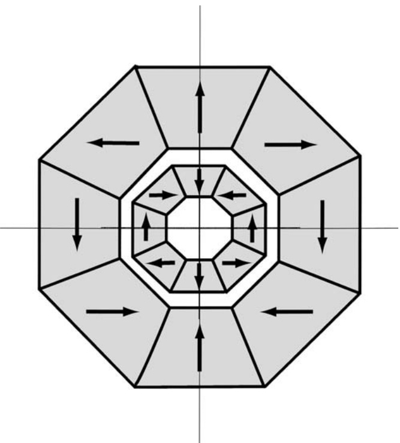

Fig. 2.14 Pair of concentric Halbach arrays. Each array can be rotated independently about the central axis perpendicular to the page.

any direction up to this sum. Using high-quality rare-earth permanent magnet materials, this maximum field can be as high as 20 kOe or 2 T, as noted above.

## 2.5 MEASUREMENT OF FIELD STRENGTH

The field H to which a specimen is subjected in a measurement of its magnetic properties must be known, by calculation or measurement. If the field is produced by a solenoid, the field strength can be calculated from the current, number of turns, and length of the winding, since these quantities can all be determined with good accuracy. However, the field in the gap of an electromagnet must be measured, because it depends not only on the current in the windings but also on the geometry and magnetic properties of the core and yoke. It is possible to measure this field for a range of magnet currents and prepare calibration curves like those of Fig. 2.11, although these do not take account of the fact that the field at a given current varies slightly depending on whether the field is increasing or decreasing, due to the hysteresis in the core material.

The two most common methods of measuring magnetic fields are by means of the Hall effect and by electronically integrating the voltage induced in a search coil.

## 2.5.1 Hall Effect

This effect1 occurs in any conductor carrying a current in the presence of a transverse magnetic field. If there is a current i in a plate-shaped conductor (Fig. 2.15), then two opposite points a and b will be at the same potential in the absence of a magnetic field. When a field H acts at right angles to the plate, the current path is distorted, and an emf $e_{\mathrm{H}}$ is developed between a and b. The magnitude of this Hall emf is proportional to the product of the current and the field:

$$
e _ {\mathrm{H}} = R _ {\mathrm{H}} \frac {i H}{t} \quad \text {volt,}\tag{2.6}
$$

where t is the thickness of the plate, and $R_{\mathrm{H}}$ the Hall constant, is a property of the material. The effect occurs both in metals and semiconductors, but is very much larger in the latter.

If i is kept constant, then $e_{\mathrm{H}}$ is a measure of field strength H. If i is alternating, then $e_{\mathrm{H}}$ is also alternating and can be easily amplified. The sensing element, called a Hall probe, is usually the semiconductor InSb in commercial instruments. The probe can be made very small, 1 mm2 or less, and is usually mounted on the end of a thin rod connected by a small-diameter cable to a control unit containing the current source, amplifier, and indicating meter. Depending on the orientation of the semiconductor chip, the measured field can be perpendicular to the rod (transverse probe) or parallel to the rod (axial probe). Multirange instruments are available for measurement of fields ranging from values smaller than the Earth’s field to 30 kOe (3 T) or more. Because of the small size of the probe, these instruments are well suited to the measurement of fields in confined regions, or of field gradients. Alternating fields may also be measured, up to some frequency limit set by the characteristics of the measuring circuit.

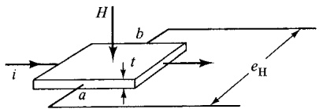

Fig. 2.15 Sketch of a Hall plate, showing the relationship between field, current, and emf.

<small>1Discovered in 1879 by the American physicist Edwin Hall (1855– 1938) when he was a student under H. A. Rowland at Johns Hopkins University.</small>

Commercial instruments, called gaussmeters or teslameters, have a manual zero setting, and if it is necessary to measure very small fields the zero must be set with the probe located in a magnetically shielded cylinder to eliminate the Earth’s field of about 0.5 Oe or 40 A/m In practice, the relationship between Hall voltage and field is not perfectly linear, and becomes increasingly non-linear at high fields. This means that generally Hall probes can be used only with control units for which they have been specifically calibrated.

Calibration of a Hall probe requires a series of accurately known fields. It is possible to buy small permanent magnet assemblies of known field strengths in small gaps just large enough to insert a probe; these are stable over long time periods. Alternatively, the field of an electromagnet can be very accurately measured with a nuclear magnetic resonance probe. The NMR technique is the standard for establishing an accurate value of a magnetic field; NMR is discussed briefly later in this chapter, and in somewhat more detail in Chapter 12. The technique depends on the measurement of a frequency, which can be done to very high precision and accuracy.

## 2.5.2 Electronic Integrator or Fluxmeter

By Faraday’s law, a changing magnetic flux w through a coil of N turns generates a voltage in the coil proportional to the rate of change of flux

$$
e = - C _ {2} N \frac {d \varphi}{d t} \quad \text {volt,}\tag{2.7}
$$

where in SI units $C_2 = 1$ and w is in webers or volt-seconds; in cgs units $C_2 = 10^{-8}$ and w is in maxwells. Time t is in seconds.

Rewriting Equation 2.7 we obtain

$$
e d t = - C _ {2} N d \varphi ,\tag{2.8}
$$

and integrating,

$$
\int_ {0} ^ {t} e d t = - C _ {2} N \int_ {\phi 1} ^ {\phi 2} d \varphi = - C _ {2} N \Delta \varphi .\tag{2.9}
$$

An instrument to integrate the voltage from a search coil is called a fluxmeter. Various moving-coil devices have been used in the past, but fluxmeters are now electronic integrators based on capacitative feedback around an operational amplifier (see Fig. 2.16). The electronic integrator provides a voltage output that can be digitized and recorded, rather than a pointer deflection that must be written down.

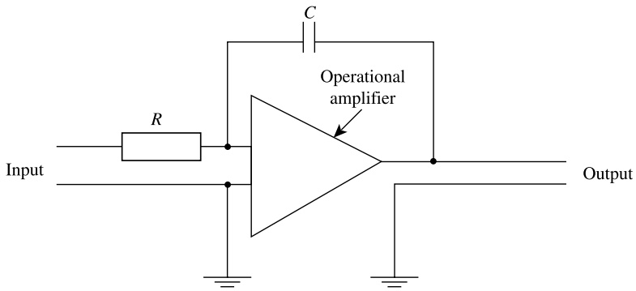

Fig. 2.16 Electronic integrator (schematic). $E_{\mathrm{out}} = 1 / RC \int_0^t E_\mathrm{in} dt.$

If the flux is uniform over the area of the coil A, there will be a flux density in the coil:

$$
B = \frac {\phi}{\Lambda}.\tag{2.10}
$$

B is in gauss = maxwell/cm² (cgs) or $\text{tesla} = \text{weber}/\text{m}^2 = \text{V-sec}/\text{m}^2$ (SI). Then

$$
\int e d t = - C _ {2} N \mathrm{A} \Delta B \quad \mathrm{V} \cdot \sec .\tag{2.11}
$$

Note that a fluxmeter measures only changes in flux or flux density. If the measuring coil encloses no magnetic material, $B = H(\mathrm{cgs})$ or $B = \mu_{0}H$ (SI), and the fluxmeter measures the field H. A fluxmeter can be used to record H during the measurement of a hysteresis loop, when the value of the starting field is known. To measure a constant field, the search coil must be moved from the unknown field to a zero-field region, or rotated through $180^{\circ}$. For this kind of measurement (finding the value of a constant field) a Hall probe is generally more convenient, since it provides a continuous reading.

The voltage generated in a search coil is often quite small. Consider a coil of 100 turns and area $1\mathrm{cm}^2 = 10^{-4}\mathrm{m}^2$ , in a field that changes from +100 to -100 Oe or +8 to -8 kA m in 1 sec. From Equation 2.11, the coil voltage has an average value of 0.2 mV, and the integrated voltage is 0.2 mV-sec. Small parasitic voltages, usually thermally induced at dissimilar-metal junctions, can cause significant background drift at these signal levels, and fluxmeters always have some kind of drift control built in. Electronic fluxmeters generally have a limiting sensitivity of about 10 maxwell turns = 10 gauss $\mathrm{cm}^2$ turns or $10^{-3}$ weber turns $= 10^{-3}$ tesla $\mathrm{m}^2$ turns. This means that a quantity about 100 times larger can be measured to 1% precision.

Calibration of a fluxmeter is in principle not required. The properties of an electronic integrator depend only on the values of its input resistor R and its feedback (integrating) capacitor C, according to

$$
e _ {\mathrm{out}} = \frac {1}{R C} \int e _ {\mathrm{in}} d t.\tag{2.12}
$$

Resistors of accurately known value are readily available, but not capacitors, and the precise measurement of capacitance is difficult. So calibration is usually accomplished with a coil of known area-turns in a known magnetic field, or with a purchased or constructed mutual inductor. Commercial instruments are calibrated before delivery. Note that the resistance of the measuring coil must be added to the internal resistance of the integrator to give the correct value of R in Equation 2.12. This correction is usually, but not always, small.

A suitable calibrating apparatus can be simply constructed by placing a search coil of known area-turns at the center of a solenoid of known dimensions, with the axes of the two coils aligned parallel. The field at the center of the solenoid is known from Equation 2.2 or 2.3, so the magnetic flux through the search coil is known. This device is in fact a mutual inductor. Alternatively, a known input signal can be provided to the integrator in the form of a small fixed voltage applied for a controlled time period. From the example in a previous paragraph, a fixed voltage of 100 mV could be applied for exactly 2 sec, or 0.2 mV for 1 sec.

## 2.5.3 Other Methods

Various other methods can be and have been used to measure magnetic fields.

Rotating Coil Magnetometer If a search coil in a field is continuously rotated about an axis perpendicular to the field, an alternating emf will be generated that is proportional to the field strength. This voltage may be brought out through slip rings and measured directly, or converted to pulsating dc by a mechanical commutator (electronic rectifiers do not work well at low voltages). The slip rings can be eliminated if the coil is oscillated through $90^{\circ}$ or $180^{\circ}$ rather than rotated. The output signal is inherently linear with field, but the rotating or oscillating coil and its mechanical drive system is bulky compared to a Hall probe.

Magnetoresistance Most conducting materials show a change in resistance when placed in a magnetic field. The effect is generally small and non-linear, and has not been very successfully used for field measurement. Very large values of magnetoresistance can be found in certain special materials and thin film arrays. This effect is used to sense changes in field in magnetic computer storage and memory devices, but not for the measurement of field strength. See Chapter 15.

Fluxgate Magnetometer A rod or strip of soft magnetic material driven beyond its linear magnetization region by an alternating field will display a symmetric hysteresis loop. If a dc field is superimposed on the ac field, the hysteresis loop will become asymmetric as it is displaced from a center at H = 0, as in Fig. 2.17. The asymmetry is easily detected, and can be cancelled by applying an opposing dc field with a small solenoid surrounding the sensing strip. The current required to cancel the asymmetry is a direct measure of the field that caused the original asymmetry. An instrument based on this principle is called a fluxgate (or saturable core) magnetometer, and is commonly used to detect changes in the Earth’s field for archeology and oil-field surveys, to control a coil current to produce a stable magnetic environment in the laboratory, etc. The fluxgate magnetometer is generally limited by heating in the balancing coil to the measurement of fields not much greater than the Earth’s field. The sensing element is also large compared to a Hall element. Further details are given in Section 2.5.3.

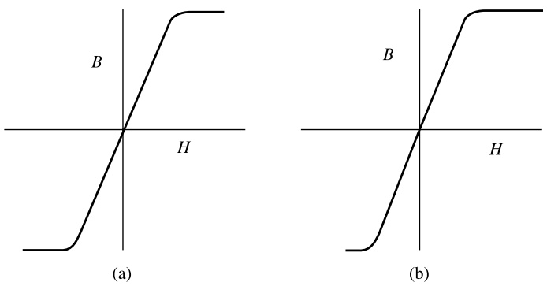

Fig. 2.17 Principle of fluxgate magnetometer (schematic).

Magnetic Potentiometer or Chattock Coil This is a tightly wound coil, usually but not necessarily semi-circular, wound on a nonmagnetic form, whose two ends lie in the same plane (see Fig. 2.18). If no current flows in the coil, the line integral $\oint H$ dl around the path shown by the dotted line must be zero. We can write this integral as the

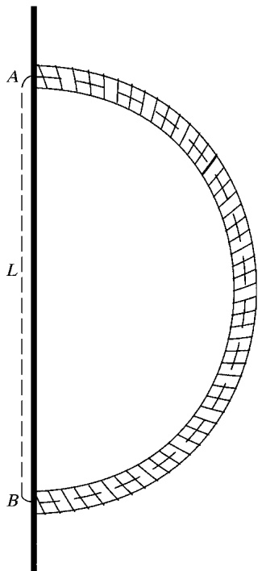

Fig. 2.18 Sketch of Chattock coil or magnetic potentiometer.

sum of two parts:

$$
\int_ {A} ^ {B} H d l + \int_ {B} ^ {A} H d L = 0.\tag{2.13}
$$

If the field is uniform from A to B along the line L, we may write

$$
\int_ {B} ^ {A} H d L = H \Delta L = - \int_ {A} ^ {B} H d l.\tag{2.14}
$$

If the output of the Chattock coil is connected to an integrator, the integrated voltage is proportional to the change in H along the line L. Or the Chattock coil can be moved from the field-measuring position to a region of zero field, and the integrator output will be proportional to the (constant) field between A and B.

It is difficult to make a very small Chattock coil, so this device has been used less as sample sizes have grown smaller over the years. It also suffers from the disadvantage of being unable to measure a steady field without there being a relative motion of the sample and the coil.

Nuclear Magnetic Resonance This was referred to above as a calibration method. The resonance frequency of an atomic nucleus depends linearly on the applied field. A probe containing a modest quantity of appropriate nuclei, plus coils for applying and detecting high-frequency fields, is placed in the field to be measured and the frequency at which resonance occurs is determined. Frequencies can be measured with high accuracy and pre-cision, and the conversion factor from frequency to field is known with high accuracy and precision, so this method is the most accurate way to measure magnetic fields. The probe is relatively large, and the instrumentation is expensive; also the field must be uniform over the volume of the probe. The subject is treated in somewhat more detail in Chapter 12.

SQUID Magnetometer This device is based on the tunneling of superconducting electrons across a very narrow insulating gap, called a Josephson junction, between two superconductors. A sketch of the device in its usual form is shown in Fig. 2.19. A superconducting measuring current flows through the ring, dividing so that equal currents pass through each of two Josephson junctions. A changing magnetic flux through the ring generates a voltage and a current in the ring, according to Faraday’s Law. This induced current adds to the measuring current in one junction, and subtracts in the other. Because of the wave nature of the superconducting current, the result is a periodic appearance of resistance in the superconducting circuit, and the appearance of a voltage between points A and B. Each voltage step corresponds to the passage of a single flux quantum across the boundary of the ring. The existence of the flux quantum was demonstrated in somewhat similar experiments on superconducting rings; its value is $h / 2e = 2.07\times 10^{-15}$ weber or $\mathrm{Tm}^2$ , or $2.07\times 10^{-7}$ maxwell or gauss $\mathrm{cm}^2$ . This sensitivity is rarely needed in a measurement of magnetic field, and in practice the device is most commonly linked to a coil to measure the flux from a small sample, and thus the sample magnetization. In this form it is called a SQUID (for superconducting quantum interference device) magnetometer. Since a superconducting Josephson device requires low-temperature operation, it is usually used in conjunction with a superconducting solenoid.

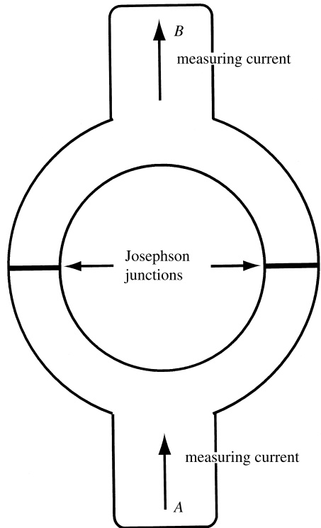

Fig. 2.19 SQUID (superconducting quantum interference device) flux sensor.

## 2.6 MAGNETIC MEASUREMENTS IN CLOSED CIRCUITS

Lines of magnetic induction B are continuous and form closed loops. The region occupied by these closed loops is called a magnetic circuit. Sometimes the flux follows a welldefined path, sometimes not. When the flux path lies entirely within strongly magnetic material, except possibly for a small amount of leakage flux, the circuit is said to be closed. If the flux passes partially through “nonmagnetic” material, usually air, the circuit is said to be open.

An important property of a closed and homogeneous magnetic circuit is that the material comprising it can be magnetized without the production of magnetic poles, and therefore without the production of any magnetic fields due to the material itself. As we shall see, this circumstance considerably simplifies the determination of the field H, which causes the magnetization.

The simplest example of a closed magnetic circuit is a ring, with a uniform circular or square or rectangular cross-section, magnetized circumferentially. We will now consider how the normal induction curve and hysteresis loop of a ring specimen can be determined. A search coil of N turns is wound directly on the ring, often over a thin layer of electrically insulating tape to protect the electrical insulation on the wire. This is called the secondary winding, and since it will carry no significant current, it can be made using the smallest practical wire size. If the material is known to be homogeneous and nondirectional, this winding need not extend around the entire circumference of the sample. However, not many samples can be reliably known to meet these conditions, so a complete circumferential winding is usually best. This winding should consist of a single layer if possible (and it usually is). Over this is placed a magnetizing winding of n turns. This is the primary winding. It must carry the magnetizing current, and its wire diameter must be chosen accordingly (see Fig. 2.20). The primary winding must be distributed uniformly around the sample circumference, and may consist of multiple layers. A current i through this winding subjects the material of the ring to a field H, given by

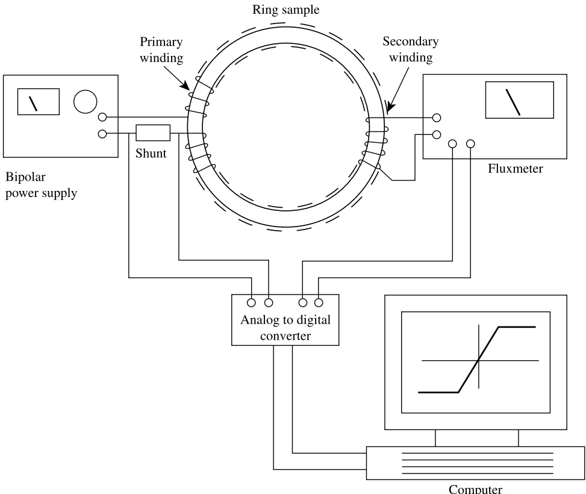

Fig. 2.20 Arrangement for measuring the magnetic properties of a ring sample.

$$
H = C _ {1} \frac {n i}{L} \text {   Oe   or   } \text {   A / m   }\tag{2.15}
$$

where $C_{1}$ is defined at Equation 2.1. The quantity L is the circumference of the ring (cm for cgs, m for SI). Note that the field will be larger around the inside circumference and smaller around the outside circumference, as the value of L varies. A common recommendation is that

$$
\frac {D _ {\text {outside}} - D _ {\text {inside}}}{D _ {\text {mean}}} \leq 0. 1,\tag{2.16}
$$

where the Ds are the diameters of the sample ring. This ensures that the field is uniform within +5% over the volume of the ring sample. The value of L in Equation 2.15 is then taken as the mean circumference of the ring.

The general procedure is to vary the current through the primary winding and measure its magnitude (usually from the voltage drop across a low-value shunt resistor in series), while simultaneously integrating the output voltage from the secondary winding with a fluxmeter. The primary winding current can be converted directly to magnetic field by means of Equation 2.15, and the integrator output is proportional to changes in the flux density in the sample. The two voltages are plotted as x and y signals to give the hysteresis loop of the sample material. The plot may be produced directly using an x2y recorder, but more commonly the voltages are converted to digital values using an analog-to-digital (A2D) converter and a computer. The hysteresis loop may then be plotted on the computer screen and/or on a printer, using the software that controls the A2D converter or some other program. An ordinary spreadsheet program works very well. A complete setup for measuring and recording hysteresis loops is called a hysteresigraph, or sometimes a hysteresisgraph.

Before beginning the measurement, the fluxmeter controls should be adjusted for minimum drift, and the fluxmeter should be reset to give zero output. If only a complete hysteresis loop is needed, it is best to start the integration at the maximum field (+ or -). The field is then varied from its maximum value, through zero, to its maximum value in the opposite direction, and then back to its original value. Use of a bipolar power supply allows the magnetizing current to be varied smoothly through zero; otherwise a reversing switch is required, with the direction of current flow reversed at zero current. The field sweep may be manually controlled, or controlled by a computer driving a programmable power supply. It may be desirable to decrease the rate of field change while traversing the steepest parts of the loop. Unless the loop shape is bizarre, it is normally sufficient to acquire about 50 data points for the entire loop, although with most software and hardware setups it is easy to acquire many more points.

If there is drift in the integrator during the measurement, the plotted loop will not close perfectly at the starting/ending tip. The usual practice is to correct for this by assuming the drift rate is constant throughout the measurement, and applying a linearly increasing (positive or negative) correction to each recorded point such that the plotted loop closes.

Since the zero setting of the fluxmeter will not in general coincide with the demagnetized state of the sample, the plotted loop will be displaced from zero in the y direction and a constant value must be added to (or subtracted from) each measured y value to center the loop about the x axis. Finally, it is necessary to convert the recorded voltages to values of field and flux density, using the dimensions of the sample, the value of the series resistor in the primary circuit, the number of turns in the two windings, and the calibration factor of the fluxmeter. Some or all of these corrections and calibrations may be made automatically in the software if routine measurements are being made on similar samples.

Note that this procedure measures the magnetic flux density B, not the magnetization M. Since it is not possible to apply very large circumferential fields to a ring sample, the method is generally limited to measurements on soft magnetic materials, in which B is large relative to H (or $\mu_0H$ and the distinction between B and 4pM (or $\mu_0M)$ is not significant. However, the correction from B to M is easily made if necessary, using $4\pi M = B - H$ (cgs) or $\mu_0M = B - \mu_0H$ (SI).

To measure the normal magnetization curve, we must start with a demagnetized sample at zero field, so that $H=0$ and $B = 0$ simultaneously. As noted in Chapter 1, there are two ways to demagnetize a ring sample: thermal and cyclic. Thermal demagnetization is achieved by heating the sample above its Curie temperature and cooling in zero field. This is tedious at best, and furthermore once any significant field is applied to the sample, the demagnetized state is lost and can only be regained by another thermal cycle. So usually a demagnetized state is achieved by subjecting the sample to a series of decreasing positive and negative fields, as indicated in Fig. 1.16. The sample then traverses a series of smaller and smaller symmetrical hysteresis loops collapsing toward the origin. At $H=0$ and $B=0$ , the fluxmeter is set to zero and the field increased to its maximum value to record the normal curve. Before the introduction of the electronic fluxmeter, when point by point readings were necessary, a series of symmetrical hysteresis loops with increasing maximum field could be measured, and the normal curve taken as the line joining the tips of the loops.

In principle, the thermally demagnetized state is not the same as the cyclically demagnetized state, and the resulting normal magnetization curves might differ. Thermal demagnetization is hardly ever used in practice, mainly because it is time-consuming but also because the thermally demagnetized state will rarely be achieved in the actual operation of a magnetic device, and so is of limited practical interest. Of course, the cyclically demagnetized state is also rarely achieved in working devices.

Sometimes minor hysteresis loops, in which the field limits do not correspond to magnetic saturation, and may not be symmetrical about H = 0, are of interest. They are easy to record using the system described above. See Fig. 1.15.

The time to record a nominally dc hysteresis loop is generally a minute or less. Ac loops can be measured up to some limiting frequency; the limit may be set by the power supply, the A2D converter, or the eddy-currents in the material (see Chapter 12).

Ring specimens, although free from magnetic poles, have some disadvantages. As noted above, it is generally not possible to apply very high magnetic fields to the sample. Primary and secondary windings must be applied to each specimen to be tested, and this can be time-consuming. There are toroidal coil winding machines to speed this procedure. Some specimens cannot be formed into a satisfactory ring. For example, if a wire or rod is bent into a circle, there will be a significant gap at the joint. If the joint is welded, it is not in the same magnetic state as the rest of the ring and this can lead to erroneous results. Sheet material, on the other hand, is often quite satisfactory; rings can be stamped out, and if necessary a number of these can be stacked together to form a composite, laminated ring. Small ring samples of thin sheet material may be placed in a snugly fitting protective plastic cover, called a core box, before the windings are applied. Note that sheet material is usually magnetically anisotropic; it has different properties in directions at different angles to the direction in which the sheet was originally rolled. Therefore, measurements on rings cut or stamped from such sheets reveal only the average properties over the various directions in the sheet. Thin strip material may be coiled like a roll of masking tape to make a laminated ring. Such a sample is known as a tape-wound core.

A “ring” sample need not be circular, but may be cut in the form of a hollow square or other closed geometrical figure. This is appropriate, for example, when the sample is a single crystal, and the properties in a particular crystallographic direction are required. Such a sample is generally called a picture-frame sample.

## 2.7 DEMAGNETIZING FIELDS

Before considering magnetic measurements in open circuits, we must examine the nature of the fields involved. A magnetic field H can be produced either by electric currents or by magnetic poles. If due to currents, the lines of H are continuous and form closed loops; for example, the H lines around a current-carrying conductor are concentric circles. If due to poles, on the other hand, the H lines begin on north poles and end on south poles.

Suppose a bar sample is magnetized by a field applied from left to right and subsequently removed. Then a north pole is formed at the right end, and a south pole at the left, as shown in Fig. 2.21a. We see that the H lines, radiating out from the north pole and ending at the south pole, constitute a field both outside and inside the magnet which acts from north to south and which therefore tends to demagnetize the magnet. This self-demagnetizing action of a magnetized body is important, not only because of its bearing

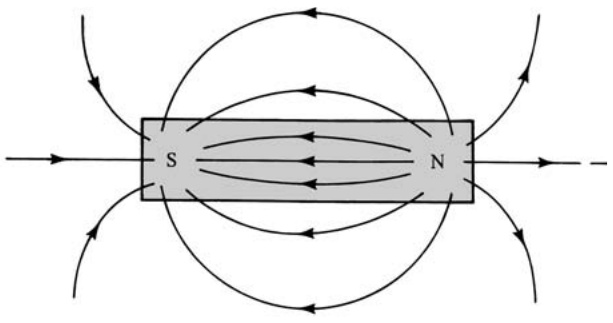

(a)

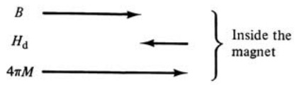

(b)

Fig. 2.21 Fields of a bar magnet in zero applied field. (a) H field, and (b) B field. The vectors in the center indicate the values and directions of $B,H_{\mathrm{d}},$ and 4pM (cgs units) at the center of the magnet.

Fig. 2.22 Variation of the demagnetizing field along the length of a bar magnet.

on magnetic measurements, but also because it strongly influences the behavior of magnetic materials in many practical devices. We will therefore consider it in some detail.

The demagnetizing field $H_{\mathrm{d}}$ acts in the opposite direction to the magnetization M which creates it. In Fig. 2.21a, $H_{\mathrm{d}}$ is the only field acting, and the relation $B = H + 4\pi M$ becomes $B = -H_{\mathrm{d}} + 4\pi M$ (cgs) , or $B = \mu_0(H + M)$ becomes $B = -\mu_0H_{\mathrm{d}} + \mu_0M$ (SI). The flux density B inside the magnet is therefore less than 4pM $(\mu_0M)$ but in the same direction, because $H_{\mathrm{d}}(\mu_0H_{\mathrm{d}})$ can never exceed 4pM $(\mu_0M)$ in magnitude. These vectors are indicated in Fig. 2.21, along with a sketch of the B field of the magnet. Note that lines of B are continuous and are directed from south to north inside the magnet. Outside the magnet, $B = H$ (cgs) or $B = \mu_0H$ (SI) and the external fields in Fig. 2.21a and b are therefore identical. The magnet of Fig. 2.21b is in an open magnetic circuit, because part of the flux is in the magnet and part is in air.

As Fig. 2.21b shows, the flux density of a bar magnet is not uniform: the lines diverge toward the ends, so that the flux density there is less than in the center. This results from the fact that $H_{\mathrm{d}}$ is stronger near the poles, and Fig. 2.22 shows why: the dashed lines show the H field due to each pole separately, and the resultant curve has a minimum at the center.

The variation in induction along a bar magnet is easily demonstrated experimentally. A closely fitting but moveable search coil, connected to a fluxmeter, is placed around the magnet at a particular point and then removed to a distance where the field is negligible; the resulting deflection is proportional to B at that point. The distribution of B shown in Fig. 2.23a was measured on a steel bar magnet. Newer and better permanent magnets are more resistant to demagnetization, so the same experiment using an alnico magnet of almost the same length-to-area ratio gives a different result (Fig. 2.23b), but still shows the reduction in flux at the ends of the sample due to the demagnetizing field. Ferrite and rare-earth permanent magnets would show even less drop in flux, but these materials are not normally made as rods or bars magnetized lengthwise.

When a soft magnetic body is placed in a field, it alters the shape of that field. Thus, in Fig. 2.24, suppose that Fig. 2.24a is a uniform field, such as the field of a solenoid. It may be regarded as either an H field or a B field. The B field of a magnet in zero applied field is shown in Fig. 2.24b. The B field in Fig. 2.24c is the vector sum of the fields in Fig. 2.24a and b. The flux tends to crowd into the magnet, as though it were more permeable than the surrounding air; this is the origin of the term permeability for the quantity m. At points outside the magnet near its center, the field is actually reduced. The same general result is obtained if the body placed in the field is originally unmagnetized, because the field itself will produce magnetization. Figure 2.24 applies to a material like iron, with $\mu \gg 1$ . The opposite effect occurs for a diamagnetic body: the flux tends to avoid the body, so that the flux density is greater outside than inside. (Because lines of B are continuous, the B lines of Fig. 2.24 must close on themselves outside the drawing. If the field in which the body was placed was generated by a solenoid, then the manner in which the lines close is suggested in Fig. 1.8.)

(a)

(b)

Fig. 2.23 (a) Measured flux density vs position in a steel bar magnet. (b) Same for an alnico bar magnet. The two magnets had similar length/area ratios.

The extent to which a body, originally unmagnetized, disturbs the field in which it is placed depends on its permeability. For strongly magnetic materials (ferro- and ferrimagnetic) the disturbance is considerable; for weakly magnetic materials it is practically negligible. Steel ships produce appreciable disturbance of the Earth’s magnetic field at a considerable distance from the ship, and the magnetic mines used in warfare make use of this fact. As the ship passes, the change in field at the position of the mine is sensed by some kind of magnetometer which then actuates an electrical circuit to activate the mine.

Fig. 2.24 Result of placing a magnetized body in an originally uniform field.

## 2.8 MAGNETIC SHIELDING

If a high-permeability ring or cylinder is placed in a field, it tends to shield the space inside from the field, as suggested by Fig. 2.25a. The field lines tend to follow the magnetic material around the perimeter and emerge from the other side. The difficulty with this explanation of shielding is that it suggests that the part of the cylinder normal to the field plays a primary role in diverting the flux. Actually, a field normal to the center of a flat plate passes right through, undeviated, as shown in Fig. 2.25b. It is the sides of the cylinder parallel to the applied field that have the greatest effect. These become magnetized, with poles as shown in Fig. 2.25c, and they reduce the field inside the ring by exactly the same mechanism as that by which the bar magnet of Fig. 2.24 reduces the field in the region adjacent to its center. (The portions of the cylinder normal to the field acquire little magnetization, because of their very large demagnetizing factor. See below.) Two or more concentric thin cylinders, separated by air gaps, are more effective than one thick cylinder. Components of some electronic circuits and devices need to be shielded from external magnetic fields, and this is done by enclosing them in one or more thin sheets of a high-permeability material, usually a Ni –Fe alloy.

(a)

(b)

(c)

Fig. 2.25 Magnetic shielding.

## 2.9 DEMAGNETIZING FACTORS

Returning to the bar magnets of Fig. 2.24, we might ascribe the nonuniformity of the induction inside the magnet to the fact that lines of B “leak out” of the sides. If we taper the magnet toward each end to make up for this leakage, the induction can be made uniform throughout. It may be shown, although not easily, that the correct taper to achieve this result is that of an ellipsoid (Fig. 2.26). If an unmagnetized ellipsoid is placed in a uniform magnetic field, it becomes magnetized uniformly throughout; the uniformity of M and B are due to the uniformity of $H_{\mathrm{d}}$ throughout the volume. This uniformity can be achieved only in an ellipsoid. (These statements require qualification for ferro- and ferrimagnetic materials, because they are made up of domains, or small regions magnetized to saturation in different directions. Even an ellipsoidal specimen of such a material cannot be uniformly magnetized, although a condition of uniform M is approached as the domain size becomes small relative to the specimen size. (See Sections 4.1 and 7.2.)

Fig. 2.26 The H field of an ellipsoidal magnet in zero applied field.

The demagnetizing field $H_{\mathrm{d}}$ of a body is proportional to the magnetization which creates it:

$$
H _ {\mathrm{d}} = - N _ {\mathrm{d}} M,\tag{2.17}
$$

where $N_{\mathrm{d}}$ is the demagnetizing factor or demagnetizing coefficient. The value of $N_{d}$ depends mainly on the shape of the body, and has a single calculable value only for an ellipsoid. The sum of the demagnetizing factors along the three orthogonal axes of an ellipsoid is a constant:

$$
\begin{array}{l} N _ {\mathrm{a}} + N _ {\mathrm{b}} + N _ {\mathrm{c}} = 4 \pi (\mathrm{cgs}) \\ N _ {\mathrm{a}} + N _ {\mathrm{b}} + N _ {\mathrm{c}} = 1 (\mathrm{SI}). \end{array}\tag{2.18}
$$

For a sphere, the three demagnetizing factors must be equal, so

$$
N _ {\text {sphere}} = \frac {4 \pi}{3} (\text {cgs}) \text {or} N _ {\text {sphere}} = \frac {1}{3} (\text {SI}).
$$

The general ellipsoid has three unequal axes 2a, 2b, 2c, and a section perpendicular to any axis is an ellipse (Fig. 2.27). Of greater practical interest is the ellipsoid of revolution, or spheroid. A prolate spheroid is formed by rotating an ellipse about its major axis 2c; then $a = b < c,$ and the resulting solid is cigar-shaped. Rotation about the minor axis 2a results in the disk-shaped oblate spheroid, with $a <   b = c$ . Maxwell calls this the planetary spheroid, which may be easier to remember.

Fig. 2.27 Ellipsoids.

Equations, tabular data, and graphs for the demagnetizing factors of general ellipsoids are given by E. C. Stoner [Phil. . Mag., 36 (1945) p. 803] and J. A. Osborn [Phys. Rev. , 67 (1945) p. 351]. The most important results are as follows [here $C_3 = 4\pi$ (cgs) $C_3 = 1$ (SI)]

1. Prolate spheroid, or rod (cigar). $a = b <   c$ . Put $c / a = m$ . Then,

$$
N _ {\mathrm{c}} = \frac {C _ {3}}{(m ^ {2} - 1)} \left[ \frac {m}{\sqrt {m ^ {2} - 1}} \ln (m + \sqrt {m ^ {2} - 1}) - 1 \right]\tag{2.19}
$$

$$
N _ {\mathrm{a}} = N _ {\mathrm{b}} = \frac {C _ {3} - N _ {\mathrm{c}}}{2}.\tag{2.20}
$$

When m is large (long, thin rod), then

$$
N _ {\mathrm{c}} \approx \frac {C _ {3}}{m ^ {2}} (\ln (2 m) - 1)\tag{2.21}
$$

$$
N _ {\mathrm{a}} = N _ {\mathrm{b}} \approx \frac {C _ {3}}{2}.\tag{2.22}
$$

The approximation is in error by less than 0.5% for $m > 20.N_{\mathrm{c}}$ approaches zero as m becomes large. Example: For $m = 10$ $N_{\mathrm{c}} = 0.255$ and $N_{\mathrm{a}} = N_{\mathrm{b}} = 6.156$ (cgs); $N_{\mathrm{c}} = 0.0203$ and $N_{\mathrm{a}} = N_{\mathrm{b}} = 0.490$ (SI) .

2. Oblate (planetary) spheroid, or disk. $a < b = c.$ and $c / a = m$

$$
N _ {\mathrm{c}} = N _ {\mathrm{b}} = \frac {C _ {3}}{2} \frac {1}{(m ^ {2} - 1)} \left(\frac {m ^ {2}}{\sqrt {m ^ {2} - 1}} \arcsin \left(\frac {\sqrt {m ^ {2} - 1}}{m}\right) - 1\right)\tag{2.23}
$$

$$
N _ {\mathrm{a}} = C _ {3} - 2 N _ {\mathrm{c}}\tag{2.24}
$$

$N_{\mathrm{b}}$ and $N_{c}$ approach zero as m becomes large. Example: For $m = 10$ $N_{\mathrm{b}} = N_{\mathrm{c}} =$ 0.875 and $N_{\mathrm{a}} = 10.82$ (cgs); $N_{\mathrm{b}} = N_{\mathrm{c}} = 0.0696$ and $N_{\mathrm{a}} = 0.861$ (SI) . When m is large (thin disk), then

$$
N _ {\mathrm{c}} = N _ {\mathrm{b}} \approx C _ {3} \left(\frac {\pi}{4 m} - \frac {1}{2 m ^ {2}}\right)\tag{2.25}
$$

$$
N _ {\mathrm{a}} \approx C _ {3} \left(1 - \frac {\pi}{2 m} + \frac {1}{m ^ {2}}\right)\tag{2.26}
$$

This approximation is in error by less than 0.5% for $m > 20$ . For larger values of m. the $1/m^{2}$ terms can be dropped, giving

$$
N _ {\mathrm{c}} = N _ {\mathrm{b}} \approx C _ {3} \frac {\pi}{4 m}\tag{2.27}
$$

$$
N _ {\mathrm{a}} \approx C _ {3} \Big (1 - \frac {\pi}{2 m} \Big)\tag{2.28}
$$

Specimens often encountered in practice are a cylindrical rod magnetized along its axis and a disk magnetized in its plane. Since these are not ellipsoids, the demagnetizing factors calculated according to the previous formulas will be in error to some degree. Rods and disks are never uniformly magnetized except when completely saturated. The demagnetizing field varies from one point to another in the specimen and so has no single value. Two specific effective demagnetizing factors may be defined and used, depending on the way the magnetization is measured. The ballistic or fluxmetric demagnetizing factor $N_{f}$ is the ratio of the average demagnetizing field to the average magnetization, both taken at the midplane of the sample. It is the appropriate factor to use when the magnetization is measured with a small coil wound around the sample at its midpoint, using a ballistic galvanometer (now obsolete) or a fluxmeter. The fluxmetric demagnetizing factor is useful primarily for rod-shaped samples. The magnetometric demagnetizing factor $N_{m}$ the ratio of the average demagnetizing field to the average magnetization of the entire sample. It is the appropriate factor to use when the total magnetic moment of the sample is determined using a vibrating-sample, an alternating-gradient, or a SQUID magnetometer (these instruments are described later). Note, however, that strictly speaking these devices measure the total sample moment only when the sample is small enough (relative to the pickup coil dimensions) to act as a point dipole. The samples used in these instruments are commonly disks magnetized along a diameter, although they may also be rods or rectangular prisms.

Values of the demagnetizing factor depend primarily on the geometry of the sample, but also on the permeability or susceptibility of the material. Bozorth [R. M. Bozorth, Ferromagnetism, Van Nostrand (1951); reprinted IEEE Press (1993)] gives a table and graphs of demagnetizing factors for prolate and oblate (planetary) spheroids, and also of fluxmetric demagnetizing factors for cylindrical samples with various values of permeability. Bozorth’s curves have been widely reprinted and used. They are shown here as Fig. 2.28. The values for cylinders are based on a selection of early theoretical and experimental results, and should not be regarded with reverence. Note particularly that the demagnetizing factors for cylindrical (nonellipsoidal) samples given by Bozorth are fluxmetric values (although Bozorth does not use this terminology) and are only appropriate for measurements made with a short, centrally-positioned pickup coil around a cylindrical sample.

The values in Bozorth’s graph for disk samples magnetized along a diameter are calculated for planetary (oblate) ellipsoids, and so do not distinguish between fluxmetric and magnetometric values. It should also be noted that Bozorth plots and tabulates values of $N / 4\pi$ (cgs), not N (cgs), presumably so that the values can be multiplied by B to give demagnetizing fields $H_{\mathrm{d}}$ This is strictly incorrect, but useful for soft magnetic materials where $H \ll B$ and so $B\approx 4\pi M$ . Since

$$
N (\mathrm{SI}) = \frac {N (\mathrm{cgs})}{4 \pi},\tag{2.29}
$$

Bozorth’s values are numerically correct in SI.

Better values for the demagnetizing factors of rods and disks (and other shapes, such as rectangular prisms) can be determined by experiment, or by calculation. The calculations generally assume a material of constant susceptibility χ, which is in fact the differential susceptibility dM/dH measured at a point on the magnetization curve. Three specific values of χ are of special significance: $\chi = -1$ , corresponding to a superconductor in the fullyshielded state; $\chi \approx 0.$ , corresponding to a weakly magnetic material such as a para- or diamagnet, or to a fully-saturated ferro- or ferrimagnet; and $\chi = \infty$ , corresponding to very soft magnetic material. The condition $\chi = -1$ requires that $B = 0$ everywhere in the samples. The condition $\chi = 0$ requires that the magnetization M be constant throughout the sample, with $H_{\mathrm{d}}$ variable. Note that $\chi = dM / dH = 0$ does not require $M = 0$ . The condition $\chi = \infty$ requires that the demagnetizing field be constant throughout the samples, exactly equal and opposite to the applied field, with magnetization M varying from point to point. Demagnetizing factors can be calculated for other values of χ, both positive and negative, but the assumption of constant and uniform χ makes them of limited usefulness.

Fig. 2.28 Demagnetizing factors for various samples. [R. M. Bozorth, Ferromagnmetism, Van Nostrand (1952); reprinted IEEE (1993) pp. 846 –847]. Values plotted are $N_{\mathrm{cgs}} / 4\pi ,$ which are numerically equal to $N_{\mathrm{SI}}$

The values for $\chi = \infty$ should apply for soft magnetic materials far from saturation, and values for $\chi = 0$ to materials at or approaching magnetic saturation. In practice, demagnetizing field corrections are most important at low fields, where values of permeability and remanence are determined. Demagnetizing corrections are relatively unimportant (although not small) as the sample approaches saturation. Values of the coercive field are generally not much affected by demagnetizing effects, since they are determined when the magnetization is at or near zero. Permanent magnet materials, in which the values of susceptibility are low and uncertain, are normally measured in closed magnetic circuits where the demagnetizing fields are kept small.

Fig. 2.28 Continued.

A paper by D.-X. Chen, J. A. Brug, and R. B. Goldfarb [IEEE Trans. Mag., 37 (1991) p. 3601] reviews the history of demagnetizing factor calculations and derives new values of Nf and $N_{\mathrm{m}}$ for rod samples. A later paper [D.-X. Chen, E. Pardo, and A. Sanchez, J. Magn. Mag. Matls., 306 (2006) p. 135] gives improved values for rod samples, and adds some calculated values of $N_{\mathrm{m}}$ for disk samples. Similar results for rectangular prisms are given by the same authors [IEEE Trans. Mag., 41 (2005) p. 2077]. All three of these papers include results for a range of values of susceptibility as well as for sample shape.

Fig. 2.29 Calculated SI magnetometric demagnetizing factors for rod samples magnetized parallel to the rod axis. Central dashed line is for a prolate ellipsoid. Dotted curves are for $\chi = \infty ;$ solid curves for $\chi = 0$ . Upper dotted and solid curves are magnetometric factors $N_{m};$ lower curves are fluxmetric factors $N_{\mathrm{f}}$ Data in Figs. 2.29 and 2.30 from D.-X. Chen, E. Pardo, and A. Sanchez, J. Magn. Mag. Mater., 306 (2006) p. 125.

The results are extensive and detailed, and not easy to summarize. Figure 2.29 shows calculated values of $N_{f}$ and $N_{\mathrm{m}}$ for rod samples. The central dashed line is for prolate ellipsoids, where $N_{f}$ and $N_{\mathrm{m}}$ are the same. The dotted lines are calculated values of $N_{f}$ and $N_{\mathrm{m}}$ for $\chi = \infty$ , i.e., for very soft magnetic materials. At large values of m (long, thin rods) $N_{\mathrm{m}}$ is slightly above the ellipsoid line, and $N_{f}$ is slightly below. Note that values of m less than about 10 are largely of mathematical interest, since the measurement requires a central coil whose length is small compared to the sample length. The upper solid line is $N_{\mathrm{m}}$ for $\chi = 0$ , and the lower solid line is $N_{f}$ for $\chi = 0$ . For samples of low susceptibility, or for samples approaching magnetic saturation, the demagnetizing factors can differ from those of the ellipsoid (of the same m value) by a factor approaching 10 when $m = 100$ For samples of high susceptibility, in low fields, the demagnetizing factor for an ellipsoid of the same m value is generally a reasonable approximation, considering the various uncertanties involved.

Figure 2.30 gives some results for the magnetometric demagnetizing factor $N_{\mathrm{m}}$ for disk samples magnetized along a diameter. Fluxmetric demagnetizing factors $N_{f}$ are of little interest for disk samples. The dashed curve is for oblate (planetary) ellipsoids; this is the same curve given by Bozorth. The dotted curve is for $\chi = \infty$ (high permeability) and the solid curve is for $\chi = 0$ (uniform magnetization). In the m range of practical interest, values of $N_{\mathrm{m}}$ are always higher than for the ellipsoid of the same m value, and the difference between the $\chi = \infty$ and the $\chi = 0$ values is much less than for rod samples.

There are some relevant experimental measurements. Figure 2.31 shows data points from vibrating-sample (VSM) measurements on a series of permalloy disks, together with the calculated curves for $\chi = \infty$ and $\chi = 0$ from Fig. 2.30. The experimental points generally fall between the two calculated curves. Note that it is not difficult to prepare samples with values of m greater than the highest value for which calculations (other than for ellipsoids) have been made; this is especially true if thin-film samples are measured.

Fig. 2.30 Calculated SI magnetometric demagnetizing factors for disk samples magnetized along a diameter. Dashed line is for an oblate (planetary) ellipsoid. Dotted line is $N_{\mathrm{m}}$ for $\chi = \infty ;$ solid line is for $\chi = 0$

The theoretical papers give demagnetizing factors for values of χ between 0 and 1, and also for χ between 0 and 21. The negative values apply to superconductors, and will be treated in Chapter 16.

In the case of nonellipsoidal samples, it is no longer necessarily true that the sum of the three orthogonal demagnetizing factors is a constant, so Equations 2.18 are not exactly correct.

Fig. 2.31 Magnetometric demagnetizing factors for disk samples. Data points measured on 80 permalloy disk samples using a vibrating-sample magnetometer [C. D. Graham and B. E. Lorenz, IEEE Trans. Mag., 43 (2007) p. 2743]. Dotted and solid lines are copied from Fig. 2.30, for $\chi = \infty$ and $\chi = 0$

Clearly in experimental work it is advantageous to make the value of m large, to minimize the demagnetizing correction. Ideally, the worst-case value of $H_{\mathrm{d}}$ should be comparable to the uncertainty in the measurement of the applied field; then uncertainty in the value of N becomes unimportant.

Permanent magnet samples are usually made in the form of short cylinders or rectangular blocks, and they need to be measured in high fields, so the usual practice is to make the sample part of a closed magnetic circuit. This largely eliminates the demagnetizing effect. See the next section.

A common mathematical procedure to calculate the demagnetizing field is to make use of the magnetic pole density on the sample surface, given by $\rho_{\mathrm{s}} = M$ cos $\theta$ , where M is the magnetization of the sample and $\theta$ is the angle between M and the normal to the surface. Note that M cos $\theta$ is the component of the magnetization normal to the surface inside the body, and that M is zero outside. Therefore, the pole density produced at a surface equals the discontinuity in the normal component of M at that surface. If n^ is a unit vector normal to the surface, then

$$
M \cos \theta = \vec {M} \cdot \hat {\mathbf {n}} = \rho_ {\mathrm{s}}.\tag{2.30}
$$

Note that this agrees with one of the definitions of M as the pole strength per unit area of cross section. The polarity of the surface is positive, or north, if the normal component of M decreases as a surface is crossed in the direction of M. Free poles can also be produced at the interface between two bodies magnetized by different amounts and/or in different directions. If $M_{1}$ and $M_{2}$ are the magnetizations of the two bodies, then the discontinuity in the normal component is

$$
\vec {M} _ {1} \cdot \hat {\mathbf {n}} - \vec {M} _ {2} \cdot \hat {\mathbf {n}} = \rho_ {\mathrm{s}}.\tag{2.31}
$$

This is an important principle, which we shall need later.

We also note that, at the interface between two bodies or between a body and the surrounding air, certain rules govern the directions of H and B at the interface:

1. The tangential components of H on each side of the interface must be equal.

2. The normal components of B on each side of the interface must be equal.

These conditions govern the angles at which the B and H lines meet the air—body interfaces depicted in Fig. 2.24, for example.

Free poles may exist not only at the surface of a body, but also in the interior. For example, on a gross scale, if a bar has a winding like that shown in Fig. 2.32a, south poles will be produced at each end and a north pole in the center, for a current i in the direction indicated. On a somewhat finer scale, free poles exist inside a cylindrical bar magnet, as very approximately indicated in Fig. 2.32b. The condition for the existence of interior poles is nonuniform magnetization. An ellipsoidal body can be uniformly magnetized, and it has free poles only on the surface, unless it contains domains. A body of any other shape, such as a cylindrical bar, cannot be uniformly magnetized except at saturation, because the demagnetizing field is not uniform, and so the body always has interior as well as surface poles. Nonuniformity of magnetization means that there is a net outward flux of M from a small volume element, i.e., the divergence of M is greater than zero. But if there is a net outward flux of M, there must be free poles in the volume element to supply this flux. Such a volume element is delineated by dashed lines in Fig. 2.32b, in which lines of M have also been drawn, going from south to north poles. (For clarity, the lines of M connecting surface poles on the ends have been omitted.) If $\rho_{\mathrm{v}}$ is the volume pole density (pole strength per unit volume), then

(a)

Fig. 2.32 Internal poles in a magnetized body.

$$
\mathrm{div} \mathbf {M} = \nabla \cdot \mathbf {M} = \frac {\partial M _ {\mathrm{x}}}{\partial x} + \frac {\partial M _ {\mathrm{y}}}{\partial y} + \frac {\partial M _ {\mathrm{z}}}{\partial z} = - \rho_ {\mathrm{v}}.\tag{2.32}
$$

On the axis of a bar magnet, M decreases in magnitude from the center toward each end, as indicated qualitatively by the density of flux lines in Fig. 2.32b. Suppose the axis of the magnet is the x-axis, and we assume for simplicity that M is uniform over any cross section. Then only the term $\partial M_{x} / \partial x$ need be considered. Between the center of the magnet and the north end, $\partial M_{\mathrm{x}} / \partial x$ becomes increasingly negative, which means that $\rho_{v}$ is positive and that it increases in magnitude toward the end, as depicted in Fig. 2.32b. Although the interior pole distributions in Fig. 2.32a and b differ in scale, both are rather macroscopic; we shall see in Chapter 9 that interior poles can also be distributed on a microscopic scale.

The general derivations of Equations. 2.31 and 2.32 may be found in any intermediatelevel text on electricity and magnetism.

In summary:

1. Lines of B are always continuous, never terminating.

2. a. If due to currents, lines of H are continuous.

b. If due to poles, lines of H begin on north poles and end on south poles.

3. At an interface,

a. the normal component of B is continuous,

b. the tangential component of H is continuous, and

c. the discontinuity in the normal component of M equals the surface pole density $\rho_{s}$ at that interface.

4. The negative divergence of M at a point inside a body equals the volume pole density at that point.

5. The magnetization of an ellipsoidal body is uniform, and free poles reside only on the surface, unless the body contains domains. See Section 9.5.

6. The magnetization of a nonellipsoidal body is nonuniform, and free poles exist on the surface and in the interior. (The saturated state constitutes the only exception to this statement. A saturated body of any shape is uniformly magnetized and has poles only on its surface.)

## 2.10 MAGNETIC MEASUREMENTS IN OPEN CIRCUITS

Measurements of this type are usually made with a VSM or alternating gradient magnetometer (AGM), a fluxmeter, or a SQUID magnetometer. In the case of the VSM, AGM, or SQUID, the direct experimental result is a plot of the sample magnetic moment m vs the applied field $H_{a}$ . In the case of the fluxmeter, the usual result is a plot of flux density B vs applied field $H_{a}$ . The problem is to correct values of the applied field $H_{a}$ to values of the true field $H_{\mathrm{tr}}$ by subtracting the values of the demagnetizing field $H_{\mathrm{d}}$ The relationship is

$$
H _ {\mathrm{tr}} = H _ {\mathrm{a}} - H _ {\mathrm{d}},\tag{2.33}
$$

where $H_{\mathrm{d}} = N_{\mathrm{d}}M$ and $N_{d}$ is the demagnetizing factor. As discussed above, unless the sample is in the shape of an ellipsoid, there is no single demagnetizing factor $N_{d}$ that applies for all parts of the sample at all levels of magnetization. A workable procedure is to select a value of $N_{f}$ or $N_{\mathrm{m}}$ from Figs. 2.28 –2.31 that is appropriate for the dimensions of the sample, the measurement technique, and the low-field permeability or susceptibility of the sample. It is important to remember that the demagnetizing field is always directed opposite to the direction of magnetization in the sample. If the experiment produces values of M, the correction is straightforward: at each value of M, the demagnetizing field is calculated from Equation 2.17, and the demagnetizing field is subtracted from the applied field (Equation 2.33) to obtain the true field acting on the sample. The corrections are made at fixed values of M, and move the measured M values parallel to the H axis. Since the demagnetizing field is proportional to the magnetization, $H_{\mathrm{d}}$ can be represented by the line OD in Fig. 2.33, and the demagnetizing correction can be visualized by rotating the line OD counterclockwise about the origin O until it coincides with the y-axis, and simultaneously moving each of the experimental values of M parallel to the H-axis, keeping the distance between the line OD and the value of M fixed. This is sometimes called the shearing correction.

(a)

(b)

Fig. 2.33 Graphical treatment of demagnetizing fields. (a) Plot of M versus H. (b) Plot of B versus H.

When the measurement gives values of flux density B rather then M, the correction becomes more complicated. M and $H_{\mathrm{d}}$ are evaluated as follows:

$$
\begin{array}{c} B = H _ {\mathrm{tr}} + 4 \pi M = H _ {\mathrm{a}} - N _ {\mathrm{d}} M + 4 \pi M (\mathrm{cgs}) \\ \frac {B}{\mu_ {0}} = H _ {\mathrm{tr}} + M = H _ {\mathrm{a}} - N _ {\mathrm{d}} M + M (\mathrm{SI}). \end{array}\tag{2.34}
$$

Then

$$
M = \frac {B - H _ {\mathrm{a}}}{4 \pi - N _ {\mathrm{d}}} (\mathrm{cgs}) \quad M = \frac {(B / \mu_ {0}) - H _ {\mathrm{a}}}{1 - N _ {\mathrm{d}}} (\mathrm{SI})\tag{2.35}
$$

$$
H _ {\mathrm{d}} = N _ {\mathrm{d}} \bigg (\frac {B - H _ {\mathrm{a}}}{4 \pi - N _ {\mathrm{d}}} \bigg) (\mathrm{cgs}) \quad H _ {\mathrm{d}} = N _ {\mathrm{d}} \bigg (\frac {(B / \mu_ {0}) - H _ {\mathrm{a}}}{1 - N _ {\mathrm{d}}} \bigg) (\mathrm{SI})\tag{2.36}
$$

Two simplifications are often possible. First, if $N_{\mathrm{d}}$ is reasonably small compared to 4p (cgs) or 1 (SI), the denominator in Eqs. 2.35 and 2.36 may be replaced by 4p or 1. Remembering that demagnetizing factors are not exact or well-defined except for ellipsoids, we may say that if $N_{d}$ is less than about 2% of its maximum value (4p or 1), it may be neglected here. This would mean m greater than 10 for a prolate ellipsoid (cigar) or greater than 30 for an oblate (planetary) ellipsoid (disk). This does not mean that the demagnetizing field is negligible, just that $N_{d}$ may be neglected in this denominator. Second, in many cases of measurement on soft magnetic materials, $H_{\mathrm{a}}$ is small compared to B (cgs), or compared to $B / \mu_{0}$ (SI). If both these conditions hold, Equation 2.33 reduces to

$$
H _ {\mathrm{d}} = N _ {\mathrm{d}} \frac {B}{4 \pi} (\mathrm{cgs}) \quad \text {or} \quad H _ {\mathrm{d}} = N _ {\mathrm{d}} \frac {B}{\mu_ {0}} (\mathrm{SI})\tag{2.37}
$$

How this works is illustrated by the experimental data in Table 2.2, obtained from a rod of commercially pure iron in the cold-worked condition. The rod was 240 mm long and 6.9 mm in diameter and hence had a length/diameter ratio of 35. The measurements were made with a search coil at the center of the rod, so the fluxmetric demagnetizing factor applies. The low-field permeability is unknown, but we may make the reasonable assumption that it lies somewhere between $10^{2}$ and 1. From Fig. 2.28 we read $N_{\mathrm{d}} = 0.002$ (SI) or $N_{\mathrm{d}} = (0.002)(4\pi) = 0.025$ (cgs) . Using Equation 2.37, this leads to the demagnetizing fields $H_{\mathrm{d}}$ listed in the table (which is in cgs units), and we see that they form a very substantial fraction of the applied fields. The flux density is plotted in Fig. 2.34 as a function of both applied and true fields. It is clear that the apparent permeability, given by $B/H_{a},$ is much less than the true permeability, or $B/H_{\mathrm{tr}}$ If the two conditions noted above are met, it may be shown that

TABLE 2.2 Magnetization of Iron Rod

| Ha, Oe | B, G | (B 2 Ha), G | M, emu/cm3 | Hd, Oe | H, Oe |
| --- | --- | --- | --- | --- | --- |
| 8.1 | 1,080 | 1,070 | 85 | 2.1 | 6.0 |
| 16.2 | 3,850 | 3,830 | 305 | 7.7 | 8.5 |
| 26.9 | 7,910 | 7,880 | 627 | 15.8 | 11.1 |
| 35.0 | 10,080 | 10,040 | 799 | 20.1 | 14.9 |
| 43.0 | 12,420 | 12,380 | 985 | 24.8 | 18.2 |
| 53.9 | 14,860 | 14,810 | 1,180 | 29.6 | 24.3 |
| 80.7 | 18,220 | 18,140 | 1,450 | 36.3 | 44.4 |

Fig. 2.34 Measured and corrected magnetization curves of cold-worked iron, from the data of Table 2.2.

$$
\frac {1}{\mu_ {\mathrm{true}}} = \frac {1}{\mu_ {\mathrm{apparent}}} - \frac {N _ {\mathrm{d}}}{4 \pi} (\mathrm{cgs}) \quad \frac {1}{\mu_ {\mathrm{r(true)}}} = \frac {1}{\mu_ {\mathrm{r(apparent)}}} - N _ {\mathrm{d}} (\mathrm{SI}).\tag{2.38}
$$

This suggests an experimental method to determine a value for the demagnetizing factor. If a material has a high permeability $\mu_{\mathrm{true}}$ say 5000 or higher, then $1 / \mu_{\mathrm{true}}$ is negligible and Equation 2.38 gives:

$$
\mu_ {\text {apparent}} = \frac {4 \pi}{N _ {\mathrm{d}}} (\mathrm{cgs}) \quad \mu_ {\mathrm{r(apparent)}} = \frac {1}{N _ {\mathrm{d}}} (\mathrm{SI}).\tag{2.39}
$$

A measurement of B vs $H_{\mathrm{a}}$ on a sample of this material will give an initial straight line with a slope

$$
\frac {B}{H _ {\mathrm{a}}} = \mu_ {\mathrm{apparent}} = \frac {4 \pi}{N _ {\mathrm{d}}} (\mathrm{cgs}) \quad \text {or} \quad \frac {B}{\mu_ {0} H _ {\mathrm{a}}} = \mu_ {\mathrm{r(apparent)}} = \frac {1}{N _ {\mathrm{d}}} (\mathrm{SI})
$$

The reciprocal of the numerical value of this slope gives the experimental value of $N_{\mathrm{d}}$ So a sample of high-permeability material, such as Ni–Fe permalloy or high-purity annealed iron or nickel, made in the same size and shape as the sample(s) to be measured, can be used to establish an experimental demagnetizing factor for all high-permeability samples of the same size and shape, measured in the same apparatus.

If M is measured directly instead of B, then we can write

$$
\frac {H}{M} = \frac {H _ {\mathrm{a}}}{M} - N\tag{2.40}
$$

or, since susceptibility $\chi = M / H.$

$$
\frac {H _ {\mathrm{a}}}{M} - \frac {1}{\chi} = N.\tag{2.41}
$$

The value of χ at low field can be measured on a ring sample where N = 0 . For soft magnetic materials, 1/χ may be negligible. Then the reciprocal of the slope of the measured M vs $H_{\mathrm{a}}$ curve gives an experimental value for N. This is the method used to determine the experimental points in Fig. 2.31.

When the field applied to a specimen on open circuit is reduced to zero, the induction remaining is always less than in a ring specimen, because of the demagnetizing field. In Fig. 2.33b the induction in a ring specimen would be $B_{r}$ , because $H_{\mathrm{d}} = 0$ and $H_{\mathrm{a}} = H.$ But in an open-circuit specimen, the remanent induction is given by the intersection of the demagnetizing line OC or OC' with the second quadrant of the hysteresis loop. If the specimen is long and thin, this line (OC) will be steep and the residual induction $B_{1}$ will not differ much from that of the ring. If the specimen is short and thick, the line $(OC')$ will be so nearly flat that the residual induction $B_{2}$ will be very small.

The demagnetizing effect can assume huge proportions in short specimens of magnetically soft materials. For example, suppose a sample of iron can be brought to its saturation value of $M_{\mathrm{s}} = 1700 \mathrm{emu} / \mathrm{cm}^{3} (1.7 \times 10^{6} \mathrm{~A} / \mathrm{m})$ by a field of 10 Oe (800 A/m) when it is in the form of a ring. If it is in the form of a sphere, $H_{\mathrm{d}}$ at saturation will be $(4\pi /3)(1700) = 7120$ Oe $([1 / 3][1.7\times 10^{6}] = 570\mathrm{kA / m})$ , and the applied field necessary to saturate it will be $7120 + 10 = 7130$ Oe or $570 + 0.8 = 571\mathrm{kA / m}$ . The M, $H_{\mathrm{a}}$ (or $B, H_{a})$ curve will be a straight line almost to saturation, with a slope determined by the value of $N_{\mathrm{d}}$ and the details of the true curve, such as the initial permeability, will be unobservable.

In open-circuit measurements on very soft magnetic materials, the Earth’s magnetic field of $\sim 0.5$ Oe or 40 A/m may be significant. This influence can be minimized by orienting the long axis of the sample perpendicular to the Earth’s field, as determined by a magnetic compass. It may be important to consider that the Earth’s field has a component normal to the Earth’s surface, except near the equator.

We have seen three possible methods of calculating or eliminating the demagnetizing field correction:

1. Make the specimen in the form of an ellipsoid. Then $H_{\mathrm{d}}$ can be exactly calculated, but at the cost of laborious specimen preparation.

2. Use a rod or strip or thin film specimen of very large length–area ratio. The demagnetizing factor is then so small that any error in it has little effect on the computed value of the true field.

3. Apply a correction using a calculated or tabulated or measured demagnetizing factor. The uncertainties in this approach have been noted above.

A fourth approach, which is often used, is to make the specimen into part of a closed magnetic circuit, so that the free poles causing the demagnetizing field are largely eliminated. This is done by clamping the sample into some form of magnetic yoke; the resulting device is known as a permeameter. It is described in more detail below.

If a large number of identical rod samples are to be tested using a fluxmeter, time will be saved by slipping each rod into a single search coil, previously wound on a nonmagnetic form. Since the cross-sectional area $A_{c}$ of the search coil will be larger than the area $A_{s}$ of the specimen, an air-flux correction must be made for the flux in air outside the specimen but inside the search coil:

$$
\begin{array}{c} \phi_ {\text {observed}} = \phi_ {\text {specimen}} + \phi_ {\text {air}}, \\ B _ {\text {apparent}} A _ {\mathrm{s}} = B _ {\text {true}} A _ {\mathrm{s}} + H (A _ {\mathrm{c}} - A _ {\mathrm{s}}) (\mathrm{cgs}) = B _ {\text {true}} A _ {\mathrm{s}} - \mu_ {0} H (A _ {\mathrm{c}} - A _ {\mathrm{s}}) (\mathrm{SI}) \\ B _ {\text {true}} = B _ {\text {apparent}} - H \bigg (\frac {A _ {\mathrm{c}} - A _ {\mathrm{s}}}{A _ {\mathrm{s}}} \bigg) (\mathrm{cgs}) = B _ {\text {apparent}} - \mu_ {0} H \bigg (\frac {A _ {\mathrm{c}} - A _ {\mathrm{s}}}{A _ {\mathrm{s}}} \bigg) (\mathrm{SI}). \end{array}\tag{2.42}
$$

## 2.11 INSTRUMENTS FOR MEASURING MAGNETIZATION

## 2.11.1 Extraction Method

This method is based on the flux change in a search coil when the specimen is removed (extracted) from the coil, or when the specimen and search coil together are extracted from the field. When the solenoid in Fig. 2.35 is producing a magnetic field, the total flux through the search coil is

$$
\Phi_ {1} = B A = (H + 4 \pi M) A = (H _ {\mathrm{a}} - H _ {\mathrm{d}} + 4 \pi M) A = (H _ {\mathrm{a}} - N _ {\mathrm{d}} M + 4 \pi M) A (\mathrm{cgs})
$$

or

$$
\Phi_ {1} = B A = \mu_ {0} (H + M) A = \mu_ {0} (H _ {\mathrm{a}} - H _ {\mathrm{d}} + M) A = \mu_ {0} (H _ {\mathrm{a}} - N _ {\mathrm{d}} M + M) A (\mathrm{SI})\tag{SI}
$$

(2.43)

where A is the specimen or search-coil area. (The two are assumed equal here to simplify the equations, i.e., the air-flux correction is omitted.) If the specimen is suddenly removed from the search coil, the flux through the coil becomes

Fig. 2.35 Arrangement for measuring a rod sample in a magnetizing solenoid. Two procedures are possible: (1) solenoid current is varied continuously and fluxmeter output is recorded continuously; (2) at a series of constant solenoid current values the sample (not the search coil) is moved to a position of effectively zero field, and the fluxmeter reading is recorded. This is the extraction method. Procedure 1 measures B vs H; procedure 2 measures $M(4\pi - N)$ (cgs) or $\mu_0M(1 - N)$ (SI).

$$
\Phi_ {2} = H _ {\mathrm{a}} A (\mathrm{cgs}) \quad \Phi_ {2} = \mu_ {0} H _ {\mathrm{a}} A (\mathrm{SI}).\tag{2.44}
$$

The fluxmeter will therefore record a value proportional to the flux change:

$$
\Phi_ {1} - \Phi_ {2} = (4 \pi - N _ {\mathrm{d}}) M A (\mathrm{cgs}) \quad \text {or} \quad \Phi_ {1} - \Phi_ {2} = \mu_ {0} (1 - N _ {\mathrm{d}}) M A (\mathrm{SI}).\tag{2.45}
$$

This version of the extraction method therefore measures M directly, rather than B. Note that M is measured at a particular field strength, rather than as a change in M due to a change in field, and that the flux change in the search coil does not involve H. This fact results in greater sensitivity when M is small compared to H, as it is for weakly magnetic substances.

A variation of this method involves two identical search coils, located symmetrically in the solenoid. These are connected in “series opposition,” i.e., if one is wound clockwise, viewed along their common axis, the other is wound counterclockwise. If the area-turns of both coils are equal, then a change in $H_{\mathrm{a}}$ will induce equal and opposite emfs in the two coils, and the fluxmeter will show no deflection. Thus variations in the applied field will not influence the results. When the specimen is moved out of one coil and into the other, the measured signal is twice that obtained with a single coil. Similar reasoning controls the design of pickup coils in the vibrating sample magnetometer (see next section).

The extraction method, with either a single or double coil, may be used with an electromagnet as a field source. In Fig. 2.36 the coil axes are parallel to the field but displaced from one another; each coil is also split in two, so that the entire coil system resembles two Helmholtz pairs.

The extraction method does not allow continuous recording of H and M in a simple way and is no longer widely used, except in the SQUID magnetometer. However, the vibrating-sample method, which may be regarded as kind of partial extraction method, is very common.

## 2.11.2 Vibrating-Sample Magnetometer

This instrument is credited to S. Foner [Rev. Sci. Instrum., 30 (1959) pp. 548 – 557] and is sometimes referred to as a Foner magnetometer. The idea was also published by G. W. Van Oosterhout [Appl. Sci. Res., B6 (1956) p. 101], and by P. J. Flanders [IEEE Special Publication T-91, Conference on Magnetism and Magnetic Materials, Boston (1956) pp. 315– 317]. It is based on the flux change in a coil when a magnetized sample is vibrated near it. The sample, commonly a small disk, is attached to the end of a nonmagnetic rod, the other end of which is fixed to a loudspeaker cone (Fig. 2.37) or to some other kind of mechanical vibrator. The oscillating magnetic field of the moving sample induces an alternating emf in the detection coils, whose magnitude is proportional to the magnetic moment of the sample. The (small) alternating emf is amplified, usually with a lock-in amplifier which is sensitive only to signals at the vibration frequency. The lock-in amplifier must be provided with a reference signal at the frequency of vibration, which can come from an optical, magnetic, or capacitive sensor coupled to the driving system. The detection-coil arrangement shown in Fig. 2.37 is only one of several possible ones described by Foner, all of which involve balanced pairs of coils that cancel signals due to variation in the applied field. The coil arrangement of Fig. 2.37 is very commonly used. The apparatus is calibrated with a specimen of known magnetic moment, which must be of the same size and shape as the sample to be measured, and should also be of similar permeability.

Fig. 2.36 Extraction method using two coils, in the air gap of an electromagnet.

Fig. 2.37 Vibrating sample magnetometer or VSM (schematic).

The driving system may be mechanical, through a cam or crank and a small synchronous motor, or in a recent commercial instrument, with a linear motor. In this case the vibration frequency is generally below 40 Hz, and the vibration amplitude is a few millimeters. The amplitude is fixed by the geometry of the mechanical system or by the drive signal to the linear motor. Alternatively, the driving system may be based on a loudspeaker, as in Fig. 2.37, in which case the frequency is generally about 100 Hz, and the amplitude is near 0.1 mm. In this case, the amplitude may vary, depending on the mass of the sample and its interaction with the magnetic field, so there must be some provision for monitoring and/or controlling the amplitude as well as the frequency of vibration. One method is to attach a small permanent magnet to the sample rod, outside the varying field region, with a second set of sensing coils. Then the signal from these coils can be used in a feedback loop to maintain a constant amplitude of vibration. Alternatively, a portion of the signal from the permanent magnet can be balanced against the signal from the unknown sample, making the method a null method.

Fig. 2.38 VSM working in a superconducting solenoid. The oscillating sample motion is provided by a linear motor. Courtesy of Quantum Design, Inc.

Care is necessary to minimize vibration of the sensing coils in the field, and to keep the measuring field from influencing other parts of the system. Note that the VSM measures the magnetic moment m of the sample, and therefore the magnetization M, whereas the fluxmeter method ordinarily measures the flux density B.

The VSM is very versatile and sensitive. It may be used for both weakly and strongly magnetic substances, and standard versions can detect a magnetic moment of about $10^{-5}\mathrm{emu} = \mathrm{erg / Oe}$ or $10^{-8}\mathrm{A m^{2}}$ . This corresponds to the saturation magnetization of about 0.04 μg of iron, which suggests the attention to cleanliness that is necessary when measuring small or weakly magnetic samples. The VSM must be used with care in the determination of the magnetization curves or hysteresis loops of magnetically soft materials. The specimen has to be short, and the demagnetizing field may then be such a large fraction of the applied field that the true field is uncertain. However, if the sample is or can be made very thin, as is often the case in the computer and electronics industries, the demagnetizing correction can be small or negligible. The demagnetizing correction is also generally unimportant in the determination of saturation magnetization $M_{s}$

The VSM can be adapted for measurements at high and low temperatures, since only the sample and vibrating rod must be heated or cooled. (The organic insulation on magnet wire does not suffer at low temperatures, but has limited high temperature endurance.) VSMs of normal design are limited to small samples, generally less than 1 g.

Figure 2.10 shows a commercial VSM mounted to operate in an electromagnet, and Fig. 2.38 shows a VSM driven by a linear motor, working in a superconducting solenoid magnet. The arrangement in Fig. 2.38 can operate as a VSM or as an extraction magnetometer.

## 2.11.3 Alternating (Field) Gradient Magnetometer—AFGM or AGM (also called Vibrating Reed Magnetometer)

Sensitivities even higher than the VSM can be achieved by mounting the sample at the end of a fiber, and subjecting it to a fixed dc field plus an alternating field gradient, produced by an appropriate coil pair, as indicated in Fig. 2.39. The field gradient produces an alternating force on the sample, which causes it to oscillate and flexes the fiber. If the frequency of vibration is tuned to a resonant frequency of the system, the vibration amplitude increases by a factor equal to the quality factor Q of the vibrating system, which can be of the order of 100. The first system of this kind used an optical microscope to observe the vibration amplitude, but later versions [P. J. Flanders, J. Appl. Phys., 63 (1988) pp. 3940 – 1345] use a piezoelectric crystal to generate a voltage proportional to the vibrational amplitude, which in turn is proportional to the sample moment. The limiting sensitivity of the commercial version is about $10^{-6}$ emu or $10^{-9}\mathrm{Am}^{2}$ . At this level of sensitivity, sample cleanliness and mounting methods become critical. The AGM, also called the resonant reed or vibrating reed magnetometer, is more limited than the VSM in the maximum mass of the sample that can be measured, and tuning the vibration frequency to resonance complicates the measurement. The necessary presence of a field gradient means the sample is never in a completely uniform field, which is sometimes a limitation.

## 2.11.4 Image Effect

Open-circuit measurements made with an electromagnet may show errors due to the image effect. Figure 2.40a shows the exterior field of a short magnetized specimen. If this

Fig. 2.39 Alternating-gradient magnetometer or AGM (schematic).

(a)

(b)

Fig. 2.40 Image effect. (a) field due to magnetized sample in empty space; (b) field due to magnetized sample placed between two soft iron pole pieces.

Fig. 2.41 Magnetization curve showing image effect.

specimen is now placed in the gap of an unmagnetized electromagnet, the lines of force from the specimen swing around to the positions indicated in Fig. 2.40b. These new positions are just those which would result if the lines of force were connected to the “magnetic images” of the specimen in the pole pieces, as shown by the dashed lines. An analogous effect occurs in electrostatics, when the lines of force from a point charge shift their position when a conducting plate is placed nearby. The magnetic moment of the magnetic image exactly equals that of the specimen when the permeability μ of the pole caps is infinite, decreases as μ decreases, and vanishes when the pole caps become magnetically saturated [m (cgs) or $\mu_{\mathrm{r}}$ (SI) = 1] . The change in field distribution caused by this image effect generally increases the flux linkage with the search coil and therefore increases the fluxmeter or VSM signal. This increased signal disappears as the material of the pole caps approaches saturation, which results in an apparent magnetization curve like that in Fig. 2.41. The image effect appears as a drop in signal at high fields, although physically it results from an increase in signal at low fields. An analogous effect occurs in a superconducting magnet, as magnetic flux can increasingly penetrate the coil windings at high field levels.

The image effect can be minimized by keeping the sample and sensing coils as far as possible from the pole faces of the electromagnet, or by increasing the working gap of the magnet. However, these are not usually practical methods, because they reduce either the working space in the magnet or the maximum field that can be applied to the sample. The best solution in principle is to measure a sample of known constant magnetization, and of the same size and shape as the sample to be measured, over the full range of fields available in the electromagnet, and use these data to establish a field-dependent correction factor. This requires a sample whose magnetic moment remains constant over a wide range of applied fields. Such a sample can be achieved in the form of an artificial specimen, consisting of a small coil of the same shape and size as the real specimen, in which a constant current is maintained in order to produce a constant magnetic moment of known magnitude. However, the total magnetic moment of such a coil will be much less than the moment of a strongly magnetic sample of the same size. It is also difficult to make a coil in any shape other than a cylinder. Another possibility is to use a sample of a modern permanent magnet material, whose remanent moment is unaffected by a wide range of applied fields, or a soft magnetic material that saturates in low fields and keeps a constant saturated magnetization in high fields. In both these cases it is hard to be sure that the sample magnetization is exactly constant over a wide range of fields, but the correction may be adequate for many purposes.

Precise measurements by any of the methods noted above require that the position of the specimen be accurately reproducible, both with respect to the coils and, because of the image effect, with respect to the pole pieces. In addition, the standard specimen used to calibrate the apparatus must have the same size and shape as the unknown, and also have similar susceptibility or permeability.

## 2.11.5 SQUID Magnetometer

The SQUID device described previously, when used as a magnetometer, acts as a very high-sensitivity fluxmeter, in which the integration is performed by counting voltage steps. It is of such high sensitivity that in a working instrument the magnetic field is held exactly constant by a superconducting shield, and the sample is moved slowly through a superconducting pickup coil coupled to the SQUID while flux quanta are counted. Since the SQUID is a superconducting device, it is usually incorporated in a system including a superconducting magnet. Measurements over a range of fields and temperatures are time consuming, and the systems are normally operated unattended, under computer control. The sensitivity of a SQUID magnetometer is generally about $10^{-7}$ emu or $10^{-10}\mathrm{Am}^{2}$ , an order of magnitude more sensitive than the AGM.

## 2.11.6 Standard Samples

The U.S. National Institute of Standards and Technology (NIST) includes in its list of Standard Reference Materials three different magnetic moment standards: one of yttrium iron garnet (YIG) and two of nickel, and a magnetic susceptibility standard of platinum. (www.nist.gov/srm).

## 2.11.7 Background Fields

Any kind of work involving weak fields, such as the measurement of low-field properties of materials, the measurement of magnetic fields produced by small current flows in the human body, or the calibration of magnetometers for use in satellite systems, is likely to be influenced by variations in the Earth’s magnetic field. In addition to short-term and long-term variations in the Earth’s field itself, which are small but not zero, substantial fields can be generated locally by electric power lines, large motors, transformers, and the like. One solution is to build a laboratory in a remote location, avoiding the use of any iron or steel construction materials (such as nails!). A more practical solution is to control the field in an existing laboratory. This control can be achieved by building a magnetically shielded room and/or by generating compensating fields. The latter are produced by an arrangement of three large Helmholtz-coil pairs on mutually perpendicular axes. Three magnetometers (or a single three-axis magnetometer) at the center sense the fields there and through appropriate circuits control the currents in the Helmholtz coils to control the three field components. In this manner the field in the central region can be made to have any required (low) value, including zero, regardless of field changes outside the system.

## 2.12 MAGNETIC CIRCUITS AND PERMEAMETERS

A permeameter is a device for testing straight bars or rods in a closed magnetic circuit. To understand this method requires a general knowledge of the magnetic circuit, which we will now consider. The concept of a magnetic circuit is a very useful one, not merely with respect to materials testing, but also in the design of electric motors and generators and devices containing permanent magnets.

Fig. 2.42 Magnetic circuits. (a) closed, (b) open.

Suppose an iron ring of permeability $\mu_{\mathrm{r}}$ (SI) , circumferential length l, and cross section A is uniformly wound with n turns of wire carrying a current of i amperes (Fig. 2.42a). Then the field and the flux are given by

$$
H = \frac {4 \pi n i}{1 0} \frac {n i}{l} \mathrm{Oe(cgs)} \quad H = \frac {n i}{l} \mathrm{Am} ^ {- 1} (\mathrm{SI})\tag{2.46}
$$

$$
\Phi = B \mathrm{A} = \mu H \mathrm{A} \text {Maxwell(cgs)} \quad \Phi = B \mathrm{A} = \mu H \mathrm{A} = \mu_ {0} \mu_ {\mathrm{r}} H \mathrm{A} \mathrm{Wb(SI)}.\tag{2.47}
$$

Combining these equations gives

$$
\Phi = \frac {4 \pi}{1 0} \mu \frac {n i}{l} \mathrm{A} = \frac {4 \pi}{1 0} \frac {n i}{l / \mu \mathrm{A}} (\mathrm{cgs}) \quad \Phi = \mu_ {0} \mu_ {\mathrm{r}} \frac {n i}{l} A = \mu_ {0} \frac {n i}{l / \mu_ {\mathrm{r}} A} (\mathrm{SI}).\tag{2.48}
$$

This should be compared with the equation for the current i in a wire of length l, cross secton A, resistance R, resistivity ρ, and conductivity $\sigma = 1 / \rho ,$ when an electromotive force e is acting:

$$
i = \frac {e}{R} = \frac {e}{\rho l / A} = \frac {e}{l / \sigma A}.\tag{2.49}
$$

The similarity in form between Equations 2.48 and 2.49 suggests the various analogies between electric and magnetic quantities listed in Table 2.3. The most important of these are the magnetomotive force (mmf ) = (4p/10)ni (cgs), unit gilbert or oersted-centimeter; mmf = ni (SI), unit ampere; and the reluctance $= 1 / \mu \mathrm{A}$ (cgs), $= 1 / \mu_{r}\mathrm{A}$ (SI)

TABLE 2.3 Circuit Analogies

| Electric | Magnetic |
| --- | --- |
| Current = electromotive force/resistance | Flux = magnetomotive force/reluctance |
| Current = i | Flux = F |
| Electromotive force = e | Magnetomotive force = ni (SI) or (4p/10)ni (cgs) |
| Resistance = R = rl/A = l/sA | Reluctance = l/mrA (SI) or l/mA (cgs) |
| Resistivity = r | Reluctivity = 1/mr (SI) or 1/m (cgs) |
| Conductance = 1/R | Permeance = mrA/l (SI) or mA/l (cgs) |
| Conductivity = s = 1/r | Permeability = mr (SI) or m (cgs) |

A magnetic circuit may consist of various substances, including air, in series. We then add reluctances to find the total reluctance of the circuit, just as we add resistances in series:

$$
\Phi = \frac {\mathrm{mmf}}{(l _ {1} / \mu_ {1} A _ {1}) + (l _ {2} / \mu_ {2} A _ {2}) \dots},\tag{2.50}
$$

where $l_{1}, l_{2}, \ldots$ are the lengths of the various portions of the circuit, $\mu_{1},\mu_{2},\mu_{3},\ldots$ . their permeabilities, and $A_{1}, A_{2}, \ldots$ . their areas. [Linear dimensions are in centimeters for cgs, m for SI; μ (cgs) is replaced by $\mu_{r}$ (SI); and the right-hand side must be multiplied by $\mu_{0}$ for SI.) Similarly, if the circuit elements are in parallel, the reciprocal of the total reluctance is equal to the sum of the reciprocals of the individual reluctances.

The open magnetic circuit of Fig. 2.42b, consisting of an iron ring with an air gap, may be regarded as a series circuit of iron and air. Because the permeability of air is so small compared to that of iron, the presence of a gap of length $l_{\mathrm{g}}$ greatly increases the reluctance of the circuit. Thus

$$
\frac {\text {Reluctance with gap}}{\text {Reluctance without gap}} = \frac {\frac {(l - l _ {\mathrm{g}})}{\mu A} + \frac {l _ {\mathrm{g}}}{(1) A}}{\frac {l}{\mu A}} = 1 + \left(\frac {l _ {\mathrm{g}}}{l}\right) (\mu - 1),\tag{2.51}
$$

where μ is replaced by $\mu_{r}$ for SI units.

A value for μ or $\mu_{r}$ of 5000 is typical of iron near the knee of its magnetization curve. If the ring has a mean diameter of 10 cm (circumference 31.4 cm) and a gap length of 1 cm, then the reluctance of the gapped ring is 160 times that of the complete ring, although the gap amounts to only 3% of the circumference. Even if the gap is only 0.05 mm $(2 \times 10^{-3}$ in), so that it is more in the nature of an imperfect joint than a gap, the reluctance is 1.8 times that of a complete ring. Since the magnetomotive force is proportional to the reluctance (for constant flux), the current in the winding would have to be 160 times as large to produce the same flux in the ring with a 1 cm gap as in the complete ring, and 1.8 times as large for the 0.05 mm gap.

These results may be recast in different language. To say that the current in the winding must be increased to overcome the reluctance of the gap is equivalent to saying that a current increase is required to overcome the demagnetizing field $H_{\mathrm{d}}$ created by the poles formed on either side of the gap. We can then regard the field due to the winding as the applied field $H_{a}$ If $H_{\mathrm{a}}$ (and $\phi)$ are clockwise, as in Fig. 2.42b, $H_{\mathrm{d}}$ will be counterclockwise. This demagnetizing field can be expressed in terms of a demagnetizing coefficient $N_{\mathrm{d}}$ which we will find to be directly proportional to the gap width. If $H_{\mathrm{tr}}$ is the true field, then (using cgs units)

$$
\begin{array}{r l} H _ {\mathrm{tr}} = \frac {B}{\mu} = \frac {\Phi}{\mu A} = \frac {\mathrm{mmf/reluctance}}{\mu A} = \frac {1}{\mu A} \left[ \frac {4 \pi n i 1 0}{\left(\frac {l - l _ {\mathrm{g}}}{\mu A} + \frac {l _ {\mathrm{g}}}{A}\right)} \right] \\ = \left(\frac {4 \pi n i}{1 0}\right) \left[ \frac {1}{l + l _ {\mathrm{g}} (\mu - 1)} \right] = \frac {H _ {\mathrm{a}} l}{l + l _ {\mathrm{g}} (\mu - 1)}. \end{array}\tag{2.52a}
$$

But $\mu - 1 = 4\pi \chi = 4\pi M / H_{\mathrm{tr}}$ , where χ is the susceptibility. Substituting and rearranging, we find

$$
H _ {\mathrm{tr}} = H _ {\mathrm{a}} - 4 \pi \frac {l _ {\mathrm{g}}}{l} M = H _ {\mathrm{a}} - N _ {\mathrm{d}} M = H _ {\mathrm{a}} - H _ {\mathrm{d}}.\tag{2.53a}
$$

The demagnetizing coefficient is thus given by $4\pi (l_{\mathrm{g}} / l)$ . The field in the gap is $H_{\mathrm{g}} = B_{\mathrm{g}},$ which, because of the continuity of lines of B, is equal to the flux density B in the iron, provided that fringing (widening) of the flux in the gap can be neglected.

Repeating in SI units,

$$
\begin{array}{r l} H _ {\mathrm{tr}} & = \frac {B / \mu_ {0}}{\mu_ {\mathrm{r}}} = \frac {\Phi}{\mu_ {0} \mu_ {\mathrm{r}} A} = \frac {\mathrm{mmf/reluctance}}{\mu_ {0} \mu_ {\mathrm{r}} A} \\ & = \frac {1}{\mu_ {0} \mu_ {\mathrm{r}} A} \left[ \frac {n i}{\frac {l - l _ {\mathrm{g}}}{\mu_ {\mathrm{r}} A} + \frac {l _ {\mathrm{g}}}{A}} \right] = \frac {n i}{\mu_ {0}} \frac {1}{(l - l _ {\mathrm{g}} + \mu_ {\mathrm{r}} l _ {\mathrm{g}})} \\ & = \frac {n i}{\mu_ {0}} \frac {1}{l + l _ {\mathrm{g}} (\mu_ {\mathrm{r}} - 1)} = \frac {H _ {\mathrm{a}} l}{l + l _ {\mathrm{g}} (\mu_ {\mathrm{r}} - 1)} \end{array}\tag{2.52b}
$$

but $\mu_{\mathrm{r}} - 1 = \chi = M / H.$ , where χ is the volume susceptibility. Substituting and rearranging, we find

$$
H _ {\mathrm{tr}} = H _ {\mathrm{a}} - \frac {l _ {\mathrm{g}}}{l} M = H _ {\mathrm{a}} - N _ {\mathrm{d}} M = H _ {\mathrm{a}} - H _ {\mathrm{d}}.\tag{2.53b}
$$

The demagnetizing coefficient is given by $l_{\mathrm{g}} / l.$ The field in the gap is $H_{\mathrm{g}} = B_{\mathrm{g}} / \mu_{0}$ which, because of the continuity of lines of B, is equal to the flux density B in the iron, provided that fringing (widening) of the flux in the gap can be neglected.

Returning to the ungapped ring, we may write Equation 2.46 as

$$
H l = \frac {4 \pi}{1 0} n i = \mathrm{mmf(cgs)} \quad \text {or} \quad H l = n i = \mathrm{mmf(SI)}.\tag{2.54}
$$

Since l is the mean circumference of the ring, Hl is the line integral of H around the circuit, which we may take as another definition of magnetomotive force:

$$
\oint H d l = \mathrm{mmf} = \frac {4 \pi}{1 0} n i = 1. 2 5 7 n i (\mathrm{cgs}) \quad \text {or} \quad \oint H d l = \mathrm{mmf} = n i (\mathrm{SI}).\tag{2.55}
$$

It is understood here that H is parallel to l, as is usually true. If not, we must write the integral as $\oint H\cos\theta dl$, where $\theta$ is the angle between H and dl. Although we have extracted Equation 2.55 from a particular case, it is quite generally true and is known as Ampere’s law: the line integral of H around any closed curve equals $4\pi /10$ (cgs) or 1 (SI) times the total current through the surface enclosed by the curve. Thus, if l is the mean circumference of the ring in Fig. 2.42a, the total current through this surface is ni, so that $Hl = (4\pi /10)ni$ (cgs) or $Hl = ni$ (SI) . Ampere’s law often provides a simple means of evaluating magnetic fields. For example, the value of $\oint H dl$ around a wire carrying a current i, and at a distance r from the wire, is simply $(H)(2\pi r)$ ; therefore,

$$
2 \pi r H = \frac {4 \pi}{1 0} i, \quad \text {or} \quad H = \frac {2 i}{1 0 r} (\mathrm{cgs}); \qquad 2 \pi r H = i, \quad \text {or} \quad H = \frac {i}{2 \pi r} (\mathrm{SI}),
$$

in agreement with Equation 1.10.

Magnetomotive force may also be defined as the work required to take a unit magnetic pole around the circuit. Since the force exerted by a field H on a unit pole is simply H, the work done in moving it a distance dl is H dl, and we again arrive at $\oint H dl$ as the magnetomotive force in the circuit. Pursuing the analogy with electricity still further, we may define the difference in magnetic potential V between two points as the work done in bringing a unit magnetic pole from one point to the other against the field, or

$$
V _ {2} - V _ {1} = - \int_ {1} ^ {2} H   d l.\tag{2.56}
$$

In a circuit, closed or open, composed of permanently magnetized material, flux exists even though the magnetomotive force is zero. Discussion of such circuits will be deferred to Chapter 14.

Although the analogy between magnetic and electric circuits is useful, it cannot be pushed too far. The following differences exist:

1. There is no flow of anything in a magnetic circuit corresponding to the flow of charge in an electric circuit.

2. No such thing as a magnetic insulator exists (except for some superconductors). Thus flux tends to “leak out” of magnetized bodies instead of confining itself to welldefined paths. This fact alone is responsible for the greater difficulty and lower accuracy of many magnetic measurements, compared to electrical.

3. Electrical resistance is independent of the current strength. But magnetic reluctance depends on the flux density, because μ or $\mu_{\mathrm{r}}$ varies with flux density B.

## 2.12.1 Permeameter

In a permeameter a closed magnetic circuit is formed by attaching a yoke, or yokes, of soft magnetic material to the specimen in order to provide a closed flux path. A magnetizing winding is applied to the specimen or yoke, or both. A permeameter can be regarded as an electromagnet in which the gap is closed by the specimen.

Many types of permeameters have been made and used, distinguished by the size and shape of the sample, the relative arrangement of specimen, yoke, and magnetizing winding, and by the means of sensing the field. As an example, we may consider the Fahy Simplex permeameter shown in Fig. 2.43. The specimen, usually in the form of a flat bar, is clamped between two soft iron blocks, A and A', and a heavy U-shaped yoke. The yoke is made of silicon steel (iron containing 2 or 3% Si), a common high-permeability material, laminated to reduce eddy currents. Its cross section is made large relative to that of the specimen, so that its reluctance will be low. The lower the reluctance, the greater will be the effect of a given number of ampere-turns on the yoke in producing a field through the specimen.

Fig. 2.43 Fahy Simplex permeameter (sketch).

A B-coil is wound on a hollow form into which the specimen can be easily slipped. If the current through the magnetizing winding is changed, the field H acting on the specimen will change. The resulting change in B in the specimen is measured by means of a fluxmeter connected to the B-coil. The only problem then is the measurement of H, and the same problem exists in any permeameter because none of them has a perfectly closed magnetic circuit. In the Fahy permeameter the field in the specimen is not the same as the field through the magnetizing coil because of leakage; therefore H cannot be calculated from the magnetizing current. Instead, H is measured by means of the H-coil, which consists of a large number of turns on a nonmagnetic cylinder placed near the specimen and between the blocks A and A0. This H-coil is an example of the Chattock potentiometer described on page 42. When the magnetizing current is changed, H is measured by another fluxmeter connected to the H-coil. In effect, the assumptions are made that the magnetic potential difference between the ends of the specimen in contact with the blocks is the same as that between the ends of the H-coil, and that the H-coil accurately measures this difference. This is found to be not quite correct, and rather low accuracy results unless the H-coil is calibrated by means of a specimen with known magnetic properties. All permeameters suffer from uncertainty in measuring the value of the field applied to the sample, which results in part from the fact that the field is not uniform over the length of the sample.

Other permeameters are designed for various shapes and sizes of samples, and may use other methods, such as a Hall probe, to measure the magnetic field. A related class of devices are single-sheet testers, used to measure power loss in samples of transformer and motor steels (see Chapter 13). A closed circuit can be made of interleaved strips of magnetic sheet; this is the basis of the Epstein frame test, which is also described in Chapter 13.

The properties of magnetically soft materials may be sensitive to strain, and this must be kept in mind when clamping a specimen of such material in a permeameter. Too much clamping pressure alters the properties of the specimen, and too little results in a magnetically poor joint and greater leakage.

## 2.12.2 Permanent Magnet Materials

Measurements on permanent magnet materials present some special problems. Ring-shaped samples are generally not available, and in any case higher fields are needed than can be applied to ring samples. Permanent magnet samples are often too heavy for a VSM or other moving-sample instruments. The demagnetizing corrections are large and uncertain.

The usual solution is to use a special form of permeameter, in which the permanent magnet sample is clamped between the (moveable) pole pieces of an electromagnet to create a closed magnetic circuit. The flux density B is measured with a close-fitting coil around the sample, connected to an integrating fluxmeter. The field H is determined by means of a pair of concentric coils around the sample, of slightly different areas, wound directly above the B coil or adjacent to it (see Fig. 2.44). Let $A_{i}$ be the area of the inner H coil, $A_{0}$ the area of the outer H coil, and $A_{s}$ the cross-sectional area of the sample. Then the magnetic flux through the inner coil is

$$
B A _ {\mathrm{i}} = 4 \pi M A _ {\mathrm{s}} + H A _ {\mathrm{i}} (\mathrm{cgs}) \quad \text {or} \quad B A _ {\mathrm{i}} = \mu_ {0} M A _ {\mathrm{s}} + \mu_ {0} H A _ {\mathrm{i}} (\mathrm{SI})\tag{2.57}
$$

Fig. 2.44 Measurement of permanent magnet sample (schematic).

and the magnetic flux through the outer coil is

$$
B A _ {\mathrm{o}} = 4 \pi M A _ {\mathrm{s}} + H A _ {\mathrm{o}} (\mathrm{cgs}) \quad \text {or} \quad B A _ {\mathrm{o}} = \mu_ {0} M A _ {\mathrm{s}} + \mu_ {0} H A _ {\mathrm{o}} (\mathrm{SI}).\tag{2.58}
$$

If the coils are connected so that the difference between the two coil signals is measured, the signal due to the sample magnetization disappears, and we are left with

$$
\begin{array}{l} B A _ {\mathrm{o}} - B A _ {\mathrm{i}} = H A _ {\mathrm{o}} - H A _ {\mathrm{i}} = H (A _ {\mathrm{o}} - A _ {\mathrm{i}}) (\text {cgs}) \\ B A _ {\mathrm{o}} - B A _ {\mathrm{i}} = \mu_ {0} (H A _ {\mathrm{o}} - H A _ {\mathrm{i}}) = \mu_ {0} H (A _ {\mathrm{o}} - A _ {\mathrm{i}}) (\text {SI}). \end{array}\tag{2.59}
$$

If $A_{\mathrm{o}}$ and $A_{i}$ are known, integration of the difference signal gives a signal proportional to H. Alternatively, the quantity $(A_{\mathrm{o}} - A_{\mathrm{i}})$ may be determined by calibration in a known field. Equations 2.58 and 2.59 assume that each of the coils has the same number of turns. If this is not true, the number of turns in each coil must be included explicitly to give the area-turns product $n_{x}A_{x}$ for each coil.

This method relies on that fact that the tangential component of field is the same just inside and just outside the sample, and on the assumption that the field is independent of radial position from the center of the sample out to the radius of the outer coil. The comments about drift control, zero offsets, etc., noted above in connection with measurements on ring samples apply here as well, with the added complication that both B and H signals must be integrated.

In samples with length-to-diameter ratios less than about 2, a drop in signal like that caused by the image effect (Fig. 2.41) appears. This is presumably due to non-uniform saturation of the pole tips, with saturation occurring first in the region where the flux from the sample enters the pole tips. This explanation is consistent with the observation that the apparent drop in magnetization occurs at lower fields when the sample saturation magnetization is high. The error fortunately does not influence measurements in the second quadrant, which are of greatest importance for permanent magnets, and can be eliminated by making the length-to-diameter ratio large enough.

Instead of using an analog electronic integrator and recording the integrated signal, it is possible to record the unintegrated voltage signal, either amplified or not, and then carry out the integration digitally in software. This is regularly done in the case of high-speed pulse magnetization, where the short time intervals give large values of $dB/dt$ , but not in the case of slow measurements on bulk permanent magnet samples.

## 2.13 SUSCEPTIBILITY MEASUREMENTS

The chief property of interest in the case of weakly magnetic substances (dia-, para-, and antiferromagnetic) is their susceptibility. The M vs H curve is linear except at very low temperatures and very high fields, so that measurements at one or two values of H are enough to fix the slope of the curve, which equals the susceptibility. Fields of the order of several kOe or several hundred kA/m are usually necessary in order to produce an easily measurable magnetization, and these fields are usually provided by an electromagnet. Because M is small, the demagnetizing field $H_{\mathrm{d}}$ is small, even for short specimens, and usually negligible relative to the large applied fields $H_{\mathrm{a}}$ involved. If a demagnetizing correction is needed, the appropriate value of $N_{\mathrm{m}}$ can be read from the curve for $\chi = 0$ in Fig. 2.29 or 2.30.

The vibrating-sample magnetometer, the vibrating reed magnetometer (AGM), and the SQUID magnetometer may all be used to measure susceptibility. In addition, another category of techniques is available for susceptibility measurements. These methods are based on measurement of the force acting on a body when it is placed in a nonuniform magnetic field. An instrument designed for this purpose is usually called a magnetic balance or a magnetic force balance.

A homogeneous non-spherical body placed in a uniform field will rotate until its long axis is parallel to the field. The field then exerts equal and opposite forces on the two poles so that there is no net force of translation. On the other hand, consider the nonuniform field, increasing from left to right, of Fig. 2.45. In a body of positive χ, such as a paramagnetic, poles of strength p will be produced as shown. Because the field is stronger at the north pole than at the south, there will be a net force to the right, given by

$$
\begin{array}{r l} F _ {x} & = - p H + p \bigg (H + l \frac {d H}{d x} \bigg) \\ & = p l \frac {d H}{d x} = m \frac {d H}{d x} = M v \frac {d H}{d x} \\ & = \chi v H \frac {d H}{d x} = \frac {\chi v}{2} \frac {d H ^ {2}}{d x} \end{array}\tag{2.60}
$$

where m is the magnetic moment and v the volume of the body. Thus the body, if free to do so, will move to the right, that is, into a region of greater field strength. (Note that the body moves in such a way as to increase the number of lines through it, just as the same body, if placed at rest in a previously uniform field, acts to concentrate lines within it as shown in Fig. 2.24c.) If the body is diamagnetic (negative χ). its polarity in the field will be reversed and so will the force: It will move toward a region of lower field strength. This statement should be contrasted with the ambiguous remark, sometimes made, that a diamagnetic is “repelled by a field.”

The orientation of a para- or diamagnetic rod in a field depends on the shape of the field. If the field is uniform, both rods will be parallel to the field. If the field is axially symmetrical, with the field lines concave to the axis, as in Fig. 2.46, the paramagnetic rod will lie parallel to the field (Greek para = beside, along) and the diamagnetic rod at right angles (dia = through, across). These terms were originated by Faraday. A field of this shape always exists between the tapered pole pieces of an electromagnet or between flat pole pieces if they are widely separated.

Fig. 2.45 Magnetized body in a nonuniform field.

Fig. 2.46 Orientations of para- and diamagnetic rods in the field of an electromagnet.

If the field H has components $H_{x}, H_{y}, H_{z}$ then $H^{2}=H_{x}^{2}+H_{y}^{2}+H_{z}^{2}$ , and the force on the body in the x direction is

$$
\begin{array}{l} F _ {\mathrm{x}} = \frac {\chi v}{2} \left(\frac {\partial H _ {\mathrm{x}} ^ {2}}{\partial x} + \frac {\partial H _ {\mathrm{y}} ^ {2}}{\partial x} + \frac {\partial H _ {\mathrm{z}} ^ {2}}{\partial x}\right) \\ = \chi v \left(H _ {\mathrm{x}} \frac {\partial H _ {\mathrm{x}}}{\partial x} + H _ {\mathrm{y}} \frac {\partial H _ {\mathrm{y}}}{\partial x} + H _ {\mathrm{z}} \frac {\partial H _ {\mathrm{z}}}{\partial x}\right). \end{array}\tag{2.61}
$$

It is often necessary to correct for the effect of the medium, usually air, in which the body exists, because the susceptibility χ of the body may not be greatly different from the susceptibility $\chi_{0}$ of the medium. The force on the body then becomes

$$
F _ {\mathrm{x}} = (\chi - \chi_ {0}) v \left(H _ {\mathrm{x}} \frac {\partial H _ {\mathrm{x}}}{\partial x} + H _ {\mathrm{y}} \frac {\partial H _ {\mathrm{y}}}{\partial x} + H _ {\mathrm{z}} \frac {\partial H _ {\mathrm{z}}}{\partial x}\right),\tag{2.62}
$$

because motion of the body in the +x direction must be accompanied by motion of an equal volume of the medium in the -x direction.

The two most important ways of measuring susceptibility are the Curie method (sometimes called the Faraday method) and the Gouy method.

In the Curie method the specimen is small enough so that it can be located in a region where the field gradient is constant throughout the specimen volume. The pole pieces of an electromagnet may be shaped or arranged in various ways to produce a small region of constant field gradient. Figure 2.47 shows one example. Alternatively, a set of small currentcarrying coils can be placed in the gap of an ordinary electromagnet to produce a local and controllable field gradient. The field is predominantly in the y direction and, in the region occupied by the specimen, $H_{x}$ and $H_{z}$ and their gradients with x are small. The variation of $H_{\mathrm{y}}^{2}$ with x is shown by the curve superimposed on the diagram, and it is seen that

$$
\frac {d H _ {\mathrm{y}} ^ {2}}{d x} \left(= 2 H _ {\mathrm{y}} \frac {d H _ {\mathrm{y}}}{d x}\right)
$$

is approximately constant over the specimen length. Equation (2.62) therefore reduces to

$$
F _ {\mathrm{x}} = (\chi - \chi_ {0}) v H _ {\mathrm{y}} \frac {d H _ {\mathrm{y}}}{d x}.\tag{2.63}
$$

Fig. 2.47 Curie method for measurement of susceptibility.

Note that $\chi v\mathrm{H}$ is the magnetic moment m of the sample. $F_{x}$ is measured by suspending the specimen from one arm of a sensitive balance or other force-measuring device. If $(\chi - \chi_0)$ is positive, there will be an apparent increase in mass $\Delta w$ when the field is turned on. Then

$$
F _ {x} = g \Delta w,\tag{2.64}
$$

where g is the acceleration due to gravity. The Curie method is difficult to use as an absolute method because of the difficulty of determining the field and its gradient at the position of the specimen. But it is capable of high precision and high sensitivity, and can be calibrated by measurements on specimens of known susceptibility, determined, for example, by the Gouy method.

The specimen in the Gouy method is in the form of a long rod (Fig. 2.48). It is suspended so that one end is near the center of the gap between parallel magnet pole pieces, where the field $H_{y}$ is uniform and strong. The other end extends to a region where the field $H_{\mathrm{y0}}$ is relatively weak. The field gradient $dH_{\mathrm{y}} / \mathrm{dx}$ therefore produces a downward force on the specimen, if the net susceptibility $(\chi - \chi_0)$ of specimen and displaced medium is positive. The force on a small length dx of the rod, of volume dv and cross-sectional area a, is

Fig. 2.48 Gouy method for measurement of susceptibility.

$$
d F _ {\mathrm{x}} = \frac {(\chi - \chi_ {0})}{2} d v \frac {d H _ {\mathrm{y}} ^ {2}}{d x} = \frac {(\chi - \chi_ {0})}{2} a d x \frac {d H _ {\mathrm{y}} ^ {2}}{d x}.\tag{2.65}
$$

The force on the whole rod is

$$
F _ {\mathrm{x}} = \frac {(\chi - \chi_ {0})}{2} a \int_ {H _ {\mathrm{y} 0}} ^ {H _ {\mathrm{y}}} d H _ {\mathrm{y}} ^ {2} = \frac {(\chi - \chi_ {0})}{2} a (H _ {\mathrm{y}} ^ {2} - H _ {\mathrm{y} 0} ^ {2}).\tag{2.66}
$$

$H_{y}$ is typically about 10,000 Oe = 800 kA/m , and $H_{y0}$ is less than $100\mathrm{Oe} = 8\mathrm{kA / m}$ Hence $H_{\mathrm{y0}}^{2}$ is negligible compared to $H_{\mathrm{y}}^{2}$ and

$$
F _ {\mathrm{x}} = \frac {(\chi - \chi_ {0})}{2} a H _ {\mathrm{y}} ^ {2}.\tag{2.67}
$$

The field gradient does not have to be determined in this method; all that is needed is a measurement of the uniform field in the magnet gap. The only disadvantage of the method is that a fairly large amount of specimen is required (about 10 cm3), since the specimen must be 10 – 15 cm long. Solid rods may be measured directly. Powdered materials or liquids are enclosed in a glass tube, and the force on the empty tube is measured separately to find the correction for the container.

A variation of the Gouy method uses a small sample, and measures the force acting on the sample continuously as it is moved from a high field region to a region of effectively zero field. The integral of this force over the distance moved is equivalent to Equation 2.66.

In this section, statements regarding paramagnetics apply to any material with positive x. If the material is ferro- or ferrimagnetic, the forces involved will be quite large and the magnetization M is not a linear function of the field, so force methods are not usually used. Force methods do have the advantage that no insulated wire is needed near the sample, so measurements at high temperatures are relatively easy. For this reason they are sometimes used for determination of Curie points.

As will become apparent in later chapters, susceptibility measurements made just at room temperature are of limited value. Only by making measurements over an extended temperature range can we obtain information which will permit a description of the true magnetic nature of the specimen. Thus furnaces and/or cryostats are needed, and these must be narrow enough to fit in a magnet gap and yet enclose the specimen. Furnaces are usually of the electrical resistance type, water-cooled on the outside. It should be noted that the usual helically wound tube furnace constitutes a solenoid, and the heating current produces an appreciable magnetic field. In magnetic experiments it may be important to suppress this field. This can be done by winding the furnace “non-inductively,” as shown in Fig. 2.49. The wire is simply doubled on itself before it is wound on the furnace core. Currents in adjacent turns are then in opposite directions, and their magnetic fields cancel one another. Whether wound inductively or not, furnaces exposed to strong magnetic fields should be powered with direct, not alternating, current. Because of the force on a current-carrying conductor in a magnetic field, windings carrying ac will vibrate at twice the frequency of the ac voltage. This vibration can quickly loosen refractory cement and cause failure of the furnace.

The liquids in general use for cooling cryostats are liquid helium (normal boiling point = 4.2K), liquid hydrogen (20.4K), and liquid nitrogen (77.3K). Liquid hydrogen is not often used because of its flammability.

Fig. 2.49 Noninductive, or bifilar, winding.

When measurements extend over a range of temperature, the mass susceptibility $\chi_{m}$ is a more convenient property to deal with than the volume susceptibility $\chi_{\mathrm{v}}$ because the specimen mass does not change with temperature, whereas its volume does. Since $\chi_{\mathrm{v}}v =$ $\chi_{\mathrm{v}}w = m / H =$ (magnetic moment produced by unit field), all that is necessary is to replace $\chi_{\mathrm{v}}v$ by $\chi_{\mathrm{v}}w$ in equations like 2.59, where w is the mass of the specimen.

## PROBLEMS

2.1 A solenoid 50 cm long and 2.5 cm in diameter is uniformly wound with insulated copper wire of American Wire Gage (AWG) size 22, which has copper diameter 0.02535 inch or 0.0644 cm and resistance at $20^{\circ}\mathrm{C}$ of 16.14 ohm/1000 feet or 53 ohm/1000 meter. The coil carries a current of 2.75 A. Find the voltage required to produce this current, the power dissipated, and the magnitude of the field at the center of the solenoid.

2.2 For the solenoid of the previous problem, plot the field on the axis as a function of position, from the center to the end. Consider the middle half of the solenoid (that is, the section extending ±1/4 of the total length, measured from the center). What is the ratio of the field at the center of the solenoid to the field at the end of center half? What is the ratio of the field at the center of the solenoid to the field at the end of the solenoid?

2.3 A given power source can deliver a maximum of 4.0 A at a voltage of 20 V. A solenoid of length 30 cm and diameter 2.0 cm is to be wound with a single layer of copper wire of diameter d. Copper has a room-temperature resistivity of 1.7 × $10^{-6}$ ohm cm. Find the optimum wire diameter to produce a maximum field of 100 oersted. Neglect the thickness of the electrical insulation on the wire, and assume the winding diameter is the same as the solenoid diameter.

2.4 If the wire diameter in the previous problem is increased by 50%, what is the effect on the maximum field and the maximum power?

2.5 Compare the field at the center of a Helmholtz coil pair and at the center of a solenoid, if both use the same total length of wire and carry the same current. Take the solenoid length equal to the spacing between the Helmholtz coils, and let the solenoid diameter be 0.1 of its length.

2.6 A nickel-iron ring with cross-sectional area $0.85\mathrm{cm}^{2}$ is expected to be driven to its saturation magnetization of 1.1 T in a field of 800 A/m . The flux density will be measured by an electronic flux integrator with input resistance of 1 kOhm and an integrating capacitor of 10 μF. How many turns should be would on the secondary (flux-measuring) coil to give an output signal of ±5 V as the ring sample is driven to +1.1 T?

2.7 A magnet is placed in a uniform field $H_{\mathrm{a}}$ directed opposite to its magnetization. As in Fig. 2.21, sketch the vector relationships inside the magnet and the B field inside and outside the magnet under the following conditions:

a. $H_{a}$ is large enough to reduce B in the magnet to zero (the coercive field).

b. $H_{\mathrm{a}}$ is large enough to reduce M in the magnet to zero (the intrinsic coercive field).

2.8 A field of 750Oe is applied perpendicular to the surface of a large iron plate (the surface area may be taken to be infinite). The permeability of the iron is 1200 (cgs units). What is the flux density B in the iron?

2.9 An unmagnetized body in the shape of a prolate ellipsoid with relative permeability 5000 (SI) is placed in a uniform magnetic field parallel to the long axis. Find the ratio of the flux density in the body to the flux density in the original field when the axial ratio of the ellipsoid is (a) 1 (a sphere); (b) 5; (c) 100; and (d) 1.

2.10 The following values of H (Oe) and $M(\mathrm{emu/cm}^{3})$ were measured on a ring specimen of annealed nickel.

| H | M |
| --- | --- |
| 4.04 | 49.1 |
| 5.38 | 91.9 |
| 8.08 | 196 |
| 13.44 | 298 |
| 17.48 | 330 |
| 21.5 | 349 |
| 26.9 | 365 |
| 33.9 | 379 |
| 40.4 | 388 |

a. Plot the M versus H curve for the material.

b. Compute and plot the M versus $H_{\mathrm{a}}$ curve for the same material in the form of a sphere.

c. What is the reciprocal slope of the initial linear part of the curve of question b? Express this number as a multiple of π.

d. Show that if the permeability is large, a plot of M versus $H_{\mathrm{a}}$ has an initial slope of 1/N.

2.11 A cylinder of silver measures 15.00 cm long and 1.00 cm in diameter, and has a density of $10.48\mathrm{g/cm^{3}}$ . The susceptibility of silver is $-0.181 \times 10^{-6} \mathrm{emu/cm}^{3}$ . Oe (cgs) and the susceptibility of air can be taken as $0.027\times10^{-6}$ in the same units. The cylinder is suspended in a Gouy susceptibility apparatus, initially with zero applied field.

a. What is the weight of the silver sample?

b. When a field of 8500 Oe is turned on, by how much does the measured weight change?

c. If the price of silver is \$450/kg , how much is the sample worth?

# DIAMAGNETISM AND PARAMAGNETISM

## 3.1 INTRODUCTION

By appropriate methods we can measure the bulk magnetic properties of any substance and classify that substance as diamagnetic, paramagnetic, or ferromagnetic, etc. We will now proceed, in Chapters 3–6, to examine the internal mechanisms responsible for the observed magnetic behavior of various substances. In these chapters we will be interested only in two structure-insensitive properties, the susceptibility of weakly magnetic substances and the saturation magnetization of strongly magnetic ones. These properties are said to be structure-insensitive meaning they do not depend on details of structural elements such as grain size, crystal orientation, strain, lattice imperfections, or small amounts of impurities. We will also pay particular attention to the variation of these properties with temperature, because this variation provides an important clue to the magnetic nature of the substance.

The magnetic properties in which we are interested are due entirely to the electrons of the atom, which have a magnetic moment by virtue of their motion. The nucleus also has a small magnetic moment, but it is insignificant compared to that of the electrons, and it does not affect the gross magnetic properties.

## 3.2 MAGNETIC MOMENTS OF ELECTRONS

There are two kinds of electron motion, orbital and spin, and each has a magnetic moment associated with it. The orbital motion of an electron around the nucleus may be likened to a current in a loop of wire having no resistance; both are equivalent to a circulation of charge. The magnetic moment of an electron, due to this motion, may be calculated by an equation

similar to Equation 1.12, namely,

$$
\mu = (\text {area of loop}) (\text {current})\tag{3.1}
$$

(Use of the symbol μ for both permeability and for an electronic or atomic moment is common and ordinarily does not lead to any ambiguity.) To evaluate μ we must know the size and shape of the orbit and the electron velocity. In the original (1913) Bohr theory of the atom, the electron moved with velocity v in a circular orbit of radius r. In cgs units e is the charge on the electron in esu and c the velocity of light, so e/c is the charge in emu. In SI units, the charge of the electron is measured in coulombs. The current, or charge passing a given point per unit time, is then $(e / c)(v / 2\pi r)$ (cgs) or ev/ $2\pi r$ (SI). Therefore,

$$
\mu (\text {orbit}) = \pi r ^ {2} \left(\frac {e v}{2 \pi r c}\right) = \frac {e v r}{2 c} (\mathrm{cgs}) \quad \text {or} \quad = \pi r ^ {2} \left(\frac {e v r}{2 \pi r}\right) = \frac {e v r}{2} (\mathrm{SI}).\tag{3.2}
$$

An additional postulate of the theory was that the angular momentum of the electron must be an integral multiple of $h / 2\pi ,$ where h is Planck’s constant. Therefore,

$$
m v r = n \frac {h}{2 \pi},\tag{3.3}
$$

where m is the mass of the electron. Combining these relations, we have

$$
\mu (\text {orbit}) = \frac {e h}{4 \pi m c} (\mathrm{cgs}) \quad \text {or} \quad = \frac {e h}{4 \pi m} (\mathrm{SI})\tag{3.4}
$$

for the magnetic moment of the electron in the first $(n = 1)$ Bohr orbit.

The spin of the electron was postulated in 1925 in order to explain certain features of the optical spectra of hot gases, particularly gases subjected to a magnetic field (Zeeman effect), and it later found theoretical confirmation in wave mechanics. Spin is a universal property of electrons in all states of matter at all temperatures. The electron behaves as if it were in some sense spinning about its own axis, and associated with this spin are definite amounts of magnetic moment and angular momentum. It is found experimentally and theoretically that the magnetic moment due to electron spin is equal to

$$
\begin{array}{r l} \mu (\mathrm{spin}) & = \frac {e h}{4 \pi m c} (\mathrm{cgs}) \\ & = \frac {(4 . 8 0 \times 1 0 ^ {- 1 0} \mathrm{esu}) (6 . 6 2 \times 1 0 ^ {- 2 7} \mathrm{ergsec})}{4 \pi (9 . 1 1 \times 1 0 ^ {- 2 8} \mathrm{g}) (3 . 0 0 \times 1 0 ^ {1 0} \mathrm{cm/sec})} (\mathrm{cgs}) \\ & = 0. 9 2 7 \times 1 0 ^ {- 2 0} \mathrm{erg/Oeoremu}. \end{array}
$$

$$
\begin{array}{r l} \mu (\mathrm{spin}) & = \frac {e h}{4 \pi m} (\mathrm{SI}) \\ & = \frac {(1 . 6 0 \times 1 0 ^ {- 1 9} \mathrm{C}) (6 . 6 2 \times 1 0 ^ {- 3 4} \mathrm{Js})}{4 \pi (9 . 1 1 \times 1 0 ^ {- 3 1} \mathrm{kg})} (\mathrm{SI}) \\ & = 9. 2 7 \times 1 0 ^ {- 2 4} \mathrm{J/TorAm} ^ {2}. \end{array}\tag{3.5}
$$

Fig. 3.1 Visualization of electron spin.

Thus the magnetic moment due to spin and that due to motion in the first Bohr orbit are exactly equal. Because it is such a fundamental quantity, this amount of magnetic moment is given a special symbol $\mu_{B}$ and a special name, the Bohr magneton. Thus,

$$
\begin{array}{r l} \mu_ {\mathrm{B}} & = \text {Bohr magneton} = e h / 4 \pi m c = 0. 9 2 7 \times 1 0 ^ {- 2 0} \text {erg / Oe (cgs)} \\ & = e h / 4 \pi m = 9. 2 7 \times 1 0 ^ {- 2 4} \text {A} \cdot \text {m} ^ {2} (\text {SI}) \\ & = \mu_ {0} e h / 4 \pi m = 1. 1 7 \times 1 0 ^ {- 2 9} \text {Wb} \cdot \text {m (SI)}. \end{array}\tag{3.6}
$$

It is a natural unit of magnetic moment, just as the electronic charge e is a natural unit of electric charge.

How can the magnetic moment due to spin be understood physically? We may, if we like, imagine an electron as a sphere with its charge distributed over its surface. Rotation of this charge produces an array of tiny current loops (Fig. 3.1), each of which has a magnetic moment directed along the rotation axis. But if we calculate the resultant moment of all these loops, we obtain the wrong answer, $(5 / 6)\mu_{\mathrm{B}}$ instead of $\mu_{B}$ . Nor does the right answer result from the assumption that the charge is uniformly distributed through the volume of the sphere. Such calculations are fruitless, because we do not know the shape of the electron or the way in which charge is distributed on or in it. The spin of the electron, and its associated magnetic moment, has to be accepted as a fact, consistent with wave mechanics and with a large number of experiments of various kinds, but with no basis in classical physics. The model of Fig. 3.1 is therefore only an aid to visualization; it has no quantitative significance.

## 3.3 MAGNETIC MOMENTS OF ATOMS

Atoms contain many electrons, each spinning about its own axis and moving in its own orbit. The magnetic moment associated with each kind of motion is a vector quantity, parallel to the axis of spin and normal to the plane of the orbit, respectively. The magnetic moment of the atom is the vector sum of all its electronic moments, and two possibilities arise:

1. The magnetic moments of all the electrons are so oriented that they cancel one another out, and the atom as a whole has no net magnetic moment. This condition leads to diamagnetism.

2. The cancellation of electronic moments is only partial and the atom is left with a net magnetic moment. Such an atom is often referred to, for brevity, as a magnetic atom. Substances composed of atoms of this kind are para-, ferro-, antiferro-, or ferrimagnetic.

To calculate the vector sum of the magnetic moments of all the electrons in any particular atom is a rather complex problem which is treated in any book on atomic physics. However, this problem is not particularly relevant here because the result applies only to the free atom, such as the atoms in a monatomic gas. The calculation from first principles of the net magnetic moment of an atom in a solid is, in general, not yet possible, and the net moment must be determined experimentally. This knowledge of atomic moments, obtained experimentally, is of great importance in the continued development of solid-state physics, entirely aside from its relevance to commercially important magnetic materials.

## 3.4 THEORY OF DIAMAGNETISM

A diamagnetic is a substance that exhibits, so to speak, negative magnetism. Even though it is composed of atoms which have no net magnetic moment, it reacts in a particular way to an applied field. The classical (nonquantum-mechanical) theory of this effect was first worked out by the French physicist Paul Langevin (1872–1946) in a noted paper published in 1905 [P. Langevin, Ann. Chemie et Physique, 5 (1905) p. 70–127]. He refined and made quantitative some ideas which had been earlier advanced by Ampére and by the German physicist Wilhelm Weber (1804–1891).

The theory considers that the effect of an applied field on a single electron orbit is to reduce the effective current of the orbit, and so to produce a magnetic moment opposing the applied field. This effect is summed over all the electrons in the atom, and each atom is regarded as acting independently of the others. The values of diamagnetic susceptibility calculated in this way generally agree with experimental values to better than a factor of 10, which suggests that the model is at least qualitatively correct. Nothing in the model suggests a strong temperature dependence of susceptibility, and this also agrees with the experiment.

## 3.5 DIAMAGNETIC SUBSTANCES

Electrons which constitute a closed shell in an atom usually have their spin and orbital moments oriented so that the atom as a whole has no net moment. Thus the monoatomic rare gases He, Ne, A, etc., which have closed-shell electronic structures, are all diamagnetic. So are most polyatomic gases, such as $H_{2}, N_{2}$ , etc., because the process of molecule formation usually leads to filled electron shells and no net magnetic moment per molecule.

The same argument explains the diamagnetism of ionic solids like NaCl. The process of bonding in this substance involves the transfer of an electron from each Na atom to each Cl atom; the resulting ions, $\mathrm{Na^{+}}$ and Cl $^{-}$ , then have closed shells and are both diamagnetic. Covalent bonding by the sharing of electrons also leads to closed shells, and elements like C (diamond), Si, and Ge are diamagnetic. Most organic compounds are diamagnetic, and magnetic measurements have furnished much useful information about the size and shape of organic molecules.

But not all gases are diamagnetic, nor are all ionic or covalent solids. Generalizations in this area are dangerous. The reader interested in further details should consult books on magnetochemistry such as A. F. Orchard, Magnetochemistry, Oxford University Press, (2003), which is a subject devoted to the relation between magnetic properties and the chemical bond. The behavior of the metals is particularly complex; most are paramagnetic, but some diamagnetic; they are discussed in Section 3.8.

Superconductors under some conditions are perfect diamagnets. They are treated in Chapter 16.

## 3.6 CLASSICAL THEORY OF PARAMAGNETISM

The first systematic measurements of the susceptibility of a large number of substances over an extended range of temperature were made by Pierre Curie1 and reported by him in 1895. He found that the mass susceptibility $\chi_{\mathrm{m}}$ was independent of temperature for diamagnetics, but that it varied inversely with the absolute temperature for paramagnetics:

$$
\chi_ {\mathrm{m}} = C / T.\tag{3.7}
$$

This relation is called the Curie law, and C is the Curie constant per gram. It was later shown that the Curie law is only a special case of a more general law,

$$
\chi_ {\mathrm{m}} = C / (T - \theta),\tag{3.8}
$$

called the Curie–Weiss law. Here $\theta$ is a constant, with the dimensions of temperature, for any one substance, and equal to zero for those substances which obey Curie’s law. Some authors write the denominator of Equation 3.8 as (T+$\theta$).

Curie’s measurements on paramagnetics went without theoretical explanation for 10 years, until Langevin in 1905 took up the problem in the same paper in which he presented his theory of diamagnetism. Qualitatively, his theory of paramagnetism is simple. He assumed a paramagnetic to consist of atoms, or molecules, each of which has the same net magnetic moment μ, because all the spin and orbital moments of the electrons do not cancel out. In the absence of an applied field, these atomic moments point at random and cancel one another, so that the magnetization of the specimen is zero. When a field is applied, there is a tendency for each atomic moment to turn toward the direction of the field; if no opposing force acts, complete alignment of the atomic moments would be produced and the specimen as a whole would acquire a very large moment in the direction of the field. But thermal agitation of the atoms opposes this tendency and tends to keep the atomic moments pointed at random. The result is only partial alignment in the field direction, and therefore a small positive susceptibility. The effect of an increase in temperature is to increase the randomizing effect of thermal agitation and therefore to decrease the susceptibility.

We will now consider the quantitative aspects of the theory in some detail, because the theory of paramagnetism leads naturally into the theory of ferro and ferrimagnetism.

We consider a unit volume of material containing n atoms, each having a magnetic moment μ. Let the direction of each moment be represented by a vector, and let all the vectors be drawn through the center of a sphere of unit radius. We wish to find the number dn of moments inclined at an angle between $\theta$ and $\theta + d\theta$ to the field H. In the absence of a field the number of μ vectors passing through unit area of the sphere surface is the same at any point on the sphere surface, and dn is proportional simply to the area $dA$ , which is given, as in Fig. 3.2, by 2p sinu $d\theta$ for a sphere of unit radius. But when a field is applied, the μ vectors all shift toward the direction of the field. Each atomic moment then has a certain potential energy $E_{p}$ in the field, given by Equation 1.5, so that

<small>1Pierre Curie (1859–1906) was a French physicist. He and his wife, Marie (Sklodowska) Curie (1867–1934), later became famous for their research on radioactivity.</small>

Fig. 3.2 Effect of field on orbital moment.

$$
E _ {\mathrm{p}} = - \mu H \cos \theta .\tag{3.9}
$$

In a state of thermal equilibrium at temperature T, the probability of an atom having an energy $E_{\mathrm{p}}$ is proportional to the Boltzmann factor $e^{-\bar{E}_{\mathrm{p}} / kT}$ where k is the Boltzmann constant. The number of moments between $\theta$ and $\theta + \mathrm{d}\theta$ will now be proportional to dA, multiplied by the Boltzmann factor, or

$$
d n = K d A e ^ {- E _ {\mathrm{p}} / k T} = 2 \pi K e ^ {(\mu H \cos \theta) / k T} \sin \theta d \theta ,\tag{3.10}
$$

where K is a proportionality factor, determined by the fact that

$$
\int_ {0} ^ {n} d n = n.
$$

For brevity we put $a = \mu H / kT$ . We then have

$$
2 \pi K \int_ {0} ^ {\pi} e ^ {a \cos \theta} \sin \theta   d \theta = n.\tag{3.11}
$$

The total magnetic moment in the direction of the field acquired by the unit volume under consideration, that is, the magnetization M, is given by multiplying the number of atoms dn by the contribution mcosu of each atom and integrating over the total number:

$$
M = \int_ {0} ^ {n} \mu \cos \theta   d n.
$$

Substituting Equations 3.10 and 3.11 into this expression, we have

$$
\begin{array}{r l} M & = 2 \pi K \mu \int_ {0} ^ {\pi} e ^ {a \cos \theta} \sin \theta \cos \theta d \theta \\ & = \frac {n \mu \int_ {0} ^ {\pi} e ^ {a \cos \theta} \sin \theta \cos \theta d \theta}{\int_ {0} ^ {\pi} e ^ {a \cos \theta} \sin \theta d \theta} \end{array}
$$

To evaluate these integrals, we put $x = \cos \theta$ and $dx = -\sin \theta d\theta .$ Then

$$
\begin{array}{l} M = \frac {n \mu \int_ {1} ^ {- 1} x e ^ {a x} d x}{\int_ {1} ^ {- 1} e ^ {a x} d x} \\ \quad = n \mu \bigg (\frac {e ^ {a} + e ^ {- a}}{e ^ {a} - e ^ {- a}} - \frac {1}{a} \bigg) = n \mu \bigg (\coth a - \frac {1}{a} \bigg). \end{array}\tag{3.12}
$$

But $n\mu$ is the maximum possible moment which the material can have. It corresponds to perfect alignment of all the atomic magnets parallel to the field, which is a state of complete saturation. Calling this quantity $M_{0},$ we have

$$
\frac {M}{M _ {0}} = \coth a - \frac {1}{a}.\tag{3.13}
$$

The expression on the right is called the Langevin function, usually abbreviated to L(a). Expressed as a series, it is

$$
\mathrm{L} (a) = \frac {a}{3} - \frac {a ^ {3}}{4 5} + \frac {2 a ^ {5}}{9 4 5} - \dots\tag{3.14}
$$

which is valid only for $a \leq 1. \mathrm{~L}(a)$ as a function of a is plotted in Fig. 3.3. At large a, L(a) tends to 1; and for a less than about 0.5, it is practically a straight line with a slope of $\frac{1}{3}$ as seen in Equation 3.14.

Fig. 3.3 Langevin function.

The Langevin theory leads to two conclusions:

1. Saturation will occur if a $(= \mu H / kT)$ is large enough. This makes good physical sense, because large H or low T, or both, is necessary if the aligning tendency of the field is going to overcome the disordering effect of thermal agitation.

2. At small a, the magnetization M varies linearly with H. As we shall see presently, a is small under “normal” conditions, and linear M, H curves are observed, like that of Fig. 1.13b.

The Langevin theory also leads to the Curie law. For small a, $\mathrm{L}(a) = a / 3$ , and Equation 3.12 becomes

$$
M = \frac {n \mu a}{3} = \frac {n \mu^ {2} H}{3 k T}.\tag{3.15}
$$

Therefore,

$$
\chi_ {\mathrm{v}} = \frac {M}{H} = \frac {n \mu^ {2}}{3 k T},\tag{3.16}
$$

$$
\chi_ {\mathrm{m}} = \frac {\chi_ {\mathrm{v}}}{\rho} = \frac {n \mu^ {2}}{3 \rho k T}.
$$

where ρ is density. But n, the number of atoms per unit volume, is equal to $N\rho /A$ where N is atoms/mol (Avogadro’s number), ρ is density, and A is atomic weight. Therefore,

$$
\chi_ {\mathrm{v}} = \frac {N \mu^ {2}}{3 A k T} = \frac {C}{T} \frac {\mathrm{emu}}{\mathrm{cm} ^ {3} \mathrm{Oe}} (\mathrm{cgs}) \text {or} \frac {\mathrm{Am} ^ {2}}{\mathrm{m} ^ {3} \mathrm{Am} ^ {- 1}} [ \text {dimensionless} ] (\mathrm{SI})
$$

and

$$
\chi_ {\mathrm{m}} = \frac {N \mu^ {2}}{\rho 3 A k T} = \frac {C}{\rho T} \frac {\mathrm{emu}}{\mathrm{gOe}} (\mathrm{cgs}) \text {or} \frac {\mathrm{Am} ^ {2}}{\mathrm{kgAm} ^ {- 1}} = \frac {\mathrm{m} ^ {3}}{\mathrm{kg}} (\mathrm{SI})\tag{3.17}
$$

which is Curie’s law, with the Curie constant given by

$$
C = \frac {N \mu^ {2}}{3 A k}.\tag{3.18}
$$

The net magnetic moment μ per atom may be calculated from experimental data by means of Equation 3.17. Consider oxygen, for example. It is one of the few gases which is paramagnetic; it obeys the Curie law and has a mass susceptibility of

$$
\begin{array}{l} \chi_ {\mathrm{m}} = 1. 0 8 \times 1 0 ^ {- 4} \frac {\mathrm{emu}}{\mathrm{gOe}} (\mathrm{cgs}) \\ \chi_ {\mathrm{m}} = 1. 3 6 \times 1 0 ^ {- 6} \frac {\mathrm{J/T}}{\mathrm{kgAm} ^ {- 1}} \text {or} \frac {\mathrm{Am} ^ {2}}{\mathrm{kgAm} ^ {- 1}} \text {or} \frac {\mathrm{m} ^ {3}}{\mathrm{kg}} (\mathrm{SI}) \end{array}
$$

at $20^{\circ}\mathrm{C}$ . Therefore, writing $M'$ (molecular weight) instead of A (atomic weight) in Equation 3.17 because the constituents of oxygen are molecules, we have

$$
\begin{array}{l} \mu = \left(\frac {3 M ^ {\prime} k T \chi}{N}\right) ^ {1 / 2} \\ = \left[ \frac {(3) (3 2 \mathrm{g/mole}) (1 . 3 8 \times 1 0 ^ {- 1 6} \mathrm{erg/K}) (2 9 3 \mathrm{K}) (1 . 0 8 \times 1 0 ^ {- 4} \mathrm{emu/gOe})}{6 . 0 2 \times 1 0 ^ {2 3} \text {molecules / mole}} \right] ^ {1 / 2} (\mathrm{cgs}) \\ = \left[ \frac {(3) (0 . 0 3 2 \mathrm{kg/mole}) (1 . 3 8 \times 1 0 ^ {- 2 3} \mathrm{J/K}) (2 9 3 \mathrm{K}) (1 . 3 6 \times 1 0 ^ {- 6} (\mathrm{J/T}) / (\mathrm{kgAm} ^ {- 1}))}{(6 . 0 2 \times 1 0 ^ {2 3} \text {molecules / mole}) (4 \pi \times 1 0 ^ {- 7} \mathrm{T/Am} ^ {- 1})} \right] ^ {1 / 2} \\ = 2. 6 4 \times 1 0 ^ {- 2 0} \text {erg / Oe per molecule (cgs)} \\ = 2. 6 4 \times 1 0 ^ {- 2 3} \mathrm{Am} ^ {2} / \text {molecule or J / T per molecule (SI)} \end{array}\tag{SI}
$$

and dividing by the value of the Bohr magneton $\mu_{B}$

$$
= \frac {2 . 6 4 \times 1 0 ^ {- 2 0}}{0 . 9 2 7 \times 1 0 ^ {- 2 0}} \text {or} \frac {2 . 6 4 \times 1 0 ^ {- 2 3}}{0 . 9 2 7 \times 1 0 ^ {- 2 3}} = 2. 8 5 \mu_ {\mathrm{B}} \text {per molecule}.
$$

This value of μ is typical. Even in heavy atoms or molecules containing many electrons, each with orbital and spin moments, most of the moments cancel out and leave a net magnetic moment of only a few Bohr magnetons.

We can now calculate a and justify our assumption that it is small. Typically, H is about 10,000 Oe or 1T or 800 kA/m in susceptibility measurements. Therefore, at room temperature,

$$
\begin{array}{r l} a = & \frac {\mu H}{k T} = \frac {(2 . 6 4 \times 1 0 ^ {- 2 0} \mathrm{erg/Oe}) (1 0 ^ {4} \mathrm{Oe})}{(1 . 3 8 \times 1 0 ^ {- 1 6} \mathrm{erg/K}) (2 9 3 \mathrm{K})} \\ = & 0. 0 0 6 5, \end{array}
$$

which is a value small enough so that the Langevin function L(a) can be replaced by a/3 The effect of even very strong fields in aligning the atomic moments of a paramagnetic is very feeble compared to the disordering effect of thermal energy at room temperature. For example, there are N/32 oxygen molecules per gram, each with a moment of $2.64\times10^{-20}$ emu. If complete alignment could be achieved, the specific magnetization s of oxygen would be $(6.02 \times 10^{23} / 32)(2.64 \times 10^{-20})$ , or 497 emu /g (cgs), $(6.02\times 10^{-23} / 0.032)(2.64\times 10^{-23}) = 497\mathrm{Am}^2 /\mathrm{kg}$ (SI) . This value is more than double that of saturated iron. But the magnetization acquired in a field as strong as 100,000 Oe or 10 T or 8 MA/m at room temperature is only $\sigma = \chi H = (1.08\times 10^{-4})(10^{5}) = 10.8\mathrm{emu / g(cgs)} =$ $(1.36 \times 10^{-6})(8 \times 10^{6}) = 10.9 \mathrm{~Am}^{2} / \mathrm{kg}$ (SI), about 2% of the saturation value.

There is nothing in our previous discussion of the diamagnetic effect to indicate that it was restricted to atoms with no net magnetic moment. In fact, it is not; the diamagnetic effect occurs in all atoms, whether or not they have a net moment. A calculation of the susceptibility of a paramagnetic should therefore be corrected by subtracting the diamagnetic contribution from the value given by Equation 3.17. This correction is usually small (of the order of $-0.5 \times 10^{-6} \mathrm{emu/g Oe})$ and can often be neglected in comparison to the paramagnetic term.

The Langevin theory of paramagnetism, which leads to the Curie law, is based on the assumption that the individual carriers of magnetic moment (atoms or molecules) do not interact with one another, but are acted on only by the applied field and thermal agitation. Many paramagnetics, however, do not obey this law; they obey instead the more general Curie –Weiss law,

$$
\chi_ {\mathrm{m}} = \frac {C}{(T - \theta)}.\tag{3.19}
$$

In 1907 Weiss $^{2}$ in the J. de Physique 6 (1907) pp. 66–690 pointed out that this behavior could be understood by postulating that the elementary moments do interact with one another. He suggested that this interaction could be expressed in terms of a fictitious internal field which he called the “molecular field” $H_{\mathrm{m}}$ and which acted in addition to the applied field H. The molecular field was thought to be in some way caused by the magnetization of the surrounding material. (If Weiss had advanced his hypothesis some 10 years later, he would probably have called $H_{\mathrm{m}}$ the “atomic” field. X-ray diffraction was first observed in 1912, and by about 1917 diffraction experiments had shown that all metals and simple inorganic solids were composed of atoms, not molecules.)

Weiss assumed that the intensity of the molecular field was directly proportional to the magnetization:

$$
H _ {\mathrm{m}} = \gamma M,\tag{3.20}
$$

where γ is called the molecular field constant. Therefore, the total field acting on the material is

$$
H _ {\mathrm{t}} = H + H _ {\mathrm{m}}.\tag{3.21}
$$

Curie’s law may be written

$$
\chi_ {\mathrm{m}} = \frac {M}{\rho H} = \frac {C}{T}.
$$

H in this expression must now be replaced by $H_{\mathrm{t}}$

$$
\frac {M}{\rho (H + \gamma M)} = \frac {C}{T}.
$$

Solving for M, we find

$$
M = \frac {\rho C H}{T - \rho C \gamma}.
$$

<small>2Pierre Weiss (1865–1940), French physicist deserves to be called the “Father of Modern Magnetism” because almost the whole theory of ferromagnetism is due to him, and his ideas also permeate the theory of ferrimagnetism. Most of his work was done at the University of Strasbourg.</small>

Fig. 3.4 Variation of mass susceptibility with absolute temperature for para- and diamagnetics.

Therefore,

$$
\chi_ {\mathrm{m}} = \frac {M}{\rho H} = \frac {C}{T - \rho C \gamma} = \frac {C}{T - \theta}.\tag{3.22}
$$

Therefore, $\theta (= \rho C\gamma)$ is a measure of the strength of the interaction because it is proportional to the molecular field constant γ. For substances that obey Curie’s law, $\theta = \gamma = 0$

Figure 3.4 shows how χ varies with T for para- and diamagnetics. If we plot $1 / \chi$ versus T for a paramagnetic, a straight line will result; this line will pass through the origin (Curie behavior) or intercept the temperature axis at $T = \theta$ (Curie–Weiss behavior). Data for two paramagnetics which obey the Curie–Weiss law are plotted in this way in Fig. 3.5, and we note that both positive and negative values of θ are observed, positive for MnCl2 and negative for $\mathrm{FeSO}_{4}$ . Many paramagnetics obey the Curie–Weiss law with small values of θ, of the order of 10 K or less. A positive value of θ, as illustrated in Fig. 3.5, indicates that the molecular field is aiding the applied field and therefore tending to make the elementary magnetic moments parallel to one another and to the applied field. Other things being equal, the susceptibility is then larger than it would be if the molecular field were absent. If $\theta$ is negative, the molecular field opposes the applied field and tends to decrease the susceptibility.

It is important to note that the molecular field is in no sense a real field; it is rather a force, which tends to align or disalign the atomic or molecular moments. The strength of this force depends on the amount of alignment already attained, because the molecular field is proportional to the magnetization. Further discussion of the molecular field will be deferred to the next chapter.

Early in this section it was stated that the effect of an applied field on the atomic or molecular “magnets” was to turn them toward the direction of the field. This statement requires qualification, because the effect of the field is not just a simple rotation, like that of a compass needle exposed to a field not along its axis. Instead, there is a precession of the atomic moments about the applied field, because each atom possesses a certain amount of angular momentum as well as a magnetic moment. This behavior is analogous to that of a spinning top. If the top in Fig. 3.6a is not spinning, it will simply fall over because of the torque exerted by the force of gravity F about its point of support A. But if the top is spinning about its axis, it has a certain angular momentum about that axis; the resultant of the gravitational torque and the angular momentum is a precession of the axis of spin about the vertical, with no change in the angle of inclination $\theta$. In an atom, each electron has angular momentum by virtue of its spin and its orbital motion, and these momenta combine vectorially to give the atom as a whole a definite angular momentum. We might then roughly visualize a magnetic atom as a spinning sphere, as in Fig. 3.6b, with its magnetic moment vector and angular momentum vector both directed along the axis of spin. A magnetic field H exerts a torque on the atom because of the atom’s magnetic moment, and the resultant of this torque and the angular momentum is a precession about H. If the atom were isolated, the only effect of an increase in H would be an increase in the rate of precession, but no change in $\theta$. However, in a specimen containing many atoms, all subjected to thermal agitation, there is an exchange of energy among atoms. When a field is applied, this exchange of energy disturbs the precessional motion enough so that the value of $\theta$ for each atom decreases slightly, until the distribution of $\theta$ values becomes appropriate to the existing values of field and temperature.

Fig. 3.5 Reciprocal mass susceptibilities of one diamagnetic and two paramagnetic compounds. Note change of vertical scale at the origin.

(a)

(b)

Fig. 3.6 Precession of (a) a spinning top in a gravitational field, and (b) a magnetic atom in a magnetic field.

## 3.7 QUANTUM THEORY OF PARAMAGNETISM

The main conclusions of the classical theory are modified by quantum mechanics, but not radically so. We will find that quantum theory greatly improves the quantitative agreement between theory and experiment without changing the qualitative features of the classical theory.

The central postulate of quantum mechanics is that the energy of a system is not continuously variable. When it changes, it must change by discrete amounts, called quanta, of energy. If the energy of a system is a function of an angle, then that angle can undergo only discontinuous stepwise changes. This is precisely the case in a paramagnetic substance, where the potential energy of each atomic moment μ in a field H is given by $-\mu H$ cos $\theta$. In the classical theory, the energy, and hence u, is regarded as a continuous variable, and μ can lie at any angle to the field. In quantum theory, $\theta$ is restricted to certain definite values $\theta_{1},\theta_{2},\ldots$ , and intermediate values are not allowed. This restriction is called space quantization, and is illustrated schematically in Fig. 3.7, where the arrows indicate atomic moments. The classical case is shown in Fig. 3.7a, where the moments can have any direction in the shaded area; Figs. 3.7b and c illustrate two quantum possibilities, in which the moments are restricted to two and five directions, respectively. The meaning of J is given later.

The rules governing space quantization are usually expressed in terms of angular momentum rather than magnetic moment. We must therefore consider the relation between the two, first for orbital and then for spin moments. The orbital magnetic moment for an electron in the first Bohr orbit is, from Equation 3.4,

(a)

(b)

(c)

Fig. 3.7 Space quantization: (a) classical, (b) and (c), two quantum possibilities.

$$
\mu_ {\mathrm{orbit}} = \frac {e h}{4 \pi m c} = \frac {e}{2 m c} \left(\frac {h}{2 \pi}\right) (\mathrm{cgs})
$$

$$
\mu_ {\mathrm{orbit}} = \frac {e h}{4 \pi m} = \frac {e}{2 m} \left(\frac {h}{2 \pi}\right) (\mathrm{SI})
$$

If we write the corresponding angular momentum $h / 2\pi$ as p, we have

$$
\mu_ {\mathrm{orbit}} = \frac {e}{2 m c} (p _ {\mathrm{orbit}}) (\mathrm{cgs}) \text {or} \frac {e}{2 m n} (p _ {\mathrm{orbit}}) (\mathrm{SI})\tag{3.23}
$$

The angular momentum due to spin is sh/2π where s is a quantum number equal to $\frac{1}{2}$ Therefore, from Equation 3.5,

$$
\begin{array}{l} \mu_ {\mathrm{spin}} = \frac {e h}{4 \pi m c} = \frac {e}{m c} \left(\frac {h}{4 \pi}\right) = \frac {e}{m c} (p _ {\mathrm{spin}}) (\mathrm{cgs}), \\ \mu_ {\mathrm{spin}} = \frac {e h}{4 \pi m} = \frac {e}{m} \left(\frac {h}{4 \pi}\right) = \frac {e}{m} (p _ {\mathrm{spin}}) (\mathrm{SI}) \end{array}\tag{3.24}
$$

Therefore the ratio of magnetic moment to angular momentum for spin is twice as great as it is for orbital motion. The last two equations can be combined into one general relation between magnetic moment μ and angular momentum p by introducing a quantity g:

$$
\begin{array}{l} \mu = g (e / 2 m c) (p) (\mathrm{cgs}) \\ \mu = g (e / 2 m) (p) (\mathrm{SI}) \end{array}\tag{3.25}
$$

where $g = 1$ for orbital motion and $g = 2$ for spin. The factor g is called (for historical reasons) the spectroscopic splitting factor, or g factor.

In an atom composed of many electrons the angular momenta of the variously oriented orbits combine vectorially to give the resultant orbital angular momentum of the atom, which is characterized by the quantum number L. Similarly, the individual electron spin momenta combine to give the resultant spin momentum, described by the quantum number S. Finally, the orbital and spin momenta of the atom combine to give the total angular momentum of the atom, described by the quantum number J. Then the net magnetic moment of the atom, usually called the effective moment $\mu_{\mathrm{eff}}$ , is given in terms of g and J, as we might expect by analogy with Equation 3.25. The relation is

$$
\begin{array}{l} \mu_ {\mathrm{eff}} = g \left(\frac {e h}{4 \pi m c}\right) \sqrt {J (J + 1)} \mathrm{erg/Oe, (cgs)} \\ \mu_ {\mathrm{eff}} = g \left(\frac {e h}{4 \pi m}\right) \sqrt {J (J + 1)} \frac {\mathrm{J}}{\mathrm{T}} \text {or Am} ^ {2} (\mathrm{SI}) \\ \mu_ {\mathrm{eff}} = g \sqrt {J (J + 1)} \mu_ {\mathrm{B}}. \end{array}\tag{3.26}
$$

The moment may be said to consist of an effective number $n_{\mathrm{eff}}$ of Bohr magnetons:

$$
n _ {\mathrm{eff}} = g \sqrt {J (J + 1)}.
$$

Because of spatial quantization the effective moment can point only at certain discrete angles $\theta_{1},\theta_{2},\ldots$ to the field. Rather than specify these angles, we specify instead the possible values of $\mu_{\mathrm{H}}$ , the component of $\mu_{eff}$ in the direction of the applied field H. These possible values are

$$
\mu_ {\mathrm{H}} = g M _ {J} \mu_ {\mathrm{B}},\tag{3.27}
$$

where $M_{J}$ is a quantum number associated with J. For an atom with a total angular momentum J, the allowed values of $M_{J}$ are

$$
J, J - 1, J - 2, \dots , - (J - 2), - (J - 1), - J,
$$

and there are $(2J + 1)$ numbers in this set. For example, if $J = 2$ for a certain atom, the effective moment has five possible directions, and the component $\mu_{\mathrm{H}}$ in the field direction must have one of the following five values:

$$
2 g \mu_ {\mathrm{B}}, g \mu_ {\mathrm{B}}, 0, - g \mu_ {\mathrm{B}}, - 2 g \mu_ {\mathrm{B}}.
$$

This is the case illustrated in Fig. 3.7c.

The maximum value of $\mu_{H}$ is

$$
\mu_ {\mathrm{H}} = g J \mu_ {\mathrm{B}},\tag{3.28}
$$

and the symbol $\mu_{H}$ if not otherwise qualified, is assumed to stand for this maximum value. [The moments given by Equations 3.23–3.25 are $\mu_{\mathrm{H}}$ values.] The relation between $\mu_{\mathrm{H}}$ and $\mu_{\mathrm{eff}}$ is shown in Fig. 3.8.

The value of J for an atom may be an integer or a half-integer, and the possible values range from $J = \frac{1}{2}$ to $J = \infty$ . These extreme values have the following meanings:

1. $J = \frac{1}{2}.$ This corresponds to pure spin, with no orbital contribution $(L = 0.$ $J = \bar{S} = \frac{1}{2})$ , so that $g = 2$ . Since the permissible values of $M_{J}$ decrease from +J to $-J$ in steps of unity, these values are simply $+\frac{1}{2}$ and $- \frac { 1 } { 2 }$ for this case. The corresponding resolved moments $\mu_{H}$ are then $\mu_{B}$ and $-\mu_{\mathrm{B}}$ , parallel and antiparallel to the field, as illustrated in Fig. 3.7b.

Fig. 3.8 Relationship between effective moment and its component in the field direction.

2. $J = \infty$ . Here there are an infinite number of J values, corresponding to an infinite number of moment orientations. This is equivalent to the classical distribution of Fig. 3.7a.

To compute $\mu_{H}$ or $\mu_{\mathrm{eff}}$ we must know g, as well as J, for the atom in question. The g factor is given by the Landé equation:

$$
g = 1 + \frac {J (J + 1) + S (S + 1) - L (L + 1)}{2 J (J + 1)}.\tag{3.29}
$$

If there is no net orbital contribution to the moment, $L = 0$ and $J = S.$ Then Equation 3.29 gives $g = 2$ whatever the value of J. On the other hand, if the spins cancel out, then $S = 0$ $J = L$ , and $g = 1$ . The g factors of most atoms lie between 1 and 2, but values outside this range are sometimes encountered.

At this point the calculation of the net magnetic moment of an atom would seem straightforward, simply by a combination of Equations 3.29 and 3.28. However, the values of J, L, and S are known only for isolated atoms; it is, in general, impossible to calculate μ for the atoms of a solid, unless certain simplifying assumptions are made. One such assumption, valid for many substances, is that there is no orbital contribution to the moment, so that $J = S$ . The orbital moment is, in such cases, said to be quenched. This condition results from the action on the atom or ion considered of the electric field, called the crystalline or crystal field, produced by the surrounding atoms or ions in the solid. This field has the symmetry of the crystal involved. Thus the electron orbits in a particular isolated atom might be circular, but when that atom forms part of a cubic crystal, the orbits might become elongated along three mutually perpendicular axes because of the electric fields created by the adjoining atoms located on these axes. In any case, the orbits are in a sense bound, or “coupled,” rather strongly to the crystal lattice. The spins, on the other hand, are only loosely coupled to the orbits. Thus, when a magnetic field is applied along some arbitrary direction in the crystal, the strong orbit– lattice coupling often prevents the orbits, and their associated orbital magnetic moments, from turning toward the field direction, whereas the spins are free to turn because of the relatively weak spin–orbit coupling. The result is that only the spins contribute to the magnetization process and the resultant magnetic moment of the specimen; the orbital moments act as though they were not there. Quenching may be complete or partial.

Fortunately, it is possible to measure g for the atoms of a solid, and such measurements tell us what fraction of the total moment, which is also measurable, is contributed by spin and what fraction by orbital motion. Experimental g factors will be given later.

## 3.7.1 Gyromagnetic Effect

Two entirely different kinds of experiments are available for the determination of g. The first involves the gyromagnetic effect, which depends on the fact that magnetic moments and angular momenta are coupled together; whatever is done to change the direction of one will change the direction of the other. From the magnitude of the observed effect a quantity $g'$ called the magnetomechanical factor or $g'$ factor, can be calculated. The g

factor can then be found from the relation

$$
\frac {1}{g} + \frac {1}{g ^ {\prime}} = 1.\tag{3.30}
$$

If the magnetic moment is due entirely to spin, then $g = g^{\prime} = 2$ . If there is a small orbital contribution, g is somewhat larger than 2 and $g'$ somewhat smaller.

Two methods of measuring the gyromagnetic effect, and thus the value of $g'$ , have been successful:

1. Einstein–de Haas Method. A rod of the material to be investigated is suspended vertically by a fine wire and surrounded by a magnetizing solenoid. If a field is suddenly applied along the axis of the rod, the atomic moments will turn toward the axis. But this will also turn the angular momentum vectors toward the axis. Since angular momentum cannot be created except by external torques, this increase in the axial component of momentum of the atoms must be balanced by an increase, in the opposite direction, of the momentum of the bar as a whole. The result is a rotation of the bar through a very small angle, from which the value of $g'$ can be computed. The experiment is extremely difficult with a ferromagnetic rod, and even more so with a paramagnetic, because the size of the observed effect depends mainly on the magnetization that can be produced in the specimen.

2. Barnett Method. The specimen, again in the form of a rod, is very rapidly rotated about its axis. The angular momentum vectors therefore turn slightly toward the axis of rotation and cause the magnetic moments to do the same. The rod therefore acquires a very slight magnetization along its axis, from which $g'$ can be calculated.

The two methods may be described as “rotation by magnetization” and “magnetization by rotation.” Detailed accounts of both are given by L. F. Bates in Modern Magnetism, Cambridge University Press (1961). These are difficult experiments, and the results of various authors do not always agree. The available values were almost all published before 1950.

## 3.7.2 Magnetic Resonance

The second kind of experiment is magnetic resonance, which measures g directly. The specimen is placed in the strong field $H_{z}$ of an electromagnet, acting along the z-axis. It is also subjected to a weak field $H_{x}$ acting at right angles, along the x-axis; $H_{x}$ is a highfrequency alternating field generally in the microwave region near 10 GHz. The atomic moments precess around $H_{z}$ at a rate dependent on g and $H_{z}$ Energy is absorbed by the specimen from the alternating field $H_{x},$ and, if the intensity of $H_{z}$ or the frequency n of $H_{x}$ is slowly varied, a point will be found at which the energy absorption rises to a sharp maximum. In this resonant state the frequency n equals the frequency of precession, and both are proportional to the product $gH_{z}$ from which g may be calculated.

Assuming that g and J are known for the atoms involved, we can proceed to calculate the total magnetization of a specimen as a function of the field and temperature. The procedure is the same as that followed in deriving the classical (Langevin) law, except that:

1. The quantized component of magnetic moment in the field direction $\mu_{\mathrm{H}}(= gM_J\mu_{\mathrm{B}})$ replaces the classical term μ cos $\theta$.

2. A summation over discrete moment orientations replaces an integration over a continuous range of orientations.

The potential energy of each moment in the field H is

$$
E _ {p} = - g M _ {J} \mu_ {\mathrm{B}} H,\tag{3.31}
$$

which is the counterpart of Equation 3.9. According to Boltzmann statistics, the probability of an atom having an energy $E_{p}$ is proportional to

$$
e ^ {- E _ {p} / k T} = e ^ {g M _ {J} \mu_ {\mathrm{B}} H / k T}
$$

If there are n atoms per unit volume, the magnetization M is given by the product of n and the average magnetic moment resolved in the direction of the field, or

$$
M = n \frac {\sum g M _ {J} \mu_ {\mathrm{B}} e ^ {g M _ {J} \mu_ {\mathrm{B}} H / k T}}{\sum e ^ {g M _ {J} \mu_ {\mathrm{B}} H / k T}},\tag{3.32}
$$

where the summations are over $M_{J}$ and extend from $-J \text{ to } + J.$ After considerable manipulation, this reduces to

$$
M = n g J \mu_ {\mathrm{B}} \left[ \frac {2 J + 1}{2 J} \coth \left(\frac {2 J + 1}{2 J}\right) a ^ {\prime} - \frac {1}{2 J} \coth \frac {a ^ {\prime}}{2 J} \right],\tag{3.33}
$$

where

$$
a ^ {\prime} = \frac {g J \mu_ {\mathrm{B}} H}{k T} = \frac {\mu_ {\mathrm{H}} H}{k T}.
$$

But $ngJ\mu_{\mathrm{B}} = n\mu_{\mathrm{H}}$ , which is the product of the number of atoms per unit volume and the maximum moment of each atom in the direction of the field. Therefore $n\mu_{\mathrm{H}} = M_{0}$ the saturation magnetization, and

$$
\frac {M}{M _ {0}} = \frac {2 J + 1}{2 J} \coth \left(\frac {2 J + 1}{2 J}\right) a ^ {\prime} - \frac {1}{2 J} \coth \frac {a ^ {\prime}}{2 J}.\tag{3.34}
$$

The expression on the right is called the Brillouin function and was first obtained in 1927. It is abbreviated $B(J,a^{\prime})$

When $J = \infty$ , the classical distribution, the Brillouin function reduces to the Langevin function:

$$
\frac {M}{M _ {0}} = \coth a ^ {\prime} - \left(\frac {1}{a ^ {\prime}}\right).\tag{3.35}
$$

When $J = \frac{1}{2},$ so that the magnetic moment consists of one spin per atom, the Brillouin function reduces to

$$
\frac {M}{M _ {0}} = \tanh \left(a ^ {\prime}\right)\tag{3.36}
$$

Fig. 3.9 Vector relations for $J = \frac{1}{2}.$

A direct derivation of this last equation may clarify some of the physics involved. When $J = \frac{1}{2}$ the effective moment, given by Equation 3.26, is

$$
2 \sqrt {\left(\frac {1}{2}\right) \left(\frac {3}{2}\right)} \mu_ {\mathrm{B}} \quad \text {or} \quad \sqrt {3} \mu_ {\mathrm{B}}.
$$

The component of this in the field direction is, according to Equation 3.28, $2\left(\frac{1}{2}\right)\mu_{\mathrm{B}}$ or $\mu_{B}$ Note that J is always less than $\sqrt{J(J + 1)}$ , so that $\mu_{H}$ is always less than $\mu_{\mathrm{eff}}$ This means that the moment is never parallel to the field direction, even when J is large, and that drawings like Figs. 3.7b and c, which show such parallelism, are, strictly speaking, incorrect. The true situation is shown in Fig. 3.9, for $J = \frac{1}{2}$ where $\theta = 54.7^{\circ}$ . Nevertheless, a drawing like Fig. 3.7b is a conventional description, and so is loose language like “spins parallel and antiparallel to the field,” or, more briefly, “spins up and spins down.”

Let $n_{+}$ and $n_{-}$ equal the numbers of atoms (per unit volume) with spins parallel and antiparallel to the field. The corresponding potential energies are $-\mu_{\mathrm{B}}H$ and $+ \mu_{\mathrm{B}} H.$ Then

$$
n _ {+} = b e ^ {\mu_ {\mathrm{B}} H / k T} \quad \text { and } \quad n _ {-} = b e ^ {- \mu_ {\mathrm{B}} H / k T},\tag{3.37}
$$

where b is a proportionality constant. Thus, at constant temperature, the number of atoms with spin-up increases as the field increases, and the number of atoms with spin-down decreases. We say loosely that the field has caused some of the spins to “flip over.” The total number of atoms per unit volume is

$$
n = n _ {+} + n _ {-} = b \Big (e ^ {\mu_ {\mathrm{B}} H / k T} + e ^ {- \mu_ {\mathrm{B}} H / k T} \Big).\tag{3.38}
$$

The average magnetic moment in the field direction is

$$
(\mu_ {\mathrm{H}}) _ {\mathrm{av}} = \frac {n _ {+} (\mu_ {\mathrm{B}}) + n _ {-} (- \mu_ {\mathrm{B}})}{n}.\tag{3.39}
$$

Combining the previous equations yields the magnetization

$$
\begin{array}{l} M = n (\mu_ {\mathrm{H}}) _ {\mathrm{av}}, \\ M = n \mu_ {\mathrm{B}} \frac {e ^ {\mu_ {\mathrm{B}} H / k T} - e ^ {- \mu_ {\mathrm{B}} H / k T}}{e ^ {\mu_ {\mathrm{B}} H / k T} + e ^ {- \mu_ {\mathrm{B}} H / k T}}, \\ M = M _ {0} \tanh \frac {\mu_ {\mathrm{B}} H}{k T}, \\ \frac {M}{M _ {0}} = \tanh a ^ {\prime}. \end{array}\tag{3.40}
$$

which reproduces Equation 3.36.

The Brillouin function, like the Langevin, is zero for $a'$ equal to zero and tends to unity as $a'$ becomes large. However, the shape of the curve in between depends on the value of J for the atom involved. Moreover, the quantity a in the classical theory differs from the corresponding quantity $a'$ in the quantum theory:

$$
(\text {classical}) \quad a = \mu H / k T,\tag{3.41}
$$

$$
(\text {quantum}) \quad a ^ {\prime} = \mu_ {\mathrm{H}} H / k T.\tag{3.42}
$$

In the classical theory, μ is the net magnetic moment of the atom. The quantity which corresponds to this in quantum theory is the effective moment $\mu_{\mathrm{eff}}$ and not its component $\mu_{\mathrm{H}}$ on the field direction. The parameters a and $a'$ therefore have distinctly different physical meanings.

When H is large enough and T low enough, a paramagnetic can be saturated, and we can then compare the experimental results with the predictions of classical and quantum theory. For example, W. E. Henry [Phys. Rev., 88 (1952) p. 559] measured the magnetization of potassium chromium alum, $\mathrm{KCr(SO_4)_2\cdot 12H_2O}$ at fields up to 50,000 Oe and at temperatures of 4.2 K (liquid helium) and below. The only magnetic atom, or rather ion, in this compound is the $\mathrm{Cr^{3+}}$ ion. The quantum numbers for this ion in the free state are $J = \frac{3}{2}, L = 3, S = \frac{3}{2},$ which lead to $g = \frac{2}{5},$ as the reader can verify from Equation 3.30. The magnetic moment per molecule, or per chromium ion, is then given by Equation 3.31:

$$
M / n = g J B (J, a ^ {\prime}) \mu_ {\mathrm{B}}.\tag{3.43}
$$

Figure 3.10 shows the experimental data as a function of H/T. The curve through the experimental points is a plot of Equation 3.43, with $g = 2$ (not $\frac{2}{5}$) and $J = \frac{3}{2}.$ The lower curve is a similar plot with $g = \frac{2}{5}.$ The excellent agreement between theory and experiment for $g = 2$ shows that the magnetic moment of the chromium ion in this compound is entirely due to spin; in the solid, $L = 0$ rather than 3, and the orbital component has been entirely quenched. The maximum moment of the chromium ion in the field direction is (2) $(\frac{3}{2})\mu_{\mathrm{B}}$, or $3\mu_{\mathrm{B}}$ , and its effective moment is

$$
\begin{array}{r l} \mu_ {\mathrm{eff}} & = g \sqrt {J (J + 1)} \mu_ {\mathrm{B}} \\ & = 2 \sqrt {\left(\frac {3}{2}\right) \left(\frac {5}{2}\right)} \mu_ {\mathrm{B}} \\ & = \sqrt {1 5} \mu_ {\mathrm{B}} = 3. 8 7 \mu_ {\mathrm{B}}. \end{array}\tag{3.44}
$$

Fig. 3.10 Magnetic moment of potassium chromium alum as a function of H/T. Data from W. E. Henry, Phys. Rev., 88 (1952) p. 550.

If this value is set equal to μ in the classical equations 3.41 and 3.14, the upper curve of Fig. 3.10 results. It is asymptotic to $3.87\mu_{\mathrm{B}}$ per ion, whereas the experimental and quantum curves are asymptotic to 3.00. The wide disparity between classical theory and experiment, when H/T is large, is clearly evident.

The fields required, at room and liquid-helium temperatures, to produce the values of H/ T shown in Fig. 3.10, are indicated on the two H scales at the bottom. At room temperature, enormous fields, of the order of 10 million oersteds or 1000 tesla would be required to achieve saturation.

While measurements at very low temperatures and high fields are necessary in order to obtain the saturation effects which allow magnetic theories to be tested, most measurements on paramagnetics are confined to “normal” temperatures and “moderate” fields (5000–10,000 Oe or 0.5 to 1T), i.e., to the region near the origin of Fig. 3.10, where the magnetization curves are linear. We therefore need a quantum-theory expression for the susceptibility. When χ is small, coth x can be replaced by $(1 / \chi +\chi /3)$ . With this substitution, the Brillouin function, for small $a'$ reduces to

$$
B (J, a ^ {\prime}) = \frac {a ^ {\prime} (J + 1)}{3 J},\tag{3.45}
$$

and

$$
\begin{array}{r l} M & = n g J \mu_ {\mathrm{B}} B (J, a ^ {\prime}) \\ & = n g J \mu_ {\mathrm{B}} \left(\frac {g J \mu_ {\mathrm{B}} H}{k T}\right) \left(\frac {J + 1}{3 J}\right) \\ & = \frac {n g ^ {2} J (J + 1) \mu_ {\mathrm{B}} ^ {2} H}{3 k T} \\ & = \frac {n \mu_ {\mathrm{eff}} ^ {2} H}{3 k T}. \end{array}\tag{3.46}
$$

The mass susceptibility is then

$$
\chi_ {\mathrm{m}} = \frac {\chi_ {v}}{\rho} = \frac {M}{\rho H} = \frac {n \mu_ {\mathrm{eff}} ^ {2}}{3 \rho k T} = \frac {N \mu_ {\mathrm{eff}} ^ {2}}{3 A k T}.\tag{3.47}
$$

This is the quantum analog of the classical Equation 3.23. Similarly, the Curie constant per gram is given by

$$
C = \frac {N \mu_ {\mathrm{eff}} ^ {2}}{3 A k},\tag{3.48}
$$

where N is Avogadro’s number and A, the atomic weight, is to be replaced by $M'$ the molecular weight, if $\mu_{\mathrm{eff}}$ refers to a molecule rather than an atom.

As mentioned earlier, the quantum numbers J, L, and S are normally not known for an atom or molecule in a solid. Under these circumstances it is customary to compute the magnetic moment from the susceptibility measurements, on the assumption that the moment is due only to the spin component; then $L = 0, J = S.$ and $g = 2$ . The result is called the “spinonly” moment. The value of $J(= S)$ is computed from the experimental value of C by a combination of Equations 3.26 and 3.48, and the moment $\mu_{H}$ is then given by $gJ\mu_{\mathrm{B}} = 2J\mu_{\mathrm{B}} = 2S\mu_{\mathrm{B}}$ . Reporting the results of susceptibility measurements in terms of a spin-only moment is merely a convention and does not imply that the orbital contribution is really absent. Other kinds of information are usually necessary to decide this point.

As an example of this kind of calculation, we can consider the data on potassium chromium alum. This substance follows the Curie law exactly, with a molecular Curie constant $C_M$ of 1.85. $(C_M$ is the Curie constant per mole.) Therefore, Equation 3.48 becomes

$$
C _ {M} = C M ^ {\prime} = \frac {N \mu_ {\mathrm{eff}} ^ {2}}{3 k}
$$

and

$$
\begin{array}{r l} \mu_ {\mathrm{eff}} & = \left(\frac {3 k C _ {M}}{N}\right) ^ {1 / 2} \\ & = \left[ \frac {3 (1 . 3 8 \times 1 0 ^ {- 1 6}) (1 . 8 5)}{6 . 0 2 \times 1 0 ^ {2 3}} \right] ^ {1 / 2} \\ & = 3. 5 7 \times 1 0 ^ {- 2 0} \mathrm{erg/Oe} \\ & = \frac {3 . 5 7 \times 1 0 ^ {- 2 0}}{0 . 9 2 7 \times 1 0 ^ {- 2 0}} \mu_ {\mathrm{B}} = 3. 8 5 \mu_ {\mathrm{B}}. \end{array}
$$

For pure spin, Equation 3.26 becomes

$$
2 \sqrt {J (J + 1)} \mu_ {\mathrm{B}} = \mu_ {\mathrm{eff}} = 3. 8 5 \mu_ {\mathrm{B}}.\tag{3.49}
$$

(Some authors write S instead of J in this equation to emphasize that only spin moments are involved.) The solution of Equation 3.49 is $J = 1.49$ , which compares well with $J = \frac{3}{2},$ the value assumed in drawing the central curve of Fig. 3.10. (In this case, the good fit of the magnetization data to the curve, over the whole range of H/T, is conclusive evidence that the moment of the chromium ion in this compound is due only to spin.) We can also calculate the maximum component of the moment in the field direction, namely,

$$
\mu_ {\mathrm{H}} = g J \mu_ {\mathrm{B}} = 2 (1. 4 9) \mu_ {\mathrm{B}} = 2. 9 8 \mu_ {\mathrm{B}}.
$$

Writers of technical papers sometimes cause confusion by not being sufficiently specific when reporting their results. For example, the statement that “the susceptibility measurements lead to a spin-only moment of x Bohr magnetons” is ambiguous. Does the author mean $\mu_{H}$ or $\mu_{\mathrm{eff}}?$ Usually, $\mu_{H}$ is meant, but one can never be sure unless the value of the Curie constant C is also given. This should always be done, because the value of either moment can be calculated from C.

Equation 3.47 for the susceptibility applies to a substance which obeys the Curie law. A quantum relation for Curie–Weiss behavior can be obtained, just as in the classical case, by introducing a molecular field $H_{\mathrm{m}}(= \gamma M)$ , which adds to the applied field H. We then have, according to Equation 3.21,

$$
\chi_ {m} = C / (T - \theta),
$$

where C, the Curie constant per gram, is now given by Equation 3.48. Therefore,

$$
\chi_ {m} = \frac {N \mu_ {\mathrm{eff}} ^ {2}}{3 A k (T - \theta)} = \frac {N g ^ {2} J (J + 1) \mu_ {\mathrm{B}} ^ {2}}{3 A k (T - \theta)},\tag{3.50}
$$

where θ, as before, is a measure of the molecular field constant g and is given by

$$
\theta = \rho C \gamma = \frac {\rho N \mu_ {\mathrm{eff}} ^ {2} \gamma}{3 A k} = \frac {\rho N g ^ {2} J (J + 1) \mu_ {\mathrm{B}} ^ {2} \gamma}{3 A k}.\tag{3.51}
$$

Before concluding these sections on the theory of dia- and paramagnetism, it is only fair to point out the range of validity of some of the arguments advanced. On a basic level, the theory of any kind of magnetism must be an atomic theory or, more exactly, an electronic theory. But the electrons in atoms do not behave in a classical way, and to understand their behavior we must abandon the relative simplicity and “reasonableness” of classical physics for the complexity and abstractions of quantum mechanics. Classical explanations are simply not valid on the atomic level, even when they lead to the right answer. For example, Equation 3.22, which states that the ratio of the magnetic moment to the angular momentum is e/2mc (cgs) for an electron moving in a circular orbit, is true in quantum mechanics. But the way in which this result was derived in this chapter is entirely classical. This classical treatment, and similar treatments of other basic magnetic phenomena, should be regarded more as aids to visualization than as valid analyses of the problem.

## 3.8 PARAMAGNETIC SUBSTANCES

These are substances composed of atoms or ions which have a net magnetic moment because of noncancellation of the spin and orbital components. Closed electron shells usually exhibit no net magnetic moment and lead to diamagnetism. Incomplete outer shells, as in metals like sodium or copper, lead to complex behavior, discussed below. However, incomplete inner shells, such as those of the transition metal ions and rare earth ions, can have a large net moment, and compounds of these elements are strongly paramagnetic.

## 3.8.1 Salts of the Transition Elements

These show the simplest behavior. The only magnetic ions in such compounds are the transition metal ions, and the magnetic moments of these are due almost entirely to spin, the orbital components being largely quenched. This is shown by the fact that the susceptibility calculated on a spin-only basis agrees well with the measured value, and we have already seen an example of that in potassium chromium alum, $\mathrm{KCr(SO_4)_2\cdot 12H_2O}$ Even more direct evidence is given by experimental values of the g factor, which are close to 2. The transition-metal salts usually obey the Curie law, or the Curie – Weiss with a small value of θ, as shown in Fig. 3.6. [This behavior is rather surprising. The Langevin theory or its quantum-mechanical counterpart, which leads to the Curie law, was originally derived for a gas, on the assumption that there is no interaction between the individual carriers of magnetic moment, be they atoms or molecules. There is no a priori reason why this theory should also apply to solids, in which the atoms are packed close together. But in fact it often does apply, and we find that it applies more exactly the more “magnetically dilute” the substance is. Thus, if a compound contains a lot of water of crystallization, as $\mathrm{KCr(SO_4)_2\cdot 12H_2O}$ does, the magnetic ions, in this case $\mathrm{Cr}^{3+}$ , will be so far separated from each other that any interaction between them will be negligible, and the Curie law will be closely obeyed.]

## 3.8.2 Salts and Oxides of the Rare Earths

These compounds are very strongly paramagnetic. (The effective magnetic moment varies in a regular way with atomic number and reaches a value as large as 10.6 Bohr magnetons for the trivalent ion of dysprosium.) In these substances both susceptibility and g-factor measurements show that orbital motion contributes a large part of the observed moment. In effect, the electrons in the unfilled shell responsible for the magnetic moment (the 4f shell in these substances) lie so deep in the ion that the outer electron shells shield them from the crystalline field of the other ions, and the orbital moments remain unquenched.

## 3.8.3 Rare-Earth Elements

These are also strongly paramagnetic. The magnetic moments per ion are so large that there is considerable interaction between adjacent ions, even though the moments are deepseated, and these elements obey the Curie–Weiss law with rather large values of θ, rather than the simple Curie law. Many of the rare earths become ferromagnetic at low temperature, although gadolinium becomes ferromagnetic at just below room temperature. They are discussed further in Section 5.4.

## 3.8.4 Metals

The magnetic behavior of metals is complex. Three are ferromagnetic at room temperature (Fe, Co, and Ni); two are antiferromagnetic (Cr and Mn), and the rest are para- or diamagnetic. The transition metals are ferro-, antiferro-, or paramagnetic. (All ferromagnetic substances become paramagnetic above their Curie temperatures, and the paramagnetism of Fe, Co, and Ni above their Curie points will be dealt with in the next chapter.) The susceptibility of the para- and diamagnetic metals is made up of three parts:

1. Diamagnetism of the core electrons. A metal is made up of positive ions and free electrons. These ions usually consist of closed shells which contribute a diamagnetic term to the susceptibility, just as they do in any substance.

2. Diamagnetism of the conduction electrons. When a magnetic field is present, the conduction electrons must move in curved paths. This results in an additional diamagnetic effect, for much the same reason that electron motion in an orbit causes a diamagnetic reaction when a field is applied.

3. Paramagnetism of the conduction electrons, also called Pauli paramagnetism or weak spin paramagnetism. The conduction electrons, present to the extent of one or more per atom, depending on the valence, each have a spin magnetic moment of one Bohr magneton. One would therefore expect them to make a sizable paramagnetic contribution. This does not happen, however, because the conduction electrons of a metal occupy energy levels in such a way that an applied field can reorient the spins of only a very small fraction of the total number of electrons. The resulting paramagnetism, which will be more fully explained in Section 4.4, is very weak and does not vary much with temperature.

The sum of these three effects, all of them small, is the observed susceptibility of the metal. If the first two are stronger, the metal is diamagnetic, like copper; if the third outweighs the other two, it is paramagnetic, like aluminum. If the net effect is paramagnetic, the resultant paramagnetism is very weak (i.e., at room temperature the susceptibility per atom of manganese in metallic manganese is less than 4% of the susceptibility per atom of manganese in MnCl2). Moreover, the susceptibility of such a paramagnetic does not obey the Curie or Curie–Weiss law; because effects (1) and (2) are independent, and (3) is almost independent of temperature. The resulting susceptibility can decrease as the temperature increases, remain constant, or even increase.

## 3.8.5 General

When a solid solution is formed between paramagnetic or diamagnetic metals, or between a para- and a diamagnetic, the variation of the susceptibility with composition is, in general, unpredictable. One effect is clear, however: If a para- and a diamagnetic form a continuous series of solid solutions, the susceptibility must pass through zero at some intermediate composition. A substance having this composition will be completely unaffected by an applied magnetic field and forms an exception to the general statement that all substances are magnetic. However, this zero value of the susceptibility will be retained only at one temperature, because the susceptibility of the paramagnetic constituent will generally change with temperature. An example of such a material occurs in the Cu–Ni system. The phase diagram is shown in Fig. 3.11a, where the dashed line indicates the Curie temperatures of the ferromagnetic, Ni-rich alloys. Below about 65% Ni, the alloys become paramagnetic at room temperature. Figure 3.11b shows the room temperature susceptibility of the Cu-rich alloys; it passes through zero at 3.7 wt% Ni. Below room temperature this alloy becomes slightly diamagnetic but, at any temperature between room temperature and 2K, its susceptibility is less than one-tenth that of pure copper. It is therefore a suitable material for specimen holders, and other parts of equipment designed for delicate magnetic measurements, which must have a susceptibility as near zero as possible.

Fig. 3.11 (a) Phase diagram of the Cu – Ni system. (b) Mass susceptibility of Cu– Ni alloys at room temperature.

Although the terms “weak” and “strong” paramagnetism have been used in this section, it must be remembered that they are only relative and the susceptibility of any paramagnetic is minute in comparison with that of a ferromagnetic. This means that a small amount of a ferromagnetic impurity in a para- or diamagnetic can mask the true behavior of the material. If the impurity is present in solid solution, the observed M, H curve will be linear from the origin, but the slope, and hence the susceptibility, will depend on the concentration of the impurity. If the impurity is present as a ferromagnetic second phase, the M, H curve will be curved initially as the second phase becomes increasingly saturated. Figure 3.12 shows this effect. A specimen of copper containing 0.1 wt% iron gave curve A, which can be regarded as the sum of curves B and C. There is enough iron present in solid solution to change the normally diamagnetic “copper” to a paramagnetic, and B is the M, H curve of this solid solution. The rest of the iron is present as a ferromagnetic second phase, consisting of particles of an iron-rich iron–copper solid solution. C is the magnetization curve of this phase, which is saturated at a field of about 6 kOe. The susceptibility of the solid solution is given by the slope of the straight-line portion of A, which has the same slope as B. The applied field at which the second-phase particles saturate can depend markedly on the shape and orientation of these particles. The demagnetizing field associated with each particle will be much larger if it is spherical than if it is, for example, in the shape of a rod parallel to the applied field.

Fig. 3.12 Magnetization curve of copper containing 0.1 wt% iron (curve A). See text for meaning of curves B and C.

## PROBLEMS

3.1 Assume that an electron is a solid sphere rotating about an axis through its center. Its rotational velocity is determined by the fact that the angular momentum due to spin is sh/2π, where $s = \frac{1}{2}$ and h is Planck’s constant. Calculate the magnetic moment due to spin, in units of Bohr magnetons, on the assumption that the total charge of the electron is (a) distributed uniformly over its surface and (b) distributed uniformly throughout its volume.

3.2 For a paramagnet that obeys the Curie–Weiss law, show that:

a. The effective number of Bohr magnetons per molecule is given by $n_{\mathrm{eff}} =$ 2 2.83$\sqrt{C_{\mathrm{M}}}$ where $C_{\mathrm{M}}$ is the Curie constant per molecule.

b. The molecular field is given by

$$
H _ {\mathrm{m}} = \frac {\theta H}{T - \theta}.
$$

3.3 The susceptibility of $\mathrm{FeCl}_{2}$ obeys the Curie–Weiss law over the temperature range 90 K to room temperature, with $\theta = 48\mathrm{K}$ . Its molecular susceptibility at room temperature is $1.475 \times 10^{-2}$ emu /Oe/(g mol).

a. What is the effective magnetic moment in Bohr magnetons?

b. What are the spin-only values of J and $\mu_{\mathrm{H}}$ (max)?

c. At an applied field of 8000 Oe, what is the value of the molecular field at $0^{\circ}\mathrm{C}$ and at $100^{\circ}\mathrm{C}$?

3.4 Show that the Brillouin function $B(J, a')$ reduces to Equation 3.35 for $J = \infty$ , to Equation 3.40 for $J = \frac{1}{2}$ , and to Equation 3.45 when $a'$ is small.

3.5 Plot the relation between $M / M_{0}$ and H, according to quantum theory, for a material with $g = 2$ and $J = \frac{1}{2}$ for fields up to 10 T and temperatures of $20^{\circ}\mathrm{C}$ and 2K.

a. What is the effective moment?

b. What is the atomic susceptibility at $20^{\circ}\mathrm{C}$?

c. What percentage of the saturation magnetization is attained at a field of 10 T at $20^{\circ}\mathrm{C}$?

d. What field is needed to produce 85% of saturation at 2K?

3.6 Repeat the plots of Problem , according to classical theory.

a. What is the atomic susceptibility at $20^{\circ}\mathrm{C}$?

b. What percentage of the saturation magnetization is attained at a field of 10 T at $20^{\circ}\mathrm{C}$?

c. How can the susceptibilities be the same (for classical and quantum theories) but the saturation percentages be different?

## 3.7 The susceptibility of a-Mn is

$$
7 6 6 \times 1 0 ^ {- 6} \frac {\mathrm{A} \cdot \mathrm{m} ^ {2}}{\mathrm{A} \cdot \mathrm{m} ^ {- 1} \cdot \mathrm{kg}} = 7 6 6 \times 1 0 ^ {- 6} \frac {\mathrm{m} ^ {3}}{\mathrm{kg}} \text {at} 2 0 ^ {\circ} \mathrm{C}.
$$

The susceptibility of $\mathrm{MnCl_{2}}$ obeys the Curie–Weiss law, with $\theta = 3.0\mathrm{K}$ and an effective moment of 5.7  $\mu_{B}$ per molecule. Calculate the susceptibility per atom of Mn in α-Mn as a percentage of the susceptibility per atom of Mn in $\mathrm{MnCl}_{2}$

# FERROMAGNETISM

## 4.1 INTRODUCTION

Magnetization curves of iron, cobalt, and nickel are shown in Fig. 4.1. These curves are partly schematic. The experimental values of the saturation magnetization $M_{\mathrm{s}}$ are given for each metal, but no field values are shown on the abscissa. This is done to emphasize the fact that the shape of the curve from $M = 0$ to $M = M_{\mathrm{s}}$ and the strength of the field at which saturation is attained, are structure-sensitive properties, whereas the magnitude of $M_{\mathrm{s}}$ is not. The problems presented by the magnetization curve of a ferromagnet are therefore rather sharply divisible into two categories: the magnitude of the saturation value, and the way in which this value is reached from the demagnetized state. We shall now consider the first problem and leave the details of the second to later chapters.

A single crystal of pure iron, properly oriented, can be brought to near saturation in a field of less than 50 Oe or 4 kA/m . Each cubic centimeter then has a magnetic moment of about 1700 emu, or each cubic meter a moment of about 1.7 MA m² or MJ/T. At the same field a typical paramagnet will have a magnetization of about $10^{-3}\mathrm{emu/cm^{3}}$ or 1 A/m . Ferromagnetism therefore involves an effect which is at least a million times as strong as any we have yet considered.

No real progress in understanding ferromagnetism was made until Pierre Weiss in 1906 advanced his hypothesis of the molecular field [P. Weiss, Compt. Rend. 143 (1906) p. 1136 – 1139]. We have seen in the previous chapter how this hypothesis leads to the Curie – Weiss law, $\chi = C / (T - \theta)$ , which many paramagnetic materials obey. We saw also that $\theta$ is directly related to the molecular field $H_{\mathrm{m}}$ because $\theta = \rho \gamma C$ and $H_{\mathrm{m}} = \gamma M,$ where g is the molecular field coefficient. If $\theta$ is positive, so is g, which means that $H_{\mathrm{m}}$ and M are in the same direction or that the molecular field aids the applied field in magnetizing the substance.

Fig. 4.1 Magnetization curves of iron, cobalt, and nickel at room temperature (H-axis schematic). The SI values for saturation magnetization in A/m are $10^{3}$ times the cgs values in emu/cm³

Above its Curie temperature $T_{c}$ a ferromagnet becomes paramagnetic, and its susceptibility then follows the Curie –Weiss law, with a value of $\theta$ approximately equal to $T_{\mathrm{c}}$ The value of $\theta$ is therefore large and positive (over 1000K for iron), and so is the molecular field coefficient. This fact led Weiss to make the bold and brilliant assumption that a molecular field acts in a ferromagnetic substance below its Curie temperature as well as above, and that this field is so strong that it can magnetize the substance to saturation even in the absence of an applied field. The substance is then self-saturating, or “spontaneously magnetized.” Before we consider how this can come about, we must note at once that the theory is, at this stage, incomplete. For if iron, for example, is self-saturating, how can we explain the fact that it is quite easy to obtain a piece of iron in the unmagnetized condition?

Weiss answered this objection by making a second assumption: a ferromagnet in the demagnetized state is divided into a number of small regions called domains. Each domain is spontaneously magnetized to the saturation value $M_{\mathrm{s}}$ but the directions of magnetization of the various domains are such that the specimen as a whole has no net magnetization. The process of magnetization is then one of converting the specimen from a multi-domain state into one in which it is a single domain magnetized in the same direction as the applied field. This process is illustrated schematically in Fig. 4.2. The dashed line in Fig. 4.2a encloses a portion of a crystal in which there are parts of two domains; the boundary separating them is called a domain wall. The two domains are spontaneously magnetized in opposite directions, so that the net magnetization of this part of the crystal is zero. In Fig. 4.2b a field H has been applied, causing the upper domain to grow at the expense of the lower one by downward motion of the domain wall, until in Fig. 4.2c the wall has moved right out of the region considered. Finally, at still higher applied fields, the magnetization rotates into parallelism with the applied field and the material is saturated, as in Fig. 4.2d. During this entire process there has been no change in the magnitude of the magnetization of any region, only in the direction of magnetization.

The Weiss theory therefore contains two essential postulates: (1) spontaneous magnetization; and (2) division into domains. Later developments have shown that both of these postulates are correct. It is a tribute to Weiss’s creative imagination that a century of subsequent research has served, in a sense, only to elaborate these two basic ideas.

(a) M=0

(b) M> 0

(c) $M=M_{s}$ cos θ

(d) $M=M_{s}$

Fig. 4.2 The magnetization process in a ferromagnet.

## 4.2 MOLECULAR FIELD THEORY

Consider a substance in which each atom has a net magnetic moment. Assume that the magnetization of this substance increases with field, at constant temperature, according to curve 1 of Fig. 4.3, as though the substance were paramagnetic. Assume also that the only field acting on the material is a molecular field $H_{\mathrm{m}}$ proportional to the magnetization:

$$
H _ {\mathrm{m}} = \gamma M.\tag{4.1}
$$

Line 2 in Fig. 4.3 is a plot of this equation, with the slope of the line equal to 1/γ. The magnetization which the molecular field will produce in the material is given by the intersection of the two curves. There are actually two intersections, one at the origin and one at the point P. However, the one at the origin represents an unstable state. If M is zero and the slightest applied field, the Earth’s field for example, acts even momentarily on the material, it will be magnetized to the point A, say. But if $M = A$ , then line 2 states that $H_{\mathrm{m}}$ is B. But a field of this strength would produce a magnetization of C. Thus M would go through the values 0, A, C, E, . . . , and arrive at P. We know that P is a point of stability, because the same argument will show that a magnetization greater than P will spontaneously revert to P, in the absence of an applied field. The substance has therefore become spontaneously magnetized to the level of P, which is the value of $M_{s}$ for the temperature in question. It is, in short, ferromagnetic. We may therefore regard a ferromagnet as a paramagnet subject to a very large molecular field. The size of this field will be calculated later.

Fig. 4.3 Spontaneous magnetization by the molecular field.

We now inquire how this behavior is affected by changes in temperature. How will $M_{\mathrm{s}}$ vary with temperature, and at what temperature will the material become paramagnetic? To answer these questions, we replot Fig. 4.3 with a as a variable rather than $H_{\mathrm{m}}$ where $a = \mu H / kT$ is the variable which appears in the theory of paramagnetism. Following Weiss, we will suppose that the relative magnetization is given by the Langevin function:

$$
\frac {M}{M _ {0}} = L (a) = \coth (a) - \frac {1}{a}.\tag{4.2}
$$

(Later we will replace this with the correct quantum-mechanical relation, namely, the Brillouin function.) When the applied field is zero, we have

$$
a = \frac {\mu H _ {\mathrm{m}}}{k T} = \frac {\mu \gamma M}{k T} = \frac {\mu \gamma M}{k T} \frac {M _ {0}}{M _ {0}},\tag{4.3}
$$

$$
\frac {M}{M _ {0}} = \bigg (\frac {k T}{\mu \gamma M _ {0}} \bigg) a.\tag{4.4}
$$

$M / M_{0}$ is therefore a linear function of a with a slope proportional to the absolute temperature. In Fig. 4.4, curve 1 is the Langevin function and line 2 is a plot of Equation 4.4 for a temperature $T_{2}$ . Their intersection at P gives the spontaneous magnetization achieved at this temperature, expressed as a fraction $M_{\mathrm{s}} / M_{0}$ of the saturation magnetization $M_{0}$ An increase in temperature above $T_{2}$ has the effect of rotating line 2 counterclockwise about the origin. This rotation causes P and the corresponding magnetization to move lower and lower on the Langevin curve. The spontaneous magnetization vanishes at temperature $T_{3}$ when the line is in position 3, tangent to the Langevin curve at the origin. $T_{3}$ is therefore equal to the Curie temperature $T_{\mathrm{c}}$ At any higher temperature, such as $T_{4}$ , the substance is paramagnetic, because it is not spontaneously magnetized.

The Curie temperature can be evaluated from the fact that the slope of line 3 is the same as the slope of the Langevin curve at the origin, which is $\frac{1}{3}$ Replacing T with $T_{\mathrm{c}}$ we have

$$
\begin{array}{c} \frac {k T _ {\mathrm{c}}}{\mu \gamma M _ {0}} = \frac {1}{3} \\ T _ {\mathrm{c}} = \frac {\mu \gamma M _ {0}}{3 k}. \end{array}\tag{4.5}
$$

Fig. 4.4 Effect of temperature on the value of spontaneous magnetization. Curve 1 is the Langevin function.

Therefore the slope of the straight line representing the molecular field is, at any temperature,

$$
\frac {k T}{\mu \gamma M _ {0}} = \frac {T}{3 T _ {\mathrm{c}}}.\tag{4.6}
$$

But the slope of the line determines the point of intersection P with the Langevin curve and hence the value of $M_{\mathrm{s}} / M_{0}$ Therefore $M_{\mathrm{s}} / M_{0}$ is determined solely by the ratio $T / T_{\mathrm{c}}$ . This means that all ferromagnetic materials, which naturally have different values of $M_{0}$ and $T_{\mathrm{c}}$ have the same value of $M_{\mathrm{s}} / M_{0}$ for any particular value of $T / T_{\mathrm{c}}$ This is sometimes called the law of corresponding states.

This statement of the law is very nearly, but not exactly, correct. In arriving at the Langevin law in Equation 3.13, we considered the number n of atoms per unit volume and set $n\mu = M_0$ . But n changes with temperature because of thermal expansion. Therefore, values of $M / M_{0}$ at different temperatures are not strictly comparable, because they refer to different numbers of atoms. When dealing with magnetization as a function of temperature, a more natural quantity to use is the specific magnetization σ, which is the magnetic moment per unit mass, because then thermal expansion does not affect the result.

If $n_{g}$ is the number of atoms per gram and $\bar{\mu}$ the average component of magnetic moment in the direction of the field, then we can write Equation 3.13 as

$$
\frac {n _ {g} \bar {\mu}}{n _ {g} \mu} = \frac {\sigma}{\sigma_ {0}} = \coth a - \frac {1}{a}.\tag{4.7}
$$

If we then define, for a ferromagnetic material, $\sigma_{s}$ and $\sigma_{0}$ as the saturation magnetizations at TK and 0K, respectively, an exact statement of the law of corresponding states is that all materials have the same value of $\sigma_{\mathrm{s}} / \sigma_{0}$ for the same value of $T / T_{\mathrm{c}}$ . The relation between the and M values is

$$
\frac {\sigma_ {\mathrm{s}}}{\sigma_ {0}} = \frac {M _ {\mathrm{s}} / \rho_ {\mathrm{s}}}{M _ {0} / \rho_ {0}} = \frac {M _ {\mathrm{s}} \rho_ {0}}{M _ {0} \rho_ {\mathrm{s}}},\tag{4.8}
$$

where $\rho_{s}$ and $\rho_{0}$ are the densities at TK and 0K, respectively. A change from M to $\sigma$ also involves a change in the molecular field constant γ:

$$
H _ {\mathrm{m}} = \gamma M = \gamma \rho (M / \rho) = (\gamma \rho) \sigma .\tag{4.9}
$$

Thus (gr) becomes the molecular field constant, and Equations 4.5 and 4.6 become

$$
T _ {\mathrm{c}} = \frac {\mu \gamma \rho \sigma_ {0}}{3 k},\tag{4.10}
$$

and

$$
\frac {k T}{\mu \gamma \rho \sigma_ {0}} = \frac {T}{3 T _ {\mathrm{c}}}.\tag{4.11}
$$

Equation 4.4 therefore becomes

$$
\frac {\sigma}{\sigma_ {0}} = \left(\frac {k T}{\mu \gamma \rho \sigma_ {0}}\right) a = \left(\frac {T}{3 T _ {\mathrm{c}}}\right) a,\tag{4.12}
$$

when the magnetization is expressed in terms of σ.

Experimental data on the variation of the saturation magnetization $\sigma_{s}$ of Fe, Co, and Ni with temperature are shown in Fig. 4.5. The temperature scales shown in Fig. 4.6 give the Curie points and the temperatures of phase changes and recrystallization for the three metals. The recrystallization temperatures are the approximate minimum temperatures at which heavily cold-worked specimens will recrystallize; thus iron and cobalt can be recrystallized while still ferromagnetic, but nickel cannot. The three curves of Fig. 4.5 have similar shapes and, when the data are replotted in the form of $\sigma_{\mathrm{s}} / \sigma_{0}$ $T / T_{\mathrm{c}}$ as in Fig. 4.7, the points conform rather closely to a single curve. Thus Weiss prediction of a law of corresponding states is verified. However, the shape of the curve of $\sigma_{\mathrm{s}} / \sigma_{0}$ vs $T / T_{\mathrm{c}}$ predicted by the Weiss –Langevin theory does not agree with experiment. We can see this by finding graphically the points of intersection of the curve of Equation 4.7 and the lines of Equation 4.12 for various values of $T / T_{\mathrm{c}}$ . The result is shown by the curve labeled “classical, $J=\infty$ ” in Fig. 4.7. This disagreement is not surprising, inasmuch as we have already seen in Chapter 3 that the classical Langevin theory, which was the only theory available for Weiss to test in this manner, does not conform to experiment.

Fig. 4.5 Saturation magnetization of iron, cobalt, and nickel as a function of temperature.

Fig. 4.6 Curie points $(T_{\mathrm{c}})$ , recrystallization temperatures [R], and phase changes in Fe, Co, and Ni. BCC = body-centered cubic; FCC = face-centered cubic; HCP = hexagonal close packed. Ni is FCC at all temperatures.

The Weiss theory may be modernized by supposing that the molecular field acts on a substance having a relative magnetization determined by a quantum-mechanical Brillouin function $B(J, a')$ , as discussed in Chapter 3. In terms of specific magnetization, we have

$$
\frac {\sigma}{\sigma_ {0}} = \frac {2 J + 1}{2 J} \coth \left(\frac {2 J + 1}{2 J}\right) a ^ {\prime} - \frac {1}{2 J} \coth \frac {a ^ {\prime}}{2 J},\tag{4.13}
$$

where $a^{\prime} = \mu_{\mathrm{H}}H / kt$ from Equation 3.40. The straight line representing the molecular field is given by

$$
\frac {\sigma}{\sigma_ {0}} = \left(\frac {k T}{\mu_ {\mathrm{H}} \gamma \rho \sigma_ {0}}\right) a ^ {\prime}.\tag{4.14}
$$

Fig. 4.7 Relative saturation magnetization of iron, cobalt, and nickel as a function of relative temperature. Calculated curves are shown for three values of J.

The slope of the Brillouin function at the origin is $(J + 1) / 3J,$ from Equation 3.45. Therefore, the Curie temperature is

$$
T _ {\mathrm{c}} = \left(\frac {\mu_ {\mathrm{H}} \gamma \rho \sigma_ {0}}{k}\right) \left(\frac {J + 1}{3 J}\right)\tag{4.15}
$$

$$
= \frac {g (J + 1) \mu_ {\mathrm{B}} \gamma \rho \sigma_ {0}}{3 k}.\tag{4.16}
$$

The equation of the molecular-field line can then be written

$$
\frac {\sigma}{\sigma_ {0}} = \left(\frac {J + 1}{3 J}\right) \left(\frac {T}{T _ {\mathrm{c}}}\right) a ^ {\prime}.\tag{4.17}
$$

Values of the relative spontaneous magnetization $\sigma_{\mathrm{s}} / \sigma_{0}$ as a function of $T / T_{\mathrm{c}}$ can be found graphically from the intersections of the curve of Equation 4.13 and the lines of Equation 4.17. A different relation will be found for each value of J. The particular value $J = \frac{1}{2}$ is of special interest. Equations 4.13 and 4.17 then become

$$
\frac {\sigma}{\sigma_ {0}} = \tanh a ^ {\prime}\tag{4.18}
$$

and

$$
\frac {\sigma}{\sigma_ {0}} = \left(\frac {T}{T _ {\mathrm{c}}}\right) a ^ {\prime}.\tag{4.19}
$$

These can be combined to give

$$
\frac {\sigma_ {\mathrm{s}}}{\sigma_ {0}} = \tanh \frac {(\sigma_ {\mathrm{s}} / \sigma_ {0})}{(T / T _ {\mathrm{c}})},\tag{4.20}
$$

which can be solved for $\sigma_{\mathrm{s}} / \sigma_{0}$ as a function of $T / T_{\mathrm{c}}$ . The theoretical curves for $J = \frac{1}{2}$ and J = 1 are plotted in Fig. 4.7. Either one is in fairly good agreement with experiment, with the curve for $J = \frac{1}{2}$ perhaps slightly better.

If J equals $\frac{1}{2}$ the magnetic moment is due entirely to spin, the g factor is 2, and there is no orbital contribution. That this condition is closely approximated by ferromagnetic substances is also suggested by experimental values of g. Table 4.1 lists observed g factors for Fe, Co, Ni, and several ferromagnetic alloys, and they are all seen to be close to 2. We may therefore conclude that ferromagnetism in transition metals is due essentially to electron spin, with little or no contribution from the orbital motion of the electrons. At 0K the spins on all the atoms in any one domain are parallel and, let us say, “up.” At some higher temperature, a certain fraction of the total, determined by the value of the Brillouin function at that temperature, flips over into the “down” position; the value of that fraction determines the value of $\sigma_{s}$

Up to this point we have put the applied field equal to zero and considered only the effect of the molecular field. If a field H is applied, the total field acting on the substance is $(H +$ $H_{\mathrm{m}})$ , where by H we mean the applied field corrected for any demagnetizing effects. Therefore,

$$
a ^ {\prime} = \frac {\mu_ {\mathrm{H}} (H + H _ {\mathrm{m}})}{k T} = \frac {\mu_ {\mathrm{H}} (H + \gamma \rho \sigma)}{k T},\tag{4.21}
$$

TABLE 4.1 Values of the g Factor

| Material | g |
| --- | --- |
| Fe | 2.10 |
| Co | 2.21 |
| Ni | 2.21 |
| FeNi | 2.12 |
| CoNi | 2.18 |
| Supermalloy (79 Ni, 5 Mo, 16 Fe) | 2.10 |
| Cu2MnAl | 2.01 |
| MnSb | 2.10 |
| NiFe2O4 | 2.19 |

S. Chikazumi, Physics of Ferromagnetism, 2nd ed. Oxford University Press (1997), p. 69.

which may be written

$$
\frac {\sigma}{\sigma_ {0}} = \bigg (\frac {k T}{\mu_ {\mathrm{H}} \gamma \rho \sigma_ {0}} \bigg) a ^ {\prime} - \frac {H}{\gamma \rho \sigma_ {0}}.\tag{4.22}
$$

This is a straight line parallel to the line of Equation 4.14 but displaced downward by an amount $H / \gamma \rho \sigma_{0}$ , proportional to the applied field. In Fig. 4.8, lines 2 and 4 represent the molecular field alone, while the dashed lines 2' and $4'$ represent the molecular and applied fields.

Above the Curie point, at $T = 1.2 T_{\mathrm{c}}$ for example, the effect of the applied field is to move the point of intersection of the field line and the magnetization curve from the origin to the point B, and from this change in magnetization the susceptibility can be calculated. Inasmuch as we are interested only in the region near the origin, the Brillouin function can be approximated by the straight line

$$
\frac {\sigma}{\sigma_ {0}} = \bigg (\frac {J + 1}{3 J} \bigg) a ^ {\prime}.\tag{4.23}
$$

Eliminating $a'$ from Equations 4.22 and 4.23, we obtain

$$
\chi = \frac {\sigma}{H} = \frac {\mu_ {\mathrm{H}} \sigma_ {0} (J + 1) / 3 k J}{T - [ \mu_ {\mathrm{H}} \gamma \rho \sigma_ {0} (J + 1) / 3 k J ]},\tag{4.24}
$$

Fig. 4.8 Effects of temperature and applied field on magnetization. Curve 1 is the Brillouin function for $J = \frac{1}{2}$

which has the form of the Curie –Weiss law $\chi = C / (T - \theta)$ , provided that

$$
C = \frac {\mu_ {\mathrm{H}} \sigma_ {0} (J + 1)}{3 k J},\tag{4.25}
$$

$$
\theta = \frac {\mu_ {\mathrm{H}} \gamma \rho \sigma_ {0} (J + 1)}{3 k J}.\tag{4.26}
$$

Since Equations 4.15 and 4.26 are identical, it follows from molecular-field theory that $T_{c}$ , the temperature at which the spontaneous magnetization becomes zero, and u, the temperature at which the susceptibility becomes infinite, are identical. It is left as an exercise to show that the Curie constant per gram given by Equation 4.25 is the same as that given by Equation 3.46.

At temperatures well below the Curie temperature, for example at room temperature in most ferromagnets, even a very strong applied field produces only a small increase in the spontaneous magnetization $\sigma_{s}$ or $M_{\mathrm{s}}$ already produced by the molecular field. Thus, for $T = 0.5 T_{\mathrm{c}}$ line 2 in Fig. 4.8 shifts to position 2' when a field is applied, but the increase in relative magnetization, from P to $P'$ is very slight, because the magnetization curve is so nearly flat in this region. To increase the magnetization of a ferromagnetic specimen from zero to $\sigma_{s}$ or $M_{\mathrm{s}}$ usually requires, at room temperature, applied fields less than 1000 oersted or 80 kA/m. In this chapter “applied field” means the true field acting inside the specimen. It is the difference between the actual applied field and any demagnetizing field that may be present. The magnetization of the specimen is then the same as that of each domain in the demagnetized state, and the specimen is sometimes said to be in a state of “technical saturation” or simply “saturation.” To produce any appreciable increase in magnetization beyond this point requires fields 100 times stronger, and such an increase is called forced magnetization. It represents an increase in the magnetization of the domain itself. At any temperature above 0K an infinite field is required to produce absolute saturation, for which $\sigma_{\mathrm{s}} = \sigma_{0}$ or $M_{\mathrm{s}} = M_{0}$ . At 0K this condition can be reached with fields of $10^{2}-10^{3}$ Oe, or 8-80 kA/m . (At 0K the obstacles to absolute saturation no longer include thermal agitation, because $\sigma_{s}$ equals $\sigma_{0}$ in each domain of the demagnetized state. The obstacles are then only the “ordinary” ones inherent in domain wall motion and domain rotation; these processes are discussed in Chapters 7 – 9.)

Forced magnetization beyond the value of the spontaneous magnetization is called the para-process by Russian authors. It is represented, at temperature $T_{1}$ , by points lying along the line AB of Fig. 4.9. The increase in magnetization beyond $\sigma_{s}$ caused by a given increase in field is larger the closer $T_{1}$ is to the Curie temperature; this and other phenomena occurring near $T_{c}$ have been described in detail by K. P. Belov [Magnetic Transitions, Consultants Bureau (1961), translated from Russian], L. F. Bates [Modern Magnetis, 4th ed., Cambridge University Press (1961)], and R. M. Bozorth [Ferromagnetism, Van Nostrand (1951); reprinted by IEEE Press (1993)].

Figure 4.9 summarizes the results of molecular-field theory. The temperature $\theta$ at which the susceptibility χ becomes infinite, and 1/χ becomes zero, is the same as the temperature $T_{c}$ at which the spontaneous magnetization appears. Careful measurements have shown that the situation near the Curie point is not that simple. Two deviations from the theory, illustrated in Fig. 4.10, are observed:

1. The curve of 1/χ vs T is a straight line at high temperatures but becomes concave upward near the Curie point. The extrapolation of the straight-line portion cuts the temperature axis at $\theta_{\mathrm{p}}$ which is called the paramagnetic Curie point. It is therefore equal to the $\theta$ of the Curie – Weiss law.

T(°K)

Fig. 4.9 Magnetization and susceptibility curves below and above the Curie temperature. The small sketches at the top represent the distribution of classical spin directions, in zero applied field within a single domain (below $T_{\mathrm{c}})$ , and in a group of atoms (above $T_{\mathrm{c}})$

2. The curve of the spontaneous magnetization $\sigma_{\mathrm{s}} / \sigma_{0}$ vs T does not cut the temperature axis at a large angle but bends over to form a small “tail.” The temperature $\theta_{\mathrm{f}}$ defined by the extrapolation of the main part of the curve is called the ferromagnetic Curie point.

It is usual to refer to the Curie point as $T_{c}$ (or u) except when dealing with phenomena in the immediate neighborhood of this “point.” It is then necessary to distinguish between the two Curie points $\theta_{\mathrm{f}}$ and $\theta_{\mathrm{p}}$ The difference between the two is generally 10 – 30K. This behavior shows that the transition from the ferromagnetic to the paramagnetic state is not sharp, but blurred. The fuzziness of the transition is attributed to spin clusters. These are small groups of atoms in which the spins remain parallel to one another over a small temperature range above $\theta_{p};$ as such they constitute a kind of magnetic short-range order. These clusters of local spin order exist within a matrix of the spin disorder which constitutes a true paramagnetic material, and they gradually disappear as the temperature is raised. Conversely, below $\theta_{\mathrm{f}}$ there is a long-range order of spins even in the absence of an applied field; this is pre-cisely what spontaneous magnetization means.

Fig. 4.10 Magnetic behavior near the Curie point.

There is an extensive literature on the behavior of ferromagnets in the temperature region near the Curie point, which is generally categorized under the topic critical indices. The book by Chikazumi (see Table 4.1) treats this subject in some detail.

Another and perhaps more serious disagreement between molecular-field theory and experiment involves the magnitudes of the magnetic moment per atom below and above the Curie point. At absolute zero, where complete saturation is attained, the specific magnetization $\sigma_{0}$ is given by the maximum magnetic moment per atom in the direction of the field multiplied by the number of atoms per gram, or

$$
\sigma_ {0} = \mu_ {\mathrm{H}} \frac {N}{A},\tag{4.27}
$$

where N is Avogadro’s number and A the atomic weight. For iron, substituting the value of $\sigma_{0}$ from Appendix 2, we have

$$
\begin{array}{r l} \mu_ {\mathrm{H}} & = \frac {(2 2 1 . 9) (5 5 . 8 5)}{6 . 0 2 \times 1 0 ^ {2 3}} = 2. 0 6 \times 1 0 ^ {- 2 0} \mathrm{erg/Oe} \\ & = \frac {2 . 0 6 \times 1 0 ^ {- 2 0}}{0 . 9 2 7 \times 1 0 ^ {- 2 0}} = 2. 2 2 \mu_ {\mathrm{B}}. \end{array}
$$

Similar calculations for cobalt and nickel yield the values listed in the second column of Table 4.2. According to molecular-field theory, these elements should exhibit the same atomic moments above the Curie point, but this is not found to be true. From the observed Curie constants in the paramagnetic region we can calculate the effective moments per atom; these appear in the third column. Values of $\mu_{H}$ can then be calculated from observed values of $\mu_{\mathrm{eff}}$ for any assumed value of J; two such values of $\mu_{\mathrm{H}}$ are shown for each metal in the last two columns. From Equations 3.26 and 3.28, it follows that for any value of g, $\mu_{\mathrm{H}} = \mu_{\mathrm{eff}} / \sqrt{3}$ when $J = \frac{1}{2}$ and $\mu_{\mathrm{H}} = \mu_{\mathrm{eff}} / \sqrt{2}$ when $J = 1$ . Neither for $J = \frac{1}{2}$ nor for

TABLE 4.2 Atomic Moments of Iron, Cobalt, and Nickel

<table><tr><td rowspan="3"></td><td colspan="2">Ferromagnetic</td><td colspan="3">Paramagnetic</td></tr><tr><td rowspan="2"> $\sigma_0$  emu/g or A m2/kg</td><td rowspan="2"> $\mu_H$ </td><td rowspan="2"> $\mu_{\text{eff}}$ </td><td colspan="2">Calculated  $\mu_H$ </td></tr><tr><td> $J = \frac{1}{2}$ </td><td> $J=1$ </td></tr><tr><td>Fe</td><td>221.9</td><td>2.22  $\mu_B$ </td><td>3.15  $\mu_B$ </td><td>1.82  $\mu_B$ </td><td>2.23  $\mu_B$ </td></tr><tr><td>Co</td><td>162.5</td><td>1.72</td><td>3.13</td><td>1.81</td><td>2.21</td></tr><tr><td>Ni</td><td>57.50</td><td>0.60</td><td>1.61</td><td>0.93</td><td>1.14</td></tr></table>

(f)

$J = 1$ is there agreement for all three metals with the values of $\mu_{H}$ in the ferromagnetic region. These differences are generally attributed to and explained on the basis of the band theory of magnetism.

Certain aspects of the $\mu_{H}$ values in the ferromagnetic region should be noted.

1. They are nonintegral. This fact will be discussed in Section 4.4

2. They are not what one would expect from the relation $\mu_{\mathrm{H}} = gJ\mu_{\mathrm{B}}$ (Equation 3.28) and reasonable values of g and J. If $g = 2$ and $J = \frac{1}{2},$ as seems most likely, mH should be one Bohr magneton or one spin per atom. But the observed value, for iron, is $2.2\mu_{\mathrm{B}}$ . Suppose we ignore the fractional part and assume exactly two spins per atom. How can this value be reconciled with $J = \frac{1}{2}$ and the tanh $a'$ variation of $\sigma_{\mathrm{s}} / \sigma_{0}$ (Equation 4.18), which is experimentally observed? The answer is that the two spins on any one atom are not coupled together. Figure 4.11 shows atoms represented by circles and spin moments by arrows, and Fig. 4.11a –c shows the possible arrangements of two spins per atom on three atoms, for $J = \frac{1}{2}.$ Because one spin is able to flip over, in response to a change in temperature, for example, without causing the other spin on the same atom to flip, these arrangements are equivalent to the possible arrangements of one spin per atom on six atoms, and the statistics of this situation lead to the tanh $a'$ relation. On the other hand, if $J = 1$ and $g = 2$ the possible values of $\mu_{H}$ are +2, 0, and -2 Bohr magnetons. But here the two spins per atom are coupled; if one flips, the other must, too, as in Fig. 4.11d – f, and the tanh $a'$ relation is not followed. Complete spin reversal, from Fig. 4.11d to f, is a common transition when $J = 1$ , but the same change, from Fig. 4.11a to c, is quite unlikely when $J = \frac{1}{2},$ because it would require the simultaneous reversal of two independent spins.

3. The $\mu_{H}$ values in the ferromagnetic region are of the same order of magnitude as the $\mu_{H}$ values for paramagnetic substances generally. The huge difference between a ferromagnet and a paramagnet is therefore due to the degree of alignment achieved and not to any large difference in the size of the moment per atom.

(a)

(b)

(c)

(d)

(e)

Fig. 4.11 Possible spin arrangements for coupled and uncoupled spins.

We will conclude this section on the molecular field by calculating its magnitude. From Equation 4.26 for $J = \frac{1}{2},$ we have for the molecular field coefficient:

$$
\gamma \rho = \frac {k \theta}{\mu_ {\mathrm{H}} \sigma_ {0}}.\tag{4.28}
$$

For iron, this becomes

$$
\gamma \rho = \frac {(1 . 3 8 \times 1 0 ^ {- 1 6}) (1 0 4 3)}{(2 . 0 6 \times 1 0 ^ {- 2 0}) (2 2 1 . 9)} = 3. 1 5 \times 1 0 ^ {4} \mathrm{Oe} \frac {\mathrm{g}}{\mathrm{emu}}.
$$

Therefore, the molecular field in iron at room temperature is

$$
H _ {\mathrm{m}} = (\gamma \rho) \sigma_ {\mathrm{s}} = (3. 1 5 \times 1 0 ^ {4}) (2 1 8. 0) = 6. 9 \times 1 0 ^ {6} \mathrm{Oe} = 5 5 0 \times 1 0 ^ {6} \mathrm{A/m}
$$

The corresponding values for cobalt and nickel are 11.9 and $14.7\times 10^{6}$ oersteds (950 and $1200 \times 10^{6} \mathrm{~A/m})$ , respectively. These fields are very much larger than any continuous field yet produced in the laboratory, and some $10^{4}$ times larger than the fields normally needed to achieve technical saturation. It is therefore not surprising to find that the application of even quite large fields produces only a slight increase in the spontaneous magnetization already produced by the molecular field. Finally, it should be stressed again that the molecular field is not a real field, but rather a force or torque tending to make adjacent atomic moments parallel to one another; it is called a field, and measured in field units, because it has the same kind of effect as a real field.

## 4.3 EXCHANGE FORCES

The Weiss theory of the molecular field says nothing about the physical origin of this field. However, the hypothesis that $H_{\mathrm{m}}$ is proportional to the existing magnetization implies that the phenomenon involved is a cooperative one. Thus, the greater the degree of spin alignment in a particular region of a crystal, the greater is the force tending to align any one spin in that region. The cooperative nature of the phenomenon is clearly shown by the way in which $\sigma_{s}$ decreases with increasing temperature (Fig. 4.7). Near absolute zero the decrease is slight, but, as the temperature is raised, thermal energy is able to reverse more and more spins, thus reducing the aligning force on those spins which are still aligned. The result is a more and more rapid breakdown in alignment, culminating in almost complete disorder at the Curie point.

In seeking for a physical origin of the molecular field, we might at first wonder if it could be entirely magnetic. Figure 4.12a, for example, shows a set of atoms, represented by small circles, each having a net magnetic moment. The directions of these moments, considered as classically free to point in any direction, are indicated by the arrows. Each atom, considered as a magnetic dipole, produces an external field like that of Fig. 1.6, and the sum of the fields of all the dipoles at the point P would be a field from left to right, tending to increase the alignment of the moment on an atom placed at that point. The calculation of this field at P would involve a summation over all the dipoles in the specimen. The calculation becomes easier if we replace the set of dipoles with a continuous medium of average magnetization M, as in Fig. 4.12b and ask: What is the field at P in the center of a spherical hole in the material? This field, called the Lorentz field, is due to the north and south poles produced on the sides of the hole and is exactly equal in magnitude to the demagnetizing field of a solid magnetized sphere in empty space. We have already calculated this field in Section 2.6 and found it to be $4\pi /3M$ (cgs) or 1/3M (SI). For saturated iron at room temperature this is equal to $4\pi/3$ (1714) or about 7200 Oe (cgs) or 575 kA/m (SI). So purely magnetostatic forces are too small by about a factor of 1000 to account for the molecular field.

(a)

(b)

Fig. 4.12 Field at an interior point due to surrounding magnetized material.

The physical origin of the molecular field was not understood until 1928, when Heisenberg showed that it was caused by quantum-mechanical exchange forces. About a year earlier the new wave mechanics had been applied to the problem of the hydrogen molecule, i.e., the problem of explaining why two hydrogen atoms come together to form a stable molecule. Each of these atoms consists of a single electron moving about the simplest kind of nucleus, a single proton. For a particular pair of atoms, situated at a certain distance apart, there are certain electrostatic attractive forces (between the electrons and protons) and repulsive forces (between the two electrons and between the two protons) which can be calculated by Coulomb’s law. But there is still another force, entirely nonclassical, which depends on the relative orientation of the spins of the two electrons. This is the exchange force. If the spins are antiparallel, the sum of all the forces is attractive and a stable molecule is formed; the total energy of the atoms is then less for a particular distance of separation than it is for smaller or larger distances. If the spins are parallel, the two atoms repel one another. The exchange force is a consequence of the Pauli exclusion principle, applied to the two atoms as a whole. This principle states that two electrons can have the same energy only if they have opposite spins. Thus two hydrogen atoms can come so close together that their two electrons can have the same velocity and occupy very nearly the same small region of space, i.e., have the same energy, provided these electrons have opposite spin. If their spins are parallel, the two electrons will tend to stay far apart. The ordinary (Coulomb) electrostatic energy is therefore modified by the spin orientations, which means that the exchange force is fundamentally electrostatic in origin.

The term “exchange” arises in the following way. When the two atoms are adjacent, we can consider electron 1 moving about proton 1, and electron 2 moving about proton 2. But electrons are indistinguishable, and we must also consider the possibility that the two electrons exchange places, so that electron 1 moves about proton 2 and electron 2 about proton 1. This consideration introduces an additional term, the exchange energy, into the expression for the total energy of the two atoms. This interchange of electrons takes place at a very high frequency, about $10^{18}$ times per second in the hydrogen molecule.

The exchange energy forms an important part of the total energy of many molecules and of the covalent bond in many solids. Heisenberg showed that it also plays a decisive role in ferromagnetism. If two atoms i and j have spin angular momentum $\mathbf{S}_i h / 2\pi$ and $\mathbf{S}_jh / 2\pi$ respectively, then the exchange energy between them is given by

$$
E _ {\mathrm{ex}} = - 2 J _ {\mathrm{ex}} \mathbf {S} _ {i} \mathbf {S} _ {j} = - 2 J \mathbf {S} _ {i} \mathbf {S} _ {j} \cos \phi\tag{4.29}
$$

where $J_{ex}$ is a particular integral, called the exchange integral, which occurs in the calculation of the exchange effect, and f is the angle between the spins. If $J_{ex}$ is positive, $E_{\mathrm{ex}}$ is a minimum when the spins are parallel (cos $\phi = 1)$ and a maximum when they are antiparallel (cos $\phi = -1)$ . If $J_{ex}$ is negative, the lowest energy state results from antiparallel spins. As we have already seen, ferromagnetism is due to the alignment of spin moments on adjacent atoms. A positive value of the exchange integral is therefore a necessary condition for ferromagnetism to occur. This is also a rare condition, because $J_{\mathrm{ex}}$ is commonly negative, as in the hydrogen molecule.

According to the Weiss theory, ferromagnetism is caused by a powerful “molecular field” which aligns the atomic moments. In modern language we say that “exchange forces” cause the spins to be parallel. However, it would be unrealistic to conclude from this change in terminology that all the mystery has been removed from ferromagnetism. The step from a hydrogen molecule to a crystal of iron is a giant one, and the problem of calculating the exchange energy of iron is so formidable that it has not yet been solved. Expressions like Equation 4.29, which is itself something of a simplification and which applies only to two atoms, have to be summed over all the atom pairs in the crystal. Exchange forces decrease rapidly with distance, so that some simplification is possible by restricting the summation to nearest-neighbor pairs. But even this added simplification does not lead to an exact solution of the problem. In the present state of knowledge, it is impossible to predict from first principles that iron is ferromagnetic, i.e., merely from the knowledge that it is element 26 in the periodic table.

Nevertheless, knowledge that exchange forces are responsible for ferromagnetism and, as we shall see later, for antiferro- and ferrimagnetism, has led to many conclusions of great value. For example, it allows us to rationalize the appearance of ferromagnetism in some metals and not in others. The curve of Fig. 4.13, usually called the Bethe –Slater curve, shows the postulated variation of the exchange integral with the ratio $r_{\mathrm{a}} / r_{3d},$ where $r_{\mathrm{a}}$ is the radius of an atom and $r_{3d}$ the radius of its 3d shell of electrons. (It is the spin alignment of some of the 3d electrons which is the immediate cause of ferromagnetism in Fe, Co, and Ni.) The atom diameter is $2r_{a}$ and this is also the distance apart of the atom centers, since the atoms of a solid are regarded as being in contact with one another. If two atoms of the same kind are brought closer and closer together but without any change in the radius $r_{3d}$ of their 3d shells, the ratio $r_{\mathrm{a}} / r_{3d}$ will decrease. When this ratio is large, $J_{ex}$ is small and positive. As the ratio decreases and the 3d electrons approach one another more closely, the positive exchange interaction, favoring parallel spins, becomes stronger and then decreases to zero. A further decrease in the interatomic distance brings the 3d electrons so close together that their spins must become antiparallel (negative $J_{ex}$ . This condition is called antiferromagnetism.

Fig. 4.13 Bethe–Slater curve (schematic).

The curve of Fig. 4.13 can be applied to a series of different elements if we compute $r_{a}/r_{3d}$ from their known atom diameters and shell radii. The points so found lie on the curve as shown, and the curve correctly separates Fe, Co, and Ni from Mn and the next lighter elements in the first transition series. (Mn is antiferromagnetic below 95K, and Cr, the next lighter element, is antiferromagnetic below $37^{\circ}\mathrm{C}$ ; above these temperatures they are both paramagnetic.) When $J_{ex}$ is positive, its magnitude is proportional to the Curie temperature (see below), because spins which are held parallel to each other by strong exchange forces can be disordered only by large amounts of thermal energy. The positions of Fe, Co, and Ni on the curve agree with the fact that Co has the highest, and Ni the lowest, Curie temperature of the three.

Although the theory behind the Bethe –Slater curve has received much criticism, the curve does suggest an explanation of some otherwise puzzling facts. Thus ferromagnetic alloys can be made of elements which are not in themselves ferromagnetic; examples of these are MnBi and the Heusler alloys, which have approximate compositions $Cu_{2}$ MnSn and $\mathrm{Cu_2MnAl}$ Because the manganese atoms are farther apart in these alloys than in pure manganese, $r_{a}/r_{3d}$ becomes large enough to make the exchange interaction positive.

Inasmuch as the molecular field and the exchange interaction are equivalent, there must be a relation between them. We can find an approximate form of this relation as follows. Let z be the coordination number of the crystal structure involved, i.e., let each atom have z nearest neighbors, and assume that the exchange forces are effective only between nearest neighbors. Then, if all atoms have the same spin S, the exchange energy between one atom and all the surrounding atoms is

$$
E _ {\mathrm{ex}} = z (- 2 J _ {\mathrm{ex}} S ^ {2}),
$$

when all the spins are parallel. But this is equivalent to the potential energy of the atom considered in the molecular field $H_{\mathrm{m}}$ If the atom has a magnetic moment of $\mu_{\mathrm{H}}$ in the direction of the field, this energy is

$$
E _ {\mathrm{pot}} = - \mu_ {\mathrm{H}} H _ {\mathrm{m}}.
$$

Equating these two expressions for the energy, we have

$$
H _ {\mathrm{m}} = (\gamma \rho) \sigma_ {0} = \frac {2 z J _ {\mathrm{ex}} S ^ {2}}{\mu_ {\mathrm{H}}}.\tag{4.30}
$$

But the molecular field coefficient (gr) is related to the Curie temperature $\theta$ by Equation 4.26. When J = S (pure spin), this substitution gives

$$
J _ {\mathrm{ex}} = \frac {3 k \theta}{2 z S (S + 1)},\tag{4.31}
$$

which shows that the exchange integral is proportional to the Curie temperature, as mentioned above. For a body-centered cubic structure like that of iron, for which z = 8 , and for $S = \frac{1}{2},$ Equation 4.31 gives $J_{\mathrm{ex}} = 0.25 k\theta .$ A more rigorous calculation gives $J_{\mathrm{ex}} = 0.34$ ku for this case.

Exchange forces depend mainly on interatomic distances and not on any geometrical regularity of atom position. Crystallinity is therefore not a requirement for ferromagnetism. The first discovery of an amorphous ferromagnet was reported in 1965 by S. Mader and A. S. Nowick [Appl. Phys. Lett., 7 (1965) p. 57]. They made amorphous thin films of cobalt-gold alloys by co-depositing the two metals from the vapor on a substrate maintained, not at room or elevated temperatures, but at 77K. These alloys were both ferromagnetic and amorphous, as judged from electron-diffraction photographs, and they retained their amorphous condition when heated to room temperature. Many ferromagnetic amorphous alloys have since been made, and several are produced commercially. See Chapter 13.

## 4.4 BAND THEORY

The band theory is a broad theory of the electronic structure of solids. It is applicable not only to metals, but also to semiconductors and insulators. It leads to conclusions about a variety of physical properties, e.g. cohesive, elastic, thermal, electrical, and magnetic. When the band theory is applied specifically to magnetic problems, it is sometimes called the collective-electron theory. This application of band theory was first made in 1933 – 1936 by E. C. Stoner and N. F. Mott in the United Kingdom and by J. C. Slater in the United States. Our task in this section is to apply it to Fe, Co, and Ni in an attempt to explain the $\mu_{H}$ values of these metals at 0K, namely, 2.22, 1.72, and 0.60 Bohr magnetons per atom, respectively (Table 4.2). These are important numbers, and any satisfactory theory of magnetism has to account for them.

We will begin by reviewing the electronic structure of free atoms, i.e., atoms located at large distances from one another, as in a monatomic gas. The electrons in such atoms occupy sharply defined energy levels in accordance with the Pauli exclusion principle. This principle states that no two electrons in the atom can have the same set of four quantum numbers. Three of these numbers define the level (“shell”) or sublevel involved, while the fourth defines the spin state of the electron (spin up or spin down). The Pauli principle can therefore be alternatively stated: Each energy level in an atom can contain a maximum of two electrons, and they must have opposite spin. Table 4.3 lists the various energy levels and the number of electrons each can hold, in terms of X-ray notation $(K,L,\dots)$ and quantum-mechanical notation $(1s, 2s, \ldots)$ . The 2p subshell is actually composed of three sub-subshells of almost the same energy, each capable of holding two electrons; the 3d subshell has a similar kind of substructure, and its total capacity is 10 electrons.

TABLE 4.3 Atomic Energy Levels

<table><tr><td>Shell</td><td>K</td><td colspan="2">L</td><td colspan="3">M</td><td colspan="2">N</td></tr><tr><td>Subshell</td><td>1s</td><td>2s</td><td>2p</td><td>3s</td><td>3p</td><td>3d</td><td>4s</td><td>...</td></tr><tr><td>Capacity</td><td>2</td><td>2</td><td>6</td><td>2</td><td>6</td><td>10</td><td>2</td><td>...</td></tr></table>

The filling up of levels proceeds regularly in the elements from hydrogen to argon, which has 18 electrons. At this point all levels up to and including the 3p are filled. As we go to heavier elements, however, we find irregularities in the way that the 3d and 4s levels are filled, because these two have nearly the same energy and they shift their relative positions almost from atom to atom. Observations of optical spectra disclose the electron distributions listed in Table 4.4. The transition elements, those in which an incomplete 3d shell is being filled, are the ones of most interest to us because they include the three ferromagnetic metals. It must be emphasized that the electron distributions in Table 4.4 apply only to free atoms, because of the way in which these distributions were observed. The optical spectrum of an element is obtained by placing it in an electric arc, and the temperature of the arc is high enough to convert any element into a monatomic gas.

When atoms are brought close together to form a solid, the positions of the energy levels are profoundly modified. Suppose that two atoms of iron approach each other from a large distance. When they are well separated, their 1s levels, each containing two electrons, have exactly the same energy. When they approach so closely that their electron clouds begin to overlap, the Pauli principle now applies to the two atoms as a unit and prevents them from having a single 1s level containing four electrons; instead, the 1s level must split into two levels with two electrons in each. Similarly, when N atoms come together to form a solid, each level of the free atom must split into N levels, because the Pauli principle now applies to the whole group of N atoms. However, the extent of the splitting is different for different levels, as indicated in Fig. 4.14. In the transition elements, the outermost electrons are the 3d and 4s; these electron clouds are the first to overlap as the atoms are brought together, and the corresponding levels are the first to split. When the interatomic distance d has decreased to $d_{0},$ the equilibrium value for the atoms in the crystal, the 3d levels are spread into a band extending from B to C, and the 4s levels are spread into a much wider band, extending from A to D, because the 4s electrons are farther from the nucleus. At the same atom spacing, however, the inner core electrons (1s and 2s) are too far apart to have much effect on one another, and the corresponding energy levels show a negligible amount of splitting. If the atoms could be forced together to distances much smaller than $d_{0}$ the 1s and 2s levels would presumably broaden considerably, as indicated in the drawing. Experimental evidence for the above statements is afforded by the X-ray emission spectra of solid metals. When electron transitions occur between two inner shells, radiation of a single wavelength is emitted, namely, the sharp K, L, etc. X-ray lines. The levels involved must therefore have sharply defined energies. On the other hand, when the transition is between an outer and an inner shell, the emitted radiation consists of a broad range of wavelengths.

TABLE 4.4 Electron Distributions in Free Atoms

<table><tr><td rowspan="2">Number of Electrons in Shell</td><td colspan="3"></td><td colspan="7">Transition Elements</td><td colspan="2"></td></tr><tr><td>K</td><td>Ca</td><td>Sc</td><td>Ti</td><td>V</td><td>Cr</td><td>Mn</td><td>Fe</td><td>Co</td><td>Ni</td><td>Cu</td><td>Zn</td></tr><tr><td>3d</td><td>0</td><td>0</td><td>1</td><td>2</td><td>3</td><td>5</td><td>5</td><td>6</td><td>7</td><td>8</td><td>10</td><td>10</td></tr><tr><td>4s</td><td>1</td><td>2</td><td>2</td><td>2</td><td>2</td><td>1</td><td>2</td><td>2</td><td>2</td><td>2</td><td>1</td><td>2</td></tr><tr><td>3d + 4s</td><td>1</td><td>2</td><td>3</td><td>4</td><td>5</td><td>6</td><td>7</td><td>8</td><td>9</td><td>10</td><td>11</td><td>12</td></tr></table>

Fig. 4.14 Splitting of electron energy levels as the interatomic distance decreases.

There are a great many energy levels in a band, even for a small bit of crystal. For example, 55.85 g of iron (the gram atomic weight) contain $6.02 \times 10^{23}$ atoms (Avogadro’s number). Thus 1 mg of iron contains about $10^{19}$ atoms, and the Pauli principle therefore requires that each separate energy level in the free atom split into about $10^{19}$ levels in a 1 mg crystal. This means that the levels in a band are so closely spaced as to constitute almost a continuum of allowed energy. Nevertheless, we will still be interested in the energy difference between levels or, to put it in other terms, in the density of levels in the band. This density is often written as N(E) to emphasize the fact that it is not constant but a function of the energy E itself. The product of the density N(E) and any given energy range gives the number of levels in that range; thus N(E)dE is the number of levels lying between the energies E and $E + dE,$ and $1 / N(E)$ is the average energy separation of adjacent levels in that range.

An important and difficult problem of the band theory is to calculate the “shape” of energy bands, i.e., the form of the N(E) vs E curve for the band. The result of one such calculation, for the 3d band of nickel, is shown in Fig. 4.15. More recent calculations for nickel and other metals are given in the text by Chikazumi. All 3d band calculations show that the variation of N(E) with E is quite irregular. However, the exact shape of the band does not affect the general arguments to be advanced later.

Fig. 4.15 One calculation of the density of levels as a function of energy in the 3d band of nickel.

Since the 3d and 4s bands overlap in energy (Fig. 4.14), it is convenient to draw the corresponding density curves side by side, as in Fig. 4.16. Here the density of 3d levels increases outward to the left, and that of 4s levels outward to the right; the letters A, B, C, and D refer to the same energies as in Fig. 4.14; and a simplified form, of schematic significance only, has been adopted for the shape of the 3d band. Note that the density of 3d levels is far greater than that of 4s levels, because there are five 3d levels per atom, with a capacity of 10 electrons, whereas there is only one 4s level, with a capacity of two electrons, as noted in Table 4.3. The area under each N(E) vs E curve is equal to the total number of levels in the band.

Fig. 4.16 Density of levels in the 3d and 4s bands (schematic).

We will now use the curves of Fig. 4.16 as a basis for discussing the electronic structure of the elements Mn through Zn; i.e., we will make the first-approximation assumption that the shape of these bands does not change much from one element to another in this range. This is called the rigid-band model. Note that the N(E) curves show the density of available levels. The extent to which these levels are occupied by electrons depends on the number of (3d + 4s) electrons in the atom. The 3d band can hold a total of 10 electrons per atom, but in the transition elements it is never completely full. The extent to which it is filled in several metals is shown by dashed lines in Fig. 4.16. The topmost filled level for any metal is called the Fermi level. These lines also show the extent to which the 4s band, which can hold only two electrons per atom, is filled. As long as both bands are partly full, they must be filled to the same height, just as water in two interconnected tanks must reach the same level.

Nickel has a total of 10 (3d + 4s) electrons, in the solid or the free atom, and magnetic evidence, described below, indicates that 9.4 are in the 3d band and 0.6 in the 4s. (The corresponding distribution in the free atom is 8 and 2, respectively.) The Fermi level for nickel is therefore drawn just below the top of the 3d zone. Copper has one more electron, and its 3d zone is therefore completely full and its 4s zone half full. In zinc both zones are full.

Filled energy levels cannot contribute a magnetic moment, because the two electrons in each level have opposite spin and thus cancel each other out. This situation is depicted in Fig. 4.17a, where a band of levels, imagined to consist of two half bands, contains an equal number of spin-up and spin-down electrons. The band shown corresponds to a highly simplified, very unreal example: Suppose an atom has just one electron in a particular energy level, when the atom is free, and then suppose that 10 such atoms are brought together to form a “crystal.” Then the single level in the free atom will split into 10 levels, and the lower five will each contain two electrons. If one electron reverses its spin, as in Fig. 4.17b, then a spin unbalance of 2 is created, and the magnetic moment, or value of $\mu_{\mathrm{H}}$ , is $2 / 10$ or $0 / .2\mu_{\mathrm{B}}$ per atom. The force creating this spin unbalance in a ferromagnet is just the exchange force. Returning to the water-in-a-tank analogy, we might say that the exchange force is like a dam holding water in one half of a tank at a higher level than in the other half. To create a spin unbalance requires that one or more electrons be raised to higher energy levels; evidently these levels must not be too widely spaced or the exchange force will not be strong enough to effect a transfer.

The ferromagnetism of Fe, Co, and Ni is due to spin unbalance in the 3d band. The 4s electrons are assumed to make no contribution. The density of levels in the 4s band is low, which means that the levels themselves are widely spaced. Since the 3d band can hold five electrons with spin up and five with spin down, the maximum unbalance, i.e., the saturation magnetization, is achieved when one half-band is full of five electrons. Suppose we let

(a)

(b)

Fig. 4.17 Energy bands with (a) balanced and (b) unbalanced spins.

$$
\begin{array}{r l r} n = \text {number of} (3 d + 4 s) & \quad & \text {electrons per atom} \\ x = \text {number of} 4 s & \quad & \text {electrons per atom} \\ n - x = \text {number of} 3 d & \quad & \text {electrons per atom} \end{array}
$$

At saturation, five 3d electrons have spin up and $(n - x - 5)$ have spin down. The magnetic moment per atom is therefore

$$
\mu_ {\mathrm{H}} = [ 5 - (n - x - 5) ] \mu_ {\mathrm{B}} = [ 1 0 - (n - x) ] \mu_ {\mathrm{B}}.\tag{4.32}
$$

This equation also shows that the maximum spin unbalance is equal to the number of unfilled electron states in the 3d band. For nickel, n is 10 and the experimental value of $\mu_{H}$ is $0.60\mu_{\mathrm{B}}$ . Inserting these values in Equation 4.32, we find $x = 0.60$ . This number is proportional to the area enclosed by the lower part of the 4s N(E) curve in Fig. 4.16 and the dashed line marked “Ni.” It is therefore only a slight approximation to assume that the number of 4s electrons is constant at 0.60 for elements near nickel. We then have

$$
\mu_ {\mathrm{H}} = (1 0. 6 - n) \mu_ {\mathrm{B}}.\tag{4.33}
$$

The magnetic moments per atom predicted by this equation are compared with experiment in Fig. 4.18 and Table 4.5. Note that theory and experiment have been made to agree for nickel and that the predicted negative moment for copper has no physical meaning, since the 3d band of copper is full.

Figure 4.18 shows fairly good agreement between theory and experiment for Fe, Co, and Ni, and, as we shall see in the next section, for certain alloys. However, the theory predicts that manganese and the next lighter elements would be more magnetic than iron, whereas they are, in fact, not ferromagnetic at all. In iron we have assumed 5.00 electrons with spin up and 2.40 with spin down, leading to a spin unbalance of 2.60. Since the observed spin unbalance in iron is some 20% less than this predicted value, and in manganese actually zero, it appears that the exchange force cannot keep one half-band full of electrons if the other half-band is less than about half full.

Fig. 4.18 Observed and calculated dependence of the saturation magnetization on the number n of (3d and 4s) electrons per atom.

TABLE 4.5 Saturation Magnetization

|  | Mn | Fe | Co | Ni | Cu |
| --- | --- | --- | --- | --- | --- |
| n | 7 | 8 | 9 | 10 | 11 |
| mH (observed) (mB/atom) | 0 | 2.22 | 1.72 | 0.60 | 0 |
| mH (calculated) (mB/atom) | 3.60 | 2.60 | 1.60 | 0.60 | 20.40 |

The fact that the observed values of $\mu_{H}$ are nonintegral follows quite naturally from the band theory as soon as it is assumed that the 4s electrons contribute nothing to the magnetism. For then the division of an integral number of $(3d + 4s)$ electrons between the two bands must lead, more often than not, to a nonintegral number of electrons in the 3d band. However, the difficulty of the appropriate value to assign to J, mentioned in Section 4.3, still remains. “Experimental” values of J can be obtained by putting the experimental value of $\mu_{\mathrm{H}}$ and $g = 2$ into the relation $\mu_{\mathrm{H}} = gJ\mu_{\mathrm{B}}$ . This leads to J values of 1.11, 0.86, and 0.30 for Fe, Co, and Ni, respectively. Inasmuch as these numbers are not integral multiples of $\frac{1}{2}$ , it is not at all clear what physical significance should be attached to them.

To summarize the results of the last two sections we can write down certain criteria for the existence of ferromagnetism in a metal:

1. The electrons responsible must lie in partially filled bands in order that there may be vacant energy levels available for electrons with unpaired spins to move into.

2. The density of levels in the band must be high, so that the increase in energy caused by spin alignment will be small.

3. The atoms must be the right distance apart so that the exchange force can cause the d-electron spins in one atom to align the spins in a neighboring atom.

Requirement (1) rules out inner core electrons, and (2) rules out valence electrons, because the density of levels in the valence band is low. But the transition elements, which include the rare-earth metals, have incompletely filled inner shells with a high density of levels, so these elements are possible candidates for ferromagnetism. However, of all the transition elements, only Fe, Co, and Ni meet requirement (3). Many of the rare earths are ferromagnetic below room temperature, as shown in Appendix 3; their spontaneous magnetization is due to spin unbalance in their 4f bands.

Note that all of the above criteria are the result of hindsight. They are a blend of experiment and theory, and were not predicted from first principles.

The band theory affords a ready explanation of the Pauli paramagnetism (weak spin paramagnetism) mentioned in Section 3.8. Electrons in a partially filled band of a metal occupy the available levels in accordance with the Fermi –Dirac distribution law. At 0K this distribution is such that all levels up to the Fermi level are full and all higher levels completely empty, as shown in Fig. 4.19a, where the heavy lines indicate the density of occupied levels and the light lines the density of available levels. At any higher temperature, as in Fig. 4.19b, thermal energy excites some electrons into higher levels; the density of occupied levels above the former Fermi level therefore increases from zero to some finite value, and the density of occupied levels just below the former Fermi level decreases.

(b)

Fig. 4.19 Electron distributions at (a) 0K and (b) at a high temperature. $E_{F}$ is the Fermi level.

To understand the effect of an applied field, imagine the band divided into two halfbands, containing electrons of opposite spin. In zero applied field, each half-band contains the same number of electrons, and the crystal as a whole has no net moment. When a field is applied at 0K, it can reverse the spins only of those electrons which lie at and just below the Fermi level, and these constitute only a tiny fraction of the total number of electrons. The spins of those which lie in levels deep below $E_{F}$ cannot be changed, because there are no empty levels immediately above. The result is a weak paramagnetism. Note that here the field creates a moment on each atom, in sharp contrast to a normal paramagnetic material, in which each atom has a net moment before the field is applied. The effect of an increase in temperature is merely to excite the uppermost electrons in the band to higher levels, but this effect takes place to about the same extent in both half-bands and does not change the spin unbalance created by the field. The susceptibility is therefore essentially independent of temperature.

Figure 4.19 is drawn to suggest the high, narrow 3d band characteristic of a transition metal like manganese, which has a high density of 3d levels. In a metal like potassium, however, the Pauli paramagnetism will be even weaker, because the outermost electrons are now 4s electrons. The density of 4s levels is low, which means that the spacing of levels is large. The effect of a given applied field in producing spin unbalance is therefore less than for a metal with closely spaced levels.

We can now see that the phenomena of ferromagnetism and Pauli paramagnetism are very much alike, except for one vital factor: the magnitude of the force creating spin unbalance. The band sketched in Fig. 4.19 might well indicate, in a schematic way, the 3d band of both manganese (paramagnetic at room temperature) and iron (ferromagnetic). The only difference would be that the Fermi level of manganese would be somewhat lower than that of iron, because manganese has one less electron. In manganese, spin unbalance can be created only by an applied field; the amount of unbalance is small, and it disappears when the field is removed. In iron, on the other hand, a very powerful molecular field (exchange force) spontaneously and permanently creates a large spin unbalance in every atom and forces the net spins of all the atoms in a single domain to be parallel to one another.

## 4.5 FERROMAGNETIC ALLOYS

Ferromagnetism is found in the binary and ternary alloys of Fe, Co, and Ni with one another, in alloys of Fe, Co, and Ni with other elements, and in a relatively few alloys which do not contain any ferromagnetic elements. The ferromagnetism of alloys is therefore a very wide subject, and we can examine here only the more important trends.

Certain distinctions can be made at the beginning. In terms of binary alloys, these are:

1. When two elements form a mutual solid solution, the variation of the saturation magnetization $\sigma_{s}$ and the Curie temperature $T_{c}$ with composition is, in general, unpredictable.

2. When an alloy consists of two phases, a change in overall composition changes only the relative amounts of the two phases, but the composition of each phase remains constant. Therefore, if one phase is ferromagnetic, the saturation magnetization $\sigma_{s}$ of the alloy will vary linearly with the weight percent of the added element in the alloy, and $T_{c}$ will remain constant.

These two kinds of behavior are illustrated in Fig. 4.20. Element A is assumed to be ferromagnetic, and B, together with the B-rich solid solution β, is assumed to be paramagnetic. When B is added to A to form the a solid solution, both $\sigma_{s}$ and $T_{\mathrm{c}}$ are expected to decrease, but the shape of the curve of $\sigma_{\mathrm{s}}$ (or $T_{\mathrm{c}}$) vs composition is unpredictable. In the two-phase $(\alpha + \beta)$ region, the a phase is saturated and does not change its composition, but the amount of a decreases as B is added. Therefore $\sigma_{s}$ decreases linearly to zero at the edge of the two-phase field, and $T_{c}$ remains constant.

(b)

Fig. 4.20 (a) Hypothetical phase diagram of A–B alloys. Element A is ferromagnetic, B is paramagnetic. (b) Variation of $\sigma_{s}$ and $T_{c}$ with composition.

Iron-cobalt alloys illustrate these effects. Figure 4.21a shows the phase diagram; there is a very wide range of solid solubility at room temperature, extending to about 75% Co. The 50% Co alloy undergoes long-range ordering, and $\alpha^{\prime}$ is the ordered form of a. The Curie temperature, shown by dotted lines, follows the boundaries of the $(\alpha + \gamma)$ region from about 15 to 73% Co, a range over which these boundaries are almost coincident; $T_{c}$ is then constant, but not shown on the diagram, over the two-phase region from 73 to

(a)

(b)

Fig. 4.21 (a) Fe–Co binary phase diagram. (b) Variation of $\sigma_{s}$ at room temperature with composition.

Fig. 4.22 Slater –Pauling curve: dependence of saturation magnetization of alloys on the number of (3d + 4s) electrons per atom. [S. Chikazumi, Physics of Ferromagnetism, Oxford University Press, (1997).]

76% Co, and then rises to the value for pure Co. Figure 4.21b shows the variation of $\sigma_{s}$ with composition. The addition of cobalt, which is less magnetic than iron, increases the magnetization, and the 30% Co alloy has a higher value of $\sigma_{s}$ at room temperature than any other known material. The cobalt-rich alloys are not spaced closely enough in composition to clearly show the expected variation of $\sigma_{s}$ in the two-phase $(\alpha + \gamma)$ and $(\gamma + \varepsilon)$ regions, but the marked change in slope of the curve at about 75% Co, the edge of the a region, is apparent. The dashed line corresponds to the $(\alpha + \gamma)$ field, but the phase diagram and the magnetic data are not in full accord in the Co-rich region.

In the remainder of this section we will consider only single-phase solid solutions. According to the band theory, the saturation magnetization of elements near nickel should depend only on the number n of $(3d + 4s)$ electrons per atom in accordance with Equation 4.33. By alloying we can make n take on nonintegral values and, in this way, test the theory over those ranges of n in which solid solutions exist. The results are shown in Fig. 4.22, generally called the Slater–Pauling curve. We note the following points:

1. When n is greater than about 8.3, theory and experiment are in good agreement. Both the theoretical and experimental values of $\mu_{H}$ go to zero in a Ni–Cu alloy containing 60% Cu $(n = 10.6)$; this composition is such that the 3d band is just filled. In general, however, good agreement is obtained only when a particular value of n is arrived at by alloying adjacent elements.

2. For n greater than 8.3, most of the data are in marked disagreement with theory for alloys of nonadjacent elements. For example, Co containing 50% Ni has $n = 9.5$ and lies on the main curve, but Mn containing 83% Ni, for which n is also 9.5, has a value of $\mu_{H}$ much lower than the theoretical. There appears to be no general agreement on the reason for such deviations. (See also Section 5.5.)

3. When n is less than 8.3, there is no agreement whatever between theory and experiment, and the magnetization decreases as n decreases.

When a nontransition element (e.g., Cu, Zn, Al, Si, etc.) is dissolved in Fe, Co, or Ni, the magnetization decreases, but the rate of decrease per added atom is not the same for all solutes.

† Ni-base Alloys. Here the magnetization decreases at a rate proportional to the valence of the solute. Thus 60 atom% of Cu (valence 1) is needed to reduce the magnetization to zero, but only 30 atom% of Zn (valence 2). The solute atom appears to contribute all its valence electrons to the 3d band of the alloy; the larger the valence, the more rapidly the band fills up, and hence the more rapid is the decrease in magnetization. This behavior is in good agreement with the band theory.

† Fe- and Co-rich Alloys. Here the rate of decrease of magnetization, at least initially, is much the same, whatever the added atom. The solute atom appears to act as a simple diluent, i.e., the magnetization decreases as though iron atoms, for example, of moment $2.22\mu_{\mathrm{B}}$ were being replaced by atoms of zero moment. This behavior is inexplicable in terms of the simple band theory.

Even more complex problems are presented to the theorist by binary alloys of Fe, Co, or Ni and one of the transition metals immediately below them in the periodic table (Ru, Rh, Pd, Os, Ir, and Pt). The magnetization usually decreases as one of the latter is added, but at a rate which is greater than, equal to, or less than the rate corresponding to simple dilution. And in some of the alloys the magnetization actually increases at first, before it begins to decrease.

At low temperatures, surprisingly small amounts of Fe, Co, or Ni, when alloyed with elements like Pt or Pd, can serve to make the alloy ferromagnetic. Thus ferromagnetism has been observed in Pd containing only 10 atom% Fe at temperatures below about 260K. And ferromagnetism still persists when the Fe content is as low as 0.15 atom%, although the Curie temperature is then about 3K. In such a dilute alloy the iron atoms are so far apart, some 8 – 10 interatomic distances, that exchange forces could not possibly keep the spins of nearest-neighbor iron atoms parallel to one another. The intervening palladium atoms must take part in the long-range coupling between iron atoms.

All of the above remarks on alloys apply to disordered (random) solid solutions, in which the constituent atoms, A and B, occupy the available lattice sites at random. In many alloys this disordered state is stable only at relatively high temperatures; below a certain critical temperature, long-range ordering sets in. A atoms then occupy a particular set of lattice sites and B atoms occupy another set. In the disordered state, like atoms are often adjacent to each other (AA or BB pairs), whereas ordering commonly makes all nearest neighbors unlike (AB pairs). Because the nature of the nearest neighbors in a particular alloy can influence its electronic nature, ordering usually changes the magnetic properties, sometimes dramatically.

In Fe–Co alloys, at and near the composition of FeCo, ordering takes place below a critical temperature of about $730^{\circ}\mathrm{C},$ as shown in Fig. 4.21a. In the disordered a phase the atoms are arranged at random on the corners and at the center of a cubic unit cell. The ordered a0 phase has the CsCl structure, in which iron atoms occupy only corner sites and cobalt atoms only the cube-center sites. Ordering produces a slight increase in the saturation magnetization. The same small effect is found in $\mathrm{FeNi}_{3}$ . Here the disordered phase is face-centered cubic, while the ordered structure is one in which iron atoms occupy only the cube corners and nickel atoms only the centers of the cube faces (see Fig. 4.5). But in MnNi3, which orders like $\mathrm{FeNi}_{3}$ , ordering has a profound effect: the disordered alloy is paramagnetic, the ordered one ferromagnetic.

Many binary alloys of a transition metal and a rare earth element are ferromagnetic. For example, alloys of the composition $RCo_{5}$ , where R = Y, Ce, Pr, Nd, or Sm, are ferromagnetic and some of them are good permanent magnets; see Chapter 14.

Finally, we will consider ferromagnetism in alloys made of nonferromagnetic elements. Most of these contain manganese or chromium. The Heusler alloys $\mathrm{Cu_{2}MnSn}$ and $\mathrm{Cu_2MnAl}$ , which have been known since 1898, have already been mentioned in Section 4.3 Like $\mathrm{MnNi}_{3}$ , they are paramagnetic when disordered and ferromagnetic when ordered. Presumably, in all three alloys, ordering makes the Mn–Mn distance large enough for the exchange interaction to become positive. MnBi and MnAl are ferromagnetic, and their coercivities are high enough to make them of interest as possible permanent-magnet materials. Some other ferromagnetic manganese alloys are $\mathrm{Ag_5MnAl}$ $\mathrm{Mn}_{3}\mathrm{ZnC}$ $\mathrm{Au}_{4}\mathrm{Mn}$ MnSb, MnCrSb, and $\mathrm{Pt}_{3}\mathrm{Mn}$ . Ferromagnetic chromium alloys or compounds include CrS, CrTe, and $\mathrm{CrBr}_{3}$ . One would not expect to find ferromagnetism in the $\mathrm{Zr-Zn}$ system, but the compound $\mathrm{ZrZn_{2}}$ is ferromagnetic; however, its Curie temperature is only 35K.

Ferromagnetism is rare in ionic compounds, in general, and even rarer in oxides. Only two examples of the latter are known, $\mathrm{CrO_{2}}$ and EuO. The Curie point of EuO is 77K, but $\mathrm{CrO_{2}}$ is ferromagnetic at room temperature $(T_{\mathrm{c}} = 127^{\circ}\mathrm{C})$ . The crystal structure of $\mathrm{CrO_{2}}$ is that of the mineral rutile; it is shown in Fig. 5.12. The $\mathrm{Cr^{4+}}$ ions are located at the cell center and the cell corners, and the spins on these ions are all parallel, unlike the spin structure illustrated there. The properties of $\mathrm{CrO_{2}}$ make it suitable for magnetic recording tape (see Section 15.3).

## 4.6 THERMAL EFFECTS

Ferromagnetic substances exhibit two unusual thermal effects. These effects are of interest to solid-state physicists because of the light they can throw on the electronic nature of a solid, and may have some practical applications in refrigeration systems. They are:

Specific Heat. The specific heat of a ferromagnet is greater than that of a nonferromagnet and goes through a maximum at the Curie temperature. When heat is added to any metal, part of it increases the amplitude of thermal vibration of the atoms (lattice specific heat) and the remainder increases the kinetic energy of the valence electrons (electronic specific heat). If the metal is ferromagnetic, additional heat is required to disorder the spins (magnetic specific heat). The number of spins disordered per degree rise in temperature increases with the temperature in accordance with the appropriate Brillouin function, and becomes very large just below the Curie temperature, where the magnetization is decreasing precipitously. The fact that the specific heat is still abnormally high just above the Curie temperature is further evidence for the spin clusters mentioned in Section 4.2.

Magnetocaloric Effect. When heat is absorbed by a ferromagnet, part of the heat causes a decrease in the degree of spin order. Conversely, if the spin order is increased, by the application of a large field, heat will be released. If the field is applied suddenly, the process will be essentially adiabatic and the temperature of the specimen will rise. This is the magnetocaloric effect. The increase in temperature amounts to 1 or $2^{\circ}\mathrm{C}$ for fields of the order of 10 – 20 kOe (1 – 2 T).

The magnetocaloric effect is not to be confused with a much smaller heating effect which occurs at room temperature during a change of magnetization from zero to the state of technical saturation, i.e., during the conversion of the specimen from the multi-domain to the single-domain state. The magnetocaloric effect is caused by the change in spin order accompanying forced magnetization, in which a high field causes an increase in magnetization of the domain itself. This increase in magnetization above $\sigma_{s},$ for a given applied field, is greatest at the Curie temperature and decreases as the temperature decreases below $T_{\mathrm{c}}$ A relatively large increase in magnetization per unit of applied field can also be produced just above the Curie temperature because there the susceptibility of the paramagnetic state has its maximum value. As a result the temperature increase produced by this effect goes through a maximum at $T_{\mathrm{c}}$

## 4.7 THEORIES OF FERROMAGNETISM

The critical reader must by now have come to the conclusion, correctly, that the theory of ferromagnetism is in a far from satisfactory state. In this section we shall briefly examine the theory in the light of the main experimental facts. Actually, there is not a single theory, but at least two rather divergent viewpoints: (1) the localized moment theory, and (2) the band theory.

According to the localized moment theory, the electrons responsible for ferromagnetism are attached to the atoms and cannot move about in the crystal. These electrons contribute a certain magnetic moment to each atom and that moment is localized at each atom. This view is implicit in the molecular field theory, either in the original form given by Weiss or in the quantum-mechanical form obtained by substituting the Brillouin function for the Langevin. As we have seen, this theory accounts satisfactorily for the variation of the saturation magnetization $\sigma_{s}$ with temperature and for the fact that a Curie – Weiss law is obeyed, at least approximately, above $T_{c}$ . But it cannot explain the fact that the observed moments per atom $\mu_{H}$ are nonintegral for metals; since the moment is due almost entirely to spin, as shown by g factor measurements, the moment per atom, if due to localized electrons, should be an integer. Other defects of the theory are that $\mu_{H}$ and the molecular-field constant gr are different above and below the Curie temperature.

The Heisenberg approach is also based on the assumption of localized moments, because the expression for the exchange energy (Equation 4.29) explicitly localizes a certain spin magnetic moment on each atom. A substance which does behave as though its moments were localized, and there are a few, like EuO, is called a Heisenberg ferromagnet. Thus the assumption of localized moments is built into the molecular field theory, whether we call the force causing parallel spin alignment a molecular field or an exchange force.

In the band theory, on the other hand, all attempts at localizing the outer electrons of the atom are abandoned. As mentioned earlier, the band theory is sometimes called the collective-electron theory, when applied to magnetic properties. Another name is the itinerant-electron theory. These alternative names emphasize the fact that the electrons responsible for ferromagnetism are considered to belong to the crystal as a whole and to be capable of moving from one atom to another, rather than localized at the positions of the atoms. This theory accounts quite naturally for the nonintegral values of the moment per atom. It also explains fairly well the relative magnitudes of $\mu_{\mathrm{H}}$ in iron, cobalt, and nickel, and the value of the average magnetic moment per atom in certain alloys. These are important accomplishments of the theory. However, the band theory, at least in its simple form, cannot account for those alloys which depart from the main curve of Fig. 4.22.

It seems clear that the molecular field theory, with its attendant assumption of localized moments, is simply not valid for metals. Instead, band theory is a more useful approach. Steady progress has been and is being made in this subject, but the details are largely unnecessary for the remainder of this book. Summaries of the current status of the fields can be found in the books by Soshin Chikazumi [Physics of Ferromagnetism, Oxford University Press (1997)] and Robert C. O’Handley [Modern Magnetic Materials, Principles and Applications, Wiley (2000)].

## 4.8 MAGNETIC ANALYSIS

We turn now to a very practical subject. Magnetic analysis, in the widest sense of the term, embraces any determination of chemical composition or physical structure by means of magnetic measurements. It therefore includes the following:

1. Measurement of the susceptibility χ of weakly magnetic substances. If the relation between χ and the chemical composition of a solid solution is known, either from the literature or from calibration experiments, a measurement of χ will give the composition. (An example was mentioned in the previous chapter, in the discussion of Fig. 3.11.) Determination of the M, H curve will disclose the presence of a small amount of a ferromagnetic second phase, as described in the discussion of Fig. 3.12.

2. Measurement of the structure-sensitive properties, such as the initial permeability $\mu_{0}$ and the coercivity $H_{c},$ of ferro- and ferrimagnetics. The interpretation of such measurements, although difficult, can yield information about the physical structure of the material, e.g. preferred crystal orientation, residual stress, and the presence of inclusions. These topics will be taken up in later portions of the book.

3. Measurement of the structure-insensitive properties of ferro- and ferrimagnetics. These are considered below.

The structure-insensitive properties are the saturation magnetization $\sigma_{s}$ and the Curie temperature $T_{\mathrm{c}}$ . As we saw in Fig. 4.20, the value of $\sigma_{s}$ for a two-phase alloy is simply the weighted average of the magnetizations of the two phases:

$$
\sigma_ {\mathrm{s}} (\text {alloy}) = w _ {\alpha} \sigma_ {\mathrm{s} \alpha} + w _ {\beta} \sigma_ {\mathrm{s}} = w _ {\alpha} \sigma_ {\mathrm{s} \alpha} + (1 - w _ {\alpha}) \sigma_ {\mathrm{s} \beta}\tag{4.34}
$$

where $w_{\alpha}$ and $w_{\beta}$ are the weight fractions of the $\alpha$ and β phases. This equation holds whether the β phase is ferromagnetic $(\sigma_{\mathrm{s}\beta} > 0)$ or paramagnetic $(\sigma_{\mathrm{s}\beta} = 0)$ . If $\sigma_{\mathrm{s}\alpha}$ and $\sigma_{\mathrm{s}\beta}$ are known, a measurement of $\sigma_{s}$ (alloy) will give the amount of each phase present. At least two applications of such measurements have been made:

1. Determination of Retained Austenite in Hardened Steel. At a sufficiently high temperature, steel is wholly austenitic. Austenite is a paramagnetic solid solution of carbon and possibly other elements, in face-centered cubic g-iron. When the steel is quenched (rapidly cooled), the austenite transforms wholly or partially to martensite, which is a ferromagnetic, supersaturated solid solution of carbon in a-iron, with a body-centered tetragonal unit cell. Any untransformed austenite is called retained austenite, and is generally undesirable; it can be present in amounts ranging from 0 to about 20% in many steels.

2. Determination of Martensite in Stainless Steel. Many stainless steels are wholly austenitic, and paramagnetic, at room temperature; an example is the popular “18-8” variety, which contains about 18% Cr and 8% Ni. However, a substantial amount of ferromagnetic martensite may be formed if the steel is deformed at room temperature or merely cooled to a temperature far below room temperature.

Although the application of Equation 4.34 to these determinations might seem easy, there is a certain experimental difficulty in determining $\sigma_{s}$ (alloy). The approach to magnetic saturation, as the applied field is increased, is gradual, and it is sometimes difficult to know whether or not saturation has actually been reached (see Section 9.15). This means in turn that greater accuracy can be achieved in determining a small amount of a ferromagnet dispersed in a paramagnetic matrix (e.g. martensite in stainless steel) than in determining, by difference, a small amount of a paramagnet dispersed in a ferromagnet (e.g. retained austenite in hardened steel).

Measurements of $\sigma_{s}$ can be helpful in determining phase diagrams. Measurement of the solid solubility of B in A is illustrated in Fig. 4.23, in which, as before, a is assumed to be ferromagnetic and β paramagnetic. If the alloys are very slowly cooled to room temperature $T_{1}$ , so that they are in equilibrium at that temperature, then $\sigma_{s}$ will vary with composition along the curve abe. But if the alloys are brought to equilibrium at $T_{2}$ and then quenched to room temperature, $\sigma_{s}$ will vary along abcd. The intersections of the straight line portions with the curve abc, which shows the variation of $\sigma_{s}$ with composition in the $\alpha$ region, gives the solid solubilities, namely, x and y% B at temperatures $T_{1}$ and $T_{2}$ respectively. Although magnetic analysis can be of considerable value in the study of some alloy systems, it should be supplemented with the more common techniques of microscopic examination and X-ray diffraction.

Fig. 4.23 Variation of saturation magnetization $\sigma_{s}$ with composition in alloys equilibrated at temperatures $T_{1}$ and $T_{2}$

Fig. 4.24 Variation of $\sigma_{s}$ with temperature in an alloy of two ferromagnetic phases.

In all the above examples, the measurement of $\sigma_{s}$ is made at room temperature. Another method, called magnetothermal analysis, involves measurement of $\sigma_{s}$ as a function of temperature, leading to a curve like that of Fig. 4.24. This curve would apply to a twophase alloy in which both phases are ferromagnetic. In principle, at least, the composition of each phase can be found from the observed Curie points, $T_{\mathrm{c}\alpha}$ and $T_{\mathrm{c}\beta},$ and their relative amounts from $\sigma_{\mathrm{s}\alpha}$ and $\sigma_{\mathrm{s}\beta}$ One difficulty with this method is that both Curie points must be well below the temperature of rapid diffusion, or alternatively, the solid—solubility limits of each phase must not change with temperature; if these conditions are not met, the mere act of heating the specimen to the measurement temperatures will change the composition of one or both phases and make quantitative interpretation of the $\sigma_{s}$ T curve impossible.

Magnetic measurements have also been used to study the precipitation process in alloys, particularly those in which a ferromagnetic phase precipitates in a paramagnetic matrix. When conditions are favorable, the size of the precipitate particles, the total amount of pre-cipitate, and the way in which these quantities change with time can be measured. The interpretation of such measurements is not always straightforward. For one thing, the size of the field required to saturate the particles depends on their shape and orientation, as mentioned near the end of Section 3.8. But more important is the fact that the magnetic properties of very fine particles are unusual. These properties are described in Chapter 11, and an example of a magnetic study of precipitation will be given there (Section 11.7).

## PROBLEMS

4.1 Show that Equation 4.25 is equivalent to Equation 3.48.

4.2 From Fig. 4.22,

a. What alloy has the highest saturation magnetization?

b. What is the numerical value of this magnetization, expressed as magnetization per unit mass?

c. How does this compare with the saturation per unit mass of iron?

# ANTIFERROMAGNETISM

## 5.1 INTRODUCTION

Antiferromagnetic substances have a small positive susceptibility at all temperatures, but their susceptibilities vary in a peculiar way with temperature. At first glance, they might therefore be regarded as anomalous paramagnets. However, closer study has shown that their underlying magnetic structure is so entirely different that they deserve a separate classification. The theory of antiferromagnetism was developed chiefly by Néel$^{1}$ in a series of papers, beginning in 1932 [L. Néel, Ann. de Physique, 18 (1932) p. 5], in which he applied the Weiss molecular field theory to the problem.

The way in which the susceptibility of an antiferromagnetic varies with temperature is shown in Fig. 5.1. As the temperature decreases, x increases but goes through a maximum at a critical temperature called the Néel temperature $T_{\mathrm{N}}$ The substance is paramagnetic above $T_{\mathrm{N}}$ and antiferromagnetic below it. $T_{N}$ often lies far below room temperature, so that it may be necessary to carry susceptibility measurements down to quite low temperatures to discover if a given substance, paramagnetic at room temperature, is actually antiferromagnetic at some lower temperature. Most, but not all, antiferromagnetics are ionic compounds: oxides, sulfides, chlorides, and the like. A very large number are known, which makes them much more common than ferromagnetics. A selection is given in Table 5.1. They are of considerable scientific interest, and are important in some computer applications that make use of exchange anisotropy or exchange bias (see Chapter 15). The theory of these materials is worth examining in some detail because it leads naturally into the theory of ferrimagnetic materials, which are of great industrial importance.

<small>1Louis Néel (1904–2000) was a French physicist and former student under Weiss at Strasbourg. He founded, after World War II, a flourishing center of magnetic research at the University of Grenoble. He was awarded a Nobel prize in 1970.</small>

Fig. 5.1 Temperature dependence of susceptibility χ and inverse susceptibility $1 / \chi$ for an antiferromagnetic material (schematic). AF = antiferromagnetic, P = paramagnetic.

Just as in the case of ferromagnetism, the clue to the behavior of an antiferromagnet lies in the way its susceptibility varies with temperature above the critical temperature. Figure 5.1 shows that a plot of 1/χ vs T is a straight line above $T_{\mathrm{N}}$ and that this line extrapolates to a negative temperature at $1/\chi=0$ . The equation of the line is

TABLE 5.1 Some Antiferromagnetic Materialsa

| Material | Metal Ion Arrangement$^{b}$ | $T_{\text{N}}$(K) | $\Theta$(K)$^c$ | $\frac{\Theta}{T_{\text{N}}}$ | $\frac{\chi_{\text{p}}(0)}{\chi_{\text{p}}(T_{\text{N}})}$ |
| --- | --- | --- | --- | --- | --- |
| MnO | fcc | 122 | 610 | 5.0 | 0.69 |
| FeO | fcc | 198 | 570 | 2.9 | 0.78 |
| CoO | fcc | 293 | 280 | 1.0 | — |
| NiO | fcc | 523 | 3000 | 5.7 | 0.67 |
| α-MnS | fcc | 154 | 465 | 3.0 | 0.82 |
| β-MnS | fcc | 155 | 982 | 6.3 | — |
| α-Fe$_2$O$_3$ | r | 950 | 2000 | 2.1 | — |
| Cr$_2$O$_3$ | r | 307 | 1070 | 3.5 | 0.76 |
| CuCl$_2$·2H$_2$O | r | 4.3 | 5 | 1.2 | — |
| FeS | hl | 613 | 857 | 1.4 | — |
| FeCl$_2$ | hl | 24 | -48 | -2.0 | &lt;0.2 |
| CoCl$_2$ | hl | 25 | -38 | -1.5 | ~0.6 |
| NiCl$_2$ | hl | 50 | -68 | -1.4 | — |
| MnF$_2$ | bct | 67 | 80 | 1.2 | 0.76 |
| FeF$_2$ | bct | 79 | 117 | 1.5 | 0.72 |
| CoF$_2$ | bct | 40 | 53 | 1.3 | — |
| NiF$_2$ | bct | 78 | 116 | 1.5 | — |
| MnO$_2$ | bct | 84 | — | — | 0.93 |
| Cr | bcc | 310 |  |  |  |
| α-Mn | cc | 100 |  |  |  |

aData from various sources.

bfcc = face-centered cubic, r = rhombohedral, hl = hexagonal layers, bct = body-centered tetragonal, bcc = body-centered cubic, cc = complex cubic.

cThe sign of $\theta$ in this column refers to a χ, T relation in the form $\chi = C / (T + \theta)$

$$
\frac {1}{\chi} = \frac {T + \theta}{C}\tag{5.1}
$$

or

$$
\chi = \frac {C}{T + \theta} = \frac {C}{T - (- \theta)}\tag{5.2}
$$

In other words, the material obeys a Curie –Weiss law but with a negative value of $\theta$. Inasmuch as $\theta$ is proportional to the molecular field coefficient γ (see Equation 3.21), the molecular field $H_{\mathrm{m}}$ in the paramagnetic region, is opposed to the applied field H; whereas H acts to align the ionic moments, $H_{\mathrm{m}}$ acts to disalign them. If we now think of the molecular field on a very localized scale, the result is that any tendency of a particular ionic moment to point in one direction is immediately counteracted by a tendency for the moment on an adjacent ion to point in the opposite direction. In other words, the exchange force is negative.

Below the critical temperature $T_{\mathrm{N}}$ this tendency toward an antiparallel alignment of moments is strong enough to act even in the absence of an applied field, because the randomizing effect of thermal energy is so low. The lattice of magnetic ions in the crystal then breaks up into two sublattices, designated A and B, having moments more or less opposed. The tendency toward antiparallelism becomes stronger as the temperature is lowered below $T_{\mathrm{N}}$ until at 0K the antiparallel arrangement is perfect, as depicted in Fig. 5.2. Only the magnetic metal ions are shown in this sketch: the other ions (oxygen, or sulfur, etc., as the case may be) are nonmagnetic and need not be considered at this point.

We now see that an antiferromagnetic at 0K consists of two interpenetrating and identical sublattices of magnetic ions, each spontaneously magnetized to saturation in zero applied field, but in opposite directions, just as the single lattice of a ferromagnetic is spontaneously magnetized. Evidently, an antiferromagnetic has no net spontaneous moment and can acquire a moment only when a strong field is applied to it. We note also that the Néel temperature $T_{N}$ plays the same role as the Curie temperature $T_{c};$ each divides the temperature scale into a magnetically ordered region below and a disordered (paramagnetic) region above. The several analogies to ferromagnetism are apparent and the name “antiferromagnetism” is entirely appropriate.

Fig. 5.2 Antiferromagnetic arrangement of A and B sublattices.

## 5.2 MOLECULAR FIELD THEORY

Before entering into the details of the molecular field theory, we should note that almost all antiferromagnetics are electrical insulators or semiconductors. Their electrical resistivities are thus at least a million times larger than those of typical metals. This means that they contain essentially no free electrons and that the electrons responsible for their magnetic properties are localized to particular ions. We therefore expect greater success in applying the molecular field theory, which is a localized-moment theory, to an antiferromagnetic insulator like MnO than to a ferromagnetic conductor like iron.

We will apply the molecular field theory to the simplest possible case, namely, one for which the lattice of magnetic ions can be divided into two identical sublattices, A and B, such that any A ion has only B ions as nearest neighbors, and vice versa, as shown for two dimensions in Fig. 5.2. We assume that the only interaction is between nearest neighbors (AB) and ignore the possibility of interactions between second-nearest neighbors (AA and BB).

We now have two molecular fields to deal with. The molecular field $H_{\mathrm{mA}}$ acting on the A ions is proportional, and in the opposite direction, to the magnetization of the B sublattice:

$$
H _ {\mathrm{mA}} = - \gamma M _ {\mathrm{B}},\tag{5.3}
$$

where γ is the molecular field coefficient, taken as positive. Similarly,

$$
H _ {\mathrm{m}} = - \gamma M _ {\mathrm{A}}.\tag{5.4}
$$

These two equations are valid both above and below $T_{\mathrm{N}}$ We will consider the two cases in turn.

## 5.2.1 Above $T_{\mathrm{N}}$

In the paramagnetic region we can find an equation for the susceptibility by proceeding as in Section 3.6, according to Equations 3.19– 3.22. Assuming Curie-law behavior, we have

$$
\chi = \frac {M}{\rho H} = \frac {C}{T}\tag{5.5}
$$

or

$$
M T = \rho C H,\tag{5.6}
$$

where H must be interpreted as the total field, applied and molecular, acting on the material. We now write Equation 5.6 for each sublattice:

$$
M _ {\mathrm{A}} T = \rho C ^ {\prime} (H - \gamma M _ {\mathrm{B}}),\tag{5.7}
$$

$$
M _ {\mathrm{B}} T = \rho C ^ {\prime} (H - \gamma M _ {\mathrm{A}}),\tag{5.8}
$$

where $C'$ is the Curie constant of each sublattice and H is the applied field. By adding these two equations we can find the total magnetization M produced by the field and

hence the susceptibility:

$$
\begin{array}{c} (M _ {\mathrm{A}} + M _ {\mathrm{B}}) T = 2 \rho C ^ {\prime} H - \rho C ^ {\prime} \gamma (M _ {\mathrm{A}} + M _ {\mathrm{B}}), \\ M T = 2 \rho C ^ {\prime} H - \rho C ^ {\prime} \gamma M, \\ M (T + \rho C ^ {\prime} \gamma) = 2 \rho C ^ {\prime} H, \end{array}\tag{5.9}
$$

$$
\chi_ {\mathrm{m}} = \frac {M}{\rho H} = \frac {2 C ^ {\prime}}{T + \rho C ^ {\prime} \gamma}.
$$

This relation is equivalent to Equation 5.2, found experimentally, with

$$
C = 2 C ^ {\prime} \text { and } \theta = \rho C ^ {\prime} \gamma .\tag{5.10}
$$

Note that, when a field is applied above $T_{\mathrm{N}}$ each sublattice becomes magnetized in the same direction as the field, but each sublattice then sets up a molecular field, in the opposite direction to the applied field, tending to reduce both $M_{A}$ and $M_{\mathrm{B}}$ . The result is that the susceptibility x is smaller, and 1/χ larger, than that of an ideal paramagnetic in which the molecular field is zero. The two are compared graphically in Fig. 5.3, which also shows how x varies with T in a substance with a large positive molecular field, such as a ferromagnetic above its Curie point.

Fig. 5.3 Dependence of the susceptibility χ on the molecular field $H_{\mathrm{m}}$ for a fixed value of the Curie constant C.

## 5.2.2 Below $T_{\mathrm{N}}$

In the antiferromagnetic region, each sublattice is spontaneously magnetized, in zero applied field, by the molecular field created by the other sublattice. When H is zero,

$$
M = M _ {\mathrm{A}} + M _ {\mathrm{B}} = 0,
$$

and

$$
M _ {\mathrm{A}} = - M _ {\mathrm{B}},\tag{5.11}
$$

at any temperature below $T_{\mathrm{N}}$ At a temperature infinitesimally below $T_{\mathrm{N}}$ we may assume that M is still proportional to the total field, because saturation effects are unimportant near $T_{\mathrm{N}}$ Then Equations 5.7 and 5.8 are still valid. At $T = T_{\mathrm{N}}$ and $H=0$ , Equation 5.7 becomes

$$
M _ {\mathrm{A}} T _ {\mathrm{N}} = - \rho C ^ {\prime} \gamma M _ {\mathrm{B}}.\tag{5.12}
$$

Therefore,

$$
\rho C ^ {\prime} \gamma = \theta = - (M _ {\mathrm{A}} / M _ {\mathrm{B}}) T _ {\mathrm{N}} = T _ {\mathrm{N}}.\tag{5.13}
$$

The Néel temperature, at which the maximum in the $\chi, T$ curve occurs, should therefore equal the $\theta$ value found from the high-temperature susceptibility measurements.

Below $T_{\mathrm{N}}$ each sublattice is spontaneously magnetized to saturation just as a ferromagnetic is, and we can compute its magnetization in the same way. As in Section 4.2, we prefer to consider the specific magnetization $\sigma (= M / \rho)$ rather than M, because a range of temperature is involved. The fractional specific magnetization of the A sublattice will then be given, according to Equation 4.13, for any temperature and field by

$$
\frac {\sigma_ {\mathrm{A}}}{\sigma_ {0 \mathrm{A}}} = B (J, a ^ {\prime}) = B \bigg (J, \frac {\mu_ {\mathrm{H}} H}{k T} \bigg),\tag{5.14}
$$

where B is the Brillouin function. The field H which appears in Equation 5.14 is the total field acting on the A sublattice. Since we are computing the spontaneous magnetization, the applied field is zero, and we include only the molecular field due to the B sublattice:

$$
H _ {\mathrm{mA}} = - \gamma M _ {\mathrm{B}} = \gamma M _ {\mathrm{A}} = \gamma \rho \sigma_ {\mathrm{A}}.\tag{5.15}
$$

Therefore, the fractional spontaneous magnetization of the A sublattice is given by

$$
\frac {\sigma \mathrm{s} _ {\mathrm{A}}}{\sigma_ {0 \mathrm{A}}} = B \Big (J, \frac {\mu_ {\mathrm{H}} \gamma \rho \sigma_ {\mathrm{sA}}}{k T} \Big),\tag{5.16}
$$

with a similar expression for the B sublattice. This equation can be solved graphically by the method of Fig. 4.4. A plot of the two sublattice magnetizations is given in Fig. 5.4.

Although the net spontaneous magnetization is zero below $T_{\mathrm{N}}$ an applied field can produce a small magnetization. The resulting susceptibility is found to depend on the angle which the applied field makes with the axis of antiparallelism marked D in

Fig. 5.4 Spontaneous magnetizations of the A and B sublattices at temperatures below $T_{\mathrm{N}}$ (schematic).

Fig. 5.2, an axis which usually coincides with an important crystallographic direction in the crystal. For brevity we will call this the spin axis. (In most antiferromagnetics, the orbital contribution is almost entirely quenched, so that the net moment per magnetic ion is due essentially to spin.) We will consider two limiting cases.

Field at Right Angles to Spin Axis. The effect of the applied field H is to turn each sublattice magnetization away from the spin axis by a small angle a, as shown in Fig. 5.5a, where the vectors representing the magnetizations of the two sublattices are drawn from one point. This rotation immediately creates a magnetization s in the direction of the field and sets up an unbalanced molecular field $H_{\mathrm{m}}$ in the opposite direction. The spins will rotate until $H_{\mathrm{m}}$ equals H, or

(b)

Fig. 5.5 Magnetization changes in an antiferromagnet when the field H is applied (a) at right angles and (b) parallel to the spin axis D.

$$
\begin{array}{l} 2 (H _ {\mathrm{mA}} \sin \alpha) = H, \\ 2 \gamma \rho \sigma_ {\mathrm{sA}} \sin \alpha = H. \end{array}\tag{5.17}
$$

But

$$
\sigma = 2 \sigma_ {\mathrm{sA}} \sin \alpha .
$$

Therefore, grs = H, and

$$
\chi_ {\perp} = \frac {\sigma}{H} = \frac {1}{\gamma \rho} = \frac {C}{2 \theta}.\tag{5.18}
$$

We have assumed here that the sublattice magnetizations $\sigma_{\mathrm{sA}}$ and $\sigma_{\mathrm{sB}}$ change only their directions and not their magnitude when a field is applied; this is a good approximation because $\alpha$ is very small. We note from Equation 5.18 that the susceptibility at right angles to the spin axis is inversely proportional to the molecular field constant, as might be expected, and it is independent of the temperature. The high-temperature susceptibility Equation 5.9 should thus give the same result as Equation 5.18 at $T_{\mathrm{N}}$ This can be shown by combining Equations 5.9, 5.10, and 5.13.

Field Parallel to Spin Axis. Suppose the field is applied in the direction of the A sublattice magnetization. Then the effect of the field is to increase the zero-field value of the A sublattice magnetization $\sigma_{\mathrm{sA}}$ by an amount $\Delta \sigma_{\mathrm{A}}$ and decrease the corresponding value $\sigma_{\mathrm{sB}}$ of the B sublattice by an amount $\Delta\sigma_{B}$ , as shown in Fig. 5.5b. The balance between the two sublattices is upset, and a net magnetization in the direction of the field is produced:

$$
\sigma = \sigma_ {\mathrm{A}} - \sigma_ {\mathrm{B}} = | \Delta \sigma_ {\mathrm{A}} | + | \Delta \sigma_ {\mathrm{B}} |.\tag{5.19}
$$

Now the magnetization of either sublattice is governed by the Brillouin function $B(J,a^{\prime})$ of Equation 4.13, as shown in Fig. 5.6. Here P represents the spontaneous magnetization $\sigma_{s}$ , in the absence of an applied field, of either sublattice; it is determined by the particular value $a_{0}^{\prime}$ of the variable $a'$. The effect of an applied field is to move the point P up on the curve for the A sublattice and down on the curve for the B sublattice. To simplify the calculation, we replace the Brillouin curve by its tangent at P, which amounts to assuming that the applied field produces equal changes in both sublattices:

$$
\begin{array}{c} | \Delta \sigma_ {\mathrm{A}} | = | \Delta \sigma_ {\mathrm{B}} |, \\ \sigma = 2 \Delta \sigma_ {\mathrm{A}}. \end{array}\tag{5.20}
$$

The value of $\Delta \sigma_{\mathrm{A}}$ will be given by the product of $\Delta a^{\prime}$ and the slope of the magnetization curve:

$$
\Delta \sigma_ {\mathrm{A}} = \Delta a ^ {\prime} [ \sigma_ {0 \mathrm{A}} B ^ {\prime} (J, a _ {0} ^ {\prime}) ],\tag{5.21}
$$

Fig. 5.6 Magnetization changes when the field is applied parallel to the spin axis.

where $B^{\prime}(J,a_{0}^{\prime})$ is the derivative of the Brillouin function with respect to its argument a0, evaluated at $a_{0}^{\prime}$ To find $\Delta a^{\prime}$ , we must remember that the field H in the variable $a^{\prime}(=\mu_{\mathrm{H}}H/kt)$ can include both an applied field, which we will now write explicitly as $H_{a},$ and a molecular field. In the present problem, the increase in $a'$ is caused by the application of the field $H_{\mathrm{a}}$ less the amount the molecular field due to the B sublattice has decreased due to $H_{a}$ or

$$
\Delta a ^ {\prime} = \frac {\mu_ {\mathrm{H}}}{k \mathrm{T}} (H _ {\mathrm{a}} - \gamma \rho | \Delta \sigma_ {\mathrm{B}} |) = \frac {\mu_ {\mathrm{H}}}{k \mathrm{T}} (H _ {\mathrm{a}} - \gamma \rho \Delta \sigma_ {\mathrm{A}}).\tag{5.22}
$$

Equation 5.21 then becomes

$$
\Delta \sigma_ {\mathrm{A}} = \frac {n _ {\mathrm{g}} \mu_ {\mathrm{H}} ^ {2}}{2 k \mathrm{T}} (H _ {\mathrm{a}} - \gamma \rho D \sigma_ {\mathrm{A}}) B ^ {\prime} (J, a _ {0} ^ {\prime}),\tag{5.23}
$$

where we have put $\sigma_{0A}$ , which represents absolute saturation of the A sublattice, equal to $(n_{\mathrm{g}} / 2)\mu_{\mathrm{H}}$ where $n_{\mathrm{g}}$ is the number of magnetic ions per gram. After solving Equation 5.23 for $\Delta \sigma_{\mathrm{A}}$ , we arrive finally at an expression for the susceptibility parallel to the spin axis:

$$
\chi_ {\parallel} = \frac {\sigma}{H _ {\mathrm{a}}} = \frac {2 \Delta \sigma_ {\mathrm{A}}}{H _ {\mathrm{a}}} = \frac {2 n _ {\mathrm{g}} \mu_ {\mathrm{H}} ^ {2} B ^ {\prime} (J , a _ {0} ^ {\prime})}{2 k T + n _ {\mathrm{g}} \mu_ {\mathrm{H}} ^ {2} \gamma \rho B ^ {\prime} (J , a _ {0} ^ {\prime})}.\tag{5.24}
$$

This equation may be put in another form by making the substitution

$$
n _ {\mathrm{g}} \mu_ {\mathrm{H}} ^ {2} = 3 k C \bigg (\frac {J}{J + 1} \bigg),\tag{5.25}
$$

which follows from Equation 3.48 and where C is the Curie constant and J the quantum number.

Equation 5.24 is quite general and holds both above and below the Néel temperature. It also holds for a ferromagnet: The increase in magnetization caused by unit applied field, as given by Equation 5.24, corresponds exactly to the “forced magnetization” of Section 4.2. This forced magnetization of a ferromagnet is difficult to measure because it is small and imposed on the spontaneous magnetization, which is rather large. But it is easy to measure in an antiferromagnetic, because the net magnetization, before the field is applied, is zero. It is left to the reader to demonstrate the following properties of Equation 5.24:

1. It reduces to Equation 5.2 at high temperatures.

2. It reduces to Equation 5.18 at $T_{\mathrm{N}}$

3. It approaches zero as T approaches 0K.

The variation of $\chi_{\parallel}$ between 0K and $T_{\mathrm{N}}$ relative to $\chi_{\perp}$ , depends only on J and may be calculated with the aid of $B^{\prime}(J,a_{0}^{\prime})$ values. This variation is shown in Fig. 5.7. It may be interpreted physically as follows: at 0K, $a'$ is infinite and the sublattice magnetization curve is perfectly flat, so that an applied field can produce no change in the magnetization of either sublattice, both of which are in a state of absolute saturation. As the temperature increases above 0K, thermal energy decreases the spontaneous magnetization of each sublattice (as shown in Fig. 5.4), the applied field is able to reverse an increasing number of spins, and $\chi_{\parallel}$ increases.

In a powder specimen or a random polycrystal, in which there is no preferred orientation of the grains, the spin axis D takes on all possible orientations with respect to the applied field. To find the susceptibility of a powder we must therefore average over all orientations. If the applied field H makes an angle $\theta$ with the spin axis D of a particular crystal in the powder, then the magnetizations acquired by that crystal, parallel and perpendicular to D, are

$$
\begin{array}{c} \sigma_ {\parallel} = \chi_ {\parallel} H \cos \theta , \\ \sigma_ {\perp} = \chi_ {\perp} H \sin \theta . \end{array}\tag{5.26}
$$

Fig. 5.7 Calculated temperature variation of the susceptibility of an antiferromagnet near and below the Néel temperature $T_{\mathrm{N}}$ The curve of $\chi_{\parallel}$ is calculated for $J = 1$

The magnetization in the direction of the field is then

$$
\begin{array}{r l} \sigma = \sigma_ {\parallel} \cos \theta + \sigma_ {\perp} \sin \theta \\ = \chi_ {\parallel} H \cos^ {2} \theta + \chi_ {\perp} H \sin^ {2} \theta \end{array}
$$

or

$$
\chi = \frac {\sigma}{H} = \chi_ {\parallel} \cos^ {2} \theta + \chi_ {\perp} \sin^ {2} \theta .\tag{5.27}
$$

This susceptibility of one crystal must then be averaged over all possible values of $\theta$ to give the susceptibility of the powder:

$$
\begin{array}{c} \chi_ {p} = \chi_ {\parallel} \overline {{\cos^ {2} \theta}} + \chi_ {\perp} \overline {{\sin^ {2} \theta}} \\ = \frac {1}{3} \chi_ {\parallel} + \frac {2}{3} \chi_ {\perp}. \end{array}\tag{5.28}
$$

A plot of the temperature variation of the powder susceptibility is included in Fig. 5.7.

## 5.2.3 Comparison with Experiment

The molecular field theory outlined above leads to three predictions, easily compared with experiment:

1. $\theta / T_{\mathrm{N}}$ should equal 1, according to Equation 5.13.

2. The values of $\chi_{\parallel}$ and $\chi_{\perp}$ for a single crystal should vary with temperature as in Fig. 5.7.

3. The ratio of the susceptibility of a powder at 0K to its value at $T_{N}$ should equal $\frac{2}{3}$ , according to Equation 5.28, since $\chi_{\parallel} = 0$ and $\chi_{\perp} = \chi_{T_{\mathrm{N}}}$ at 0K.

Table 5.1 shows that observed values of $\theta /T_{\mathrm{N}}$ range from 1 up to 5 or 6. This departure from unity does not mean that the molecular field theory has failed but that our initial assumption was too restrictive. We assumed that the only molecular field acting on the A ions was due to the B sublattice. Actually, there is no reason to exclude the possibility that AA and BB exchange forces are also acting. Equations 5.3 and 5.4 would then be replaced by

$$
H _ {\mathrm{mA}} = - \gamma_ {\mathrm{AB}} M _ {\mathrm{B}} + \gamma_ {\mathrm{AA}} M _ {\mathrm{A}},
$$

$$
H _ {\mathrm{mB}} = - \gamma_ {\mathrm{AB}} M _ {\mathrm{A}} + \gamma_ {\mathrm{BB}} M _ {\mathrm{B}},\tag{5.29}
$$

(5.30)

where there are now two molecular field constants; $\gamma_{AB}$ defines the strength of the AB interaction, and $\gamma_{AA}$ usually assumed equal to $\gamma_{BB}$ , defines the strength of the AA interaction. The constant $\gamma_{\mathrm{AA}} (= \gamma_{\mathrm{BB}})$ can be positive, negative, or zero. When $\gamma_{AA}$ is not zero, the ratio $\theta /T_{\mathrm{N}}$ can take on larger values than unity; the ratio $\gamma_{AA}/\gamma_{AB}$ can then be computed from the observed value of $\theta / T_{\mathrm{N}}$ . Negative values of u, which mean that $\chi = C / (\mathrm{T} - \theta)$ above $T_{\mathrm{N}}$ observed for some chlorides like $\mathrm{FeCl}_{2}$ , imply that $\gamma_{AA}$ is negative.

Fig. 5.8 Temperature variation of the susceptibility of MnO powder. [H. Bizette, C. F. Squire, and B. Tai, Compt. Rend., 207 (1938) p. 449.]

The other predictions of the theory are reasonably well satisfied by experiment. Table 5.1 shows that $\chi_{\mathrm{p}}(0) / \chi_{\mathrm{p}}(T_{\mathrm{N}})$ is nearly always close to the theoretical value of 0.67. Typical $\chi, T$ curves for powders are shown in Figs 5.8 and 5.9 and for a single crystal in Fig. 5.9; these curves are seen to agree quite closely with the theoretical curves of Fig. 5.7. (The fact that the susceptibility of MnO below $T_{\mathrm{N}}$ depends on the size of the field used to measure it is due to crystal anisotropy, which is discussed in Section 7.9.)

Fig. 5.9 Temperature variation of the molar susceptibility of $\mathrm{MnF_{2}}$ The central curve (below $T_{N}$ is for a powder sample, and the other two curves are for a single crystal. [H. Bizette and B. Tai, Compt. Rend., 238 (1954) p. 1575.]

The generally good agreement between theory and experiment is all the more remarkable when we realize that one of our initial assumptions is often not satisfied. This is the assumption that any A ion has only B ions as nearest neighbors. This requirement can be satisfied by a body-centered cubic arrangement of metal ions, in which the cube-center ions form the A sublattice and the cube-corner ions the B sublattice, and by a body-centered tetragonal arrangement, provided the axial ratio c/a of the unit cell lies between certain limits. It is not satisfied for the face-centered cubic arrangement, as will become clear in the next section.

The crystal anisotropy of antiferromagnetics and the attendant phenomenon of metamagnetism are discussed in Section 7.9.

## 5.3 NEUTRON DIFFRACTION

The first substance to be clearly recognized as antiferromagnetic was MnO, in 1938, when the results shown in Fig. 5.8 were published. Between 1938 and 1949 the evidence which had accumulated for the assumed spin arrangement in antiferromagnets below $T_{\mathrm{N}}$ was good but rather indirect: it consisted solely in the agreement of the susceptibility data with what could be predicted from the model. In 1949 the first direct evidence was provided, when C. G. Shull and J. S. Smart [Phys. Rev., 76 (1949) p. 1256] succeeded in showing by neutron diffraction that the spins on the manganese ions in MnO are divided into two groups, one antiparallel to the other. Neutron diffraction has wide applicability as a research tool, but here we are interested only in its application to magnetic studies. These are not confined to antiferromagnetic substances, because neutron diffraction can furnish important information about ferro- and ferrimagnetics as well.

A stream of particles has many attributes of wave motion, in particular a wavelength l, given by $\lambda = h / p.$ where h is Planck’s constant and p is the momentum of the particles. A stream, or beam, of neutrons can therefore be diffracted by a crystal just like a beam of X rays, provided that the neutron wavelength is of the same order of magnitude as the interplanar spacings of the crystal. The neutrons in the core of a nuclear reactor have just the right wavelength, about 0.1nm, and a beam of them can be obtained simply by cutting a narrow hole through the shielding of the reactor.

The diffraction of neutrons is governed by the same Bragg law that governs the diffraction of X rays

$$
n \lambda = 2 d \sin \theta ,\tag{5.31}
$$

where n is an integer (0, 1, 2, . . .) called the order of reflection, d is the spacing of atomic planes in the crystal, and $\theta$ is the angle between the incident beam and the atomic planes involved (Fig. 5.10). When neutrons, or X rays, encounter an atom, they are scattered in all directions, and what we call a diffracted beam is simply a set of scattered beams which are in phase, so that they reinforce one another. The Bragg law states the condition that rays scattered in the direction shown in the sketch, making an angle $\theta$ with the atomic planes equal to the angle of incidence, will be in phase with one another. In all other directions of space the phase relations between the scattered beams are such that they cancel one another. In experimental work, the angle $2\theta$, rather than $\theta$, is usually measured; it is the angle between the diffracted beam and the incident or the transmitted beam.

Fig. 5.10 Diffraction geometry.

Although both X rays and neutrons obey the Bragg law, they are scattered by atoms in markedly different ways. X rays are scattered by the electrons of the atom, because X rays are electromagnetic radiation which can interact with the electronic charge. Neutrons are uncharged, easily penetrate the electron screen, and are scattered only by the nucleus. There is one important exception to this statement: if the scattering atom or ion has a net magnetic moment, that moment will interact with the neutron beam, because the neutron has a small magnetic moment of its own, equal to about $10^{-3}$ Bohr magneton. Neutron scattering from a magnetic ion therefore has two parts, one nuclear, the other magnetic; the magnetic part is due to the electrons of the ion, because it is the ion’s electrons that are responsible for its magnetic moment. Neutrons can thus “see” elementary magnetic moments, whereas X rays cannot. Furthermore, both the magnitude and direction of the magnetic moment of an atom or ion can be determined from measurements of the intensity of the magnetic scattering. It is this feature of neutron diffraction which makes it so valuable in the study of magnetic materials.

Electron diffraction is a fairly common means of investigating crystals, and the reader may wonder why it also is not effective in revealing magnetic structure. After all, each electron in the beam of electrons incident on the solid, in an electron diffraction experiment, has a magnetic moment of one Bohr magneton and therefore of the same order of magnitude as the net magnetic moment of each atom of the solid, rather than a moment of less than $10^{-3}$ times an atomic moment, as is typical of neutrons. The answer lies in the fact that electrons are charged. The incident electrons are scattered by atomic electrons because of the very large electrostatic (Coulomb) repulsion between them. This electrostatic interaction is so much stronger than the magnetic interaction that the latter is normally unobservable. Neutrons, on the other hand, are uncharged, and their magnetic interaction with the scattering atoms, although much weaker than that of electrons, can easily be observed because it is not overwhelmed by an electrostatic interaction.

When an antiferromagnet is cooled below $T_{\mathrm{N}}$ what was previously a random arrangement of spins becomes an ordered arrangement, with one set of spins antiparallel to the other. This change is very similar, especially from a diffraction point of view, to the chemical ordering which takes place in certain solid solutions when cooled below a critical temperature. Consider X-ray diffraction from the (100) planes of such a solid solution, consisting of elements C and D in equal atomic proportions and assumed to have a body-centered cubic structure. These planes are marked X and Z in Fig. 5.11a, which applies to the disordered state. If the incoming X rays make an angle $\theta$ such that the path difference abc between scattered rays 1 and 3 equals one whole wavelength, then rays 1 and 3 will be in phase and reinforce each other. But if $abc = \lambda$ , the path difference def between rays 1 and 2 is λ/2 , so that these rays are exactly out of phase. Moreover, the amplitudes of 1 and 2 are exactly equal, because planes X and Y are statistically identical when the solution is disordered. Scattered rays 1 and 2 therefore cancel each other, as indicated in the sketch of the scattered wave form, and so do 3 and 4, 5, and 6, etc. There is no 100 reflection from the disordered solution. There is, however, a 200 reflection; this is obtained by increasing the angle $\theta$ until def = λ so that rays 1 and 2, scattered from the (200) planes X and Y, are in phase. In Fig. 5.11b there is perfect order: C atoms occupy only cube corners and D atoms only cube centers. For first-order (n = 1) reflection from (100) planes, scattered rays 1 and 2 are again exactly out of phase. But now their amplitudes differ, because planes X and Y now contain chemically different atoms, with different numbers of electrons per atom and hence different X-ray scattering powers. Therefore, rays 1 and 2 do not cancel but combine to form the wave indicated by the dashed line in the sketch. The ordered solid solution thus produces a 100 reflection. If we examined other reflections, from planes of different Miller indices hkl, we would find other examples of lines which are present in the diffraction pattern of ordered solutions and absent from the pattern of disordered ones. These extra lines are called superlattice lines, and their presence constitutes direct evidence of order.

(a)

(b)

Fig. 5.11 Diffraction by (a) disordered and (b) ordered structures.

The detection of order in magnetic systems with neutrons is exactly analogous. We now regard Fig. 5.11a as representing a lattice of chemically identical ions, C ions, say, each with an identical magnetic moment randomly oriented in space. For the same reasons as in the X-ray case, there will be no 100 neutron reflection. In Fig. 5.11b we have magnetic order: the spins on the corner ions are “up,” say, and those on the body-centered ions, “down.” There will now be a 100 neutron superlattice line, because the neutron magnetic scattering is sensitive to the differing directions of the spin moments on adjacent planes.

Before considering a particular example, we must qualify the remarks just made about “up” and “down” spins. No magnetic scattering at all can take place if the spin axes are normal to the reflecting planes, for reasons described by G. E. Bacon [Neutron Diffraction, 2nd ed., Oxford University Press (1962)]. Thus, if “up” and “down” mean normal to the (100) planes, there will be no 100 superlattice reflection, not because of any cancellation effect, as in Fig. 5.11a, but because there is no magnetic scattering to begin with, only nuclear scattering. But a 100 superlattice reflection will occur if the axis of the antiparallel spins makes any angle other than $90^{\circ}$ with the (100) planes.

We choose $\mathrm{MnF_{2}}$ to exemplify these general rules, because it exhibits simpler diffraction phenomena than MnO. It has the structure of the mineral rutile $(\mathrm{TiO}_2)$ , with $2\mathrm{MnF}_{2}$ per unit cell, located as follows:

$$
\begin{array}{l} 2 \mathrm{Mnionsat000,} \frac {1}{2} \frac {1}{2} \frac {1}{2}. \\ 4 \mathrm{Fionsat} x x 0; \bar {x} \bar {x} 0; \frac {1}{2} + x, \frac {1}{2} - x, \frac {1}{2}; \frac {1}{2} - x, \frac {1}{2} + x, \frac {1}{2}. \end{array}
$$

(The ionic coordinates are given as fractions of the unit-cell edges.) The value of x is 0.31. The cell is tetragonal with $a = 0.487$ nm and $c = 0.331 \mathrm{~nm}$ . The unit cell is shown in Fig. 5.12.

Neutron diffraction experiments were carried out on this compound with an instrument called a neutron diffractometer (Fig. 5.13). The neutrons which issue from a reactor have a range of wavelengths, and it is necessary to select a single wavelength from this range for the diffraction experiment. This is done by setting a single crystal, usually copper or lead, in the path of the beam at a particular angle $\theta$ of incidence, so that it will reflect, in accordance with the Bragg law, only the particular wavelength desired, usually one in the range 0.10–0.12 nm. The crystal “monochromator” thus reflects only one wavelength out of the many wavelengths incident on it. The reflected beam from the monochromator then encounters the specimen (which may be a single crystal or a compacted mass of powder), is diffracted by it, and enters a counter which measures its intensity. The diffraction pattern is obtained by moving the counter stepwise through various angles $2\theta$ and measuring the intensity of the radiation diffracted by the specimen at each angle.

The result is a plot of diffracted intensity vs $2\theta$ which is shown for $\mathrm{MnF_{2}}$ in Fig. 5.14, for temperatures above and below the Néel temperature of 67K. The chief difference between the two patterns is the presence of the strong 100 superlattice line below $T_{N}$ . This tells us immediately that the spins on the cell-corner ions are antiparallel to those on the cell-center ions. On the other hand, there is no 001 line; the spin axis is therefore normal to these planes and parallel to the c-axis of the unit cell, as shown in Fig. 5.15. Detailed analysis of the intensities of the other lines in the pattern confirms this conclusion. The intensity of the 100 line from $\mathrm{MnF_{2}}$ depends on the degree of spin order, and it increases as the temperature decreases from $T_{\mathrm{N}}$ to 0K. From such measurements one can determine the shape of the sublattice s, T curve, shown schematically in Fig. 5.4. Such information cannot be obtained from magnetic measurements.

Fig. 5.12 Structure of MnF2.

Fig. 5.13 Neutron diffractometer (schematic).

It is not always possible to determine the orientation of the spin axis solely from diffraction patterns made with powder specimens. Often a single-crystal specimen is required. (In some substances the orientation of the spin axis can be found from susceptibility measurements alone, without any recourse to neutron diffraction; by trial and error two orientations of the crystal in the applied field were found for which the $\chi, T$ curves have the form of Fig. 5.7.)

MnO has the face-centered cubic NaCl structure, which is like a three-dimensional checkerboard (Fig. 5.16a). In Fig. 5.16b, only the magnetic ions are shown, and the spin structure as deduced by neutron diffraction. The spin axis is parallel to (111) planes and lies in the [110] direction in these planes; alternate (111) planes, shown by dashed lines in the drawing, have opposite spin. The antiferromagnetic state of MnO has one feature not found in $\mathrm{MnF_{2}}$ : The magnetic unit cell differs from the chemical (also called the nuclear) unit cell. Although a unit cell may be chosen in many ways, the choice must meet certain requirements. One is that the “entity” (chemical species, spin direction, etc.) at one corner of the cell be the same as that at all other corners. The unit cell in Fig. 5.16a is the chemical unit cell and has a manganese ion at each corner; it is also the magnetic unit cell above $T_{\mathrm{N}}$ because the spin directions are then random and the manganese ions are, in a magnetic sense, statistically identical. But when magnetic ordering sets in, the spin direction at one corner of the chemical unit cell is opposite to that at the three nearest corners. It is then necessary to choose a magnetic unit cell twice as large along each cube edge, as shown in Fig. 5.16b.

Fig. 5.14 Neutron diffraction patterns of a powder sample of $\mathrm{MnF_{2}}$ in the paramagnetic state (300K) and in the antiferromagnetic state (23K). [R. A. Erickson, Phys. Rev., 90 (1953) p. 779.]

Fig. 5.15 Projection of the MnF2 unit cell on a (010) face. Only the Mn ions are shown.

Neutron diffraction has disclosed spin structures in which the spins in alternate layers are not antiparallel but inclined at some angle other than $180^{\circ}$. $\mathrm{MnAu}_{2}$ is an example and Fig. 5.17 shows its chemical unit cell. It is body-centered tetragonal, and Au atoms are arranged at a distance of about c/3 above and below each Mn atom, along the c-axis. The spins of the Mn ions in each (002) plane are parallel to one another and to the (002) plane itself, but the spins rotate through an angle φ of $51^{\circ}$ about the c-axis from one (002) plane to the next. Such an arrangement of spins is called a spiral or helical structure.

(a)

(b)

Fig. 5.16 Structure of MnO. (a) Chemical unit cell of Mn and O ions. (b) Chemical and magnetic units cells, Mn ions only.

Fig. 5.17 Structure of Mn $\mathrm{Au}_{2}$

Evidently we must revise our earlier definition of antiferromagnetism and make it more general, to include the possibility that the spins of the two sublattices may have any relation to each other as long as they form an ordered arrangement with no net magnetization. More complex spin arrangements than that of $\mathrm{MnAu}_{2}$ have been found, some involving more than two sublattices.

Slight deviations from ideal antiferromagnetism can also exist. In some substances the spins of the two sublattices are not quite antiparallel but slightly tilted or “canted” out of alignment, as indicated in Fig. 5.18. The result is a small net magnetization $\sigma_{s}$ in one direction. From one point of view such substances are ferromagnetic; they are composed of domains, each spontaneously magnetized to a magnitude $\sigma_{s}$ , and they show hysteresis. But they do not saturate, and in strong fields they exhibit a susceptibility x appropriate to their basic antiferromagnetism. Such substances have a magnetization curve like that of curve A of Fig. 3.12, which can be described by

Fig. 5.18 Canted spins.

$$
\sigma = \sigma_ {\mathrm{s}} + \chi H,\tag{5.32}
$$

where the first term reaches its maximum value $\sigma_{s}$ only in a finite field, as indicated by curve C of Fig. 3.12. In the older literature this phenomenon is called parasitic ferromagnetism, and it was often attributed to a ferromagnetic impurity existing as particles of a second phase. It is now recognized as having a more basic cause and is known as canted antiferromagnetism. Substances which show this behavior at room temperature include $\alpha-\mathrm{Fe}_{2}\mathrm{O}_{3}$ (hematite) and the rare-earth orthoferrites. These have the general formula $\mathrm{RFeO_{3}}$ where R is yttrium or a rare earth. Their crystal structure is orthorhombic (three axes of unequal length at right angles to one another), and the spontaneous magnetization $\sigma_{s}$ is parallel to the c-axis (the <001>-axis of the cell), except in $\mathrm{SmFeO_{3}}$ where $\sigma_{s}$ is parallel to the a-axis.

The exchange interaction in antiferromagnetic ionic solids takes place by the mechanism of indirect exchange, also called superexchange, already alluded to briefly near the end of Section 4.7. In these structures, the positive metal ions, which carry the magnetic moment, are too far apart for direct exchange forces to be of much consequence. Instead, they act indirectly through the neighboring anions (negative ions). Consider, for example, two $\mathrm{Mn}^{2+}$ ions being brought up to an $\mathrm{O}^{2-}$ ion from a large distance, as in Fig. 5.19a. The directions of the moments on these two ions are at first unrelated. The oxygen ion has no net moment, because it has a neon-like structure of filled shells. But imagine that the outer electrons of the oxygen ion constitute two superimposed orbits, one with a net spin up, the other with a net spin down, as pictured in Fig. 5.19a. When a manganese ion with an up spin is brought close to the oxygen ion, the up-spin part of the oxygen ion will be displaced as in Fig. 5.19b, because parallel spins repel one another. If now another manganese ion is brought up from the right, it is forced to have a down spin when it comes close to the up-spin side of the “unbalanced” oxygen ion. The strength of the antiparallel coupling between metal ions M depends on the bond angle AOB and is generally greatest when this angle is $180^{\circ}$ (M – O – M collinear).

(a)

(b)

Fig. 5.19 Superexchange.

To conclude this section we will consider what neutron diffraction has revealed concerning the spin structure of some transition metals.

## 5.3.1 Antiferromagnetic

Chromium is antiferromagnetic below $37^{\circ}\mathrm{C}$ and manganese below 95K. Neither has a susceptibility which varies much with temperature and neither obeys a Curie–Weiss law. (Inasmuch as they are both electrical conductors, rather than insulators, we do not expect their behavior to conform closely to a localized-moment, molecular-field theory.) Chromium turns out to have a peculiar magnetic structure known as a incommensurate spin-density wave, in which the magnitude of the spin forms a spatial wave whose wavelength is not an integral number of unit cell edges. Manganese has a complicated crystal structure with 29 atoms per unit cell, and develops a complicated antiferromagnetic structure with moments varying from 0.25 to $1.9\mu_{\mathrm{B}}$ per Mn atom.

## 5.3.2 Ferromagnetic

For iron, nickel, and cobalt, neutron diffraction shows that the spins on all the atoms are parallel to one another and that the moment per atom is in accord with values deduced from measurements of saturation magnetization. (Furthermore, the diffraction experiments show that each atom has the same moment. This evidence disposes of a suggestion that had been made that a nonintegral moment, such as $0.6\mu_{\mathrm{B}}/\mathrm{atom}$ , was simply an average, resulting from the appropriate mixture of atoms of zero moment and atoms with a moment of one Bohr magneton.) It has even been possible to discover the way in which the magnetization is distributed around the nucleus [C. G. Shull, in Magnetic and Inelastic Scattering of Neutrons by Metals, T. J. Rowland and P. A. Beck, eds, Gordon and Breach (1968)]. In cobalt this distribution is spherically symmetrical. In iron, however, the magnetization is drawn out to some extent along the cube-edge directions of the unit cell; in nickel, it tends to bulge out in the face-diagonal and body-diagonal directions.

## 5.4 RARE EARTHS

The 15 rare earth metals extend from lanthanum La (atomic number 57) to lutetium Lu (71). They are all paramagnetic at room temperature and above. At low temperatures their magnetic behavior is complex. Because almost all the rare earths are antiferromagnetic over at least some range of temperature, it is convenient to give their magnetic properties some brief consideration here.

The rare earths are chemically very similar, and it is therefore difficult to separate them from one another or to obtain them in a pure state. This near identity of chemical behavior is due to the fact that the arrangement of their outer electrons is almost identical. However, the number of electrons in the inner 4f shell varies from 0 to 14 through the series La to Lu, and the magnetic properties are due to this inner, incomplete shell. Because the 4f electrons are so deep in the atom, they are shielded from the crystalline electric field of the surrounding ions; the orbital moment is therefore not quenched, and the total magnetic moment has both orbital and spin components. The total moment can become very large in some of the atoms and ions of the rare earths (see following text).

The “light” rare earths, lanthanum (La) to europium (Eu), remain paramagnetic down to 91K or below, and then five of the seven become antiferromagnetic. [Promethium (Pm) is not found in nature and has no stable isotope; the properties of the metallic form are unknown.]

Of the eight “heavy” rare earths, six become ferromagnetic at sufficiently low temperatures, and five of these (terbium, Tb, through thulium, Tm) pass through an intermediate antiferromagnetic state before becoming ferromagnetic. Gadolinium (Gd) just misses being ferromagnetic at room temperature; its Curie point is $16^{\circ}\mathrm{C}$ All six ferromagnetic rare earths have magnetic moments per atom $\mu_{H}$ exceeding that of iron; if they only retained their ferromagnetism up to room temperature, they might make useful, although expensive, materials. The one with the largest moment is holmium, Ho, which has $\mu_{\mathrm{H}} = 10.34\mu_{\mathrm{B}}/$ atom, or almost five times that of iron (2.22 $\mu_{\mathrm{B}}$) . The rare earth atoms are so heavy, however, that their saturation magnetizations $\sigma_{0}$ per gram at 0K are not very different from that of iron. For example, we may calculate, by means of Equation 4.27 and the moment per atom given above, that $\sigma_{0}$ for holmium is 351 emu/g, compared to 221.9 emu/g for iron.

The rare earths and their alloys have provided a rich field for research by neutron diffraction. The spin structures of the antiferromagnetic states include helical and even more complex arrangements. Even the ferromagnetic structures are sometimes unusual. Consider, for example, gadolinium and holmium, which have the same crystal structure (hexagonal close-packed). Ferromagnetic Gd has a simple arrangement of parallel spins, like iron. Antiferromagnetic Ho has a helical spin structure like that of Mn $\mathrm{Au}_{2}$ in Fig. 5.17; the spins in any one hexagonal layer are all parallel, but they progressively rotate about the c-axis from one layer to the next. In the ferromagnetic state below 20K, this spiral spin structure is retained, but added to it is a ferromagnetic component of spins parallel to the c-axis in every layer. (The c-axis is normal to the hexagonal layers.) The resultant of these two components, one parallel and one at right angles to the hexagonal layers, gives ferromagnetic Ho a kind of conical spin arrangement.

## 5.5 ANTIFERROMAGNETIC ALLOYS

Antiferromagnetism is now known to exist in a considerable number of alloys, most of them containing Mn or Cr. It is more common in chemically ordered structures, which exist at simple atomic ratios of one element to the other, like AB or $AB_{2}$ , but it has also been found, surprisingly, in some disordered solid solutions.

An example of antiferromagnetism in an ordered phase has already been given: $\mathrm{MnAu}_{2}$ in Fig. 5.17. In the same alloy system, the phases MnAu and MnAu3 are also antiferromagnetic. Some other antiferromagnetic ordered phases are CrSb, CrSe, FeRh, FePt3, MnSe, MnTe, $\mathrm{Mn}_{2}\mathrm{As}$ , and NiMn. The spin structure of the latter is interesting. The unit cell is face-centered tetragonal and the (002) planes, normal to the c-axis, are occupied alternately by Ni and Mn atoms. Each (002) layer of atoms, whether all Ni or all Mn, is antiferromagnetic in itself, i.e., half the atoms in one layer have spins pointing in one direction and parallel to the plane of the layer, and the other half have spins pointing in the opposite direction.

Among disordered alloys antiferromagnetism has been observed in Mn-rich Mn–Cu and Mn –Au alloys. They have a face-centered tetragonal structure. All the spins in any one (002) plane are parallel to one another and to the c-axis, but the spins in alternate (002) layers point “up” and “down.” Disordered MnCr is also antiferromagnetic. It is body-centered cubic, with the spins on the cell-corner atoms antiparallel to those on the body-centered atoms. In none of these examples is there any chemical ordering. Each lattice site in, for example, the Mn –Cu alloys is occupied by a statistically “average” Mn –Cu atom, and each average atom appears to have a magnetic moment of the same magnitude. This behavior is understandable on the basis of the band theory, which envisages all the 3d and 4s electrons as belonging to a common pool, but not on the basis of a localized-moment theory. If the moments were localized, the various exchange interactions (molecular fields), between Mn–Mn, Mn–Cu, and Cu–Cu atoms, would have different orientations from one unit cell to the next in a disordered alloy, so that it would be difficult to understand how any long-range magnetic order could result.

Finally, it should be noted that the susceptibility–temperature curves of alloys do not usually give evidence for, or against, the existence of antiferromagnetism, because a Curie – Weiss law is not often followed. Neutron diffraction is the only sure test.

## PROBLEMS

5.1 MnF2 is antiferromagnetic and at high temperatures its Curie constant per mol is 4.10. Its molar susceptibility xM is 0.024 emu/Oe/(g mol) at the Néel temperature. Assuming the ideal behavior described in Section 5.2, and assuming all the magnetic moment of Mn is due to spin, calculate

a. The value of J.

b. The spontaneous magnetization of each sublattice at 0K.

c. The molecular field acting on each sublattice at 0K.

d. The angle a in Fig. 5.5a when a field of 1.2 T is applied perpendicular to the spin axis of a single crystal at 0K.

5.2 Show that Equation 5.24 reduces to Equation 5.2 at high temperatures, to Equation 5.18 at $T_{\mathrm{N}}$ and to zero at 0K.

5.3 In a body-centered tetragonal arrangement of metal ions (Fig. 5.12), the cell-center ions form the A sublattice and the cell-corner atoms form the B sublattice. If an A ion is to have only B ions as nearest neighbors, find the range of allowable values for c/a

# FERRIMAGNETISM

## 6.1 INTRODUCTION

Ferrimagnetic substances exhibit a substantial spontaneous magnetization at room temperature, just like ferromagnetics, and this fact alone makes them industrially important. Like ferromagnetics, they consist of magnetically saturated domains, and they exhibit the phenomena of magnetic saturation and hysteresis. Their spontaneous magnetization disappears above a certain critical temperature $T_{\mathrm{c}}$ also called the Curie temperature, and then they become paramagnetic (Fig. 6.1). Ferrimagnetics were not recognized as forming a distinct magnetic class until 1948. In practical importance they are second only to ferromagnetics and are essential materials in some applications.

The most important ferrimagnetic substances are certain double oxides of iron and another metal, called ferrites (although not all oxide ferrites are ferrimagnetic). This mineralogical term is not to be confused with the same word applied by metallurgists to bodycentered cubic iron. The ferrites were developed into commercially useful magnetic materials, chiefly during the years 1933 – 1945, by Snoek and his associates at the Philips Research Laboratories in the Netherlands [J. Smit and H. P. J. Wijn, Ferrites, Wiley (1959)]. In a classic paper published in 1948, L. Néel [Ann. Phys., 3 (1948) p.137] provided the theoretical key to an understanding of the ferrites, and the word ferrimagnetism is due to him. It was perhaps not the best choice, since careful enunciation is needed to distinguish “ferrimagnetism” from “ferromagnetism.” Ferrimagnetism is pronounced either as fer-eye-magnetism or fer-ee-magnetism.

The magnetic ferrites fall mainly into two groups with different crystal structures:

1. Cubic. These have the general formula $\mathrm{MO}\cdot\mathrm{Fe}_{2}\mathrm{O}_{3}$ , where M is a divalent metal ion, like Mn, Ni, Fe, Co, or Mg. Cobalt ferrite $\mathrm{CoO}\cdot\mathrm{Fe}_{2}\mathrm{O}_{3}$ is magnetically hard, but all the other cubic ferrites are magnetically soft. As magnetic materials, these ferrites are both old and new, inasmuch as magnetite $\mathrm{Fe}_{3}\mathrm{O}_{4} (= \mathrm{FeO} \cdot \mathrm{Fe}_{2}\mathrm{O}_{3})$ , which might be called iron ferrite, is the oldest magnetic material known to man, the “lodestone” of the ancients.

Fig. 6.1 Temperature dependence of magnetic properties of a typical ferrimagnet $(\mathrm{NiO}\cdot\mathrm{Fe}_{2}\mathrm{O}_{3})$ Left-hand figure shows the fractional saturation magnetization per unit mass $\sigma_{\mathrm{s}} / \sigma_{0}$ in the ferrimagnetic region and the right-hand figure shows the reciprocal susceptibility (per mole) in the paramagnetic region. The dashed curve in the left-hand figure is the corresponding data for metallic iron.

2. Hexagonal. The most important in this group are barium and strontium ferrites, $\mathrm{BaO}\cdot6\mathrm{Fe}_{2}\mathrm{O}_{3}$ and $\mathrm{SrO}\cdot6\mathrm{Fe}_{2}\mathrm{O}_{3}$ , which are magnetically hard.

Ferrites are manufactured by the usual techniques of ceramics. To make nickel ferrite, for example, NiO and $\mathrm{Fe_{2}O_{3}}$ , in powder form, are thoroughly mixed, pressed to the desired shape, and sintered at temperatures in excess of $1200^{\circ}\mathrm{C}$ Sometimes metal carbonates are used as the starting materials and converted to oxides in a preliminary calcining stage. (See Section 13.6 for details.) The resulting product is hard and brittle. It is also a semiconductor, which means that its electrical resistivity is at least a million times that of a metal. This very large resistivity means in turn that an applied alternating magnetic field will not induce eddy currents (Section 12.2) in a ferrite. This property makes ferrites the best magnetic materials for high-frequency applications where power losses from eddy currents must be minimized.

Many ferrites are found, usually in an impure state, as naturally occurring minerals in rocks. Knowledge of the properties of ferrites is therefore important to geologists working in the field of rock magnetism. Studies of the magnetic properties of rocks have led to important conclusions about the strength and direction of the Earth’s magnetic field in past geological ages, and these conclusions form part of the evidence for the theory of continental drift.

The ferrites are ionic compounds, and their magnetic properties are due to the magnetic ions they contain. We are therefore interested in knowing what magnetic moment a particular metal ion should have. (The oxygen ion $O^{2-}$ has no net moment.) This information is given by Hund’s rule, which states that the spins in a partly filled shell are arranged so as to produce the maximum spin unbalance consistent with the Pauli exclusion principle. The rule is stated here in terms of spin alone, because the orbital contribution is unimportant in ferrites. Hund’s rule was derived from a study of optical spectra, and the spin arrangements which it predicts are the result of exchange forces acting within a single atom or ion. We can apply the rule to ions of the first transition series in the following way. The outermost shell is the 3d, and it can contain five electrons with spin up and five with spin down. The first five electrons enter with spin up, say, in order to maximize the moment. The sixth electron, because of the exclusion principle, must have spin down. An ion with six 3d electrons, such as $\mathrm{Fe}^{2+}$ , must then have a spin-only moment of 5 - $1 = 4\mu_{\mathrm{B}}$ . The moments of a number of other ions are given in Table 6.1. Note again that we are dealing with ionic compounds which are effectively insulators. In such materials, the electronic energy levels of the ions do not overlap, as they do in a metal, and therefore an integral number of electrons can be associated with each ion of the solid, just as in the free ion. This is just another way of saying that the electrons of each ion in the solid are fixed to that ion and cannot wander freely about.

When we try to reconcile the ionic moments of Table 6.1 with the measured magnetization values for ferrites we realize the great difference between ferrimagnets and ferromagnetics. In nickel ferrite $\mathrm{NiO}\cdot\mathrm{Fe}_{2}\mathrm{O}_{3}$ , for example, there is one divalent nickel ion with a moment of $2\mu_{B}$ and two trivalent iron ions, each with a moment of $5\mu_{\mathrm{B}}$ . If positive exchange forces produced a parallel alignment of all of these moments as in a ferromagnetic, the total moment per $\mathrm{NiO}\cdot\mathrm{Fe}_{2}\mathrm{O}_{3}$ formula unit would be $2 + 5 + 5 = 12\mu_{\mathrm{B}}$ . On the other hand, the measured saturation magnetization $\sigma_{0}$ at 0K is 56 emu /g or $\mathrm{A m^{2}/kg}$ which corresponds to 2.3  $\mu_{B}$ per molecule. This marked difference shows that the ionic moments cannot be aligned parallel to one another.

Inspection of Fig. 6.1 yields further evidence that the ferrites are not ferromagnetic. The fractional magnetization $\sigma_{\mathrm{s}} / \sigma_{0}$ of a typical ferrite decreases rather rapidly with increasing temperature, whereas the value of $\sigma_{\mathrm{s}} / \sigma_{0}$ for iron, for example, remains large until $T / T_{\mathrm{c}}$ exceeds about 0.8. Furthermore, in the paramagnetic region, the variation of the inverse susceptibility with temperature is decidedly nonlinear, which means that the Curie–Weiss law is not obeyed.

TABLE 6.1 Spin-Only Moments of Ions of First Transition Series

<table><tr><td colspan="3"></td><td colspan="6">Ions</td><td>Number of 3d Electrons</td><td>Spin-Only Moment in  $\mu_{\text{B}}$ </td></tr><tr><td rowspan="11"> $Sc^{3+}$ </td><td> $Ti^{4+}$ </td><td></td><td></td><td></td><td></td><td></td><td></td><td></td><td>0</td><td>0</td></tr><tr><td> $Ti^{3+}$ </td><td> $V^{4+}$ </td><td></td><td></td><td></td><td></td><td></td><td></td><td>1</td><td>1</td></tr><tr><td> $Ti^{2+}$ </td><td> $V^{3+}$ </td><td> $Cr^{4+}$ </td><td></td><td></td><td></td><td></td><td></td><td>2</td><td>2</td></tr><tr><td></td><td> $V^{2+}$ </td><td> $Cr^{3+}$ </td><td> $Mn^{4+}$ </td><td></td><td></td><td></td><td></td><td>3</td><td>3</td></tr><tr><td></td><td></td><td> $Cr^{2+}$ </td><td> $Mn^{3+}$ </td><td> $Fe^{4+}$ </td><td></td><td></td><td></td><td>4</td><td>4</td></tr><tr><td></td><td></td><td></td><td> $Mn^{2+}$ </td><td> $Fe^{3+}$ </td><td> $Co^{4+}$ </td><td></td><td></td><td>5</td><td>5</td></tr><tr><td></td><td></td><td></td><td></td><td> $Fe^{2+}$ </td><td> $Co^{3+}$ </td><td> $Ni^{4+}$ </td><td></td><td>6</td><td>4</td></tr><tr><td></td><td></td><td></td><td></td><td></td><td> $Co^{2+}$ </td><td> $Ni^{3+}$ </td><td></td><td>7</td><td>3</td></tr><tr><td></td><td></td><td></td><td></td><td></td><td></td><td> $Ni^{2+}$ </td><td></td><td>8</td><td>2</td></tr><tr><td></td><td></td><td></td><td></td><td></td><td></td><td></td><td> $Cu^{2+}$ </td><td>9</td><td>1</td></tr><tr><td></td><td></td><td></td><td></td><td></td><td></td><td></td><td> $Cu^{+}$ </td><td>10</td><td>0</td></tr></table>

[After J. Smit and H. P. J. Wijn, Ferrites, Wiley (1959)]

These several facts led Néel to the conclusion that the ferrites had a magnetic structure distinctly different from any previously recognized. It was known that the metal ions in a ferrite crystal occupied two crystallographically different kinds of position, called A sites and B sites. Néel made the basic assumption that the exchange force acting between an ion on an A site and an ion on a B site is negative, as in an antiferromagnetic. There is thus a lattice of A ions spontaneously magnetized in one direction and a lattice of B ions magnetized in the opposite direction. However, in a ferrimagnetic, the magnitudes of the A and B sublattice magnetizations are not equal. The two opposing magnetic moments do not cancel, and a net spontaneous magnetization results. Ferrimagnetism can therefore be thought of as imperfect or incomplete antiferromagnetism. Néel worked out all the implications of his hypothesis using molecular-field theory and obtained results in good agreement with experiment. Before examining this theory, we will consider the crystal structure of a cubic ferrite in some detail in order to understand the difference between A and B sites.

## 6.2 STRUCTURE OF CUBIC FERRITES

These ferrites have the spinel structure and are sometimes called ferrospinels, because their crystal structure is closely related to that of the mineral spinel, $\mathrm{MgO}\cdot \mathrm{Al}_{2}\mathrm{O}_{3}$ The structure is complex, in that there are eight formula units, or a total of $8\times 7 = 56$ ions, per unit cell. The large oxygen ions (radius about 0.13 nm) are packed quite close together in a face-centered cubic arrangement, and the much smaller metal ions (radii from about 0.07 to 0.08 nm) occupy the spaces between them. These spaces are of two kinds. One is called a tetrahedral or A site, because it is located at the center of a tetrahedron whose corners are occupied by oxygen ions (Fig. 6.2a). The other is called an octahedral or B site, because the oxygen ions around it occupy the corners of an octahedron (Fig. 6.2b). The crystallographic environments of the A and B sites are therefore distinctly different.

The unit cell contains so many ions that a two-dimensional drawing of the complete cell is too cluttered to be useful. Instead we can consider a unit cell of edge a to be divided into eight octants, each of edge a/2. , as shown in Fig. 6.2c. The four shaded octants have identical contents, and so do the four unshaded octants. The contents of the two lower-left octants in Fig. 6.2c are shown in Fig. 6.2d. One tetrahedral site occurs at the center of the right octant of Fig. 6.2d, and other tetrahedral sites are at some but not all octant corners. Four octahedral sites occur in the left octant; one is connected by dashed lines to six oxygen ions, two of which, shown dotted, are in adjacent octants behind and below. The oxygen ions are arranged in the same way, in tetrahedra, in all octants.

Not all of the available sites are actually occupied by metal ions. Only one-eighth of the A sites and one-half of the B sites are occupied, as shown in Table 6.2. In the mineral spinel, the $\mathrm{Mg}^{2+}$ ions are in A sites and the $\mathrm{Al}^{3+}$ ions are in B sites. Some ferrites $\mathrm{MO}\cdot \mathrm{Fe}_{2}\mathrm{O}_{3}$ have exactly this structure, with $\mathrm{M}^{2+}$ in A sites and $\mathrm{Fe}^{3+}$ in B sites. This is called the normal spinel structure. Both zinc and cadmium ferrite have this structure and they are both nonmagnetic, i.e., paramagnetic. Many other ferrites, however, have the inverse spinel structure, in which the divalent ions are on B sites, and the trivalent ions are equally divided between A and B sites. The divalent and trivalent ions normally occupy the B sites in a random fashion, i.e., they are disordered. Iron, cobalt, and nickel ferrites have the inverse structure, and they are all ferrimagnetic.

The normal and inverse structures are to be regarded as extreme cases, because X-ray and neutron diffraction show that intermediate structures can exist. Thus manganese ferrite is almost, but not perfectly, normal; instead of all the $\mathrm{Mn}^{2+}$ ions being on A sites, a fraction 0.8 is on A sites and 0.2 on B sites. Similarly, magnesium ferrite is not quite inverse; a fraction 0.9 of the $\mathrm{Mg}^{2+}$ ions is on B sites and 0.1 on A sites. The distribution of the divalent ions on A and B sites in some ferrites can be altered by heat treatment; it may depend, for example, on whether the material is quenched from a high temperature or slowly cooled.

Fig. 6.2 Crystal structure of a cubic ferrite.

TABLE 6.2 Arrangements of Metal Ions in the Unit Cell of a Ferrite $\mathrm{MO}\cdot \mathrm{Fe}_{2}\mathrm{O}_{3}$

<table><tr><td rowspan="2">Kind of Site</td><td rowspan="2">Number Available</td><td rowspan="2">Number Occupied</td><td colspan="2">Occupants</td></tr><tr><td>Normal Spinel</td><td>Inverse Spinel</td></tr><tr><td>Tetrahedral (A)</td><td>64</td><td>8</td><td> $8M^{2+}$ </td><td> $8Fe^{3+}$ </td></tr><tr><td>Octahedral (B)</td><td>32</td><td>16</td><td> $16Fe^{3+}$ </td><td> $8Fe^{3+}$  $8M^{2+}$ </td></tr></table>

Ferrites can be prepared containing two or more different kinds of divalent ion, e.g. (Ni,Zn)O·Fe₂O₃ . This is called a mixed ferrite. Most of the cubic ferrites used commercially are mixed ferrites.

## 6.3 SATURATION MAGNETIZATION

We can calculate the saturation magnetization of a ferrite at 0K, knowing (a) the moment on each ion, (b) the distribution of the ions between A and B sites, and (c) the fact that the exchange interaction between A and B sites is negative. Actually, the AB, AA, and BB interactions all tend to be negative, but they cannot all be negative simultaneously. The AB interaction is usually the strongest, so that all the A moments are parallel to one another and antiparallel to the B moments. The crystallographic directions of these moments are of the form <111>, i.e., parallel to a body diagonal of the unit cell, in all the cubic ferrites except cobalt. In cobalt ferrite the moments are parallel to the cube edge directions <100>.

Example 1 of Table 6.3 shows how the calculation is made for Ni ferrite. The structure is inverse, with all the $\mathrm{Ni}^{2+}$ ions in B sites and the $\mathrm{Fe}^{3+}$ ions evenly divided between A and B sites. The moments of the $\mathrm{Fe}^{3+}$ ions therefore cancel, and the net moment is simply that of the $\mathrm{Ni}^{2+}$ ion, which is $2\mu_{B}$ . Generalizing on this, we conclude that the saturation magnetization $\mu_{H}$ of any inverse ferrite is simply the moment on the divalent ion. This leads to the following calculated values, in $\mu_{\mathrm{B}}$ per molecule, for the series of ferrites from Mn to Zn:

| Ferrite | Mn | Fe | Co | Ni | Cu | Zn |
| --- | --- | --- | --- | --- | --- | --- |
| Calculated mH | 5 | 4 | 3 | 2 | 1 | 0 |
| Measured mH | 4.6 | 4.1 | 3.7 | 2.3 | 1.3 | 0 |

As stated earlier, Mn ferrite is far from being inverse, and yet its calculated net moment is still $5\mu_{\mathrm{B}}$ per molecule. This is due to the fact that $\mathrm{Mn}^{2+}$ and $\mathrm{Fe}^{3+}$ ions each have a moment of $5\mu_{B}$ ; whatever their distribution between A and B sites, the expected net moment per molecule is still 5 $\mu_{\mathrm{B}}$ . The ion and spin distribution in Zn ferrite are shown in Example 2 of Table 6.3. This ferrite has the normal structure, and $\mathrm{Zn}^{2+}$ ions of zero moment fill the A sites. There can thus be no AB interaction. The negative BB interaction then comes into play: the $\mathrm{Fe}^{3+}$ ions on B sites then tend to have antiparallel moments, and there is no net moment. One would therefore expect Zn ferrite to be antiferromagnetic. It is, but only below 9K. It is paramagnetic down to this temperature, because the negative BB interaction is so weak that even small amounts of thermal energy can prevent the antiparallel ordering of the moments.

Figure 6.3 compares the calculated and measured moments of the series of ferrites just discussed. The agreement is generally good, and affords strong support to Néel’s basic assumption. Even more direct support has been given by neutron diffraction, which has shown that the moments on the A and B sites are indeed antiparallel.

TABLE 6.3 Ion Distribution and Net Moment per Molecule of Some Typical Ferrites

<table><tr><td>Example</td><td>Substance</td><td>Structure</td><td colspan="2">Tetrahedral A Sites</td><td colspan="2">Octahedral B Sites</td><td>Net Moment ( $\mu_{B}$ /Molecule)</td></tr><tr><td>1</td><td> $NiO \cdot Fe_{2}O_{3}$ </td><td>Inverse</td><td colspan="2"> $Fe^{3+}$  $\stackrel{\rightarrow}{5}$ </td><td> $Ni^{2+}$  $\stackrel{\leftarrow}{2}$ </td><td> $Fe^{3+}$  $\stackrel{\leftarrow}{5}$ </td><td>2</td></tr><tr><td>2</td><td> $ZnO \cdot Fe_{2}O_{3}$ </td><td>Normal</td><td colspan="2"> $Zn^{2+}$ 0</td><td> $Fe^{3+}$  $\stackrel{\leftarrow}{5}$ </td><td> $Fe^{3+}$  $\stackrel{\rightarrow}{5}$ </td><td>0</td></tr><tr><td>3</td><td> $MgO \cdot Fe_{2}O_{3}$ </td><td>Mostly inverse</td><td> $Mg^{2+}$ 0</td><td> $Fe^{3+}$ 4.5 $\stackrel{\rightarrow}{4.5}$ </td><td> $Mg^{2+}$ 0</td><td> $Fe^{3+}$ 5.5 $\stackrel{\leftarrow}{5.5}$ </td><td>1</td></tr><tr><td rowspan="3">4</td><td> $0.9NiO \cdot Fe_{2}O_{3}$ </td><td>Inverse</td><td colspan="2"> $Fe^{3+}$ 4.5 $\stackrel{\rightarrow}{4.5}$ </td><td> $Ni^{2+}$ 1.8 $\stackrel{\leftarrow}{4.5}$ </td><td> $Fe^{3+}$ 4.5 $\stackrel{\leftarrow}{4.5}$ </td><td></td></tr><tr><td rowspan="2"> $0.1ZnO \cdot Fe_{2}O_{3}$ </td><td rowspan="2">Normal</td><td colspan="2"> $Zn^{2+}$ 0</td><td> $Fe^{3+}$ 0.5 $\stackrel{\leftarrow}{0.5}$ </td><td> $Fe^{3+}$ 0.5 $\stackrel{\leftarrow}{0.5}$ </td><td></td></tr><tr><td colspan="2">4.5 $\stackrel{\rightarrow}{4.5}$ </td><td colspan="2">7.3 $\stackrel{\leftarrow}{7.3}$ </td><td>2.8</td></tr></table>

The discrepancies between theory and experiment, evident in Fig. 6.3, are generally ascribed to one or both of the following:

1. Orbital moments may not be completely quenched; i.e., there may be an orbital moment, not allowed for in the theory, besides the spin moment. This is thought to be particularly true of the $\mathrm{Co}^{2+}$ ion.

Fig. 6.3 Saturation magnetization at 0K of some simple ferrites.

2. The structure may not be completely inverse. And, as mentioned earlier, the degree of inversion can sometimes be changed by heat treatment. The saturation magnetization then becomes a structure-sensitive property.

Mg ferrite is a frequent component of mixed ferrites. If its structure were completely inverse, its net moment would be zero, because the moment of the $\mathrm{Mg}^{2+}$ ion is zero. But, as noted earlier, 0.1 of the $\mathrm{Mg}^{2+}$ ions are on A sites, displacing an equal number of $\mathrm{Fe}^{3+}$ ions. Then, as shown in Example 3 of Table 6.3, the A-site moment becomes 0.9 (5) $= 4.5\mu_{\mathrm{B}}$ and the B-site moment 1.1 (5) $= 5.5\mu_{\mathrm{B}}$ , giving an expected net moment of $1.0\mu_{\mathrm{B}}$ . This agrees well with the experimental value of 1.1 $\mu_{B}$

A surprising fact about mixed ferrites containing zinc is that the addition of the nonmagnetic $\mathrm{Zn}^{2+}$ ion increases the saturation magnetization. Suppose we compute, as in Example 4 of Table 6.3, the net moment of a mixed ferrite (solid solution) containing 10 mol% Zn ferrite in Ni ferrite. The $\mathrm{Zn^{2+}}$ ions of zero moment go to the A sites as in pure Zn ferrite, thus weakening the A-site moment, and the $\mathrm{Fe}^{3+}$ ions from the Zn ferrite now have parallel moments in the B sites, because of the strong AB interaction. The expected net moment therefore increases from $2.0\mu_{\mathrm{B}}$ , for pure Ni ferrite, to 2.8  $\mu_{B}$ for the mixed one. If this increase, of $0.8\mu_{\mathrm{B}}$ per 10 mol% of Zn ferrite, continued with further additions, we would expect pure Zn ferrite to have a moment of $10\mu_{\mathrm{B}}$ . This cannot occur because the A moments will soon become too weak to affect the B moments, and the net moment must sooner or later begin to decrease. However, the experimental curve does begin with a slope very close to the theoretical, as shown in Fig. 6.4, which gives data on three mixed ferrites containing zinc.

Table 6.4 summarizes magnetic and other data on various pure ferrites and compares them with similar data on metallic iron. Although the magnetic moment per molecule of many ferrites is rather large (several Bohr magnetons), iron has a much larger magnetization on the basis of unit mass or unit volume.

Fig. 6.4 Effect on the saturation moment (at 0K) of adding Zn ferrite to Mn, Co, and Ni ferrite.

TABLE 6.4 Magnetic and Other Data for Various Ferrites and Metallic Iron

<table><tr><td rowspan="2">Substance</td><td rowspan="2">Lattice Parameter a, nm</td><td rowspan="2">Density, g/cm3</td><td colspan="2">0K</td><td colspan="2">20°C</td><td rowspan="2"> $T_c$ , °C</td></tr><tr><td> $\sigma_0$ , emu/g</td><td> $M_0$ , emu/cm3</td><td> $\sigma_s$ , emu/g</td><td> $M_s$ , emu/cm3</td></tr><tr><td>MnO·Fe2O3</td><td>0.85</td><td>5.00</td><td>112</td><td>560</td><td>80</td><td>400</td><td>300</td></tr><tr><td>FeO·Fe2O3</td><td>0.839</td><td>5.24</td><td>98</td><td>510</td><td>92</td><td>480</td><td>585</td></tr><tr><td>CoO·Fe2O3</td><td>0.838</td><td>5.29</td><td>90</td><td>475</td><td>80</td><td>425</td><td>520</td></tr><tr><td>NiO·Fe2O3</td><td>0.834</td><td>5.38</td><td>56</td><td>300</td><td>50</td><td>270</td><td>585</td></tr><tr><td>CuO·Fe2O3</td><td> $0.837^a$ </td><td>5.41</td><td>30</td><td>160</td><td>25</td><td>135</td><td>455</td></tr><tr><td>MgO·Fe2O3</td><td>0.836</td><td>4.52</td><td>31</td><td>140</td><td>27</td><td>120</td><td>440</td></tr><tr><td>BaO·6Fe2O3</td><td>a=0.588c=2.32</td><td>5.28</td><td>100</td><td>530</td><td>72</td><td>380</td><td>450</td></tr><tr><td>Fe</td><td>0.287</td><td>7.87</td><td>222</td><td>1747</td><td>218</td><td>1714</td><td>770</td></tr></table>

aCubic when quenched from above $760^{\circ}\mathrm{C}.$ If slowly cooled it becomes tetragonal, with $a = 0.822$ and $c = 0.870 \mathrm{~nm}$. [After J. Smit and H. P. J. Wijn, Ferrites, Wiley (1959)]

## 6.4 MOLECULAR FIELD THEORY

Most ferrimagnetics have such low electrical conductivity that their magnetic moments may be regarded as completely localized at particular ions. A molecular field (localizedmoment) theory is therefore expected to be valid. We also expect that the exchange forces between the metal ions in a ferrimagnetic will act through the oxygen ions by means of the indirect exchange (super-exchange) mechanism, just as in antiferromagnetics (Fig. 5.19).

However, molecular field theory for a ferrimagnetic is inherently more complicated than for an antiferromagnetic, because the A and B sites are crystallographically different for a ferrimagnetic, but identical for an antiferromagnetic. This means that the AA interaction in a ferrimagnetic will differ from the BB interaction, even though the ions involved are identical. The basic reason is that an ion on an A site has a different number and arrangement of neighbors from the same ion on a B site.

Figure 6.5a shows the interactions (exchange forces) that would have to be considered in a rigorous treatment of an inverse ferrite $\mathrm{MO}\cdot\mathrm{Fe}_{2}\mathrm{O}_{3}$ . These interactions are shown by arrows, and there are five in all, compared to two (AB and AA = BB) in an antiferromagnetic. To simplify the problem, Néel replaced the real ferrimagnetic with a model composed of identical magnetic ions divided unequally between the A and B sublattices. This still leaves three different interactions to be considered, as shown in Fig. 6.5b. The Néel theory is outlined below.

Let there be n identical magnetic ions per unit volume, with a fraction l located on A sites and a fraction $v(= 1 - \lambda)$ on B sites. Let $\mu_{A}$ be the average moment of an A ion in the direction of the field at temperature T. (Even though the A and B ions are identical, $\mu_{A}$ is not equal to $\mu_{B}$ , because these ions, being on different sites, are exposed to different molecular fields.) Then the magnetization of the A sublattice is $M_{\mathrm{A}} = \lambda n\mu_{\mathrm{A}}$

Fig. 6.5 Exchange interactions between ions in an inverse cubic ferrite.

Put $n\mu_{\mathrm{A}} = M_{\mathrm{a}}$ . Then $M_{\mathrm{A}} = \lambda M_{\mathrm{a}},$ and $M_{\mathrm{B}} = vM_{\mathrm{b}}$ The total magnetization is

$$
M = M _ {\mathrm{A}} + M _ {\mathrm{B}} = \lambda M _ {\mathrm{a}} + v M _ {\mathrm{b}}.\tag{6.1}
$$

The molecular field acting on sublattice A is

$$
H _ {\mathrm{mA}} = - \gamma_ {\mathrm{AB}} M _ {\mathrm{B}} + \gamma_ {\mathrm{AA}} M _ {\mathrm{A}},\tag{6.2}
$$

where the molecular field coefficients g are regarded as positive quantities, and the signs correspond to the assumption of a negative (antiparallel) interaction between A and B ions and a positive (parallel) interaction between A ions. Similarly,

$$
H _ {\mathrm{mB}} = - \gamma_ {\mathrm{AB}} M _ {\mathrm{A}} + \gamma_ {\mathrm{BB}} M _ {\mathrm{B}},\tag{6.3}
$$

The coefficients $\gamma_{AA}$ and gBB are now unequal, and we express them as fractions of $\gamma_{AB}$

$$
\alpha = \frac {\gamma_ {\mathrm{AA}}}{\gamma_ {\mathrm{AB}}} \qquad \beta = \frac {\gamma_ {\mathrm{BB}}}{\gamma_ {\mathrm{AB}}}.
$$

The molecular fields are then

$$
\begin{array}{r} H _ {\mathrm{mA}} = \gamma_ {\mathrm{AB}} (\alpha \lambda M _ {\mathrm{a}} - v M _ {\mathrm{b}}), \\ H _ {\mathrm{mB}} = \gamma_ {\mathrm{AB}} (\beta v M _ {\mathrm{b}} - \lambda M _ {\mathrm{a}}). \end{array}\tag{6.4}
$$

(6.5)

These equations are valid both above and below the Curie temperature.

## 6.4.1 Above $T_{c}$

In the paramagnetic region we proceed, as we did for antiferromagnetics, by assuming Curie-law behavior, namely,

$$
M T = \rho C H _ {\mathrm{t}}
$$

for each sublattice. Here ρ is the density and $H_{\mathrm{t}}$ is the total field, the sum of the applied field H and the molecular field. Then, for the two sublattices,

$$
M _ {\mathrm{a}} T = \rho C (H + H _ {\mathrm{mA}}),\tag{6.6}
$$

$$
M _ {\mathrm{b}} T = \rho C (H + H _ {\mathrm{mB}}),\tag{6.7}
$$

where C is the Curie constant per gram of the magnetic ions involved, from Equation 3.49. By eliminating $M_{\mathrm{a}}, M_{\mathrm{b}}, H_{\mathrm{mA}}$ , and $H_{\mathrm{mB}}$ from Equations 6.1 and 6.4– 6.7, we find, after much tedious algebra, the following expression for the mass susceptibility χ:

$$
\chi = \frac {M}{\rho H} = \frac {C T - \gamma_ {\mathrm{AB}} \rho C ^ {2} \lambda \nu (2 + \alpha + \beta)}{T ^ {2} - \gamma_ {\mathrm{AB}} \rho C T (\alpha \lambda + \beta \nu) + \gamma_ {\mathrm{AB}} ^ {2} \rho^ {2} C ^ {2} \lambda \nu (\alpha \beta - 1)}.\tag{6.8}
$$

This may be written in the form

$$
\frac {1}{\chi} = \frac {T}{C} + \frac {1}{\chi_ {0}} - \frac {b}{T - \theta},\tag{6.9}
$$

$$
\frac {1}{\chi} = \frac {T + (C / \chi_ {0})}{C} - \frac {b}{T - \theta},\tag{6.10}
$$

where

$$
\begin{array}{l} \frac {1}{\chi_ {0}} = \gamma_ {\mathrm{AB}} \rho (2 \gamma \nu - \alpha \gamma^ {2} - \beta \nu^ {2}), \\ b = \gamma_ {\mathrm{AB}} ^ {2} \rho^ {2} C \gamma \nu [ \gamma (1 + \alpha) - \nu (1 - \beta) ] ^ {2} \\ \theta = \gamma_ {\mathrm{AB}} \rho C \gamma \nu (2 + \alpha + \beta). \end{array}
$$

Equation 6.10 represents a hyperbola, and the physically meaningful part of it is plotted in Fig. 6.6. It cuts the temperature axis at $\theta_{\mathrm{p}}$ called the paramagnetic Curie point. At high temperatures the last term of Equation 6.10 becomes negligible, and the equation reduces to a Curie–Weiss law:

$$
\chi = \frac {C}{T + (C / \chi_ {0})}.
$$

This is the equation of a straight line, shown dashed in Fig. 6.6, to which the (1/χ) vs T curve becomes asymptotic at high temperatures.

Equation 6.10 is in good agreement with experiment, except near the Curie point. Figure 6.7 shows the data for Mg ferrite. The temperature $\theta_{\mathrm{f}}$ (or $T_{\mathrm{c}}$) at which the susceptibility becomes infinite and spontaneous magnetization appears is called the ferrimagnetic Curie point; in the example shown, it was determined from measurements made in the ferrimagnetic region. This disagreement between theory and experiment in the region of the Curie “point” recalls the similar disagreement in ferromagnetism (Fig. 4.10) and is presumably due to the same cause: short-range spin order (spin clusters) at temperatures above $\theta_{\mathrm{f}}$

Temperature (K)

Fig. 6.6 Theoretical variation of reciprocal susceptibility with temperature for a ferrimagnetic above the Curie point.

Fig. 6.7 Reciprocal susceptibility vs. temperature for Mn ferrite. Here $\chi_{M}$ refers to a half molecule of ferrite, i.e., to one mol of $\mathrm{Fe}^{3+}$

By fitting Equation 6.10 to the experimental points at temperatures sufficiently above $\theta_{\mathrm{f}}$ the constants $\chi_0, b$ and $\theta$ can be evaluated. For the curve of Fig. 6.7, for example, they have the values $1 / \chi_0 = 296.7, b = 14,700.$ and $\theta = 601.8$ , with C equal to 4.38 for the $\mathrm{Fe}^{3+}$ ion, which is assumed to be the only magnetic ion present. Values of $\gamma_{\mathrm{AB}}, \alpha, \beta,$ and l can then be calculated from $\chi_0, b.$ and θ, by a method given by Néel, provided that the saturation magnetization at 0K is also known. Néel analyzed the data on several ferrites in this way and found $\gamma_{AB}$ to be large and positive, as expected, but $\alpha$ and β small and negative, which means that $\gamma_{AA}$ and $\gamma_{BB}$ are small and negative. Recalling the assumptions behind the signs of Equations 6.2 and 6.3, we conclude that the AA and BB interactions are weakly antiparallel.

## 6.4.2 Below $T_{c}$

In the ferrimagnetic region each sublattice is spontaneously magnetized by the molecular field acting on it, but the two sublattice magnetizations are opposed to each other. The net (observable) magnetization is then

$$
| M | = | M _ {\mathrm{A}} | - | M _ {\mathrm{B}} |.
$$

Each sublattice magnetization is governed by the same relation as a ferromagnetic, namely, Equation 4.13. In terms of the magnetization per gram $\sigma(=M / \rho)$ , the fractional specific

magnetization of the A sublattice is given by

$$
\frac {\sigma_ {\mathrm{A}}}{\sigma_ {0 \mathrm{A}}} = B (J, a ^ {\prime}) = B \bigg (J, \frac {\mu_ {\mathrm{H}} H}{k T} \bigg),\tag{6.11}
$$

where B is the Brillouin function. The field H here is to be put equal to the molecular field $H_{\mathrm{mA}}$ acting on the A lattice, because we are computing the spontaneous magnetization in the absence of an applied field. In terms of s rather than M, Equation 6.4 becomes

$$
H _ {\mathrm{mA}} = - \gamma_ {\mathrm{AB}} \rho (\alpha \lambda \sigma_ {\mathrm{a}} - v \sigma_ {\mathrm{b}}).
$$

The two sublattice fractional spontaneous magnetizations are then given by

$$
\frac {\sigma_ {\mathrm{sA}}}{\sigma_ {\mathrm{0A}}} = B \left(J, \frac {\mu_ {\mathrm{H}} \gamma_ {\mathrm{AB}} \rho (\alpha \gamma \sigma_ {\mathrm{a}} - \nu \sigma_ {\mathrm{b}})}{k T}\right)\tag{6.12}
$$

$$
\frac {\sigma_ {s \mathrm{B}}}{\sigma_ {0 \mathrm{B}}} = B \Bigg (J, \frac {\mu_ {\mathrm{H}} \gamma_ {\mathrm{AB}} \rho (\beta \nu \sigma_ {\mathrm{b}} - \nu \sigma_ {\mathrm{a}})}{k T} \Bigg)\tag{6.13}
$$

These two equations cannot be solved separately by the simple graphical method of Fig. 4.4, because they are not independent. The extent to which the A lattice is magnetized depends on the extent to which the B lattice is magnetized, and vice versa. Instead, the equations must be solved simultaneously. The solutions in a typical case might appear like Fig. 6.8, where the dashed lines show the sublattice magnetizations and the full line is the resultant. Note that the two sublattices must have the same Curie point. If not, then, at some temperature between the two Curie points, one lattice would have zero moment and so could not align the moments on the other.

If the values of the constants $\gamma_{\mathrm{AB}},\alpha ,\beta ,$ and l have been calculated for a particular substance from an analysis of its paramagnetic behavior, then the $\sigma_{\mathrm{s}},T$ curve of that substance below $T_{c}$ can be calculated, and the result is in fairly good agreement with experiment. However, it is necessary to follow a rather arbitrary procedure. In an inverse ferrite $\mathrm{MO}\cdot\mathrm{Fe}_{2}\mathrm{O}_{3}$ , the B sites are actually occupied by $\mathbf{M}^{2+}$ and $\mathrm{Fe}^{3+}$ ions with different moments. In the calculation it is necessary, to conform to the assumptions of the molecular-field theory, to replace these two kinds of ions on B sites with a single fictitious kind of ion having a moment intermediate between that of $\mathrm{M}^{2+}$ and $\mathrm{Fe}^{3+}$

Fig. 6.8 Spontaneous magnetizations of the A and B sublattices, and the resultant saturation magnetization $\sigma_{s}$ , for a typical cubic ferrimagnet (schematic).

Fig. 6.9 Unusual $\sigma_{s}$ vs T curves for cubit ferrimagnets.

The sublattice magnetizations given by Equations 6.12 and 6.13 depend on the molecular field constants $\gamma_{AB}$, α, and β and on the magnetic ion distribution parameter $\lambda$. The shapes of the sublattice $\sigma_{\mathrm{s}}, T$ curves thus depend on the values of these constants, and the shape of the curve for lattice A will generally differ from that of lattice B. Since the observed, resultant curve is the difference between these two, it follows that slight changes in the shapes of the sublattice curves can yield resultant curves of quite unusual shape. Néel has determined the various forms the resultant curve can assume, as a function of $\gamma_{\mathrm{AB}}, \alpha, \beta,$ and $\lambda$. Two quite unexpected forms, shown in Fig. 6.9, were predicted, and both have since been observed.

In Fig. 6.9, the sublattice magnetization curves are both plotted on the positive side of the temperature axis. In Fig. 6.9a the resultant magnetization increases with temperature and goes through a maximum before finally falling to zero, because $\left|\sigma_{\mathrm{sA}}\right|$ decreases less rapidly with increasing temperature than $\left|\sigma_{\mathrm{sB}}\right|$ . The chromite NiO. $\mathrm{Cr_{2}O_{3}}$ , which has the spinel structure, behaves like this. In Fig. 6.9b we see the opposite behavior: The resultant magnetization decreases to zero below $T_{c}$ and then becomes “negative.” The temperature at which the resultant becomes zero is that at which the opposing sublattice magnetizations are exactly balanced; it is called a compensation point. $\mathrm{Li_{0.5}Fe_{1.25}Cr_{1.25}O_4}$ , which also has the spinel structure, shows this behavior.

It is not accurate to say that $\sigma_{s}$ becomes negative above the compensation point, because that would imply diamagnetism. If a rod of the material is placed parallel to a saturating field directed from left to right, then, at any temperature below $T_{\mathrm{c}}$ the magnetization $\sigma_{s}$ will be directed from left to right. The $\sigma_{s}$ T curve should thus be plotted as in Fig. 6.10a rather than as in Fig. 6.9b. It is the remanent magnetization $\sigma_{\mathrm{r}}$ which changes sign with change in temperature. Let the rod be saturated at temperature $T_{1}$ and the field then removed; its remanent magnetization at this temperature $\sigma_{\mathrm{r}}(T_1)$ is then represented by point a in Fig. 6.10b. The effect of the demagnetizing field of the rod has been neglected in this illustration. If the rod is now heated, still in zero field, from $T_{1}$ to $T_{2}$ its remanent magnetization will decrease, become zero, and then reverse direction, ending up at point b in the diagram. This sign reversal of the remanence can be convincingly demonstrated in the following way. Hang the rod, in the remanent state at $T_{1}$ , by a torsion-free suspension, so that it can freely rotate in a horizontal plane, in a weak field. The field should be too weak to alter the magnetic state of the rod appreciably but strong enough to align it. When the rod is then heated through the compensation point, it will rotate through $180^{\circ}$ . Only a ferrimagnetic of this peculiar kind will behave in this way; this experiment is thus, in a sense, a crucial test of the theory of ferrimagnetism.

Fig. 6.10 Behavior of a ferrimagnet with a compensation point.

Fig. 6.11 Saturation magnetization vs temperature for several cubic ferrimagnets. [Data for Figs 6.11 and 6.13 from J. Smit and H. P. J. Wijn, Ferrites, Wiley (1959).]

The two examples just described are unusual. The saturation magnetization of most ferrimagnetics decreases continuously, but more rapidly than that of a ferromagnetic, to zero at $T_{c}$ . Typical examples are shown in Fig. 6.11.

## 6.4.3 General Conclusions

We have seen that the Néel molecular field theory successfully accounts for a whole new class of magnetic materials and is in generally good agreement with experiment. In particular, it offers satisfactory explanations for (a) the marked curvature of the $1 / \chi ,$ T plot, which has been called the most characteristic single property of ferrimagnetics, and (b) the unusually shaped $\sigma_{s}$ T curves shown in Fig. 6.9.

The success of the theory may seem surprising in view of the simplified magnetic structure of the model adopted, a structure which rarely corresponds to that of a real ferrimagnetic. However, according to J. S. Smart [Effective Field Theories of Magnetism, Saunders (1966)], “it can be shown that a generalization of the model to include the possibility [of more than one type of magnetic ion] merely introduces more adjustable parameters into the theory and does not change the general characteristics of the susceptibility and magnetization curves already predicted.”

## 6.5 HEXAGONAL FERRITES

There are many hexagonal ferrimagnetic oxides, but the only ones of commercial importance are barium ferrite $\mathrm{BaO}\cdot6\mathrm{Fe}_{2}\mathrm{O}_{3}(=\mathrm{BaFe}_{12}\mathrm{O}_{19})$ and strontium ferrite with Sr replacing Ba in the same formula. Barium ferrite has the same crystal structure as magnetoplumbite, which is a mineral with the approximate composition $\mathrm{PbFe_{7.5}Mn_{3.5}Al_{0.5}Ti_{0.5}O_{19}}$ . The Fe ions in barium ferrite occupy the same positions as the mixture of Fe, Mn, Al, and Ti ions in magnetoplumbite.

The hexagonal unit cell of barium ferrite contains two formula units, or an amount totalling $2\times 32 = 64$ atoms . It is very long in the c direction, with $c = 2.32$ nm and $a = 0.588$ nm. The $\mathrm{Ba}^{2+}$ and $O^{2-}$ ions are both large, about the same size, and nonmagnetic; they are arranged in a close-packed fashion. The smaller $\mathrm{Fe}^{3+}$ ions are located in the interstices.

The key to an understanding of this large complex cell lies in the relation between the hexagonal-close-packed and the face-centered-cubic structures. Both are built up by stacking identical layers of atoms one on top of another in a particular sequence. Within each layer the atoms are located at the corners of a network of adjoining equilateral triangles, as shown at the top of Fig. 6.12. If the layers are stacked in the sequence ABABAB. . . i.e., with the third layer directly over the first, the resulting structure is hexagonal closepacked. If the stacking sequence is ABCABC. . . , so that the sequence does not repeat until the fourth layer, the result is face-centered cubic. The cubic ferrites with the spinel structure may be thought of in this way, i.e., as being composed of layers of oxygen ions stacked in the ABCABC sequence, with the $\mathrm{M}^{2+}$ and $\mathrm{Fe}^{3+}$ ions in the interstices. The moments of the magnetic ions are normal to the plane of the oxygen layers, in a direction of the form <111>.

Fig. 6.12 The barium ferrite structure.

In the barium ferrite unit cell, shown schematically in Fig. 6.12, there are 10 layers of large ions $(\mathrm{Ba}^{2+}\ \mathrm{or}\ \mathrm{O}^{2-})$ , with four ions per layer. Eight of these layers are wholly oxygen, while two contain one barium ion each, as indicated. The whole block of 10 layers can be regarded as made up of four blocks, two cubic and two hexagonal. In the cubic blocks the arrangement of oxygen ions, occupied tetrahedral sites, and occupied octahedral sites is exactly the same as in the cubic spinels. In each hexagonal block a barium ion substitutes for an oxygen ion in the central of the three layers, and the layers are stacked in the hexagonal sequence. A study of the stacking sequence indicated in the drawing shows that the cubic and hexagonal sections overlap; thus the four layers between those containing barium have cubic packing, and the five layers centered on a barium ion have hexagonal packing. The unit cell as a whole has hexagonal symmetry.

The only magnetic ions in barium ferrite are the $\mathrm{Fe}^{3+}$ ions, each with a moment of $5\mu_{\mathrm{B}}$ These are located in three crystallographically different kinds of sites: tetrahedral, octahedral, and hexahedral. The hexahedral site is surrounded by five equidistant oxygen ions, arranged at the corners of a bipyramid with a triangular base. One of these sites occurs in each barium-containing layer. The $\mathrm{Fe}^{3+}$ ions have their moments normal to the plane of the oxygen layers, and thus parallel or antiparallel to the +c axis of the hexagonal cell, which is the <0001> direction. Of the 24 $\mathrm{Fe}^{3+}$ ions per cell, four are in tetrahedral sites, 18 in octahedral, and two in hexahedral. By starting with the known spin directions of the $\mathrm{Fe}^{3+}$ ions in the cubic sections of the cell and by applying the known principles governing the superexchange interaction, one can proceed from ion to ion throughout the cell and predict the direction of its spin moment, that is, whether it is [0001] or $[000\bar{1}]$ In this way one arrives at a predicted value, per cell, of 16 ions with spins in one direction and eight with spins in the other. The predicted magnetic moment per cell is therefore (16 - 8)(5) = 40 $\mu_{\mathrm{B}}$ per cell or $20\mu_{\mathrm{B}}$ per molecule of $\mathrm{BaO}\cdot 6\mathrm{Fe}_{2}\mathrm{O}_{3}$ . This quantity corresponds to 100 emu /g or $\mathrm{Am}^2 /\mathrm{kg}$ , and agrees exactly with the measured value of the saturation magnetization at 0K. The variation of $\sigma_{s}$ with temperature is shown in Fig. 6.13. At 208C it has fallen to 72 emu/g or $\mathrm{Am}^2 /\mathrm{kg}$ $(M_{\mathrm{s}} = 380\mathrm{emu / cm}^{3})$ and the Curie temperature is $450^{\circ}\mathrm{C}$

Fig. 6.13 Temperature variation of saturation magnetization of barium ferrite.

The hexagonal ferrites have strong uniaxial crystal anisotropy and are widely used as permanent magnet materials. See Chapter 14.

Other ferrimagnetic oxides with a hexagonal structure include the following:

$$
\begin{array}{l l} \mathrm{BaO} \cdot 2 \mathrm{MO} \cdot 8 \mathrm{Fe} _ {2} \mathrm{O} _ {3} & \mathrm{W} \\ 2 (\mathrm{BaO} \cdot \mathrm{MO} \cdot 3 \mathrm{Fe} _ {2} \mathrm{O} _ {3}) & \mathrm{Y} \\ 3 \mathrm{BaO} \cdot 2 \mathrm{MO} \cdot 1 2 \mathrm{Fe} _ {2} \mathrm{O} _ {3} & \mathrm{Z} \end{array}
$$

Here M is a divalent ion as before, and the letter symbols at the right serve as abbreviations. Thus, $\mathrm{Co}_{2}\mathrm{Z}$ stands for $3\mathrm{BaO}\cdot 2\mathrm{CoO}\cdot 12\mathrm{Fe}_{2}\mathrm{O}_{3}$ . The structures and magnetic properties of these compounds are described by Smit and Wijn.

## 6.6 OTHER FERRIMAGNETIC SUBSTANCES

Besides the ferrites already described, there are a number of other ferrimagnetics of considerable interest.

## 6.6.1  $\gamma-Fe_{2}O_{3}$

This compound, called maghemite, has a cubic structure and is made by oxidizing magnetite:

$$
2 \mathrm{Fe} _ {3} \mathrm{O} _ {4} + \frac {1}{2} \mathrm{O} _ {2} \rightarrow 3 \mathrm{Fe} _ {2} \mathrm{O} _ {3}
$$

It is unstable and transforms to $\alpha-\mathrm{Fe}_{2}\mathrm{O}_{3}$ (hematite) on heating above $400^{\circ}\mathrm{C}$ . (Hematite is rhombohedral and a canted antiferromagnetic, with a Néel temperature of 950K.) Elongated particles of $\gamma-\mathrm{Fe}_{2}\mathrm{O}_{3}$ are used as the active recording medium in many recording tapes and floppy disks for storing analog and digital data.

All the magnetic ions in $\gamma-\mathrm{Fe}_{2}\mathrm{O}_{3}$ are identical, namely $\mathrm{Fe}^{3+}$ , and ferrimagnetism arises from an unequal distribution of these ions in A and B sites. This substance therefore corresponds exactly to the model adopted by Néel for his theory of ferrimagnetism. The higher O/Fe ratio of $\gamma-\mathrm{Fe}_{2}\mathrm{O}_{3}$ , compared to that of $\mathrm{Fe_{3}O_{4}}$ , is achieved, not by adding oxygen, but by removing iron. The unit cell of $\gamma-\mathrm{Fe}_{2}\mathrm{O}_{3}$ is tetragonal, with $c / a = 3$ . It is made by piling up three of the cubic spinel cells of $\mathrm{Fe_{3}O_{4}}$ and then removing eight Fe ions from octahedral (B) sites. The unit cell of $\mathrm{Fe_{3}O_{4}}$ contains eight molecules, so that the conversion to $\gamma-\mathrm{Fe}_{2}\mathrm{O}_{3}$ can be written, in terms of the tetragonal cell, as:

$$
({3}) (8) (\mathrm{Fe} _ {3} \mathrm{O} _ {4}) - 8 \mathrm{Fe} = \mathrm{Fe} _ {6 4} \mathrm{O} _ {9 6} = 3 2 (\mathrm{Fe} _ {2} \mathrm{O} _ {3}).
$$

From the information in Table 6.2 we can then conclude that the $\mathrm{Fe}^{3+}$ ions in a unit cell of $\gamma-\mathrm{Fe}_{2}\mathrm{O}_{3}$ are distributed as follows:

$$
\begin{array}{l} \text {A sites:} 8 \times 3 = 2 4, \\ \text {B sites:} (1 6 \times 3) - 8 = 4 0. \end{array}
$$

Because each ion has a moment of $5\mu_{B}$ , the net moment is $(40 - 24)(5) = 80\mu_{\mathrm{B}}$ per unit cell or $80 / 32 = 2.50\mu_{\mathrm{B}}$ per molecule of $\mathrm{Fe_{2}O_{3}}$ . This is in good agreement with the experimental value of $\sigma_{0}$ of 2.39 $\mu_{\mathrm{B}}/$ molecule = 83.5 emu/g or A m²/kg. At 20°C, σs is 76.0 emu/g or $\mathrm{Am}^{2}/\mathrm{kg}$

## 6.6.2 Garnets

The semiprecious stone garnet is actually a group of isomorphous minerals with a complex cubic structure. A typical composition is $3\mathrm{MnO}\cdot \mathrm{Al}_{2}\mathrm{O}_{3}\cdot 3\mathrm{SiO}_{2}$ but certain other divalent ions can be substituted for $\mathrm{Mn}^{2+}$ and certain other trivalent ions for $\mathrm{Al}^{3+}$ . By substituting certain trivalent ions for the mixture of divalent $(\mathrm{Mn}^{2+})$ and tetravalent $(\mathrm{Si}^{4+})$ ions in natural garnet, it is possible to make silicon-free garnets with the composition $3\mathrm{M}_{2}\mathrm{O}_{3} \cdot 5\mathrm{Fe}_{2}\mathrm{O}_{3}$. The most magnetically interesting of these synthetic garnets are those in which M is yttrium (Y) or one of the rare earths from gadolinium (Gd) to lutetium (Lu), inclusive. These are all ferrimagnetic, but rather weakly so; $\sigma_{s}$ in the neighborhood of room temperature is less than 10 emu/g or $\mathrm{Am}^2 /\mathrm{kg}$ . Yttrium –iron garnet, commonly known as YIG, has a normal $\sigma_{s}$ T curve, but most of the rare-earth garnets exhibit a compensation point (Fig. 6.10). YIG has important applications at very high frequency, in the microwave region.

The cubic unit cell is large, with a lattice parameter of more than 1.29 nm, and it contains 160 atoms. Three crystallographically different kinds of sites exist, labeled conventionally as A, B, and C, and occupied as follows: $16Fe^{3+}$ in A, $24Fe^{3+}$ in B, and $24M^{3+}$ in C. The interaction between the $\mathrm{Fe}^{3+}$ ions in A and B sites is strongly antiparallel. In the rare-earth garnets, the moment on the rare-earth ions in C sites is antiparallel to the resultant moment of the $\mathrm{Fe}^{3+}$ ions. The $\mathrm{Y}^{3+}$ ion in YIG has no moment, so that the net moment of YIG is solely due to an unequal distribution of the same kind of ions $(\mathrm{Fe}^{3+})$ in A and B sites, as in $\gamma-\mathrm{Fe}_{2}\mathrm{O}_{3}$

The garnets were extensively investigated and developed in the 1960s and 1970s during the creation of a nonvolatile computer memory and processor system based on moveable magnetized regions called bubble domains. A great deal of high-quality materials and engineering work was done, but the system was not commercially successful and has disappeared.

## 6.6.3 Alloys

Ferrimagnetic intermediate phases occur in several alloy systems. Perhaps the best known is $\mathrm{Mn}_{2}\mathrm{Sb}$ . Its tetragonal cell contains two atoms of manganese in different kinds of sites. The moment of a Mn atom in an A site is antiparallel and unequal to the moment of a Mn atom in a B site, leading to a net moment of $0.94\mu_{\mathrm{B}}$ per Mn atom. This magnetic structure for $\mathrm{Mn}_{2}\mathrm{Sb}$ was proposed by Guillaud in 1943, five years before the publication of Néel’s general theory of ferrimagnetism, and was later confirmed by neutron diffraction. $\mathrm{Mn}_{2}\mathrm{Sb}$ was the first strongly magnetic substance to be recognized as ferrimagnetic rather than ferromagnetic.

Other ferrimagnetic metallic phases include $\mathrm{Mn}_{2}\mathrm{Sn}, \mathrm{Mn}_{3}\mathrm{Ga}, \mathrm{Mn}_{3}\mathrm{Ge}_{2}, \mathrm{Mn}_{3}\mathrm{In}, \mathrm{FeGe}_{2}$ FeSe, $\mathrm{Cr_{3}As_{2}}$ , and $\mathrm{CrPt}_{3}$

Many binary alloys of a rare-earth element, especially a heavy rare earth, and a transition metal, are ferrimagnetic. Typical examples are $\mathrm{RCo}_{5}$ alloys, where R = Gd, Tb, Dy, Ho, Er, or Tm, all of which, incidentally, show a compensation point. In these alloys the cobalt moments are antiparallel to those of the rare earths. On the other hand, when R is a light rare earth, all moments are parallel, resulting in ferromagnetism, as mentioned in Section 4.5.

## 6.7 SUMMARY: KINDS OF MAGNETISM

We have surveyed, in Chapters 3 – 6, the five main kinds of magnetism exhibited by matter. A graphical summary of this material is shown in Fig. 6.14. Here a circle represents an atom or ion, and an arrow through that circle represents its net magnetic moment. Open and solid circles represent atoms or ions of different valence or chemical species. The magnetic structures depicted are those which exist in zero applied field.

The five kinds of magnetism can be divided into three broad categories:

1. Diamagnetism and Pauli paramagnetism, characterized by atoms having no inherent magnetic moments.

2. Ideal Curie paramagnetism, characterized by noninteracting atomic moments.

3. Curie –Weiss paramagnetism, ferromagnetism, antiferromagnetism, and ferrimagnetism, characterized by interacting atomic moments.

Fig. 6.14 Kinds of magnetism.

## PROBLEMS

6.1 In 1907, Pierre Weiss published measurements of the magnetization of magnetite $(Fe_{3}O_{4})$ as a function of temperature. His values, with magnetization expressed as a fraction of the magnetization at absolute zero and temperature expressed as a fraction of the Curie temperature, are as follows:

| $\sigma/\sigma_{\text{o}}$ | 0.92 | 0.88 | 0.83 | 0.77 | 0.68 | 0.58 | 0.43 | 0.32 | 0.22 | 0.03 |
| --- | --- | --- | --- | --- | --- | --- | --- | --- | --- | --- |
| $T/T_{\text{c}}$ | 0.23 | 0.33 | 0.43 | 0.54 | 0.55 | 0.78 | 0.69 | 0.94 | 0.95 | 0.98 |

Plot these values together with the curve derived from the Weiss –Langevin theory of ferromagnetism, which is the curve labeled $J = \infty$ in Fig. 4.7. In 1907, ferrimagnetism was unknown, and magnetite was regarded as a ferromagnet. The agreement between theory and experiment shown by these two curves was strong evidence for the validity of the theory. But the agreement was just a coincidence; the ferrimagnetic structure of magnetite means the theory cannot apply.

6.2 The measured saturation magnetization of $\mathrm{NiO}\cdot\mathrm{Fe}_{2}\mathrm{O}_{3}$ at 0K is 56 $\mathrm{Am}^2 /\mathrm{kg}$ . Calculate the magnetic moment per molecule, in Bohr magnetons.

6.3 A mixed Co-Zn ferrite contains cobalt and zinc in the ratio of 4.5 : 1 by weight. Find the saturation magnetization in Bohr magnetons per molecule. Assume pure Co ferrite to have the theoretical spin-only moment of a completely inverse ferrite.

# MAGNETIC ANISOTROPY

## 7.1 INTRODUCTION

The remainder of this book will be devoted, almost without exception, to the strongly magnetic substances, namely, ferro- and ferrimagnetics. Chapters 7–12 deal mainly with structure-sensitive properties, those which depend on the prior history (thermal, mechanical, etc.) of the specimen. In these chapters we shall be concerned chiefly with the shape of the magnetization curve; that is, with the way in which the magnetization changes from zero to the saturation value $M_{\mathrm{s}}$ The value of $M_{\mathrm{s}}$ itself will be regarded simply as a constant of the material. If we understand the several factors that affect the shape of the M, H curve, we will then understand why some materials are magnetically soft and others magnetically hard.

One factor which may strongly affect the shape of the M, H (or B, H ) curve, or the shape of the hysteresis loop, is magnetic anisotropy. This term simply means that the magnetic properties depend on the direction in which they are measured. It is pronounced ann-eye-SOT-rope-ee. This general subject is of considerable practical interest, because anisotropy is exploited in the design of most magnetic materials of commercial importance. A thorough knowledge of anisotropy is thus important for an understanding of these materials.

There are several kinds of anisotropy:

1. Crystal anisotropy, formally called magnetocrystalline anisotropy.

2. Shape anisotropy.

3. Stress anisotropy (Section 8.5).

4. Anisotropy induced by

a. Magnetic annealing (Chapter 10).

b. Plastic deformation (Chapter 10).

c. Irradiation (Chapter 10).

5. Exchange anisotropy (Section 11.8).

Of these, only crystal anisotropy is intrinsic to the material. Strictly, then, all the others are extrinsic or “induced.” However, it is customary to limit the term “induced” to the anisotropies listed under item 4 above. All the anisotropies from 1 to 5 (except 4c) are important in practice, and any one may become predominant in special circumstances. In this chapter we will consider only crystal and shape anisotropy.

## 7.2 ANISOTROPY IN CUBIC CRYSTALS

Suppose a single crystal with cubic structure is cut in the form of a disk parallel to a plane of the form {110}. This specimen will then have directions of the form <100>, <110>, and <111> as diameters, as shown in Fig. 7.1 for the plane $(1\bar{1}1)$. Measurements of magnetization curves along these diameters, in the plane of the disk, will then give information about three important crystallographic directions. The results for iron, which has a body-centered cubic structure, are shown in Fig. 7.2a, and those for nickel (face-centered cubic), in Fig. 7.2b.

For iron these measurements show that saturation can be achieved with quite low fields, of the order of a few tens of oersteds at most, in the <100> direction, which is accordingly called the “easy direction” of magnetization. This tells us something about domains in iron in the demagnetized state. As will become clear later, a domain wall separating two domains in a crystal can be moved by a small applied field. If we assume that domains in demagnetized iron are spontaneously magnetized to saturation in directions of the form <100>, then a possible domain structure for a demagnetized crystal disk cut parallel

Fig. 7.1 The three principal crystallographic directions in the $(1\bar{1}1)$ plane of a cubic material.

<small>1Planes of a form are planes related by symmetry, such as the six faces of a cube: (100), (010), (001), $(\bar{1}00)$, $(0\bar{1}0)$, and $(00\bar{1})$. By convention, minus signs are placed above the index number. The indices of any one, enclosed in braces {100}, stand for the whole set. The indices of particular directions are enclosed in square brackets, such as the six cube-edge directions: [100], [010], [001], $[\bar{1}00]$, $[0\bar{1}0]$, and $[00\bar{1}]$. These are directions of a form, and the whole set is designated by the indices of any one, enclosed in angular brackets <100>.</small>

(a)

(b)

Fig. 7.2 Magnetization curves for single crystals of iron (a) and nickel (b).

to (001) would be that shown in Fig. 7.3a. It has four kinds of domains, magnetized parallel to four of the six possible easy directions, namely, [010], [100], $[0\bar{1}0]$, and $[\bar{1}00]$. Actually, an iron crystal disk of diameter, say, 1 cm, would contain tens or hundreds of domains, rather than the four shown in Fig. 7.3. However, it would still be true that all these domains would be of only four kinds, namely those with $M_{\mathrm{s}}$ vectors in the [010], [100], $[0\bar{1}0]$, and $[\bar{1}00]$ directions. If a field H is now applied in the [010] direction, the [010] domain will grow in volume by the mechanism of domain-wall motion, as indicated in Fig. 7.3b. It does so because the magnetic potential energy of the crystal is thereby lowered; Equation 1.5 shows that the energy of a [010] domain in the field is $-M_{\mathrm{s}}H$ per unit volume, that of a $[0\bar{1}0]$ domain is $+M_{\mathrm{s}}H,$ and that of a [100] or $[\bar{1}00]$ domain is zero. Continued application of the field eliminates all but the favored domain, and the crystal is now saturated (Fig. 7.3c). This has been accomplished simply by applying the low field required for domain wall motion. Since experiment shows that only a low field is needed to saturate iron in a <100> direction, we conclude that our postulated domain structure is basically correct and, more generally, that the direction of easy magnetization of a crystal is the direction of spontaneous domain magnetization in the demagnetized state. In nickel, Fig. 7.2b shows that the direction of easy magnetization is of the form <111>, the body diagonal of the unit cell. The direction <111> is also the direction of easy magnetization in all the cubic ferrites, except cobalt ferrite or mixed ferrites containing a large amount of cobalt. The latter have <100> as an easy direction.

Fig. 7.3 Domain structures in a single-crystal disk of iron (schematic). The field H is applied in the [010] direction.

Note that, on the scale of a few domains, as in Fig. 7.3b, a partially magnetized crystal is never uniformly magnetized, in the sense of M being everywhere equal in magnitude and direction, whether or not the crystal is ellipsoidal in shape. The notion of uniform magnetization predates the domain hypothesis. It has validity, for a crystal containing domains, only when applied either to a volume less than that of one domain, or to a volume so large that it contains many domains and has a net magnetization M equal to that of the whole crystal.

Figure 7.2a shows that fairly high fields, of the order of several hundred oersteds or tens of kiloamps per meter, are needed to saturate iron in a <110> direction. For this orientation of the field, the domain structure changes as in Fig. 7.4. Domain wall motion, in a low field, occurs until there are only two domains left (Fig. 7.4c), each with the same potential energy. The only way in which the magnetization can increase further is by rotation of the Ms vector of each domain until it is parallel with the applied field. This process is called domain rotation. The domain itself, which is a group of atoms, does not rotate. It is the net magnetic moment of each atom which rotates. Domain rotation occurs only in fairly high fields, because the field is then acting against the force of crystal anisotropy, which is usually fairly strong. Crystal anisotropy may therefore be regarded as a force which tends to hold the magnetization in certain equivalent crystallographic directions in a crystal. When the rotation process is complete (Fig. 7.4d), the domain wall in Fig. 7.4c disappears, and the crystal is saturated.

(a) M = 0

(b) M > 0

(c) M = Ms cos 45°

(d) M = Ms

Fig. 7.4 Domain structures in a single crystal of iron (schematic). The field H is applied in the [110] direction.

Because the applied field must do work against the anisotropy force to turn the magnetization vector away from an easy direction, there must be energy stored in any crystal in which $M_{\mathrm{s}}$ points in a noneasy direction. This is called the crystal anisotropy energy E. The Russian physicist Akulov showed in 1929 that E can be expressed in terms of a series expansion of the direction cosines of $M_{s}$ relative to the crystal axes. In a cubic crystal, let $M_{s}$ make angles a, b, c with the crystal axes, and let $\alpha_{1},\alpha_{2},\alpha_{3}$ be the cosines of these angles, which are called direction cosines. Then

$$
E = K _ {0} + K _ {1} (\alpha_ {1} ^ {2} \alpha_ {2} ^ {2} + \alpha_ {2} ^ {2} \alpha_ {3} ^ {2} + \alpha_ {3} ^ {2} \alpha_ {1} ^ {2}) + K _ {2} (\alpha_ {1} ^ {2} \alpha_ {2} ^ {2} \alpha_ {3} ^ {2}) + \dots\tag{7.1}
$$

where $K_{0}, K_{1}, K_{2}, \ldots$ are constants for a particular material at a particular temperature and are expressed in $\mathrm{erg / cm^3}$ (cgs) or $\mathrm{J / m^3}$ (SI) . Higher powers are generally not needed, and sometimes $K_{2}$ is so small that the term involving it can be neglected. The first term, $K_{0},$ is independent of angle and is usually ignored, because normally we are interested only in the change in the energy E when the $M_{s}$ vector rotates from one direction to another. Table 7.1 gives the value of E when the $M_{\mathrm{s}}$ vector lies in a particular direction [u v w].

TABLE 7.1 Crystal Anisotropy Energies for Various Directions in a Cubic Crystal

| [u v w] | a | b | c | $\alpha_{1}$ | $\alpha_{2}$ | $\alpha_{3}$ | E |
| --- | --- | --- | --- | --- | --- | --- | --- |
| [100] | 0 | 90° | 90° | 1 | 0 | 0 | $K_{0}$ |
| [110] | 45° | 45° | 90° | 1/$\sqrt{2}$ | 1/$\sqrt{2}$ | 0 | $K_{0} + K_{1}/4$ |
| [111] | 54.7° | 54.7° | 54.7° | 1/$\sqrt{3}$ | 1/$\sqrt{3}$ | 1/$\sqrt{3}$ | $K_{0} + K_{1}/3 + K_{2}/27$ |

TABLE 7.2 Directions of Easy, Medium, and Hard Magnetization in a Cubic Crystal

| $K_{1}$ | + | + | + | - | - | - |
| --- | --- | --- | --- | --- | --- | --- |
| $K_{2}$ | +$\infty$ to -9$K_{1}$/4 | -9$K_{1}$/4 to -9$K_{1}$ | -9$K_{1}$ to -$\infty$ | -$\infty$ to 9$\|K_{1}\|$/4 | 9$\|K_{1}\|$/4 to 9$\|K_{1}\|$ | 9$\|K_{1}\|$ to +$\infty$ |
| Easy | $\langle 100\rangle$ | $\langle 100\rangle$ | $\langle 111\rangle$ | $\langle 111\rangle$ | $\langle 110\rangle$ | $\langle 110\rangle$ |
| Medium | $\langle 110\rangle$ | $\langle 111\rangle$ | $\langle 100\rangle$ | $\langle 110\rangle$ | $\langle 111\rangle$ | $\langle 100\rangle$ |
| Hard | $\langle 111\rangle$ | $\langle 110\rangle$ | $\langle 110\rangle$ | $\langle 100\rangle$ | $\langle 100\rangle$ | $\langle 111\rangle$ |

When $K_{2}$ is zero, the direction of easy magnetization is determined by the sign of $K_{1}$ . If $K_{1}$ is positive, then $E_{100} < E_{110} < E_{111}$ and <100> is the easy direction, because E is a minimum when $M_{\mathrm{s}}$ is in that direction. Thus iron and the cubic ferrites containing cobalt have positive values of $K_{1}$ . If $K_{1}$ is negative, $E_{111} <   E_{110} <   E_{100},$ and <111> is the easy direction. $K_{1}$ is negative for nickel and all the cubic ferrites that contain little or no cobalt.

When $K_{2}$ is not zero, the easy direction depends on the values of both $K_{1}$ and $K_{2}$ . The way in which the values of these two constants determine the directions of easy, medium, and hard magnetization is shown in Table 7.2.

An alternative notation for anisotropy constants [see Robert C. O’Handley, Modern Magnetic Materials, Wiley (2000)] has some advantages, especially when higher-order anisotropy terms are important, but is rarely used in practice.

## 7.3 ANISOTROPY IN HEXAGONAL CRYSTALS

Magnetization curves of cobalt, which has a hexagonal close-packed structure at room temperature, are shown in Fig. 7.5. The hexagonal c axis is the direction of easy magnetization, and, within the accuracy of the measurements, all directions in the basal plane are found to be equally hard. Under these circumstances the anisotropy energy E depends on only a single angle, the angle $\theta$ between the $M_{s}$ vector and the c axis, and the anisotropy can be described as uniaxial. Therefore,

Fig. 7.5 Magnetization curves for a single crystal of cobalt.

$$
E = K _ {0} ^ {\prime} + K _ {1} ^ {\prime} \cos^ {2} \theta + K _ {2} ^ {\prime} \cos^ {4} \theta + \dots\tag{7.2}
$$

However, it is customary to write the equation for E in uniaxial crystals in powers of sinu. Putting $\cos^2\theta = 1 - \sin^2\theta$ into Equation 7.2, we have

$$
E = K _ {0} + K _ {1} \sin^ {2} \theta + K _ {2} \sin^ {4} \theta + \dots\tag{7.3}
$$

When $K_{1}$ and $K_{2}$ are both positive, the energy E is minimum for $\theta = 0$ , and the c-axis is an axis of easy magnetization. A crystal with a single easy axis, along which the magnetization can point either up or down, is referred to as a uniaxial crystal, as noted above. Its domain structure in the demagnetized state is particularly simple (Fig. 7.6). Elemental cobalt, barium ferrite, and many rare earth transitional metal intermetallic compounds behave in this way.

When $K_{1}$ and $K_{2}$ are both negative, the minimum value of E occurs at $\theta = 90^{\circ}$ . This creates an easy plane of magnetization, which is the basal plane of a hexagonal material, lying perpendicular to the c-axis.

If $K_{1}$ and $K_{2}$ have opposite signs, the situation can be more complicated, as indicated in Fig. 7.7. Here $K_{1}$ is plotted on the x-axis and $K_{2}$ on the y-axis, so any pair of values $K_{1}, K_{2}$ is represented by a point in the plane of the figure. If $K_{1}$ is positive and $K_{2}$ is negative, the line $K_{2} = -K_{1}$ is the boundary between uniaxial and planar anisotropy. When $K_{1} = -K_{2}$ exactly, there are easy directions at both 0 and $90^{\circ}$

If $K_{1}$ is negative and $K_{2}$ is positive, the limit of easy plane behavior is $K_{2} < -\frac{1}{2} K_{1}$ . In the range $K_{2} = -\frac{1}{2} K_{1}$ to $K_{2} = \infty$ (with $K_{1}$ negative), the minimum value of E is at an angle between 0 and 908, so there is an easy cone of magnetization. The value of u, which is the half-angle of the cone, drops sharply from $90^{\circ}$ to near $0^{\circ}$ as $K_{2}$ increases relative to $|K_{1}|$ , as indicated in Fig. 7.7. The value of $\theta$ is given by $\theta = \arcsin (\sqrt{(|K_1| / 2K_2)})$ . The easy cone configuration is unusual, but not unknown.

Fig. 7.6 Domain structure of a uniaxial crystal.

Fig. 7.7 Easy directions and planes in hexagonal crystals for all possible values of $K_{1}$ and $K_{2}$

## 7.4 PHYSICAL ORIGIN OF CRYSTAL ANISOTROPY

Crystal anisotropy is due mainly to spin-orbit coupling. By coupling is meant a kind of interaction. Thus we can speak of the exchange interaction between two neighboring spins as a spin–spin coupling. This coupling can be very strong, and acts to keep neighboring spins parallel or antiparallel to one another. But the associated exchange energy is isotropic; it depends only on the angle between adjacent spins, as stated by Equation 4.29, and not at all on the direction of the spin axis relative to the crystal lattice. The spin – spin coupling therefore cannot contribute to the crystal anisotropy.

The orbit-lattice coupling is also strong. This follows from the fact that orbital magnetic moments are almost entirely quenched, as discussed in Section 3.7 This means, in effect, that the orientations of the orbits are fixed very strongly to the lattice, because even large fields cannot change them.

There is also a coupling between the spin and the orbital motion of each electron. When an external field tries to reorient the spin of an electron, the orbit of that electron also tends to be reoriented. But the orbit is strongly coupled to the lattice and therefore resists the attempt to rotate the spin axis. The energy required to rotate the spin system of a domain away from the easy direction, which we call the anisotropy energy, is just the energy required to overcome the spin–orbit coupling. This coupling is relatively weak, because fields of a few hundred oersteds or a few tens of kilamps per meter are usually strong enough to rotate the spins. Inasmuch as the “lattice” consists of a number of atomic nuclei arranged in space, each with its surrounding cloud of orbital electrons, we can also speak of a spin–lattice coupling and conclude that it too is weak. These several relationships are summarized in Fig. 7.8.

Fig. 7.8 Spin – lattice – orbit interactions.

The strength of the anisotropy in any particular crystal is measured by the magnitude of the anisotropy constants $K_{1}, K_{2}$ etc. Although there seems to no doubt that crystal anisotropy is due primarily to spin – orbit coupling, the details are not clear, and it is generally not possible to calculate the values of the anisotropy constants in a particular material from first principles.

Nor is there any simple relationship between the easy, or hard, direction of magnetization and the way atoms are arranged in the crystal structure. Thus in iron, which is body-centered cubic, the direction of greatest atomic density, i.e., the direction in which the atoms are most closely packed, is <111>, and this is the hard axis. But in nickel (face-centered cubic) the direction of greatest atomic density is <110>, which is an axis of medium hard magnetization. And when iron is added to nickel to form a series of face-centered cubic solid solutions, the easy axis changes from <111> to <100> at about 25% iron, although there is no change in crystal structure.

The magnitude of the crystal anisotropy generally decreases with temperature more rapidly than the magnetization, and vanishes at the Curie point. Since the anisotropy contributes strongly to the coercive field, the coercive field generally goes to zero together with the anisotropy. The combination of vanishing anisotropy and coercive field and nonvanishing magnetization leads to a maximum in permeability, especially the low-field or initial permeability. A maximum in permeability at or near the Curie point was noted by Hopkinson long before there was any theory to account for it, and is known as the Hopkinson effect; it can be used as a simple method to determine an approximate value of the Curie point.

## 7.5 ANISOTROPY MEASUREMENT

The anisotropy constants of a crystal may be measured by the following methods:

1. Torque curves.

2. Torsion pendulum.

3. Magnetization curves (Section 7.6).

4. Magnetic resonance (Section 12.7).

The first method is generally the most reliable and will be described, along with the closely related torsion-pendulum method, in this section. The other methods are left to later sections, or a later chapter.

## 7.5.1 Torque Curves

A torque curve is a plot of the torque required to rotate the saturation magnetization away from an easy direction as a function of the angle of rotation. Consider first a uniaxial crystal, such as a hexagonal crystal, with an easy axis parallel to the c-axis. It is cut in the form of a thin disk with the c-axis in the plane of the disk, placed in a saturating magnetic field (usually provided by an electromagnet) directed in the plane of the disk, as in Fig. 7.9. The disk is rotated about an axis through its center, and the torque acting on the disk is measured as a function of the angle of rotation. Details of how the torque can be measured will be discussed later. If the field is strong enough, the magnetization $M_{\mathrm{s}}$ will be parallel to H and the angle between c and $M_{\mathrm{s}}$ which we can call u, will be the same as the angle between c and H.

From Equation 7.3 the u-dependent part of the anisotropy energy, if $K_{2}$ is negligible, is given by

$$
E = K _ {1} \sin^ {2} \theta .\tag{7.4}
$$

When the energy of a system depends on an angle, the derivative of the energy with respect to the angle is a torque. Thus $dE / d\theta$ is the torque exerted by the crystal on $M_{\mathrm{s}}$ and $-dE / d\theta$ is the torque exerted on the crystal by $M_{s}$ . (Clockwise torques are taken as positive, and the positive direction of $\theta$ is measured from $M_{\mathrm{s}}$ to c.) Then the torque on the crystal per unit volume is

$$
L = - \frac {d E}{d \theta},\tag{7.5}
$$

$$
L = - 2 K _ {1} \sin \theta \cos \theta = - K _ {1} \sin 2 \theta .\tag{7.6}
$$

The torque L is in dyne-cm/cm³ if E is in $\mathrm{erg/cm^{3}}$ , or in N $\mathrm{m/m^{3}}$ if E is in $\mathrm{J/m^{3}}$ Figure 7.10 shows how E and L vary with angle. For positive $K_{1}$ , the 0 and $180^{\circ}$ positions are energy minima, and $\theta = 90^{\circ}$ , which is a direction of difficult magnetization, is a position of instability. The slope of the torque curve at $L = 0$ is negative for the positions of stability $(\theta = 0$ and $180^{\circ}$) and positive for the unstable position $(\theta = 90^{\circ})$ . At a stable position, a clockwise (positive) rotation of the sample produces a negative (counterclockwise) torque, and vice versa. At an unstable position, a clockwise rotation of the sample produces a positive (clockwise) torque. The value of $K_{1}$ can found simply from the maximum amplitude of the torque curve $(= \pm K_{1})$ , or from the values of the slope at the zero crossings $(= \pm 2K_{1})$ , or by fitting the entire curve to Equation 7.6 with the value of $K_{1}$ as a fitting parameter.

Fig. 7.9 Uniaxial disk sample in a saturating magnetic field produced by an electromagnet. $c =$ easy axis.

Fig. 7.10 Variation with $\theta$ of the anisotropy energy E and the torque $L(= -dE / d\theta)$ for a uniaxial crystal. $\theta$ is the angle between $M_{s}$ and the easy axis.

The preceding analysis is valid only if the field is strong enough so that the magnetization $M_{\mathrm{s}}$ is aligned with the field H for all values of $\theta$. This condition is often not met, and we have instead the situation shown in Fig. 7.11. Here ψ is the angle from the c direction to the applied field, which is known from the measurement; θ is the angle from the c direction to the magnetization $M_{\mathrm{s}}$ and $\varphi (= \psi -\theta)$ is the angle from the field H to the magnetization $M_{\mathrm{s}}$ Neither $\theta$ nor φ is known directly, but the angular position of $M_{\mathrm{s}}$ is determined by the balance between two torques, $L_{K} = -K_{1}$ sin $2\theta$ and $L_{H}=M_{s}H$ sin w. Here $L_{K}$ is the anisotropy torque, acting to rotate the magnetization toward the easy direction, and $L_{H}$ is the torque exerted by the field, acting to rotate the magnetization toward the field. Since these torques are balanced, we have $K_{1}$ sin $2\theta = M_{\mathrm{s}}H$ sin φ. We also know that the torque exerted on the sample by the anisotropy must be balanced by the measured torque $L_{meas}$ so that

$$
L _ {\mathrm{meas}} = K _ {1} \sin 2 \theta = M _ {\mathrm{s}} H \sin \phi .\tag{7.7}
$$

So if we measure L, and we know $M_{\mathrm{s}}$ and H, we can find sin f and therefore φ from sin $\phi =$ $(L_{\mathrm{meas}} / M_{\mathrm{s}}H)$ . And knowing $\phi,$ we can correct the measured value of ψ for each measured

Fig. 7.11 As Fig. 7.9, for the case where $M_{s}$ is not aligned with the field H.

L to a value of $\theta$. Figure 7.12 shows a plot of torque L vs c, for uniaxial anisotropy with $M_{\mathrm{s}}H = 2K_{1}$ (dashed line). The corrected curve (solid line) corresponds to $M_{\mathrm{s}}H \gg K_{1}$ . The correction does not affect the maximum torque, but it clearly does affect the slopes at zero torque, and the general shape of the curve.

Fig. 7.12 Variation of torque with angle c between easy axis c and field H for a uniaxial crystal. The dashed curve is for $H = 2K_{1} / M_{\mathrm{s}};$ solid curve for $H \gg 2K_{1} / M_{s}$

Note that the demagnetizing field does not directly influence the torque curve, because the demagnetizing field is always directed opposite to the magnetization, and therefore exerts no torque on the magnetization or on the sample. However, the demagnetizing field is present, and the proper value of H to use in the preceding equations is the true or corrected field.

Note also that $M_{\mathrm{s}}$ sin φ (see Equation 7.7) is the component of magnetization perpendicular to the applied field, which may be labeled $M_{\perp}$ . This fact suggests an alternate method for measuring torque: a measurement of $M_{\perp}$ in a known (true) field H gives a value of $M_{\perp}H,$ which is numerically equal to torque L. Various methods can be used to measure $M_{\perp}$ , including a VSM equipped with pickup coils to measure the perpendicular component of magnetization. The principal disadvantage of this method is that as the field becomes large, where one would expect the best results, φ and therefore $M_{\perp}$ become small, and correspondingly difficult to measure accurately.

For a cubic crystal, the simplest case is a disk cut parallel to the (001) plane with <100> easy directions. This disk will have biaxial anisotropy, because it has two easy directions in its plane. The top of Fig. 7.13 shows the orientation after the [100] axis has been rotated by an angle $\theta$ away from $M_{s}$ and H, which is assumed to be very strong. The direction cosines of $M_{s}$ are then $\alpha_{1} = \cos \theta$ , $\alpha_{2} = \cos (90^{\circ} - \theta) = \sin \theta ,$ and $\alpha_{3}=0$ . Putting these values into Equation 7.1, we find the crystal anisotropy energy

$$
E = K _ {0} + K _ {1} \sin^ {2} \theta \cos^ {2} \theta ,\tag{7.8}
$$

which is independent of $K_{2}$ . This can be written as

$$
E = K _ {0} + \frac {K _ {1}}{4} \sin^ {2} 2 \theta .\tag{7.9}
$$

Fig. 7.13 Variation of torque L with angle $\theta$ in the {001} plane of a cubic crystal for $K_{1} > 0$

The torque on the crystal is then

$$
\begin{array}{l} L = - \frac {d E}{d \theta} = - K _ {1} \sin 2 \theta \cos 2 \theta , \\ L = - \frac {K _ {1}}{2} \sin 4 \theta . \end{array}\tag{7.10}
$$

This equation is plotted in the lower part of Fig. 7.13. The torque goes through a full cycle in a $90^{\circ}$ rotation of the disk. The peak value of the curve is $\pm K_{1} / 2$ and the zero-crossing slopes are $\pm 2K_{1}$ . No information about $K_{2}$ results. The polar diagram of Fig. 7.14 clearly shows the minima in anisotropy energy in <100> directions and the maxima in <110>.

If a disk is cut parallel to {110}, as in Fig. 7.1, it will have three principal crystal directions in its plane, and both $K_{1}$ and $K_{2}$ will contribute to the torque curve. If $M_{\mathrm{s}}$ is in the $(1\bar{1}0)$ plane of Fig. 7.1 and at an angle $\theta$ to [001], the direction cosines of $M_{\mathrm{s}}$ are $\alpha_{1} = \alpha_{2} =$ (sin $\theta / \sqrt{2})$ and $\alpha_{3} = \cos \theta .$ Equation 7.1 then becomes

$$
E = K _ {0} + \left(\frac {K _ {1}}{4}\right) (\sin^ {4} \theta + \sin^ {2} 2 \theta) + \left(\frac {K _ {2}}{4}\right) (\sin^ {4} \theta \cos^ {2} \theta).\tag{7.11}
$$

When this equation is differentiated to find the torque, the result is an equation in powers of sin $\theta$ and cos $\theta$. This may be transformed into an equation in the sines of multiple angles:

$$
L = - \frac {d E}{d \theta} = - \left(\frac {K _ {1}}{4} + \frac {K _ {2}}{6 4}\right) \sin 2 \theta - \left(\frac {3 K _ {1}}{8} + \frac {K _ {2}}{1 6}\right) \sin 4 \theta + \left(\frac {3 K _ {2}}{6 4}\right) \sin 6 \theta.\tag{7.12}
$$

This form of the equation shows immediately the various components of the torque: the term in sin $2\theta$ is the uniaxial component (like Equation 7.6), the term in sin 4u is the biaxial component (like Equation 7.14), etc. Figure 7.15 shows the torque curve obtained on a {110} disk cut from a crystal of 3.85% silicon iron (iron containing 3.85 wt% silicon in solid solution). The points are experimental, and the curve is a plot of Equation 7.12 with values of the constants chosen to give the best fit. There are many published experiments on single crystals of iron with 3 – 4 wt% silicon. This is because these alloys are much easier to prepare in single-crystal form than pure iron, for reasons given in Section 13.4, while they remain like iron in having <100> easy directions. Similar Fe–Si alloys are widely used in the magnetic cores of electrical machines.

Fig. 7.14 Polar plot of crystal anisotropy E as a function of direction in the (001) plane of a cubic crystal. $K_{1}$ is positive and taken as $5K_{0}$

Fig. 7.15 Measured torque of a f011g disk of an Fe + 3.85 wt% Si alloy. The fitted curve is drawn for $K_{1}=2.87\times10^{5}\mathrm{erg/cm^{3}}$ and $K_{2}=1\times10^{5}\mathrm{erg/cm^{3}}$ . [R. M. Bozorth, Ferromagnetism, reprinted by IEEE Press (1993).]

Distortion of the torque curve occurs when the field is not strong enough to align the magnetization exactly in the field direction, just as in the case of uniaxial anisotropy discussed above, and can be corrected in the same way, if the magnetization and field are known. The value of sin φ is found from $L_{\mathrm{meas}} = M_{\mathrm{s}}H$ sin $\phi,$ and the value of φ is used to correct the measured value of ψ to give $\theta$.

If a disk is cut parallel to {111} and $M_{s}$ makes an angle $\theta$ with a <110> direction, the crystal anisotropy energy may be written

$$
E = K _ {0} + \frac {K _ {1}}{4} + \left(\frac {K _ {2}}{1 0 8}\right) (1 - \cos 6 \theta).\tag{7.13}
$$

The torque is then

$$
L = - \frac {d E}{d \theta} = - \left(\frac {K _ {2}}{1 8}\right) \sin 6 \theta .\tag{7.14}
$$

The calculated torque curve is a simple sine curve, repeating itself every $60^{\circ}$ , with an amplitude of $\pm K_{2} / 18$ and zero-crossing slope $\pm K_{2} / 3$ . In principle, a disk cut parallel to {111} is a better specimen for the determination of $K_{2}$ than one cut parallel to {110}, because the torque on a {111} specimen is determined only by $K_{2}$ , whereas the torque on a {110} specimen is a function of both $K_{1}$ and $K_{2}$ . In practice, however, {111} disks often yield imperfect sin $6\theta$ curves, because slight misorientation of the specimen gives a relatively large contribution from $K_{1}$ . In general, accurate $K_{2}$ values are not easy to obtain from torque measurements, and the values reported in the literature tend to be inconsistent.

Fourier analysis of experimental torque curves offers a means of sorting out the various contributions to the observed torque. The torque is expressed as a Fourier series:

$$
L = A _ {1} \cos \theta + A _ {2} \cos 2 \theta + \dots + B _ {1} \sin \theta + B _ {2} \sin 2 \theta + \dots\tag{7.15}
$$

Fourier analysis of the experimental curve then yields the values of the various coefficients $A_{n}$ and $B_{n},$ which in turn describe the kinds of anisotropy present. For example, suppose a torque curve is obtained from a disk cut parallel to {100} in a cubic crystal. If conditions are perfect, Fourier analysis of the experimental curve would show that all Fourier coefficients are zero except $B_{4}$ , because Equation 7.10 shows that the torque varies simply as sin 4u. But suppose that the specimen or torque magnetometer, or both, is slightly misaligned and that this misalignment introduces a spurious uniaxial component into the torque curve. This will be reflected in a nonzero value for $B_{2},$ because Equation 7.6 shows that uniaxial anisotropy causes a sin $2\theta$ variation of torque. The nonzero value of $B_{2}$ in this particular example, discloses the misalignment, while the value of $B_{4}$ yields the quantity desired, namely, $K_{1} = -2B_{4}$

Slight experimental imperfections do not distort a torque curve so much that its basic character is unrecognizable. Thus, in the example just described, the experimental curve would be somewhat distorted but still recognized as basically similar to the curve of Fig. 7.13, which describes pure biaxial anisotropy. The function of Fourier analysis is then to separate out the spurious torques and leave only the torque due to the crystal itself. But specimens are also encountered in which two, or even three, sources of anisotropy are simultaneously present, and with more or less the same strength. Fourier analysis of the torque curve then becomes not merely a means of refining slightly imperfect experimental data, but a necessary method for disentangling the various components of the anisotropy. Before computers became ubiquitous, Fourier analysis of experimental torque data was a fairly tedious computational task. It is now quick and easy.

## 7.5.2 Torque Magnetometers

The instrument for making torque measurements is called a torque magnetometer. Depending on the material to be measured, the size of the sample, and the temperature, the maximum torque may vary over many orders of magnitude, so that no single design is universally useful. Commercial instruments are available, but many torque magnetometers are specially built for particular uses.

Early designs made use of a torsion fiber, or a spiral clock spring, to measure the torque, as suggested by Fig. 7.16. In this case, the deflections (the twist in the torsion fiber) are large enough to be read by eye, but there is no simple way to record the data automatically. A further difficulty is that over substantial portions of the torque curve, centered around the unstable hard axes, there may be no stable angular position of the sample. The condition for stability is that the net torque on the sample (the sum of the anisotropy torque and the torsion fiber torque) is zero and has negative slope. As noted above, negative slope means that a positive (clockwise) rotation of the sample produces a negative (counterclockwise) torque, and vice versa. Therefore the condition for stability is that the stiffness of the torsion fiber, given by the (negative) slope of the torque vs angle curve, must be greater than the positive slope of the torque curve in the hardest direction. In making this comparison, the absolute value of the torque must be used; that is, the torque per unit volume times the volume of the sample.

Fig. 7.16 Basic mechanical torque magnetometer (schematic).

Again using the uniaxial case as the simplest example, the absolute value of the slope in the hard direction is $2K_{1}v.$ where v is the volume of the sample. The torque acting on the sample due to the torsion fiber is $-k\beta$ , where k is the torsion constant (dyne-cm or N-m per radian) and β is the twist in the fiber. The slope of this torque (vs angle) is simply -k. The zero net torque condition gives $k\beta = K_{1}v.$ and the negative slope condition gives $2K_{1}v-$ k < 0, or $k > 2K_{1}v$ . Solving for β gives $\beta <  \frac{1}{2}$ (radian), or less than $30^{\circ}$ . Thus the suspension fiber must be made stiff enough so that the maximum twist angle is less than $30^{\circ}$ to permit stable readings through a full $360^{\circ}$ rotation of the sample. This analysis does not take into account the distortion of the torque curve when the field is not strong enough to align the magnetization parallel to the field, as discussed above. The distortion increases the measured slope in the hard direction, and thus increases the required stiffness of the torsion fiber and decreases the maximum twist in the fiber. Exactly similar reasoning applies to the torque curves for the various cubic anisotropy cases.

The conclusion is that, in order to insure stable readings, the simple torsion fiber version of the torque magnetometer must be made so stiff that its maximum deflection is limited to about ±20° in the most favorable case, which limits the precision of the torque readings. This limitation can be overcome to some extent by using a softer torsion fiber and limiting the angular motion of the sample to a small range, say $\pm1^{\circ}$ , with mechanical stops, and measuring the torque required to jump the sample position from one limit to the other over the range of unstable positions. However, this virtually eliminates any possibility of automatic recording of the torque data.

For automatic recording of torque curves, two basic possibilities exist.

1. Passive Sensing. The torque magnetometer can be built with a very stiff torsion structure and equipped with a sensitive way to measure the angle of twist. For example, resistance strain gages can be used to measure small elastic strains in a thin-walled torsion tube. Or sensitive position detectors such as linear variable differential transformers (LVDTs) can be used to detect small displacements of pointers attached above and below a stiff torsion-sensing fiber. Such a system can have the advantage that the sample is rigidly supported in the air gap of the electromagnet, so that no bearing is required to limit the sideways motion of the sample. This design is best suited to the measurement of relatively large torques—large anisotropy or large sample, or both.

2. Active Sensing. The sample can be hung from a very sensitive torsion fiber, and fitted with a feedback mechanism to supply the balancing torque. Figure 7.17 shows a common arrangement. The top of the sample rod carries a coil of fine wire, which is placed in the field of a small permanent magnet. This is exactly the configuration of a D’Arsonval analog meter; if the coil carries a current, it experiences a torque proportional to the current. A sensing circuit, usually based on a light beam, mirror, and photocell or photodiode as in the figure, provides a feedback signal that drives a current through the coil to balance the anisotropy torque. If the system response is fast enough (which is not difficult), the sample can be held at any angle to the field. The value of the current through the coil is proportional to the torque on the sample. This design can be made very sensitive for the measurement of small anisotropies in small samples. Generally some low-friction method of keeping the sample centered in the air gap of the magnet is required; for example, a jewel bearing, an airbearing, or a second torsion fiber.

Fig. 7.17 Automatic recording torque magnetometer.

In any torque magnetometer, either the electromagnet may be rotated around the sample, or the magnetometer and sample may be rotated in a stationary magnet gap. Neither is easy, but either is possible.

The ideal specimen shape is that of an ellipsoid of revolution (planetary or oblate spheroid), which is relatively easy to saturate. However, an ellipsoidal specimen is difficult to make and also somewhat difficult to mount securely in the sample holder, and most investigators settle for a disk with a diameter/thickness ratio of 10 or more. Thin film samples have inherently a very large diameter/thickness ratio, and make very satisfactory samples if the sensitivity of the instrument is high enough. Simple theory predicts that the measured value of the anisotropy should remain constant with increasing field once the field is large enough to saturate the sample in any direction, but in practice, at least with samples other than thin films, the measured anisotropy increases with increasing measuring field. This is presumably partly due to lack of saturation in small volumes of the sample where the local demagnetizing fields are large, and partly due to the real increase in saturation magnetization with field as the field overcomes thermal vibration (the paraprocess). Whether the measured values should be extrapolated to infinite field or back to zero field, and how the extrapolation should be done, are matters that remain unresolved. They rarely have a major impact on the measured values of the anisotropy, but they do limit the accuracy of experimental values.

Torque measurements in a superconducting magnet are difficult, because access to the sample is normally only possible in a direction parallel to the field. Split-coil superconducting magnets can be built to provide access perpendicular to the field direction, but they must be designed to withstand the large attractive force between the two coils, and the perpendicular access path must penetrate the thermal insulation around the superconducting windings.

## 7.5.3 Calibration

The torsion constant of a fiber (dyne-cm or N-m per radian) is given by

$$
k = \frac {L}{\beta} = \frac {\pi G r ^ {4}}{2 l},\tag{7.16}
$$

where r is the fiber radius, l is the length, and G is the shear modulus, all in consistent units. However, this equation does not give values accurate enough for most measurements, mainly because uncertainty in the value of the radius r of a small fiber is magnified in the $r^{4}$ term.

The value of the torsion constant can be determined quite accurately by using it as a torsion pendulum. The wire is suspended from a fixed support and its lower end is attached to the center of a heavy disk of radius R and mass M. By rotating the disk through a small angle and then releasing it, the system will go into torsional oscillation. The period of oscillation T (sec) is measured by counting complete cycles of oscillation in a measured time interval, and the torsion constant is obtained from

$$
T = 2 \pi \sqrt {I / k},\tag{7.17}
$$

where I is the moment of inertia, equal to $MR^{2}/2$ for a disk. Therefore

$$
k = \frac {2 \pi^ {2} M R ^ {2}}{T ^ {2}},\tag{7.18}
$$

which requires no knowledge of the fiber dimensions or material. If k is large (a stiff suspension), the period of oscillation T may be small, and some kind of electronic recording system will be needed.

Torque magnetometers that do not rely on the properties of a torsion fiber must be calibrated directly. In principle, any torque measuring system can be calibrated with a string wrapped around the shaft and a set of appropriate weights and pulleys. In practice, this does not work well for a sensitive instrument, and a sample of known anisotropy is needed instead. The usual choice is to rely on the shape anisotropy of a thin straight wire of a material of known saturation magnetization, commonly nickel. The anisotropy energy (per unit volume) is uniaxial, and is given by

$$
E _ {\mathrm{shape}} = \frac {1}{2} \Delta N M _ {\mathrm{s}} ^ {2} \sin^ {2} \theta ,\tag{7.19}
$$

where DN is the difference in demagnetizing factor parallel and perpendicular to the wire axis. For a long thin wire, N is 2p (cgs) or 1(SI) when the magnetization is perpendicular to the wire axis, and effectively zero when the magnetization is parallel to the axis. The sample behaves as described previously for a uniaxial material, and the torque (per unit volume of wire) is

$$
L = - \frac {d E}{d \theta} = - \pi M _ {\mathrm{s}} ^ {2} \sin 2 \theta (\mathrm{cgs}) \quad \text {or} \quad L = - \frac {M _ {\mathrm{s}} ^ {2}}{4} \sin 2 \theta (\mathrm{SI}).\tag{7.20}
$$

The field must be high enough to saturate the wire in the perpendicular direction $[H>$ $2\pi M_{s}$ (cgs) or $>1 / 2M_{\mathrm{s}}$ (SI)]. The sample volume can be obtained by direct measurement, or (preferably) from the sample mass and density.

For smaller fields, and for small rotations of the wire away from the easy direction, F. E. Luborsky and C. R. Morelock [J. Appl. Phys., 35 (1964) p. 2055] give

$$
L = - \frac {\pi M _ {\mathrm{s}} ^ {2} H}{(H + 2 \pi M _ {\mathrm{s}})} 2 \theta (\mathrm{cgs}) \quad \text {or} \quad L = - \frac {M _ {\mathrm{s}} ^ {2} H}{(4 H + 2 M _ {\mathrm{s}})} 2 \theta (\mathrm{SI})\tag{7.21}
$$

where $\theta$ is in radians and L is the torque per unit volume of wire.

An alternative standard torque sample might be a disk of a highly anisotropic, highcoercive field permanent magnet, such as one of the rare-earth transition metal compounds discussed in Chapter 14. These materials can have magnetic moments that are almost unchanged in fields over the range +20 kOe (2T) or more. The energy of such a sample, of magnetic moment m in a field H as function of the angle between m and H, is

$$
E = - m H \cos \theta ,\tag{7.22}
$$

and the torque is given by

$$
L = - \frac {d E}{d \theta} = - m H \sin \theta .\tag{7.23}
$$

Here m is the absolute magnetic moment of the sample, in emu (cgs) or A/m (SI), which must be determined experimentally in a separate measurement.

It is important that the component parts of a torque magnetometer be properly aligned. Each of three axes should coincide with the center of the magnet air gap: the axis of the specimen, the axis of rotation of the torsion head (upper dial of Fig. 7.16), and the axis of the instrument (the line from the upper support of the torsion wire through the center of gravity of all the suspended parts). Improper alignment will introduce spurious torques which distort the experimental curve. The alignment can be checked by determining the torque curve of a specimen having a known, and simple, anisotropy, such as uniaxial, and comparing this curve with that theoretically expected.

## 7.5.4 Torsion-Pendulum Method

In this case, the specimen is a disk, suspended by a torsion wire in the air gap of an electromagnet, just as in a torque magnetometer. Suppose the crystal is uniaxial, with the easy axis c in the plane of the disk. The initial, minimum-energy position of the specimen is one with c parallel to the field H and no twist in the torsion wire. The specimen is then rotated away from H by a small angle, released, and allowed to oscillate back and forth about the field direction at the natural frequency of the suspended system. This frequency is measured, by counting the number of oscillations in a known time interval. When the specimen is in the deflected position, two restoring torques act on it: (1) the torque in the wire, and (2) the crystal anisotropy torque which tries to rotate c back into parallelism with $M_{\mathrm{s}}$ and H. The period T of the oscillatory motion is still given by an equation of the general form of Equation 7.21, but modified to include the anisotropy torque:

$$
\frac {1}{f} = T = 2 \pi \sqrt {\frac {I}{k _ {\mathrm{w}} + k _ {\mathrm{s}}}}\tag{7.24}
$$

where f is oscillation frequency, I is the moment of inertia of the suspended system, $k_{\mathrm{w}}$ is the torsion constant of the wire, and $k_{\mathrm{s}}$ is the torsional stiffness of the specimen. The quantity $k_{s}$ is the rate of change of torque with angle and is therefore given by $dL/d\theta.$ But $|L| = dE/d\theta,$ so that $k_{\mathrm{s}} = d^{2}E / d\theta^{2}$ , where E is the anisotropy energy. From the measured frequency, $k_{\mathrm{s}}$ may be calculated, because I and $k_{\mathrm{w}}$ are known, and the anisotropy constant may then be determined from $k_{s}$

Anisotropy can be measured by the torsion-pendulum method in a few seconds, but only the slope of the torque curve at the equilibrium angle is measured, not the full torque curve. The method is rarely used.

## 7.6 ANISOTROPY MEASUREMENT (FROM MAGNETIZATION CURVES)

Anisotropy constants may determined from the magnetization curves of single crystals in two ways:

1. By fitting a calculated magnetization curve to the observed one.

2. By measuring, on a graph of M vs H, the area included between the magnetization curves for two different crystal directions.

## 7.6.1 Fitted Magnetization Curve

This is not a very common method. However, it is instructive to see how magnetization curves are calculated, because the calculation tells us something about the magnetization process. In such calculations we ignore everything but the crystal anisotropy forces; that is, we assume that domain walls will move in negligibly small fields, but that $M_{s}$ can be rotated out of the easy direction only by fields strong enough to overcome the anisotropy forces.

The simplest case is that of a crystal magnetized in one of its easy directions, e.g. an iron crystal magnetized in one of the <100> directions, as illustrated in Fig. 7.3, or a uniaxial crystal (Fig. 7.6), magnetized parallel to its easy axis. Here the whole process, from the demagnetized state to saturation, occurs by wall motion only, at an (assumed) negligibly small field. The magnetization curve, shown in Fig. 7.18, is simply a vertical line, and the hysteresis loop encloses zero area.

Fig. 7.18 Idealized hysteresis loop of a crystal measured parallel to an easy axis.

When a field is applied to an iron crystal in the [110] direction, wall motion occurs until there are only two kinds of domains left, namely those with $M_{s}$ vectors in the [010] and [100] directions, the two easy directions closest to the field (Fig. 7.4). The magnetization of the sample is then $M=M_{s}$ cos $45^{\circ} = M_{\mathrm{s}} / \sqrt{2} = 0.707$ $M_{\mathrm{s}}$ Further increase in field rotates the $M_{\mathrm{s}}$ vectors away from the easy directions by an angle d in the (001) plane (Fig. 7.19a). The direction cosines of $M_{\mathrm{s}}$ relative to the crystal axes are then $\alpha_{1} = \cos \delta ,$ $\alpha_{2} = \cos (90^{\circ} - \delta)$ , and $\alpha_{3}=0$ , for the [100] domains. (These comprise half the volume of the crystal. It is enough to base the following calculation on them alone, because the behavior of the [010] domains is exactly similar.) The anisotropy energy is then, from Equation 7.13,

$$
E _ {\mathrm{a}} = K _ {0} + \frac {K _ {1}}{4} \sin^ {2} 2 \delta .
$$

The magnetic potential energy is, from Equation 1.5,

$$
E _ {\mathrm{p}} = - M _ {\mathrm{s}} H \cos (4 5 ^ {\circ} - \delta).
$$

The larger the angle d, the larger is the anisotropy energy and the smaller the potential energy. The angle d will therefore be such as to minimize the total energy $E_{\mathrm{t}}$

$$
E _ {\mathrm{t}} = K _ {0} + \frac {K _ {1}}{4} \sin^ {2} 2 \delta - M _ {\mathrm{s}} H \cos (4 5 ^ {\circ} - \delta).
$$

To minimize $E_{t}$ we put

$$
\frac {d E _ {\mathrm{t}}}{d \delta} = [ K _ {1} \sin 2 \delta \cos 2 \delta ] - [ M _ {\mathrm{s}} H \sin (4 5 ^ {\circ} - \delta) ] = 0.\tag{7.25}
$$

This problem may be thought of in terms of torques, rather than energies. The first term in Equation 7.25 is the torque exerted on $M_{\mathrm{s}}$ by the crystal, the second term is the torque exerted on $M_{\mathrm{s}}$ by the field, and the equation states that these torques are equal and opposite. The component of $M_{s}$ in the field direction is the measured magnetization:

$$
M = M _ {\mathrm{s}} \cos (4 5 ^ {\circ} - \delta).\tag{7.26}
$$

[010]

Fig. 7.19 Magnetization of an iron crystal in a [011] direction.

Eliminating d from Equations 7.21 and 7.22, we find

$$
H = \frac {4 K _ {1}}{M _ {\mathrm{s}}} \frac {M}{M _ {\mathrm{s}}} \left[ \left(\frac {M}{M _ {\mathrm{s}}}\right) ^ {2} - \frac {1}{2} \right],\tag{7.27}
$$

which gives the field required to reach any given level of magnetization. This field is directly proportional to $K_{1}$ and independent of $K_{2}$ The field required to make $M=M_{s}$ which is to saturate the magnetization in the [110] direction, is

$$
H = \frac {2 K _ {1}}{M _ {\mathrm{s}}}.\tag{7.28}
$$

Figure 7.18b shows the magnetization curve for iron at room temperature, calculated for $M_{\mathrm{s}} = 1714 \mathrm{emu} / \mathrm{cm}^{3}$ and $K_{1}=4.5\times10^{5}\mathrm{erg/cm^{3}}(1.714\times10^{6}\mathrm{A/m}$ and $4.5\times10^{4}\mathrm{~J/m^{3}})$

The magnetization curve in the [111] direction of a crystal having <100> easy directions is calculated in similar fashion. Wall motion in low fields will eliminate all but three kinds of domains—[100], [010], and [001]—and $M_{\mathrm{s}}$ in each will be equally inclined, at $54.7^{\circ}$ , to the [111] field direction. The magnetization will then be $M=M_{s}$ cos $54.7^{\circ} = M_{\mathrm{s}} / \sqrt{3} =$ $0.577M_{s}$ Further increase in field will rotate the $M_{\mathrm{s}}$ vectors in {110} planes, as shown for one of these in Fig. 7.20. The equation for the magnetization curve is complex:

$$
\begin{array}{r l} H M _ {\mathrm{s}} & = \frac {K _ {1}}{3} \left[ \sqrt {2 - 2 \mathrm{m} ^ {2}} (4 \mathrm{m} ^ {2} - 1) + \mathrm{m} (7 \mathrm{m} ^ {2} - 3) \right] \\ & \quad - \frac {K _ {2}}{1 8} \left[ \sqrt {2 - 2 \mathrm{m} ^ {2}} (1 0 \mathrm{m} ^ {4} - 9 \mathrm{m} ^ {2} + 1) - \mathrm{m} (2 3 \mathrm{m} ^ {4} - 1 6 \mathrm{m} ^ {2} + 1) \right], \end{array}\tag{7.29}
$$

where $m = M / M_{\mathrm{s}}$ . The field required to saturate in the [111] direction is

$$
H = \frac {4 (3 K _ {1} + K _ {2})}{9 M _ {\mathrm{s}}}.\tag{7.30}
$$

For a crystal like iron, this is less than the field required for saturation in the [110] direction, in agreement with the experimental results shown in Fig. 7.2a.

Fig. 7.20 Magnetization of an iron crystal in a [111] direction.

It is also of interest to calculate the magnetization of a uniaxial crystal like cobalt, when the field is applied in a direction at right angles to the easy axis. When the field is strong enough to rotate $M_{s}$ away from the easy axis by an angle u, the anisotropy energy is, from Equation 7.3,

$$
E _ {\mathrm{a}} = K _ {0} + K _ {1} \sin^ {2} \theta + K _ {2} \sin^ {4} \theta .
$$

The magnetic potential energy is

$$
E _ {\mathrm{p}} = - M _ {\mathrm{s}} H \cos (9 0 ^ {\circ} - \theta).
$$

The condition for minimum total energy is

$$
2 K _ {1} \sin \theta \cos \theta + 4 K _ {2} \sin^ {3} \theta \cos \theta - M _ {\mathrm{s}} H \cos \theta = 0.
$$

Also,

$$
M = M _ {\mathrm{s}} \cos (9 0 ^ {\circ} - \theta).
$$

Elimination of $\theta$ from these two equations gives

$$
H = \frac {2 K _ {1}}{M _ {\mathrm{s}}} \left(\frac {M}{M _ {\mathrm{s}}}\right) + \frac {4 K _ {2}}{M _ {\mathrm{s}}} \left(\frac {M}{M _ {\mathrm{s}}}\right) ^ {3},\tag{7.31}
$$

with saturation $(M / M_{\mathrm{s}} = 1)$ attained in a field of

$$
H = \frac {2 K _ {1} + 4 K _ {2}}{M _ {\mathrm{s}}}.\tag{7.32}
$$

If $K_{2}$ is zero, the magnetization curve becomes a straight line,

$$
H = \frac {2 K _ {1} M}{M _ {\mathrm{s}} ^ {2}},\tag{7.33}
$$

and the saturating field becomes

$$
H = \frac {2 K _ {1}}{M _ {\mathrm{s}}},\tag{7.34}
$$

Figure 7.21 shows the room-temperature magnetization curve for cobalt, calculated for $M_{\mathrm{s}} = 1422 \mathrm{emu} / \mathrm{m}^{3}, K_{1} = 4.5 \times 10^{6} \mathrm{erg} / \mathrm{cm}^{3}$ , and $K_{2}=1.5\times10^{6}\mathrm{erg/cm^{3}(cgs)}$ or $M_{\mathrm{s}} =$ $1.422 \times 10^{6} \mathrm{~A/m}, K_{1} = 450 \times 10^{3} \mathrm{~J/m}^{3}$ , and $K_{2}=150\times10^{3}\mathrm{~J/m^{3}}$ (SI). Fields in excess of 10,000 Oe or 0.8 MA/m are needed for saturation. The dashed line shows the magnetization behavior if $K_{2}$ is zero.

For iron, nickel, and cobalt crystals the general features of the experimental magnetization curves are well reproduced by the calculated ones. Figure 7.22 shows this kind of a comparison for crystals of 3.85% silicon iron. The fact that nonzero fields are required for saturation in the easy direction, evident in Figs 7.2, 7.5, and 7.22, shows that domain walls encounter obstacles to their easy motion. This topic will be pursued in Chapter 9.

Up to this point we have examined the magnetization curve of a single crystal only when the field is applied parallel to an axis of symmetry in the crystal. If the field is in some arbitrary direction, the magnetization process becomes more complicated. The demagnetizing field $H_{\mathrm{d}}$ must then be considered and a distinction made between the applied field $H_{\mathrm{a}}$ and the true field H, equal to the vector sum of $H_{\mathrm{a}}$ and $H_{\mathrm{d}},$ inside the specimen. H and M are no longer always parallel, and neither is necessarily parallel to $H_{a}$ For the case of an iron crystal, see H. Lawton and K. H. Stewart [Proc. R. Soc., 193 (1948) p. 72], and for a cobalt crystal see Y. Barnier, R. Pauthenet, and G. Rimet [Cobalt, 15 (1962) p. 1] or [J. Phys. Soc. Japan, 17 (suppl. B1) (1962) p. 309].

Fig. 7.21 Calculated magnetization curves for cobalt single crystal with field perpendicular to the easy axis.

## 7.6.2 Area Method

This method of determining anisotropy constants from magnetization curves is based directly on the definition of the anisotropy energy E, namely, the energy stored in a crystal when it is magnetized to saturation in a noneasy direction. If we can determine W, the work done on the crystal to bring it to saturation, we can equate E and W and so determine the anisotropy constants.

Fig. 7.22 Calculated and measured magnetization curves for Fe–Si crystals. [R. M. Bozorth, Ferromagnetism, reprinted by IEEE Press (1993).]

One way of finding an expression for W is to calculate the electrical work done in magnetizing a rod specimen by means of a current in a solenoidal coil wound on the rod. Assume that the rod is so long that the demagnetizing field can be neglected. Let the rod be of length l and cross-sectional area A, wound with n turns. When the current increases by an amount di, the induction increases by dB and the flux by $d\phi = A dB$ . This change in flux causes a back emf e in the coil, and work must be done to overcome this emf. We ignore the work done in producing heat in the coil, equal to $i^{2}R.$ where R is the resistance, because this work does not contribute to the magnetization of the rod. The total work done in time dt is

$$
V d W = e i d t \text { joule },\tag{7.35}
$$

where V is the volume of the rod and W the work per unit volume. From Equation 2.6 we have (using cgs units)

$$
e = 1 0 ^ {- 8} n \frac {d \phi}{d t} = 1 0 ^ {- 8} n A \frac {d B}{d t} \text {volt}.\tag{7.36}
$$

The field produced by the current is, from Equation 1.12,

$$
H = \frac {4 \pi n i}{1 0} \frac {}{l} \mathrm{Oe}.\tag{7.37}
$$

Combining the last three equations and noting that $V = Al,$ we obtain

$$
d W = \frac {1 0 ^ {- 7}}{4 \pi} H d B \frac {\mathrm{joule}}{\mathrm{cm} ^ {3}} \quad \text {or} \quad d W = \frac {H}{4 \pi} d B \frac {\mathrm{erg}}{\mathrm{cm} ^ {3}}.\tag{7.38}
$$

Then the work done per unit volume in changing the induction from 0 to B is

$$
W = \frac {1}{4 \pi} \int_ {0} ^ {B} H d B \frac {\mathrm{erg}}{\mathrm{cm} ^ {3}},\tag{7.39}
$$

where H is in oersteds and B in gauss. Because $B = H + 4\pi M.$ , at the same field $dB=$ 4pdM, and

$$
W = \int_ {0} ^ {M} H d M \frac {\mathrm{erg}}{\mathrm{cm} ^ {3}},\tag{7.40}
$$

where M is in emu/cm³ . The work done in magnetization is simply the area between the M, H curve and the M-axis, shown shaded in Fig. 7.23a.

The SI equivalent of Equation 7.39 is

$$
W = \int_ {0} ^ {B} H d B \frac {\mathrm{J}}{\mathrm{m} ^ {3}}
$$

Fig. 7.23 Work done in magnetization.

and of Equation 7.40 is

$$
W = \int_ {0} ^ {M} \mu_ {0} H d M \frac {\mathrm{J}}{\mathrm{m} ^ {3}}\tag{7.41}
$$

Hysteresis has no direct connection with the measurement of anisotropy from magnetization curves. In fact, complete reversibility (no hysteresis) is usually assumed in such measurements. But if hysteresis is present, then removal of the magnetizing field will return energy equal to the area shaded in Fig. 7.23b to the magnetizing circuit. The energy stored in the material at its remanence point $M_{\mathrm{r}}$ is the area shaded in Fig. 7.23c.

When a specimen is driven through one complete cycle, the total work done on the specimen is the hysteresis loss $W_{\mathrm{h}}$ which is equal to $1 / 4\pi$ times the area enclosed by the B, H loop (erg/cm³) , cgs), or unity times this area $(J/m^{3}$ SI) as shown in Fig. 7.23d. This work appears as heat in the specimen.

For a substance of constant permeability μ, such as a dia-, para-, or antiferromagnetic, $B = \mu H, dB = \mu dH.$ , and Equation 7.41 becomes

$$
W = \frac {\mu H ^ {2}}{8 \pi} (\mathrm{cgs}) \quad \text {or} \quad \mathrm{W} = \frac {\mu H ^ {2}}{2} = \frac {\mu_ {\mathrm{r}} \mu_ {0} H ^ {2}}{2} (\mathrm{SI}).\tag{7.42}
$$

If the substance is air, then μ or $\mu_{\mathrm{r}} \approx 1$ , and

$$
W = \frac {H ^ {2}}{8 \pi} (\mathrm{cgs}) \quad \text {or} \quad W = \frac {\mu_ {0} H ^ {2}}{2} (\mathrm{SI}).\tag{7.43}
$$

This is the energy per unit volume stored in a magnetic field in air (or vacuum).

The magnetization of a specimen can increase either by domain rotation or domain wall motion, or both. Consider a small volume of the specimen with a magnetic moment m oriented at an angle $\theta$ to the magnetizing field H. This moment has a component m cos $\theta$ parallel to the field. Summing over unit volume of the specimen, we have

$$
\sum m \cos \theta = M.\tag{7.44}
$$

When the field increases from H to $H + dH,$ the moment of the small volume considered will rotate from orientation $\theta$ to $\theta - d\theta.$ The work done by the field is (couple)(angle) = (mH sin $\theta)(-d\theta)$ (see Section 1.3). Summed over unit volume, the work done is

$$
d W = - \sum m H \sin \theta d \theta .\tag{7.45}
$$

From Equation 7.43,

$$
d M = d \Big (\sum m \cos \theta \Big) = - \sum m \sin \theta d \theta .\tag{7.46}
$$

Combination of Equations 7.45 and 7.46 gives

$$
d W = H d M.
$$

If W is the area between a particular M, H curve and the M-axis, then W equals the anisotropy energy E stored in a crystal magnetized in that particular direction. We have already worked out these energies for cubic crystals, and they appear in Table 7.1. Therefore,

$$
\left. \begin{array}{l} W _ {1 0 0} = E _ {1 0 0} = K _ {0}, \\ W _ {1 1 0} = E _ {1 1 0} = K _ {0} + \frac {K _ {1}}{4}, \\ W _ {1 1 1} = E _ {1 1 1} = K _ {0} + \frac {K _ {1}}{3} + \frac {K _ {2}}{2 7}. \end{array} \right\}\tag{7.47}
$$

These equations may be solved for the anisotropy constants:

$$
\left. \begin{array}{l} K _ {0} = W _ {1 0 0}, \\ K _ {1} = 4 (W _ {1 1 0} - W _ {1 0 0}), \\ K _ {2} = 2 7 (W _ {1 1 1} - W _ {1 0 0}) - 3 6 (W _ {1 1 0} - W _ {1 0 0}). \end{array} \right\}\tag{7.48}
$$

Here an expression like $(W_{110} - W_{100})$ is to be understood as the area included between the M, H curves for the [110] and [100] directions. As mentioned earlier, experimental M, H curves in the easy direction usually show a nonzero area between the curve and the M-axis, indicating that the field has had to overcome hindrances to domain wall motion. These hindrances are assumed to be the same for any direction of the applied field relative to the crystal axes. Therefore, equations like 7.48, which are based on the area between certain curves, yield anisotropy constants which should be largely free of the effects of domain wall motion.

It is rare to find more than one experimental method used in a single investigation, and the literature therefore contains almost no comparisons of alternative techniques. Williams, however, measured the anisotropy constants of his silicon iron crystals by three methods, with the results shown in Table 7.3 [H. J. Williams, Phys. Rev., 52 (1937) p. 747]. Differences between the three results reflect not only experimental error, but also differences in what is actually being measured. The torque measurement is the most fundamental, because a high-field torque measurement involves only the rotation of $M_{\mathrm{s}}$ relative to the axes of a single-domain crystal; no wall motion is included. The other two methods include (or ignore) the effects of domain wall motion at low fields, which are not directly related to the anisotropy.

TABLE 7.3 Anisotropy Constants of $\mathbf{Fe} + 3.85$ wt% Si

| Method | K1 (105 erg/cm3) | K2 (105 erg/cm3) |
| --- | --- | --- |
| Torque curves | 2.87 | 1.0 |
| Fitting magnetization curves | 2.80 | 1.0 |
| Areas between magnetization curves | 2.72 | 1.5 |

## 7.6.3 Anisotropy Field

The crystal anisotropy forces which hold the spontaneous magnetization $M_{\mathrm{s}}$ of any domain in an easy direction can also be expressed in an indirect but often useful way that does not explicitly involve anisotropy constants. For small rotations of the magnetization away from an easy direction, the crystal anisotropy acts like a magnetic field trying to hold the magnetization parallel to the axis. This field is called the anisotropy field and is given the symbol $H_{\mathrm{K}}$ The anisotropy field is parallel to the easy direction and of a magnitude such that for small angular deviations $\theta$ it exerts the same torque on $M_{\mathrm{s}}$ as the crystal anisotropy itself. The torque due to the anisotropy field is $H_{\mathrm{K}}M_{\mathrm{s}}$ sin θ, or $H_{\mathrm{K}}M_{\mathrm{s}}\theta$ for small values of θ. The torque due to crystal anisotropy depends on the crystal structure, the anisotropy constants, the easy axis direction, and in some cases the crystallographic plane in which $M_{s}$ rotates away from the easy axis. For example, in a cubic crystal with <100> easy directions, the torque exerted on Ms by the crystal when $M_{s}$ rotates away from <100> is, from Equation 7.14, $+K_{1} / 2$ sin 4u, or $2K_{1}\theta$ for small $\theta$.

Equating these torques, we have

$$
\begin{array}{c} H _ {\mathrm{K}} M _ {\mathrm{s}} \theta = 2 K _ {1} \theta \\ H _ {\mathrm{K}} = \frac {2 K _ {1}}{M _ {\mathrm{s}}} (\mathrm{cgs}) \qquad H _ {\mathrm{K}} = \frac {2 K _ {1}}{\mu_ {0} M _ {\mathrm{s}}} (\mathrm{SI}). \end{array}\tag{7.49}
$$

If <111> is the easy direction, similar reasoning shows that

$$
H _ {\mathrm{K}} = \frac {- 4 (3 K _ {1} + K _ {2})}{9 M _ {\mathrm{s}}} (\mathrm{cgs}) \quad H _ {\mathrm{K}} = \frac {- 4 (3 K _ {1} + K _ {2})}{9 \mu_ {0} M _ {\mathrm{s}}} (\mathrm{SI})\tag{7.50}
$$

The last two equations are valid whatever the plane of rotation of $M_{\mathrm{s}}$ away from the easy direction. For a uniaxial crystal we find, through Equation 7.4, that

$$
H _ {\mathrm{K}} = \frac {2 K _ {1}}{M _ {\mathrm{s}}} (\mathrm{cgs}) \quad H _ {\mathrm{K}} = \frac {2 K _ {1}}{\mu_ {0} M _ {\mathrm{s}}} (\mathrm{SI}).\tag{7.51}
$$

From Equation 7.34 this is also the value of the field that is required to reach magnetic saturation in the hard direction when $K_{2}$ is zero. Thus for a uniaxial crystal the anisotropy field has the added physical significance of being the magnitude of the field, applied at $90^{\circ}$ to the easy axis, which can completely overcome the anisotropy forces by rotating $M_{\mathrm{s}}$ through $90^{\circ}$

## 7.7 ANISOTROPY CONSTANTS

Table 7.4 shows the values of the room temperature anisotropy constants of several magnetic materials. It is usually found that lower symmetry leads to larger anisotropy, so materials with hexagonal crystal structure have larger anisotropy constants than cubic materials. The extremely large anisotropy of $\mathrm{YCo}_{5}$ is typical of that of other $RCo_{5}$ phases, where R is Y (yttrium) or a rare-earth element.

The values of these constants are usually known only to two significant figures (sometimes only one) and the accuracy of $K_{2}$ is less than that of $K_{1}$ . Furthermore, the results of different investigators are sometimes in poor agreement. The lack of reproducibility may result from differences between samples, different experimental techniques, and different maximum applied fields.

Anisotropy constants almost always decrease as the temperature increases and become essentially zero before the Curie temperature is reached. There is then no preferred crystallographic direction for the magnetization of a domain. Figure 7.24 shows the behavior of iron and nickel and Fig. 7.25 that of cobalt. (The data for iron, which are quite old, are in poor agreement with the room-temperature values given in Table 7.4.) The thermal variation of $K_{1}$ and $K_{2}$ for cobalt is such that the easy axis is (a) parallel to the c axis up to $245^{\circ}\mathrm{C},$ (b) inclined to the c axis, but having any azimuthal position about it, at an angle which increases from 0 to $90^{\circ}$ as the temperature increases from $245^{\circ}$ to $325^{\circ}\mathrm{C}$ , and (c) in any direction in the basal plane above $325^{\circ}\mathrm{C}$ Note that cobalt undergoes a sluggish phase transformation from hexagonal close-packed to face centered cubic at about $410^{\circ}\mathrm{C}$ , with no change in saturation magnetization.

One model for the temperature dependence of anisotropy is based on the idea that, as the temperature increases, the local magnetization direction spreads over a range of angles about the mean direction. This raises the energy of the easy direction and lowers the energy of the hard direction, and leads to the prediction that anisotropy will decrease as a power of the reduced magnetization $M / M_{0},$ where $M_{0}$ is the saturation magnetization at 0K. Specifically, the prediction is that

$$
\frac {K ^ {n}}{K _ {0} ^ {n}} \propto \left(\frac {M _ {\mathrm{s}}}{M _ {\mathrm{s,0}}}\right) ^ {\frac {n (n + 1)}{2}}\tag{7.52}
$$

TABLE 7.4 Anisotropy Constants

| Structure Substance | K1 (105 erg/cm3 ) K2 (105 erg/cm3 ) |
| --- | --- |
| Cubic Fe | 4.8 +0.5 |
| Ni | 20.5 20.2 |
| FeO . Fe2O3 | 21.1 |
| MnO . Fe2O3 | 20.3 |
| NiO . Fe2O3 | 20.62 |
| MgO . Fe2O3 | 20.25 |
| CoO . Fe2O3 | 20 |
| Hexagonal Co | 45 15 |
| BaO . 6Fe2O3 | 33 |
| YCo5 | 550 |
| MnBi | 89 27 |

(a)

(b)

Fig. 7.24 Temperature dependence of anisotropy constants. (a) Iron [K. Honda, H. Masumoto, and S. Kaya, Sci. Rep. Tohoku Univ., 17 (1928) p. 111]. (b) Nickel [G. Aubert, J. Appl. Phys., 39 (1968) p. 504].

Fig. 7.25 Temperature dependence of anisotropy constants of cobalt [Y. Barnier, R. Pauthenet, and G. Rimet, Cobalt, 15 (1962) p. 1].

where n is the power of the anisotropy function. So for uniaxial anisotropy (n = 2),

$$
\frac {K _ {\mathrm{u}}}{K _ {\mathrm{u,0}}} \propto \left(\frac {M _ {\mathrm{s}}}{M _ {\mathrm{s,0}}}\right) ^ {3}\tag{7.53}
$$

and for cubic anisotropy $(n = 4)$

$$
\frac {K _ {1}}{K _ {1 , 0}} \propto \left(\frac {M _ {\mathrm{s}}}{M _ {\mathrm{s,0}}}\right) ^ {1 0}\tag{7.54}
$$

This model fits the data quite well for iron, but fails badly for some other materials.

The anisotropy constants of alloys vary markedly with composition. These values will be given later when particular alloy systems are discussed.

## 7.8 POLYCRYSTALLINE MATERIALS

If the constituent crystals (grains) of a polycrystalline body are oriented randomly in space (which is not often the case), then the anisotropy of the individual grains will average out, and the body on the whole will exhibit no crystal anisotropy. If, on the other hand, the crystals have a preferred orientation, also called a crystallographic texture, then the polycrystalline aggregate itself will have an anisotropy dictated by the weighted average of the individual crystals.

The kind of texture possessed by a body depends on its shape and how it was formed. Thus a round wire, rod, or bar generally has a fiber texture: each grain has a certain crystallographic direction < uvw > parallel, or nearly parallel, to a single direction called the fiber axis, which, in the case of a wire, coincides with the wire axis. However, the grains can have any rotational position about this axis. Iron wire, for example, has a <110> fiber texture. Double textures are also possible. Wires of some face-centered-cubic metals have a <111> + <100> texture; some grains have <111> directions parallel to the wire axis, others have <100>. Electrodeposited or evaporated layers, deposited on a flat surface, may also have a fiber texture, but here the fiber axis is normal to the surface of deposition.

Sheet made by rolling has a texture in which, in each grain, a certain plane {hkl} tends to be parallel to the sheet surface and a certain direction < uvw > in that plane tends to be parallel to the direction in which the sheet was rolled. Such sheet textures are described by the symbolism: frolling planeg krolling directionl. Thus the “cube texture,” found in some metals and alloys, is {100} <001>; a cube plane {100} is parallel to the sheet surface, and a cube-edge direction <001> is parallel to the rolling direction.

Textures in metals are also distinguished by whether they are formed during deformation (deformation textures) or during a recrystallization heat treatment (recrystallization textures).

Crystal anisotropy is often exploited in the manufacture of magnetic materials by inducing a texture such that the easy directions of magnetization in all grains are at least approximately parallel. The polycrystalline body as a whole then has an easy direction. Some control of the degree and, to a lesser extent, of the kind of preferred orientation is possible in metals and alloys formed by the usual processes of casting and working by rolling or wire drawing. But in general it is not possible to produce a particular desired texture at will. Thus both the deformation and recrystallization textures of iron wire are <110>, and it stubbornly resists any attempts to rotate the <100> easy directions into parallelism with the wire axis. Efforts to make marked changes of any kind in the <110> texture, including recrystallization in a magnetic field, have so far been unsuccessful.

On the other hand, control of easy-axis orientation is relatively easy when the manufacturing operation is one of pressing and sintering a powder, either metallic or nonmetallic, if the individual particles are single crystals. It is simply a matter of applying a strong magnetic field in the required direction during the pressing operation. When the powder particles are still a loose assemblage, the field lines them up with their easy axes parallel to one another and to the field; the compacting die then locks in this preferred orientation as the powder is compressed. Note that alignment will not occur if the individual particles are themselves random polycrystals.

The aligning effect of a magnetic field can also be used in a method for determining the easy axis of a material, when a single-crystal specimen is not available. A powder is pre-pared by grinding or filing, annealed to remove the effects of deformation, and mixed with a solution of a binder so that it forms a powder suspension. A few drops are then placed on a glass slide, or other flat plate, and allowed to dry in the presence of a magnetic field applied normal to the slide surface. The dried powder specimen on the slide then has a marked preferred orientation, with easy axes < uvw > normal to the slide surface. It is subsequently examined in an X-ray diffractometer in the usual way, i.e., with the incident and diffracted beams making equal angles with the slide surface. Under these circumstances, only those grains which have their {hkl} planes parallel to the slide surface can contribute to a particular hkl reflection. For the field-oriented specimen, certain X-ray reflections will be abnormally strong, namely, those from planes at right angles to the < uvw > easy axis. The direction < uvw > can then be determined from a knowledge of the crystal structure of the specimen. For example, a field-oriented powder specimen of hexagonal barium ferrite $(\mathrm{BaO} \cdot 6\mathrm{Fe}_{2}\mathrm{O}_{3})$ produces abnormally strong basal-plane {0002} reflections. This means that the c-axis <0002> is the easy direction.

If a polycrystalline specimen in the form of a sheet, for example, has preferred orientation, then a disk cut from the sheet will normally show magnetic anisotropy when examined in a torque magnetometer. If it is a cubic material, with <100> easy axes, and has the cube texture, then its torque curve will resemble Fig. 7.13 with a smaller amplitude. Textures are never perfectly sharp, since a perfect texture would be a single crystal. Scatter of the crystal orientations about the ideal orientation {100} <001> introduces a degree of randomness and therefore decreases the amplitude of the torque-curve peaks.

While it is thus possible to predict the torque curve of a polycrystalline disk from a knowledge of its texture, the texture cannot be unambiguously deduced from the torque curve. For example, consider again a cubic material with <100> easy axes. If one sheet has the cube texture {100} <001>, called texture A for short, and another sheet has texture B, {100} <011>, the corresponding torque curves would resemble Fig. 7.26a and b. If a third sheet had a double texture, composed of 75% A and 25% B, its torque curve would look like Fig. 7.26c, the weighted sum of the (a) and (b) curves. But curve (c) would also be produced by a mixture of 50% A and 50% random orientations. Furthermore, an equal mixture of textures A and B would produce curve (d), which exhibits no anisotropy, even though the specimen has preferred orientation. (See also Section 7.11.)

The only sure way of determining the kind and degree of preferred orientation is by X-ray diffraction or some other direct crystallographic technique. On the other hand, even though torque curves are ambiguous, in that more than one kind of texture corresponds to a given curve, torque curves may nevertheless be very useful in any work aimed at the development of magnetically useful textures. A torque curve requires much less time than an X-ray texture determination, and it does indicate the magnetically easy direction in the sheet. When torque and X-ray measurements are carried out together, the effect of processing variables on texture, and thus on magnetic properties, can be evaluated more quickly than with either technique alone.

Fig. 7.26 Effect of mixed textures on torque curves.

## 7.9 ANISOTROPY IN ANTIFERROMAGNETICS

We digress now from the main subject of strongly magnetic substances to consider unusual effects which occur in some antiferromagnetics. These effects are due to their crystal anisotropy, which is about as strong as in ferro- or ferrimagnetics. In Section 5.2 we noted that the spins of the two sublattices are parallel, in zero applied field, to an important crystallographic axis, labeled D in Fig. 5.2. When a field was applied at right angles to the D-axis, we saw that the sublattice magnetizations rotated away from D, as shown in Fig. 5.5a, until the reverse molecular field equaled the applied field. Actually, there is another force tending to resist the rotation of the spins, and that is the crystal anisotropy which tends to bind the spin directions to the D-axis. Inclusion of an anisotropy term does not alter the main conclusions reached in Section 5.2, but anisotropy forces are responsible for the following effects:

1. Field-dependent Susceptibility of Powders. When the specimen is a powder composed of randomly oriented crystals, the angle between the applied field and the D-axis takes on all values between 0 and 908. Under these circumstances the susceptibility increases as the field strength increases, as shown for MnO powder in Fig. 5.8.

2. Spin Flopping. When a substance of mass susceptibility $\chi_{\mathrm{m}}$ and density ρ is magnetized by a field H, its magnetization M is xrH and its potential energy in the field is $(-\chi\rho H^{2})$ , from Equation 1.5. In an antiferromagnetic below the Néel temperature, $\chi_{\perp}$ is greater than $\chi_{\parallel}$ , which means that the state with spins at right angles to H is of lower energy than that in which spins are parallel and antiparallel to H. Thus when H is parallel to the spin directions and the D-axis, as in Fig. 7.27a, there is a tendency for the spin directions to rotate into orientation (b). Counteracting this is the binding of the spin directions to the D-axis by the crystal anisotropy forces. As the field increases, a critical value will be reached when these forces are overcome;

Fig. 7.27 Spin flopping and metamagnetism.

the spins then “flop over” from orientation (a) to (b), causing a sudden increase in magnetization; further increase in field then rotates the spins slightly from the perpendicular orientation, and M increases with H at a rate governed by the value of $\chi_{\perp}$ Figure 7.28a shows an example of this behavior in single crystals of $\mathrm{MnF_{2}}$ at

(a)

(b)

Fig. 7.28 (a) Spin flop in $\mathrm{MnF_{2}}$ at 4.2K [I.S. Jacobs, J. Appl. Phys., 32 (1961) p. 1067]. (b) Metamagnetism in $\mathrm{FeCl}_{2}$ at 13.9K [C. Starr, F. Bitter, and A. R. Kaufmann, Phys. Rev., 58 (1940) p. 977].

4.2K. The angles marked on the curves are those between H and the spin direction, which is the c-axis in these crystals. (See Fig. 5.12 for the spin structure of $\mathrm{MnF_2}$ .)

3. Metamagnetism. If the anisotropy forces are very strong and the field is applied parallel to D, the magnetization will first increase with H according to the value of $\chi_{\parallel}$ . Then, at a high, critical value of H, the spins antiparallel to the field will flip over into parallelism, and the substance will saturate. Thus an abrupt transition is made from Fig. 7.27a to c; because of the very strong binding of the spin directions to the D-axis, the intermediate state (b) is not stable. This behavior is known as metamagnetism, and Fig. 7.28b shows an example. The specimen of $\mathrm{FeCl}_{2}$ was in the form of a powder with a very high degree of preferred orientation, and the field direction was such that it was almost parallel to the D axis in every powder particle. Note that metamagnetic behavior represents a change in magnetic state from antiferromagnetic to ferromagnetic, because the final state of parallel spins is, by definition, ferromagnetic. This transition is brought about solely by an increase in field at constant temperature, and it thus differs from the antiferromagnetic-to-ferromagnetic transition which occurs spontaneously in some rare earths on cooling through a critical temperature.

## 7.10 SHAPE ANISOTROPY

Consider a polycrystalline specimen having no preferred orientation of its grains, and therefore no net crystal anisotropy. If it is spherical in shape, the same applied field will magnetize it to the same extent in any direction. But if it is nonspherical, it will be easier to magnetize it along a long axis than along a short axis. The reason for this is contained in Section 2.6, where we saw that the demagnetizing field along a short axis is stronger than along a long axis. The applied field along a short axis then has to be stronger to produce the same true field inside the specimen. Thus shape alone can be a source of magnetic anisotropy.

In order to treat shape anisotropy quantitatively, we need an expression for the magnetostatic energy $E_{\mathrm{ms}}$ of a permanently magnetized body in zero applied field. If a body is magnetized by an applied field to some level A (Fig. 7.29) and the applied field is then removed, the magnetization will decrease to C under the action of the demagnetizing field $H_{\mathrm{d}}$ Here O C is the demagnetizing-field line, with a slope of $-1 / N_{\mathrm{d}}$ , where $N_{d}$ is the demagnetizing coefficient. The specimen then contains stored energy $E_{ms}$ equal to the area of the shaded triangle OCD, according to Equation 7.40. This energy is that associated with the demagnetizing field of the specimen, and is variously called the magnetostatic energy, the self-energy, or the energy of a magnet in its own field. From Equation 7.43, this energy is

Fig. 7.29 Magnetostatic energy of a magnetized body in zero applied field.

$$
E _ {\mathrm{ms}} = \frac {1}{8 \pi} \int H _ {\mathrm{d}} ^ {2} d v \text {erg(cgs)} \quad \text {or} \quad E _ {\mathrm{ms}} = \frac {\mu_ {0}}{2} \int H _ {\mathrm{d}} ^ {2} d v \text {joule(SI)},\tag{7.55}
$$

where dv is an element of volume and the integration extends over all space. The distribution of $H_{\mathrm{d}}$ in space is seldom known accurately and, even when it is, the evaluation of this integral would be difficult. It is easier to compute the area of the triangle OCD in Fig. 7.28:

$$
E _ {\mathrm{ms}} = \frac {1}{2} H _ {\mathrm{d}} M,\tag{7.56}
$$

where M is the level of magnetization at point C. This energy can be written in vector form as

$$
E _ {\mathrm{ms}} = - \frac {1}{2} \mathbf {H} _ {\mathrm{d}} \cdot \mathbf {M},\tag{7.57}
$$

because $H_{d}$ is antiparallel to M.

On the other hand, the potential energy per unit volume of a magnet in an applied field $H_{\mathrm{a}}$ is, from Equation 1.6,

$$
E _ {\mathrm{p}} = - \mathbf {H} _ {\mathrm{a}} \cdot \mathbf {M}.\tag{7.58}
$$

The expressions for the energy of a magnet in its own field and in an applied field are therefore similar in form, except for the factor $\frac{1}{2}$ Equation 7.58 can be written in terms of $N_{\mathrm{d}}$ by the substitution $H_{\mathrm{d}} = N_{\mathrm{d}}M:$

$$
E _ {\mathrm{ms}} = \frac {1}{2} N _ {\mathrm{d}} M ^ {2} \mathrm {erg / cm^ {3} (cgs)} \quad \text {or} \quad E _ {\mathrm{ms}} = \frac {1}{2} \mu_ {0}   N _ {\mathrm{d}} M ^ {2}   \mathrm {joule / m^ {3} (SI)}.\tag{7.59}
$$

The reasoning leading to Equation 7.59 is more physically meaningful when one realizes that the point representing the state of the specimen, or part of it, in Fig. 7.29 can be made to move back and forth along the line OC. If C represents the room-temperature state, then the point moves from C to O when the specimen is heated from room temperature to the Curie point. If one now imagines a small volume, smaller that the normal volume of a domain, at a temperature above $T_{\mathrm{c}}$ then, on cooling through $T_{\mathrm{c}}$ this small volume becomes spontaneously magnetized to a level $M_{\mathrm{s}}$ which increases as the temperature decreases. Simultaneously, a demagnetizing field $H_{\mathrm{d}}$ is set up. The point representing this small volume therefore moves from O toward C. At room temperature the magnetization of the whole specimen, which is the sum of the $M_{s}$ vectors in all the domains, is at point C.

To return to shape anisotropy, we now consider a specimen in the shape of a prolate spheroid (rod) with semi-major axis c and semi-minor axes a of equal length (Fig. 7.30). Let it be magnetized to a value M at an angle $\theta$ to c. Then, taking components of M parallel and perpendicular to c, we have

Fig. 7.30 Prolate ellipsoid.

$$
E _ {\mathrm{ms}} = \frac {1}{2} [ (M \cos \theta) ^ {2} N _ {\mathrm{c}} + (M \sin \theta) ^ {2} N _ {\mathrm{a}} ],\tag{7.60}
$$

where $N_{c}$ and $N_{\mathrm{a}}$ are demagnetizing coefficients along c and a, respectively, as given by Equations (2.20) and (2.21). Substituting cos $\mathrm{s}^2\theta = 1 - \sin^2\theta ,$ we find

$$
E _ {\mathrm{ms}} = \frac {1}{2} M ^ {2} N _ {\mathrm{c}} + \frac {1}{2} (N _ {\mathrm{a}} - N _ {\mathrm{c}}) M ^ {2} \sin^ {2} \theta .\tag{7.61}
$$

This expression for the magnetostatic energy has an angle-dependent term of exactly the same form as uniaxial crystal anisotropy energy (Equation 7.4). The long axis of the specimen plays the same role as the easy axis of the crystal, and the shape-anisotropy constant $K_{\mathrm{s}}$ is given by

$$
K _ {\mathrm{s}} = \frac {1}{2} (N _ {\mathrm{a}} - N _ {\mathrm{c}}) M ^ {2} \mathrm {erg / cm^ {3} (cgs)} \quad \text {or} \quad K _ {\mathrm{s}} = \frac {1}{2} \mu_ {0} (N _ {\mathrm{a}} - N _ {\mathrm{c}}) M ^ {2} \mathrm {joule / m^ {3} (SI)},\tag{7.62}
$$

which are often written as

$$
K _ {s} = \frac {1}{2} \Delta N M ^ {2} \mathrm{erg/cm} ^ {3} (\mathrm{cgs}) \quad \text {or} \quad K _ {s} = \frac {1}{2} \mu_ {0} \Delta N M ^ {2} \mathrm{joule/m} ^ {3} (\mathrm{SI}).\tag{7.63}
$$

Magnetization is easy along the c-axis and equally hard along any axis normal to c. If c shrinks until it equals a, the specimen becomes spherical, $N_{\mathrm{a}} = N_{\mathrm{c}}, K_{\mathrm{s}} = 0.$ , and shape anisotropy disappears. The long axis of the spheroid is labeled 2c in Fig. 7.30 to conform with the earlier definition of ellipsoids. It is not to be confused with the c axis of a hexagonal crystal.

Magnetization of a planetary or oblate spheroid (disk) is difficult along the short a-axis and equally easy along any axis normal to a, i.e., in the plane of the disk, which is why specimens for crystal-anisotropy measurements are made in the form of disks.

As Equation 7.62 shows, the “strength” of shape anisotropy depends both on the axial ratio c/a of the specimen, which determines $(N_{\mathrm{a}} - N_{\mathrm{c}})$ , and on the magnitude of the magnetization M. To illustrate the sort of numbers involved, we put $M = 1422\mathrm{emu / cm}^3$ or $1.422 \times 10^{6} \mathrm{~A} \mathrm{~m}^{2} / \mathrm{m}^{3}$ , which is the room-temperature saturation magnetization of uniaxial cobalt, and calculate the value of the shape-anisotropy constant $K_{s}$ as a function of c/a for a prolate spheroid of polycrystalline cobalt with no preferred orientation. E. C. Stoner and E. P. Wohlfarth in [Phil. Trans. R. Soc, A-240 (1948) p. 599] give values of $(N_{a} - N_{c})$ as a function of c/a for both prolate and oblate spheroids. Figure 7.31 shows the results. At an axial ratio of about 3.5, $K_{s}$ is about $45\times10^{5}\mathrm{erg/cm^{3}}$ or $4.5 \times 10^{6} \mathrm{~J} / \mathrm{m}^{3}$ , which is equal to the value of the first crystal-anisotropy constant $K_{1}$ of cobalt. In other words, neglecting $K_{2}$ we can say that a prolate spheroid of saturated cobalt, with axial ratio 3.5 and without any crystal anisotropy, would show the same uniaxial anisotropy as a spherical cobalt crystal with its normal crystal anisotropy.

Fig. 7.31 Shape anisotropy constant vs axial ratio of a prolate spheroid. Numerical values calculated for cobalt $(M_{\mathrm{s}} = 1422 \mathrm{emu} \mathrm{cm}^{3})$

## 7.11 MIXED ANISOTROPIES

The calculation of the last paragraph suggests that we consider a more realistic situation, in which two anisotropies are present together. The discussion will be limited to uniaxial anisotropies. We have already touched on the problem of mixed anisotropies in Section 7.8, where the effect of double textures on the anisotropy of polycrystalline sheet was discussed. Here we are interested in the combined effect of two anisotropies of different physical origin, such as crystal and shape anisotropy, on the resultant anisotropy of a single crystal.

We might have, for example, a rod-shaped crystal of a uniaxial substance like cobalt, with its easy crystal axis at right angles to the rod axis. Will it be easier to magnetize along the rod axis, as dictated by shape anisotropy, or at right angles to the rod axis, as dictated by crystal anisotropy? Both anisotropy energies are given, except for constant terms, by expressions of the form: $energy = (constant) \cdot \sin^{2}$ (angle between M and easy axis).

The problem is generalized in Fig. 7.32. where AA represents one easy axis and BB the other. The separate anisotropy energies, distinguished by subscripts, are

$$
\begin{array}{l} E _ {\mathrm{A}} = K _ {\mathrm{A}} \sin^ {2} \theta , \\ E _ {\mathrm{B}} = K _ {\mathrm{B}} \sin^ {2} (9 0 ^ {\circ} - \theta). \end{array}
$$

Fig. 7.32 Mixed anisotropy.

The total energy is

$$
\begin{array}{r l} E & = K _ {\mathrm{A}} \sin^ {2} \theta + K _ {\mathrm{B}} \cos^ {2} \theta \\ & = K _ {\mathrm{B}} + (K _ {\mathrm{A}} - K _ {\mathrm{B}}) \sin^ {2} \theta . \end{array}\tag{7.64}
$$

If the two anisotropies are of equal strength $(K_{\mathrm{A}} = K_{\mathrm{B}})$ , then E is independent of angle and there is no anisotropy. (Thus two equal uniaxial anisotropies at right angles are not equivalent to biaxial anisotropy.) If they are not equal, we want the value of $\theta$ for which E is a minimum:

$$
\frac {d E}{d \theta} = (K _ {\mathrm{A}} - K _ {\mathrm{B}}) \sin 2 \theta = 0.\tag{7.65}
$$

The solutions are $\theta = 0$ and $\theta = 90^{\circ}$ . To find whether these are minima or maxima, we take the second derivative,

$$
\frac {d ^ {2} E}{d \theta^ {2}} = 2 (K _ {\mathrm{A}} - K _ {\mathrm{B}}) \cos 2 \theta ,\tag{7.66}
$$

which must be positive for a minimum. Therefore, $\theta = 0$ is a minimum-energy position if $K_{\mathrm{A}} > K_{\mathrm{B}}$ , and $\theta = 90^{\circ}$ if $K_{\mathrm{A}} < K_{\mathrm{B}}$ . The direction of easiest magnetization is not, as might be expected, along some axis lying between AA and BB. The easy direction is along AA if the A anisotropy is stronger, and along BB if B is stronger. The basic reason for this behavior is that a uniaxial anisotropy exerts no torque on M when M is at $90^{\circ}$ to the uniaxial axis.

If the two easy axes of Fig. 7.31 are at some angle a to each other, rather than at right angles, the reader can show that they are together equivalent to a new uniaxial axis CC, which either (a) lies midway between AA and BB, if $K_{\mathrm{A}} = K_{\mathrm{B}}$ , and has a strength of $K_{\mathrm{C}} = K_{\mathrm{A}} = K_{\mathrm{B}}$ , or (b) lies closer to AA, if $K_{\mathrm{A}} > K_{\mathrm{B}}$ , and has a strength $K_{\mathrm{C}} > K_{\mathrm{A}}$

## PROBLEMS

7.1 Prove the statements in Section 7.1 regarding the equilibrium values of the angle $\theta$ for various relative values of $K_{1}$ and $K_{2}$ in a hexagonal crystal.

7.2 A disk sample 0.80 cm in diameter and 0.050 cm thick has a weak uniaxial anisotropy with $K_{1}=2500\mathrm{erg/cm^{3}}$ . What is the maximum torque acting on the sample when it is rotated in a strong magnetic field about an axis perpendicular to the disk surface?

7.3 a. Find the relations between H and M for magnetization in the <100> and <110> directions of a cubic crystal like nickel, with $K_{1}<0$ . Assume $K_{2}=0$

b. Compute and plot the magnetization curves of a nickel crystal in the <100> <110> , and <111> directions. Take $K_{1} = -5.0\times 10^{3},K_{2} = 0,M =$ $846\times10^{3}\mathrm{~A/m}$

c. What are the fields required to saturate in the <110> and <100> directions?

7.4 Calculate the anisotropy energy stored in a cubic crystal with <100> easy directions, magnetized in a <110> direction, by finding the area between the M, H curve and the M-axis.

7.5 Derive Equation 7.50.

7.6 An oblate or planetary spheroid and a prolate spheroid have the same ratio of major axis to minor axis. Which has the greater shape anisotropy?

7.7 A cobalt single crystal is made into an oblate or planetary ellipsoid with ratio of major to minor axis = 2. The <0001> easy axis of the crystal is normal to the plane of the ellipsoid. Take $K_{1} = 4.5 \times 10^{6} \mathrm{erg/cm}^{3}, K_{2} = 0, M_{\mathrm{s}} = 1422 \mathrm{emu/cm}^{3}$ . In which direction is it easiest to magnetize the sample to saturation?

7.8 At what value of the dimensional ratio will the sample of Problem 7.7 be equally easy to saturate parallel and perpendicular to the surface?

# MAGNETOSTRICTION AND THE EFFECTS OF STRESS

## 8.1 INTRODUCTION

When a substance is exposed to a magnetic field, its dimensions change. This effect is called magnetostriction. It was discovered as long ago as 1842 by Joule, who showed that an iron rod increased in length when it was magnetized lengthwise by a weak field. The fractional change in length $\Delta l / l$ is simply a strain, and, to distinguish it from the strain 1 caused by an applied stress, we give the magnetically induced strain a special symbol l:

$$
\lambda = \frac {\Delta l}{l}.\tag{8.1}
$$

The value of l measured at magnetic saturation is called the saturation magnetostriction $\lambda_{s},$ and, when the word “magnetostriction” is used without qualification, $\lambda_{s}$ is usually meant.

The longitudinal, sometimes called Joule, magnetostriction just described is not the only magnetostrictive effect. Others include the magnetically induced torsion or bending of a rod. These effects, which are really only special cases of the longitudinal effect, will not be described here.

Magnetostriction occurs in all pure substances. However, even in strongly magnetic substances, the effect is usually small: $\lambda_{s}$ is typically of the order of $10^{-5}$ . The small magnitude of this strain may perhaps be better appreciated if it is translated into terms of stress. If Young’s modulus is $30 \times 10^{6} \mathrm{~lb/in}^{2}$ (the normal value for iron and steel), a strain of $10^{-5}$ would be produced by an applied stress of only $(10^{-5})(30\times 10^{6}) = 300\mathrm{lb / in}^{2}$ or $0.2\mathrm{kg}/\mathrm{mm}^{2}$ or 2 MPa. Alternatively, the magnetostrictive strain can be compared to thermal expansion. Metals and alloys typically have thermal expansion coefficients near

$20\times10^{-6}$ per K, so a strain of $10^{-5}$ results from a temperature change of just 0.5K. In weakly magnetic substances the effect is even smaller, by about two orders of magnitude, and can be observed only in very strong fields. We will not be concerned with magnetostriction in such materials.

Although the direct magnetostrictive effect is small, and not usually important in itself, there exists an inverse effect (Section 8.5) which causes such properties as permeability and the size and shape of the hysteresis loop to be strongly dependent on stress in many materials. Magnetostriction therefore has many practical consequences, and a great deal of research has accordingly been devoted to it.

The value of the saturation longitudinal magnetostriction $\lambda_{s}$ can be positive, negative, or, in some alloys at some temperature, zero. The value of l depends on the extent of magnetization and hence on the applied field, and Fig. 8.1 shows how l typically varies with H for a substance with positive magnetostriction. As mentioned in the preceding chapter, the process of magnetization occurs by two mechanisms, domain-wall motion and domain rotation. Most of the magnetostrictive change in length usually occurs during domain rotation.

Between the demagnetized state and saturation, the volume of a specimen remains very nearly constant. This means that there will be a transverse magnetostriction $\lambda_{t}$ very nearly equal to one-half the longitudinal magnetostriction and opposite in sign, or

$$
\lambda_ {\mathrm{t}} = - \frac {1}{2} \lambda\tag{8.2}
$$

When technical saturation is reached at any given temperature, in the sense that the specimen has been converted into a single domain magnetized in the direction of the field, further increase in field causes a small further strain (Section 4.2). This causes a slow change in l with H called forced magnetostriction, and the logarithmic scale of H in Fig. 8.1 roughly indicates the fields required for this effect to become appreciable. It is caused by the increase in the degree of spin order which very high fields can produce (the paraprocess).

The longitudinal, forced-magnetostriction strain l shown in Fig. 8.1 is a consequence of a small volume change, of the order of $\Delta V / V = 10^{-10}$ per oersted, occurring at fields beyond saturation and called volume magnetostriction. It causes an equal expansion or contraction in all directions. Forced magnetostriction is a very small effect and has no bearing on the behavior of practical magnetic materials in ordinary fields.

Fig. 8.1 Dependence of magnetostriction on magnetic field (schematic). Note that the field scale is logarithmic.

The measurement of longitudinal magnetostriction is straightforward but not trivial, especially over a range of temperatures. While early investigators used mechanical and optical levers to magnify the magnetostrictive strain to an observable magnitude, today this measurement on bulk samples is commonly made with an electrical-resistance strain gage cemented to the specimen. The gage is made from an alloy wire or foil grid, embedded in a thin paper or polymer sheet, which is cemented to the sample. When the sample changes shape, so does the grid, and the change in shape causes a change in the electrical resistance of the gage. With ordinary gages, the fractional change in resistance is about twice the elastic strain. This is typically a small resistance change, but one fairly easily measured with a bridge circuit, either ac or dc.

Commercial strain gages commonly are magnetoresistive (show a change in resistance when subjected to a magnetic field). This effect can be compensated by including in the bridge circuit used for detection a dummy gage that is subject to the same magnetic field as the active gage, but that is not attached to the sample and so undergoes no strain. The sensitivity, or gage factor, of a strain gage may also be temperature dependent. Semiconductor strain gages are much more sensitive than ordinary alloy gages, but have larger magnetoresistance and larger temperature dependence.

Capacitance or inductance or optical measuring systems of various designs may also be used. These have the advantage that nothing has to be cemented to the specimen, and by appropriate design they can be used over a wide temperature range. Careful control of the sample temperature is always necessary, since (as noted above) a one-degree temperature change can easily produce a strain larger than the magnetostrictive strain to be measured. Other, more subtle sources of error, due to uncertainties about the nature of the demagnetized state, are considered later.

Thin film samples present special challenges in the measurement of magnetostriction, since the films are almost always bonded to a nonmagnetic substrate. If the substrate is thin enough, a change in dimension of the film may produce a measurable curvature in the substrate, from which the magnetostrictive strain can be deduced. Another approach is to apply a known stress to the sample and measure the resulting change in magnetic anisotropy. This method makes use of the concept of the stress anisotropy, as described later in this chapter.

## 8.2 MAGNETOSTRICTION OF SINGLE CRYSTALS

When an iron single crystal is magnetized to saturation in a [100] direction, the length of the crystal in the [100] direction is found to increase. From this we infer that the unit cell of ferromagnetic iron is not exactly cubic, but slightly tetragonal. (A tetragonal cell has three axes at right angles; two are equal to each other, and the third is longer or shorter than the other two.) This conclusion follows from what we already know about the changes occurring in an iron crystal during magnetization in a [100] direction. These changes consist entirely of domain wall motion and were described with reference to Fig. 7.3. If the saturated crystal is longer in the direction of its magnetization than the demagnetized crystal, then the single domain which comprises the saturated crystal must be made up of unit cells which are slightly elongated in the direction of the magnetization vector.

Fig. 8.2 Magnetostriction of an iron crystal in the [100] direction.

The same is true of each separate domain in the demagnetized state. Figure 8.2a depicts this state in terms of four sets of domains, [100], $[\bar{1}00]$, [010], and $[0\bar{1}0]$. Unit cells are shown by dashed lines; their tetragonality is enormously exaggerated and so is their size relative to the domain size. But the main point to notice is that these cells are all longer in the direction of the local $M_{s}$ vector than they are in directions at right angles to this vector. Thus, when a region originally occupied by, say, a $[0\bar{1}0]$ domain is replaced by a [100] domain, by the mechanism of wall motion, that region must expand in the [100] direction and contract in directions at right angles. The length of the whole crystal therefore changes from l to $l + \Delta l,$ where $\Delta l / l = \lambda_{\mathrm{s}} =$ the saturation magnetostriction in the [100] direction.

The unit cell of iron is exactly cubic only when the iron is above the Curie temperature, i.e., only when it is paramagnetic, and subject to no applied field. As soon as it cools below $T_{\mathrm{c}}$ spontaneous magnetization occurs and each domain becomes spontaneously strained, so that it is then made up of unit cells which are slightly tetragonal. The degree of tetragonality in iron and most other materials is less than can be detected by X-ray diffraction, so iron is regarded as cubic in the crystallographic literature.

There are therefore two basic kinds of magnetostriction: (1) spontaneous magnetostriction, which occurs in each domain when a specimen is cooled below the Curie point; and (2) forced magnetostriction, which occurs when a saturated specimen is exposed to fields large enough to increase the magnetization of the domain above its spontaneous value. Both kinds are due to an increase in the degree of spin order. The spontaneous magnetostriction is difficult to observe directly, but it is evidenced by a local maximum at $T_{c}$ in the variation of the thermal expansion coefficient with temperature. (This is the reason why Invar, an Fe–Ni alloy containing 36% Ni, has such a low expansion coefficient near room temperature. Its Curie point is near room temperature, and its spontaneous magnetostriction varies with temperature in such a way that it almost compensates the normal thermal expansion.) The “ordinary,” field-induced magnetostriction which concerns us, and in which l changes from 0 to ls (Fig. 8.1), is caused by the conversion of a demagnetized specimen, made up of domains spontaneously strained in various directions, into a saturated, single-domain specimen spontaneously strained in one direction. Figure 8.2 shows one special case of such a conversion, in which the only mechanism of magnetization change is domain wall motion.

Domain walls are described by the angle between the $M_{\mathrm{s}}$ vectors in the two domains on either side of the wall. Two types exist: $180^{\circ}$ walls and non-$180^{\circ}$ walls. The uniaxial crystal of Fig. 7.6 has only $180^{\circ}$ walls, while the iron crystal of Fig. 8.2a has only $90^{\circ}$ walls. Nickel, which has <111> easy directions, can have $180^{\circ}$, $110^{\circ}$, or $71^{\circ}$ walls. Non-$180^{\circ}$ walls are often called $90^{\circ}$ walls for brevity, whether the actual angle is 908, 1108, or $71^{\circ}$ The domain structure of real single crystals is normally such that both $180^{\circ}$ and non-$180^{\circ}$ walls exist.

The magnetostrictive effect of the motion of the two kinds of walls is quite different. Because the spontaneous strain is independent of the sense of the magnetization, the dimensions of a domain do not change when the direction of its spontaneous magnetization is reversed. Since passage of a $180^{\circ}$ wall through a certain region reverses the magnetization of that region, we conclude that $180^{\circ}$ wall motion does not produce any magnetostrictive change in dimensions. Thus, when the uniaxial crystal of Fig. 7.6 is saturated in the axial direction by an applied field, only $180^{\circ}$ wall motion is involved, and the length of the crystal does not change in the process. On the other hand, magnetization of the iron crystal of Fig. 8.2 is accomplished by $90^{\circ}$ wall motion, and a change in the length of the crystal does occur.

Rotation of the $M_{\mathrm{s}}$ vector of a domain always produces a dimensional change, because the spontaneous magnetostriction depends on the direction of the $M_{\mathrm{s}}$ vector relative to the crystal axes. Thus, in the general case of a crystal being magnetized in a noneasy direction, the magnetization process will involve $180^{\circ}$ and $90^{\circ}$ wall motion and domain rotation. The last two of these three processes will be accompanied by magnetostriction.

We now need expressions for the strain which a crystal undergoes in a certain direction when it is magnetized either in the same direction or in some arbitrary direction.

## 8.2.1 Cubic Crystals

The saturation magnetostriction $\lambda_{si}$ undergone by a cubic crystal in a direction defined by the direction cosines $\beta_{1},\beta_{2},\beta_{3}$ relative to the crystal axes, when it changes from the demagnetized state to saturation in a direction defined by the direction cosines $\alpha_{1},\alpha_{2}$ $\alpha_{3}$ , is given by

$$
\begin{array}{c} \lambda_ {\mathrm{si}} = \frac {3}{2} \lambda_ {1 0 0} (\alpha_ {1} ^ {2} \beta_ {1} ^ {2} + \alpha_ {2} ^ {2} \beta_ {2} ^ {2} + \alpha_ {3} ^ {2} \beta_ {3} ^ {2} - \frac {1}{3}) \\ \quad + 3 \lambda_ {1 1 1} (\alpha_ {1} \alpha_ {2} \beta_ {1} \beta_ {2} + \alpha_ {2} \alpha_ {3} \beta_ {2} \beta_ {3} + \alpha_ {3} \alpha_ {1} \beta_ {3} \beta_ {1}), \end{array}\tag{8.3}
$$

where $\lambda_{100}$ and $\lambda_{111}$ are the saturation magnetostrictions when the crystal is magnetized, and the strain is measured, in the directions <100> and <111>, respectively. This equation is valid for crystals having either <100> or <111> as easy directions. Most commonly, we want to know the strain in the same direction as the magnetization; then $\beta_{1},\beta_{2},\beta_{3} = \alpha_{1},\alpha_{2},\alpha_{3}$ , and Equation 8.3 becomes

$$
\lambda_ {\mathrm{si}} = \frac {3}{2} \lambda_ {1 0 0} (\alpha_ {2} ^ {4} + \alpha_ {2} ^ {4} + \alpha_ {3} ^ {4} - \frac {1}{3}) + 3 \lambda_ {1 1 1} (\alpha_ {1} ^ {2} \alpha_ {2} ^ {2} + \alpha_ {2} ^ {2} \alpha_ {3} ^ {2} + \alpha_ {3} ^ {2} \alpha_ {1} ^ {2}).\tag{8.4}
$$

This can be further reduced, by means of the relation

$$
(\alpha_ {1} ^ {2} + \alpha_ {2} ^ {2} + \alpha_ {3} ^ {2}) ^ {2} = (\alpha_ {1} ^ {4} + \alpha_ {2} ^ {4} + \alpha_ {3} ^ {4}) + 2 (\alpha_ {1} ^ {2} \alpha_ {2} ^ {2} + \alpha_ {2} ^ {2} \alpha_ {3} ^ {2} + \alpha_ {3} ^ {2} \alpha_ {1} ^ {2}) = 1,\tag{8.5}
$$

to the expression

$$
\lambda_ {\mathrm{si}} = \lambda_ {1 0 0} + 3 (\lambda_ {1 1 1} - \lambda_ {1 0 0}) (\alpha_ {1} ^ {2} \alpha_ {2} ^ {2} + \alpha_ {2} ^ {2} \alpha_ {3} ^ {2} + \alpha_ {3} ^ {2} \alpha_ {1} ^ {2}).\tag{8.6}
$$

Equation 8.3 is called the “two-constant” equation for magnetostriction. Like the rather similar equation for crystal anisotropy energy (Equation 7.1), it can be expanded to higher powers of the direction cosines. The next approximation involves five constants; its use is rarely justified by the accuracy of available magnetostriction data.

Equation 8.3 and others derived from it require a word of caution. They give the fieldinduced strain when the crystal is brought from the demagnetized to the saturated state. The saturated state is, by definition, one in which the whole specimen consists of a single domain with its $M_{\mathrm{s}}$ vector parallel to the applied field. The demagnetized state, on the other hand, is not well-defined. All that is required is that all the domain magnetizations, each properly weighted by its volume, add vectorially to zero. The difficulty is that there are an infinite number of domain arrangements and relative volumes that can result in zero net magnetization of the whole specimen. Equation 8.3 is based on a paticular definition of the demagnetized state, namely, one in which all possible types of domains have equal volumes. For example, in a cubic crystal like iron, with <100> easy directions, this state is one in which the total volume of the crystal is divided equally among six kinds of domains: [100], $[\bar{1}00]$, [010], $[0\bar{1}0]$, [001], and $[00\bar{1}]$. If this “ideal” demagnetized state is not achieved, Equation 8.3 is invalid, and the measured magnetostriction will be larger or smaller than the calculated value. Differences in the magnetostriction values observed by different investigators for the same material are usually due to differences in the demagnetized states of their specimens.

The special symbol $\lambda_{\mathrm{si}}$ is used in Equation 8.3 and similar ones, where the subscript “i” refers to the ideal demagnetized state. This symbol is not widely used in the scientific literature. It is introduced here in an attempt to inject greater clarity into the discussion of magnetostrictive strains. The single symbol $\lambda_{\mathrm{s}}$ is ambiguous, because it is used in the literature to refer both to ideal and nonideal demagnetized states. We therefore have two kinds of saturation magnetostriction:

1. $\lambda_{\mathrm{si}}$ measured from the ideal demagnetized state. This value is a constant of the material. Because it is defined, through Equation 8.3, in terms of $\lambda_{100}$ and $\lambda_{111}$ the two latter are also $\lambda_{\mathrm{si}}$ values, measured in these particular crystal directions.

2. $\lambda_{s}$ measured on a particular specimen having a particular, nonideal demagnetized state. This value is a property only of that particular specimen. The quantity $\lambda_{s}$ is highly structure sensitive, in that it depends on the mechanical, thermal, and magnetic history of the specimen. If the demagnetized state is nonideal, i.e., if all possible domains are not present in equal volumes, it is said to be a state of preferred domain orientation. Thus a preferred domain orientation can exist in the demagnetized state of a single crystal, or in the individual grains of a polycrystal, in addition to the preferred grain orientation that may exist in a polycrystal.

The domain arrangement shown for the demagnetized crystal in Fig. 8.2a is an example of preferred domain orientation, because it contains only four kinds of domains. If the missing domains [001] and $[00\bar{1}]$ were present, the demagnetized crystal would be shorter in both the [100] and [010] directions than the crystal shown. This means, for magnetization and strain measurement both in the direction [100], that the magnetostriction for the ideal state would be greater than that for the crystal shown.

Equation 8.3 is of greater utility than may first appear. Properly manipulated, it allows us (a) to calculate the dimensional change of a single domain due to a rotation of its $M_{\mathrm{s}}$ vector out of the easy direction, and (b) to circumvent, in magnetostriction measurements, the uncertainty about the demagnetized state. The first application arises from the fact that a saturated single crystal is a single domain. If we compute, by means of Equation 8.3, the values of $\lambda_{si}$ for two different orientations of $M_{\mathrm{s}}$ in the saturated state, then the difference between these two values is the strain undergone by the saturated, single-domain crystal when $M_{\mathrm{s}}$ rotates from one orientation to the other. For example, suppose we wish to know how the length of a cube-edge direction <100> in a single domain changes as the $M_{\mathrm{s}}$ vector rotates away from it. In Fig. 8.3a let $M_{\mathrm{s}}$ rotate away from [001] by an angle d in the plane (010). The direction cosines of $M_{\mathrm{s}}$ are $\alpha_{1} = \cos (90^{\circ} - \delta) =$ sin δ, $\alpha_{2} = 0, \alpha_{3} = \cos \delta$ . We wish to know the strain along the [001] direction; therefore, $\beta_{1}=$ $\beta_{2} = 0$ and $\beta_{3} = 1$ . Substituting these values into Equation 8.3, we find

$$
\lambda_ {\mathrm{si}} (\delta = \delta) = \frac {3}{2} \lambda_ {1 0 0} (\cos^ {2} \delta - \frac {1}{3}).\tag{8.7}
$$

This is the strain along [001] which occurs when an ideally demagnetized crystal is saturated in the direction d. When $\delta = 0$ , this expression reduces to

$$
\lambda_ {\mathrm{si}} (\delta = 0) = \lambda_ {1 0 0},\tag{8.8}
$$

as it should. If we take the state of saturation along [001] as the initial state, then the strain along [001] in a single domain when $M_{\mathrm{s}}$ rotates by an angle d away from [001] is

$$
\begin{array}{r l} \frac {\Delta l}{l} & = \lambda_ {\mathrm{si}} (\delta = \delta) - \lambda_ {\mathrm{si}} (\delta = 0) \\ & = \frac {3}{2} \lambda_ {1 0 0} (\cos^ {2} \delta - \frac {1}{3}) - \lambda_ {1 0 0} \\ & = - \frac {3}{2} \lambda_ {1 0 0} \sin^ {2} \delta . \end{array}\tag{8.9}
$$

(a)

(b)

Fig. 8.3 Magnetostrictive strains in a cubic crystal with $\lambda_{100}$

In iron, $\lambda_{100}$ is positive and <100> is an easy direction. Therefore, when $M_{\mathrm{s}}$ rotates through an angle of $90^{\circ}$ out of an easy direction, the domain contracts fractionally in that direction by an amount $\frac{3}{2}\lambda_{100}$ . The $M_{\mathrm{s}}$ vector may rotate away from [001] in any plane, not only (010), and Equation 8.9 will still apply, because a change in the plane of rotation changes only $\alpha_{1}$ and $\alpha_{2}$ . Inasmuch as these appear only in terms involving $\beta_{1}$ or $\beta_{2}$ , both zero, they do not affect the final result. These several changes in the length of the crystal along [001] are illustrated in Fig. 8.3b. If the demagnetized state is nonideal, the zero of strain in this diagram will be shifted up or down, and the $\lambda_{\mathrm{si}}$ values shown will become $\lambda_{s}$ values. However, the strain $\Delta l / l,$ resulting from a change from one saturated state to another, will remain the same.

These results show that magnetostriction constants can be determined, without any uncertainty regarding the demagnetized state, by making strain measurements as the $M_{\mathrm{s}}$ vector rotates from one orientation to another in a saturated crystal. For example, $\lambda_{100}$ can be determined by cutting a disk from a crystal parallel to the plane (010). A strain gage is cemented to the disk with its axis parallel to the chosen direction of measurement, namely, [001], as in Fig. 8.4. The disk is then placed in the strong field of an electromagnet. When this is done, the disk magnetostrictively strains, of course, but this strain is ignored. With the disk in the position shown, the strain gage reading is noted. The disk is then rotated by $90^{\circ}$ in its own plane to make [100] parallel to $M_{\mathrm{s}}$ which is parallel to the applied field, and the gage reading is again noted. The difference between these two readings multiplied by 23 gives $\lambda_{100}$ according to Equation 8.9. Actually, it is better to cut the disk parallel to {110} , because this plane contains both <100> and <111> directions. Then $\lambda_{100}$ and $\lambda_{111}$ can both be determined from measurements on a single specimen. By this technique, without any reference to or knowledge of the demagnetized state, we can determine the value of $\lambda_{100}$ , for example, even though $\lambda_{100}$ is defined as the strain in <100> occurring in a crystal when it passes from the ideal demagnetized state to saturation in <100>.

Figure 8.5 shows experimental curves for magnetostriction in various directions in an iron crystal. The behavior is complex. When the field is parallel to [100], the strain in that direction is a simple expansion, as noted earlier. When the field is parallel to [111], $180^{\circ}$ wall motion occurs until the crystal contains only three sets of domains—[100], [010], and [001]—with $M_{\mathrm{s}}$ in each set equally inclined at $55^{\circ}$ to the field; during this process the dimensions of the crystal do not change. Further increase of field causes $M_{\mathrm{s}}$ vectors to rotate toward [111], and this rotation causes a contraction along [111].

Fig. 8.4 Magnetostriction measurement on a single crystal using a strain gage.

Fig. 8.5 Magnetostriction as a function of magnetization in single crystal iron rods. Each rod had a different crystallographic axis. [ W. L. Webster, Proc. R. Soc., A109 (1925) p. 570.]

When H is parallel to [110] in iron, the crystal first expands in that direction and then contracts. These changes can be understood by reference to Fig. 7.4, if one imagines the addition of [001] and $[00\bar{1}]$ domains to the initial state depicted there. In response to the applied field, $90^{\circ}$ and $180^{\circ}$ wall motion will take place until the crystal contains only two sets of domains, those corresponding to the two easy axes nearest the applied field (Fig. 7.4c). During this process, [001] and $[00\bar{1}]$ domains have disappeared. Inasmuch as these domains are spontaneously contracted in a direction parallel to the field direction [110], their removal causes an expansion in the [110] direction, as observed. With further increase in field, the magnetization in the remaining [100] and [010] domains rotates into the [110] direction, causing an additional strain of $\frac{3}{4}\lambda_{111}$ along [110]. Because $\lambda_{111}$ is negative, this strain is a contraction, and it is large enough to make the crystal shorter at saturation than it was initially.

A nickel crystal contracts in all three principal directions when magnetized, as shown in Fig. 8.6. From the observed contraction in the [111] direction and the fact that the easy directions in nickel are <111>, it follows that the unit cell of ferromagnetic nickel is slightly distorted from cubic to rhombohedral, with one cell diagonal, the one parallel to the local direction of magnetization, slightly shorter than the other three. So when the $M_{s}$ vector in a domain is rotated away from a <111> easy axis, that axis becomes longer. One can then understand, by arguments similar to those given above for iron, why l100 and $\lambda_{111}$ are both negative in nickel.

Note that, in Fig. 8.5, magnetostriction is plotted against magnetization, while in Fig. 8.6 magnetostriction is plotted against magnetic field H. These qualitative descriptions of the variation of l with H (or M ) below saturation can be made quantitative without much difficulty, although certain rather arbitrary assumptions have to be made about the sequence of $180^{\circ}$ and $90^{\circ}$ wall motion.

Fig. 8.6 Magnetostriction as a function of field and crystal direction for nickel single crystal. Samples were planetary (oblate) spheroids. Solid lines, {011} disk; dashed lines, [001] disk. [Y. Masiyama, Sci. Rep. Tohoku Univ., 17 (1928) p. 947.]

If the magnetostriction of a particular material is isotropic, we can put $\lambda_{100} = \lambda_{111} = \lambda_{\mathrm{si}}$ Then Equation 8.3 becomes, with the introduction of a new symbol,

$$
\begin{array}{l} \lambda_ {\theta} = \frac {3}{2} \lambda_ {\mathrm{si}} [ (\alpha_ {1} ^ {2} \beta_ {1} ^ {2} + \alpha_ {2} ^ {2} \beta_ {2} ^ {2} + \alpha_ {3} ^ {2} \beta_ {3} ^ {2} - \frac {1}{3}) + 2 (\alpha_ {1} \alpha_ {2} \beta_ {1} \beta_ {2} + \alpha_ {2} \alpha_ {3} \beta_ {2} \beta_ {3} + \alpha_ {3} \alpha_ {1} \beta_ {3} \beta_ {1}) ], \\ \lambda_ {\theta} = \frac {3}{2} \lambda_ {\mathrm{si}} [ (\alpha_ {1} \beta_ {1} + \alpha_ {2} \beta_ {2} + \alpha_ {3} \beta_ {3}) ^ {2} - \frac {1}{3} ], \\ \lambda_ {\theta} = \frac {3}{2} \lambda_ {\mathrm{si}} (\cos^ {2} \theta - \frac {1}{3}), \end{array}\tag{8.10}
$$

where $\lambda_{\theta}$ is the saturation magnetostriction at an angle $\theta$ to the direction of magnetization, measured from the ideal demagnetized state. (If $\theta$ is the angle between two directions defined by cosines $\alpha_{1},\alpha_{2},\alpha_{3}$ and $\beta_{1},\beta_{2},\beta_{3}$ , then cos $\theta = \alpha_{1}\beta_{1} + \alpha_{2}\beta_{2} + \alpha_{3}\beta_{3}.$ Because of isotropy, no reference to the crystal axes appears in Equation 8.10, and the magnetostrictive effect can be illustrated quite simply by Fig. 8.7, which shows a demagnetized sphere distorted into an ellipsoid of revolution when saturated, for a positive value of $\lambda_{\mathrm{si}}$ Figure 8.6 shows that the magnetostrictive behavior of nickel is approximately isotropic, and Equation 8.10 is often applied to nickel.

Table 8.1 lists $\lambda_{\mathrm{si}}$ values for some cubic metals and ferrites. (The variation with composition of $\lambda_{\mathrm{si}}$ for alloys will be described later.) In general, the magnetostriction of the ferrites is of about the same order of magnitude as that of the metals, with the notable exception of cobalt ferrite. Here the spontaneous distortion of the crystal unit cell, from cubic to tetragonal, is so large that it can be detected by X-ray diffraction. This ferrite also has an unusually large value of crystal anisotropy (Table 7.4).

Fig. 8.7 Isotropic magnetostriction.

## 8.2.2 Hexagonal Crystals

The magnetostriction of a hexagonal crystal is given by the following equation, which corresponds to Equation 8.3 for a cubic crystal:

$$
\begin{array}{r l} \lambda_ {\mathrm{si}} & = \lambda_ {\mathrm{A}} [ (\alpha_ {1} \beta_ {1} + \alpha_ {2} \beta_ {2}) ^ {2} - (\alpha_ {1} \beta_ {1} + \alpha_ {2} \beta_ {2}) \alpha_ {3} \beta_ {3} ] \\ & \quad + \lambda_ {\mathrm{B}} [ (1 - \alpha_ {3} ^ {2}) (1 - \beta_ {3} ^ {2}) - (\alpha_ {1} \beta_ {1} + \alpha_ {2} \beta_ {2}) ^ {2} ] \\ & \quad + \lambda_ {\mathrm{C}} [ (1 - \alpha_ {3} ^ {2}) \beta_ {3} ^ {2} - (\alpha_ {1} \beta_ {1} + \alpha_ {2} \beta_ {2}) \alpha_ {3} \beta_ {3} ] \\ & \quad + 4 \lambda_ {\mathrm{D}} (\alpha_ {1} \beta_ {1} + \alpha_ {2} \beta_ {2}) \alpha_ {3} \beta_ {3}. \end{array}\tag{8.11}
$$

Although this expression has four constants, it is the first approximation, like Equation 8.3. The next approximation, involving higher powers of the direction cosines, has nine constants. It is important to note that the direction cosines in Equation 8.11 relate, not to hexagonal axes, but to orthogonal axes x, y, z. Figure 8.8 shows the relation between the two. The usual hexagonal axes are $a_{1}, a_{2}, a_{3}$ , and c. The orthogonal axes are chosen so that x is parallel to $a_{1}, a_{2}, \text{ or } a_{3}$ , and z is parallel to c. The base of the hexagonal unit cell is outlined. The c and z axes are normal to the plane of the drawing. Equation 8.11 is valid only for crystals in which the c-axis is the easy direction.

TABLE 8.1 Magnetostriction Constants of Cubic Substances (Units of $10^{-6}$

| Material | $\lambda_{100}$ | $\lambda_{111}$ | $\lambda_{\text{p}}^{a}$ |
| --- | --- | --- | --- |
| Fe | +21 | -21 | -7 |
| Ni | -46 | -24 | -34 |
| $FeO \cdot Fe_{2}O_{3}$ | -20 | +78 | +40 |
| $Co_{0.8}Fe_{0.2}O \cdot Fe_{2}O_{3}$ | -590 | -120 |  |
| $CoO \cdot Fe_{2}O_{3}$ |  |  | -110 |
| $Ni_{0.8}Fe_{0.2}O \cdot Fe_{2}O_{3}$ | -36 | -4 |  |
| $NiO \cdot Fe_{2}O_{3}$ |  |  | -26 |
| $MnO \cdot Fe_{2}O_{3}$ |  |  | -5 |
| $MgO \cdot Fe_{2}O_{3}$ |  |  | -6 |

aExperimental values for polycrystalline specimens.

Fig. 8.8 Hexagonal and orthogonal axes in a hexagonal crystal.

When the magnetostriction is measured in the same direction as the magnetization, then $\beta_{1},\beta_{2},\beta_{3} = \alpha_{1},\alpha_{2},\alpha_{3}$ , and Equation 8.11 reduces to a two-constant expression

$$
\lambda_ {\mathrm{si}} = \lambda_ {\mathrm{A}} [ (1 - \alpha_ {3} ^ {2}) ^ {2} - (1 - \alpha_ {3} ^ {2}) \alpha_ {3} ^ {2} ] + 4 \lambda_ {\mathrm{D}} (1 - \alpha_ {3} ^ {2}) \alpha_ {3} ^ {2},\tag{8.12}
$$

because $\alpha_{1}^{2} + \alpha_{2}^{2} + \alpha_{3}^{2} = 1$ . Inasmuch as only $\alpha_{3}$ appears in Equation 8.12, the value of $\lambda_{si}$ in, for example, the basal plane, is the same in any direction. Equations 8.11 and 8.12 therefore express cylindrical, rather than hexagonal, symmetry. Hexagonal symmetry appears only in the next approximation. R. M. Bozorth [Ferromagnetism, Van Nostrand (1951); reprinted by IEEE (1993)] finds that the behavior of cobalt is adequately described by the following constants:

$$
\begin{array}{l l} \lambda_ {\mathrm{A}} = - 4 5 \times 1 0 ^ {- 6}, & \quad \lambda_ {\mathrm{B}} = - 9 5 \times 1 0 ^ {- 6}, \\ \lambda_ {\mathrm{C}} = + 1 1 0 \times 1 0 ^ {- 6}, & \quad \lambda_ {\mathrm{D}} = - 1 0 0 \times 1 0 ^ {- 6}. \end{array}
$$

Magnetostriction as a function of field strength is shown in Fig. 8.9. As expected, $\lambda_{si}$ parallel to the c-axis is zero, because only $180^{\circ}$ wall motion is involved. The contraction observed at $60^{\circ}$ to the c-axis is much larger than in the basal plane $(\theta = 90^{\circ})$ and is, in fact, the maximum contraction for any value of $\theta$.

Alternative Notation An alternative notation for magnetostriction in single crystals [E. R. and H. B. Callen, Phys. Rev., 129 (1963) p. 578; A139 (1965) p. 455] is sometimes used, especially in theoretical treatments of the subject.

General Magnetostriction constants usually decrease in absolute magnitude as the temperature increases, and approach zero at the Curie point. However, there are exceptions. Figure 8.10 shows the behavior of iron; it is clear that $\lambda_{100}$ and $\lambda_{111}$ have very different temperature dependences.

Before leaving the topic of single crystals it is important to realize that any demagnetized crystal that contains $90^{\circ}$ walls is never completely stress free at room temperature. The various domains simply do not fit together exactly. Figure 8.11a depicts a single crystal of iron, for example, at a temperature above the Curie point; the dashed lines indicate where domain walls will form below $T_{\mathrm{c}}$ As the crystal cools below $T_{c}$ , it spontaneously

Fig. 8.9 Magnetostriction of a cobalt single crystal as a function of field. The strain l is measured parallel to the field H, and $\theta$ is the angle between them and the hexagonal axis. [R. M. Bozorth, Ferromagnetism, reprinted by IEEE Press (1993).]

Fig. 8.10 Temperature dependence of magnetostriction constants of iron. [T. Okamoto and E. Tatsumoto, J. Phys. Soc. Japan, 14 (1959) p. 1588.]

(a)

(b)

(c)

Fig. 8.11 Strains in a demagnetized single crystal.

magnetizes in four different directions in various parts of the crystal, thus forming domains. At the same time, each domain strains spontaneously. If the domains were free to deform, they would separate at the boundaries, as shown in Fig. 8.11b, because each domain lengthens in the direction of $M_{\mathrm{s}}$ and contracts at right angles. But the strains involved are much too small to cause separation of the domains. The result is an elastically deformed state, something like Fig. 8.11c, in which each domain exerts stress on its neighbor. Saturation removes the $90^{\circ}$ walls, the cause of the misfit, and an elongated, singledomain, stress-free crystal results.

## 8.3 MAGNETOSTRICTION OF POLYCRYSTALS

The saturation magnetostriction of a polycrystalline specimen, parallel to the magnetization, is characterized by a single constant $\lambda_{\mathrm{p}}$ Its value depends on the magnetostrictive properties of the individual crystals and on the way in which they are arranged, i.e., on the presence or absence of preferred domain or grain orientation.

If the grain orientations are completely random, the saturation magnetostriction of the polycrystal should be given by some sort of average over these orientations. Just how this averaging should be carried out, however, is not entirely clear. When a polycrystal is saturated by an applied field, each grain tries to strain magnetostrictively, in the direction of the field, by an amount different from its neighbors, because of its different orientation. There are two limiting cases: (1) stress is uniform throughout, but strain varies from grain to grain; or (2) strain is uniform, and stress varies.

The condition of uniform strain is usually considered to be physically more realistic. It is then a question of averaging the magnetostriction in the field direction over all crystal orientations, or, what amounts to the same thing, averaging Equation 8.6, for cubic crystals, over all orientations of the $M_{s}$ vector with respect to a set of fixed crystal axes. We first express $\alpha_{1},\alpha_{2},\alpha_{3}$ in terms of the angles  and φ of Fig. 8.12. The relations are

$$
\alpha_ {1} = \sin \phi \cos \theta , \alpha_ {2} = \sin \phi \sin \theta , \alpha_ {3} = \cos \phi.
$$

On the surface of a sphere of unit radius centered on the origin, the element of area is $\mathrm{d}A =$ sin φ df du. Averaging over the upper hemisphere, we find the average value of $\lambda_{si}$ to be

$$
\overline {{\lambda_ {\mathrm{si}}}} = \frac {1}{2 \pi} \int_ {\theta = 0} ^ {\pi / 2} \int_ {\phi = 0} ^ {\pi / 2} \lambda_ {\mathrm{si}} \sin \phi \mathrm{d} \phi \mathrm{d} \theta .\tag{8.13}
$$

Fig. 8.12 Definitions of angles $\theta$ and φ.

Substituting Equation 8.6 for $\lambda_{si}$ and integrating, we obtain

$$
\overline {{\lambda_ {\mathrm{si}}}} = \frac {2 \lambda_ {1 0 0} + 3 \lambda_ {1 1 1}}{5}.\tag{8.14}
$$

On the other hand, H. E. Callen and N. Goldberg [J. Appl. Phys., 36 (1965) p. 976] claim that an assumption intermediate between those of uniform stress and uniform strain leads to an equation which better represents the data available for a number of polycrystalline metals, alloys, and ferrites. This assumption leads to the following equation

$$
\overline {{\lambda_ {\mathrm{si}}}} = \lambda_ {1 1 1} + \left(\frac {2}{5} - \frac {\ln c}{8}\right) (\lambda_ {1 0 0} - \lambda_ {1 1 1}),\tag{8.15}
$$

where $c = 2c_{44} / (c_{11} - c_{12})$ , and $c_{44}, c_{11}$ , and $c_{12}$ are single-crystal elastic constants. A crystal is elastically isotropic if $c = 1$ ; in that case, Equations 8.14 and 8.15 are the same.

When the single-crystal data for iron are substituted into these relations, $\bar{\lambda}_{\mathrm{si}}$ is found to be $-4\times 10^{-6}$ from Equation 8.14 and $-9 \times 10^{-6}$ from Equation 8.15. The usually accepted experimental value of $\lambda_{p}$ is about $-7\times 10^{-6}$ . However, it should be noted that the magnetostriction of polycrystalline materials is often measured on rod specimens, and iron rods almost invariably have a more or less pronounced <110> fiber texture, as mentioned in Section 7.8. Inasmuch as the value of $\lambda_{110}\mathrm{is} - 10\times 10^{-6}$ , the presence of a <110> component would tend to make the value of $\lambda_{p}$ measured on a rod specimen more negative than the value to be expected for a polycrystal with randomly oriented grains. This suggests that Equation 8.14 is more accurate for iron.

The usually accepted experimental value of $\lambda_{\mathrm{p}}$ for nickel, $-34\times10^{-6}$ , compares reasonably well with $-33\times10^{-6}$ given by Equation 8.14, and with $-30\times10^{-6}$ given by Equation 8.15. However, the values of $\lambda_{\mathrm{p}}$ reported by individual investigators cover a surprisingly wide range, from $-25 \times 10^{-6} \text{ to } -47 \times 10^{-6}$ . Part of this spread may be due to differences in preferred grain orientation. While magnetostriction in nickel is commonly regarded as approximately isotropic, the magnitude of $\lambda_{100}$ is in fact almost double that of $\lambda_{111}$ . Like other face-centered-cubic metals, nickel in rod form can be expected to have a double $\langle 100\rangle +\langle 111\rangle$ fiber texture, as mentioned in Section 7.8. Variations in the relative amounts of these two components could cause large changes in $\lambda_{\mathrm{p}}$ So could insufficient annealing of the specimens. The magnetic measurements might then have been made on specimens containing residual stress left over from the cold-worked state. This stress could introduce large errors, because the magnetic properties of nickel are very stress sensitive, as we shall see in Sections 8.5 and 8.6.

If we wish to know the magnetostriction at an angle $\theta$ to the magnetization, we can use Equation 8.10 to find

$$
\lambda_ {\theta} = \frac {3}{2} \lambda_ {\mathrm{p}} (\cos^ {2} \theta - \frac {1}{3}),\tag{8.16}
$$

where $\lambda_{\mathrm{p}}$ has been substituted for $\lambda_{\mathrm{si}}$ . Because this equation was derived for an isotropic specimen, its application to a polycrystal requires that the specimen have no preferred orientation or that it be composed of grains which are themselves magnetically isotropic.

Figure 8.13 shows typical l, H curves for polycrystalline iron, cobalt and nickel. The shapes of such curves, as reported by different investigators, can vary widely, usually because of differences in preferred orientation. Unfortunately, however, the measurement of magnetostriction is hardly ever accompanied by a determination of the kind and degree of preferred orientation.

Fig. 8.13 Magnetostriction of polycrystalline iron, cobalt, and nickel. [E. W. Lee, Rep. Progr. Phys. 18 (1955) p. 184.]

Magnetostriction is usually measured, and the results presented, as strain vs field. Since magnetostriction results directly from changes in magnetization, it would be more appropriate from a fundamental viewpoint to plot magnetostrictive strain vs magnetization, although this makes the experimental work more complicated. Figure 8.14 shows plots of strain vs field and strain vs magnetization, for a sample of $\mathrm{FeCo} + 2\% \mathrm{V}$ at room temperature. The sample has been heat treated so that its coercive field is very small.

(a)

(b)

Fig. 8.14 Magnetostriction vs field and vs magnetization for polycrystalline FeCo + 2% V. [B. E. Lorenz and C. D. Graham, IEEE Trans. Mag., 42 (2006) p. 3886.]

## 8.4 PHYSICAL ORIGIN OF MAGNETOSTRICTION

Magnetostriction is due mainly to spin-orbit coupling. This coupling, as we saw in Section 7.4, is also responsible for crystal anisotropy. It is relatively weak, because applied fields of a few hundred oersteds usually suffice to rotate the spins away from the easy direction.

The relation between magnetostriction and spin-orbit coupling can be crudely pictured in terms of Fig. 8.15, which is a section through a row of atoms in a crystal. The black dots represent atomic nuclei, the arrows show the net magnetic moment per atom, and the oval lines enclose the electrons belonging to, and distributed nonspherically about, each nucleus. The upper row of atoms depicts the paramagnetic state above $T_{\mathrm{c}}$ If, for the moment, we assume that the spin – orbit coupling is very strong, then the effect of the spontaneous magnetization occurring below $T_{c}$ would be to rotate the spins and the electron clouds into some particular orientation determined by the crystal anisotropy, left to right, say. The nuclei would be forced further apart, and the spontaneous magnetostriction would be $\Delta L^{\prime} / L^{\prime}$ If we then apply a strong field vertically, the spins and the electron clouds would rotate through $90^{\circ}$ , and the domain of which these atoms are a part would magnetostrictively strain by an amount $\Delta L / L$

The strains pictured are enormous, of the order of 0.3. Actually, we know that the magnetostrictive strain produced in a domain or a crystal, when its direction of magnetization is changed, is usually very small, of the order of $10^{-5}$ . This means that the reorientation of electron clouds takes place only to a very small extent. This conclusion is in turn supported by the fact that orbital magnetic moments are almost entirely quenched, i.e., not susceptible to rotation by an applied field, in most materials, as shown by measurements of the g or $g'$ factors (Section 3.7 and Table 4.1).

Fig. 8.15 Mechanism of magnetostriction (schematic).

The rare-earth metals are exceptions to the above statements. Many of them are ferromagnetic, at temperatures mostly well below room temperature, and their orbital moments are not quenched, i.e., the spin –orbit coupling is strong. Moreover, the electron cloud about each nucleus is decidedly nonspherical. Therefore, when an applied field rotates the spins, the orbits rotate too and considerable distortion results. At 22K the saturation magnetostriction of dysprosium is about $4.5\times10^{-3}$ in the basal plane, or some 100 times that of “normal” metals and alloys. Some rare-earth compounds with transition metals Fe, Ni, and Co have Curie points above room temperature together with abnormally large values of magnetostriction.

Inasmuch as magnetostriction and crystal anisotropy are both due to spin – orbit coupling, we would expect some correlation between the two. In fact, a large value of the anisotropy constant $K_{1}$ is usually accompanied by a large value of $\lambda_{\mathrm{si}}$ . For example, hexagonal substances tend to have larger values of both $\left|K_{1}\right|$ and $\left|\lambda_{\mathrm{si}}\right|$ than cubics. And in binary alloys, the addition of a second element in solid solution often decreases both $\left|K_{1}\right|$ and $\left|\lambda_{\mathrm{si}}\right|$ . These are just general trends, however, and there are exceptions.

The physical origin of magnetostriction is treated in some detail by E. du Trémolet de Lacheisserie [Magnetism, Volume 1, Chapter 12, Kluwer Academic (2002)].

## 8.4.1 Form Effect

When a specimen is magnetized, a strain $(\Delta l / l)_{\mathrm{f}}$ occurs which has a physical origin entirely different from that of magnetostriction but which can be erroneously ascribed to magnetostriction. Because this strain depends on the shape of the specimen, it is referred to as the form effect. This effect occurs because of the tendency of a magnetized body to minimize its magnetostatic energy. Suppose a specimen is magnetized to its saturation $M_{\mathrm{s}}$ in a direction along which its demagnetizing factor is $N_{\mathrm{d}}$ Then, according to Equation 7.51, its magnetostatic energy is of the form $\frac{1}{2} N_{\mathrm{d}}M_{\mathrm{s}}^{2}$ . The specimen can decrease this energy by lengthening a fractional amount $(\Delta l / l)_{\mathrm{f}}$ in the direction of $M_{\mathrm{s}}$ because a longer specimen has a smaller value of $N_{\mathrm{d}}$ The magnitude of the elongation will depend on the elastic constants of the material. The strain $\lambda_{si}$ due to magnetostriction is superimposed on the formeffect strain $(\Delta l / l)_{\mathrm{f}},$ and the two together make up the observed strain. For an iron sphere, $(\Delta l / l)_{\mathrm{f}}$ is about $4\times10^{-6}$ This value decreases rapidly as the sample is made more elongated in the direction of magnetization. So the form effect is generally small, but not negligible for short specimens.

Because it is difficult to calculate $(\Delta l / l)_{\mathrm{f}}$ with accuracy, it is better (and usual) to avoid the form effect by choosing a specimen shape with small $N_{\mathrm{d}}$ . The magnetostatic energy will then be so small that $(\Delta l / l)_{\mathrm{f}}$ will become negligible. For most materials, a disk sample with a diameter/thickness ratio of 10 or more will not require a correction for the form effect.

## 8.5 EFFECT OF STRESS ON MAGNETIC PROPERTIES

Although the magnetostrictive strain is small in most magnetic materials, the existence of magnetostriction means that an applied mechanical stress can alter the domain structure and create a new source of magnetic anisotropy. These effects can have a substantial effect on the low-field magnetic properties, such as permeability and remanence. Figure 8.16 shows the marked effects of applied stress on the magnetization behavior of polycrystalline nickel. At a field H of 10 Oe (800 A/m), a compressive stress of 10,000 lb /in² (70 MPa) almost doubles the permeability μ, while the same amount of tensile stress reduces μ to about onetenth of the zero-stress value and makes the M, H curve practically linear. Nickel is not unique in this respect. Materials are known in which the low-field permeability is changed by a factor of 100 by an applied stress of the order of 10,000 lb/in2.

Fig. 8.16 Effect of applied tensile (+) and compressive (-) stress on the magnetization curve of polycrystalline nickel; 10,000 lb /in²  69 MPa. [D. K. Bagchi, unpublished.]

The magnetostriction of nickel is negative. For a material with positive magnetostriction, such as 68 permalloy, the effect of stress is just the opposite. (The word permalloy now refers to a family of Ni – Fe alloys, sometimes containing small additions of other elements. The number before the alloy name gives the nickel content. Thus “68 permalloy” means an alloy containing 68% Ni and 32% Fe.) Applied tensile stress increases the permeability of this alloy, as Fig. 8.17 shows.

The magnetostriction of polycrystalline iron is positive at low fields, then zero, then negative at higher fields, as shown in Fig. 8.13. As a result, the magnetic behavior under stress is complicated. At low fields tension raises the B, H curve and at higher fields lowers it; the crossover of the two curves at a particular field strength, which depends on the stress and on preferred orientation, is called the Villari reversal. In the measurements shown in Fig. 8.18, tension has no appreciable effect until B exceeds about 10 kilogauss; the Villari reversal occurs at about 20 Oe. Compression has a reverse, and larger, effect, lowering B at low fields and raising it at large fields.

The experimental results of Figs 8.15 –8.18 show that there is a close connection between the magnetostriction l of a material and its magnetic behavior under stress. As a result, the effect of stress on magnetization is sometimes called the inverse magnetostrictive effect, but more commonly is referred to simply as a magnetomechanical effect. It is entirely distinct from the magnetomechanical factor of Section 3.7. These results could have been anticipated by a general argument based on Le Chatelier’s principle. If, for example, a material has positive l, it will elongate when magnetized; applied tensile stress, which tends to elongate it, will therefore increase the magnetization, and applied compressive stress will decrease it. These conclusions are valid whether or not a field is acting, as long as M is not zero. Thus, in Fig. 8.19, if a field $H_{1}$ produces a magnetization of A at zero stress, then application of a stress $+\sigma_{1}$ will raise the magnetization to B at constant field. The magnetization in the remanent state at zero stress is C, and the same stress $+\sigma_{1}$ will increase this to D. But a stress applied to a demagnetized specimen will not produce any magnetization, as shown by the intersection of the full-line and dashed curves at the origin. (The symbol s is used here and in the following paragraphs for applied mechanical stress, not, as previously, for magnetization per unit mass.)

Fig. 8.17 Effect of applied tensile stress on the magnetization curve of 68 permalloy. [R. M. Bozorth, Ferromagnetism, reprinted by IEEE Press (1993).]

Fig. 8.18 Effects of applied tensile (+) and compressive (-) stress on the magnetization curve of iron; 8000 lb . $\cdot \mathrm{in}^2\approx 55\mathrm{MPa}$

Fig. 8.19 Effect of tension on the magnetization of a material with positive magnetostriction (schematic).

So far we have tacitly assumed that H, M (or B), and s are all parallel, but, in general, M and s may not be parallel. We know from Equation 8.3 that the amount of magnetostrictive strain exhibited by a crystal in a particular direction depends on the direction of the magnetization. If we impose an additional strain by applying a stress, we expect that the direction of the magnetization will change. We therefore need a general relation between the direction of $M_{s}$ within a domain and the direction and magnitude of σ. But we know that, in the absence of stress, the direction of $M_{\mathrm{s}}$ is controlled by crystal anisotropy, as characterized by the first anisotropy constant $K_{1}$ . Therefore, when a stress is acting, the direction of $M_{s}$ is controlled by both $\sigma$ and $K_{1}$ . These two quantities are therefore involved in the expression for that part of the energy which depends on the direction of $M_{\mathrm{s}}$ which is, for a cubic crystal,

$$
\begin{array}{c} E = K _ {1} (\alpha_ {1} ^ {2} \alpha_ {2} ^ {2} + \alpha_ {2} ^ {2} \alpha_ {3} ^ {2} + \alpha_ {3} ^ {2} \alpha_ {1} ^ {2}) - \frac {3}{2} \lambda_ {1 0 0} \sigma (\alpha_ {1} ^ {2} \gamma_ {1} ^ {2} + \alpha_ {2} ^ {2} \gamma_ {2} ^ {2} + \alpha_ {3} ^ {2} \gamma_ {3} ^ {2}) \\ - 3 \lambda_ {1 1 1} \sigma (\alpha_ {1} \alpha_ {2} \gamma_ {1} \gamma_ {2} + \alpha_ {2} \alpha_ {3} \gamma_ {2} \gamma_ {3} + \alpha_ {3} \alpha_ {1} \gamma_ {3} \gamma_ {1}), \end{array}\tag{8.17}
$$

where $\alpha_{1},\alpha_{2},\alpha_{3}$ , are the direction cosines of $M_{s}$ as before, and $\gamma_{1},\gamma_{2},\gamma_{3}$ are the direction cosines of the stress σ. The units of E are $\mathrm{erg / cm^3}$ if s is expressed in $\mathrm{dyne / cm^2}$ (1 dyne/ $\mathrm{cm}^2 = 1.02 \times 10^{-8}$ $\mathrm{kg / mm^2 = 1.45\times 10^{-5}lb / in^2)}$ or joule/m³ if $\sigma$ is expressed in pascals $= \mathrm{N} / \mathrm{m}^{2}$

Note that here and subsequently the applied stress $\sigma$ is an elastic stress; that is, a stress less than the elastic limit or at least less than the yield stress. If a higher stress is applied, the material will undergo a permanent change in dimensions, and various magnetic properties will be affected.

The first term of Equation 8.17 is the crystal anisotropy energy, taken from Equation 7.1 in its abbreviated form. The next two terms, which involve the magnetostrictive strains and the stress, comprise what is usually called the magnetoelastic energy $E_{\mathrm{me}}$ The equilibrium direction of $M_{\mathrm{s}}$ is that which makes E a minimum, and this direction is seen to be a complicated function of $K_{1},\lambda_{100},\lambda_{111}$ , and σ, for any given stress direction $\gamma_{1}, \gamma_{2}, \gamma_{3}$ . But we can note, qualitatively, that the direction of $M_{s}$ will be determined largely by crystal anisotropy when $K_{1}$ is much larger than $\lambda_{100}\sigma$ and $\lambda_{111}\sigma;$ when this inequality is reversed, the stress will control the $M_{\mathrm{s}}$ direction.

When the magnetostriction is isotropic, so that $\lambda_{100} = \lambda_{111} = \lambda_{\mathrm{si}}$ , the last two terms of Equation 8.17 reduce to a very simple form for the magnetoelastic energy:

$$
E _ {\mathrm{me}} = - \frac {3}{2} \lambda_ {\mathrm{si}} \sigma \cos^ {2} \theta\tag{8.18}
$$

where θ is the angle between $M_{s}$ and σ. Alternatively, we can substitute $(1 - \sin^{2}\theta)$ for $\cos^2\theta,$ drop a constant term, and write the energy as

$$
E _ {\mathrm{me}} = \frac {3}{2} \lambda_ {\mathrm{si}} \sigma \sin^ {2} \theta .\tag{8.19}
$$

The two forms are equivalent with respect to the angular dependence of $E_{\mathrm{me}}$ and differ only in what is taken as the zero of energy. In one form or the other these relations are often used to determine the effect of stress on magnetic behavior. We note that the way in which a material responds to stress depends only on the sign of the product of $\lambda_{si}$ and; a material with positive $\lambda_{\mathrm{si}}$ under tension behaves like one with negative $\lambda_{si}$ under compression. Equation 8.19 is widely used, but it should be regarded as no more than semi-quantitative because it incorporates the assumption of isotropic magnetostriction, which is rarely justified.

A direct derivation of Equation 8.19 brings out its physical meaning. Suppose a tensile stress $\sigma$ is applied to the unit cube of Fig. 8.20 and that $M_{\mathrm{s}}$ is initially parallel to the stress. Let $M_{s}$ then rotate through an angle $\theta$. As it does so, the material will contract along the stress axis because $\lambda_{\theta}$ is less than $\lambda_{si}$ , as shown for positive $\lambda_{si}$ by Equation 8.10. This contraction, in the presence of a tensile stress, means that work is done on the material. This work is stored as magnetoelastic energy in the material and is given by $dE_{\mathrm{me}} = -\sigma d\lambda$ for an infinitesimal rotation of $M_{\mathrm{s}}$ . Therefore,

$$
\int_ {0} ^ {E _ {\mathrm{me}}} d E _ {\mathrm{me}} = - \sigma \int_ {\lambda_ {\mathrm{si}}} ^ {\lambda_ {\theta}} d \lambda ,\tag{8.20}
$$

$$
E _ {\mathrm{me}} = - \sigma [ \frac {3}{2} \lambda_ {\mathrm{si}} (\cos^ {2} \theta - \frac {1}{3}) - \lambda_ {\mathrm{si}} ],\tag{8.21}
$$

$$
E _ {\mathrm{me}} = \frac {3}{2} \lambda_ {\mathrm{si}} \sigma \sin^ {2} \theta .\tag{8.22}
$$

Fig. 8.20 Unit cube of material with isotropic magnetostriction.

This form of the equation states that the magnetoelastic energy is zero when $M_{\mathrm{s}}$ and s are parallel and that it increases to a maximum of $3/2\lambda_{\mathrm{si}}\sigma$ when they are at right angles, provided that $\lambda_{\mathrm{si}}\sigma$ is positive. If this quantity is negative, the minimum of energy occurs when $M_{s}$ and s are at right angles.

We are now in a position to understand why it is so easy to magnetize a material with positive l, such as 68 permalloy, when it is stressed in tension (Fig. 8.17). If the crystal anisotropy is weak, as it is in this alloy, the direction of $M_{\mathrm{s}}$ in the absence of a field will be controlled largely by stress, and, in a polycrystalline specimen with no preferred orientation, Equations 8.18 or 8.19 will apply. Let Fig. 8.21a represent a small portion of the specimen, comprising four domains. The application of a small tensile stress to the demagnetized specimen, as in Fig. 8.21b, will cause domain walls to move in such a way as to decrease the volume of domains magnetized at right angles to the stress axis, because such domains have a high magnetoelastic energy. These domains are completely eliminated by some higher value of the stress, as in Fig. 8.21c, and $E_{me}$ is now a minimum. The domain structure is now identical with that of a uniaxial crystal, shown in Fig. 7.6. Only a small applied field is now required to saturate the specimen, because the transition from Fig. 8.21c to d can be accomplished solely by the relatively easy process of $180^{\circ}$ wall motion. If the crystal anisotropy is zero, and if no impediments to wall motion (to be discussed in Chapter 9) exist, then an infinitesimal stress and an infinitesimal field should suffice for saturation. Of course these conditions are never met, and we find in practice that a nonzero stress and a nonzero field are required. For 68 permalloy, Fig. 8.17 shows that $+2840 \mathrm{lb} / \mathrm{in}^{2} (19.6 \mathrm{MPa})$ and 0.5 Oe (40 A/m) are enough to raise the magnetization almost to saturation.

(a)

(b)

(c)

(d)

Fig. 8.21 Magnetization of a material with positive magnetostriction under tensile stress (schematic).

In this example, $\lambda_{\mathrm{si}}\sigma$ is a positive quantity. The mechanism of Fig. 8.21 will therefore also apply to nickel under compression, because $\lambda_{\mathrm{si}}\sigma$ is again positive, and we see in Fig. 8.16 that compression of nickel does indeed make magnetization easier.

Two points emerge from this examination of magnetization under stress:

1. In the demagnetized state, stress alone can cause domain wall motion. This motion will be such as to retain zero net magnetization for the whole specimen. This condition is not difficult to meet, however, because there is an infinite number of domain arrangements which make M equal to zero.

2. Stress alone can create an easy axis of magnetization. Therefore, when stress is present, stress anisotropy must be considered, along with any other anisotropies that may exist. It is a uniaxial anisotropy, and the relation which governs it, namely Equation 8.19, is of exactly the same form as Equation 7.4 for uniaxial crystal anisotropy or Equation 7.53 for shape anisotropy. We therefore write for the stress anisotropy energy, which is a magnetoelastic energy,

$$
E _ {\mathrm{me}} = K _ {\sigma} \sin^ {2} \theta ,\tag{8.23}
$$

where the stress anisotropy constant $K_{\sigma}$ is given by $\frac{3}{2}\lambda_{\mathrm{si}}\sigma,$ from Equation 8.19. The axis of stress is an easy axis if $\lambda_{\mathrm{si}}\sigma$ is positive. If this quantity is negative, the stress axis is a hard axis and the plane normal to the stress axis is an easy plane of magnetization. The three anisotropies we have met so far are summarized in Table 8.2, in terms of a general uniaxial anisotropy constant $K_{u}$

When $\lambda_{\mathrm{si}}\sigma$ is negative, as it is for nickel under tension, the stress axis becomes a hard axis, because the field now has to supply energy equal to the magnetoelastic energy in order to rotate the $M_{\mathrm{s}}$ vector of each domain by $90^{\circ}$ into the field direction (Fig. 8.22c). When this rotation is complete, the domain wall simply disappears, and the saturated state of Fig. 8.22d results. The magnetization curve is then expected to be a straight line, just like the M, H curve of a uniaxial crystal such as cobalt when H is perpendicular to the easy axis. This latter example was discussed in Section 7.6, and the relation between M and H was given by Equation 7.29, in terms of a single anisotropy constant. Translating this equation into terms of stress anisotropy, we have

$$
M = \frac {M _ {\mathrm{S}} ^ {2} H}{2 K _ {\sigma}} = \frac {M _ {\mathrm{S}} ^ {2} H}{3 \lambda_ {\mathrm{si}} \sigma}.\tag{8.24}
$$

The lower curve of Fig. 8.16 shows that the M, H behavior of nickel under tension is indeed linear, as required by Equation 8.24, at least up to a field of 60 Oe. However, over the whole range of about 500 Oe required to saturate, the M, H relation is decidedly nonlinear, as shown by the insert to Fig. 8.16.

TABLE 8.2 Summary of Some Uniaxial Anisotropies

| Kind of Anisotropy | Energy Responsible | Governing Relation $E = K_{\text{u}} \sin^{2} \theta$ | Equation |
| --- | --- | --- | --- |
| Crystal | Crystal anisotropy | $K_{\text{u}} = K_{1}$ | (7.4) |
| Shape | Magnetostatic | $K_{\text{u}} = K_{\text{s}} = \frac{1}{2}(N_{\text{a}} - N_{\text{c}}) M^{2}$ | (7.53) |
| Stress | Magnetoelastic | $K_{\text{u}} = K_{\sigma} = 3/2 \lambda_{\text{si}} \sigma$ | (8.23) |

(a)

(b)

(c)

(d)

Fig. 8.22 Magnetization of a material with positive magnetostriction under compressive stress (schematic).

This disagreement suggests that we examine the validity of Equation 8.24. It is derived on the basis that only stress anisotropy is present, i.e., that any other anisotropy which may exist, such as crystal anisotropy, is negligible in comparison. Now crystal anisotropy, for example, is a constant of the material, but stress anisotropy, for a given material, depends on the stress. We might therefore ask: At what stress does the stress anisotropy become equal to the crystal anisotropy? This stress can be found approximately by equating the stress anisotropy energy $3 / 2\lambda_{\mathrm{si}}\sigma$ to the crystal anisotropy energy $K_{1}$ . For nickel, this critical stress will be (in cgs units)

$$
\begin{array}{r l} \sigma & = \frac {2 K _ {1}}{3 \lambda_ {\mathrm{si}}} = \frac {2 (0 . 5 \times 1 0 ^ {5})}{3 (3 4 \times 1 0 ^ {- 6})} \\ & = 1 0 ^ {9} \mathrm{dyne/cm} ^ {2} \approx 1 5, 0 0 0 \mathrm{lb/in} ^ {2} \approx 1 0 0 \mathrm{MPa}. \end{array}\tag{8.25}
$$

(The sign of $\lambda_{si}$ is irrelevant in this calculation.) Therefore, at a stress of 10,000 lb/in² , at which the data of Fig. 8.16 were obtained, stress anisotropy is actually weaker than crystal anisotropy. The stress would have to be many times 15,000 lb/in² before Equation 8.24 would strictly apply, all the way to saturation.

The calculation just made is only approximate, because it ignores the complex details of domain rotation. In a single domain of nickel, for example, there are four easy axes determined by the crystal anisotropy and one easy axis determined by the stress. As the $M_{s}$ vector of this domain rotates from its initial position, in response to an increasing applied field, its rotation is sometimes helped and sometime hindered by the crystal anisotropy, depending on the relative orientation at that time of $M_{\mathrm{s}}$ and the easy crystal axes. The calculation also assumes isotropic magnetostriction.

Of the three cases illustrated in Figs 8.16 to 8.18 (nickel, 68 permalloy, and iron), the effect of stress on magnetization is smallest for iron. This is because iron has a relatively large value of $K_{1}$ and a small value of $\lambda_{si}$ . This combination of properties means that crystal anisotropy is more important than stress anisotropy; the critical stress at which the two become equal is found from Equation 8.25 to have the very high value of $660,000\mathrm{lb / in}^2 = 4500\mathrm{MPa}$ . This stress is some ten times the breaking stress of iron and is therefore unattainable.

This section has been devoted mainly to the effect of stress on domain rotation. It can also affect domain wall motion, and this topic will be discussed in Section 9.11.

## 8.6 EFFECT OF STRESS ON MAGNETOSTRICTION

Stress not only alters the character of a magnetization curve, but it can produce large changes in the observed magnetostriction $\lambda_{s}$ This effect is nicely illustrated by the results shown in Fig. 8.23. Nickel rods were subjected to axial tension and compression and the saturation magnetostriction $\lambda_{si}$ was measured in the axial direction. Compression reduced the magnitude of $\lambda_{si}$ and, at a stress of about $12\mathrm{kg} / \mathrm{mm}^2$ (17,000 lb/in²) or 115 MPa), the magnetostriction disappeared. Tension, on the other hand, increased the magnitude of $\lambda_{si}$ and, at a tensile stress of about $12\mathrm{kg/mm^{2}}$ $\lambda_{s}$ had become 3/2 of the zero-stress value, which was found to be $-40\times 10^{-6}$

This behavior can be understood in terms of the preferred domain orientation set up in the demagnetized state by the applied stress before the magnetostriction measurement is begun. Thus, for nickel under compression, $\lambda_{\mathrm{si}}\sigma$ is positive, and sufficient compression will produce the domain arrangement shown in Fig. 8.21c. This specimen can be brought to saturation entirely by $180^{\circ}$ wall motion, which produces no magnetostrictive change in length. Similarly, a high tensile stress will result in the domain arrangement of Fig. 8.22c; saturation now requires $90^{\circ}$ domain rotation over the total volume of the specimen; the result is a numerically larger magnetostriction than that observed when the structure of Fig. 8.22a is saturated, because, in Fig. 8.22a, domain rotation is required in only a part of the total volume.

Fig. 8.23 Saturation magnetization of nickel under tension and compression. [H. Kirchner, Ann. Phys., 27 (1936) p. 49.]

These arguments can be made quantitative by means of Equation 8.10:

$$
\lambda_ {\theta} = \frac {3}{2} \lambda_ {\mathrm{si}} \bigl (\cos^ {2} \theta - \frac {1}{3} \bigr).\tag{8.10}
$$

Here $\lambda_{\theta}$ is the saturation magnetostriction, measured at an angle $\theta$ to the magnetization, when the initial state is the ideal demagnetized state. Suppose now that the initial state is the ideal demagnetized state and that the final state is, not saturation, but the state of partial magnetization indicated in Fig. 8.24, where the domain vectors all lie within a range of angles $\theta_{\mathrm{a}}$ to $\theta_{b}$ with the specimen axis. Then the observed magnetostriction parallel to the specimen axis $(\lambda_{\theta})$ would be

$$
\lambda = \frac {3}{2} \lambda_ {\mathrm{si}} \left(\langle \cos^ {2} \theta \rangle - \frac {1}{3}\right),\tag{8.26}
$$

where the angular brackets indicate an average of $\cos^2\theta$ over all orientations of the $M_{s}$ vectors in the final state, namely, over the range of angles $\theta_{\mathrm{a}}$ to $\theta_{b}$ . If now the state of a specimen changes from state 1 to state 2, defined by average values $\langle \cos^2\theta \rangle_1$ and $\langle \cos^2\theta \rangle_2$ , respectively, then the observed magnetostriction during this change will be

$$
\begin{array}{r l} \lambda & = \frac {3}{2} \lambda_ {\mathrm{si}} \big [ \big (\langle \cos^ {2} \theta \rangle_ {2} - \frac {1}{3} \big) - \big (\langle \cos^ {2} \theta \rangle_ {1} - \frac {1}{3} \big) \big ] \\ & = \frac {3}{2} \lambda_ {\mathrm{si}} \big [ \langle \cos^ {2} \theta \rangle_ {2} - \langle \cos^ {2} \theta \rangle_ {1} \big ]. \end{array}\tag{8.27}
$$

If the final state 2 is one of saturation, as it usually is, then $\theta = 0$ for all domains, $\langle \cos^2\theta \rangle_2 = 1$ , and

$$
\lambda_ {\mathrm{s}} = \frac {3}{2} \lambda_ {\mathrm{si}} \left[ 1 - \langle \cos^ {2} \theta \rangle_ {1} \right].\tag{8.28}
$$

Equation 8.28 is very useful, because it permits a calculation of the saturation magnetostriction for any initial state, providing we know the distribution of domain vectors in that state. For example, the ideal demagnetized state of a polycrystal has domains randomly oriented in space, and the average value of $\cos^2\theta$ is then 1/3 . If this is substituted into Equation 8.28, $\lambda_{s}$ becomes equal to $\lambda_{\mathrm{si}}$ as it should. On the other hand, demagnetized nickel under high compressive stress has all domain vectors parallel to the specimen axis. The value of $\langle \cos^2\theta \rangle$ 1 is 1, and the observed $\lambda_{s}$ is zero, in accordance with Fig. 8.23. Under high tensile stress all vectors are at right angles to the axis, $\langle \cos^2\theta \rangle_1 = 0.$ and the observed $\lambda_{s}$ is 3/2 of the normal, stress-free value $(\lambda_{\mathrm{si}})$ , again in accordance with experiment.

Fig. 8.24 Partial magnetization.

In connection with effect of stress on magnetostriction, it is of interest to enquire into the shape of l, M curves. First, consider an extreme example, nickel under sufficient tension so that all $M_{\mathrm{s}}$ vectors are initially at right angles to the axis. Then Equation 8.27 becomes

$$
\lambda = \frac {3}{2} \lambda_ {\mathrm{si}} \cos^ {2} \theta ,\tag{8.29}
$$

where θ is the angle between $M_{\mathrm{s}}$ vectors and the axis at any particular field strength. But

$$
M = M _ {\mathrm{s}} \cos \theta .\tag{8.30}
$$

Therefore,

$$
\lambda = \frac {3}{2} \lambda_ {\mathrm{si}} \left(\frac {M}{M _ {\mathrm{s}}}\right) ^ {2}.\tag{8.31}
$$

The linear relation between l and $M^{2}$ predicted by this equation has been verified by experiment. Now, in measurements on “ordinary” polycrystalline specimens, it is sometimes impossible to reach magnetic saturation because the field source is not strong enough. Then a plot of l vs $M^{2}$ may be a reasonably straight line in the high-field region, say for values of M greater than about 0.7 or 0.8 M . This line can be extrapolated to saturation to obtain a value of $\lambda_{s}$ The reason for this behavior is that the magnetization of most specimens changes almost entirely by rotation in the high-field region, just as the magnetization of the stressed nickel specimen changes by rotation over the whole range of M, from 0 to $M_{\mathrm{s}}$

## 8.7 APPLICATIONS OF MAGNETOSTRICTION

When a material is subjected to an alternating magnetic field, the variation of B (or M ) with H traces out a hysteresis loop. At the same time, the variation of l with H traces out another loop. The latter is actually a double loop, sometimes called a butterfly loop, as illustrated for nickel in Fig. 8.25, because the magnetostrictive strain does not change sign when the field is reversed. The material therefore vibrates at twice the frequency of the field to which it is exposed. This magnetostrictive vibration is one source of the humming sound emitted by transformers. (A transformer contains a “core” of magnetic material subjected to the alternating magnetic field generated by the alternating current in the primary winding.) This sound, sometimes called “60-cycle hum,” actually has a fundamental frequency of twice 60, or 120 Hz. In Europe and other countries where the ac power frequency is 50 Hz, the hum is at 100 Hz.

Conversely, if a partially magnetized body is mechanically vibrated, its magnetization will vary in magnitude about some mean value because of the inverse magnetostrictive effect, and this alternating magnetization will induce an alternating emf in a coil wound around the body.

Fig. 8.25 Hysteresis in the magnetization and magnetostriction of nickel. [L. W. McKeehan, J. Franklin Inst., 202 (1926) p. 737.]

These two effects are exploited in the magnetostrictive transducer. It is one of a class of electromechanical transducers which can convert electrical energy into mechanical energy, and vice versa. The shape and size of a magnetostrictive transducer depends on the nature of the application. In early applications, nickel was commonly used as the magnetostrictive material, but this has been replaced by a rare earth-iron compound of the approximate composition $\mathrm{Tb}_{3}\mathrm{Dy}_{7}\mathrm{Fe}_{19}$, known as Terfenol-D, prepared by directional solidification to have a strong crystallographic texture. This compound has a saturation magnetostriction greater than $10^{-3}$ , about 15 times larger than nickel, and can be driven to saturation in an applied field of about 1000 Oe or 80 kA/m . In this case the direct correlation between anisotropy and magnetostriction does not exist; the Tb/Dy ratio is chosen so that positive and negative anisotropy contributions cancel, but the magnetostriction retains the large value characteristic of rare earth elements and compounds.

Magnetostrictive transducers using metallic elements are limited to fairly low frequencies, in the kHz range, by eddy-current effects. They have several applications:

1. Underwater Sound. The detection of an underwater object, such as a submarine or a school of fish, is accomplished by a sonar (sound navigation and ranging) system. An “active” sonar generates a sound signal with a transmitting transducer and listens for the sound reflected from the submerged object with a receiving transducer, called a hydrophone. A “passive” sonar listens for sound, such as engine noise, generated by the submerged object. An echo sounder is an active sonar designed to measure the depth of the ocean bottom.

2. Ultrasonic Sound Generators. These are also sound transducers, but here the emphasis is not on sound as a signal but on sound as a mechanical disturbance, usually in some liquid medium. The most important application of this kind is ultrasonic cleaning of metal and other parts, both in the laboratory and in manufacturing operations. The parts to be cleaned are immersed in a solvent which is agitated by an ultrasonic generator. Removal of dirt and grease is much faster and more complete by this method than by simple immersion or scrubbing, and dirt can be dislodged from crevices that are difficult to reach in other ways.

3. Large Force-Small Displacement Positioners. Terfenol-type transducers are useful when well-controlled small displacements requiring large forces are required, as in making small changes in the shape of very large mirrors in telescopes, or in changing the shape of a mechanical part under load so that it acts as if it had infinite stiffness. In comparison with piezoelectric transducers, which change shape under an applied voltage, magnetostrictive transducers provide much larger forces, but require much greater operating power.

## 8.8 DE EFFECT

Another consequence of magnetostriction is a dependence of Young’s modulus E of a magnetic material on its state of magnetization. When an originally demagnetized specimen is saturated, its modulus increases by an amount $\Delta E.$ The value of $\Delta E / E$ depends greatly on the way in which it is measured, as will be explained below.

When a stress is applied to a demagnetized specimen, two kinds of strain are produced:

1. Elastic $\varepsilon_{\mathrm{el}}$ , such as occurs in any substance, magnetic or not.

2. Magnetoelastic $\varepsilon_{\mathrm{me}}$ due to the reorientation of domain vectors by the applied stress. This strain is zero in the saturated state, because no domain reorientation can occur. For an applied tensile stress, $\varepsilon_{\mathrm{me}}$ is always positive, whatever the sign of $\lambda_{\mathrm{si}}$ (If a rod of positive $\lambda_{si}$ is stressed in tension, $M_{\mathrm{s}}$ vectors will rotate toward the axis, and the rod will lengthen. If $\lambda_{si}$ is negative, Ms vectors will rotate away from the axis, and the rod will lengthen.)

As a result of these two kinds of strain, the modulus in the demagnetized state is

$$
E _ {\mathrm{d}} = \frac {\sigma}{\varepsilon_ {\mathrm{el}} + \varepsilon_ {\mathrm{me}}},\tag{8.32}
$$

and the modulus in the saturated state is

$$
E _ {\mathrm{s}} = \frac {\sigma}{\varepsilon_ {\mathrm{el}}}.\tag{8.33}
$$

These two relations lead to

$$
\frac {\Delta E}{E} = \frac {E _ {\mathrm{s}} - E _ {\mathrm{d}}}{E _ {\mathrm{d}}} = \frac {\varepsilon_ {\mathrm{me}}}{\varepsilon_ {\mathrm{el}}}.\tag{8.34}
$$

We have seen in Section 8.6 that $\varepsilon_{\mathrm{me}}$ depends on the magnitude of the applied stress and on the strength of whatever other anisotropy, such as crystal anisotropy, is present. Figure 8.26 shows three kinds of stress – strain curves, with the differences between them greatly exaggerated. One is for a saturated specimen, and the other two are for demagnetized specimens: (a) one with some strong other anisotropy; and (b) one with weak anisotropy. In (b) the maximum magnetoelastic strain is soon developed, and the curve rapidly becomes parallel to the curve for the saturated specimen. In (a) this occurs only at a higher stress, because of the stronger opposing anisotropy. We see therefore that the DE effect is actually rather complicated, in that E depends, not only on the degree of magnetization, but also on the stress (or strain) and the strength of the other anisotropy present. If DE is measured from a conventional stress – strain curve, the stress level will be reasonably high, and the measured $\Delta E / E$ will be small, typically a few percent. But if DE is measured from the resonant frequency of a small-amplitude vibration, the stress level will be very low, and the value of $\Delta E / E$ may be very large, up to several hundred percent.

Fig. 8.26 Elastic and magnetoelastic contributions to the stress – strain curve.

The DE effect is a special case of what is more generally called the modulus defect. Whenever any mechanism is present which can contribute an extra strain (inelastic strain) in addition to the elastic strain, the modulus will be smaller than normal. Magnetoelastic strain is just one example of such an extra strain; other examples are the strain contributed by dislocation motion and the strain due to carbon atoms in iron moving into preferred positions in the lattice.

## 8.9 MAGNETORESISTANCE

The magnetoresistance effect is a change in the electrical resistance R of a substance when it is subjected to a magnetic field. The value of $\Delta R / R$ is extremely small for most substances, even at high fields, but is relatively large (a few percent) for strongly magnetic substances. The resistance of nickel increases about 2%, and that of iron about 0.3%, when it passes from the demagnetized to the saturated state. The magnetoresistance effect is mentioned here because of its close similarity to magnetostriction, and because a magnetoresistance measurement, like a magnetostriction measurement, can disclose the presence or absence of preferred domain orientations in the demagnetized state.

As in the case of magnetostriction, we will be interested only in the change in R between the demagnetized and saturated states (the region of domain wall motion and domain rotation), and we will ignore the small change in R that occurs during forced magnetization beyond saturation. A magnetoresistance measurement is usually made on a rod or wire specimen with the measuring current i and the applied field H both parallel to the rod axis. Then, in most ferromagnetics, the observed effect is an increase in R of any domain as the angle $\theta$ between the current i and the $M_{\mathrm{s}}$ vector of that domain decreases. The physical origin of the magnetoresistance effect lies in spin-orbit coupling: as $M_{s}$ rotates, the electron cloud about each nucleus deforms slightly, as shown by the existence of magnetostriction, and this deformation changes the amount of scattering undergone by the conduction electrons in their passage through the lattice.

The relation between the saturation magnetoresistance change $(\Delta R / R)_{\mathrm{s}}$ and the initial domain arrangement is exactly analogous to Equation 8.28 for magnetostriction, namely,

$$
\left(\frac {\Delta R}{R}\right) _ {\mathrm{s}} = \frac {3}{2} \left(\frac {\Delta R}{R}\right) _ {\mathrm{si}} [ 1 - \langle \cos^ {2} \theta \rangle_ {1} ]\tag{8.35}
$$

where $(\Delta R / R)_{\mathrm{si}}$ is the change observed when a specimen is brought from the ideal demagnetized state to saturation.

Two ways of greatly increasing magnetoresistance have been developed. The resistance of a very thin layer of a normal (nonmagnetic) metal sandwiched between two layers of magnetic materials shows a substantial difference (10%) in resisitivity depending on whether the magnetizations in the magnetic layers are parallel or antiparallel. This gives what is known as Giant MagnetoResistance, or GMR; such a structure can be used to read the magnetic fields above a track of stored data in a hard disk drive. And certain perovskite oxides containing manganese and rare earths show an even larger magnetoresistance (100% or more), leading them to be called Colossal MagnetoResistive materials (CMR). They are also candidates for magnetic field detectors in computer drives. In this application, it is not necessary to determine the magnitude of the field above the recorded surface; it is simply necessary to detect the presence (or absence) of a field of a specified magnitude. These effects will be considered in more detail in Chapter 15.

Stress alone can change the resistance, an effect called elastoresistance, because stress alters the orientations of the $M_{\mathrm{s}}$ vectors. Stress can therefore change the observed magnetoresistance, just as it can change magnetostriction.

## PROBLEMS

8.1 Find the saturation magnetostriction of a cubic crystal in the <110> direction, in terms of $\lambda_{100}$ and $\lambda_{111}$

8.2 A single-crystal disk of a cubic material is cut with the plane of the disk parallel to $(1\bar{1}1)$. A strain gage is cemented on one face of the disk, oriented to measure strain in the [001] direction, and another gage is cemented on the opposite face, oriented to measure strain in the [110] direction. The disk is placed in a saturating magnetic field aligned parallel to the [001] direction, and then rotated about an axis normal to its plane. Let $\theta$ be the angle between the [001] direction and the field direction, measured so that positive $\theta$ rotates the field direction from [001] to [110]. Find the equation that describes the strain measured by each gage as a function of $\theta$.

8.3 Compute $\lambda_{si}$ for a cobalt single crystal when the measured strain is parallel to the applied field, and the applied field is at (a) $60^{\circ}$ and (b) $90^{\circ}$ to the easy c-axis. Compare with Fig. 8.9.

8.4 Consider a cubic material, with $\lambda_{100}, \lambda_{111}$ , and $K_{1}$ positive, and $K_{2}=0$ . The magnetization $M_{\mathrm{s}}$ in a single domain lies in the [010] direction, and a tensile stress is applied in the [100] direction. How does the direction of $M_{s}$ change as the stress increases from zero to some large value?

8.5 If $\theta$ is the angle between the local magnetization direction and some arbitrary direction in space, show that the average value of $\cos^2\theta$ is 1/3 if the magnetization directions are random.

# DOMAINS AND THE MAGNETIZATION PROCESS

## 9.1 INTRODUCTION

The two previous chapters, on anisotropy and magnetostriction, were in a sense a prologue to the present one. There we were concerned only incidentally with the processes of domain wall motion and domain rotation. Now we must examine these processes in detail in order to better understand how they contribute to the magnetization process. To do this requires study of the domain itself, particularly with respect to the structure and orientation of the walls which bound it.

The magnetic domain, in theory and experiment, has had a curious history. Of the two great concepts introduced by Weiss in 1906, the domain hypothesis and the molecular field, Weiss himself stressed only the latter. Later investigators added very little. For a period of 43 years they made virtually no application of the domain idea to the problems of explaining the shape of a magnetization curve or the mechanism of magnetic hysteresis. During this period some isolated, though important, theoretical work was done, but the domain hypothesis was not brought into the mainstream of research on magnetic materials. Not until 1949 was there any direct experimental evidence for, and clear understanding of, the domain structure of a real material; in that year H. J. Williams, R. M. Bozorth, and W. Shockley [Phys. Rev., 74 (1949) p. 155] published their work, performed at the Bell Telephone Laboratories, on domains in silicon-iron single crystals. Since that time, domain theory has become central to any discussion of magnetization processes.

## 9.2 DOMAIN WALL STRUCTURE

Domain walls are interfaces between regions in which the spontaneous magnetization has different directions. At or within the wall the magnetization must change direction, from one easy crystallographic direction to another. We might at first imagine this change to be abrupt, occurring from one atom to the next as in Fig. 9.1. A row of atoms is shown, parallel to x, with the $180^{\circ}$ domain wall lying in the yz plane; the easy axis is ±y. But the exchange energy in a ferromagnetic is a minimum only when adjacent spins are parallel. Therefore, the wall of Fig. 9.1 would have a large exchange energy associated with it, because the spins adjacent to the wall are antiparallel. This exchange energy can be decreased if we allow the $180^{\circ}$ change in spin direction to take place gradually over N atoms, so that the angle φ between adjacent spins, with an average value of $\pi /N,$ is much less than $180^{\circ}$ . Figure 9.2 shows such a wall, drawn for $\phi = 30^{\circ}$ . The total exchange energy is then reduced because, as shown below, it varies as $\phi^{2}$ rather than as $\phi.$

However, the spins within the wall of Fig. 9.2 are pointing away from easy directions, so that the crystal anisotropy energy within the wall is higher than it is in the adjoining domains. While the exchange energy tries to make the wall as wide as possible, in order to make the angle φ between adjacent spins as small as possible, the anisotropy energy tries to make the wall thin, in order to reduce the number of spins pointing in noneasy directions. (The hypothetical wall of Fig. 9.1 has no extra anisotropy energy.) As a result of this competition, the wall in general has a nonzero width and a definite structure. Also, like any other interface (such as a grain, twin, or phase boundary), the wall has an energy per unit area of its surface, because the spins in it are not parallel to one another and not parallel to an easy axis. The first theoretical examination of the structure of a domain wall was made by F. Bloch in 1932 [Z. Physik, 74 (1932) p. 295], and domain walls are accordingly often called Bloch walls.

To calculate the energy and structure of a domain wall, we assume a fairly thick wall and use a continuum model rather than a model of individual atoms. In particular, we replace the exchange energy for a pair of atoms of the same spin S

$$
E _ {\mathrm{ex}} = - 2 J S ^ {2} \cos \phi_ {i j},\tag{9.1a}
$$

with a continuum expression

$$
E _ {\mathrm{ex}} = - 2 A \cos \left(\frac {d \phi}{d x}\right),\tag{9.1b}
$$

where $A = (nJS^{2} / a)$ is called the exchange stiffness or the exchange constant. Here n is the number of atoms per unit cell, and a is the lattice parameter. The exchange stiffness A has units of J/m or erg/cm, and may be regarded as a macroscopic equivalent of the exchange energy J. The quantity $d\phi/dx$ represents the rate at which the direction of local magnetization rotates with position in the wall. The series expansion of cos $\phi$ is

Fig. 9.1 Hypothetical $180^{\circ}$ domain wall of zero thickness.

Fig. 9.2 Structure of a $180^{\circ}$ domain wall.

$$
\cos \phi = 1 - \frac {\phi^ {2}}{2} + \frac {\phi^ {4}}{2 4} - \dots .\tag{9.2}
$$

Dropping the terms in $\phi^{4}$ and higher powers because φ is assumed to be small, and substituting into Equation 9.1b, we have

$$
E _ {\mathrm{ex}} = - 2 A + A \left(\frac {d \phi}{d x}\right) ^ {2}.\tag{9.3a}
$$

The first term is independent of angle and can therefore be dropped. The extra exchange energy existing within the wall is given by the second term

$$
E _ {\mathrm{ex}} = A \left(\frac {d \phi}{d x}\right) ^ {2}.\tag{9.3b}
$$

The anisotropy energy is given in the general case by

$$
E _ {K} = g (\phi),\tag{9.4}
$$

where φ is measured from the easy axis. For uniaxial anisotropy, $g(\phi) = K_u \sin^2 \phi,$ and for cubic anisotropy with magnetization confined to a {100} plane, $g(\phi) = K_{1}\sin^{2}\phi \cos^{2}\phi .$

The wall energy is given by the sum of the exchange and anisotropy energies, integrated over the thickness of the wall:

$$
\sigma_ {\mathrm{wall}} = \sigma_ {\mathrm{ex}} + \sigma_ {K} = \int_ {- \infty} ^ {\infty} \left[ A \bigg (\frac {d \phi}{d x} \bigg) ^ {2} + g (\phi) \right] d x.\tag{9.5}
$$

Note that the symbol $\sigma$ is used here to denote the surface energy of a domain wall. Some authors use γ. Greek s has previously been used in this book to denote magnetization per unit mass, and also stress.

We consider the case of a $180^{\circ}$ domain wall lying in the yz plane, with the direction of magnetization rotating about the x-axis while remaining parallel to the yz plane. Then x denotes position in the wall, and φ denotes the direction of the local magnetization. Nature will choose the magnetization pattern $[x = f(\phi)$ or $\phi = f(x)]$ that minimizes the total wall energy σ.

The mathematical treatment of the domain wall is usually handled as a problem in the calculus of variations. It seems conceptually and mathematically easier to think in terms of the torque acting on the local magnetization. The torque resulting from the exchange energy is

$$
L _ {\mathrm{ex}} = \frac {d E _ {\mathrm{ex}}}{d \phi} = A \frac {\partial (\partial \phi / \partial x) ^ {2}}{\partial \phi} = 2 A \frac {\partial \phi}{\partial x} \frac {\partial (\partial \phi / \partial x)}{\partial \phi} = 2 A \frac {\partial \phi}{\partial x} \frac {\partial^ {2} \phi}{\partial x ^ {2}} \frac {\partial x}{\partial \phi} = 2 A \frac {d ^ {2} \phi}{d x ^ {2}}.\tag{9.6}
$$

Physically, we can see that if the angle between neighboring spins is constant $(d\phi / dx =$ const.), the exchange torques acting on each spin due to its neighbors will be equal and opposite, canceling to zero. So only if $d\phi/dx$ is not constant, and $d^{2}\phi/dx^{2}$ is not zero, is there a net exchange torque.

The torque resulting from the anisotropy energy is

$$
L _ {K} = \frac {\partial E _ {K}}{\partial \phi} = \frac {\partial g (\phi)}{\partial \phi}.\tag{9.7}
$$

At equilibrium, these torques must be equal and opposite, giving zero net torque, at each point in the domain wall. Therefore,

$$
\frac {\partial g (\phi)}{\partial \phi} + 2 A \frac {\partial^ {2} \phi}{\partial x ^ {2}} = 0\tag{9.8}
$$

everywhere in the wall.

Multiplying by $\partial \phi /\partial x$ and integrating over x, the first term in Equation 9.8 becomes

$$
\int \frac {\partial \phi}{\partial x} \frac {\partial g (\phi)}{\partial \phi} \mathrm{d} x = \int \partial g (\phi) = g (\phi)\tag{9.9}
$$

and the second term becomes

$$
\int \frac {\partial \phi}{\partial x} 2 A \frac {\partial^ {2} \phi}{\partial x ^ {2}} d x = 2 A \int \frac {\partial \phi}{\partial x} \frac {1}{2} \frac {\partial (\partial \phi / \partial x)}{\partial x} d x = A \left(\frac {d \phi}{d x}\right) ^ {2}\tag{9.10}
$$

and so

$$
A \bigg (\frac {d \phi}{d x} \bigg) ^ {2} = g (\phi).\tag{9.11}
$$

Comparing this with Equation 9.5, we see that the exchange and anisotropy energies are equal everywhere in the wall. This means that where the anisotropy energy is the highest, which is where the magnetization points in a hard direction, the rate of change of magnetization angle $\partial \phi /\partial x$ is the greatest.

From Equation 9.11,

$$
\frac {d \phi}{d x} = \frac {\sqrt {g (\phi)}}{\sqrt {A}}
$$

$$
d x = \sqrt {A} \frac {d \phi}{\sqrt {g (\phi)}}\tag{9.12}
$$

$$
x = \sqrt {A} \int \frac {d \phi}{\sqrt {g (\phi)}}.
$$

This is the general equation relating x and φ in the domain wall. Note that it appears as $x=$ $f(\phi)$ , not $\phi = f(x)$

The simplest case is a $180^{\circ}$ domain wall in a material with uniaxial anisotropy, where $g(\phi) = K_u\sin^2\phi ,\sqrt{[g(\phi)]} = \sqrt{K_u}$ sin $\phi,$ and the local magnetization rotates through $180^{\circ}$ , from 0 to p. Therefore

$$
x = \sqrt {\frac {A}{K _ {u}}} \int \frac {d \phi}{\sin \phi}.\tag{9.13}
$$

This is a standard integral, listed in handbooks; the result is

$$
x = \sqrt {\frac {A}{K _ {u}}} \ln \left(\tan \frac {\phi}{2}\right),\tag{9.14}
$$

which gives the relationship between x and φ through the domain wall. It is shown graphically in Fig. 9.3.

The thickness of the domain wall is formally infinite. An effective wall thickness can be defined as the thickness of a wall with a constant value of $d\phi/dx$ equal to that at the center of the wall. For uniaxial anisotropy, the slope $d\phi/dx$ has its maximum value $\sqrt{(A / K_u)}$ at the center of the wall, so the effective wall thickness is

$$
\delta = \pi \sqrt {\frac {A}{K _ {u}}}\tag{9.15}
$$

as shown by the dashed line in Fig. 9.3.

Turning now to the calculation of the wall energy, we recall Equation 9.5:

$$
\sigma_ {\mathrm{wall}} = \sigma_ {\mathrm{ex}} + \sigma_ {K} = \int_ {- \infty} ^ {\infty} \left[ A \left(\frac {d \phi}{d x}\right) ^ {2} + g (\phi) \right] d x.\tag{9.5}
$$

Fig. 9.3 Variation of magnetization direction through a $180^{\circ}$ domain wall. Dashed line shows definition of wall width.

Since the two terms are everywhere equal, we can rewrite this as

$$
\sigma_ {\mathrm{wall}} = \int_ {- \infty} ^ {\infty} 2 g (\phi) d x\tag{9.16}
$$

and from Equation 9.12,

$$
d x = \sqrt {A}   \frac {d \phi}{\sqrt {g (\phi)}}.
$$

So

$$
\sigma^ {1 8 0} = 2 \sqrt {A} \int_ {0} ^ {\pi} \frac {g (\phi)}{\sqrt {g (\phi)}} d \phi = 2 \sqrt {A} \int_ {0} ^ {\pi} \sqrt {g (\phi)} d \phi .\tag{9.17}
$$

For uniaxial anisotropy, $\sqrt{[g(\phi)]} = \sqrt{K_u}$ sin $\phi,$ giving

$$
\begin{array}{r l} \sigma_ {\text {uniaxial}} ^ {1 8 0} & = 2 \sqrt {A K _ {u}} \int_ {0} ^ {\pi} \sin \phi d \phi = 2 \sqrt {A K _ {u}} | - \cos \phi | _ {0} ^ {\pi} \\ & = 4 \sqrt {A K _ {u}}. \end{array}\tag{9.18}
$$

For cubic anisotropy described by a single positive anisotropy constant $K_{1} > 0, g(\phi) =$ $K_{1}\sin^{2}\phi\cos^{2}$ f if the domain wall lies in a {100} plane. Then

$$
\sqrt {g (\phi)} = \sqrt {K _ {1}} \sin \phi \cos \phi = \frac {\sqrt {K _ {1}}}{2} \sin 2 \phi .\tag{9.19}
$$

However, a complication arises when we attempt to calculate the domain wall thickness and energy of a $180^{\circ}$ wall in this case. There is an easy direction halfway through the wall, where $\phi = \pi /2$ , as indicated in Fig. 9.4. We might expect the $180^{\circ}$ wall to separate into two $90^{\circ}$ walls, with a new domain between them. This does not in fact occur, because of magnetostriction. If the original domains, separated by the $180^{\circ}$ wall, were magnetized along [100] and $[\bar{1}00]$ directions in a {001} plane, they would be elongated along the [100] easy axis. The new domain would be magnetized and elongated along a [010] direction. The misfit would create local elastic strains, which would increase the energy associated with the wall. The magnitude of the energy increase will depend primarily on the magnetostriction constants and the elastic constants of the material, and to some extent on the surrounding domain configuration. (B. A. Lilley Phil. Mag., 41 (1950) p. 792] has made this calculation under some simplifying assumptions, and has calculated domain wall energies and thicknesses for various additional cases, including cubic $K_{u}<0$

Fig. 9.4 Splitting of a $180^{\circ}$ wall into two $90^{\circ}$ walls.

A simple approach is to calculate the wall energy and thickness for a $90^{\circ}$ wall in a cubic material, and double these values for the $180^{\circ}$ wall. The calculated values will both be too low, but not by a large factor.

Proceeding this way, Equation 9.13 becomes

$$
\begin{array}{l} x = \sqrt {A} \int \frac {\partial \phi}{\sqrt {g (\phi)}} = \sqrt {A} \int \frac {d \phi}{\frac {1}{2} \sqrt {K _ {1}} \sin 2 \phi} = 2 \sqrt {\left(\frac {A}{K _ {1}}\right)} \int \frac {d \phi}{\sin 2 \phi} \\ = \sqrt {\frac {A}{K _ {1}}} \ln (\tan \phi) \end{array}\tag{9.20}
$$

which clearly has the same form as Equations 9.13 and 9.14.

The domain wall energy is given by

$$
\sigma_ {\mathrm{cubic}} ^ {9 0} = 2 \sqrt {A} \int_ {0} ^ {\pi / 2} \sqrt {g (\phi)} d \phi = 2 \sqrt {A K _ {1}} \int_ {0} ^ {\pi / 2} \frac {1}{2} \sin 2 \phi d \phi = 2 \sqrt {A K _ {1}}.\tag{9.21}
$$

The energy of the $180^{\circ}$ is just twice that of the $90^{\circ}$ wall, so

$$
\sigma_ {\mathrm{cubic}} ^ {1 8 0} = 4 \sqrt {A K _ {1}}.\tag{9.22}
$$

Note that for any domain wall, the wall thickness $\delta$ is proportional to $\sqrt{(A / K)}$ and the wall energy $\sigma$ is proportional to $\sqrt{(AK)}$

To calculate numerical values of domain wall energy and thickness, we must have values for the exchange constant A and the anisotropy constant K. Values of K are reasonably well known, but $A = (nJS^{2}) / a$ presents some difficulty. The value of A is directly proportional to the exchange constant J, which is not directly measurable. It is usually estimated from the Curie temperature as $J\approx 0.3kT_{\mathrm{c}},$ as noted in Section 4.3. It can also be estimated from the variation of the saturation magnetization with temperature at low temperatures. For iron, $J\approx 4\times 10^{-14}$ erg, and so

$$
A = \frac {n J S ^ {2}}{a} = \frac {2 \cdot 4 \times 1 0 ^ {- 1 4} \cdot \left(\frac {1}{2}\right) ^ {2}}{2 . 8 7 \times 1 0 ^ {- 8}} \approx 7 \times 1 0 ^ {- 7} \mathrm{erg/cm} = 7 \times 1 0 ^ {- 1 2} \mathrm{J/m}.\tag{9.23}
$$

The wall energy is then

$$
\sigma_ {\mathrm{cubic}} ^ {1 8 0} = 4 \sqrt {A K} = 4 \sqrt {7 \times 1 0 ^ {- 7} \cdot 4 . 5 \times 1 0 ^ {5}} \approx 2 \mathrm{erg/cm} ^ {2} = 2 \times 1 0 ^ {- 3} \mathrm{J/m} ^ {2}.\tag{9.24}
$$

The thickness of a 90° wall in iron is

$$
\delta_ {\mathrm{cubic}} ^ {9 0} = \pi \sqrt {\frac {A}{K _ {1}}} \approx 4 \times 1 0 ^ {- 6} \mathrm{cm} = 4 0 \mathrm{nm} = 4 0 0 \AA\tag{9.25}
$$

which is about 150 atom diameters. The average angle $\Delta\phi$ between adjacent spins is therefore $90^{\circ}/150$ or $0.6^{\circ}$ , much smaller than the value of $30^{\circ}$ shown in Fig. 9.2. The thickness of a $180^{\circ}$ wall will be somewhat more than twice 400 Å, because of the tendency to separate into two $90^{\circ}$ walls as in Fig. 9.4; the degree of separation will depend on the value of the magnetostriction constants as well as on the elastic constants of the material, just as the wall energy does.

Most ferromagnetic metals have domain wall energies of a few $\mathrm{erg/cm^{2}}$ and wall thicknesses of a few hundred atom diameters. This thickness means that domain walls will not interact strongly with point defects, such as vacancies or single interstitial atoms.

Two types of $90^{\circ}$ wall are possible, and they have different structures. One kind is shown in Fig. 9.5a; the spins in the adjoining domains are parallel to the wall, which therefore has a structure identical with half of a $180^{\circ}$ wall. In the other kind, represented in Fig. 9.5b, the spins in the domains are at $45^{\circ}$ to the wall. The structure of this kind is harder to visualize: the spins rotate through the wall in such a way that they make a constant angle of $45^{\circ}$ both with the wall normal and the wall surface.

The energy of a domain wall also depends on the orientation of the wall in the crystal. This point is discussed briefly in Section 9.4.

(b)

Fig. 9.5 (a) and (b) Two types of $90^{\circ}$ wall.

In materials with $K_{1}<0$ such as nickel, the easy directions are of the form <111l> The domain wall that separates domains with magnetizations in opposite directions along a <111> axis is then a $180^{\circ}$wall. Instead of $90^{\circ}$ walls, however, there are $70^{\circ}$ and $109^{\circ}$ walls.

Materials with very high values of anisotropy, such as rare-earth metals and their intermetallic compounds, may have domain walls only a few atoms thick, with correspondingly high energy. The continuum approximation used above may no longer be appropriate and a model based on individual atom moments must be used. In this case there may be an energy difference between a wall with an atom located at the midplane and a wall with the midplane between two atoms. This energy difference leads to an inherent obstacle to wall motion, or an intrinsic coercive field, which will exist even in a perfect single crystal. In the cases where this effect has been calculated or measured, the coercive fields are not large enough to be of commercial interest: less than 100 Oe or 8 kA/m

Various methods have been applied to the measurement of the wall energy s. For example, the equilibrium spacing of domain walls in a sample of known geometry depends directly on the wall energy, if there are no barriers to wall nucleation and motion. The resulting values of wall energy are not very accurate because of the simplifying assumptions that must be made, but generally agree well with values calculated by the method given above. Better methods of directly measuring $\sigma$ would be useful, not only because of interest in the wall energy itself, but also because such measurements would lead, through Equation 9.21 or 9.22, to better values of the fundamental constant J, the exchange integral.

The structure of domain walls in ferrimagnetic materials has apparently not been considered in detail. A drawing of such a wall would necessarily be more complicated than Fig. 9.2, because of the presence of chemically different atoms with oppositely directed spins. However, one can still think of the spin axis as slowly rotating through the wall from one domain to the other.

## 9.2.1 Né el Walls

When the thickness of a sample becomes comparable to the thickness of the domain wall, the energy associated with the free poles that arise where a Bloch wall meets the surface (Fig. 9.6) becomes significant. This can lead to a change in wall structure, with the magnetization rotating in the plane of the sample rather than in the plane of the wall (Fig. 9.7). This creates free poles on the wall, since the normal component of magnetization in the wall is no longer constant, but nevertheless gives a lower overall energy. This kind of wall is called a Néel wall, and the term Bloch wall is now reserved for the normal wall structure in Fig. 9.6. There are also calculations and evidence to show that the spin variation in a Bloch wall is modified where the wall meets the surface of the sample. This topic is considered further in Section 11.11.

Fig. 9.6 Bloch wall. Note free poles appearing where the wall intersects the surfaces.

Fig. 9.7 Néel wall in thin sample. Free poles appear along the surface of the wall, but not at the sample surface.

## 9.3 DOMAIN WALL OBSERVATION

Domains are normally so small that one must use some kind of microscope to see them. Exactly what one sees depends on the technique involved. Generally the observation techniques fall into two groups:

1. Those which disclose domain walls (Bitter method, scanning probe microscope, Lorentz microscopy in the Fresnel mode). The individual domains, whatever their direction of magnetization, look more or less the same, but the domain walls are delineated.

2. Those which disclose domains (optical methods involving the Kerr or Faraday effects; polarized electron analysis; differential phase contrast). Here domains magnetized in different directions appear as areas of different color or brightness, and the domain wall separating them appears merely as a line of demarcation where one hue changes to the other.

## 9.3.1 Bitter Method

The first successful observation of domains made use of the Bitter or powder method. This involves the application of a liquid suspension of extremely fine (colloidal) particles of ferrimagnetic magnetite $(Fe_{3}O_{4})$ to the polished surface of the specimen. Imagine a $180^{\circ}$ wall intersecting the surface, as in Fig. 9.8a, where the spins in the wall are represented simply by the one in the center, normal to the surface. A north pole is therefore formed as shown, and this is the origin of an H field gradient above the surface as indicated. The fine particles of magnetite are attracted to this region of nonuniform field, depositing as a band along the edge of the domain wall, normal to the plane of the drawing. If the surface is then examined with a metallurgical (reflecting) microscope under the usual conditions of “bright-field” illumination, as in Fig. 9.8b, the domain wall will show up as a dark line on a light background; the domains on either side of the wall reflect the vertically incident light back into the microscope and so appear light, while the particles on top of the wall scatter the light to the side and appear dark. Better contrast is observed under “dark-field” illumination (Fig. 9.8c), where the incident light strikes the specimen at an angle. The domain wall appears as a light line on a dark background, because only light reflected from the particles along the wall is scattered into the microscope objective. In either case, the arrangement of lines (domain walls) seen under the microscope is commonly called a powder pattern or Bitter pattern.

(a)

(b)

(c)

Fig. 9.8 Bitter method or powder method for observation of domain walls.

Suitable liquid suspensions of colloidal magnetite are available commercially under the name Ferrofluids. A drop of the Ferrofluid suspension is placed on the surface to be examined, and covered with a thin microscope cover glass to spread out the suspension into a uniform film.

Careful specimen preparation is extremely important. The surface of a metallic specimen is first mechanically polished and then electrolytically polished to remove the strained layer produced by the mechanical polishing. Electropolishing is accomplished by making the specimen the anode in a suitable electrolytic cell and passing a fairly heavy current, which removes a significant number of surface atom layers while keeping the surface smooth. This second step is essential. Early workers did not realize this and obtained “maze patterns,” which are determined entirely by the strains left in the surface after mechanical polishing and reveal nothing of the true domain structure. An example of the domain structure observed on a crystal of Fe + 3.8 wt% Si is shown before and after electropolishing in Fig. 9.9. The interpretation of this rather complex structure will be given later. Ferrites, being

(a)

0.1 mm

(b)

Fig. 9.9 Powder patterns on a single crystal of $\mathrm{Fe} + 3.8\% \mathrm{Si}$ using dark-field illumination. (a) after mechanical polishing, (b) after electropolishing. The area viewed is about $0.5 \times 0.45$ mm.

nonconductors, cannot be electropolished, but strain-free surfaces can be prepared by careful mechanical polishing with diamond powder, followed by heating to about $1200^{\circ}\mathrm{C}$

The essential features of most domain structures can be seen clearly at magnifications of a few hundred diameters. However, simple interpretable domain structures are normally observed only when the sample surface contains an easy direction of magnetization; if anisotropy energy forces the magnetization direction to have a component normal to the surface, a complex closure domain pattern forms, which obscures the simpler basic domain structure of the sample. This qualification is itself subject to qualifications: a sample with vanishingly small anisotropy, such as an amorphous alloy, may show a simple domain structure, and a sample with a very large anisotropy with its easy axis normal to the surface, and a sufficiently small magnetization, may have a stable simple domain structure with the magnetization normal to the surface everywhere except in the domain walls. This occurs in the bubble domain structure, treated briefly in Chapter 14.

The Bitter method can detect slowly moving, as well as stationary, domain walls. When a wall moves in response to an applied field or stress, the line of colloid particles follows the intersection of the wall with the surface, as long as the wall is moving slowly. Observation of the way walls move, causing one domain to grow at the expense of another, can be very fruitful. For this purpose it is desirable to have some means, such as Helmholtz coils or a small electromagnet, to apply a field to the specimen while it is under the microscope.

When greater detail is desired, static Bitter patterns may be examined at the much higher magnification of the electron microscope by a replica technique. A water-soluble plastic is added to the magnetite suspension, which is then spread on the specimen and allowed to dry. The powder particles go to the domain walls, as usual, and are trapped in these positions as the suspension dries. The result is a thin film, containing the powder particles, which can be peeled away from the specimen surface and examined in a transmission electron microscope.

An important step in interpreting an observed domain structure is to determine the directions in which the various domains are magnetized. This can be done by observing the behavior of the colloid particles at accidental or deliberate scratches, or other irregularities, on the specimen surface. Figure 9.10 shows the principle involved. When $M_{\mathrm{s}}$ in a particular domain is parallel to the surface and at right angles to a scratch, as in Fig. 9.10a, the flux lines tend to bow out into the air at the scratch, and this nonuniformity of field attracts the powder particles. This effect does not occur when $M_{\mathrm{s}}$ is parallel to the scratch, as in Fig. 9.10b, and few powder particles are attracted. Thus scratches crossing a domain structure like that of Fig. 9.10c will appear dark when they are at right angles to $M_{\mathrm{s}}$ and light when they are parallel. It remains then to determine the sense of the $M_{s}$ vector in each domain; this is done by applying a field parallel to the $M_{s}$ -axis of a certain domain, and noting whether that domain grows in volume or shrinks. If it grows, then $M_{\mathrm{s}}$ must be parallel, rather than antiparallel, to the applied field.

(a)

(b)

(c)

Fig. 9.10 Effect of surface scratches on colloid collection.

The tendency of powder particles to collect at surface flaws which are transverse to the magnetization is exploited, on a coarser scale, in the Magnaflux method of detecting cracks in steel objects. The object to be inspected is magnetized by a strong field and immersed in a suspension of magnetic particles. When withdrawn, previously invisible cracks are made visible by the powder particles attracted to them.

The Bitter method has several limitations: (1) If the anisotropy constant K of the material becomes less than about $10^{3}\mathrm{erg/cm}^{3}$ or $10^{2}\mathrm{J / m^{3}}$ , the domain walls become so broad that powder particles are only weakly attracted to them; (2) the method can be applied only over a rather restricted temperature range; (3) moving domain walls can be followed only at low velocities; and (4) the colloid suspension, especially if it water-based, dries up fairly quickly, limiting the time period during which domain observations can be made.

## 9.3.2 Transmission Electron Microscopy

This instrument can disclose domain walls in specimens thin enough to transmit electrons, generally about 1000 Å (100 nm) or less. Since a moving electric charge is acted on by a force when it is in a magnetic field, the electrons passing through the specimen will be deviated by an amount and in a direction determined by the magnitude and direction of the local $M_{\mathrm{s}}$ vector. In a domain wall this vector has different orientations at different positions within the wall; the result is that the wall shows up as a line, either dark or light, on the image of the specimen. The microscope must be slightly under- or overfocused in order to make the wall visible. This technique is often called Lorentz microscopy, because the force F on the electron is known as the Lorentz force. This force, on an electron of charge 2e, is given by $-e / c(\mathbf{v} \times \mathbf{B})$ , where v is the electron velocity, B the induction, and c the velocity of light (cgs units). The greater part of B at any point in the specimen is made up of the local value of $M_{\mathrm{s}}$ the balance being due to the vector sum of any applied or demagnetizing H fields present.

Fig. 9.11 Domain photographs of an iron foil by transmission electron microscopy, $5600\times$ .[J.T. Michalak and R. C. Glenn, J. Appl. Phys., 32 (1961) p. 1261.]

Two kinds of specimen are of interest:

1. Those which are thin already, which will normally have been made by evaporation or sputtering or electrodeposition, and are called “thin films.” Their magnetic properties are of great interest because of the number of current and potential applications in computer technology. Description of these materials is postponed to Chapter 11.

2. Bulk specimens which have been thinned down by grinding and etching. These are usually called “foils.” Figure 9.11 shows an example of domains in a foil of highpurity iron. The domain walls are the light and dark lines. Normally, crystal imperfections such as dislocations and stacking faults are also visible.

Lorentz microscopy has the advantage of high resolution, which allows the examination of the fine detail of domain structure. It also permits the direct observation of interactions between domain walls and crystal imperfections and grain boundaries. In the case of foil samples, there is always a question of the extent to which the domain structure of the foil sample represents that of the bulk material.

The Lorentz microscopy described here is known the Fresnel mode. Other modes are possible, including differential phase contrast and holographic, which have certain advantages [See J. Chapman and M. Scheinfein, J. Magn. Magn. Mater., 200 (1999) p. 729.]

## 9.3.3 Optical Effects

Two magneto-optic effects can distinguish one domain from another, either as a difference in color or in the degree of light and dark.

Fig. 9.12 Principle of domain observation by the Kerr effect.

Kerr Effect. This effect is a rotation of the plane of polarization of a light beam during reflection from a magnetized specimen. The amount of rotation is small, generally much less than one degree, and depends the material and on the direction and magnitude of the magnetization relative to the plane of incidence of the light beam. Specifically, the degree of rotation depends on the component of magnetization parallel to the direction of propagation of the light beam. Figure 9.12 shows the experimental arrangement. Light from a source passed through a polarizer which transmits only plane polarized light, or naturally polarized light from a laser, is incident on the specimen. For simplicity the specimen is assumed to contain only two domains, magnetized antiparallel to each other as indicated by the arrows. During reflection the plane of polarization of beam 1 is rotated one way and that of beam 2 the other way, because they have encountered oppositely magnetized domains. The light then passes through an analyzer and into a low-power microscope. The analyzer is now rotated until it is “crossed” with respect to reflected beam 2; this beam is therefore extinguished and the lower domain appears dark. However, the analyzer in this position is not crossed with respect to beam 1, because the plane of polarization of beam 1 has been rotated with respect to that of beam 2. Therefore beam 1 is not extinguished, and the upper domain appears light. Figure 9.13 shows domains in a thin film revealed in this way; the light and dark bands are domains magnetized in opposite directions.

Because of the small angle of rotation of the plane of polarization, the contrast between adjoining domains tends to be low, so all the optical elements must be of high quality and well adjusted. However, the Kerr method is ideal for observation of domain walls in motion and has supplanted the Bitter method for such studies. It has no limitations with respect to specimen temperature beyond the usual ones of thermal insulation and protection against oxidation. It can be applied both to bulk specimens and thin films. However, a component of the magnetization vector must be parallel to the direction of propagation of the light, which means for most materials the light beam strikes the sample surface at a fairly small angle. This limits the area that can be observed, especially at high magnification.

Note that the term “Kerr effect” is also applied to an electro-optic effect. If certain organic liquids are placed in a transparent container, called a Kerr cell, and subjected to an electric field, plane polarized light passing through the cell will be rotated by an amount depending on the applied voltage.

Fig. 9.13 Domains in a film of 81 permalloy observed using the Kerr effect.

Faraday Effect. This effect is a rotation of the plane of polarization of a light beam as it is transmitted through a magnetized specimen. The optical system is the same as the Kerreffect system, except that source, polarizer, specimen, analyzer, and microscope are all in line. The method is, of course, limited to specimens thin enough, or transparent enough, to transmit light; it is applied most often to thin sections of ferrimagnetic oxides, up to about 0.1 mm in thickness, although metallic films less than 400 Å thick have also been examined.

For thin sections of oxides, the amount of the Faraday rotation is a few degrees. This results in high contrast between adjoining domains and yields photographs of remarkable clarity. Like the Kerr method, the Faraday method is unrestricted as to temperature and is excellent for wall motion studies.

## 9.3.4 Scanning Probe; Magnetic Force Microscope

The scanning tunneling microscope (STM) was introduced in 1986. It makes use of the fact that the dimensions of a piezoelectric crystal can be controlled by the application of electric fields down to displacements less than the diameter of an atom. A very sharp-pointed tip can be scanned across a small sample area with a set of xy piezoelectric crystals while its distance above the surface z is controlled by a third piezoelectric crystal, as shown in Fig. 9.14. The original version of the scanning probe microscope applies a voltage between the tip and the sample, and brings the tip close enough to the surface so that a tunneling current flows. Then the tunneling current is measured as the tip is scanned over the sample surface, or (usually) the tip-to-sample distance is varied to keep the tunneling current constant. The variation of tunneling current or tip spacing with position then maps out the geometry of the surface at atomic-scale resolution.

A number of variations on this basic idea quickly followed. One of these uses a tip coated with a thin layer of magnetic material, which experiences a measurable force when it enters the field gradient where a domain wall meets the sample surface. This is the magnetic force microscope, or MFM. The force acting on the tip can be measured optically, by the deflection of the cantilever holding the tip, or from the change in amplitude of

Fig. 9.14 Scanning probe microscope.

(a)

(b)

Fig. 9.15 SEMPA analysis of domain wall structure. This is a scan across a $180^{\circ}$ domain wall in iron. Solid bars show vertical polarization of electrons vs. position; open circles show horizontal polarization. Note that there is no visible separation of the $180^{\circ}$ wall into two $90^{\circ}$ walls. [Data from H. P. Oepen and J. Kirschner, Phys. Rev. Lett., 62 (1989) p. 819.]

the cantilever motion when set into resonant oscillation. MFM requires minimal surface preparation, and works on both conducting and insulating materials. The same instrument can determine the surface contours of the sample, and so can largely separate surface effects from magnetic effects.

The MFM offers the prospect of observing magnetic structures at extremely high resolution, and it has been used successfully in some investigations. However, there are problems in interpreting the results. The magnetic material on the tip is in the form of a hollow cone or a portion of a hollow cone, and it is typically subjected to a highly nonuniform field above the surface of the sample. It is then not clear how to relate the magnetic field above the sample, which is the desired information, to the force on the tip, which is the measured quantity. There is also the possibility that if the domain walls in the sample are highly mobile, they may be displaced by the interaction with the magnetic material of the tip. The tip coating is usually a soft magnetic material, but it may also be a permanent magnet material, in which case the tip magnetization may be regarded as fixed, but the chance of the tip causing motion of the domain walls is increased.

## 9.3.5 Scanning Electron Microscopy with Polarization Analysis

This is another powerful technique for domain observation. A tightly focused electron beam is scanned over the sample surface, and the emitted secondary electrons are analyzed to determine their magnetic polarization, which depends on the direction of magnetization of the region from which they were emitted. The experiment requires special apparatus carefully adjusted, but can give very detailed results, including the variation in magnetization direction across an individual domain wall, as in Fig. 9.15.

## 9.4 MAGNETOSTATIC ENERGY AND DOMAIN STRUCTURE

We turn now from the observation of domains to an examination of the reasons for their formation and their relative arrangement in any given specimen. We will find that magnetostatic energy plays a primary role.

## 9.4.1 Uniaxial Crystals

Consider a large single crystal of a material with uniaxial anisotropy. Suppose it is entirely one domain, spontaneously magnetized parallel to the easy axis, as in Fig. 9.16a. Then free poles form on the ends, and these poles are the source of a large H field. The magnetostatic energy of this crystal is $1 / 8\pi \int H^{2}$ dv (cgs) or $1 / 2\int H^{2}$ dv (SI), evaluated over all space. This considerable energy can be reduced by almost a factor of 2 if the crystal splits into two domains magnetized in opposite directions as in Fig. 9.16b, because this brings north and south poles closer to one another, thus decreasing the spatial extent of the H field. If the crystal splits into four domains as in Fig. 9.16c, the magnetostatic energy again decreases, to about one-fourth of its original value, and so on. But this division into smaller and smaller domains cannot continue indefinitely, because each wall formed in the crystal has a wall energy per unit area, which adds energy to the system. Eventually an equilibrium domain size will be reached.

(a)

(b)

(c)

Fig. 9.16 Division of a crystal into domains. Only external H fields are shown.

The magnetostatic energy of the single-domain crystal is, from Equation 7.59,

$$
E _ {\mathrm{ms}} = \frac {1}{2} N _ {\mathrm{d}} M _ {\mathrm{s}} ^ {2}\tag{9.26}
$$

per unit volume, where $N_{d}$ is the demagnetizing factor. The value of $N_{\mathrm{d}}$ for a cube, in a direction parallel to an edge, is $4\pi /3$ (cgs) or 1/3 (SI) . If we take this value as applying approximately to the crystal of Fig. 9.16, the magnetostatic energy of the crystal per unit area of its top surface is

$$
E _ {\mathrm{ms}} = \frac {2}{3} \pi M _ {\mathrm{s}} ^ {2} L (\mathrm{cgs}) \text {or} \frac {1}{6} M _ {\mathrm{s}} ^ {2} L (\mathrm{SI}),\tag{9.27}
$$

where L is the thickness.

The calculation, which is not easy, of the magnetostatic energy of the multi-domain crystal of Fig. 9.16c has been given by S. Chikazumi [Physics of Ferromagnetism, 2nd ed. Oxford (1997), pp. 434 – 435]. This energy, per unit area of the top surface, is

$$
E _ {\mathrm{ms}} = 0. 8 5 M _ {\mathrm{s}} ^ {2} D,\tag{9.28}
$$

where D is the thickness of the slab-like domains, provided that D is small compared to L. The total energy is the sum of the magnetostatic and wall energies:

$$
\begin{array}{l} E = E _ {\mathrm{ms}} + E _ {\mathrm{wall}}, \\ E = 0. 8 5 M _ {\mathrm{s}} ^ {2} D + \sigma \frac {L}{D} \end{array}\tag{9.29}
$$

where $\sigma$ is the domain wall energy per unit area of wall and L/D is the wall area per unit area of the top surface of the crystal. The minimum energy occurs when

$$
\frac {d E}{d D} = 0. 8 5 M _ {\mathrm{s}} ^ {2} - \frac {\sigma L}{D ^ {2}} = 0,
$$

$$
D = \sqrt {\frac {\sigma L}{0 . 8 5 M _{\mathrm{s}} ^ {2}}}\tag{9.30}
$$

and

$$
E = 2 M _ {\mathrm{s}} \sqrt {0 . 8 5 \sigma L}.\tag{9.31}
$$

For cobalt, taking $\sigma = 7.6 \mathrm{erg} / \mathrm{cm}^{2}$ and $L = 1$ cm, we find

$$
D = \sqrt {\frac {(7 . 6) (1)}{(0 . 8 5) (1 4 2 2) ^ {2}}} \approx 2 \times 1 0 ^ {- 3} \mathrm{cm} = 2 0 \mu \mathrm{m}
$$

which means there will be about $1 / (2\times 10^{-3}) = 500$ domains in a 1 cm cube crystal. The ratio of total energy before and after division into domains is

$$
\begin{array}{c} \frac {E (\text {single - domain})}{E (\text {multi - domain})} = \frac {\frac {2}{3} \pi M _ {\mathrm{s}} ^ {2} L}{2 \sqrt {0 . 8 5 M _ {\mathrm{s}} ^ {2} \sigma L}} \\ \approx M _ {\mathrm{s}} \sqrt {\frac {L}{\sigma}} = 1 4 2 2 \sqrt {\frac {1}{7 . 6}} \approx 5 0 0 \end{array}\tag{9.32}
$$

where the values appropriate to cobalt have been inserted. Thus the creation of domains has lowered the energy by a factor of 500.

A still larger reduction in magnetostatic energy will result if the unlike poles on each end of the crystal are “mixed” more intimately. This can be done if the domain walls become curved rather than flat, although still parallel to the easy axis, as in Fig. 9.17a. A section of such a crystal parallel to the easy axis will show straight lines separating the domains, and a section normal to the easy axis will show curved lines. Curvature of the walls increases the wall area, and this type of domain structure is therefore found mainly in very thin crystals. In thick crystals, wall curvature involves too much extra wall energy, and another method of reducing magnetostatic energy is favored, as in Fig. 9.17b. Here spike-shaped domains of reversed magnetization are formed at the surface. This has the desired effect of producing a fine mixture of opposite poles on the end surfaces without adding too much wall energy, because the spike domains are short. However, there is a discontinuity in the normal component of $M_{\mathrm{s}}$ on the walls of the spike domains, and free north poles must form there in accordance with Equation 2.29. These interior poles are the source of an H field and therefore contribute to the magnetostatic energy. The number and size of the spike domains will be such as to balance the reduction in main magnetostatic energy due to the surface poles against the increase in wall energy and in magnetostatic energy due to interior poles, assuming that there is no barrier to the formation of additional domains.

(a)

(b)

Fig. 9.17 Curved domain walls and surface spike domains.

## 9.4.2 Cubic Crystals

The domain structure of cubic crystals tends to be more complicated, because there are now three or four easy axes, depending on the sign of the anisotropy constant $K_{1}$ . Furthermore, it is now possible for the flux to follow a closed path within the specimen so that no surface or interior poles are formed, and the magnetostatic energy is reduced to zero. Figure 9.18a shows how this is done. Triangular domains are formed at the ends and, because they are paths by which the flux can close on itself, they are called closure domains. One might think that the domains in such a crystal could be very large, since the only obvious source of energy is wall energy. However, there is also magnetoelastic energy. If $\lambda_{100}$ is positive, as it is in iron, then the [100] closure domain would strain magnetostrictively as shown by the dotted lines in Fig. 9.18b, if not restrained by the main [010] and $[0\bar{1}0]$ domains on either side. The closure domains are therefore strained, and the magnetoelastic energy stored in them is proportional to their volume. The total closure-domain volume can be reduced by decreasing the width D of the main domains. The crystal will therefore split into more and more [010] and $[0\bar{1}0]$ domains, until the sum of the magnetoelastic and domain wall energies becomes a minimum. Closure domains of the type shown in Fig. 9.18 are often been seen at the edge of cubic crystal. Note that a closure-domain structure will ideally have $M_{s}$ parallel to the surface at all free surfaces.

The avoidance of free poles is also the guiding principle controlling the orientation of domain walls. For example, a $180^{\circ}$ wall must be parallel to the $M_{\mathrm{s}}$ vectors in the adjacent domains; if not, as in the spike domains of Fig. 9.17b, free poles will form on the wall, creating magnetostatic energy. For the same reason, a $90^{\circ}$ wall, such as those bounding the closure domains of Fig. 9.18, must lie at $45^{\circ}$ to the adjoining $M_{\mathrm{s}}$ vectors.

(a)

(b)

Fig. 9.18 Closure domains in a cubic crystal with <100> easy axes.

The principle of free-pole avoidance does not entirely fix the orientation of a domain wall. For example, suppose a $180^{\circ}$ wall, in a material with <100> easy directions, separates two domains magnetized along [100] and $[\bar{1}00]$. Then the wall could tilt about [100] as an axis through an infinity of orientations and still remain parallel to the $M_{\mathrm{s}}$ vectors on either side of it, thus remaining free of poles. Calculations show that the energy s per unit area of wall varies with the tilt angle and goes through a maximum for some orientations and a minimum for others. Similar conclusions apply to $90^{\circ}$ walls. But the ratio of maximum to minimum values of s is less than 2, and this effect is small compared to the creation of magnetostatic energy by walls so oriented that they have free poles.

Simple domain arrangements, giving rise to a set of parallel $180^{\circ}$ walls, as in the central portion of the crystal of Fig. 9.18, are seen only when the surface of the crystal is accurately parallel to an easy direction. If the surface deviates only a few degrees from a {100} plane, the complex “fir tree” pattern of Fig. 9.9 is formed. It has “branches” jutting out from the main $180^{\circ}$ walls at an angle of about $45^{\circ}$ , as shown in detail in Fig. 9.19. Here the (100) planes make an angle $\theta$ with the crystal surface, and so do the $M_{\mathrm{s}}$ vectors in the two main domains. North and south poles are therefore formed on the top surfaces of these domains. To decrease the resulting magnetostatic energy, the branch domains form. These carry flux parallel to the crystal surface, in the easy y or [010] direction, and therefore have no poles on their top surface. These branch domains are shallow and are bounded on the bottom by curved, nearly $90^{\circ}$ walls which have some free poles distributed on them. Nevertheless, the total energy is reduced by the formation of the branch domains.

The complex tree pattern is instructive, when one considers that well below the surface the domain structure of this crystal is extremely simple. This observation is generally true. Many of the complex domain arrangements seen on some crystal surfaces would not exist if that surface had not been exposed by cutting; they are closure domains which form when the cut is made, in order to reduce magnetostatic energy. Surface domain structures can therefore be very different from the basic domain structure of the interior. On the other hand, domains in very thin specimens, such as films and foils, normally extend completely through the specimen thickness. The domain structure revealed by surface examination, by the Bitter or Kerr techniques, is therefore the same as the interior structure in this case.

Fig. 9.19 Interpretation of the fir tree pattern. Lines on the sides of the crystal are parallel to {100} planes.

The simplest kinds of domain structure are seen in properly prepared single crystals, and the most complex in polycrystals. The great accomplishment of Williams, Bozorth, and Shockley lies precisely in the fact that they established this conclusion. They succeeded in showing that the complex pattern of Fig. 9.9, for example, was nothing but a surface artifact, caused by the fact that the specimen surface was not accurately parallel to a {100} plane.

The most nearly perfect metal single crystals available are whiskers. These are fine filaments, generally a few millimeters in length and several tens of micrometers thick, grown by the reduction of metal bromide vapor by hydrogen at about $800^{\circ}$C. Whiskers first attracted scientific interest because of their extremely high mechanical strength. Later it was realized that they offered excellent opportunities for magnetic domain studies. Iron whiskers, for example, often grow with a <100> axis and with sides parallel to {100} planes. Moreover, these sides are optically flat, which means that no specimen preparation is needed before the magnetic suspension is added to form a Bitter pattern. Figure 9.20 shows the domain structure observed on a {100} <100> iron whisker and the wall motion that occurs in an applied field. The sketch at the top shows the domain structure through the volume of the whisker, and the Bitter patterns are of the top face. The arrows below

H=0

- H

4 H

Fig. 9.20 Reversible wall motion in an iron whisker. Bitter patterns under dark-field illumination.

H=0

Fig. 9.20 Continued.

each pattern indicate the direction and magnitude of the applied field, which had a maximum value of about 10 Oe. The changes shown are entirely reversible; that is, the configuration at top could be regained at any stage of the magnetization process by reducing the field to zero.

Closely analogous to whiskers are metal “platelets,” which are grown by the same methods and are also single crystals. Here the growth habit is edgewise rather than axial; the result is a platelet hundreds of micrometers in its lateral dimensions and from less than 0.1 μm (1000 Å) to over 10 μm in thickness. The platelet surfaces and edges are crystal planes and directions of low indices, such as {100} and <100>. These platelets are structurally more nearly perfect than the usual thin films formed by evaporation of a metal in vacuum onto a substrate. Figure 9.21 shows an exceptionally simple domain structure in a demagnetized Ni –Co alloy platelet. The crystal structure is face-centered cubic, with <100> easy directions (positive $K_{1})$ . When a field of 3.6 Oe is applied to the right, the domain walls move reversibly to the positions shown in Fig. 9.21b. Here the corners of the platelet have pinned the ends of the $90^{\circ}$ walls, forcing the latter to bend. The normal components of $M_{\mathrm{s}}$ are no longer continuous across these walls, so they are now the sites of free poles. With further increase in field, to 4.1 Oe, the domain structure snaps irreversibly to Fig. 9.21c. The reason that the $180^{\circ}$ walls are so thin, or invisible, in these photographs is that the crystal anisotropy is low in this alloy; the walls are accordingly very broad, produce only a weak field gradient above the surface, and attract little or no colloid. The 908 walls are thinner and attract more colloid.

(a)

(b)

(c)

Fig. 9.21 Wall motion in a Ni–Co alloy platelet 165 mm across. Bitter patterns, dark field illumination.

The domain structure observed on the surface of a polycrystalline specimen is usually quite complex, because (a) the grain surfaces are rarely even approximately parallel to crystal planes of low indices like {100} or {111}, except in certain specimens having a high degree of preferred orientation, and (b) the grain boundaries tend to interrupt the continuity of magnetization from grain to grain. Because the easy directions of magnetization have different orientations in two adjoining grains, the grain boundary between them is also a domain boundary, although not of the usual kind since it cannot move or adjust its orientation. The normal component of $M_{\mathrm{s}}$ is rarely continuous across a grain boundary, which therefore becomes a source of free poles and magnetostatic energy. Although domains are not continuous across a grain boundary, domain walls often are, and Fig. 9.22 shows an example of this. Spike domains often form at grain boundaries to reduce the free pole density there, just as they do at the surface of some single crystals (Fig. 9.17b).

Fig. 9.22 Domains in a polycrystalline sample of $\mathrm{Fe} + 3\% \mathrm{Si}$

## 9.5 SINGLE-DOMAIN PARTICLES

There are good reasons to believe that a sufficiently small magnetic particle will not contain domain walls and so will consist of a single domain. One simple argument is that, if the particle is smaller than the thickness of a domain wall, it cannot consist of two domains separated by a domain wall. Another way to approach the problem is to note that the total magnetostatic energy of a single domain particle of diameter D will vary as the particle volume, which is proportional to $D^{3}$ , while the domain wall area and energy will vary as the cross-sectional area of the particle, which is proportional to $D^{2}$ . If these are the only energies to consider, there must be a critical diameter $D_{c}$ below which the single-domain state is favored.

The calculation of the critical size for single-domain behavior in specific cases turns out to be tricky and uncertain. The magnetostatic energy will depend on the saturation magnetization of the material and on the geometry of the particle. The domain wall energy will depend on the values of the anisotropy constant(s) and the exchange stiffness, and perhaps also the magnetostriction and elastic constants, as well as on the geometry. And the exact magnetization configuration in the tiny particle may not be as simple as a pure ferromagnetic state or two purely ferromagnetic regions separated by a domain wall whose structure and energy were calculated for an infinite solid.

Robert C. O’Handley [Modern Magnetic Materials, Principles and Applications, Wiley-Interscience (2000)] gives formulas for various cases. The solution generally ends up as a function of $\sigma /M_{\mathrm{s}}^{2}$ , where s is the domain wall energy and $M_{s}$ is the saturation magnetization, and the critical size for a single-domain particle is similar to the value of the domain wall thickness. So in general single-domain particles are expected to be less than 1000 atoms in diameter.

Experimental determination of a critical size for single-domain behavior is also uncertain. Particles in this size range are hard to prepare with controlled size and shape, and very difficult to isolate and measure. The particles in an assembly are unlikely to all have exactly the same size and shape, and will interact magnetically unless the individual particles are sufficiently separated. Some theoretical and experimental approaches to this general problem will be discussed in Chapter 14.

## 9.6 MICROMAGNETICS

The two preceding sections have been devoted to understanding the configuration of the local magnetization vector $M_{\mathrm{s}}$ in a specimen subjected to no external field. We reached two conclusions:

1. If the specimen exceeds a certain critical size, it will divide itself into domains, in each of which $M_{\mathrm{s}}$ is everywhere parallel, separated by domain walls, in which the direction of $M_{\mathrm{s}}$ varies with position.

2. If the specimen size is less than a critical value, $M_{\mathrm{s}}$ is everywhere parallel.

As far as large specimens are concerned, the problem is one of finding the domain arrangement of lowest total energy. For example, in considering the cubic crystal of Fig. 9.18, we found that the crystal would not consist solely of slab-like domains magnetized parallel and antiparallel to [010], because the magnetostatic energy of such an arrangement can be eliminated by putting in closure domains at the ends. But these domains contribute magnetoelastic energy. It is then necessary to make the closure domains smaller without, however, adding too much wall energy. Continuing in this manner, we finally arrive at an equilibrium width D of the main domains, which in turn defines the sizes of the other domains and the total amount of wall area. This whole process of devising a domain configuration of minimum energy has been criticized by W. F. Brown Jr [Magnetostatic Principles in Ferromagnetism, North-Holland (1962)] as being insufficiently rigorous. He points out that “the particular configuration devised is dependent on the ingenuity of the theorist who devised it; conceivably a more ingenious theorist could devise one with even lower free energy.”

Brown instead advocates a rigorous approach, called micromagnetics. Here we forget about domains and domain walls. But we allow the Ms vector, of constant magnitude, to have a direction which is a continuous function of its position x, y, z in the crystal. We then express the various energies (exchange, anisotropy, magnetostatic, etc.) in terms of these directions throughout the crystal. The resulting equations are then to be solved for the spin directions at all points. If the crystal is a large one, then the existence of domains (regions of parallel spin) and the positions of domain walls (regions of rapid change of spin direction) should come quite naturally out of the solution. If the crystal is very small, then the solution should indicate that the spins are everywhere parallel, making it a single domain. In each case we must begin with a complete physical description of the crystal; this would include such things as its crystal anisotropy, magnetostrictive behavior, size, shape, and the presence or absence of imperfections.

While there is no doubt that micromagnetics is more rigorous and intellectually satisfying than domain theory, the mathematics involved in the micromagnetics approach is of formidable complexity. As a result, only certain rather limited kinds of problems have been attempted. In passing, we note that the problem of determining the spin structure of a domain wall, treated in Section 9.2, is a simple problem in micromagnetics, because there we allowed the spin direction to be a function of position, subject to certain constraints.

## 9.7 DOMAIN WALL MOTION

Up to this point our attention has been focused on static domain structures. We now consider how domain walls move in response to an applied field. This motion is often observed to be jerky and discontinuous, rather than smooth. This phenomenon, known as the Barkhausen effect, was discovered in 1919 and can be demonstrated with the apparatus shown in Fig. 9.23a. A search coil is wound on a specimen and connected through an amplifier to a loudspeaker or headphones. The specimen is then subjected to a smoothly increasing field. No matter how smoothly and continuously the field is increased, a crackling noise is heard from the speaker. If the search coil is connected to an oscilloscope, instead of a speaker, irregular spikes will be observed on the voltage-time curve, as in Fig. 9.23b. These voltage spikes are known as Barkhausen noise. The emf induced in the search coil is, by Equation 2.6, proportional to the rate of change of flux through it, or to dB/dt. But even when dH/dt is constant, and even on those portions of the B,H curve which are practically linear, the induced voltage is not constant with time but shows many discontinuous changes. The effect is strongest on the steepest part of the magnetization curve and is evidence for sudden, discontinuous changes in magnetization. This is indicated in Fig. 9.23c, where the magnification factor applied to one portion of the curve is of the order of 109.

The Barkhausen effect was originally thought to be due to sudden rotations of the $M_{\mathrm{s}}$ vector from one orientation to another in various small volumes of the specimen. It is now known to be due mainly to domain walls making sudden jumps from one position to another. Either way, the Barkhausen effect is evidence for the existence of domains, and it was the first evidence in support of Weiss’ hypothesis of 13 years earlier.

Fig. 9.23 Barkhausen effect.

In a classic paper published in 1949, H. J. Williams and W. Shockley [Phys. Rev. 75 (1949) p. 178] reported direct visual evidence of jerky domain wall motion. They made a single crystal of Fe + 3.8% Si in the form of a hollow rectangle (picture frame) with each side parallel to an easy direction of the form <100> and all faces parallel to {100}. The overall dimensions were 19 x 13 mm, and each side was 1 mm wide and 0.7 mm thick. They examined the whole surface of the polished crystal by the Bitter technique and found the particularly simple domain structure shown in Fig. 9.24a. This shows the demagnetized state, and the crystal contains only eight domains. The domain walls, shown as dashed lines, were found, by observation of the other side, to pass straight through the crystal normal to the plane of the drawing. A magnetizing coil was wound on one leg and a flux-measuring coil on the opposite leg of the sample, marked in the figure as the H and B coils, respectively. When the applied field H was clockwise, the domain wall in each leg moved outward until it reached the edge of the specimen at saturation; each leg of the crystal was then a single domain. While the wall AB, for example, was moving, it could be observed with a microscope focused on the top leg, as indicated in Fig. 9.24a. The wall motion was generally fairly smooth, but now and then jerky when the wall encountered an inclusion. The nature of this interaction will be described in the next section.

However, the Williams–Shockley experiment has an importance much more fundamental than its clarification of the Barkhausen effect. When the applied field was changed from its maximum clockwise value to its maximum counterclockwise value and back again, the crystal went through its hysteresis cycle, and the recorded loop is shown in Fig. 9.24b. At the same time photographs of the wall position in one leg were made through the microscope. It was found (Fig. 9.24c) that there was a direct linear relation between wall position measured on the film and the magnetization M of the specimen, as would be expected from the previous observation that the walls went straight through the crystal. This was the first experimental demonstration of a relation between domain wall motion and change in magnetization. It showed that observation of a domain wall at its intersection with a surface could be correlated with a real volume effect, as measured with the B coil.

Two other points of interest in this experiment are:

1. The hysteresis loop is “square,” where this word refers to the relative squareness of the loop corners rather than to the shape of the whole loop. The coercive field of less than 0.02 Oe (1.6 A/m) is a measure of the extreme magnetic softness of this specimen. And when the magnetization begins to reverse, a field change of less than 0.005 Oe (0.4 A/m) is enough to effect essentially complete reversal. Materials with square hysteresis loops are important in many applications, and we shall return to this subject later.

2. When a magnetized rod-shaped crystal is heated above the Curie point and cooled again, it becomes demagnetized, in order to reduce its demagnetizing field and the associated magnetostatic energy. But when this picture-frame crystal was cooled from the Curie point, it was observed to be saturated, clockwise or counterclockwise, each leg a single domain. Because it forms a closed magnetic circuit, this crystal can have no demagnetizing field. Therefore, its state of minimum energy is one of minimum domain wall area. This is the saturated state, with only four short $90^{\circ}$ domain walls at the corners. Since the crystal anisotropy energy is zero, the only other source of energy is some magnetoelastic energy due to domain misfit at the corners.

(a)

(c)

(b)

Fig. 9.24 The picture-frame experiment. [H. J. Willliams and W. Shockley, Phys. Rev., 75 (1949) p. 178.]

In previous chapters we noted that magnetization can change as a result both of domain wall motion and domain rotation. The question then arises: in a typical polycrystalline specimen, what proportion of the total change in M is due to wall motion and what rotation? This question has no precise answer, but a rough division is indicated in Fig. 9.25. Wall motion is the main process up to about the “knee” of the magnetization curve. From there to saturation, rotation predominates; in this region work must be done against the anisotropy forces, and a rather large increase in H is required to produce a relatively small increase in M. This division of the magnetization curve is rather arbitrary, because wall motion and rotation are not sharply divisible processes. In fact, at any one level of M, wall motion may be occurring in one portion of a specimen and rotation in another. And in certain orientations of a single-crystal specimen relative to the applied field, wall motion and rotation can occur simultaneously in the same part of the specimen. When magnetization occurs entirely by domain rotation, we expect the process to be reversible, with the same B vs H curve followed in both increasing and decreasing fields. Domain wall motion in real materials is irreversible, leading to different curves for increasing and decreasing fields.

Fig. 9.25 Magnetization processes.

## 9.8 HINDRANCES TO WALL MOTION (INCLUSIONS)

Even in the very special case of the picture-frame crystal, an applied field greater than zero is required to move domain walls through the material. In other specimens, substantial wall motion may require fields of tens or hundreds of oersteds. Evidently real materials contain crystal imperfections of one sort or another which hinder the easy motion of domain walls. These hindrances are generally of two kinds: inclusions and residual microstress.

Inclusions may take many forms. They may be particles of a second phase in an alloy, present because the solubility limit has been exceeded. They may be oxide or sulfide particles and the like, existing as impurities in a metal or alloy. They may be simply holes or cracks. From a magnetic point of view, an “inclusion” in a domain is a region which has a different spontaneous magnetization from the surrounding material, or no magnetization at all. We will regard an inclusion simply as a nonmagnetic region.

One reason that an inclusion might impede wall motion is that the wall might tend to cling to the inclusion in order to decrease the area, and hence the energy, of the wall. When a wall arrives at a position bisecting an inclusion, as from Fig. 9.26a to Fig. 9.26b, the wall area decreases by $\pi r^{2}$ (for a spherical inclusion of radius r) and the wall energy decreases by $\pi r^{2}\sigma .$ But in 1944 Néel pointed out that free poles on an inclusion would be a far greater source of energy. A spherical inclusion entirely within a domain, as in Fig. 9.26c, would have free poles on it and an associated magnetostatic energy of

(a)

(b)

(c)

(d)

Fig. 9.26 Interaction of domain wall with inclusion.

$$
\begin{array}{r l} N _ {\mathrm{d}} \frac {M _ {\mathrm{s}} ^ {2}}{2} \mathrm{vol} & = \frac {4 \pi}{3} \frac {M _ {\mathrm{s}} ^ {2}}{2} \frac {4}{3} \pi r ^ {3} = \frac {8}{9} \pi^ {2} M _ {\mathrm{s}} ^ {2} r ^ {3} (\mathrm{cgs}) \\ & = \frac {1}{3} \frac {M _ {\mathrm{s}} ^ {2}}{2} \frac {4}{3} \pi r ^ {3} = \frac {2}{9} \pi M _ {\mathrm{s}} ^ {2} r ^ {3} (\mathrm{SI}). \end{array}\tag{9.33}
$$

When the wall moves to Fig. 9.26d, bisecting the inclusion, the free poles are redistributed as shown, and the magnetostatic energy is approximately halved, just as it is when a singledomain crystal is divided into two oppositely magnetized domains (Fig. 9.16). Therefore, when a wall moves from a position away from an inclusion to a position bisecting it, the ratio of the magnetostatic energy reduction to the wall-energy reduction is, for a 1 mm diameter inclusion in iron, and using cgs units,

$$
\frac {(4 \pi^ {2} M _ {\mathrm{s}} ^ {2} r ^ {3} / 9)}{\pi r ^ {2} \sigma} = \frac {4 \pi M _ {\mathrm{s}} ^ {2} r}{9 \sigma} = \frac {(4 \pi) (1 7 1 4 ^ {2}) (0 . 5 \times 1 0 ^ {- 4})}{(9) (1 . 5)} \approx \frac {1 4 0}{1},\tag{9.34}
$$

when $\sigma$ is taken as 1.5 ergs/cm² . This ratio, being proportional to r, becomes even larger for larger inclusions, showing that the wall-area effect is negligible.

Néel also pointed out that the magnetostatic energy of an inclusion isolated within a domain could be decreased if subsidiary spike domains formed on the inclusion, and reduced to zero by closure domains when a wall bisected the inclusion. Thus an inclusion, taken as a cube for simplicity and wholly within a domain, might have spike domains attached to it as in Fig. 9.27b. The total free pole strength in Fig. 9.27a is spread over a larger surface in Fig. 9.27b, and such “dilution” always decreases magnetostatic energy. If the walls bounding the spike domains were all at exactly $45^{\circ}$ to the magnetization of the surrounding domain, there would be no discontinuity in the normal component of $M_{\mathrm{s}}$ and hence no free poles; however, such walls would extend to infinity and add an infinite amount of wall energy to the system. Spikes of finite length and having walls at nearly, but not exactly, $45^{\circ}$ to the adjacent $M_{\mathrm{s}}$ vectors represent a compromise structure. Spike domains on inclusions were first seen in 1947 by Williams, in an iron-silicon crystal. They differed from those predicted by Néel three years earlier in having two spikes, rather than four, on each inclusion; examples are shown in Fig. 9.28.

(a)

(b)

(c)

Fig. 9.27 Spike and closure domains at an inclusion., as proposed by L. Néel [Cahiers de Physique 25 (1944) p. 21].

If a wall bisects an inclusion, magnetostatic energy can be reduced to zero, at the cost of a little wall energy, if closure domains form as shown in Fig. 9.27c.

Observation of moving domain walls in crystals has shown that wall motion is impeded by interaction of the moving wall with the spike domains normally attached to inclusions rather than by interaction with the inclusions themselves. A typical sequence is shown in Fig. 9.29. In response to an upward applied field, the wall in Fig. 9.29a moves to the right, as in Fig. 9.29b, dragging out the closure domains into the form of tubes and creating a new domain just to the right of the inclusion. Further motion of the main wall lengthens the tubular domains, as in Fig. 9.29c. The change from (a) to (b) to (c) is reversible, and the domain arrangement of (a) can be regained if the field is reduced. But if the field is further increased, the tubular domains do not continue to lengthen indefinitely, because their increasing surface area adds too much wall energy to the system. A point is reached when the main wall suddenly snaps off the tubular domains irreversibly and jumps a distance to the right, leaving two spike domains attached to the inclusion, as in Fig. 9.29d. This is a Barkhausen jump. If the field is now reduced to zero and reversed, these changes occur in reverse. If the reversed field is strong enough to drive the wall well to the left of the inclusion, the inclusion will be left with spike domains pointing to the left.

Fig. 9.28 Spike domains at inclusions in an Fe + 3% Si crystal.

(b)

(a)

(c)

(d)

Fig. 9.29 Passage of a domain wall through an inclusion.

The magnetostatic energy associated with the “naked” inclusion of Fig. 9.27a is proportional to the volume of the inclusion. The results of Problem 9.2 suggest that, in a material like iron, inclusions with a diameter of about 1 mm or larger will have spike domains attached to then in order to reduce this energy. Smaller inclusions will remain bare, because their magnetostatic energy is small. When the inclusion size is of the order of $0.01\mu \mathrm{m}(= 100\mathring{\mathrm{A}})$ , it is smaller than the usual domain wall thickness. When such an inclusion is within a wall, it reduces the wall energy and hence tends to anchor the wall. Thus both large and small inclusions tend to impede wall motion, large ones because they have subsidiary domains which tend to stick to walls, small ones because they reduce the energy of any walls that contain them. Inclusions are most effective, per unit volume of inclusion, when the inclusion diameter is about equal to the wall thickness.

## 9.8.1 Surface Roughness

If a sample is thin enough so that a single domain wall runs completely through the thickness, extending from the upper to the lower surface, then the roughness of the surfaces can affect domain wall motion. The wall will always seek to minimize its total area, and so will stick in valleys where the sample is thinnest. The fact that domain walls tend to form as plane surfaces will act to average out this effect if the surface roughness is random, but not if there are more or less continuous hills and valleys running parallel to the primary domain walls.

## 9.9 RESIDUAL STRESS

The second kind of hindrance to domain wall motion is residual microstress. Before examining the magnetic effects of such a stress, we will digress in this section to consider residual stress in general, in order to get a clearer notion of what is meant by microstress.

Stresses may be divided into two categories: applied stress (the stress in a body due to external forces) and residual stress (the stress existing in a body after all external forces have been removed). Residual stress is often mistakenly called “internal stress,” which is both uninformative and incorrect. All stress, whether applied or residual, is internal.

Residual stress may in turn be divided into macro and micro, depending on scale. Residual macrostress is reasonably constant in magnitude over distances large compared to the normal grain diameter, while residual microstress varies rapidly in magnitude and sometimes in sign over distances about equal to, or smaller than, the normal grain diameter. Residual macrostress, which is the kind of most concern to the engineer because of its effect on such phenomena as fatigue and fracture, is often due to nonuniform plastic flow that has occurred at some time in the previous history of the material; it can be removed by an appropriate annealing treatment. Residual microstress is caused by crystal imperfections of various kinds, particularly dislocations. Although it may be reduced to quite low levels by annealing, it is never entirely absent.

The distinction between residual macrostress and microstress is not sharp. A more practical distinction can be made on the basis of the effect of the stress on the X-ray diffraction pattern of the material. The depth to which X rays penetrate a metal surface is typically of the order of 20 – 30 mm, while the grain size of most metals lies in the range 10 – 100 mm. Thus a macrostress will be essentially constant over the depth examined by X rays, while a microstress will vary within this depth. As a result, residual macrostress causes an X-ray line shift, a change in direction of the diffracted beam, because the lattice-plane spacing d in Equation 5.31 is essentially constant, but different from the stress-free value, in the region examined. On the other hand, residual microstress causes line broadening, because of the variation of plane spacing within this region.

Residual macro- and microstress are quite often found together. For example, the residual macrostress caused by grinding the opposite faces of a metal strip or plate with an abrasive wheel is shown at the left of Fig. 9.30. Each ground surface is in residual compression in a direction parallel to the surface. This stress rapidly decreases to zero with depth and changes to tension in most of the interior. Residual stresses must form a balanced force system. Regions in residual compression must be balanced by regions in tension. X-ray examination of the material at the surface, or just below (accomplished by etching part of the material away), shows the X-ray lines to be both shifted and broadened. We can then imagine the microstress distribution in one small region to resemble that sketched at the right of Fig. 9.30.

Fig. 9.30 Residual stress distribution due to grinding.

There is, however, an ambiguity in the interpretation of line broadening, because two effects can cause line broadening: microstress and small crystal size, less than about 0.1 mm (1000 Å ). Thus line broadening cannot be interpreted solely in terms of either cause unless the other can be shown to be absent.

As noted above, residual microstress is never entirely absent, even in a well-annealed specimen. Consider these effects:

1. Dislocations. All specimens, except a few of the most carefully grown single crystals, contain a substantial number of dislocations and each has a stress field associated with it, because the dislocation distorts the surrounding material. In a real material, dislocation lines run in many different directions, forming a complex network and a very irregular distribution of microstress. The diameter of the stress field around a dislocation is generally less than the thickness of a domain wall, and dislocation lines will in general not lie parallel to the plane of a domain wall. The result is that the interaction of an isolated or widely spaced dislocations with moving domain walls is expected to be small.

2. Magnetostriction. When a ferro- or ferrimagnetic is cooled below the Curie point, spontaneous magnetostriction acts to distort different domains in different directions. Because the domains are not free to deform independently, microstresses are set up. The same argument shows that the stress inside a domain wall differs from the stress in the adjoining domains. Figure 9.31 shows some examples for a material, like iron, in which the magnetostriction is positive in the direction of the spontaneous magnetization. Three domains are shown in Fig. 9.31a, separated by one $90^{\circ}$ and one $180^{\circ}$ wall. Dashed lines indicate the dimensions of the various portions if they were free to deform in the y direction; strains in the x direction are ignored here. The corresponding variation of the y component of stress, $\sigma_{\mathrm{y}}$ with x is shown in Fig. 9.31b, where the zero-stress level refers to the paramagnetic material above the Curie point. Stresses of magnetostrictive origin are rather small, being of the order of $\lambda_{\mathrm{si}}E.$ where E is Young’s modulus (the stresses are generally less than 1000 lb /in² or 7 MPa). They are large enough, however, to cause interactions between domains, or domain walls, and crystal imperfections. (In fact, if one takes the point of view that anything which sets up microstress is a crystal imperfection, then domains and domain walls are crystal imperfections.) The localized distortion within domain walls can be revealed by special methods of X-ray diffraction.

(a)

(b)

Fig. 9.31 Microstresses due to magnetostriction.

Plastic deformation (cold work) has marked effects on many magnetic properties, and it has often been studied. In this context, two kinds of plastic deformation should be distinguished:

1. Nonuniform, such as the rolling of sheet, the drawing or swaging of wire and rod through a die, bending, or twisting. These processes invariably produce both macro and micro residual stress. The resulting macrostress distribution depends on the kind and amount of working, and its form is not always predictable in advance. Figure 9.32, for example, shows two stress distributions that can be produced by cold drawing, depending on the shape of the die; in Fig. 9.32a the rod is composed of an outer “case” in compression and an inner “core” in tension; in Fig. 9.32b this distribution is reversed. Nonuniform modes of deformation are quite unsuitable for fundamental studies of the effect of cold work, because the inside and outside of the same specimen can have very different magnetic properties.

2. Uniform, such as uniaxial tension and compression. These processes produce only micro residual stress, as indicated in Fig. 9.33 for a stretched rod. However, the microstress distribution is irregular, as shown in the sketch at the right: most of the lattice, estimated at some 90%, is in residual compression, balanced by small regions under high tensile stress. Although the details of this stress distribution are hypothetical, as is true of any microstress distribution in the present state of our knowledge, its general form is supported by both X-ray and magnetic evidence. While tensile deformation has the advantage over swaging, for example, of not introducing macrostress, the amount of uniform tensile deformation that can be achieved is limited by the onset of “necking” (local contraction); this limits the amount of uniform deformation, as measured by the reduction in cross-sectional area, to 25% or less in most materials. Reductions of more than double this amount can usually be achieved by swaging or wire drawing before cracking begins.

(a)

(b)

Fig. 9.32 Possible distributions of longitudinal residual stresses across the diameter of a cold-drawn metal rod.

Fig. 9.33 Distribution of longitudinal residual stress across the diameter of a rod after plastic elongation in the y direction.

The reader should note one simplification running through all the above discussion of residual stress: only the stress acting in one direction has been considered. The real situation may be much more complex. At the surface of a body the residual stress can be, and usually is, biaxial (two stresses at right angles) and, in the interior, triaxial (three stresses at right angles).

## 9.10 HINDRANCES TO WALL MOTION (MICROSTRESS)

Residual microstress hinders domain wall motion because of magnetostriction. The behavior of $90^{\circ}$ walls (non-$180^{\circ}$ walls) and $180^{\circ}$ walls is quite different. When a $90^{\circ}$ wall moves, the direction of magnetization is altered in the volume swept out by the wall motion, and because of magnetostriction there is an elastic distortion of this volume. This distortion interacts with the local stress distribution, generally in a way that tends to keep the domain wall in its original position. When a $180^{\circ}$ wall moves, on the other hand, only the sense of the magnetization direction is altered, and no magnetostrictive strain occurs. The only effect of local microstress is to change the domain wall energy, by adding a stress anisotropy $K_{\sigma} = \frac{3}{2}\lambda \sigma$ to the crystal anisotropy K (here $\sigma$ is the stress, not the wall energy).

It is possible to calculate the effect of an assumed stress distribution on the motion of an isolated $90^{\circ}$ or $180^{\circ}$ domain wall, but this is not a very useful exercise for at least two reasons: First, the actual microscopic stress distribution in real materials is generally unknown, and second, isolated domain walls do not occur in real materials. Domains exist in an interconnected network, in which no single wall can move without influencing the position of its connected walls. Not much can be said beyond the obvious general conclusion that domain walls move most easily when the magnetostriction and the stresses are small.

## 9.11 HINDRANCES TO WALL MOTION (GENERAL)

At zero applied field, a domain wall will be in a position which minimizes the energy of the system, where the “system” means the wall itself and the adjoining domains and domain walls. Thus a $180^{\circ}$ wall will tend to bisect an inclusion and be located at the point where the microstress goes through a minimum. If a small field is then applied, the wall will move, but it moves against a force tending to restore it to its original position. This restoring force, if caused by an inclusion, is due mainly to the increase in wall energy and magnetostatic energy resulting from the wall motion. If caused by microstress, the restoring force is due to an increase in wall and magnetoelastic energy.

Hindered wall motion of either kind may be discussed in terms of the variation of a single energy E with wall position x, where E stands for any or all of the various energies mentioned above. We may suppose that E varies with x as in Fig. 9.34a. The gradient of the energy is shown in Fig. 9.34b, along with the line cH representing the pressure of the field on the wall. The value of the constant c depends on the kind of wall and the orientation of the field. For the case of a $180^{\circ}$ wall, $c = 2M_{\mathrm{s}}$ . At $H=0$ , the wall is at position 1, in an energy minimum. As H is increased from zero, the wall moves reversibly to 2; if the field were removed in this range, the wall would return to 1. But point 2 is a point of maximum energy gradient (maximum restoring force); if the field is sufficient to move the wall to 2, it is sufficient to make the wall take an irreversible jump to 3, which is the only point ahead of the wall with an equally strong restoring force. This is a Barkhausen jump. If the field is then reduced to zero, the wall will go back, not to point 1, but to 4, which is the nearest energy minimum. The wall thus exhibits the phenomena of hysteresis and remanence. A reverse field will then drive the wall reversibly from 4 to 5 and by another Barkhausen jump from 5 to 6. If the diagram in 9.34b is rotated $90^{\circ}$ , it takes the form of the elemental hysteresis loop shown in Fig. 9.34c, because wall motion x is equivalent to change in magnetization M, and $dE/dx$ is proportional to H.

Fig. 9.34 Reversible and irreversible domain wall motion.

This hysteresis loop refers to only one small region of a specimen and to a restricted range of H. The hysteresis loop of a real specimen is the sum of a great number of these elemental loops, of various shapes and sizes, summed over the whole volume of the specimen. Although we are ignorant of the exact form of the E, x curve, diagrams like Fig. 9.34 have proved to be valuable aids to thought in many magnetic problems. And, as will become clear later, Fig. 9.34 can be generalized to include magnetization changes by rotation as well as by wall motion.

One form of energy change not accurately described by Fig. 9.34a is the sudden motion of a wall as it jumps away from the tubular domains connecting it to an inclusion (Fig. 9.29). Further comment on this inherently irreversible process will be made in Section 13.3.

## 9.12 MAGNETIZATION BY ROTATION

We have already made some calculations, in Chapter 7, of magnetization change by rotation in single crystals of particular orientations. We now need to obtain more general results. As it was convenient in the preceding sections on wall motion to consider only one wall, it will now be convenient to consider the rotation process in isolation. We can do this by treating only single-domain particles, in which there are no domain walls. This problem was examined in detail in a classic paper [E. C. Stoner and E. P. Wohlfarth, Phil. Trans. Roy. Soc., A240 (1948) p. 599]. Their calculations have an important bearing on the theory of permanent-magnet materials, because some of these materials consist of single domains.

When an applied field rotates the $M_{s}$ vector of a single domain out of the easy direction, the rotation takes place against the restoring force of some anisotropy, usually the shape, stress, or crystal anisotropy, or some combination of these. We will treat the problem in terms of shape anisotropy, in which most of the other forms can be included. By letting the particle have the shape of an ellipsoid of revolution, we include all the particle shapes of physical interest: rod (prolate spheroid), sphere, and disk (oblate or planetary spheroid).

## 9.12.1 Prolate Spheroid (Cigar)

Let c be the semi-major axis, the axis of revolution, and a the semi-minor axis. Then c is the easy axis of magnetization, and the anisotropy energy is given by

$$
E _ {\mathrm{a}} = K _ {\mathrm{u}} \sin^ {2} \theta ,\tag{9.35}
$$

where $\theta$ is the angle between $M_{\mathrm{s}}$ and c, and the uniaxial anisotropy constant $K_{u}$ can be written in terms of the demagnetizing coefficients along a and c by means of Equation 7.62. For the present, though, we leave Equation 9.35 in its simple form, because it can also represent the anisotropy energy of a spherical crystal subjected to a stress or that of a spherical crystal with uniaxial crystal anisotropy. The values of $K_{u}$ for these three forms of anisotropy have been given in Table 8.2.

Let the applied field H make an angle a with the easy axis, as in Fig. 9.35a. Then the potential energy is

$$
E _ {\mathrm{p}} = - H M _ {\mathrm{s}} \cos (\alpha - \theta),\tag{9.36}
$$

(a)

(b)

Fig. 9.35 Rotation of magnetization by a field applied to a single-domain ellipsoid; h is a reduced field $H/H_{\mathrm{K}}$ (see text).

and the total energy is

$$
E = E _ {\mathrm{a}} + E _ {\mathrm{p}} = K _ {u} \sin^ {2} \theta - H M _ {\mathrm{s}} \cos (\alpha - \theta).\tag{9.37}
$$

The equilibrium position of $M_{s}$ is given by

$$
\frac {d E}{d \theta} = 2 K _ {u} \sin \theta \cos \theta - H M _ {\mathrm{s}} \sin (\alpha - \theta) = 0,\tag{9.38}
$$

and the component of magnetization in the field direction is given by

$$
M = M _ {\mathrm{s}} \cos (\alpha - \theta).\tag{9.39}
$$

Suppose the field is normal to the easy axis, so that a is $90^{\circ}$ . Then

$$
2 K _ {u} \sin \theta \cos \theta = H M _ {\mathrm{s}} \cos \theta ,
$$

and

$$
M = M _ {\mathrm{s}} \sin \theta .
$$

Therefore,

$$
2 K _ {u} \frac {M}{M _ {\mathrm{s}}} = H M _ {\mathrm{s}}.
$$

Let $M / M_{\mathrm{s}} = m =$ normalized magnetization. Then

$$
m = H \frac {M _ {\mathrm{s}}}{2 K _ {u}}.\tag{9.40}
$$

This shows that the magnetization is a linear function of H, with no hysteresis. Saturation is achieved when $H = H_{\mathrm{K}} = (2K_{u} / M_{\mathrm{s}})$ = anisotropy field, as we saw in Equation 7.34 for a similar problem. If we put h= normalized field $= H / H_{\mathrm{K}} = H(M_{\mathrm{s}} / 2K_{u})$ , then $m = h$ when a is $90^{\circ}$

For the general case, Equations 9.38 and 9.39 may now be written

$$
\sin \theta \cos \theta - h \sin (\alpha - \theta) = 0,\tag{9.41}
$$

$$
m = \cos (\alpha - \theta),\tag{9.42}
$$

where $\alpha$ is the angle between the field and the easy axis.

Suppose now that the field is along the easy axis $(\alpha = 0^{\circ})$ , and that H and $M_{\mathrm{s}}$ both point along the positive direction of this axis. Then let H be reduced to zero and then increased in the negative direction $(\alpha = 180^{\circ})$ . Although H and $M_{s}$ are now antiparallel and the field exerts no torque on $M_{\mathrm{s}}$ the magnetization will become unstable at $\theta = 0^{\circ}$ and will flip over to $\theta = 180^{\circ}$ (parallel with H ) when H reaches a sufficiently high value in the negative direction. To find this critical value we note that a solution to Equation 9.41 does not necessarily correspond to a minimum in the total energy E, a point of stable equilibrium. It might also correspond to an energy maximum (unstable equilibrium), depending on the sign of the second derivative. If $d^{2}E / d\theta^{2}$ is positive, the equilibrium is stable; if it is negative, the equilibrium is unstable; if it is zero, a condition of stability is just changing to one of instability. Thus the critical field is found by setting

$$
\frac {d ^ {2} E}{d \theta^ {2}} = \cos^ {2} \theta - \sin^ {2} \theta + h \cos (\alpha - \theta) = 0.\tag{9.43}
$$

Simultaneous solution of Equations 9.42 and 9.43 leads to the following equations, from which the critical field $h_{c}$ and the critical angle $\theta_{c}$ , at which the magnetization will flip, may be calculated:

$$
\tan^ {3} \theta_ {\mathrm{c}} = - \tan \alpha,\tag{9.44}
$$

$$
h _ {\mathrm{c}} ^ {2} = 1 - \frac {3}{4} \sin^ {2} 2 \theta_ {\mathrm{c}}.\tag{9.45}
$$

When $a = 180^{\circ},\theta_{c} = 0$ and $h_{c}=1$ , or $H = H_{K}$ . The hysteresis loop is then rectangular, as shown in Fig. 9.38.

The way in which the total energy E varies with the angular position θ of the $M_{\mathrm{s}}$ vector for $\alpha = 180^{\circ}$ is shown in Fig. 9.37b for various field strengths. It is apparent there how the original energy minimum at $\theta = 0$ changes into a maximum when $h = h_{\mathrm{c}}$ . These curves are plotted from Equation 9.37. They are the analogs, for the rotational process, of the curve of Fig. 9.34a, which showed how energy varies with domain wall position.

The reduced magnetization m as a function of reduced field h for an intermediate angle, say $\alpha = 20^{\circ}$ , is calculated as follows. For positive values of h, the angle $\theta$ will vary between 0 and $20^{\circ}$ . For selected values of $\theta$ in this range, corresponding values of h and m are found from Equations 9.41 and 9.42. When h is negative, $\alpha = 180^{\circ} - 20^{\circ} = 160^{\circ}$ , and Equation 9.44 gives the critical value $\theta_{\mathrm{c}}$ at which the magnetization will flip. Values of h and m are again found from Equations 9.41 and 9.42, with a equal to $160^{\circ}$ , for selected values of $\theta$ in the range 0 to $\theta_{c}$

Figure 9.36 shows hysteresis loops calculated for various values of α. In general, these loops consist of reversible and irreversible portions, the latter constituting large single Barkhausen jumps. We see that reversible and irreversible changes in magnetization can occur by domain rotation as well as by domain wall motion. The portion of the total change in m due to irreversible jumps varies from a maximum at $\alpha = 0^{\circ}$ to zero at $\alpha =$ $90^{\circ}$ . The critical value of reduced field $h_{c},$ at which the $M_{\mathrm{s}}$ vector flips from one orientation to another, decreases from 1 at $\alpha = 0^{\circ}$ to a minimum of 0.5 at $\alpha = 45^{\circ}$ and then increases to 1 again as a approaches $90^{\circ}$ . These critical values are equal for any two values of α, such as $20^{\circ}$ and $70^{\circ}$ , symmetrically located about $\alpha = 45^{\circ}$ . On the other hand, the reduced intrinsic coercivity $h_{\mathrm{ci}}$ (the value of h which reduces m to zero) decreases from 1 at $\alpha = 0^{\circ}$ to zero at $\alpha = 90^{\circ}$ . For values of  between 0 and $90^{\circ}$ , cyclic variation of H in a fixed direction has a curious result: $M_{\mathrm{s}}$ makes one complete revolution per cycle, although it does not rotate continuously in the same direction.

Fig. 9.36 Hysteresis loops for single domain particles with uniaxial anisotropy; a is the angle between the field and the easy axis.

Fig. 9.37 Hysteresis loop of an assembly of noninteracting, randomly oriented, uniaxial single domain particles.

Stoner and Wohlfarth also calculated the hysteresis loop of an assembly of noninteracting particles, with their easy axes randomly oriented in space so that the assembly as a whole is magnetically isotropic (Fig. 9.37). This hysteresis loop is characterized by a retentivity $m_{\mathrm{r}}$ of 0.5 and a coercivity $h_{ci}$ of 0.48. The stipulation that the particles are not interacting means that the external field of each particle is assumed to have no effect on the behavior of its neighboring particles. This is a serious restriction, which is discussed in Section 11.3.

We will now translate the results of the above calculations from the rather abstract normalized field h into the more concrete actual field H for three kinds of uniaxial anisotropy (shape, stress, and crystal). By definition, $H = h(2K_u / M_s)$ . Combining this with the values of $K_{u}$ from Table 8.2, we have

$$
(\text {shape}) \quad H = h (N _ {a} - N _ {c}) M _ {\mathrm{s}},\tag{9.46}
$$

$$
(\text {stress}) \quad H = h \bigg (\frac {3 \lambda_ {\mathrm{si}} \sigma}{M _ {\mathrm{s}}} \bigg),\tag{9.47}
$$

$$
(\text {crystal}) \qquad H = h \bigg (\frac {2 K _ {1}}{M _ {\mathrm{s}}} \bigg),\tag{9.48}
$$

where $N_{a}$ and $N_{c}$ are the demagnetizing factors parallel to the a and c axes, $\lambda_{\mathrm{si}}$ the saturation magnetostriction (assumed isotropic), s the stress, and $K_{1}$ the crystal anisotropy constant. If we wish to calculate the coercivity, for example, under similar conditions (same inclination of easy axes to field direction), then h is the same in each of these three equations. This means that the intrinsic coercivity $H_{\mathrm{ci}}$ varies directly as $M_{s}$ for shape anisotropy but inversely with $M_{\mathrm{s}}$ for stress and crystal anisotropy. Thus, to maximize $H_{\mathrm{ci}}$ , both the anisotropy and the saturation magnetization of the material must be considered.

As an indication of the coercivities that result from shape anisotropy alone, Table 9.1 gives values of $(N_a - N_c)$ for various values of c/a , along with calculated $H_{\mathrm{ci}}$ values for iron particles $(M_{\mathrm{s}} = 1714\mathrm{emu / cm}^3 = 1.714\mathrm{MA / m})$ . Crystal anisotropy is taken to be small, so that $H_{\mathrm{ci}}$ for spherical particles is assumed to be zero. We note that the particle shape has to depart only slightly from spherical in order to produce a coercivity of several hundred oersteds or several kA/m. and that an increase in c/a from 1.1 to 1.5 quadruples the coercivity. Increasing c/a beyond 5 produces only moderate increases.

TABLE 9.1 Calculated Coercivities of Single-Domain Particles (Easy Axes Aligned with Field)a

<table><tr><td colspan="3">Shape Anisotropy</td><td colspan="2">Coercive Field</td><td colspan="2">Stress Anisotropy</td><td>Crystal Anisotropy</td></tr><tr><td rowspan="2"> $c/a$ </td><td colspan="2"> $N_a - N_c$ </td><td colspan="2"> $H_{ci}$ ,</td><td colspan="2"> $\sigma$ ,</td><td rowspan="2"> $K_1, 10^5 erg/cm^3 10^4 J/m^3$ </td></tr><tr><td>cgs</td><td>SI</td><td>Oe</td><td>kA/m</td><td> $kIb/in^2$ </td><td>GPa</td></tr><tr><td>1.0</td><td>0</td><td>0</td><td>0</td><td>0</td><td>0</td><td>0</td><td>0</td></tr><tr><td>1.1</td><td>0.472</td><td>0.075</td><td>810</td><td>64.5</td><td>340</td><td>2.3</td><td>7</td></tr><tr><td>1.5</td><td>1.89</td><td>0.301</td><td>3,240</td><td>258</td><td>1,350</td><td>9.3</td><td>28</td></tr><tr><td>5</td><td>5.23</td><td>0.833</td><td>8,950</td><td>712</td><td>3,700</td><td>25</td><td>77</td></tr><tr><td>10</td><td>5.90</td><td>0.939</td><td>10,100</td><td>804</td><td>4,200</td><td>29</td><td>87</td></tr><tr><td>20</td><td>6.16</td><td>0.980</td><td>10,500</td><td>836</td><td>4,400</td><td>30</td><td>90</td></tr><tr><td>∞</td><td>2π</td><td>1</td><td>10,800</td><td>859</td><td>4,500</td><td>31</td><td>93</td></tr></table>

aMs = 1714 emu/cm3 or 1.714 MA/m, lsi = 20  1026.

It is of interest to calculate the stresses which would have to be applied to a spherical particle in order to attain the same coercivities. (These are uniaxial stresses, tensile for positive $\lambda_{\mathrm{si}}$ and compressive for negative $\lambda_{\mathrm{si.}}$ The same value of $M_{\mathrm{s}}$ is assumed, but $\lambda_{si}$ is arbitrarily taken as $20\times10^{-6}$ , which is intermediate between the values for iron and nickel. The results are shown in the central portion of Table 9.1. The required stresses are seen to be very large. For example, a stress of $340,000\mathrm{lb / in}^2 = 2350\mathrm{MPa}$ , which produces the same coercivity as an unstressed nonspherical particle with $c / a = 1.1$ , is above the yield strength of all but the strongest heat-treated steels. The conclusion is that high coercivity is much easier to attain by shape anisotropy than by stress anisotropy.

Finally, in the third part of Table 9.1 are shown values of the uniaxial crystal anisotropy constant $K_{1}$ which would produce in spherical particles the coercivities listed in the first part. The same value of $M_{\mathrm{s}}$ is assumed. Here the required values of $K_{1}$ are of the same order of magnitude as those available in existing materials. Thus, barium ferrite has $K_{1}$ equal to $33 \times 10^{5} \mathrm{ergs/cm}^{3}$ , and cobalt has $K_{1}$ equal to $54 \times 10^{5} \mathrm{ergs/cm}^{3}$ , leading to calculated coercivities of several thousand oersteds. The fact that $M_{\mathrm{s}}$ for these substances is less than the value of 1714 emu/cm³ assumed in the calculations would make the computed values even higher. The calculated value for barium ferrite, with $M_{\mathrm{s}} = 380 \mathrm{emu} / \mathrm{cm}^{3}$ is 17,000 Oe or 1.35 MN/m and for cobalt, with $M_{\mathrm{s}} = 1422 \mathrm{emu} / \mathrm{cm}^{3}$ , it is 6300 Oe or 0.5 MA/m . Although the calculations leading to the stress and crystal anisotropy figures in Table 9.1 are based on arbitrarily selected values of $M_{\mathrm{s}}$ and $\lambda_{\mathrm{si}}$ they serve to fix the order of magnitude of the requirements.

All of the above values apply to an assembly of particles with their easy axes parallel to one another and to the applied field. If the particles are randomly oriented, the calculated coercivities are multiplied by 0.48.

If the crystal structure is cubic, then the rotational processes in an unstressed, spherical particle are much more difficult to calculate. There is now not one easy axis, but three $(K_{1}$ positive) or four $(K_{1}$ negative), and the anisotropy constants are generally low. Stoner and Wohlfarth estimate that, if the easy axes of an assembly of particles are aligned with the field, the maximum value of $H_{\mathrm{ci}}$ will be about 400 Oe (32 kA/m) for iron and about half as much for nickel.

## 9.12.2 Planetary (Oblate) Spheroid

Let a be the semi-minor axis, the axis of revolution, and c the semi-major axis, as in Fig. 9.38a. The a-axis is now a hard axis and cc an easy plane of magnetization. We define a as the angle between H and the easy plane and $\theta$ as the angle between $M_{\mathrm{s}}$ and the easy plane. Then Equations 9.35, 9.40, 9.41, and 9.46 are again valid.

However, a new kind of rotational behavior now occurs: whatever the value of α, there is no hysteresis and the coercivity is zero. This is shown by the sequence of sketches in Fig. 9.38b – e. As H is reduced from a large positive value (Fig. 9.40b) to a small positive value (Fig. 9.38c), $M_{\mathrm{s}}$ rotates reversibly toward the easy plane. Then, as H changes to a small negative value (Fig. 9.38d), $M_{\mathrm{s}}$ rotates by $180^{\circ}$ in the easy plane, changing m abruptly from a positive to a negative value at $h = 0$ . Further increase in H in the negative direction rotates $M_{\mathrm{s}}$ away from the easy plane. Calculated hysteresis “loops” for several angles a are shown in (Fig. 9.38f ). Note that the curve for $\alpha = 0^{\circ}$ is identical with that for a multidomain single crystal magnetized along its easy axis, as shown by Fig. 7.18. There the magnetization change was assumed to occur entirely by unhindered domain wall motion. The dashed lines show the behavior of an assembly of planetary spheroids randomly oriented in space, as calculated by Stoner and Wohlfarth.

(d)

(c)

(e)

(a)

(f)

Fig. 9.38 Hysteresis behavior for planetary (oblate) spheroids.

## 9.12.3 Remarks

The hysteresis loops of Figs 9.36 – 9.38 exhibit a remarkable variety of sizes and shapes. They range from square loops to straight lines to curved-and-straight lines without hysteresis. They offer a challenge to the materials designer, who seemingly has at her fingertips the ability to produce a magnetic material tailored to almost any application. However, for particles with a single easy axis, Fig. 9.36 shows that retentivity and coercivity are not independently variable; if one increases, so does the other.

The great difficulty, of course, is to make particles small enough to be single domains, and then imbed them in some controlled manner in a suitable matrix without sacrificing too much of the potential inherent in a single isolated particle. Considerable success in this direction has already been achieved, as we shall see in Chapter 14 on permanent-magnet materials. These materials must have a high coercivity, and magnets with coercivities of 45 kOe (3.6 MA/m) are in production in the early twenty-first century. Thus the even larger values shown in Table 9.1 as theoretically attainable in small particles are of great practical interest, and the processes of magnetization rotation in small particles have been the subject of much experimental and theoretical research.

Throughout this section the assumption has been made that the rotational process in a single-domain particle is one in which all spins in the particle remain parallel to one another during the rotation. This is not always true, as will be shown in Section 11.4 We will find there that the shape-anisotropy coercivities listed in Table 9.1 cannot be obtained in some particles, even in principle.

## 9.13 MAGNETIZATION IN LOW FIELDS

The magnetization curves and hysteresis loops of real materials have quite variable shapes. Only in three circumstances, however, do we have algebraic expressions to fit the observed curves:

1. High-field magnetization curves of single crystals, like those of Fig. 7.22.

2. High-field magnetization curves of polycrystalline specimens, to be described in the next section. In both (1) and (2) the magnetization change is by domain rotation.

3. Low-field magnetization curves and hysteresis loops of polycrystalline specimens. These are discussed in this section.

By low fields we mean fields from zero to about one oersted or 80 A/m. Since the Earth’s field amounts to a few tenths of an oersted, precautions have to be taken to ensure that this field does not interfere with the measurements. This range of magnetization was first investigated in 1887 by Lord Rayleigh [Phil. Mag., 23 (1887) p. 225] and is known as the Rayleigh region. In this region, magnetization is believed to change entirely by domain wall motion, except, of course, in specimens composed of single-domain particles.

By means of a suspended-magnet magnetometer, Rayleigh measured the lowfield behavior of iron and steel wire. In extremely low fields, $4 \times 10^{-5}$ to $4 \times 10^{-2}$ Oe (3 mA/m) to 3 A/m) , he found that the permeability μ was constant, independent of H, which means that B (or M ) varies linearly and reversibly with H. At higher fields, in the range 0.08 – 1.2 Oe (6.4–96 A/m) , hysteresis appeared, and μ was no longer constant but increased linearly with H:

$$
\mu = \mu_ {\mathrm{i}} + \nu H (\mathrm{cgs}) \quad \text {or} \quad \mu = \mu_ {\mathrm{i}} + \eta H (\mathrm{SI}),\tag{9.49}
$$

where $\mu_{i}$ , the initial permeability, and n or h are called the Rayleigh constants. This relation is called the Rayleigh law. (In very low fields, the term nH or hH becomes negligibly small with respect to $\mu_{i}$ which explains Rayleigh’s finding of a constant μ. Alternatively stated, the observation of linear, reversible magnetization depends on the sensitivity of the measuring apparatus in detecting, or not detecting, the term nH or ηH. Rayleigh’s experimental method was extremely sensitive.) Equation 9.49 forms the basis of the standard procedure for finding the initial permeability: experimental values of μ are plotted against H and extrapolated to zero field.

If Equation 9.49 is multiplied by H, we have

$$
\mu H = B = \mu_ {\mathrm{i}} H + \nu H ^ {2} (\mathrm{cgs}) \quad \text {or} \quad \mu H = B = \mu_ {\mathrm{i}} H + \eta H ^ {2} (\mathrm{SI}),\tag{9.50}
$$

which is the equation of the normal induction curve in the Rayleigh region. The term $\mu_{\mathrm{i}}H$ represents the reversible part, and $\nu H^{2}$ or $\eta H^{2}$ the irreversible part, of the total change in induction. By substituting $(H + 4\pi M)$ or $\mu_0(H + M)$ for B, we can obtain the equivalent expression for M:

$$
M = \chi_ {\mathrm{i}} H + \Big (\frac {\nu}{4 \pi} \Big) H ^ {2} (\mathrm{cgs}) \quad \text {or} \quad M = \chi_ {\mathrm{i}} H + \frac {\eta}{\mu_ {0}} H ^ {2} (\mathrm{SI}),\tag{9.51}
$$

where $\chi_{i}$ is the initial susceptibility.

Rayleigh also showed that the hysteresis loop can be described by two parabolas:

$$
\begin{array}{l} B = (\mu_ {\mathrm{i}} + \nu H _ {\mathrm{m}}) H \pm \left(\frac {\nu}{2}\right) (H _ {\mathrm{m}} ^ {2} - H ^ {2}) (\text {cgs}) \\ B = (\mu_ {\mathrm{i}} + \eta H _ {\mathrm{m}}) H \pm \left(\frac {\eta}{2}\right) (H _ {\mathrm{m}} ^ {2} - H ^ {2}) (\text {SI}), \end{array}\tag{9.52}
$$

where $H_{\mathrm{m}}$ is the maximum field applied, and where the plus and minus signs apply to the descending and ascending portions of the loop, respectively. Figure 9.39 shows such a loop, together with the initial curve. The slope of the curve leaving each tip is the same as the initial slope of the normal induction curve, namely $\mu_{i}$ . The hysteresis loss is, from Equation 7.40,

$$
\begin{array}{r l} \text {hysteresis loss} & = \left(\frac {\pi}{4}\right) (\text {area of} B, H \text {loop}) = \frac {\nu}{3 \pi} H _ {\mathrm{m}} ^ {3} \frac {\mathrm{erg}}{\mathrm{cm} ^ {3}} (\mathrm{cgs}) \\ & = \text {area of} B, H \text {loop} = \frac {4}{3} H _ {\mathrm{m}} ^ {3} \frac {\mathrm{J}}{\mathrm{m} ^ {3}} (\mathrm{SI}). \end{array}\tag{9.53}
$$

Fig. 9.39 Normal induction curve and hysteresis loop in the Rayleigh region. Dashed lines indicate where slopes are numerically equal to $\mu_{i}$

The loss increases rapidly with $H_{\mathrm{m}}$ but is independent of $\mu_{i}$ . Hysteresis loss is caused only by irreversible changes in magnetization and therefore depends on n or h; the value of $\mu_{i}$ affects the inclination of the loop but not its area.

The Rayleigh relations have been confirmed for many materials. The constants $\mu_{i}$ and n vary over a wide range: 30 – 100,000 for $\mu_{i}$ and 0.5-12,000,000 for n, according to Bozorth. Any change in the physical condition of a given material, such as a change in temperature or degree of cold work, usually causes $m_{i}$ and n to change in the same direction; sometimes there is a simple linear relation between the two constants. The maximum value of H, beyond which the Rayleigh relations no longer hold, can only be found by experiment.

The initial permeability $\mu_{i}$ almost invariably increases with rise in temperature, goes through a maximum just below the Curie point $T_{\mathrm{c}}$ , and decreases abruptly to unity at $T_{\mathrm{c}}$ As previous noted, this is called the Hopkinson effect, and can be used experimentally to obtain an approximate value for the Curie temperature. This behavior is related to the fact that the crystal anisotropy constant K and the magnetostriction $\lambda_{si}$ both decrease to zero at or below $T_{\mathrm{c}}$ Domain wall energy is proportional to $\sqrt{K},$ and wall energy is the main contribution to the hindrance offered to wall motion by inclusions. The hindrance due to microstress depends only on the product $\lambda_{\mathrm{si}}\sigma$ Therefore, whether the hindrances to wall motion are inclusions or microstress or both, they are expected to become less effective as the temperature increases, leading to an increased permeability.

Plastic deformation decreases both Rayleigh constants. Figure 9.40 shows three μ, H curves, linear in accordance with Equation 9.49; the material is a reasonably high-purity iron, annealed in hydrogen to reduce the interstitial content (carbon and nitrogen in interstitial solid solution) to 23 ppm C and 20 ppm N (1 ppm = 1 part per million $= 10^{-4}\%$ . The upper curve is for an annealed specimen and the other two for specimens prestrained in tension. These curves show the great sensitivity of the low-field magnetic behavior to a small amount of plastic deformation. For some materials the μ. H curve bends downward as H approaches zero. Measured values of μ at very low fields are then somewhat less than the value of $\mu_{i}$ found by extrapolating the main linear portion of the curve.

The domain size is important because it determines the domain wall area per unit volume. If that is known, then the average distance a wall moves can be calculated from the observed change in magnetization. This distance may be compared to the scale of the structural irregularities in the specimen. As an example of such a calculation we will take the annealed iron specimen whose μ, H curve appears in Fig. 9.40. At $H = 0.1\mathrm{Oe},\mu =$ 617, $B = 62$ gauss, and $M = 5.0 \mathrm{emu} / \mathrm{cm}^{3}$ , or $H = 8\mathrm{A / m},\mu = 775\times 10^{-6}(\mu_{\mathrm{r}} = 617)$ $B = 62 \times 10^{-4} \mathrm{T}$ and $M = 4900\mathrm{A / m}$ . When unit area of a single $180^{\circ}$ wall is moved a distance x by a field parallel to the $M_{s}$ vector in one of the adjacent domains, the magnetization of that region changes in the direction of the field by an amount $2M_{\mathrm{s}}x$ If the spacing of the walls is d, then the number of walls per unit length is 1/d, and

Fig. 9.40 Permeability μ vs field strength in the Rayleigh region for iron with varying degrees of cold work. Numbers on curves are degree of plastic elongation, in percent. [R. M. Rusak, Ph.D. thesis, University of Notre Dame, South Bend, Indiana.]

$$
M = (2 M _ {\mathrm{s}}) (x) \bigg (\frac {1}{d} \bigg).\tag{9.54}
$$

If the field is almost normal, instead of parallel, to the $M_{s}$ vector, then the factor $2M_{s}$ in this expression, resolved parallel to the field, is almost zero. When we consider the motion of both $180^{\circ}$ and $90^{\circ}$ walls, variously oriented with respect to the applied field and assumed to be present in equal numbers, the factor $2M_{s}$ in Equation 9.54 is reduced to a value of roughly $(3M_{\mathrm{s}} / 4)$ . Then,

$$
x = \frac {4 M d}{3 M _ {\mathrm{s}}}.\tag{9.55}
$$

For the annealed iron specimen referred to, d was estimated as 3 μm from Bitter patterns. Therefore, $x = (4)(5.0)(3 \times 10^{-4}) / (3)(1714) = 1.2 \times 10^{-6} \mathrm{~cm} = 120 \mathrm{~Å}$ Thus the average distance a domain wall moves in a field of 0.1 Oe or 8 A/m is less than half of the domain wall thickness, estimated at 300-400 Å in iron.

Such calculations suggest that the conventional view of wall motion, as in Fig. 9.34, wherein a wall moves reversibly from an energy minimum to a position of maximum energy gradient and then jumps to a new position, is grossly out of scale in the low-field region. Instead, it appears that in the demagnetized specimen many walls are already poised at metastable positions, ready to move irreversibly when even slight fields are applied, because n is nonzero in this region. The above calculation assumes that all walls in the specimen move when a field is applied. An alternative view is that many of the walls are pinned so that they do not move at all in these weak fields; the remainder would then have to move several times the distance calculated above in order to produce the observed magnetization. It is interesting to translate into wall motion the results of W. B. Elwood [Rev. Sci. Instrum., 5 (1934) p. 300], whose measurements of magnetization are possibly the most sensitive ever made. With a special galvanometer operated in a special way, he was able to detect an induction B of $2\times10^{-4}$ gauss or $2\times10^{-8}T$ in a specimen of compressed iron powder. If the domain wall spacing in his specimen was 3 μm , as above, and all the walls moved, then their average distance of motion was $4\times10^{-4}\mathrm{\AA!}$ This distance is not only smaller than the wall thickness but is less than the diameter of an atom, by a factor of $10^{-4}$ . Another alternative is that only a fraction $10^{-4}$ of the walls were unpinned, and these moved an average distance of 4 Å . In either case, the notion of wall motion becomes rather strained, and must be replaced with the image of the spins in the walls being rotated through very small angles by the field.

## 9.14 MAGNETIZATION IN HIGH FIELDS

Between the low-field Raylegh region and the high-field region near saturation there exists a large section of the magnetization curve, comprising most of the change of magnetization between zero and saturation. The main processes occurring here are large Barkhausen jumps, and the shape of this portion of the magnetization curve varies widely from one kind of specimen to another. It is not possible to express M as a simple function of H in this intermediate region.

In the high-field region, on the other hand, domain rotation is the predominant effect, and changes in magnetization with field are relatively small. The relation between M and H in this region is called the “law of approach” to saturation and is usually written as

$$
M = M _ {\mathrm{s}} \left(1 - \frac {a}{H} - \frac {b}{H ^ {2}}\right) + \chi H.\tag{9.56}
$$

The term $\chi H$ represents the field-induced increase in the spontaneous magnetization of the domains, or forced magnetization; this term is usually small at temperatures well below the Curie point and may often be neglected. Constant a is generally interpreted as due to inclusions and/or microstress, and b as due to crystal anisotropy.

There are both practical and theoretical difficulties with this equation. One practical difficulty is in deciding over what range of fields it should be applied. The upper field limit depends on the maximum field available, which may range from a few kilo-oersteds (less than 1 T) to several hundred kilo-oersteds (tens of tesla) in a superconducting or Bitter magnet, or even higher in pulsed fields. The lower field limit is at the discretion of the experimentalist. It should be chosen high enough so that all domain wall motion is complete, and only magnetization rotation is occurring, but there is no clear criterion to determine when this condition is reached. The values of a and b may depend quite strongly on the lower field limit chosen for fitting the equation. Another practical problem is that changes in magnetization with field at high field are small (except near the Curie point), and therefore hard to measure accurately. Some workers have elected to directly measure changes in magnetization with field, rather than the absolute magnetization, to minimize this problem.

The theoretical difficulties are of three kinds. First, a 1/H term leads to an infinite energy of magnetization at infinite field, which means the a/H term is unphysical or that it only applies over some limited range of fields. Second, the physical significance of the a/H term has been variously interpreted, with no consensus. Third, 1/H and $1/H^{2}$ terms are not the only possibilities: $1 / \sqrt{H}$ and $1/H^{3/2}$ have been proposed on various theoretical grounds.

We may conclude that understanding the approach to saturation is in a distinctly unsatisfactory state. However, this has no significant consequences in the engineering applications of magnetic materials.

## 9.15 SHAPES OF HYSTERESIS LOOPS

So far we have examined the shapes of major hysteresis loops of assemblies of singledomain particles and the minor loops, in the Rayleigh region, of polycrystalline specimens. Now we will consider the shapes of major loops of polycrystalline specimens.

Two extreme kinds are sketched in Fig. 9.41. Both apply to a material with a strongly developed uniaxial anisotropy, due, for example, to stress, uniaxial crystal anisotropy together with preferred orientation, or other causes. In Fig. 9.41a the applied field is parallel to the easy axis. The domain walls are predominantly $180^{\circ}$ walls parallel to the easy axis, as idealized, for example, in Fig. 8.21c. Magnetization reversal, from saturation in one direction to saturation in the other, occurs almost entirely by motion of these walls, in the form of large Barkhausen jumps occurring at a field equal to the coercivity $H_{c}$ The magnitude of $H_{c}$ depends on the extent to which crystal imperfections impede the wall motion or on the mechanism discussed in the next paragraph. The result is a “square loop,” with vertical or almost vertical sides and retentivity $B_{\mathrm{r}}$ almost equal to the saturation induction $B_{s}$

In many square-loop materials, the loop shape is not a real characteristic of the material but rather an artifact, due to the usual method of measuring the loop. Normally the saturated specimen is exposed to a constantly increasing reverse field. Essentially no change in B is observed until the point A in Fig. 9.42 is reached; then, when the coercivity $H_{\mathrm{c1}}$ is exceeded, a large change in B, practically equal to $2B_{s}$ , is observed as the induction changes along the dashed line. However, feedback circuits can be used which will sense the beginning of this large change in B and quickly reduce the magnitude of the reverse field. Ideally, such a circuit will provide only enough reverse field, at any level of B, to cause B to slowly decrease toward zero. In such a case, an irregular line crossing the H-axis at the “true” coercivity $H_{\mathrm{c2}}$ would be traced out, the irregularities reflecting irregular impediments to wall motion. Re-entrant loops of this kind have been observed in a number of soft magnetic materials. Two interpretations of what occurs at point A are possible:

(a)

(b)

Fig. 9.41 Hysteresis loops of uniaxial materials: (a) field parallel to easy axis; (b) field perpendicular to easy axis.

Fig. 9.42 Re-entrant hysteresis loop.

1. The specimen is truly saturated, in the sense of consisting of a single domain. If the magnetization is to reverse by wall motion, the reversal can be initiated only if one or more small reverse domains are nucleated. This is a relatively difficult process, requiring the field $H_{\mathrm{c1}}$

2. The specimen is not truly saturated. Some small reverse domains persist, but their walls are so strongly pinned that the field $H_{\mathrm{c1}}$ is required to free them.

Interpretations 1 and 2 are known as the nucleation model and the pinning model of coercivity; the play an important part in discussions of coercivity mechanisms of permanent magnet materials. In either case, mobile walls suddenly appear at point A; these walls can then be made to keep on moving by a field weaker than the field required to initiate their motion.

The other extreme kind of loop is shown in Fig. 9.41b. Here the applied field is at right angles to the easy axis. The change of B with H is nearly linear over most of its range, which is an advantage for some applications but is obviously obtained at the cost of decreased permeability. The retentivity and coercivity both approach zero.

Between these extremes of square loops and almost linear loops lie those for specimens with more or less randomly oriented easy axes. Certain parameters of such loops can sometimes be calculated. Consider, for example, a uniaxial material like cobalt in which each grain has a single easy axis and in which the grains are randomly oriented. Then Fig. 9.43 illustrates several states of magnetization. The arrangements of $M_{s}$ vectors in space is represented by a set of vectors drawn from a common origin, each vector representing a group of domains. The ideal demagnetized state is shown at point O. When a positive field is applied, domains magnetized in the minus direction are eliminated first, by $180^{\circ}$ wall motion, leading to the distribution shown at point B. Further increase in field rotates vectors into the state of saturation shown at C. When the field is now removed, the domain vectors fall back to the easy direction in each grain nearest to the +H direction. Because the easy axes are assumed to be randomly distributed, the domain vectors are then uniformly spread over one half of a sphere, as indicated at D. If $M_{\mathrm{s}}$ in any one domain makes an angle $\theta$ with the +H direction, the magnetization of that domain is $M_{\mathrm{s}}$ cos θ, and the retentivity $M_{\mathrm{r}}$ of the specimen as a whole is given by the average of $M_{\mathrm{s}}$ cos $\theta$ over all domains. This average is found by the method of Fig. 3.2b to be

Fig. 9.43 Domain arrangements for various states of magnetization. [S. Chikazumi, Physics of Ferromagnetism, Oxford University Press (1997).]

$$
M _ {\mathrm{r}} = \int_ {0} ^ {\pi / 2} M _ {\mathrm{s}} \cos \theta \sin \theta d \theta = \frac {M _ {\mathrm{s}}}{2}\tag{9.57}
$$

Thus $M_{\mathrm{r}} / M_{\mathrm{s}}$ , which is usually called the remanence ratio, is 0.5. S. Chikazumi [Physics of Ferromagnetism, 2nd edn, Oxford University Press (1997)] has shown how this ratio can be calculated for other kinds of materials, with the following results, where random grain orientation is assumed throughout:

1. Cubic crystal anisotropy, $K_{1}$ positive (three <100> easy axes). $M_{\mathrm{r}} / M_{\mathrm{s}} = 0.83$

2. Cubic crystal anisotropy, $K_{1}$ negative (four <111> easy axes). $M_{\mathrm{r}} / M_{\mathrm{s}} = 0.87$

However, Chikazumi points out that such calculations ignore the free poles that form on most grain boundaries. These free poles set up demagnetizing fields which can cause the actual value of $M_{\mathrm{r}} / M_{\mathrm{s}}$ to be substantially lower than the calculated value.

Returning to Fig. 9.43, we note that the effect of applying a negative field to the remanent state is to first reverse the domain magnetizations pointing in the +H direction, leading to state E at the coercivity point. We note also that states E, O, and $E'$ all have $M = 0$ but quite different domain distributions; of these, E and $E'$ are unstable in the sense that an applied field of one sign or the other is necessary to maintain these distributions.

Although not a hysteresis loop, it is convenient to mention here the ideal or anhysteretic (= without hysteresis) magnetization curve. A point on this curve is obtained by subjecting the specimen to a constant unidirectional field $H_{1}$ together with an alternating field of amplitude large enough to saturate the specimen. The amplitude of the alternating field is then slowly reduced to zero while the constant field remains applied. The magnetization $M_{1}$ or induction $B_{1}$ resulting from this treatment is then measured. Figure 9.44 shows how the final state is arrived at. This process is repeated for a series of values of $H_{1}$ , and the resulting anhysteretic curve, shown by the dashed line, is then plotted.

Fig. 9.44 Method for establishing a point on the anhysteretic magnetization curve. Dashed line shows the full curve.

An alternate method is to produce a series of symmetrical minor hysteresis loops, and then draw a line joining the tips of these loops. Although the two methods are not equivalent, they lead to very similar results except near the origin.

The anhysteretic curve has no points of inflection, lies above the normal magnetization curve, passes approximately through the midpoints of horizontal chords of the major loop, and is independent of the previous magnetic history of the specimen. It has an important bearing on the behavior of magnetic tapes for sound recording (Section 15.3).

## 9.16 EFFECT OF PLASTIC DEFORMATION (COLD WORK)

Plastic deformation makes magnetization more difficult. The M, H (or B, H ) curve is lower than that for the fully annealed condition. The hysteresis loop rotates clockwise, becomes wider (larger coercivity), and has a bigger area (larger hysteresis loss) for the same maximum value of M (or B). The mechanical strength and hardness also increase. Cold-working is generally possible only for metals and alloys; ceramics are brittle materials and will break rather than deform under stress.

These several changes are caused by the increased numbers of dislocations and other lattice defects. In polycrystalline materials, severe cold work multiplies the dislocation density by a factor of about $10^{4}$ . The resulting microstress impedes both domain wall motion and domain rotation, increasing the magnetic hardness. It also impedes the motion of the dislocations themselves and the generation of new dislocations, thus increasing the mechanical hardness.

In the low-field region the effect of cold work is illustrated by Fig. 9.45, which applies to the hydrogen-annealed ingot iron mentioned earlier. The hysteresis curves shown were calculated by Equation 9.52 from values of $\mu_{i}$ and n derived from the μ. H curves of Fig. 9.40. Note that the coercive field $H_{c}$ is the same for both the annealed and prestrained specimens, which is unusual. This agrees with the fact that $m_{\mathrm{i}} / \nu$ was found to be independent of strain in this material. The Rayleigh equations predict that $H_{c},$ for a given value of $H_{\mathrm{m}}$ depends only on the ratio of $\mu_{i}$ to n and not on the individual values of these constants.

Fig. 9.45 Hysteresis loops for polycrystalline iron, calculated from measured Rayleigh constants.

It is instructive to consider the changes in magnetic and other properties caused by still larger amounts of cold work, and how these properties change during subsequent annealing. Figure 9.46a shows how the hardness of commercially pure nickel increases with tensile deformation, up to 35% elongation (26% reduction in area). The X-ray line width β increases similarly, because of increased microstress and grain fragmentation. Conversely, the maximum permeability $\mu_{\mathrm{m}}$ (see Fig. 1.14) precipitously decreases with even a small amount of cold work.

Specimens elongated 35% were then annealed for 1 h at various temperatures up to $800^{\circ}\mathrm{C}$ , with the results shown in Fig. 9.46b. Three phenomena occur, depending on the temperature.

1. Recovery, up to about $600^{\circ}\mathrm{C}$ The main process taking place here is dislocation rearrangement, leading to partial relief of residual stress (macro and micro). As a result, at the higher temperatures in this range, β begins to decrease and $\mu_{m}$ to increase. However, the dislocation density remains high and so does the hardness.

2. Recrystallization, in the range 600-700°C The cold-worked structure is replaced by an entirely new, almost stress-free, grain structure, and many properties change abruptly. The hardness and dislocation density drop to low values, and β continues to decrease. There is a moderate increase in $\mu_{\mathrm{m}}$

3. Grain growth, above about $700^{\circ}\mathrm{C}$ . The average grain size increases as larger grains grow at the expense of smaller ones, causing a further small decrease in hardness due to the reduction in the amount of grain boundary material per unit volume. Residual stress, as evidenced by β, decreases to its minimum level. The increase in grain size, permitting more extensive motion of domain walls, and the decrease in stress, result in an abrupt increase in $\mu_{\mathrm{m}}$ and magnetic softness is restored. The fact that the hardness, for example, of the material annealed at $800^{\circ}\mathrm{C}$ is less than that of the unworked material, shown at the extreme left of Fig. 9.46a, shows that this material had been incompletely annealed before the cold-working experiments were begun.

Percent reduction in area

(a)

(b)

Fig. 9.46 Changes in physical properties of nickel during tensile deformation and subsequent annealing. $R_{F} =$ hardness on Rockwell F scale; $\beta =$ width (degrees) of the (420) X-ray line, using Cu $\mathrm{K}_{\alpha 1}$ radiation; $\mu_{\mathrm{m}} =$ maximum permeability. [H. Chou and B. D. Cullity, unpublished.]

It is clear from these measurements that a cold-worked material can be restored to a condition of maximum magnetic softness only by annealing above the recrystallization temperature. This temperature depends on the material, and, for a given material, it is lower the greater the purity and the greater the amount of previous cold work. Figure 4.6 shows the approximate recrystallization temperatures of iron, cobalt, and nickel.

Plastic deformation, in addition to lowering the permeability, can also produce magnetic anisotropy, particularly in certain alloys. This effect will be described in Sections 10.5 and 10.6

The results in Fig. 9.46 and similar studies are evidence of the close connection between magnetic and mechanical hardness, in that both increase when a metal is cold worked. And when carbon is added to iron to form steel, both the magnetic and mechanical hardness increase with the carbon content. In general, anything that increases mechanical hardness in metals and alloys also increases magnetic hardness. While this is a fairly good rule, it does have important exceptions.

1. Any element that goes into solid solution in a metal will increase the mechanical hardness, because the solute atoms interfere with dislocation motion. However, the effect on magnetic behavior is not predictable. The addition of silicon to iron, for example, makes the material magnetically softer, because the silicon addition decreases the crystal anisotropy constant $K_{1}$ and the magnetostriction l (Section 13.4).

2. If elongated single-domain particles of, for example, pure iron, itself rather soft mechanically, are dispersed in a matrix of lead, the resulting composite material is magnetically hard and mechanically soft (Section 14.10).

3. Magnetic oxides, which are ceramic materials and therefore inherently hard and brittle, may be magnetically soft or hard, depending on the crystal structure. Generalizations about correlations between mechanical and magnetic hardness do not apply to ceramic materials.

4. Similarly, amorphous magnetic alloys are mechanically hard, but magnetically soft.

## PROBLEMS

9.1 Calculate the domain wall energy and thickness in a hypothetical material, which is cubic with $K_{1} = 60\times 10^{6}\mathrm{erg / cm^{3}},K_{2} = 0,M_{\mathrm{s}} = 900\mathrm{emu / cm^{3}},T_{\mathrm{c}} = 480\mathrm{K}$ Also find $L_{\mathrm{C}}$ (from Equation 9.20) for this material. What value of $K_{1}$ would be needed to make the wall thickness equal to 10 atom diameters, which would make the continuum magnetization approximation questionable? Assume an atom diameter of 30 nm.

(a)

9.2 The magnetostatic energy of an inclusion within a domain, as in part (a) of the figure, can be reduced if subsidiary domains attach to it. In a material with uniaxial anisotropy, the domains might appear as in part (b). The overall length of the structure is kd, where d is the edge of the cube-shaped inclusion. We can approximate this domain arrangement by an ellipsoid of revolution, as in part (c). The ellipsoid has length kd, and a cross-sectional area at its midpoint equal to half to area of the face of the cube. The three axes of the ellipse are then $2d / \sqrt{2\pi}, 2d / \sqrt{2\pi},$ and kd. If S is the surface area of the and V is the volume of the ellipsoid, and N is its axial

demagnetizing factor, show that

$$
\begin{array}{l} S = (\pi^ {3} / 8) ^ {1 / 2} k d ^ {2}, \\ V = k d ^ {3} / 3, \\ N = (8 / k ^ {2}) (\ln k \sqrt {2 \pi} - 1). \end{array}
$$

where the expressions for S and N are better approximations for larger values of k. The total energy is

$$
E _ {\mathrm{t}} = S \gamma + 2 N M _ {s} ^ {2} V.
$$

(If the ellipsoid were isolated in a nonmagnetic medium, its magnetostatic energy would be $NM_{\mathrm{s}}^{2}V / 2$ , but here it is embedded in a medium of magnetization, $M_{\mathrm{s}}$ which doubles the surface pole strength and quadruples the energy.) Show that the value of k that minimizes the total energy is given by

$$
\frac {3}{3 2} \sqrt {\frac {\pi^ {2}}{2}} \frac {\gamma}{d M _ {\mathrm{s}} ^ {2}}.
$$

Verify the values given below for iron $(\gamma = 1.5 \mathrm{erg} / \mathrm{cm}^2, M_{\mathrm{s}} = 1714 \mathrm{emu} / \mathrm{cm}^3)$ . Here $E_{0}$ is the magnetostatic energy of the isolated cube, taken as equal to the magnetostatic energy of a sphere of the same volume.

| k | d (mm) | Et (erg) | Et/E0 |
| --- | --- | --- | --- |
| 10 | 0.15 | 1.91028 | 0.88 |
| 50 | 1.7 | 9.51026 | 0.34 |
| 100 | 5.4 | 1.91024 | 0.21 |

These values show that for particles a few tenths of a mm in size, the formation of spike domains reduces the total energy only slightly. However, for particles in the size range of a few mm, the formation of spike domains is strongly favored.

9.3 Consider magnetization by rotation in a single domain particle with uniaxial anisotropy, as illustrated by the hysteresis loops of Fig. 9.36.

a. Compute and plot the loop when the angle a between the easy axis and the field is $20^{\circ}$

b. Show that the reduced intrinsic coercivity (the field h that makes m zero) is equal to $h_{c}$ for a less than $45^{\circ}$ and equal to $-( \sin 2\alpha ) / 2$ for a greater than $45^{\circ}$

9.4 Find γ, δ, and L for barium ferrite, with $K = 33 \times 10^{5} \mathrm{erg/cm}^{3}, T_{\mathrm{c}} = 450^{\circ} \mathrm{C},$ and $M_{\mathrm{s}} = 380 \mathrm{emu} / \mathrm{cm}^{3}$ . Find d from Equation 9.11 with a set equal to 30 nm. This calculation is approximate, because Equation 9.11 was derived for a simple cubic structure, and because the appropriate value of a is uncertain.

# INDUCED MAGNETIC ANISOTROPY

## 10.1 INTRODUCTION

So far in this book we have encountered three kinds of magnetic anisotropy: magnetocrystalline, shape, and stress. Various other anisotropies may be induced in certain materials, chiefly solid solutions, by appropriate treatments. These induced anisotropies are of interest both to the physicist, for the light they throw on basic magnetic phenomena, and to the technologist, who may exploit them in the design of magnetic materials for specific applications.

The following treatments can induce magnetic anisotropy:

1. Magnetic annealing. This means heat treatment in a magnetic field, sometimes called a thermomagnetic treatment. This treatment can induce anisotropy in certain alloys. (Here the term “alloys” includes not only metallic alloys but also mixed ferrites.) The results depend on the kind of alloy:

a. Two-phase alloys. Here the cause of anisotropy is the shape anisotropy of one of the phases and is therefore not basically new. However, it is industrially important because it affects the behavior of some of the alnico permanent-magnet alloys. It will be described in Chapter 14.

b. Single-phase solid-solution alloys. Here it will be convenient to discuss substitutional and interstitial alloys in separate sections.

2. Stress annealing. This means heat treatment of a material that is simultaneously subjected to an applied stress.

3. Plastic deformation. This can cause anisotropy both in solid solutions and in pure metals, but by quite different mechanisms.

4. Magnetic irradiation. This means irradiation with high-energy particles of a sample in a magnetic field.

## 10.2 MAGNETIC ANNEALING (SUBSTITUTIONAL SOLID SOLUTIONS)

When certain alloys are heat treated in a magnetic field and then cooled to room temperature, they develop a permanent uniaxial anisotropy with the easy axis parallel to the direction of the field during heat treatment. They are then magnetically softer along this axis than they were before treatment. The heat treatment may consist only of cooling through a certain temperature range in a field, rather than prolonged annealing; the cooling range or annealing temperature must be below the Curie point of the material and yet high enough, usually above $400^{\circ}\mathrm{C},$ so that substantial atomic diffusion can occur. Unidirectional and alternating fields are equally effective, since the field determines an axis, rather than a direction, of easy magnetization. The field must be large enough to saturate the specimen during the magnetic anneal if the resulting anisotropy is to develop to its maximum extent. Usually a field of a few oersteds or a few hundred A/m is sufficient, since the material is magnetically soft to begin with, and its permeability at the magneticannealing temperature is higher than at room temperature. The term “magnetic annealing” is applied both to the treatment itself and to the phenomenon which occurs during the treatment; i.e., an alloy is often said to magnetically anneal if it develops a magnetic anisotropy during such an anneal.

The phenomenon of magnetic annealing was first reported in 1913 [H. Pender and R. L. Jones, Phys. Rev., 1 (1913) p. 259] in an alloy of $\mathrm{Fe} + 3.5$ wt% Si. They found that cooling the alloy from about $800^{\circ}\mathrm{C}$ to room temperature in an alternating field of 20 Oe peak caused a substantial increase in maximum permeability. Many years later M. Goertz [J. Appl. Phys., 22 (1951) p. 964] made measurements on a picture-frame single crystal, with <100> sides, of an alloy of $\mathrm{Fe} + 6.5\% \mathrm{Si}$ ; heat treatment in a field increased its maximum permeability from $50\times10^{3}$ to $3.8\times10^{6}$

However, most of the research on magnetic annealing has been devoted to the binary and ternary alloys of Fe, Co, and Ni. Compositions which respond well to magnetic annealing are 65– 85% Ni in Fe, 30– 85% Ni in Co, 45– 60% Co in Fe, and ternary alloys containing 20– 60% Ni, 15 –35% Fe, balance Co. Magnetic annealing has been studied most often in binary Fe –Ni alloys, for which the equilibrium phase diagram is shown in Fig. 10.1. Both the a (body-centered cubic) and the g (face-centered cubic) phases are ferromagnetic. There is a large thermal hysteresis in the a ! g and $\gamma \rightarrow \alpha$ transformations because of low diffusion rates below about $500^{\circ}\mathrm{C}$ and the equilibrium state shown in Fig. 10.1 is very difficult to achieve. For example, the $\gamma \rightarrow \alpha$ transformation on cooling is so sluggish that it is easy to obtain 100% g at room temperature in alloys containing more than about 35% Ni, by air cooling g from an elevated temperature.

Typical of the magnetic-annealing results obtained on Fe –Ni alloys are those shown for 65 Permalloy in Fig. 10.2. Comparison of the hysteresis loop of Fig. 10.2c with Fig. 10.2a or b shows the dramatic effect of field annealing: the sides of the loop become essentially vertical, as expected for a material with a single easy axis. Conversely, if the loop is measured parallel to the hard axis, i.e., at right angles to the annealing field, the shearedover, almost linear loop shown in Fig. 10.2d is obtained, where the change in the H scale should be noted. Alloys which show the magnetic-annealing effect commonly have the peculiar, “constricted” loop shown in Fig. 10.2b when they are slowly cooled in the absence of a field; this kind of loop will be discussed later.

A note on experimental techniques: magnetic annealing of sheet samples is usually done with a coil, or system of coils, located outside the annealing furnace. The field produced by the heating elements of the furnace may be significant, and must then be taken into account in finding the field acting on the sample. The annealing field may be applied in different directions either by providing two sets of coils, or by rotating the sample in the furnace. If the specimen is in the form of a disk, the annealing field can be applied in any direction in the plane of the disk. Specimens the form of rods are difficult to magnetize in a direction perpendicular to the rod axis, because of the large demagnetizing field. Instead, a current is passed along the rod axis during the anneal, producing a circular field around the axis (Section 1.6). This field can easily be made strong enough to saturate the specimen circumferentially, except for a small volume near the axis. If a magnetic measurement is subsequently made parallel to the rod axis in the usual way, the measurement direction is at right angles to the annealing field. A ring sample, or a picture-frame sample, can be magnetized circumferentially by running a large current through a single conductor that passes through the ring. It is much easier to provide electrical insulation at high temperatures for a single conductor than for a multi-turn winding on a toroidal sample. It is generally difficult to anneal a ring sample in a field oriented perpendicular to the circumference, because of the large demagnetizing field.

WEIGHT PER CENT NICKEL

Fig. 10.1 Equilibrium phase diagram of Fe – Ni alloys. [E. J. Swartzendruber, V. P. Itkin, and C. B. Alcock, ASM Handbook, Volume 3 (1992).]

Magnetic annealing evidently creates a preferred domain orientation in the demagnetized state, with the direction of magnetization in each domain tending to lie parallel to the axis of the annealing field. Subsequent magnetization in this direction can then take place preferentially by $180^{\circ}$ wall motion. As a result, magnetostriction and magnetoresistance measured in the annealing direction are reduced to very small values. Figure 10.3 illustrates this point for a Ni – Fe alloy of slightly different composition. The central curve is for a specimen cooled slowly from $1000^{\circ}\mathrm{C}$ in the absence of a field; slow cooling from $600^{\circ}\mathrm{C}$ in a longitudinal field (lower curve) greatly decreases the longitudinal magnetostriction and the same treatment in a transverse field increases it. Furthermore, when the data for the upper curve are replotted in the form of l vs $(B - H)^{2} = (4\pi M)^{2}$ (cgs) or l vs $(B - \mu_0H)^2 = (\mu_0M)^2$ (SI), the result is a straight line in agreement with Equation 8.31. The magnetization process for this specimen (annealing field transverse to axis) is therefore one of pure rotation of the domain vectors through $90^{\circ}$ from their initial positions transverse to the axis.

(a)

(b)

(c)

(d)

Fig. 10.2 Hysteresis loops of a 65 Ni – 35 Fe alloy after various heat treatments: (a) annealed at $1000^{\circ}\mathrm{C}$ and cooled quickly, (b) annealed at $425^{\circ}\mathrm{C}$ or cooled slowly from $1000^{\circ}\mathrm{C}$ (c) annealed at $1000^{\circ}\mathrm{C}$ and cooled in a longitudinal field, (d) same as (c) but with a transverse field. [R. M. Bozorth, Ferromagnetism, reprinted by IEEE Press (1993).]

The anisotropy created by magnetic annealing is due to directional order in the solid solution, an idea originated by S. Chikazumi [J. Phys. Soc. Japan, 5 (1950) p. 327]. The theory of this effect was described independently by several authors [L. Néel, J. de Physique et Radium, 15 (1954) p. 225; S. Taniguchi and M. Yamamoto, Sci. Rep. Tohoku Univ., A6 (1954) p. 330; S. Taniguchi, Sci. Rep. Tohoku Univ., A7 (1955) p. 269; S. Chikazumi and T. Oomura, J. Phys. Soc. Japan, 10 (1955) p. 842]. By directional order is meant a preferred orientation of the axes of like-atom pairs. An example, for atoms arranged on a two-dimensional square lattice, is shown in Fig. 10.4. The arrangement in Fig. 10.4a approximates a random solid solution of a 50 – 50 “alloy” of A and B; the atom positions were determined by drawing black and white balls from a box. If the solution were ideally random, there would be 56 black-white (AB) nearest-neighbor pairs, 28 AA pairs, and 28 BB pairs; the arrangement in Fig. 10.4a comes close to this, since it has 54 AB, 28 AA, and 30 BB pairs. Perfect ordering is shown in Fig. 10.4b; all nearest-neighbor pairs are AB, and no AA or BB pairs exist. The arrangement in Fig. 10.4c has directional order in the vertical direction. It has the same 28 AA pairs as Fig. 10.4a, but in Fig. 10.4c 20 of these have vertical axes and only eight have horizontal axes. The same kind of preferred orientation is shown by BB pairs; 19 are vertical and nine horizontal.

Intrinsic induction, B – H (gauss)

Fig. 10.3 Magnetostriction of a 68 Ni – 32 Fe alloy after various treatments. [H. J. Williams et al. Phys. Rev., 59 (1941) p. 1005.]

Note that directional order can be achieved in a solid solution which is perfectly random in the usual crystallographic sense. Thus, in terms of nearest neighbors only, a 50– 50 solution is random if the neighbors of any given A atom, for example, are on the average half A and half B. This solution can deviate from randomness in either of two ways: (1) short-range order, in which more than half of the neighbors of an A atom would be B atoms; and (2) clustering, in which more than half of the neighbors would be A atoms. The solution of Fig. 10.4c shows neither a tendency to short-range order (a preponderance of AB pairs) nor to clustering (a preponderance of AA and BB pairs); it has 56 unlike-atom pairs and 56 like-atom pairs. The like-atom pairs are, however, pre-ferentially oriented. The word “order” in the term “directional order” should therefore not be misconstrued. Whether short-range order or clustering exists depends on the number and kind of atoms surrounding a given atom but not on their relative positions.

How does directional order create magnetic anisotropy? The basic hypothesis of the theory is that there is a magnetic interaction between the axis of like-atom pairs and the direction of the local magnetization such that the two tend to be parallel. (The exact physical nature of this interaction is not specified; presumably it is related, like magnetocrystalline anisotropy, to spin – orbit coupling.) Thus, if a saturating field is applied at a high temperature, the magnetization will be everywhere in one direction and diffusion will occur until there is a preferred orientation of like-atom pairs parallel to the magnetization and the field. On cooling to room temperature, this directional order will be frozen in; the domains that form when the annealing field is removed will then have their local magnetization bound to the axis of the directional order. The anisotropy energy, for random polycrystals, is then of the same form as for other uniaxial anisotropies:

Fig. 10.4 Possible atom arrangements in a square lattice.

$$
E = K _ {\mathrm{u}} \sin^ {2} \theta ,\tag{10.1}
$$

where $K_{u}$ is the anisotropy constant and $\theta$ is the angle between the direction of magnetization and the direction of the annealing field.

The value of $K_{u}$ for polycrystals may be determined by measuring the area between magnetization curves measured in the easy and hard directions, or by the analysis of torque curves, if due allowance is made for the possible contribution of preferred orientation to the observed anisotropy. For single crystals, $K_{u}$ may be found from torque curves, if these are Fourier analysed to separate the field-induced anisotropy from the crystal anisotropy. The values of $K_{u}$ so found are not particularly large. They are typically of the order of a few thousand ergs/cm³ or a few hundred $\mathrm{J / m^3}$ , or no more than 10% of the magnetocrystalline anisotropy energy. The variation of $K_{\mathrm{u}}$ with composition and heat treatment is qualitatively what would be expected from the theory.

Fig. 10.5 Uniaxial anisotropy constant $K_{u}$ of polycrystalline Ni –Fe alloys, cooled in a field from 600 to $80^{\circ}\mathrm{C}$ at $10^{\circ}\mathrm{C / h}$ . [S. Chikazumi and T. Oomura, J. Phys. Soc. Japan, 10 (1955) p. 842.]

1. $K_{u}$ decreases as the alloy composition approaches a pure metal, since in a pure metal all pairs are like-atom pairs and there can be no directional order. Figure 10.5 shows the results for the Fe – Ni system.

2. $K_{u}$ is zero if long-range order is fully developed, because all pairs are then unlike-atom pairs and no directional order is possible. This can occur at 75 atom% Ni in the Fe–Ni system (Fig. 10.1), where the $\mathrm{FeNi}_{3}$ superlattice shown in Fig. 10.6 can form below a critical ordering temperature of $503^{\circ}\mathrm{C};$ the nearest neighbors in this structure are the corner atoms and those at the centers of the faces. The reader may then wonder how directional order can be produced at this composition. The reason is that crystallographic long-range ordering of this alloy is very sluggish, requiring some 160 h for completion; field annealing of a random solid solution can produce directional order before much long-range order is established. The fact that many alloys which show magnetic annealing are also capable of long-range ordering is a complication that must be kept in mind in the experimental study of magnetic annealing.

Fig. 10.6 The ordered form of FeNi3.

3. When magnetic annealing is carried out at constant temperature rather than by continuous cooling, $K_{u}$ is found to decrease as the field-annealing temperature is increased. The higher the temperature, the greater is the randomizing effect of thermal energy and the smaller the degree of directional order.

As noted above, the anisotropy induced by field annealing is not particularly strong. This suggests that the directional order is not very strong, certainly not as pronounced as that shown in Fig. 10.4c. If it were, such properties as lattice parameter and elastic constants should be detectibly different in directions parallel and perpendicular to the directionalorder axis in a single crystal; such differences have not been observed. Nor has X-ray or neutron diffraction ever furnished any direct evidence for the existence of directional order. Calculations indicate that the degree of directional order attained in practice is something like 1% of the theoretical maximum.

The behavior of field-annealed single crystals is more complex than that of polycrystals, and Equation 10.1 is not adequate to describe all the phenomena observed. Whereas the annealing field may be made parallel to any crystallographic direction that the experimenter chooses, the axis of directional order is determined by the structure of the crystal. If directional order is due to an interaction between the local magnetization and the axis of nearest-neighbor pairs, as is usually assumed, then the ordering axis must be a crystallographic direction on which nearest neighbors are located, i.e., a direction of close-packing for the structure involved. This direction is the face diagonal <110> for the face-centered cubic structure and the body diagonal <111> for the body-centered cubic structure. If the local magnetization, which we can label as $M_{\mathrm{s}}$ since in a domain the magnetization is saturated, is not parallel to a close-packed direction, directional order can still occur and create an easy axis, but this axis may or may not be parallel to $M_{\mathrm{s}}$ . For example, suppose the annealing field is parallel to [001] in an fcc crystal. Then directional order is equally favored along four of the six <110> directions, namely, [011], [1¯01], [ 01¯1], and [101], which are all equally inclined at $45^{\circ}$ to $M_{\mathrm{s}}$ but not along the [110] and [1¯10] directions, which are at right angles to $M_{\mathrm{s}}$ As a result, an easy axis is created parallel to $M_{\mathrm{s}}$ If the annealing field is along [001] in a bcc crystal, then all four <111> directions are equally inclined to [001] and no anisotropy should result, because none of the four close-packed directions is favored over the others.

The experimental results on single crystals are as follows. When the annealing field is parallel to a simple crystallographic direction like <100>, <110>, or <111> in a cubic crystal, the resulting easy axis is parallel to the annealing field direction, but the value of $K_{u}$ is different for each of these directions. When the annealing field is parallel to <100> in a bcc crystal, $K_{u}$ is observed to be small, but not zero as predicted by theory. Presumably, directional order of second-nearest neighbors, which lie on <100> axes, is taking place. Or maybe the annealing field was not exactly parallel to <100>. When the annealing field is not parallel to one of these simple directions, an easy axis results, but it is not parallel to the annealing field direction; in fact, it can deviate from it by as much as $20^{\circ}$ . For a fuller account of single-crystal behavior and a summary of directionalorder theory, the reader should consult S. Chikazumi [Physics of Ferromagnetism, Oxford University Press (1997)].

Magnetic annealing has also been observed in solid solutions of cobalt ferrite and iron ferrite (called cobalt-substituted magnetite) and in some other mixed ferrites containing cobalt. The effect depends on, but is not caused by, the presence of metal-ion vacancies in the lattice. (Such vacancies can be created by heating the ferrite in oxygen.) The $\mathrm{Co}^{2+}$ ion in a cubic spinel occupies an octahedral site (Table 6.2, Fig. 6.2) lying on a <111> axis of the crystal, and, for reasons described by Chikazumi, this ion creates a local uniaxial anisotropy parallel to that <111> axis on which it resides. In a non-field-annealed crystal all four <111> axes will be equally populated by $\mathrm{Co}^{2+}$ ions and the local anisotropies will cancel out, leaving only the cubic crystal anisotropy. In the presence of an annealing field, however, the $\mathrm{Co}^{2+}$ ions will tend to occupy the <111> axis closest to the field, producing an observable and rather large uniaxial anisotropy. Directional order of $\mathrm{Co}^{2+}-\mathrm{Co}^{2+}$ pairs is thought to be a contributing factor. The role of vacancies is to insure enough diffusion of the metal ions for substantial ordering to take place.

It is important to realize that directional order, whether of like-atom pairs in an alloy or $\mathrm{Co}^{2+}$ ions in a cobalt-containing ferrite, is not due to the field applied during annealing, but to the local magnetization. All that the applied field does is to saturate the specimen, thereby making the direction of spontaneous magnetization uniform throughout. It follows that a material that responds to magnetic annealing will undergo local self-magnetic-annealing if it is heated, in the demagnetized state and in the absence of a field, to a temperature where substantial diffusion is possible. Directional ordering will then take place in each domain, parallel to the $M_{\mathrm{s}}$ vector of that domain, and in each domain wall, parallel to the local spin direction at any place inside the wall. [Strictly, the directional ordering will take place along the close-packed direction(s) nearest to $M_{\mathrm{s}}$ in the domains and in the domain wall.] This directional order, differing in orientation from one domain to another, is then frozen in when the specimen is cooled to room temperature. The result is that domain walls tend to be stabilized in the positions they occupied during the anneal.

The effect differs in kind for $90^{\circ}$ and $180^{\circ}$ walls. When a $90^{\circ}$ wall is moved a distance x by an applied field, it sweeps out a certain volume. In the volume swept out, the $M_{\mathrm{s}}$ vector is now at $90^{\circ}$ to the axis of directional order. The potential energy of the system, which is just the anisotropy energy, must therefore increase from 0 to $K_{u}$ per unit volume swept out, according to Equation 10.1. The potential energy then varies with x as shown by the dashed line of Fig. 10.7a. The slope of this curve is the force on the wall which the field must exert to move the wall. This force soon becomes constant, as shown in Fig. 10.7b, and so does the restoring force tending to move the wall back to its original position. A $180^{\circ}$ wall, on the other hand, separates domains in which the directional order is identical. But the directional order axes within the wall itself differ from the axis in the adjoining domains. The energy of the system therefore increases as the wall is moved from its original position, but soon becomes constant when the wall is wholly within one of the original domains. The force to move the wall, and the balancing restoring force, increases to a maximum and then returns to zero. Each kind of wall is stabilized by the potential well built up around it by directional order, but the shape of the well depends on the type of wall.

These considerations explain the constricted or “wasp-waisted” hysteresis loops found in self-magnetically annealed alloys and ferrites. Such a loop was first observed in Perminvar and is sometimes called a “Perminvar loop.” This alloy usually contains 25% Co, 45% Ni, and 30% Fe, but the composition may vary over wide limits. It has the remarkable and useful property of constant permeability (hence its name) and almost zero hysteresis loss at low field strengths, as shown in Fig. 10.8a. As the field is cycled between increasingly larger limits, the B, H line progressively opens up into a loop but with essentially zero remanence and coercive force, as in Fig. 10.8c. The “Perminvar loop” is shown in Fig. 10.8d. Its fundamental characteristic is near-zero remanence. The loop for a sample driven nearly to saturation is shown in Fig. 10.8e; the remanence is no longer near zero, but is still abnormally low. If the alloy is annealed at $600^{\circ}\mathrm{C},$ a temperature too high for directional order to be established, and then quickly cooled, minor hysteresis loops of normal shape are observed at all field strengths.

(a)

(b)

Fig. 10.7 (a) Potential energy $E_{\mathrm{p}}$ as a function of the displacement x of $90^{\circ}$ and $180^{\circ}$ walls from a stabilized position. (b) Force F required to move the wall (schematic).

The magnetic behavior shown in Fig. 10.8 can be qualitatively understood in terms of the potential wells of Fig. 10.7. There is the added complication that in a real material $90^{\circ}$ and $180^{\circ}$ walls form a complex network, so that one kind of wall cannot move independently of the other. But at sufficiently low fields, neither kind of wall moves out of its potential well, and the reversible behavior of Fig. 10.8a results. Higher fields cause larger wall displacements, some of which are irreversible. However, when the field is reduced to zero, most of the walls return to their original positions, leading to the abnormally low remanence characteristic of the Perminvar loop in Fig. 10.8d. It will be noted in Fig. 10.8d that the permeability is small up to a field of about 3 Oe and then more or less abruptly becomes larger. This is the critical field (often called the stabilization field) required to move $180^{\circ}$ walls out of their potential wells; after they are out, subsequent motion becomes much easier and the permeability increases. Finally, if the material is driven to near saturation, as in Fig. 10.8e, the original domain structure is destroyed. Then when the field is reduced to zero, a new domain structure forms with many walls in positions unrelated to the existing potential wells. The hysteresis loop then approaches a normal shape, but with an abnormally low remanence because some domain walls (presumably mostly $90^{\circ}$ walls) have returned to their original positions.

H (Oe)

Fig. 10.8 Hysteresis loops of Perminvar annealed at $425^{\circ}\mathrm{C}$ [R. M. Bozorth, Ferromagnetism, reprinted by IEEE Press (1993).]

## 10.3 MAGNETIC ANNEALING (INTERSTITIAL SOLID SOLUTIONS)

The only common examples of interstitial solid solutions in magnetic materials are carbon and nitrogen in body-centered-cubic a iron or iron alloys. The C and N atoms are so small that they can fit into the spaces between the iron atoms, either at the centers of the edges or at the centers of the faces of the unit cell (Fig. 10.9), without producing too much distortion. We can distinguish x, y, and z sites for the interstitial atoms; an x site, for example, is one on a [100] edge. A face-centered site such as f is entirely equivalent to an edge site. The one shown is on a [100] line joining the body-centered iron atom to a similar atom in the next cell (not shown); this f site is therefore equivalent to an x site.

The solubility of C or N in iron is so low that not more than one of these available sites is occupied in any one unit cell. The equilibrium solubility of C, for example, ranges from nearly zero at room temperature to a maximum of about 0.025 wt% at $723^{\circ}\mathrm{C}$ The latter figure corresponds to only one C atom in 500 unit cells, about the number of cells contained in a cube of eight cells on each edge. The solubility of N is larger, but still small.

For experimental purposes it may be necessary to control the amount of C and N in solution. This is done by heat treatment in an appropriate gaseous atmosphere. Both C and N can be removed from iron by annealing for several hours at $800^{\circ}\mathrm{C}$ in hydrogen containing a small amount of water vapor. These interstitials can then be added in controlled amounts by heating the iron at $725^{\circ}\mathrm{C}$ in a mixture of hydrogen and a carbonbearing gas like carbon monoxide or methane (to add C) or in a mixture of hydrogen and ammonia (to add N). The amount introduced at high temperature can be retained in solution at room temperature by quenching.

Fig. 10.9 Positions of carbon or nitrogen atoms in the unit cell of iron.

In paramagnetic a-iron, the x, y, and z sites are crystallographically equivalent and equally populated by any C or N in solution. (We will consider only C from now on. Both interstitials have the same effect.) Below the Curie point, however, in the presence or absence of an applied field, some sites will be preferred over others, depending on the direction of the local magnetization. This preference was first suggested by Néel [J. Phys. Radium, 12 (1951) p. 339; 13 (1952) p. 249], who was following up an earlier idea due to J. L. Snoek [Physica, 8 (1941) p. 711]. Just what sites are preferred was demonstrated by G. DeVries et al. [Physica, 25 (1959) p. 1131] by means of an ingenious experiment which is described here in a slightly simplified form. They took a single-crystal disk of iron cut parallel to (001) and containing 0.008 wt% C (80 ppm C) in solution, and cemented a strain gage on it to measure strain in the [010] direction, as indicated in Fig. 10.10a. The strain gage was connected to a recorder which plotted strain vs time. The disk was placed in a saturating field parallel to [100] and maintained at a temperature of $-23^{\circ}C$ . After the C atoms had reached equilibrium positions with H parallel to [100], the disk was quickly rotated $90^{\circ}$ at time $t_{1}$ to make [010], and the strain gage, parallel to the field. What happened is shown in Fig. 10.10b. Because the magnetostriction $\lambda_{100}$ is positive in iron, the gage was contracted before the rotation. When rotated, the gage showed an instantaneous elongation because of the positive magnetostrictive strain along its length, followed immediately by a slow contraction, amounting to about 4% of $\lambda_{100}$ Now the C atoms in iron are somewhat too big for the holes they occupy, so they cause a slight expansion of the lattice. The observed contraction shows that C atoms originally in y sites began to diffuse away from these sites as soon as the Y-axis became parallel to the magnetization. Evidently, before the rotation when H was parallel to X, there were more C atoms in y and z sites than in x sites. The C atoms therefore preferentially occupy sites in a plane normal to $M_{s}$

This result was unexpected. Because each domain in iron is spontaneously elongated parallel to $M_{s}$ , and contracted at right angles, there should be more room for a C atom in an x site than in a y or z site in a domain that is magnetized in the [100] or X direction. The converse is true. This result can be understood in a general way by assuming that the electron cloud around an iron atom is elongated parallel to the spontaneous magnetization, as indicated in Fig. 10.11. This assumption explains both the positive value of $\lambda_{100}$ and the greater amount of room for C atoms in y or z sites when $M_{\mathrm{s}}$ is parallel to X.

(b)

Fig. 10.10 Experiment to determine the preferred interstitial sites in iron. [After DeVries et al. Physica, 25 (1959) p. 1131.]

There is no direct evidence to support the assumption that like-atom pairs in a substitutional solid solution have their axes parallel to the local direction of $M_{\mathrm{s}}$ The other possibility is that these pair axes lie in a plane normal to $M_{\mathrm{s}}$ which would make the axes of unlike-atom pairs preferentially parallel to $M_{\mathrm{s}}$ An experiment on substitutional alloys to decide between these possibilities, analogous to the experiment of DeVries et al., has not yet been done.

Fig. 10.11 Relation of interstitial sites x, y, z to iron atoms elongated in the magnetization direction.

We see then that the interstitial sites in iron are preferentially occupied by C atoms in a manner governed by the local magnetization, namely, in a plane normal to the $M_{\mathrm{s}}$ direction. This direction becomes an easy axis, and the resulting anisotropy is described by Equation 10.1. The value of $K_{u}$ is quite small, being 166 ergs/cm³ [1660 J/m³] for C at $-34^{\circ}\mathrm{C}$ and $71\mathrm{ergs / cm^3}$ $[710\mathrm{J / m^3}]$ for N at $-47^{\circ}\mathrm{C}$ [J. C. Slonczewski, Magnetism, Volume I, p. 205, G. T. Rado and H. Suhl, eds., Academic Press (1963)]. The cause of this anisotropy, like that due to directional order of solute – atom pairs, is assumed to be entirely magnetic, i.e., if the local magnetization $M_{\mathrm{s}}$ is in, say, the X direction, then the energy of a C atom in an x site is larger than it is in a y or z site.

Although the induced anisotropy in an Fe –Ni alloy and the induced anisotropy in iron containing C are formally the same (both are due to an anisotropic distribution of solute atoms), there is a large difference in the kinetics of the two, because interstitial atoms diffuse much faster than substitutional atoms. For example, the frequency at which C atoms jump from one interstitial site to a neighboring one in iron at room temperature is about once a second. This means that it is impossible to set up a preferred distribution of C atoms by magnetic annealing at an elevated temperature and preserve it by fast cooling to room temperature with or without a field, because soon after the annealing field is removed, diffusion destroys the anisotropy. It also means that iron containing C will self-magnetically anneal at room temperature and that domain-wall stabilization will occur by virtue of the potential wells of Fig. 10.7. Although the potential wells due to directional order of solute – atom pairs and those due to substitutional atoms are of slightly different shape, domain wall stabilization due to either cause can be qualitatively discussed in terms of Fig. 10.7.

All quantitative measurements mentioned in this section were made at subzero temperatures, in order to slow down the diffusion of carbon to a point where the measurement can be made in a convenient time. Even then the measurement is dynamic, rather than static, in character. For example, in the experiment of Fig. 10.10, the disturbed distribution of C atoms immediately began to change to a new distribution and the change was complete in about 20 minutes at $-23^{\circ}C$

Domain-wall stabilization does nevertheless lead to observable magnetic effects at room temperature, but the experiments required are of a different nature than those we have so far encountered. The effects are called “time effects,” and we shall postpone their discussion to Chapter 12.

## 10.4 STRESS ANNEALING

When a uniaxial stress is applied to a solid solution, magnetic or not, interstitial or substitutional, the distribution of solute atoms will become anisotropic if the temperature is high enough for rapid diffusion. In an interstitial solution, for example, x sites will be preferred if a tensile stress is applied along the X axis, simply because of the elongation along that axis. In a substitutional solution, the axes of like-atom pairs may be oriented parallel or perpendicular to the axis of tension, depending on the alloy. In either case, the resulting anisotropic distribution of solute can be frozen in by cooling to a temperature where diffusion is negligible.

If the material is magnetic, the effect becomes more complicated. Because of the magnetoelastic interaction, the stress s will change the domain structure by reorienting the domain vectors. If $\lambda_{\mathrm{si}}\sigma$ is large enough and positive, the local magnetization in each domain will be parallel to the stress axis; if it is negative, the magnetization will be at right angles to the stress. If the alloy is one that responds to magnetic annealing, then the solute distribution will change in response to the local direction of magnetization. Two independent forces, stress and magnetization, are thus acting to change the solute distribution. These may favor the same or different distributions, depending on the alloy, and the result is not predictable. The resulting magnetic anisotropy, if any, is uniaxial.

Stress annealing has been studied only in a few substitutional alloys. There is an experimental problem: soft magnetic alloys are mechanically weak, especially at elevated temperatures, so only small stresses can be applied during annealing if the deformation is to be purely elastic. In 50 Ni – 50 Co the easy axis is parallel to the tension axis; in 45 Ni – 55 Fe it is at right angles; $K_{u}$ is less than $10^{3}\mathrm{ergs/cm}^{3}$ or $10^{4} \mathrm{~J} / \mathrm{m}^{3}$ for a stress of $2.5\mathrm{kg/mm^{2}}$ (3600 lb /in² or 25 MPa). In Fe + 22 atom%Al, cooling from $550^{\circ}\mathrm{C}$ under a tensile stress of 14 kg/mm2 (20,000 lb /in² or 140 MPa) produces an easy axis parallel to the stress, with $K_{u}$ equal to about $17 \times 10^{2} \mathrm{ergs/cm}^{3} (170 \times 10^{3} \mathrm{J/m}^{3})$ ; this is almost double the value of $K_{u}$ obtained by cooling in a field [H. J. Birkenbeil and R. W. Cahn, J. Appl. Phys., 32 (1961) p. 362S].

## 10.5 PLASTIC DEFORMATION (ALLOYS)

A uniaxial anisotropy can be induced in certain substitutional alloys simply by plastic deformation at room temperature. Ni –Fe alloys have received the most attention. The usual method of deformation has been by rolling, and the effect is often called roll magnetic anisotropy. Equation 10.1 still applies, where u, measured in the plane of the sheet, is now the angle between the local magnetization and the rolling direction (RD). The magnitude of $K_{u}$ can be considerable, more than $2 \times 10^{5} \mathrm{erg/cm}^{3} (2 \times 10^{6} \mathrm{~J/m}^{3})$ . This is larger than the crystal anisotropy constant of nickel, of any high-Ni alloy in the Ni – Fe system, and of most cubic ferrites, but smaller than that of iron (Table 7.4). Depending on the crystallographic orientation of the specimen before rolling, the easy axis can be parallel to the RD (positive $K_{\mathrm{u}})$ or at right angles to the RD and parallel to the transverse direction (TD) (negative $K_{u}$ The main observations on rolled Ni –Fe alloys can be grouped as follows:

1. Polycrystals with randomly oriented grains. When this material is rolled, the easy axis is parallel to the RD and $K_{\mathrm{u}}$ varies with Ni content according to curve (a) of Fig. 10.12.

2. Polycrystals with {100} <001> preferred orientation. By heavy cold rolling followed by recrystallization, the cube texture {100} <001> can be obtained. When this material is again rolled, an easy axis at right angles to the RD develops. $K_{u}$ is therefore negative; its magnitude is shown by curve (b) in Fig. 10.12. A 50 Ni – 50 Fe alloy so treated is called Isoperm, because its permeability in the RD is constant right up to saturation; in the demagnetized state, its Ms vectors lie at $90^{\circ}$ to the RD, and magnetization in the RD is accomplished entirely by domain rotation.

3. Single crystals. The easy axis of a rolled single crystal may be either parallel or at right angles to the RD, depending on the crystal orientation. Examples are given later.

The anisotropy induced by plastic deformation has been explained by in terms of directional order; the theory is summarized by Chikazumi [Physics of Ferromagnetism, Oxford University Press (1997)], who has done much of the basic work in this field. This directional order is created not by diffusion, as in magnetic annealing, but by slip.

Fig. 10.12 Uniaxial anisotropy constant $K_{u}$ of rolled polycrystalline Ni –Fe alloys. (a) Randomly oriented grains rolled to 33% reduction in thickness. (b) Cube-texture material rolled to 55% reduction. [After G. W. Rathenau and J. L. Snoek, Physica, 8 (1941) p. 555.]

How this can occur is shown in Fig. 10.13 for a perfectly ordered superlattice like FeNi3. Slip by unit distance on the (111) plane in the [011¯] direction, resulting from the passage of a single dislocation, has created like-atom pairs across the slip plane where none existed before; the double lines indicate BB pairs, with axes in the [011] direction. This direction therefore becomes a local easy axis. If a second dislocation passes, the crystal becomes perfectly ordered again, with no like-atom pairs. Thus directional order is created only if an odd number of dislocations pass along the slip plane. When a face-centered cubic crystal is deformed by rolling, at least two slip systems (combination of a slip plane of the form {111} and a slip direction of the form <110>) must operate to accomplish the observed change in shape, which is a lengthening in the rolling direction, a reduction in thickness, and little or no increase in width. There are thus at least two orientations of the local easy axes, corresponding to the two orientations of active slip planes.

A further complication is that an ordered crystal is never completely ordered throughout its volume, but is made up of a number of “antiphase” regions. In order – disorder language, these are called domains, but the word “region” will be substituted here to avoid confusion with magnetic domains. The crystal structure is out of step at the boundaries of these regions, and only within them is the order perfect. When the slip distance is large enough to bring a substantial portion of one antiphase region into contact with another across the slip plane, new orientations of like-atom pairs become possible. In this way slip on the (111) plane, for example, can create BB pairs not only in the [011] direction shown in Fig. 10.13 but also in [110] and [101]. The same result is expected when only short-range order exists. The various orientations of like-atom-pair axes in the deformed crystal then combine to give a single easy axis for the whole specimen.

Fig. 10.13 Formation of AA and BB pairs by slip in an $A_{3}B$ superlattice. [S. Chikazumi, Physics of Magnetism, Oxford University Press (1997).]

The theory of Chikazumi et al. takes into account the orientations of the active slip systems when a crystal of a particular orientation is rolled, together with the orientations of like-atom pairs created by slip on these systems, and it yields a prediction of the easy axis of the rolled crystal. Chikazumi and his co-workers tested such predictions by rolling single crystals of the $\mathrm{FeNi}_{3}$ composition and measuring the resultant anisotropy; the agreement with theory was very good.

If we leave aside the complex details of the theory, we can still understand, in a qualitative way, why rolling an alloy single crystal should induce in it a magnetic anisotropy. Given the facts (1) that directional order of like-atom pairs creates an easy axis in some alloys, (2) that slip can create like-atom pairs where none existed before, (3) that the axes of such pairs must be oriented in particular ways with respect to the slip planes, and, finally, (4) that the slip planes which operate have particular orientations in the crystal, it follows that the local easy axes due to like-atom pairs must have particular orientations throughout the crystal. These local easy axes then combine to give a net overall anisotropy to the crystal as a whole. This general argument cannot, of course, predict the orientation of the resultant easy axis, or, for that matter, even show that the resultant anisotropy should be uniaxial rather than, say, biaxial.

When an Ni –Fe polycrystal with randomly oriented grains is rolled, the RD becomes an easy direction (Fig. 10.12). This result is not understood. Bitter-pattern examination of the rolled material shows that the direction of the easy axis, as judged by the orientation of $180^{\circ}$ walls, varies from one grain to another; the observed anisotropy is thus an average over all the grains in the specimen. Theoretical analysis is forbiddingly complex. When a polycrystal is deformed, as many as five slip systems can operate within a single grain, because the change in shape of that grain must conform to the changes in shape of all the neighboring grains, a requirement not imposed on a rolled single crystal.

There is little doubt that slip-induced anisotropy is due to directional order, because the magnitude of $K_{u}$ varies with composition, and thus with the likelihood of having like-atom pairs, in much the same way after rolling (Fig. 10.12) as after magnetic annealing (Fig. 10.5). However, it is not clear why the two curves in Fig. 10.12 should peak at different compositions. The magnitude of $K_{u}$ after rolling is some 50 times larger than after magnetic annealing, which shows that slip can produce a far larger concentration of like-atom pairs.

Roll magnetic anisotropy has also been observed in Fe –Al, Ni –Co, and Ni –Mn alloys. Chin et al. [G. Y. Chin, J. Appl. Phys., 36 (1965) p. 2915; G. Y. Chin, E. A. Nesbitt, J. H. Wernick, and L. L. Vanskike, ibid., 38 (1967) p. 2623] have extended the theory and experiments to deformation by wire drawing, roll flattening (rolling of wire), flat drawing (drawing through a rectangular die), and plane strain compression. The last of these simulates rolling, but the compression is carried out in a die which prevents the lateral spreading which occurs when single crystals of certain orientations are rolled.

## 10.6 PLASTIC DEFORMATION (PURE METALS)

Krause and Cullity [R. F. Krause and B. D. Cullity, J. Appl. Phys., 39 (1968) p. 5532] cut disk specimens from a flat strip of annealed, polycrystalline nickel and measured torque curves in an applied field of 9 kOe or 72 kA/m. The result is shown in Fig. 10.14 (curve labeled “Annealed”), where $\theta$ is the angle between the applied field and the long axis of the strip, which is the direction in which the strip was rolled before being annealed. There is a very weak, biaxial anisotropy, like that described by Equation 7.8, due to a small amount of preferred orientation; the easy axes are at 0 and $90^{\circ}$ to the strip axis.

If the strip is now stretched a few percent, the torque curve is radically changed. The maxima are now some ten times higher and occur at different values of $\theta$. A fairly strong uniaxial anisotropy has been created, with the easy axis parallel to the direction of elongation. Compression has the reverse effect; the anisotropy is again uniaxial, but the easy axis is at $90^{\circ}$ to the direction of compression. This anisotropy is also governed by Equation 10.1, where $\theta$ is the angle between the magnetization and the deformation axis (tensile or compressive). Fourier analysis of the torque curves for deformed specimens permits the separation of the uniaxial anisotropy caused by deformation from the weak biaxial anisotropy caused by texture. The value of $K_{u}$ was found to increase rapidly with tensile strain up to a maximum of 2700 ergs/cm³ (27 kJ/m³) at 2.5% strain; it then decreased slowly with further deformation. After 2.5% compression, $K_{u}$ was $-2400 \mathrm{ergs} / \mathrm{cm}^{3} (-24 \mathrm{kJ} / \mathrm{m}^{3})$

Fig. 10.14 Torque curves for annealed nickel and for nickel after plastic tension and compression of 2.5%. [After R. F. Krause and B. D. Cullity, J. Appl. Phys., 39 (1968) p. 5532.]

Examination of the deformed specimens by X-ray diffraction revealed the presence of residual stress, because the X-ray lines were both shifted and broadened. The line shift, as mentioned in Section 9.9, indicates a stress which is more or less constant over most of the specimen volume, and the broadening reflects stress variations about the mean in this volume. The X-ray observations are consistent with the assumed stress distribution of Fig. 9.35, for a specimen previously deformed in tension. The material can then be viewed as consisting of regions in longitudinal compression (C regions) and regions in tension (T regions). The C regions comprise most of the specimen volume and are responsible for the X-ray effects, while the smaller T regions add nothing observable to the X-ray pattern. The C regions have been tentatively identified with the subgrains which form within each plastically deformed grain, and the T regions with the subgrain boundaries. After plastic compression, the stress distribution of Fig. 9.35 is inverted; most of the specimen is then in a state of tensile stress in the direction of previous compression. These conditions are not peculiar to nickel but have been observed in a number of metals and alloys. Actually, the stress state at the surface of the deformed nickel was found to be one of biaxial compression after plastic tension and biaxial tension after plastic compression. This complication does not invalidate the argument given below and will be ignored in what follows.

The observed magnetic anisotropy after plastic deformation is attributed to the residual stress described above. Because residual stresses must form a balanced-force system, a simple argument leads to the conclusion that they could not cause any net anisotropy. To see this, we take Equation 8.23, which governs stress anisotropy, and write the magnetoelastic energy as

$$
E _ {\mathrm{me}} = 3 / 2 \lambda_ {\mathrm{si}} \sigma \sin^ {2} \theta .\tag{10.2}
$$

Suppose that a residual tensile stress $\sigma_{\mathrm{T}}$ exists, in certain portions of the specimen, parallel to a particular axis from which $\theta$ is measured, and a residual compressive stress $\sigma_{\mathrm{C}}$ exists in other portions, parallel to the same axis. Let $f_{\mathrm{T}}$ and $f_{\mathrm{C}}$ be the volume fractions of the specimen in residual tension and compression, respectively. Then the magnetoelastic energy per unit volume of such a specimen becomes

$$
E _ {\mathrm{me}} = 3 / 2 \lambda_ {\mathrm{si}} (f _ {\mathrm{T}} \sigma_ {\mathrm{T}} + f _ {\mathrm{C}} \sigma_ {\mathrm{C}}) \sin^ {2} \theta .\tag{10.3}
$$

If relative cross-sectional areas of the regions under tension and compression are assumed equal to their relative volumes, a balance of forces requires that

$$
f _ {\mathrm{T}} \sigma_ {\mathrm{T}} + f _ {\mathrm{C}} \sigma_ {\mathrm{C}} = 0,\tag{10.4}
$$

where $\sigma_{\mathrm{T}}$ is taken as positive and $\sigma_{\mathrm{C}}$ as negative. The magnetoelastic energy is therefore zero, provided that the specimen is completely saturated at all values of $\theta$. Then $M_{s}$ in the tensile regions, $M_{\mathrm{s}}$ in the compressive regions, and the applied field are all parallel to one another, and it is then justifiable to write Equation 10.3 in terms of a single angle $\theta$ between $M_{\mathrm{s}}$ and the stress axis. Then, whatever the nature of the residual stress state, no magnetic anisotropy will result. Physically, for any value of u, the torque on $M_{\mathrm{s}}$ due to the regions in tension is exactly balanced by an opposing torque on $M_{s}$ due to the regions in compression.

Some portions of the specimen, however, are not fully saturated at all angles u, and this condition causes the observed anisotropy. After plastic tension, for example, most of the specimen volume is in compression parallel to the deformation axis; these regions (the C regions) are therefore easy to magnetize along this axis, because $\lambda_{\mathrm{si}}$ is negative for nickel. The average stress in the T regions is necessarily larger than that in the C regions, because the cross section of the T regions is smaller. Therefore, the $M_{\mathrm{s}}$ vectors in the T regions, initially at right angles to the deformation axis, strongly resist rotation by a field applied along that axis. The T regions are thus difficult to saturate, but they comprise such a small fraction of the total volume, estimated at about one-tenth, that the specimen as a whole acts as though it had an easy axis parallel to the deformation axis. The same argument in reverse will account for the easy axis at right angles to the axis of previous compression.

Presumably plastic tension or compression would produce the same kind of anisotropy in other polycrystalline ferromagnetic metals, or in alloys. In alloys this anisotropy would be superimposed on any anisotropy that might result from deformation-induced directional order.

## 10.7 MAGNETIC IRRADIATION

The physical and mechanical properties of any material are usually changed when it is bombarded with neutrons, ions, electrons, or gamma rays. These property changes are due to the atomic rearrangements, called radiation damage, brought about by the radiation, and the kind of rearrangement depends on the kind of radiation. For example, neutrons, being uncharged particles, are highly penetrating. When incident on a solid, they can travel relatively large distances between collisions with atoms of the solid. Each collision, however, causes displacement of one or more atoms into interstitial positions, leaving vacancies behind. (Interstitials and vacancies are collectively called point defects to distinguish them from a line imperfection like a dislocation.) Neutron bombardment is therefore expected to create point defects distributed rather widely through the irradiated material.

A curious aspect of radiation damage is the fact that it can produce a substantial increase in the mechanical strength and hardness of many metals and alloys, just as cold work can, but without a corresponding increase in magnetic hardness. In fact, irradiation can make some materials magnetically softer, as described below. Radiation-induced defects are apparently more effective in impeding dislocations than in impeding domain walls. The effect of radiation damage on magnetic properties has been studied mainly in Ni –Fe alloys subjected to fast neutron bombardment.

Schindler et al. [A. I. Schindler and E. I. Salkovitz, J. Appl. Phys., 31 (1960) p. 245S; A. I. Schindler, R. H. Kernohan, and J. Weertman, J. Appl. Phys., 35 (1964) p. 2640] investigated polycrystalline Ni –Fe alloys containing from 50 to 80% Ni. When these alloys, which already had fairly square hysteresis loops, were irradiated with neutrons at room temperature and without a magnetic field, the coercive force $H_{c}$ increased, the remanence $B_{r}$ decreased, and the hysteresis loop became constricted at top and bottom. These results were ascribed to radiation-induced directional order in each domain; this can occur at room temperature because the vacancies created by irradiation speed up diffusion. (Why the hysteresis loop becomes constricted at top and bottom, rather than in the center like the Perminvar loop of Fig. 10.8d, is not clear. Possibly a central constriction would have been observed in a loop measured at a lower maximum field.) When the irradiation was carried out in the presence of a saturating magnetic field, $H_{c}$ was somewhat larger that that of an unirradiated specimen, but $B_{r}$ became considerably larger, i.e., the loop became even more square. These results are consistent with the assumption that directional order was created parallel to the field applied during irradiation, again because of the diffusion-enhancing effect of radiation.

Néel et al. [L. Néel, J. Pauleve, R. Pauthenet, J. Laughier, and D. Dautreppe, J. Appl. Phys., 35 (1964) p. 873] found that a very large uniaxial anisotropy could be created in a single crystal of 50 Ni – 50 Fe (atomic percent) by subjecting it simultaneously to (1) heat (a $295^{\circ}\mathrm{C}$ anneal), (2) fast neutron irradiation, and (3) a magnetic field. When the field is parallel to [100], that direction becomes an easy axis with an anisotropy energy given by

$$
E = K _ {1} \sin^ {2} \theta + K _ {2} \sin^ {4} \theta ,\tag{10.5}
$$

Fig. 10.15 Ordered FeNi, which has the same structure as ordered AuCu.

where $K_{1}$ and $K_{2}$ are equal to $3.2\times10^{6}$ and $2.3 \times 10^{6} \mathrm{ergs/cm}^{3} (32 \times 10^{6}$ and $23 \times 10^{6} \mathrm{~J/m}^{3}$) respectively, and $\theta$ is the angle between the magnetization and [100]. X-ray diffraction showed that the face-centered-cubic random solid solution had undergone long-range ordering by changing to the “AuCu structure” shown in Fig. 10.15. This structure consists of alternate layers of iron and nickel atoms, parallel to (001). The unit cell is very slightly tetragonal, with the c axis normal to the layers. Moreover, the FeNi “crystal” was found to have changed into three sets of crystallites, with their c-axes distributed among the three cube axes of the original crystal. This distribution is not uniform, however; 60% of the crystallites had their c axes parallel to [100], the direction of the field during treatment, 20% along [010], and 20% along [001], where these directions refer to the original cubic crystal. The function of the field is to promote the formation of one of the three kinds of crystallites and thus create a uniaxial anisotropy, while the function of the thermal energy and neutron kinetic energy is to cause long-range ordering to take place rapidly.

Fig. 10.16 Comparison of anisotropy strengths.

The anisotropy here is not due to directional order in a solid solution, but to three superimposed crystal anisotropies, with one stronger, per unit volume of specimen, than the other two. These results of Néel et al. are remarkable, not only for the large anisotropy produced, but also for the fact that long-range ordering had never before been observed in this system at the composition FeNi.

## 10.8 SUMMARY OF ANISOTROPIES

The magnitudes $|K|$ of the anisotropy constants at room temperature are compared in Fig. 10.16 for the various anisotropies we have considered:

1. Grouped in the upper part of the figure are the magnetocrystalline anisotropies of Fe, Ni, and Co, of some ferrites, and of $\mathrm{YCo}_{5}$ . The last is typical of the huge anisotropy found in the $\mathrm{RCo}_{5}$ compounds, where R is yttrium or certain of the rare earths.

2. Next are some anisotropies due to shape, for prolate ellipsoids. Shape anisotropy not only depends on the length/diameter ratio l/d, but also is proportional to $M_{\mathrm{s}}^{2}$ The values shown were calculated for iron $(M_{\mathrm{s}} = 1714$ emu/cm3 or $1.717\times 10^{6}\mathrm{A / m})$ .

3. The stress anisotropy constant is proportional to the product of stress and the magnetostriction $\lambda_{si}$ . The anisotropies shown were calculated for $\lambda_{\mathrm{si}} = 20\times 10^{-6}$ , taken as typical of many materials.

4. The two examples of anisotropy due to directional order are (a) polycrystalline, magnetically annealed 60 Ni –40 Fe (Fig. 10.5), and (b) polycrystalline 50 Ni – 50 Fe with a cube texture, rolled 55% (Fig. 10.12).

5. “Stretched Ni” refers to the uniaxial anisotropy found in polycrystalline nickel plastically elongated 2.5% (Section 10.6).

6. The final entry in the figure shows the anisotropy developed in a single crystal of 50 Ni – 50 Fe by the treatment described in Section 10.7.

# FINE PARTICLES AND THIN FILMS

## 11.1 INTRODUCTION

When the measured value of some physical or mechanical property is found to depend on the size of the specimen, that property is said to exhibit a size effect. Thus the yield stress in tension of an iron whisker 50 mm in diameter is more than a thousand times that of the same iron in the form of a single-crystal rod 1 cm in diameter. On the other hand, both specimens have the same density. In general, only structure-sensitive properties show a size effect.

Among magnetic properties, the saturation magnetization $M_{s},$ for example, is independent of specimen size, at least until the number of atoms on the surface becomes significant compared to the total number of atoms in the sample volume. On the other hand, the coercivity $H_{c}$ shows a marked size effect. The coercivity of elongated iron particles 150 Å in diameter is some $10^{4}$ times that of iron in bulk. In this chapter we will examine some of the magnetic properties of specimens which have been made very small in one dimension (thin films), two dimensions (fine wires), or three dimensions (small particles). Of these, thin films are important in computer applications, and fine particles in permanent magnets. Fine wires are of less importance and will be treated in the last section.

This chapter begins with a discussion of the fundamental properties of fine particles; the more practical aspect of their application in magnets is reserved for Chapter 14. Similarly, the material on thin films is divided mainly between this chapter and Chapter 12, where the mechanism of flux reversal (switching) is described; computer applications are postponed to Chapter 15.

## 11.2 SINGLE-DOMAIN VS MULTI-DOMAIN BEHAVIOR

We have already examined, in Section 9.5, the theoretical reasons for believing that a single crystal will become a single domain when its size is reduced below a critical value $L_{c}$ of a few hundred angstroms. There is ample experimental evidence of various kinds that single-domain particles do exist, and can have high values of coercivity.

An originally multi-domain particle can be kept in a saturated state only by a field larger than the demagnetizing field; once this field is removed, the magnetostatic energy associated with the saturated state breaks the particle into domains and reduces M, and the demagnetizing field, to some lower value. (But see Section 11.5 for some possible exceptions.) A single-domain particle is by definition always saturated in the sense of being spontaneously magnetized in one direction throughout its volume, but not in the sense of having its $M_{\mathrm{s}}$ vector necessarily parallel to an applied field. An applied field does not have to overcome the demagnetizing field in order to rotate $M_{\mathrm{s}}$ in the limit of zero anisotropy, $M_{\mathrm{s}}$ can be rotated by an infinitesimally small field. A well-pivoted compass needle is an exact analog to the $M_{\mathrm{s}}$ vector of a lowanisotropy single-domain particle. The needle is a permanent magnet with a demagnetizing field of more than 50 Oe, but the Earth’s field, of a few tenths of an oersted, can easily rotate it.

Another way of viewing this experiment is to focus on the energies involved. A saturated sphere of magnetic material, whatever its size, must always have a magnetostatic energy $E_{ms}$ of $(1 / 2)(4\pi /3)(M_{\mathrm{s}}^{2})$ per unit volume (cgs units), according to Equation 7.59. If the sphere is originally multidomain, this energy must be supplied by the applied field; if it is a single domain, this energy is always present, at all field strengths including zero.

## 11.3 COERCIVITY OF FINE PARTICLES

In magnetic studies on fine particles the single property of most interest is the coercivity, for two reasons: (1) it must be high, at least exceeding a few hundred oersteds, to be of any value for permanent-magnet applications, and (2) it is a quantity which comes quite naturally out of theoretical calculations of the hysteresis loop.

The coercivity of fine particles has a striking dependence on their size. As the particle size is reduced, it is typically found that the coercivity increases, goes through a maximum, and then tends toward zero. This is clearly shown for three different materials in Fig. 11.1; for the other three the maximum in coercivity has not yet been reached. The very large range of the variables should be noted: the coercivities vary over three orders of magnitude and the particle sizes over five. The smallest particles are less than 10 unit cells across, while the largest are 0.1 mm in diameter.

The mechanism by which the magnetization of a particle reverses is different in different parts of the curves of Fig. 11.1. Much of this chapter is devoted to an examination of these different mechanisms. In anticipation of the results of later sections, Fig. 11.2 shows schematically how the size range is divided, in relation to the variation of coercivity with particle diameter D. Beginning at large sizes, we can distinguish the following regions:

1. Multidomain. Magnetization changes by domain wall motion (Section 11.5). For some, but not all, materials the size dependence of the coercivity is experimentally

Fig. 11.1 Variation of coercivity with particle size, for particles whose coercivity depends on crystal anisotropy. [F. E. Luborsky, J. Appl. Phys., 32 (1961) p. 171S.]

found to be given approximately by

$$
H _ {\mathrm{ci}} = a + \frac {b}{D},\tag{11.1}
$$

where a and b are constants. This relation has no theoretical foundation.

2. Single-domain. Below a critical diameter $D_{s}$ the particles become single domains, and in this size range the coercivity reaches a maximum. (The quantity $D_{s}$ is equivalent to $L_{c}$ of Chapter 9.) Particles of size $D_{s}$ and smaller change their magnetization by spin rotation, but more than one mechanism of rotation can be involved (Section 11.4).

Fig. 11.2 Variation of intrinsic coercivity $H_{\mathrm{ci}}$ with particle diameter D (schematic).

3. As the particle size decreases below $D_{\mathrm{s}}$ the coercivity decreases, because of thermal effects, according to

$$
H _ {\mathrm{ci}} = g - \frac {h}{D ^ {3 / 2}},\tag{11.2}
$$

where g and h are constants. This relation is well understood (Section 11.6).

4. Below a critical diameter $D_{\mathrm{p}}$ the coercivity is zero, again because of thermal effects, which are now strong enough to spontaneously demagnetize a previously saturated assembly of particles. Such particles are called superparamagnetic (Section 11.6).

The magnetic hardness of most fine particles is due to the influence of shape and/or magnetocrystalline anisotropy. In order to study the effect of either of these alone, one can try to eliminate shape anisotropy by making spherical particles, or make elongated particles of a material having low or zero crystal anisotropy. In order to form a practical magnet, the fine magnetic particles must be compacted, with or without a nonmagnetic binder, into a rigid assembly. An important variable is then the packing fraction p, defined as the volume fraction of magnetic particles in the assembly. The variation of coercivity with p may depend on the kind of anisotropy present.

When shape anisotropy prevails, the coercivity $H_{\mathrm{ci}}$ decreases as p increases, because of particle interactions. The following relation has been proposed:

$$
H _ {\mathrm{ci}} (p) = H _ {\mathrm{ci}} (0) (1 - p),\tag{11.3}
$$

where $H_{\mathrm{ci}}(0)$ is the coercivity of an isolated particle $(p = 0)$ . However, the theoretical basis for this expression is unclear. Some materials obey this relation but many do not. Figure 11.3 shows the behavior of elongated Fe –Co alloy particles having an axial ratio greater than 10 and an average diameter of 305 Å or 30.5 nm.

The nature of the particle-interaction problem is indicated in Fig. 11.4, for elongated single-domain particles. In (a), part of the external field of particle A is sketched, and this field is seen to act in the +z direction on particle B below it, but in the 2z direction on particle C beside it. Thus the “interaction field” depends not only on the separation of the two particles but also on their positions relative to the magnetization direction of the particle considered as the source of the field. Suppose the $M_{\mathrm{s}}$ vectors of these particles had all been turned upward by a strong field in the +z direction. This field is then reduced to zero and increased in the 2z direction. The field of A at C now aids the applied field, and C would reverse its magnetization at a lower applied field than if A were absent; the coercivity would therefore be lowered. The opposite conclusion would be reached if we considered only the pair of A and B particles. In either case we have a relatively easy two-body problem to deal with. A quantitative study of the interactions of three particles is very difficult, and the exact solution of the many-body problem represented by Fig. 11.4b, a cylindrical compact of a large number of particles, is virtually impossible. If a reversing field $H_{\mathrm{a}}$ is applied in the -z direction, what is the true field acting on the shaded particle in the interior of the compact? Note that it is not enough to correct $H_{\mathrm{a}}$ for the demagnetizing field of the whole compact. In order to compute the coercivity we would have to know, in addition, the field at the interior particle due to all the other particles, both at the start of and during the reversal. As p increases, the particles come closer together, the interactions become stronger, and the coercivity continues to decrease. Finally, at $p = 1$ , all particles are everywhere in contact, shape anisotropy is lost, and the coercivity becomes zero, if other forms of anisotropy are absent.

Fig. 11.3 Variation of $H_{\mathrm{ci}}$ with p for elongated Fe–Co particles. [After F. E. Luborsky J. Appl. Phys., 32 (1961) p. 171S.]

On the other hand, when magnetocrystalline anisotropy prevails, the coercivity is expected to be independent of p, and this view is supported by experiment. This kind of anisotropy is due to forces (spin-orbit coupling) which are “internal” to the particle and not, like shape anisotropy, to magnetostatic fields external to the particle. At any value of p, including unity, the crystal anisotropy forces remain constant. However, at $p = 1$ individual particles no longer exist. They become grains or crystallites in a polycrystalline material, and their magnetic behavior will depend the coupling between them. This topic will be considered further in Chapter 14.

(a)

(b)

Fig. 11.4 Particle interactions.

## 11.4 MAGNETIZATION REVERSAL BY SPIN ROTATION

In Section 9.12 we examined the hysteresis loops of uniaxial single-domain particles reversing their magnetization by rotation, as calculated by Stoner and Wohlfarth. The assumption made there was that the spins of all the atoms in the particle remained parallel to one another during the rotation. This mode of reversal is called coherent rotation, or the Stoner–Wohlfarth mode.

For spherical single-domain particles of iron, with their easy axes aligned with the field, the intrinsic coercivity $H_{\mathrm{ci}}$ due to crystal anisotropy is equal to

$$
\frac {2 K}{M _ {\mathrm{s}}} = \frac {2 (4 . 8 \times 1 0 ^ {5})}{1 7 1 4} = 5 6 0 \mathrm{Oe} = 4 5 \mathrm{kA/m}, \text {from Equation 9.51}.
$$

Aligned elongated particles, reversing by coherent rotation, have a coercivity due to shape anisotropy given by Equation 9.46, namely,

$$
H _ {\mathrm{ci}} = (N _ {a} - N _ {c}) M _ {\mathrm{s}},\tag{11.4}
$$

where $N_{a}$ is the demagnetizing factor along the short axis and $N_{c}$ along the long axis. The maximum value of $(N_{a} - N_{c})$ for infinite elongation is 2p (cgs) or 0.5 (SI), so that the maximum attainable coercivity from shape anisotropy is 2pMs (cgs) or 0.5 Ms (SI). For aligned iron particles we calculated, in Table 9.2, that $H_{\mathrm{ci}}$ should be 10,100 Oe (800 kA/m) for an axial ratio c/a of 10, and 10,800 Oe (865 kA m) for infinite elongation. About 1955 a method was developed for making very thin, elongated, iron particles with axial ratios from about 1 to well over 10 by electrodeposition on a mercury cathode. (Details of the method are given in Section 14.10.) Measurements on aligned, dilute compacts of these particles showed that $H_{\mathrm{ci}}$ increased with c/a but did not exceed about 1800 Oe for c/a larger than 10 [F. E. Luborsky, J. Appl. Phys., 32 (1961) p. 171S]. These results showed that the observed coercivity was larger than could be explained by crystal anisotropy, but not as large as expected for shape anisotropy. In fact, it was less than 20% of the theoretical value. This discrepancy forced theoreticians to question the assumption on which Equation 11.4 is based, namely, coherent rotation of the spins. They therefore examined possible modes of incoherent rotation, in which all spins do not remain parallel, to see if such modes would give coercivities in better accord with experiment. The two most important of these incoherent modes are magnetization fanning and curling.

## 11.4.1 Fanning

This mode was suggested by the shape of the electrodeposited iron particles observed with the electron microscope. Figure 11.5a shows that these particles have a kind of “peanut shape,” characterized by periodic bulges rather than smooth sides. This suggests that they can be approximated by the “chain of spheres” model shown at A and B of Fig. 11.5b for two-sphere chains. I. S. Jacobs and C. P. Bean [Phys. Rev., 100 (1955)

(a)

(c)

Fanning

(b)

Coherent

Fig. 11.5 (a) Electron micrograph of electrodeposited iron particles [F. E. Luborsky, J. Appl. Phys., 32 (1961) p. 171S]. (b) Models of particle shape and reversal modes. (c) Dipole –dipole interactions.

p. 1060] considered two possible reversal mechanisms: (1) symmetric fanning (A), in which the $M_{s}$ vectors of successive spheres in the chain fan out in a plane by rotating in alternate directions in alternate spheres, and (2) coherent rotation (B) in which the $M_{\mathrm{s}}$ vectors of all the spheres are always parallel. The coercivities calculated for these mechanisms were then compared with that calculated for coherent rotation in a prolate spheroid (C) of the same axial ratio as the chain of spheres.

It is assumed that each sphere is a single domain with no anisotropy of its own and that the spins in each one reverse coherently. Each sphere is treated as a dipole of magnetic moment μ and diameter a. The mutual potential energy of two dipoles, which is basically magnetostatic energy, is shown by Equation A.7 of Appendix 1 to be

$$
E _ {\mathrm{ms}} = \frac {\mu_ {1} \mu_ {2}}{r ^ {3}} [ \cos (\theta_ {1} - \theta_ {2}) - 3 \cos \theta_ {1} \cos \theta_ {2} ],\tag{11.5}
$$

where r is their distance apart and $\theta_{1}$ and $\theta_{2}$ are defined in Fig. 11.5c. For a two-sphere chain-reversing by fanning, $\mu_{1} = \mu_{2} = \mu, r = a, \theta_{1} = \theta, \theta_{2} = -\theta.$ and Equation 11.5 reduces to

$$
(\text {fanning, A}) \quad E _ {\mathrm{ms}} = - \frac {\mu^ {2}}{a ^ {3}} (1 + \cos^ {2} \theta).\tag{11.6}
$$

This energy depends on θ in exactly the same way as the various forms of uniaxial anisotropy energy we have previously encountered. The magnetostatic coupling between two dipoles therefore causes the pair to have a uniaxial anisotropy with an easy axis along the line joining the dipoles. This has been called interaction anisotropy.

In the fanning mode, the spins in one sphere are not parallel to those in the adjacent sphere at the point of contact. Some exchange energy is therefore introduced. But exchange energy is essentially short range, which means that the spins contributing to this energy in the fanning mode form only a small fraction of the total. Thus the total exchange energy is considered to be small, and it can be made still smaller by imagining the spheres to be slightly separated. It is neglected in these calculations.

To find the coercivity of the two-sphere chain in a field H parallel to the chain axis, we note that the potential energy $E_{\mathrm{p}}$ in the field is $2\mu H$ cos u, when H is antiparallel to μ. The total energy is then

$$
E = E _ {\mathrm{ms}} + E _ {\mathrm{p}} = - \frac {\mu^ {2}}{a ^ {3}} (1 + \cos^ {2} \theta) + 2 \mu H \cos \theta .\tag{11.7}
$$

This equation is of the same form as Equation 9.37 for a uniaxial particle reversing coherently. Therefore, a fanning reversal is also characterized by a rectangular hysteresis loop, and the coercivity is the field at which the moments will flip from $\theta = 0$ to $\theta =$ $180^{\circ}$ . To find it we set $d^{2}E / d\theta^{2}$ equal to zero and proceed in exactly the same way as in Section 9.12 The result, for the intrinsic coercivity, is

$$
(\text {fanning, A}) \quad H _ {\mathrm{ci}} = \frac {\mu}{a ^ {3}} = \frac {\pi M _ {\mathrm{s}}}{6},\tag{11.8}
$$

because

$$
\mu = M _ {\mathrm{s}} \bigg (\frac {4 \pi}{3} \bigg) \bigg (\frac {a}{2} \bigg) ^ {3}.
$$

For a two-sphere chain rotating coherently (B), $\theta_{1} = \theta_{2} = \theta,$ with the result that

$$
(\text {coherent, B}) \quad E _ {\mathrm{ms}} = \frac {\mu^ {2}}{a ^ {3}} (1 - 3 \cos^ {2} \theta).\tag{11.9}
$$

The coercivity is then, for H parallel to the chain axis,

$$
(\text {coherent, B}) \quad H _ {\mathrm{ci}} = \frac {3 \mu}{a ^ {3}} = \frac {\pi M _ {\mathrm{s}}}{2}\tag{11.10}
$$

or three times as large as $H_{\mathrm{ci}}$ for fanning. The easier reversal for the fanning mode is due to the fact that the field must overcome an energy barrier for reversal only one-third as high for fanning as for coherent rotation (Problem 11.1). The physical reason is suggested in Fig. 11.6. Fanning brings north and south poles closer together, thus reducing the spatial extent of the external fields of the spheres and hence the total magnetostatic energy.

Jacobs and Bean also computed the coercivity for linear chains longer than $n = 2$ , where n is the number of spheres in the chain, both for chains aligned with the field and for chains randomly oriented. Similar calculations were made for reversal mechanism C, where n is now the axial ratio of the prolate spheroid, by means of Equation 11.4. The results, for chains aligned with the field, are shown in Fig. 11.7 both in terms of the intrinsic coercivity

Fig. 11.6 External fields of spheres reversing by fanning and by coherent rotation.

Fig. 11.7 Calculated coercivities for aligned n-sphere chains (A and B) and prolate spheroids of axial ratio n (C). The observed values are for elongated iron particles. [F. E. Luborsky, J. Appl. Phys., 32 (1961) p. 171S.]

$H_{\mathrm{ci}}$ of iron particles and in terms of the reduced intrinsic coercivity, defined as

$$
h _ {\mathrm{ci}} = \frac {H _ {\mathrm{ci}}}{2 \pi M _ {\mathrm{s}}},\tag{11.11}
$$

which gives $H_{\mathrm{ci}}$ as a fraction of the maximum attainable coercivity in a prolate spheroid undergoing coherent rotation. The predictions of the fanning theory are seen to be in rather close accord with the experimental results on highly elongated iron particles, suggesting that the reversal mechanism is incoherent rotation. This agreement is somewhat surprising, since fanning mechanism A assumes negligible exchange interaction between adjacent spheres because of their minimal contact. But if the contact area between spheres is large, the exchange forces would favor coherent-rotation mechanism B. The actual shape of these particles, seen in Fig. 11.5a, is that of a cylinder with periodic bulges, which is closer to a chain of squashed-together spheres than to a chain of spheres in point contact. Nevertheless, there must be something in the structure of these particles that forces them to reverse incoherently rather than coherently.

## 11.4.2 Curling

This mode of incoherent reversal was investigated theoretically by the methods of micromagnetics. The calculations are too intricate to reproduce here, and only the main results will be given. Consider a single-domain particle in the shape of a prolate spheroid, initially magnetized in the +z direction parallel to its long axis. Suppose a field is then applied in the 2z direction, causing each spin to rotate about the radius, parallel to the xy plane, on which it is located. This curling mode is illustrated in perspective in Fig. 11.8a, where the reversal is shown as about one-fourth completed. When the reversal has gone half way, the spins are all parallel to the xy plane and form closed circles of flux in all cross sections, as shown in Fig. 11.8b. If the axial ratio of the spheroid approaches infinity, so that it approximates an infinite cylinder, the spins are always parallel to the surface during a curling reversal, so that no free poles are formed and no magnetostatic energy is involved. The energy barrier to a curling reversal is then entirely exchange energy, because the spins are not all parallel to one another during the reversal. In contrast, the coherent rotation shown in Fig. 11.8c and d produces free poles on the surface, and therefore magnetostatic energy, but no exchange energy. We can also conclude that, if highly elongated particles in an assembly reverse by curling, the coercivity should be independent of the packing fraction, because no magnetostatic energy is involved, again in sharp contrast to coherent rotation.

As the axial ratio c/a of the spheroid (c = semi-major axis, a = semi-minor axis) changes from infinity (for the very long cylinder) to unity (for the sphere), some magnetostatic energy will be generated during a curling reversal, because the spins are no longer always parallel to the particle surface. The energy barrier then includes exchange and magnetostatic energy, and the importance of the latter increases as c/a decreases. For values of c/a less than infinite the coercivity will therefore depend on the packing fraction.

The calculations show that the coercivity in the curling mode is markedly sizedependent. A convenient and fundamental unit of length with which to measure size is

$$
D _ {0} = \frac {2 A ^ {1 / 2}}{M _ {\mathrm{s}}},\tag{11.12}
$$

(a)

(c)

Curling

(d)

Coherent rotation

Fig. 11.8 (a) and (c) are curling and coherent-rotation modes. (b) and (d) are cross sections normal to the z axis after a $90^{\circ}$ rotation from the +z direction.

where A is the exchange stiffness or exchange constant. It is a measure of the force tending to keep adjacent spins parallel to one another, i.e., of the torsional stiffness of the spin – spin coupling; it is related to the exchange integral $J_{ex}$ of Equation 4.31 by

$$
A = \frac {n J _ {\mathrm{ex}} S ^ {2}}{a},\tag{11.13}
$$

where S is the spin, a the lattice parameter, and n is the number of atoms in the unit cell (2 for bcc, 4 for fcc).

The micromagnetics calculation of shape anisotropy begins with the assumption that the particle is a single domain with all spins initially parallel to the +z direction in zero field. Crystal anisotropy is ignored and so are thermal effects. The coercivity is then found by calculating the field in the -z direction that is just enough to supply the energy required for a reversal by curling. The result is found to depend both on particle size and shape, as follows:

1. Infinite Cylinder. If the diameter of the cylinder is D, then the reduced coercivity is

$$
h _ {\mathrm{ci}} = \frac {H _ {\mathrm{ci}}}{2 \pi M _ {\mathrm{s}}} = \frac {1 . 0 8}{(D / D _ {0}) ^ {2}}.\tag{11.14}
$$

2. Prolate Spheroid. If $N_{c}$ is the demagnetizing factor along the long axis c, and $D = 2a$ where a is the semi-minor axis, then

$$
h _ {\mathrm{ci}} \geq \frac {N _ {c}}{2 \pi} - \frac {k}{(D / D _ {0}) ^ {2}},\tag{11.15}
$$

where k depends on the axial ratio c/a and varies from 1.08 for the infinite cylinder to 1.39 for the sphere. The dependence of k on c/a is given in graphical form by A. Aharoni [J. Appl. Phys., 30 (1959) p. 70S].

3. Sphere.

$$
h _ {\mathrm{ci}} \geq \frac {2}{3} - \frac {1 . 3 9}{(D / D _ {0}) ^ {2}}.\tag{11.16}
$$

This equation is valid only for $D / D_{0}$ values greater than 1.44. The inequality signs in Equations 11.16 and 11.17 mean that the coercivities are expected to be somewhat larger than the values given by these expressions but definitely smaller than the coercivity of the infinite cylinder.

Figure 11.9 shows, for the infinite cylinder, the size dependence of $h_{ci}$ for curling and the size independence for coherent rotation. The particle will reverse by the mechanism which has the lower coercivity. Thus below a critical diameter $D = (1.08)^{1 / 2}D_{0} = 1.04D_{0}$ coherent rotation is favored, while larger particles will reverse by curling. If Fig. 11.9 is replotted for a finite value of c/a (prolate spheroid), both curves will move to lower $h_{\mathrm{ci}}$ values and their intersection to larger $D / D_{0}$ values. For a sphere, the critical diameter separating the two modes of reversal is 1.44 $D_{0}$ In Fig. 11.10 the theoretical curves for the infinite cylinder are plotted in a different way; the scales are now linear, rather than logarithmic, and the contribution of crystal anisotropy, which is the same for either reversal mode, is included. The easy crystal axis is assumed to be parallel to the cylinder axis.

Fig. 11.9 Calculated reduced coercivities for coherent and curling reversals in an infinite cylinder, and for fanning reversal in an infinite chain of spheres, as a function of the reduced diameter $D / D_0.$ Crystal anisotropy is neglected. The observed values are for elongated iron particles. [F. E. Luborsky, J. Appl. Phys., 32 (1961) p. 171S.]

Another possible incoherent reversal mode, called magnetization buckling, was also investigated by E. H. Frei, S. Shtrikman and D. Treves [Phys. Rev., 106 (1957) p. 446]. It was found to give a coercivity lower than that by coherent rotation or curling only over a very narrow range of $D / D_{0}$ values near unity. For that reason details of this mechanism are ignored here.

It has also been suggested that particles with large values of c/a might reverse by the propagation of a transverse domain wall, nucleating at one end and running the length of the particle [J. E. Knowles, IEEE Trans. Mag., MAG-20 (1984) p. 84].

The main conclusion of the theory, then, is that small particles will reverse coherently and large particles by curling. The main reason is the rapid increase of magnetostatic energy with particle size for coherent rotation, because this energy is directly proportional to particle volume. But so is the potential energy available from the reversing field, and the result is that the coercivity is independent of particle size. In a curling reversal, on the other hand, the mean angle between adjacent spins, averaged over the cross section of the particle (Fig. 11.8b), is less, and the exchange energy per unit volume is smaller, the larger the diameter of the particle. The total exchange energy during reversal therefore increases with particle volume at a less than linear rate, with the result that the coercivity decreases as particle diameter increases. Large particles can therefore reverse by curling, which involves exchange energy but complete flux closure and no magnetostatic energy during reversal (infinite cylinder) or partial flux closure and low magnetostatic energy (prolate spheroid or sphere). In very small particles, the magnetostatic energy required for coherent reversal is less than the exchange energy required for curling, so that coherent reversal is preferred.

Fig. 11.10 Calculated coercivities, with the effect of crystal anisotropy included, for coherent and curling reversals in an infinite cylinder as a function of the reduced diameter $D / D_0.$ [After W. F. Brown, Magnetostatic Principles in Ferromagnetism, North Holland (1962).]

To what actual sizes do the critical diameter ratios $D / D_{0}$ calculated above correspond? This question is difficult to answer precisely because of uncertainty in the value of the exchange constant A. For iron, for example, estimates of A range from $0.3 \times 10^{-6}$ to $2\times10^{-6}$ erg/cm. If we take A as $1 \times 10^{-6} \mathrm{erg/cm}$ , then $D_{0}$ for iron is 120 Å , and the critical diameters vary from (1.04)(120) = 120 Å for the infinite cylinder to (1.44)(120) = 170 Å for the sphere.

An experimental problem that occurs in almost all small particle work is that it is extraordinarily difficult to produce a three-dimensional assembly of very small particles, each of which has exactly the same size and shape. Trying to work with single particles, instead of assemblies of particles, is at least equally difficult, both because of the small magnetic moments involved and because of the problems in isolating and mounting a single particle about 100 atoms in diameter.

We see from the preceding discussion that a magnetic particle may have all its atomic moments parallel in zero field, but that during the reversal process the magnetization may be nonuniform. Some workers in the field of micromagnetics have taken the position that a particle is truly a single domain only when its spins are always parallel, both before and during a reversal. Thus there can be two definitions of critical size:

1. Static. A particle is a single domain when all its spins are parallel in zero field. If it spontaneously breaks up into domains in zero field, then the critical size $D_{s}$ has been exceeded. This is the sense of the term “single domain” as it has been used in this book. With this criterion we estimated, in Section 9.5, that the critical size for single-domain particles was generally several hundred angstroms, and that the critical size would be larger, the larger the crystal anisotropy K.

2. Dynamic. A particle is a single domain only when its spins are all parallel at all times, both in zero field and during reversal in an applied field. Thus, according to this micromagnetic definition, only particles which reverse coherently are single domain, and the critical size for single-domain behavior is to be found from the intersection of curves like those shown in Figs. 11.9 and 11.10. For spherical iron particles this critical size was estimated above as 170 Å , which is certainly smaller than the size estimated according to static definition (1) above.

What experimental evidence is there for reversal by curling? The electro-deposited, elongated iron particles examined by Luborsky, and mentioned earlier, had c/a values larger than 10 and diameters $D(= 2a)$ ranging from 125 to 215 Å , corresponding to $D / D_{0}$ values of 1.04 – 1.79. Their coercivities $H_{\mathrm{ci}}$ were all about 1800 Oe $(h_{\mathrm{ci}} = 0.17)$ , as shown in Fig. 11.9. This size independence of the coercivity suggests that these particles reverse by fanning rather than curling. This is not unexpected, because the peanut-like shape of these particles is not a good approximation of a cylinder.

In order to deal with particles more nearly resembling the idealized models of micromagnetics, F. E. Luborsky and C. R. Morelock [J. Appl. Phys., 35 (1964) p. 2055] examined the properties of iron and iron –cobalt alloy whiskers. These have straight, smooth sides and are structurally the most nearly perfect of all crystals. The coercivities were found to be very size dependent over the large range of whisker diameters investigated, from about 200 to

$10^{6}\mathrm{\AA}(100\mu \mathrm{m})$ , and Luborsky and Morelock concluded from the nature of this size dependence that whiskers thinner than 1000 Å reversed by curling. The behavior of thicker whiskers deviated from the predictions of curling theory, so that some other reversal mechanism must be acting instead of, or in addition to, curling.

The discussion of incoherent reversal mechanisms in this section hardly does justice to the large amount of theoretical and experimental work done, by the authors cited and others, to examine and test these hypotheses. In particular, two lines of investigation in addition to those mentioned above have been pursued:

1. Angular variation of the coercivity. The way which $h_{ci}$ varies with the angle a between the applied field and the axis of the specimen depends in a predictable way on the mode of reversal. Therefore, a measurement of this variation offers a means of distinguishing between various possible modes. We have so far considered only the case of $\alpha = 0$

2. Rotational hysteresis. (See also Section 13.3.) Suppose a specimen is rotated $360^{\circ}$ in an applied field H of constant magnitude. Then, if any irreversible processes of spin rotation or domain wall motion occur during this rotation, there will be a rotational hysteresis loss $W_{\mathrm{r}}$ The value of $W_{\mathrm{r}}$ which is a function of H, can be found from a torque curve; Wr is equal to $2\pi$ times the average value of the torque during a full rotation of the sample. The rotational hysteresis integral R is defined by

$$
R = \int_ {0} ^ {\infty} \frac {W _ {\mathrm{r}}}{M _ {\mathrm{s}}} d \left(\frac {1}{H}\right)\tag{11.17}
$$

The quantity R is dimensionless and, for single-domain particles, the value of R depends in a predictable way on the mode of reversal. The measurement of R thus affords still another means of distinguishing one mode from another. Details are given by I. S. Jacobs and F. E. Luborsky [J. Appl. Phys., 28 (1957) p. 457].

Although the idea that small ferromagnetic particles should show single-domain behavior and have high coercivity has led to a great deal of important theoretical and experimental work, and also led directly to a new class of permanent magnet materials, it has gradually become clear that real permanent magnet materials do not represent a direct embodiment of the simple single-domain particle model. The Stoner –Wohlfarth model, and its various derivatives and developments, guided permanent magnet research for many years, and must be regarded as a success even if they fail to correspond exactly to the structure and behavior of the latest and best permanent magnets.

## 11.5 MAGNETIZATION REVERSAL BY WALL MOTION

Relatively large particles can have quite substantial coercivities, if their magnetocrystalline anisotropy constant K is large. For example, the curves for barium ferrite $(K = 3.3 \times 10^{6}$ $\mathrm{erg / cm^3)}$ in Fig. 11.1 show that a coercivity $H_{\mathrm{ci}}$ of about 3000 Oe can be obtained in particles 1 μm in diameter. Yet we estimated, in Problem 9.4, that the critical size $D_{s}$ for single domains in barium ferrite was 730 Å. Therefore, 1 mm (10,000 Å) particles must surely be multidomain. Two problems then arise:

1. Why are the coercivities so high, if domain-wall motion is a relatively easy process, as is usually assumed?

2. Why does the coercivity decrease as the particle size increases?

We shall look for answers to these questions in this section. Note that the discussion is restricted to particles owing their coercivity to crystal, rather than shape, anisotropy.

The two questions posed above are made even more pointed by some micro-magnetics calculations made by Brown. Consider a perfect crystal in the form of a spheroid, with the spheroid axis and the easy crystal axis parallel to the z-axis. Let it be saturated in the +z direction and therefore a single domain. A reversing field is then applied in the 2z direction. Brown showed that the field required for reversal is given by

$$
H _ {\mathrm{ci}} = \frac {2 K}{M _ {\mathrm{s}}},\tag{11.18}
$$

for a crystal of any size, whether larger or smaller than $D_{s}$ (Here $H_{\mathrm{ci}}$ is a particular value of the true field H acting on the crystal, where H is the sum of the applied field $H_{\mathrm{a}}$ and the demagnetizing field $H_{\mathrm{d}}$ . Both of these are acting in the 2z direction, and negative signs are understood.) This value of $H_{\mathrm{ci}}$ is just the value obtained in Section 9.12 for coherent rotation. For barium ferrite,

$$
\frac {2 K}{M _ {\mathrm{s}}} = \frac {2 (3 . 3 \times 1 0 ^ {6})}{3 8 0} = 1 7 \mathrm{kOe} = 1. 4 \mathrm{MA/m}.
$$

It would not be surprising to find this value approached in single-domain particles smaller than $D_{s}$ for example, in 100 $\text{\AA}$ particles. In fact, coercivities as large as 11 kOe have been observed in barium ferrite. But in particles larger than $D_{s}$ the coercivities are much less than expected; in 1 mm particles $H_{\mathrm{ci}}$ is only 3 kOe, and it decreases still further as the particle size increases (Fig. 11.1). This large discrepancy between theory and experiment for large particles is known as “Brown’s paradox.”

What is the mechanism of magnetization reversal in particles larger than $D_{s}$ i.e., in particles large enough to contain domain walls? It cannot be coherent rotation, because the observed coercivities are much less than $2\mathrm{i}/M_{\mathrm{s}}$ . The only other alternative is that one or more domain walls are nucleated in the particle; the wall then moves through the particle and reverses its magnetization. We may consider this wall nucleation process in some detail, with reference to the perfect spheroidal crystal mentioned earlier, now assumed to be larger than $D_{\mathrm{s}}$ . When saturated in the +z direction, it is a single domain with all spins parallel. When a reversing field H acts in the -z direction, wall formation presumably begins at the surface, say at the point B of Fig. 11.11a. The spins along a line AB intersecting the surface are shown in Fig. 11.11b, with the spin on the surface atom rotated $45^{\circ}$ out of the xz plane by the field. This rotation tends to rotate the spin on the next atom, because of exchange coupling, and Fig. 11.11c –e shows successive steps in the rotation. In Fig. 11.11e a complete wall, assumed for simplicity to be only four atoms thick, has been formed. In Fig. 11.11f the wall has moved inward, producing a new domain 2 magnetized antiparallel to the original domain 1. Because the crystal has been assumed perfect, there are no hindrances to the motion of the newly formed wall; under pressure of the nucleating field, it flashes across the crystal in a single Barkhausen jump, and the magnetization reversal is completed. (The just-nucleated wall will move entirely across the crystal only if the applied field exceeds the demagnetizing field. See the discussion of Fig. 11.16.) The hysteresis loop is rectangular, just as it would be if all the spins reversed coherently. But this whole process of wall nucleation and wall motion has its beginnings in spin rotation, on a few atoms at the surface, against the crystal anisotropy forces, and this requires a field equal to $2K/M_{s}$

(a)

Fig. 11.11 Domain wall nucleation at a crystal surface. Only the projections of the spins on the xz plane are shown.

The essential point is that the process of nucleating a domain wall in a perfect crystal is just as difficult as coherent rotation. Either process requires spin rotation against the same anisotropy forces.

The assumption made in earlier parts of this book is that a saturated crystal larger than $D_{s}$ will break up into domains when the saturating field is reduced to zero, in order to lower its magnetostatic energy. In a perfect crystal this may not be true, because the difficulty of wall nucleation is an energy barrier between the single-domain state and the lower-energy, multidomain state. The perfect crystal will spontaneously divide into domains only if

$$
H _ {\mathrm{d}} = N _ {\mathrm{d}} M _ {\mathrm{s}} > \frac {2 K}{M _ {\mathrm{s}}},\tag{11.19}
$$

or

$$
M _ {\mathrm{s}} > \left(\frac {2 K}{N _ {\mathrm{d}}}\right) ^ {1 / 2},\tag{11.20}
$$

where $N_{\mathrm{d}}$ is the demagnetizing factor along the axis of magnetization z. For a given material in the form of a spheroid, the process of subdivision into domains is easiest when $N_{d}$ has a maximum value of 4p (cgs) or 1 (SI), in a thin oblate spheroid (disk) with the plane of the disk normal to z. For such a disk of barium ferrite,

$$
\left(\frac {2 K}{N _ {\mathrm{d}}}\right) ^ {1 / 2} = \left[ \frac {(2) (3 . 3 \times 1 0 ^ {6})}{4 \pi} \right] ^ {1 / 2} = 7 2 0 \mathrm{emu/cm} ^ {3} \text {or kA / m}.
$$

Because this is larger than $M_{\mathrm{s}} (= 380 \mathrm{emu} / \mathrm{cm}^{3})$ , a perfect crystal of barium ferrite in the form of a spheroid cannot spontaneously break up into domains, whatever its size or shape. The same is not true of a high-$M_{\mathrm{s}}$ low-K material like iron. A perfect iron crystal in the shape of a sphere will form domains, but one in the form of a prolate spheroid of sufficiently high axial ratio will not.

The demagnetizing field of a thin disk of barium ferrite $[H_{\mathrm{d}} = 4\pi M_{\mathrm{s}} = 4800\mathrm{Oe}$ (cgs) $H_{\mathrm{d}} = M_{\mathrm{s}} = 365 \mathrm{kA} / \mathrm{m}$ (SI)] amounts to a substantial fraction of the theoretical coercivity of 17,000 Oe (1.4 MA/m) . Thus the applied field required to reverse the magnetization is 17,000 - 4800 = 12,000 Oe (960 kA/m) . Inasmuch as actual crystals of barium ferrite tend to be plate-shaped, with easy axis normal to the plate, the figure of 12,000 Oe is a more realistic value of the theoretical upper limit of coercivity for reversal by wall motion than 17,000 Oe, which applies to a crystal that has a negligible demagnetizing field.

Brown’s paradox is based on calculations assuming a perfect crystal in the form of a perfect spheroid. Real crystals contain imperfections and are not perfect spheroids. Interior imperfections include such defects as dislocations, solute atoms, interstitials, and vacancies; not only may the shape depart from spheroidal in various ways, but the surface may be marred by pits, bumps, steps, cracks, and scratches. Brown’s paradox is resolved by invoking the action of some of these imperfections in lowering the field required to nucleate a domain wall. The condition for wall nucleation in a single particle is that

$$
H _ {\mathrm{a}} + H _ {\mathrm{d}} > \frac {2 K}{M _ {\mathrm{s}}}.\tag{11.21}
$$

The applied field required may be much less than expected if (a) $H_{\mathrm{d}}$ or $M_{s}$ is larger than normal, or (b) K is smaller than normal. The maximum value of $H_{\mathrm{d}}$ is 4pMs (cgs) or $M_{\mathrm{s}}$ (SI) only in a perfect spheroid; near sharp corners, for example, $H_{\mathrm{d}}$ can become very much larger. Because the value of $M_{s}$ is determined by the magnetic moment per atom and the exchange coupling between adjacent atoms, it may change locally, up or down, in the vicinity of vacancies, interstitials, or the core of dislocations where the strains are very large. Similarly, the local value of K, which is due to spin-orbit coupling, may be changed by imperfections or small-scale inhomogeneities in the chemical composition of the particle.

Of these several possibilities, local variations in the demagnetizing field $H_{\mathrm{d}}$ are usually assumed to be the most likely nucleators of domain walls. Among surface imperfections, pits are no help at all. As shown in Fig. 11.12a, the field at the base of the pit, due to the poles on the pit walls, acts to increase the magnetization at the base of the pit and to counteract the field $H_{\mathrm{a}}$ which is acting to reverse the magnetization. On the other hand, a surface bump, shown in Fig. 11.12b, produces local fields which act to demagnetize the particle and aid $H_{a}$

(a)

(b)

Fig. 11.12 Local fields near pits and bumps.

The magnetostatic energy associated with these local fields may be so large that the system is more likely to form closure domains instead, as suggested by Fig. 11.13a; the domain arrangement indicated would decrease the density of, but not eliminate, the free poles on the surface of the bump. Similarly, closure domains may be formed at sharp corners, as in Fig. 11.13b. In fact, closure domains have been observed by C. A. Fowler, E. M. Fryer, and D. Treves [J. Appl. Phys., 32 (1961) p. 296S] at the square tips of iron whiskers held in a “saturated” state by a field applied along their axis, and these domains persisted even at applied fields of several thousand oersteds.

These considerations suggest that small domains of reversed magnetization may always be present near imperfections, even in specimens nominally “saturated.” It is difficult to determine experimentally the difference between $M=M_{s}$ and $M = 0.995M_{\mathrm{s}},$ so that reverse domains occupying a volume fraction of the order of a few tenths of a percent can easily remain undetected in a measurement of magnetization. If so, then magnetization reversal becomes a question, not of nucleating walls, but of freeing or “unpinning” walls that already exist.

(a)

(b)

Fig. 11.13 Closure domains near bumps and sharp corners.

The role of imperfections in nucleating magnetization reversals was nicely demonstrated by experiments of R. W. DeBlois and C. P. Bean [J. Appl. Phys., 30 (1959) p. 225S] on single whiskers of iron. These whiskers were about 1 cm long, from 1 to 20 mm thick, and had <100> axes. Each whisker was enclosed for protection in a quartz capillary which was then inserted in a tiny solenoid, scarcely longer than 1 cm, as shown in Fig. 11.14a. An isolated whisker appears just above the solenoid, and the bits of graph paper with 1-mm squares give the scale. An even shorter reversing coil, 13 turns and 0.8 mm long, was wound on the center of the solenoid. The whisker is initially saturated in one direction by applying a 50-Oe pulse with the solenoid; it remains saturated in that direction after the field has returned to zero. A large pulse field is then applied in the opposite direction with the short central coil. If the region of the whisker inside this coil reverses its magnetization, an emf will be induced in the solenoid and can be detected with an oscilloscope. If no reversal is observed, the magnitude of the reverse pulse field is increased until one is observed. The capillary and whisker is then moved a short distance in the solenoid to place another portion of the whisker in the central coil. An example of such measurements along the length of an 8 mm whisker, which varies in thickness from 19 to 1 mm along its length, is shown in Fig. 11.14b. The coercivity is extremely variable along the length, ranging from less than 50 to a maximum of 504 Oe (4-40 kA/m) at a point where the whisker is 12.4 μm thick. Microscopic examination of the whisker showed that visible surface defects corresponded to the positions of the local minima in the nucleating field, but not all field minima had a matching visible surface defect.

(a)

(b)

Fig. 11.14 Measurement of magnetization reversal in iron whiskers. (a) Apparatus. (b) Applied field required for reversal at various points along the length of the whisker. [R. W. DeBlois and C. P. Bean, J. Appl. Phys., 30 (1959) p. 225S.]

The theoretical coercivity of iron is

$$
\frac {2 K}{M _ {\mathrm{s}}} = \frac {2 (4 . 8 \times 1 0 ^ {5})}{1 7 1 4} = 5 6 0 \mathrm{Oe} = 4 5 \mathrm{kA/m}.
$$

The maximum observed value of 504 Oe is 90% of the theoretical maximum. These experiments therefore support the view that a perfect crystal does have a coercivity of $2K/M_{\mathrm{s}}$ and that imperfections can drastically lower this value.

The experiments just described relate to the difficulty of nucleating, or unpinning, a domain wall and give no information on the field required to move a wall once it is free, or on its velocity. In other work, however, DeBlois [J. Appl. Phys., 29 (1959) p. 459] observed that a field as small as 0.008 Oe (0.6 A/m) could move a domain wall in an iron whisker. This field is about $10^{-5}$ times that required to nucleate a wall in the more nearly perfect portions of a whisker. This result is not surprising; because whiskers are the most nearly perfect crystals known, they offer minimal resistance to wall motion. DeBlois also measured domain wall velocity and found it very high. The velocity depends on the applied field, and at 10 Oe (800 A/m) it was about 1 km/sec or 2200 mph.

Further evidence of the role of surface imperfections as nucleating points comes from measurements of coercivity before and after polishing. The coercivity of iron whiskers can be increased by several hundred oersteds by electropolishing and that of $\mathrm{YCo}_{5}$ particles by several thousand oersteds by chemical polishing. This means that there is not a single curve relating coercivity to particle size for a given material, as in Fig. 11.1, but a whole family of curves, each for a different degree of surface roughness.

A further effect was uncovered by Becker, who showed that the coercivity of particles increased, not only with increasing surface smoothness, but also with increasing magnitude of the field used to magnetize the particles [J. J. Becker, IEEE Trans. Mag., 5 (1969) p. 211]. Now a dependence of the coercive field, as defined in Section 1.8, on the maximum magnetizing field $H_{\mathrm{m}}$ is quite normal, because the coercive field is the reverse field required to reduce M or B to zero after the specimen has been partially magnetized in the forward direction. Thus in Fig. 11.15a, an increase in $H_{\mathrm{m}}$ from 1 to 2 increases the intrinsic coercive force $H_{\mathrm{ci}}$ from 1 to 2. But that the coercivity, measured after saturation in the forward direction, should depend on $H_{\mathrm{m}}$ is quite unexpected; whether $H_{\mathrm{m}}$ has the value 3 or 4, the coercivity should have the value 3. Actually, the coercivity is found to increase from 3 to 4 when $H_{\mathrm{m}}$ is increased from 3 to 4. The experimental data are shown in Fig. 11.15b for assemblies of particles of $\mathrm{SmCo}_{5}$ in various size ranges. The easy axes of these particles (the c-axes of their hexagonal unit cells) were aligned with the field, and saturation is essentially complete for fields of 10 kOe and above. Yet substantial increases in $H_{\mathrm{ci}}$ are observed, even for changes in $H_{\mathrm{m}}$ beyond 20 kOe. If coercivity is defined as the limiting value of the coercive field as $H_{\mathrm{m}}$ is increased, then the quantity plotted in Fig. 11.15b is coercive field, and the fields $H_{\mathrm{m}}$ are not really saturating the material. The retentivity $M_{r}$ also increases with $H_{\mathrm{m}}$ but the effect is relatively small. Thus, when $H_{\mathrm{ci}}$ doubles in magnitude, the increase in $M_{\mathrm{r}}$ is only about 10%.

(b)

Fig. 11.15 Dependence of coercivity on maximum value $H_{\mathrm{m}}$ of magnetizing field. (a) Schematic. (b) Experimental results on aligned particles of SmCo5. [J. J. Becker, J. Appl. Phys., 39 (1968) p. 1270.]

If the high coercivity of particles such as these is due to the difficulty of freeing domain walls that are pinned or trapped at imperfections, then the dependence of coercivity on $H_{\mathrm{m}}$ must mean that the “strength” of a pinning site depends on how hard the domain wall is driven into it by the magnetizing field in the forward direction. The mechanism of this behavior is not understood. (In terms of Fig. 9.36, where wall motion was discussed in terms of energy changes in the system, pinning sites must correspond to potential energy wells with almost vertical sides, and the sides must become more nearly vertical as $H_{\mathrm{m}}$ increases.) If a pinning site is an arrangement of closure domains near an imperfection, as suggested in Fig. 11.13, it is conceivable that the particular configuration of the closure domains, and therefore the strength of the pinning site, could depend on the magnitude $H_{\mathrm{m}}$ of the field that originally drove the main wall into the vicinity of the imperfection.

Becker has suggested [J. Appl. Phys., 39 (1969) p. 1270] that a single particle can have a number of pinning sites, each characterized by the field $H_{\mathrm{n}}$ necessary to nucleate, or unpin, a domain wall, and that the particular site that operates depends on the value of the pre-viously applied field $H_{\mathrm{m}}$ The predicted behavior of a single particle is shown in Fig. 11.16a where M is plotted against the applied field $H_{a}$ If walls are present and free to move, the hysteresis loop will have a low coercivity $H_{w},$ the wall-motion coercivity. If the interior defect concentration is so low that there is negligible resistance to wall motion, then the loop will have a negligible width and a slope of $1 / N_{\mathrm{d}}$ , where $N_{d}$ is the demagnetizing factor of the particle. Saturation is achieved at $H_{a}=H_{d}$ . If the field is increased to $H_{\mathrm{m}}$ , walls are pinned so strongly that nucleating fields $H_{n}$ , which depend on $H_{\mathrm{m}}$ are needed to cause reverse wall motion. If a wall nucleates at $H_{\mathrm{n1}}$ , it would immediately move until M drops to the upper branch of the wall-motion hysteresis loop, which would then describe the magnetization as $H_{\mathrm{a}}$ was further decreased. If a wall did not nucleate until $H_{\mathrm{n2}}$ , this field would also be the coercivity. If the wall nucleated at $H_{\mathrm{n3}}$ , the loop would be square.

(a)

(b)

Fig. 11.16 Hysteresis loops of a single particle. (a) Theoretical. (b) Observed for a particle of SmCo5. [J. J. Becker, IEEE Trans. Mag., 5 (1969) p. 211.]

With a vibrating-sample magnetometer, Becker was able to measure the hysteresis loop of a single particle of $\mathrm{SmCo}_{5}$ , about 0.2 by 0.5 mm in size, and the result is shown in Fig. 11.16b. A field of 18 kOe was applied before drawing the curves shown. The narrow portion of the loop is due to wall motion, and it is curved because of the irregular shape of the sample. The four closely spaced vertical lines are four magnetization jumps that took place after four successive magnetizations to a field of +18 kOe. If $H_{\mathrm{m}}$ was less than 13 kOe, no such jumps were observed. When $H_{\mathrm{m}}$ was between 17 and 28 kOe, jumps occurred at $H_{\mathrm{a}}$ equal to about zero, as shown. When $H_{\mathrm{m}}$ was increased to 30 kOe, the jump did not take place until $H_{\mathrm{a}}$ was $-2000\mathrm{Oe}$. (These values refer to the upper branch of the loop; the values for the lower loop were similar but not exactly the same; in fact, for the loop shown, no jumps are evident for $H_{\mathrm{m}} = -19 \mathrm{kOe.}$ These observations demonstrate that the strong dependence of $H_{ci}$ on $H_{\mathrm{m}}$ for assemblies of particles (Fig. 11.15b) is an inherent property of the individual particles, caused by a variation in the strength of pinning sites with $H_{m}$ . The fact that a crystal can have more than one wall-nucleating field, for a constant value of $H_{m},$ has been demonstrated for barium ferrite by C. Kooy and U. Enz [Philips Res. Rep. , 15 (1960) p. 7].

As mentioned in Section 11.3, the coercivity of an assembly of multidomain particles varies inversely with the diameter D of the particles, in accordance with Equation 11.1. This variation can be understood, at least qualitatively, with the following assumptions:

1. The particles are uniaxial, with their easy axes all parallel to the reversing field.

2. When a free $180^{\circ}$ wall is formed by a reverse field $H_{n},$ either by nucleation or unpinning, it moves completely through the particle and reverses its magnetization, which means that $H_{n}$ must exceed $H_{\mathrm{d}}$

3. Walls are nucleated only at surface defects.

4. The “strength” of these defects varies in such a way that all values of $H_{\mathrm{n}}$ from zero up to an upper limit of $2K/M_{s}$ are equally probable. (A defect is strong if a small field can nucleate or unpin a wall at the defect.)

5. The probability of a defect existing, per unit surface area of particle, is constant.

If the particles are large, the probability that a particular particle has a strong defect is high, because of the large surface area per particle. That particle will therefore reverse at a low $H_{n}$ . The particle can be expected to have strong defects with a range of strengths, but the strongest defect present determines the reversing field $H_{\mathrm{n}}$ Moreover, the reversal of a large particle will cause a relatively large change in the magnetization M of the assembly of particles. For example, if there are only eight particles, the reversal of one of them would cause M to decrease from $M_{\mathrm{s}}$ to $3/4M_{s}$ as in Fig. 11.17a. The coercivity $H_{\mathrm{ci}}$ of the assembly (the field required to reverse half the particles) is expected to be low because of the high probability that many particles will contain strong defects. Small particles, on the other hand, each have a small surface area and therefore fewer defects. The range of probable $H_{\mathrm{n}}$ values per particle is thus more restricted; some particles will contain only weak defects and some only strong ones. The demagnetization curve is therefore expected to resemble Fig. 11.17b, with a large coercivity.

Fig. 11.17 Demagnetization curves of assemblies of particles.

## 11.6 SUPERPARAMAGNETISM IN FINE PARTICLES

Consider an assembly of uniaxial, single-domain particles, each with an anisotropy energy density $E = K \sin^{2} \theta.$ where K is the anisotropy constant and θ the angle between $M_{\mathrm{s}}$ and the easy axis. If the volume of each particle is V, then the energy barrier $\Delta E$ that must be overcome before a particle can reverse its magnetization is KV. Now in any material, fluctuations of thermal energy are continually occurring on a microscopic scale. In 1949 Néel pointed out that if single-domain particles became small enough, KV would become so small that energy fluctuations could overcome the anisotropy forces and spontaneously reverse the magnetization of a particle from one easy direction to the other, even in the absence of an applied field. Each particle has a magnetic moment $\mu = M_{\mathrm{s}}V$ and, if a field is applied, the field will tend to align the moments of the particles, whereas thermal energy will tend to disalign them. This is just like the behavior of a normal paramagnetic, with one notable exception. The magnetic moment per atom or ion in a normal paramagnetic is only a few Bohr magnetons. But a spherical particle of iron 50 Å in diameter contains 5560 atoms and has the relatively enormous moment of (5560)(2.2) = 12,000 $\mu_{\mathrm{B}}$ As a result, Bean coined the very apt term superparamagnetism to describe the magnetic behavior of such particles. This subject has been reviewed by C. P. Bean and J. M. Livingston [J. Appl. Phys., 30 (1959) p. 120S].

If K = 0, so that each particle in the assembly has no anisotropy, then the moment of each particle can point in any direction, and the classical theory of paramagnetism will apply. Then the magnetization curve of the assembly, consisting of magnetic particles in a nonmagnetic matrix, will be given by Equation 3.13, or

$$
M = n \mu \mathrm{L} (a).\tag{11.22}
$$

Here M is the magnetization of the assembly, n the number of particles per unit volume of the assembly, $\mu(=M_{\mathrm{s}}V)$ the magnetic moment per particle, $a = \mu H / kT,$ and. $n\mu = M_{\mathrm{sa}}$ is the saturation magnetization of the assembly. As a consequence of the large value of μ, the variable $a = \mu H / kT$ can assume large values at ordinary fields and temperatures. Thus the full magnetization curve, up to saturation, of superparamagnetic particles can be easily observed, whereas very high fields and low temperatures are required for ordinary paramagnetic materials, as we saw in Chapter 3. At the other extreme, if K is nonzero and the particles are aligned with their easy axes parallel to one another and to the field, then the moment directions are severely quantized, either parallel or antiparallel to the field, and quantum theory will apply. Then, in accordance with Equation 3.36,

$$
M = n \mu \tanh a,\tag{11.23}
$$

where the hyperbolic tangent is just a special case of the Brillouin function. In the intermediate case of nonaligned particles of nonzero K, neither Equation 11.23 nor Equation 11.24 will apply. Nor will these equations be obeyed if, as is usually true, all particles in the assembly are not of the same size, because then the moment per particle is not constant. Nevertheless, two aspects of superparamagnetic behavior are always true:

1. Magnetization curves measured at different temperatures superimpose when M is plotted as a function of H/T.

2. There is no hysteresis, so that both the retentivity and coercivity are zero. We are therefore dealing with particles having diameters smaller than the critical value $D_{p}$ of Fig. 11.2.

Both of these features are illustrated by the measurements on fine iron particles dispersed in solid mercury shown in Fig. 11.18. The curves for 77 and 200K in Fig. 11.18a show typical superparamagnetic behavior, and they superimpose when plotted as a function of H/T, as shown in Fig. 11.18b. But at 4.2K, the particles do not have enough thermal energy to come to complete thermal equilibrium with the applied field during the time required for the measurement, and hysteresis appears. (The 4.2K curve is only half of the complete hysteresis loop.)

Hysteresis will appear and superparamagnetism will disappear when particles of a certain size are cooled to a particular temperature, or when the particle size, at constant temperature, increases beyond a particular diameter $D_{\mathrm{p}}$ To determine these critical values of temperature or size, we must consider the rate at which thermal equilibrium is approached. Consider first the case of zero applied field. Suppose an assembly of uniaxial particles has been brought to some initial state of magnetization $M_{\mathrm{i}}$ by an applied field, and the field is then turned off at time $t = 0$ . Some particles in the assembly will immediately reverse their magnetization, because their thermal energy is larger than average, and the magnetization of the assembly will begin to decrease. The rate of decrease at any time will be proportional to the magnetization existing at that time and to the Boltzmann factor $\mathrm{e}^{-KV / kT}$ , because this exponential gives the probability that a particle has enough thermal energy to surmount the energy gap $\Delta E = KV$ required for reversal. Therefore,

$$
- \frac {d M}{d t} = f _ {0} M \mathrm{e} ^ {- K V / k T} = \frac {M}{\tau}.\tag{11.24}
$$

Here the proportionality constant $f_{0}$ is called the frequency factor and has a value of about $10^{9}\sec^{-1}$ . This value is only slightly field dependent and can be taken as constant. The constant $\tau$ is called the relaxation time. (For spherical particles with cubic anisotropy the energy barrier is not KV but $\frac{1}{4} KV$ if K is positive with <100> easy directions, or $\frac{1}{12} KV$ if $K$ is negative with <111> easy directions.) To find how the remanence $M_{r}$ decreases with time we rearrange the terms of Equation 11.24 and integrate:

(a)

(b)

Fig. 11.18 Magnetization curves of iron particles 44 A in diameter. [I. S. Jacobs and C. P. Bean, Magnetism, Volume 3, G. T. Rado and H. Suhl, eds., Academic Press (1966).]

$$
\int_ {M _ {\mathrm{i}}} ^ {M _ {\mathrm{r}}} \frac {d M}{M} = - \int_ {0} ^ {t} \frac {d t}{\tau}\tag{11.25}
$$

$$
\ln \left(\frac {M _ {\mathrm{r}}}{M _ {\mathrm{i}}}\right) = - \frac {t}{\tau},\tag{11.26}
$$

$$
M _ {\mathrm{r}} = M _ {\mathrm{i}} \mathrm{e} ^ {- t / \tau}.\tag{11.27}
$$

The value of $\tau$ is the time for $M_{r}$ to decrease to 1/e or 37% of its initial value. (If the initial state is the saturated state, then $M_{\mathrm{i}} = M_{\mathrm{s.}}$ From Equation 11.24 we have

$$
\frac {1}{\tau} = f _ {0} \mathrm{e} ^ {- K V / k T}.\tag{11.28}
$$

Because the particle volume V and the temperature T are both in the exponent, the value of $\tau$ is strongly dependent on these quantities. For example, a spherical particle of cobalt which is 68 $\overset{\circ}{\mathrm{A}}$ in diameter has a relaxation time t at room temperature, given by Equation 11.28, of only 0.1 sec. An assembly of such particles would therefore reach thermal equilibrium $(M_{\mathrm{r}} = 0)$ almost instantaneously; $M_{r}$ would appear to be zero in any normal measurement and the assembly would be superparamagnetic. On the other hand, if the particle diameter is increased to only 90 Å , the value of t jumps to $3.2\times10^{9}$ sec or 100 years. An assembly of such particles would be very stable, with $M_{r}$ essentially fixed at its initial value.

Because t varies so very rapidly with V, it follows that relatively small changes in $\tau$ do not produce much change in the corresponding value of V. Thus it becomes possible to specify rather closely an upper limit $V_{f}$ for superparamagnetic behavior by letting $\tau =$ 100 sec define the transition to stable behavior. The value of 100 sec is chosen because it is roughly the time required to measure the remanence of a specimen. If this time were increased to 1000 sec, the corresponding value of $V_{\mathrm{f}}$ would be only slightly increased. With $\tau = 100 \, \mathrm{sec}$ , Equation 11.28 becomes

$$
1 0 ^ {- 2} = 1 0 ^ {9} \mathrm{e} ^ {- K V \mathrm{p} / k T},\tag{11.29}
$$

whence $KV_{p}/kT$ equals 25. Therefore, the transition to stable behavior occurs when the energy barrier becomes equal to 25 kT. For uniaxial particles,

$$
V _ {\mathrm{p}} = \frac {2 5 k T}{K},\tag{11.30}
$$

and the corresponding diameter $D_{\mathrm{p}}$ can be calculated for any given particle shape. It is this value which in Fig. 11.2 marks the upper limit of superparamagnetism, and the terms “stable” and “unstable” in that diagram refer to particles which have relaxation times longer and shorter, respectively, than 100 sec. The value of $D_{p}$ for spherical cobalt particles is 76 Å or 7.6 nm at room temperature.

For particles of constant size there will be a temperature $T_{\mathrm{B}}$ called the blocking temperature, below which the magnetization will be stable. For uniaxial particles and the same criterion of stability,

$$
T _ {\mathrm{B}} = \frac {K V}{2 5 k}.\tag{11.31}
$$

The iron particles of Fig. 11.18 must have a blocking temperature between 77 and 4.2K, because they ceased to behave superparamagnetically on cooling through this range. The results of Problem 11.5 show that these particles must have been slightly elongated, rather than spherical.

Figure 11.19 summarizes some of these relations for spherical cobalt particles. The variation of $D_{\mathrm{p}}$ with temperature shows that $20^{\circ}\mathrm{C}$ is the blocking temperature for particles 76 Å in diameter; above this temperature particles of this size have enough thermal energy to be superparamagnetic, while below this temperature they are stable and show hysteresis. The other curve shows how the relaxation time of 76 $\text{Å}$ particles varies with temperature; at $20^{\circ}\mathrm{C}\tau$ is 100 sec.

Fig. 11.19 Temperature dependence of the relaxation time $\tau$ for spherical cobalt particles 76 Å in diameter and of the critical diameter $D_{\mathrm{p}}$ of spherical cobalt particles.

The next point to consider is the effect of an applied field on the approach to equilibrium. Assume an assembly of uniaxial particles with their easy axes parallel to the z axis. Let the assembly be initially saturated in the +z direction. A field H is then applied in the -z direction, so that $M_{\mathrm{s}}$ in each particle makes an angle $\theta$ with +z The total energy per particle is then

$$
E = V (K \sin^ {2} \theta + H M _ {\mathrm{s}} \cos \theta),\tag{11.32}
$$

which is the same as Equation 9.37 with $\alpha = 180^{\circ}$ . The energy barrier for reversal is the difference between the maximum and minimum values of E, and it is left to the reader to show that this barrier is

$$
\Delta E = K V \bigg (1 - \frac {H M _ {\mathrm{s}}}{2 K} \bigg) ^ {2}.\tag{11.33}
$$

The barrier is therefore reduced by the field, as shown by the curves of Fig. 9.37. Particles larger than $D_{\mathrm{p}}$ are stable in zero field and will not thermally reverse in 100 seconds. But when a field is applied, the energy barrier can be reduced to 25 kT, which will permit thermally activated reversal in 100 sec. This field will be the coercivity $H_{\mathrm{ci}}$ given by

$$
\Delta E = K V \bigg (1 - \frac {H _ {\mathrm{ci}} M _ {\mathrm{s}}}{2 K} \bigg) ^ {2} = 2 5 k T.\tag{11.34}
$$

Solving for $H_{\mathrm{ci}}$ gives

$$
H _ {\mathrm{ci}} = \frac {2 K}{M _ {\mathrm{s}}} \left[ 1 - \left(\frac {2 5 k T}{K V}\right) ^ {1 / 2} \right].\tag{11.35}
$$

When V becomes very large or T approaches zero, $H_{\mathrm{ci}}$ approaches $2K/M_{s}$ as it should, because $2K/M_{s}$ is the coercivity when the field is unaided by thermal energy. If we put this limiting value equal to $H_{\mathrm{ci,0}}$ and substitute Equation 11.30 into Equation 11.35, we obtain the reduced coercivity

$$
h _ {\mathrm{ci}} = \frac {H _ {\mathrm{ci}}}{H _ {\mathrm{ci,0}}} = 1 - \left(\frac {V _ {\mathrm{p}}}{V}\right) ^ {1 / 2} = 1 - \left(\frac {D _ {\mathrm{p}}}{D}\right) ^ {3 / 2}.\tag{11.36}
$$

The coercivity therefore increases as the particle diameter D increases beyond $D_{\mathrm{p}}$ as indicated qualitatively in Fig. 11.2. A quantitative comparison of Equation 11.36 with experiment appears in the lower part of Fig. 11.20 for slightly elongated, randomly oriented particles of a 60 Co – 40 Fe alloy dispersed in mercury. The agreement is very good. (Measurements were made at three different temperatures, as indicated. The curve is independent of temperature, however, because both coordinates are normalized.) The experimental curve tails off at $D/D_{p}$ values less than 1; this is due to the particles having a range of sizes, instead of a single size, in each specimen. For these alloy particles $D_{s}$ equals about $5D_{p};$ larger particles are therefore multidomain, and the coercivity decreases as the size increases.

Equation 11.35 also predicts the variation of coercivity with temperature, for particles of constant size. Particles of the critical size $V_{\mathrm{p}}$ have zero coercivity at their blocking temperature $T_{\mathrm{B}}$ and above, where $T_{\mathrm{B}}$ is given by Equation 11.32. Therefore

$$
h _ {\mathrm{ci}} = \frac {H _ {\mathrm{ci}}}{H _ {\mathrm{ci,0}}} = 1 - \left(\frac {T}{T _ {\mathrm{B}}}\right) ^ {1 / 2}.\tag{11.37}
$$

This relation is plotted in Fig. 11.21. Similar curves have been found experimentally. However, too much generality should not be attached to Equation 11.37. The value of $T_{\mathrm{B}}$ is so extremely large for the particles in ordinary permanent magnets that any observed variation of $H_{\mathrm{ci}}$ with temperature is due, not to the thermal effects discussed here, but to other causes, such as the variation of K and/or $M_{\mathrm{s}}$ with temperature.

Particles larger than $V_{p}$ have a nonzero retentivity, because thermal energy cannot reverse their magnetization in 100 sec. To find the relation between retentivity and size we combine Equations 11.27 and 11.28 to obtain

$$
\ln \left(\frac {M _ {\mathrm{r}}}{M _ {\mathrm{i}}}\right) = - \frac {t}{\tau} = - 1 0 ^ {9} t \mathrm{e} ^ {- K \mathrm{V} / k T}.\tag{11.38}
$$

Fig. 11.20 Particle size dependence of the coercivity (lower curve) and retentivity (upper curve) of a Co –Fe alloy. Solid lines are calculated. [E. F. Kneller and F. E. Luborsky, J. Appl. Phys., 34 (1963) p. 656.]

Substituting Equation 11.31 into this and putting t = 100 sec, we obtain

$$
\ln \left(\frac {M _ {\mathrm{r}}}{M _ {\mathrm{i}}}\right) = - 1 0 ^ {1 1} \mathrm{e} ^ {- 2 5 V / V _ {\mathrm{p}}}.\tag{11.39}
$$

The variation of $M_{\mathrm{r}} / M_{\mathrm{i}}$ with $V / V_{\mathrm{p}},$ or $D / D_{\mathrm{p}},$ predicted by this equation, is extremely rapid, as illustrated by Problem 11.7. It is plotted as the upper curve of Fig. 11.20, and its slope is so large that it appears vertical. The experimental retentivities do not agree with theory as well as the coercivities, because the retentivities, which vary so rapidly with size, are more sensitive to the presence of a distribution of sizes. When particles of size $V_{p}$ are cooled below $T_{\mathrm{B}}$ , the retentivity rises very rapidly to its maximum value.

Fig. 11.21 Theoretical temperature dependence of the coercivity of single-domain fine particles. $T_{\mathrm{B}} =$ blocking temperature.

The marked dependence of the magnetic properties of very fine particles on their size means that particle sizes can be measured magnetically. An example is given in the next section.

## 11.7 SUPERPARAMAGNETISM IN ALLOYS

To produce specimens suitable for magnetic studies, fine particles of magnetic metals, alloys, and nonmetals may be prepared by a variety of methods and then dispersed in a nonmagnetic medium to avoid particle interactions,. Alternatively, some alloys can be heat treated so that fine particles of a magnetic phase are precipitated out of a nonmagnetic matrix. Magnetic measurements on such a material can furnish valuable information about the very early stages of precipitation, before the precipitate is visible in the optical microscope.

An alloy of copper with 2 wt% cobalt has received the most attention. The Cu –Co equilibrium diagram is shown in Fig. 11.22. The copper-rich phase is nonmagnetic, and the Co phase, which contains about 90% Co, is magnetic. In the experiments of J. J. Becker [Trans. AIME, 209 (1957) p. 59] the alloy was heated to $1010^{\circ}\mathrm{C}$ , where the solubility of cobalt in copper exceeds 2%. The homogeneous a solid solution was then quenched to room temperature. Subsequent aging treatments at 650 and $700^{\circ}\mathrm{C}$ allowed the magnetic phase to precipitate in reasonable time periods. The magnetic properties of the alloy were measured after each treatment.

Magnetization curves measured after aging up to 100 min at $650^{\circ}\mathrm{C}$ had the typical superparamagnetic shape, with zero coercivity. The size of the precipitate particles was determined from the initial susceptibility x of the alloy and its saturation magnetization $M_{\mathrm{sa}}$ The Langevin law will apply either for particles with no anisotropy or for a random distribution of particles with uniaxial anisotropy. The initial susceptibility will therefore be given by Equation 3.15:

Fig. 11.22 Copper–cobalt equilibrium diagram (ASM Handbook).

$$
\chi = \frac {M}{H} = \frac {n \mu^ {2}}{3 k T} = \frac {(n \mu) (\mu)}{3 k T} = \frac {(M _ {\mathrm{sa}}) (M _ {\mathrm{s}} V)}{3 k T},\tag{11.40}
$$

$$
V = \frac {3 k T \chi}{M _ {\mathrm{sa}} M _ {\mathrm{s}}}.\tag{11.41}
$$

This equation applies to materials which obey the Curie law (Equation 3.7). However, susceptibility vs temperature measurements showed that the Cu–Co alloy obeyed the Curie –Weiss law (Equation 3.8) with a small value of the constant u, about 5 – 10 K. There is, therefore, a small interaction between the precipitate particles. Because of the observed Curie –Weiss behavior, Equation 11.41 was modified to

$$
V = \frac {3 k (T - \theta) \chi}{M _ {\mathrm{sa}} M _ {\mathrm{s}}}.\tag{11.42}
$$

The value of $M_{\mathrm{s}}$ in this equation was taken as the value for pure cobalt (1422 emu/cm³ or kA/m) . From the particle volumes V given by Equation 11.43, the radius R of the particles, assumed spherical, could be calculated. These values are shown by the lower curve of Fig. 11.23, which shows how the particle size increases with aging time. These particles are very small. They are invisible with the light microscope, and could be seen only with great difficulty in the electron microscopes available at the time. At the shortest aging time of 3 min, their diameter is only about 25 Å, or less than 10 unit cells. Probably no other experimental tool could have disclosed this information as readily as these rather simple magnetic measurements.

The observed value of the saturation magnetization $M_{\mathrm{sa}}$ of the alloy disclosed the amount of the magnetic phase present, independent of its particle size. The upper curve of Fig. 11.23 therefore shows that precipitation of β is essentially complete in only 3 min at $650^{\circ}\mathrm{C}$ . Thereafter, the changes that occur in the alloy consist solely of an increase in particle size and a decrease in the number of particles, with a nearly constant total volume of precipitate. This process, called coarsening or ripening, occurs by the dissolving into solid solution of some particles and the growth of others, in order to decrease the total surface energy of the precipitate. This kind of behavior, initial rapid nucleation followed by a decrease in the nucleation rate to zero, is typical of precipitation from a supersaturated solid solution and is technically known as continuous precipitation. The cobalt-rich precipitate particles are believed to have the fcc crystal structure, rather than hcp, and to owe their uniaxial nature to shape anisotropy. If the particles are actually egg-shaped, then the radius R shown in Fig. 11.23 is an average radius.

Fig. 11.23 Effect of aging at $650^{\circ}\mathrm{C}$ on the saturation magnetization $M_{\mathrm{sa}}$ of a Cu –Co alloy and on the effective radius R of the precipitate particles. [J. J. Becker, Trans. AIME, 209 (1957) p. 59.]

After about 100 min at $650^{\circ}\mathrm{C}$ , the particle volume increased beyond the critical value $V_{\mathrm{p}}$ appropriate to the measuring temperature (room temperature), and hysteresis appeared. The time to grow particles larger than $V_{\mathrm{p}}$ can be shortened from 100 to about 10 min by raising the aging temperature from 650 to $700^{\circ}\mathrm{C},$ as shown by Fig. 11.24. Hysteresis, as evidenced by a nonzero value of the coercivity, begins to appear after about 10 min. Figure 11.24 is interesting because it shows in one single curve, on a time base, all the changes that are schematically displayed in Fig. 11.2 on a particle-size base. Up to about 10 min, the particles behave superparamagnetically. At longer times the particles have grown to such a size that thermal energy alone can no longer rapidly overcome the energy barrier KV for reversal, and a nonzero coercive field $H_{ci}$ is needed in addition. With further growth, $H_{\mathrm{ci}}$ increases to a maximum at about 800 min. The particles then become multidomain, and $H_{\mathrm{ci}}$ decreases.

Fine magnetic particles dispersed in a nonmagnetic matrix also exist in many kinds of rocks. The magnetic phase is usually a ferrimagnetic oxide. Studies in rock magnetism often involve the problem of determining the direction and magnitude of the earth’s field in the remote past when the rock was formed. This brings up the question of the stability of the original magnetization. Has it been altered by subsequent changes in the earth’s field? One must then consider the possibility of magnetization relaxation, not over a period of the order of 100 sec, but over geological times.

In the copper–cobalt alloy cited in this section and in most rocks, the magnetic particles responsible for the superparamagnetic behavior of the material are discrete particles of a second phase. This condition is not essential, because a single-phase solid solution can also be superparamagnetic if it has local inhomogeneities of the right kind. For example, in a solid solution containing 90 mol% Zn ferrite and 10% Ni ferrite, there may be small clusters containing more than the average number of magnetic ions (Fe and Ni), surrounded by nonmagnetic ions (Zn). These magnetic clusters within the solid solution then act superparamagnetically.

Fig. 11.24 Effect of aging at $700^{\circ}\mathrm{C}$ on the coercivity $H_{\mathrm{ci}}$ of a Cu – Co alloy. [J. J. Becker, Trans. AIME, 209 (1957) p. 59.]

## 11.8 EXCHANGE ANISOTROPY

Another interesting small-particle effect was discovered in 1956 by W. H. Meiklejohn and C. P. Bean [Phys. Rev., 105 (1957) p. 904], who called it exchange anisotropy. They took fine, single-domain particles of cobalt and partially oxidized them, so that each cobalt particle was covered with a layer of CoO. A compact of these particles was then cooled in a strong field to 77K, and its hysteresis loop was measured at that temperature. This loop, shown by the full curve of Fig. 11.25, is not symmetrical about the origin but shifted to the left. If the material is not cooled in a field, the loop is symmetrical and entirely normal (dashed curve). The field-cooled material has another unusual characteristic: its rotational hysteresis loss $W_{\mathrm{r}}$ measured at 77K, remains high even at fields as large as 16 kOe, whereas $W_{\mathrm{r}}$ decreases to zero at high fields in most materials.

These two features of exchange anisotropy, a shifted loop and high-field rotational hysteresis, have since been found in other materials, including alloys. For example, disordered nickel-manganese alloys at and near the composition $Ni_{3}Mn$ are paramagnetic at room temperature but show exchange anisotropy when field-cooled to low temperatures (Fig. 11.26). The hysteresis loop is then shifted so far that the remanence is positive,

Fig. 11.25 Hysteresis loops measured at 77K of oxide-coated cobalt particles. Loop (1) results from cooling in a 10 kOe field in the positive direction, and loop (2) from cooling in zero field. [W. H. Meiklejohn and C. P. Bean, Phys. Rev., 105 (1957) p. 904.]

Fig. 11.26 Hysteresis loops measured at 4.2K of an alloy of Ni + 26.5 atomic percent Mn after cooling with and without a field of 5 kOe in the positive direction. [J. S. Kouvel, C. D. Graham, and I. S. Jacobs, J. Phys. Rad., 20 (1959) p. 198.]

after cooling in a field in the positive direction, whether the previous saturating field was applied in the positive or negative direction. (Note that we are dealing here with shifted major loops, representing saturation in both directions. A shifted minor loop, in which saturation is not achieved in one or both directions, is not evidence for exchange anisotropy and can be obtained in any material.)

Both the Co–CoO particles and the $\mathrm{Ni}_{3}\mathrm{M}$ Mn alloy display unidirectional, rather than uniaxial, anisotropy. The anisotropy energy is therefore proportional to the first power, rather than the square, of the cosine:

$$
E = - K \cos \theta ,\tag{11.43}
$$

where K is the anisotropy constant and $\theta$ is the angle between $M_{\mathrm{s}}$ and the direction of the cooling field. For oxidized cobalt particles 200 $\text{\AA}$ in diameter, K is $4 \times 10^{6} \mathrm{ergs/cm}^{3}$ (cm³) of metallic cobalt). This dependence of energy on $\theta$ is just the same as that of a magnet in a field (Equation 1.5).

The unusual properties of field-cooled Co –CoO particles are due to exchange coupling between the spins of ferromagnetic Co and antiferromagnetic CoO at the interface between them. The Néel temperature $T_{N}$ of CoO is about $20^{\circ}\mathrm{C}$ When a strong field is applied at $20^{\circ}\mathrm{C},$ the cobalt is magnetically saturated but the oxide, being paramagnetic, is little affected. However, the spins of the first layer of Co ions in the oxide are forced to be parallel to the adjoining spins in the metal, because of the positive exchange force between the spins of adjacent cobalt atoms. When the particles are cooled, still in the field, far below $T_{\mathrm{N}}$ the antiferromagnetic ordering that occurs in the oxide will then have to take on the form sketched in Fig. 11.27a. Furthermore, this spin arrangement will persist when the field is removed. If now a strong field is applied in the downward (negative) direction, as in Fig. 11.27b, the spins in the cobalt will reverse, and the exchange coupling at the interface will try to reverse the spin system of the oxide. This rotation is resisted by the strong crystal anisotropy of the antiferromagnet, with the result that only, partial rotation of a few spins near the interface occurs, as indicated. Finally, when the downward field is removed, the “up” spins in the oxide at the interface force the spins in the metal to turn up, restoring the particle to state (a), with a positive retentivity. This ideal behavior is achieved in the observed loop of $\mathrm{Ni}_{3}\mathrm{Mn}$ (Fig. 11.26) but not in the Co –CoO loop (Fig. 11.25).

Fig. 11.27 Mechanism of the shifted loop in Co–CoO. Arrows represent spins on cobalt atoms or ions, and open circles are oxygen ions. Points (a) – (c) on the loop correspond to the three states at the left.

There are evidently three requirements for the establishment of exchange anisotropy: (1) field-cooling through $T_{\mathrm{N}}$ , (2) intimate contact between ferromagnetic and antiferromagnetic, so that exchange coupling can occur across the interface, and (3) strong crystal anisotropy in the antiferromagnetic. Actually, the role of field-cooling is only to give the specimen as a whole a single easy direction. If it is cooled in zero field, the exchange interaction occurs at all interfaces, leading, in the ideal case, to a random distribution of easy directions in space and zero retentivity, as shown in Fig. 11.26.

The exchange anisotropy exhibited by disordered $\mathrm{Ni}_{3}\mathrm{Mn}$ is believed to be due to composition fluctuations in the solid solution, leading to the formation of Mn-rich clusters. These clusters would be antiferromagnetic, because the exchange force between Mn –Mn nearest neighbors is negative, as in pure manganese. Just outside the cluster the solution would be richer in nickel than the average composition, and the preponderance of Ni –Ni and Ni –Mn nearest neighbors would cause ferromagnetism there. (Ordered $\mathrm{Ni}_{3}\mathrm{Mn}$ in which all nearest neighbor pairs are Ni –Mn, is ferromagnetic.) We may therefore conclude that the establishment of exchange anisotropy does not require a two-phase system like Co-CoO; it can also occur in a single-phase solid solution having the right kind of inhomogeneity. The latter behavior resembles that described in the last paragraph of Section 11.7.

Exchange anisotropy remained a scientific curiosity for many years, but has found widespread use in the data-reading heads of hard disk drives. In the spin valve, considered in more detail in Chapter 15, a thin ferromagnetic layer is held with its magnetization in a fixed direction by being placed in exchange contact with an antiferromagnetic layer. In this application, the effect is sometimes known as spin bias. This application has led to considerable additional theoretical and experimental work on exchange coupling and exchange anisotropy. For further details, see R. M. O’Handley [Modern Magnetic Materials, Principles and Applications, Wiley (2000) p. 437ff ].

## 11.9 PREPARATION AND STRUCTURE OF THIN FILMS

We turn now to thin films. Much of the early research on magnetic thin films was done because of their prospective application as memory elements in digital computers. This application was never commercially successful, but was followed by the intense development of bubble domain memories, which also required the use of patterned magnetic thin films to control the motion of the bubbles. This development, too, eventually came to naught. But a rich variety of other uses, mainly related to various aspects of computer technology, have arisen. These include the original idea of magnetic memory, although in a somewhat different form from the earlier ideas. Some of these will be discussed in Chapter 15.

Here we will consider some of the basic behavior of magnetic thin films, dealing primarily with the widely used alloy called 80 permalloy (80 wt% Ni, 20% Fe), which has low anisotropy and low magnetostriction combined with reasonably high magnetization, and is easily made in thin-film form. It is the obvious choice when a soft magnetic thin film is required.

Thin films are made by depositing atoms onto a substrate, and are almost always measured and used while bonded to the substrate. Interactions between the substrate and the film are therefore important, and the surface condition and temperature of the substrate during the deposition of the film are variables to be controlled. Thin films may be made in a variety of ways: chemical vapor deposition, electrodeposition from a liquid electrolyte, thermal evaporation (using one of several different heat sources), and sputtering. Of these, sputtering is the most widely used, mostly because it permits almost any combination of elements to be deposited. Sputtering is a physical rather than a chemical or thermal process. Atoms are physically ejected from a target material by high-energy gas ions, usually argon. The arrangement is shown in Fig. 11.28. It is necessary to create a plasma of ionized gas in the deposition chamber. The presence of this plasma, and the gas atoms needed to create it, means that the deposition conditions are much less pure than in the case of thermal evaporation, which can be carried out under very high vacuum conditions, as suggested by Fig. 11.29. Despite these difficulties, thin film production by sputtering can be done in a highly reproducible way, and sputtering is used, for example, in the production of the various layers on the disk surface of hard disk drives.

There is a voluminous literature on thin film production. The American Vacuum Society offers a series of practically oriented books on specialized topics related to the production and measurement of vacuum, and of various film deposition techniques.

The structure of thin films is complex and hard to characterize. The grain size of films is usually small, of the order of 1000 Å or less, which is about 1/100th the grain size of most bulk materials. Since the grain size is comparable to the domain wall thickness, domain walls may extend through many grains and the domain walls lose their crystallographic identity. Preferred orientation (texture) may or may not be present, depending on deposition conditions and nature of the substrate. If a texture is present, it is a single or multiple fiber texture, with fiber axes such as <100>, k 111l, etc., usually normal to the plane of the film. Such a texture introduces no crystallographic anisotropy in the plane of the film. Even if it did, little magnetic anisotropy would result in the case of 80 Permalloy in which the magnetocrystalline anisotropy is close to zero.

Directional structures can be produced in a film if the deposition conditions are arranged so that the direction of the incoming atoms makes an angle with respect to the film plane. This directionality may be the result of crystallographic texture in materials with significant crystal anisotropy, or of geometrical structures produced in the film.

Fig. 11.28 Thin-film preparation by sputtering.

Fig. 11.29 Thin-film preparation by thermal evaporation.

The difference in thermal expansion coefficients between film and substrate leads to stresses in the film (and small stresses in the substrate), and the film itself has microstress due to various imperfections. The effect of these stresses is minimized by choosing a film composition with magnetostriction is as close as possible to zero. Stress anisotropy is therefore avoided because magneto-elastic effects are always proportional to the product of the magnetostriction l and the stress s.

## 11.10 INDUCED ANISOTROPY IN FILMS

A uniaxial anisotropy can often be produced in a magnetic thin film if the deposition is carried out in the presence of an applied magnetic field as in Fig. 11.29. The induced anisotropy is described by the energy relation

$$
E = K _ {\mathrm{u}} \sin^ {2} \theta ,\tag{11.44}
$$

where θ is the angle between $M_{\mathrm{s}}$ and the easy axis, which is the direction of the applied field during deposition. The value of $K_{u}$ is generally of the order of 1000-3000 ergs/cm³ or $100-300\ J/m^{3}$ for 80 permalloy, which is similar to the value observed for magnetically annealed bulk alloys (Fig. 10.5).

The measurement of $K_{u}$ is difficult, because the specimen size is so very small. Two methods are available:

1. Measurement of the Torque Curve. This is done in the usual way, but the torque magnetometer has to be extremely sensitive. The volume of a circular film specimen 1 cm in diameter and 1000 Å thick is only $10^{-5}\mathrm{cm}^{3}$ , and the torque on the specimen is proportional to the volume. A typical bulk specimen would have about the same diameter and be about 0.1 cm thick. Thus the film specimen has a volume of only $10^{-4}$ that of the bulk specimen, and the torque magnetometer must have a sensitivity $10^{4}$ times higher than usual.

2. Measurement of the Hysteresis Loop. An 80 permalloy film 1 cm in diameter and 1000 Å thick has a total magnetic moment of about $6\times10^{-3}$ emu, which is easily measured with a vibrating-sample magnetometer. From measurements of the loop in the easy and hard directions, the anisotropy field $H_{\mathrm{K}}$ can be determined. The value of $K_{u}$ is then calculated from the relation $H_{\mathrm{K}} = 2K_{u} / M_{\mathrm{s}}$ . (Details are given in Section 12.4). The origin of the induced anisotropy in magnetic thin films is presumably directional order, the same as in bulk alloys.

## 11.11 DOMAIN WALLS IN FILMS

Except in special cases. the magnetization in thin films lies in the plane of the film, because a huge demagnetizing field would act normal to the plane of the film if $M_{\mathrm{s}}$ were turned in that direction. Domains in the film extend completely through the film thickness, and the walls between them are mainly of the $180^{\circ}$ kind, roughly parallel to the easy axis of the film.

However, two new kinds of domain walls can exist in thin films. The first is the Néel wall, first suggested on theoretical grounds by Néel (see Section 9.2.1). Ordinary walls such as those found in bulk materials can also exist in thin films; they are then specifically called Bloch walls to distinguish them from Néel walls.

Néel showed that the energy per unit area g of a Bloch wall is not a constant of the material but depends also on the thickness of the specimen, when the thickness is less than a few thousand angstroms. The magnetostatic energy of the wall them becomes appreciable, relative to the usual exchange and anisotropy energy. Free poles are formed where the wall intersects the surface, as indicated in Fig. 11.30a where only the central spin in the wall is shown. When the specimen thickness t is of the same order of magnitude as the wall thickness δ, the field created by these poles constitutes an appreciable magnetostatic energy. To calculate this energy Néel approximated the actual wall, a nonuniformly magnetized rectangular block in which the spins continuously rotate from the direction +y to -y , by a uniformly magnetized elliptic cylinder. This is sketched in Fig. 11.30b; its major axis c is infinite. When magnetized along the a-axis, its demagnetizing coefficient is

$$
N _ {\mathrm{a}} = C \frac {b}{a + b},\tag{11.45}
$$

and when magnetized along b.

$$
N _ {\mathrm{b}} = C \frac {a}{a + b},\tag{11.46}
$$

(a)

(b)

Fig. 11.30 (a) Cross section of $180^{\circ}$ Bloch wall in thin film. (b) Elliptic cylinder.

where $C = 4\pi (\mathrm{cgs})$ or 1 (SI). The magnetostatic energy density of the wall is then

$$
\begin{array}{r l} \mathrm {E_ {ms}} & = \frac {1}{2} N _ {\mathrm{t}} M _ {\mathrm{s}} ^ {2} \\ & = \frac {1}{2} \left(\frac {C \delta}{\mathrm{t} + \delta}\right) M _ {\mathrm{s}} ^ {2}. \end{array}\tag{11.47}
$$

This must be multiplied by $\delta$ to obtain the magnetostatic energy per unit area of wall in the yz plane:

$$
\gamma_ {\mathrm{ms,B}} = \frac {C}{2} \frac {\delta^ {2} M _ {\mathrm{s}} ^ {2}}{t + \delta}.\tag{11.48}
$$

This energy is negligible when $t / \delta$ is large, as in bulk specimens, but not when it is of the order of unity or less.

When the film thickness t is small, the magnetostatic energy of the wall can be reduced if the spins in the wall rotate, not about the wall normal x, but about the film normal z. The result is a Néel wall. Free poles are then formed, not on the film surface, but on the wall surface, and spins everywhere in the film, both within the domains and within the walls, are parallel to the film surface (Fig. 11.31).

If we again approximate the wall by an elliptic cylinder, its magnetostatic energy per unit area is

$$
\gamma_ {\mathrm{ms,N}} = \frac {C}{2} \frac {t \delta M _ {\mathrm{s}} ^ {2}}{t + \delta}.\tag{11.49}
$$

(b)

Fig. 11.31 Structure of Néel wall. (a) Section parallel to film surface. (b) Cross section of wall.

The ratio of the magnetostatic energies of the two kinds of wall is then

$$
\frac {\gamma_ {\mathrm{ms,B}}}{\gamma_ {\mathrm{ms,N}}} = \frac {\delta}{t}.\tag{11.50}
$$

The magnetostatic energy of a Néel wall is less than that of a Bloch wall when the film thickness t becomes less than the wall thickness d. This relation is inexact, not only because of the approximations involved in its derivation, but also because d varies with film thickness. And to know with confidence which kind of wall is more stable at a given thickness, one must calculate the total wall energy g, which contains magnetostatic, exchange, and anisotropy terms. The result of such a calculation is shown in Fig. 11.32, which has been carried out with the values appropriate to 80 permalloy. We see that the total energy of a Néel wall, as well as the magnetostatic energy, is less that of a Bloch wall when the film is very thin, less than about 500 Å . (Actually, for thicknesses of a few hundred angstroms, the total energy of either kind of wall is almost entirely magnetostatic.) The widths of Bloch and Néel walls also vary in different ways with film thickness: the thinner the film, the narrower the Bloch wall and the wider the Néel wall.

The second new kind of wall observed in thin films is the cross-tie wall. It consists of a special kind of Néel wall, crossed at regular intervals by Néel wall segments. As shown in Fig. 11.32, its energy is less than that of a Bloch wall or a Néel wall in a certain range of film thickness; the cross-tie wall therefore constitutes a transition form between the Bloch walls of thick films and the Néel walls of very thin films. Figure 11.33 shows the appearance of a cross-tie wall, and Fig. 11.34b its structure. In Fig. 11.34a a Néel wall is shown, separating two oppositely magnetized domains. It is not a normal Néel wall because it consists of segments of opposite polarity; these have formed in an attempt to mix the north and south poles on the wall surface more intimately and thus reduce magnetostatic energy. The regions within the wall where the polarity changes, marked with small circles, and where the magnetization is normal to the film surface, are called Bloch lines. However, this hypothetical wall would have very large energy, because the fields due to

Fig. 11.32 Variation of wall energy with film thickness for various kinds of wall in 80 Permalloy, calculated for exchange constant $A = 10 - 6 \, \text{erg/cm}$ , anisotropy constant $K = 1500\mathrm{ergs / cm}^3$ , bulkwall width = 20,000 Å, and bulk-wall $\mathrm{energy} = 0.1 \, \mathrm{erg/cm}^2$ . [M. Prutton, Thin Ferromagnetic Films, Butterworth (1964).]

Fig. 11.33 Bitter pattern of a cross-tie wall in an 80 Permalloy film, 300 Å thick. Modified brightfield illumination. [R. M. Moon, J. Appl. Phys., 30 (1959) p. 82S.]

(b)

Fig. 11.34 Sections parallel to film surface of (a) hypothetical Néel wall with sections of opposite polarity, and (b) cross-tie wall.

the poles on the wall, sometimes called stray fields, are antiparallel to the domain magnetization in the regions opposite the Bloch lines marked A. As a result, spike walls form in these regions, as shown in Fig. 11.34b, and the stray fields close in a clockwise direction between the cross ties.

By proper manipulation of a mask during the deposition of an evaporated film, a film can be deposited whose its thickness varies continuously from one end to the other. The Bitter pattern of such a film is shown in Fig. 11.35. At the thin end on the left the walls are of the Néel type, and as the thickness increases, cross-tie and then Bloch walls appear. The film thicknesses at which transitions occur from one type to another are in good agreement with the curves of Fig. 11.32. (Néel walls are more easily visible than Bloch walls, which sometimes appear only as a series of dots. This is due to the different modes of flux closure where each type of wall intersects the film surface. At the edge of a Néel wall the stray fields are parallel to the film surface, and these fields attract chains of colloid particles, transverse to the wall, which close the flux. The stray fields at the edge of a Bloch wall are normal to the film surface, have a larger spatial extent, and attract the colloid less strongly.)

Fig. 11.35 Domain walls in a tapered film of 80 permalloy. Easy axis horizontal. Dark-field Bitter pattern. [S. Methfessel et al., J. Appl. Phys., 31 (1960) p. 302S.]

## 11.12 DOMAINS IN FILMS

One does not expect a polycrystalline specimen to be a single domain in zero field. It would normally break up into domains arranged in conformity with the easy-axis direction in each grain. A thin film of 80 permalloy, however, if saturated in the easy direction, can remain a single domain after the saturating field is removed, as shown in Fig. 11.36a. The reason is that the demagnetizing field in the plane of the film is nearly zero, because the film is so thin; in addition, the grain size is very small. If each grain became a domain, large numbers of free poles would form at grain boundaries, and the magnetostatic energy would be high.

If a small reverse field is applied, reverse domains are nucleated at the ends of the film, as in Fig. 11.36b. It is also common to see small reverse domains in the remanent state $(H = 0)$ , nucleated by demagnetizing fields due to imperfections at the film edges; these fields need not be large, because this alloy is magnetically so soft that a reverse field of only 2 or 3 oersteds (160 or 240 A/m), applied along the easy axis, is enough to reverse the magnetization completely.

When the film is demagnetized by an alternating easy-axis field of decreasing amplitude, the resulting domain structure is shown in Fig. 11.36c. This structure is typical. It consists of elongated domains more or less parallel to the easy axis, bounded by gently curved, rather than straight, $180^{\circ}$ walls. The domain wall thickness is generally larger than the grain size. A film can also be demagnetized by saturating it in a hard direction, in the plane of the film and at right angles to the easy axis, and then removing the saturating field. The film then breaks up into the much narrower domains shown in Fig. 11.36d. The width of these domains varies from about 2 to 50 mm from one film to another.

(a)

(b)

(c)

(d)

Fig. 11.36 Domains in an 81 permalloy film observed by the Kerr effect. The film is 8 mm in diameter, 2000 Å thick, and the easy axis is vertical. (a) Single-domain remanent state, $H=0.$ (b) Domains nucleated at edges by a reverse easy-axis field of $0.2H_{c}$ (c) After demagnetizing in a 60 Hz alternating field of decreasing amplitude. (d) After demagnetizing by a transverse field equal to 1.5 $H_{K}$ or more. [Courtesy of R. W. Olmen, Sperry Rand Univac Division, St. Paul, Minnesota.]

This structure (Fig. 11.36d) is due to anisotropy dispersion. By this is meant a variation, from place to place in the film, of the direction of the easy axis and/or the magnitude of the anisotropy constant, because of inhomogeneities in the structure of the film. As a result the direction of the local magnetization $M_{\mathrm{s}}$ varies slightly from one point to another even within a domain. The nonparallelism of the $M_{s}$ vectors adds exchange energy to the system; in addition, free poles are created within the domain because of the divergence of M (Section 2.6), causing stray fields and magnetostatic energy. In order to minimize this exchange and magnetostatic energy, the $M_{\mathrm{s}}$ direction varies in a wavelike manner, called

(a)

(b)

(c)

Fig. 11.37 Domain formation in a thin film after magnetization in a hard direction.

Fig. 11.38 Transmission electron micrograph of a cobalt film, 500 Å thick. [Courtesy of E. J. Torok, Sperry Rand Univac Division, St. Paul, Minnesota.]

magnetization ripple, rather than randomly, even though the film inhomogeneities which cause the effect are themselves randomly distributed. This ripple is illustrated in Fig. 11.37a, where the film is shown in the single-domain remanent state after saturation in an easy direction. When a field is now applied in a hard direction, as in Fig. 11.37b, the ripple still persists, and its relation to the local easy-axis directions is indicated. When the hard-axis field is removed, half of the $M_{s}$ vectors rotate clockwise toward the local easy axis and half counterclockwise, forming the domain structure of the demagnetized state shown in Fig. 11.37c. The vectors indicated in Fig. 11.37b and c apply only to a narrow horizontal strip; the ripple persists in the vertical direction in each domain. The easy-axis dispersion is much exaggerated in these drawings; it is typically only 1 or $2^{\circ}$

Magnetization ripple is evidenced in transmission electron micrographs by fine striations which are everywhere normal to the local direction of $M_{\mathrm{s}}$ as in Fig. 11.38. The easy axis is roughly vertical in this photograph, and three $180^{\circ}$ walls (two light and one dark) run from top to bottom. Cross ties are also visible.

## PROBLEMS

11.1 Show that the ratio of the energy barriers $\Delta E_{ms}$ that must be overcome in reversing the moments of a two-sphere chain from $\theta = 0$ to $180^{\circ}$ by fanning and by incoherent rotation is

$$
\frac {\Delta E _ {\text {fanning}}}{\Delta E _ {\text {coherent}}} = \frac {\mu^ {2} a ^ {3}}{3 \mu^ {2} / a ^ {3}} = \frac {1}{3}.
$$

11.2 For a prolate spheroid of axial ratio $c / a = 5.$ plot $h_{ci}$ vs $D / D_{0}$ for coherent rotation and for curling, and find the critical value of $D / D_{0}$ that separates the two modes. Assume $k = 1.2$

11.3 Consider single crystal of iron, in the form of a perfect sphere 1.0 cm in diameter, initially magnetized to saturation in an easy direction. Find the values of $H_{\mathrm{d}}$ and of $2K/M_{s}$

a. Will the sphere spontaneously demagnetize by forming multiple domains?

b. Let the magnetized sphere magically grow along the axis of magnetization, becoming a prolate ellipsoid, keeping the same diameter. Is there a length at which the sample will stayed magnetized, i.e., not break up into domains? If so, find this length.

11.4 Calculate the critical diameter $D_{\mathrm{p}}$ of iron particles for superparamagnetic behavior at room temperature, if the particles are (a) spheres or (b) prolate spheroids with an axial ratio of 1.5. Take the diameter of the spheroids as the length of the minor axis.

11.5 Find the blocking temperature $T_{\mathrm{B}}$ for iron particles 440 nm in diameter for the shapes (a) and (b) of the previous problem.

11.6 Derive Equation 11.34.

11.7 Calculate the values of $D / D_{\mathrm{p}}$ corresponding to the following values of reduced magnetization $M_{\mathrm{r}} / M_{\mathrm{i}}$ : 0.50, 0.90, and 0.99.

# MAGNETIZATION DYNAMICS

## 12.1 INTRODUCTION

We now consider the dynamics, or kinetics, of magnetization. Does M reach its final value quickly or slowly? What controls the rate of change of M? How does M behave when the applied field H is itself varying with time?

We begin with the effect of eddy currents. These not only affect the operation of many kinds of magnetic devices and machines; they can also influence magnetic measurements. It is therefore important that the nature of eddy currents be thoroughly understood. We will then consider the velocity of magnetization change by domain wall motion and spin rotation. Other topics include a group of phenomena loosely known as “time effects,” and the internal friction (damping) of magnetic materials, because the latter involves the oscillatory motion of domain walls. In the final section of the chapter, the various forms of magnetic resonance are briefly described.

## 12.2 EDDY CURRENTS

We shall consider mostly the qualitative aspects of eddy currents in this chapter and leave the more difficult quantitative problems to the next.

Suppose a rod of magnetic material is wound with a wire, as in Fig. 12.1, connected by a switch to a dc source. When the switch is suddenly closed, a current $i_{w}$ is established in the wire which creates an applied field $H_{\mathrm{a}}$ along the rod axis and uniform across the rod cross section. This field magnetizes the rod, and the induction B immediately increases from its original value of zero. Therefore, by Faraday’s law, Equation 2.6, an electromotive force e will be induced in the rod proportional to dB/dt.

Fig. 12.1 Eddy currents in a rod.

When the current $i_{w}$ is increasing, the direction of e is such as to set up an eddy current $i_{ec}$ in the circular path shown. The direction of e and $i_{ec}$ is known from Lenz’s law, which states that the direction of the induced emf is such as to oppose the cause producing it. Thus, e and $i_{ec}$ are antiparallel to $i_{\mathrm{w}}$ when $i_{\mathrm{w}}$ is increasing. Correspondingly, the field $H_{ec}$ due to the eddy current is antiparallel to the field $H_{\mathrm{a}}$ due to $i_{\mathrm{w}}$ When the current $i_{\mathrm{w}}$ is in the same direction as shown but decreasing, as when the switch is opened, then $i_{ec}$ and $H_{ec}$ reverse directions because they now try to maintain $H_{\mathrm{a}}$ at its former value. The magnitude of the emf acting around a circular path of radius r is given by

$$
e = - 1 0 ^ {- 8} \frac {d \phi}{d t} = - 1 0 ^ {- 8} A \frac {d B}{d t} \text { volts (cgs)}\tag{12.1a}
$$

$$
e = - \frac {d \phi}{d t} = - A \frac {d B}{d t} \text {volts (SI)}\tag{12.1b}
$$

where $A = \pi r^{2}$ is the cross-sectional area of the rod within the path considered (cm²) or $\mathrm{m}^2)$ , B is the induction (gauss or tesla), φ the flux (maxwells or webers), and t the time (sec). Several points should be noted:

1. This emf will be induced in any material, magnetic or not.

2. For a given $dH_{\mathrm{a}} / dt,$ the induced emf will be larger, the larger the permeability μ, because e depends on dB/dt and $B = \mu H.$ Thus the eddy-current effect is much stronger for magnetic materials, with μ values of several hundred or thousand, than for nonmagnetics with $\mu \approx 1$

3. For a given dB/dt and e, the eddy currents will be larger, the lower the electrical resistivity ρ of the material. In ferrites, which are practically insulators, the eddycurrent effect is virtually absent.

In Fig. 12.1 only one ring of eddy current is shown. Actually, circular eddy currents are flowing all over the cross section of the rod in a series of concentric rings. Inside each ring the eddy current produces a field $H_{ec}$ in the -z direction and outside it in the +z direction. It follows that the eddy-current field is strongest at the center of the rod, where the contributions of all the current rings add, and that it becomes weaker toward the surface. The variation of $H_{ec}$ across the bar diameter at one particular instant is sketched in Fig. 12.2a. Because the true field H acting in the material is equal to the vector sum of $H_{\mathrm{a}}$ and $H_{ec}$ , the true field decreases below the surface and is a minimum at the center. Thus, as soon as the current $i_{w}$ is established in the winding, eddy currents are set up which temporarily shield the interior of the rod from the applied field.

(a)

(b)

(c)

Fig. 12.2 Fields in a rod due to eddy currents (schematic).

This effect is illustrated in another way in Fig. 12.2b, which shows how H changes with time at various points along the radius of the rod. The switch is closed at time $t_{1}$ and the true field is immediately established at its full value at the rod surface. The field at mid-radius takes some time to reach this value, and the field at the center takes longer still, becoming equal to the surface field at time $t_4$ The field profile in the rod interior is sketched in Fig. 12.2c for various times. The variation of B with time at any point in the rod is similar to that of H; however the B, t curves do not simply differ from the H, t curves by a constant factor μ, because μ itself is a function of H or B.

The time required for the eddy-current effect to disappear, i.e., for B to reach a stationary value at the center of the rod $(t_{4}$ in Fig. 12.2c), depends on $\mu,\rho,$ and the rod diameter. In an annealed iron rod about $\frac { 1 } { 4 }$ inch or 6 mm in diameter, the effect is over in a fraction of a second. But in thick pieces of high-m, low-r material, such as the frame of an electromagnet, eddy currents may not die out for several seconds.

There is an additional complication. When the switch is closed, the field does not instantaneously attain its final value at the rod surface. The current $i_{w}$ in the wire and the field $H_{a}$ which it creates require some time to reach their final values, the exact time depending on the resistance and inductance of the circuit.

In all of the above we have assumed a rod so long that demagnetizing effects could be neglected. If the rod is short, a substantial demagnetizing field $H_{\mathrm{d}}$ will exist, and the true field at the rod surface will be given by

$$
H = H _ {\mathrm{a}} - H _ {\mathrm{d}} = H _ {\mathrm{a}} - N _ {\mathrm{d}} M,\tag{12.2}
$$

where $N_{d}$ is the demagnetizing factor. Rewriting this for the changes that occur after the switch in the magnetizing circuit is closed, we have

$$
\Delta H = \Delta H _ {\mathrm{a}} - N _ {\mathrm{d}} M.\tag{12.3}
$$

But the change DM in the rod interior is slowed by eddy currents. Therefore, $H_{\mathrm{d}}$ is initially less than its final value, and H at the rod surface, which is not shielded by eddy currents, is initially larger than its final value. We can reach the same conclusion if we write the equation as

$$
\Delta H = \Delta H _ {\mathrm{a}} - M \Delta N _ {\mathrm{d}}.\tag{12.4}
$$

The surface layer becomes very quickly magnetized, and $N_{d}$ has an initial low value characteristic of a hollow tube, rather than a solid rod. $H_{\mathrm{d}}$ is again less than its final value, and H larger at the rod surface.

It follows then that, after a sudden increase in $H_{a},$ the rod surface finds itself first on an ascending portion of the magnetization curve (or hysteresis loop) and then on a descending loop, whereas the interior is always on an ascending portion. The total change in B, as measured with an integrating fluxmeter, may then not agree with that measured for a slow change in $H_{\mathrm{a}}$ of the same amount. In practice, measurements requiring rapid changes in field are usually made on samples in closed magnetic circuits, where demagnetizing effects are minimized. And samples of practical materials are made in a form (usually thin sheets) that minimizes eddy currents.

If the field applied to the rod is alternating, and at a frequency such that $H_{\mathrm{a}}$ goes through a maximum and begins to decrease before B at the center can attain the same maximum value that was reached by B at the surface, then the maximum value of B at the center will always be less than the maximum of B at the surface. Furthermore, the two will differ in phase, so that, at certain times in the cycle, B at the center can point in the 2z direction of the rod axis while B at the surface is in the +z direction. Eddy currents then circulate continuously, in opposite directions during each half cycle, and are a continuous source of heat. This heat is exploited in induction heating, where eddy currents are deliberately induced in a material to be heated. At sufficiently high frequency, the eddy currents are confined to a thin surface layer and it is possible to heat the surface while the interior remains cool. But in a transformer core or an electric motor, eddy-current heating represents a power loss, and should be minimized. We will return to this question of power loss in the next chapter.

## 12.3 DOMAIN WALL VELOCITY

Magnetization change can occur by domain wall motion and/or rotation of magnetization. In some specimens and in certain ranges of applied field, only one of these mechanisms is operative; in others, both mechanisms occur. In this section we will examine only the wall-motion mechanism and the factors that influence wall velocity. This subject is treated in detail in the book by Giorgio Bertotti [Hysteresis in Magnetism, Academic Press (1988)].

Let a field H be applied parallel to a $180^{\circ}$ wall and to the $M_{\mathrm{s}}$ vector in one of the adjacent domains. Then, as noted in Section 9.11, the field exerts a force per unit area, or pressure, on the wall equal to $2HM_{s}$ . Suppose that, when $H=0$ , the wall is initially located at a potential energy minimum, like position 1 of Fig. 9.36. Then the equation of motion of the wall (per unit area) is

$$
m \frac {d ^ {2} x}{d t ^ {2}} + \beta \frac {d x}{d t} + \alpha x = 2 M _ {\mathrm{s}} H,\tag{12.5}
$$

where x describes the position of the wall. If H is a weak alternating field, the wall will oscillate back and forth about its initial position. In fact, it will behave just like a mass on a spring acted on by an alternating force or like charge in an electric circuit acted on by an alternating emf; the equations describing these mechanical or electrical oscillations are exactly similar in form to Equation 12.5.

The first term in this equation, the product of the mass per unit area m of the wall and its acceleration, represents the inertia of the wall, or the resistance of the spins to sudden rotation. This term is not usually important except at very high frequencies; for $\mathrm{Fe_{3}O_{4}}$ the value of m has been calculated to be only $10^{-10} \mathrm{~g/cm}^{2}$ or $10^{-9} \mathrm{~kg/m}^{2}$. The second term represents a resistance to motion which is proportional to velocity, and β is accordingly called the viscous damping parameter. (Any force on a moving body which is proportional to velocity is, by definition, a viscous force.) The physical origin of β will be dealt with later. The third term ax represents a force due to crystal imperfections such as microstress or inclusions, and a is related to the shape of the potential-energy minimum in which the wall is located. For example, if only microstress is present, then a is equal to $6\delta\lambda_{100}k$ . The value of $\alpha$ determines the field required to move the wall out of the energy minimum, and the ensemble of a values for the whole specimen determines the coercive field $H_{c}$ which is the field required for extensive wall movement.

Suppose the field H is now constant rather than alternating and large enough to cause extensive wall motion at constant velocity. Then the first term of Equation 12.5 drops out because the acceleration is zero, and the third term must be modified because the wall is now moving large distances and is not affected by the value of a at one particular energy minimum. Instead, the third term will become a constant representing the average resistance to wall motion caused by crystal imperfections. Equation 12.5 becomes

$$
\beta v + \text {constant} = 2 M _ {\mathrm{s}} H,\tag{12.6}
$$

where v is the wall velocity. This may be written as

$$
\beta v = 2 M _ {\mathrm{s}} (H - H _ {0}),
$$

$$
v = C (H - H _ {0}),\tag{12.7}
$$

(12.8)

where $H_{0}$ is a constant and $C = 2(M_{\mathrm{s}} / \beta)$ is another constant called the domain wall mobility . The constant $H_{0}$ is the field which must be exceeded before extensive wall motion can occur; it is approximately equal to $H_{c},$ but is measured differently, by extrapolating a v vs H plot to zero velocity. The mobility is simply the velocity per unit of excess driving field.

Equation 12.8 is in good agreement with most of the experimental data. Wall velocities have been measured in two ways, both of which depend on having a specimen in which magnetization reversal is accomplished by motion of a single wall:

1. In whiskers and in polycrystalline ferromagnetic wires with positive magnetostriction loaded in tension, a single reverse domain can be nucleated at one end of a previously saturated specimen. The resulting wall can be driven along the length of the wire by an axial field from a solenoid, as in Fig. 12.3a. Two pickup coils, a known distance apart, also surround the wire and are connected to an oscilloscope or data recorder. As the wall passes each coil, the flux reversal induces a voltage pulse. The time between the two pulses gives the time required for the wall to move from one coil to the other, from which the velocity can be calculated.

Fig. 12.3 Measurement of domain wall velocity. (a) Wire or whisker specimen. (b) Portion of one leg of a picture-frame specimen wound with secondary coil.

2. Picture-frame specimens, like that of Fig. 9.26, can be cut from large single crystals so that each leg is an easy axis and contains only one domain wall. The specimen is wound with a primary (magnetizing) and a secondary coil. The hysteresis loop can be recorded and the time required for the wall to move over the distance 2L in Fig. 12.3b can be measured, from which the wall velocity can immediately be found subject to the assumption that the domain wall remains flat as it moves. This assumption is not always valid, as we shall see later.

H. J. Williams, W. Shockley, and C. Kittel [Phys. Rev., 80 (1950) p. 1090] determined wall velocity in the same Fe–Si picture-frame crystal previously studied by Williams and Shockley and shown in Fig. 9.26. At very low excess fields, $(H - H_{0})$ less than 0.003 Oe (0.24 A/m) , they found v equal to about 0.017 cm/sec, corresponding to a mobility C of about 5.5 cm/(sec Oe) $[7 \times 10^{-4} \mathrm{~m/(sec A/m)}]$ . At higher fields of 2 – 80 Oe (160 – 6400 A/m) the domain wall no longer remains flat as in Fig. 12.4a but assumes the successive positions shown in Fig. 12.4b. The wall is retarded more at the center than at the top and bottom, until it curls around on itself to enclose a cylindrical domain which shrinks and finally vanishes. The same effect occurs in a wire but in a less extreme form because of the difference in specimen shape, as suggested in the sketch of Fig. 12.3a; there the domain wall, moving from right to left, has the form of a cone, much more elongated than shown, with the tip of the cone lagging behind.

(a)

(b)

Fig. 12.4 Cross sections of leg of picture-frame crystal, showing wall motion in low and high fields. The magnetization directions are normal to the page.

(a)

(b)

Fig. 12.5 Domain wall velocity v as a function of applied field H. (a) In an Fe + 3% Si single-crystal picture frame. Data from K. H. Stewart, J. Phys. Rad., 12 (1951) p. 325. (b) In an Fe + 14% Ni wire, 0.038 cm diameter, under $92\mathrm{kg/mm^{2}}$ tension. Data from K. J. Sixtus and L. Tonks, Phys. Rev., 37 (1931) p. 930.

K. H. Stewart [J. Phys. Rad., 12 (1951) p. 325] also determined wall velocity in a picture-frame Fe –Si crystal with the results shown in Fig. 12.5a. The mobility C is 6.3 $\mathrm{cm / (secOe)[7.9\times 10^{-4}m / (secA / m)]}$

In sharp contrast to these data are the results of J. K. Galt [Bell Syst. Tech. J., 33 (1954) p. 1023] on a single-crystal picture-frame specimen of a mixed ferrite (75 mol% Ni ferrite, 25 mol% Fe ferrite), which of course has high electrical resistivity. The mobility was about $30,000\mathrm{cm / (secOe)} = 4\mathrm{m / (secA / m)}$

Mobilities of this high order have also been found in metals and alloys, but only in the form of fine wires, whiskers, and thin films. For example, K. J. Sixtus and L. Tonks [Phys. Rev., 37 (1931), p. 930], who were the first to measure wall velocity in any material, observed a mobility of $20,000\mathrm{cm / (secOe)} = 2.5\mathrm{m / (secA / m)}$ in an Fe –Ni wire under tension; some of their extensive data are shown in Fig. 12.5b. For the iron whiskers examined by R. W. DeBlois [J. Appl. Phys., 29 (1958) p. 459], the v, H relation was not strictly linear; instead, the points fell approximately on two straight lines, with the higher-field segment having a higher slope. At low fields the mobility was of the order of $10,000\mathrm{cm / (secOe)} = 1.3\mathrm{m / (secA / m)}$ . The highest observed velocity was 49 km/sec at 135 Oe (10.8 kA/m). These experiments on wires and whiskers are complicated by the fact that the moving wall is very far from perpendicular to the specimen axis. As a result the axial wall mobilities or velocities quoted above are 100 or more times the true velocity of the wall normal to itself, called the normal velocity. The true shape of the moving wall may be hard to determine from the experimental observations.

The various mobilities C noted above are a measure of the viscous damping parameter β, because $\beta = 2M_{\mathrm{s}} / C$ . Two causes of viscous damping have been identified: (1) eddy currents, characterized by a parameter $\beta_{\mathrm{e}};$ and (2) an intrinsic or relaxation effect, characterized by $\beta_{\mathrm{r}}$ . The observed β is the sum of $\beta_{e}$ and $\beta_{\mathrm{r}}$

## 12.3.1 Eddy-Current Damping

This is due to the field $H_{ec}$ set up locally by eddy currents around a moving domain wall, as indicated in Fig. 12.6. When the applied field $H_{\mathrm{a}}$ moves the wall from 1 to 2, the flux change in the region swept out induces an emf which causes eddy currents in the direction shown, namely, the direction which causes an eddy-current field $H_{ec}$ opposed to the applied field. Because the true field actually acting on the wall is now less than $H_{a},$ the velocity v of the wall is less than it would be if the eddy currents did not exist; that is, the wall motion is damped. (Another way of looking at this effect is to note that the heat developed by the eddy currents per unit of time represents a power loss, and the input power required to move the wall with a particular velocity must be increased to replace this loss.) To distinguish the scale, the large-scale eddy currents in the rod of Fig. 12.1 are usually called macro eddy currents, while those associated with a moving domain wall are known as micro eddy currents. However, the two are not inherently different. The rod of Fig. 12.1 is assumed to be polycrystalline and to contain a great many domains, so its macroeddy-current system is simply the vector sum of all the tiny whirls of micro eddy currents associated with its moving domain walls. Micro eddy currents are an important aspect of domain wall motion.

Fig. 12.6 Micro eddy currents associated with a moving domain wall.

Eddy-current damping can be accurately calculated only in simple cases. One example is a single wall moving in the specimen of Fig. 12.3b, which has a cross section of 2L by d. The drive field is assumed to be low enough that the moving wall remains flat. Crystal imperfections are ignored, so that the only force resisting wall motion is eddy-current damping; the constant $H_{0}$ in Equation 12.8 is then zero and the mobility is simply $C = v / H.$ The power dissipated by eddy currents can then be equated to the rate at which the applied field does work on the moving wall. With these assumptions and after a complex calculation, Williams et al. found that

$$
C = \frac {v}{H} = \frac {\pi^ {2} \rho c ^ {2}}{3 2 D B _ {\mathrm{s}} d},\tag{12.9}
$$

where ρ is the resistivity, c the velocity of light, and D a numerical constant whose value (Problem 12.2) depends only on the ratio 2L/d and equals 0.97 for a square rod (2L = d) . The units in this equation are Gaussian. These are mixed units, in which electrical quantities like ρ are in cgs electrostatic units and magnetic quantities like B are in cgs electromagnetic units. (A major advantage of the SI system, in dealing with electrical problems or mixed electrical-magnetic problems, like eddy currents, is that it replaces this confusing system of mixed units with a single system.) To restate this equation in ordinary mixed practical-electromagnetic units, we note that 1 statohm, the electrostatic unit of resistance, equals $1 / (9 \times 10^{11})$ ohm. Inserting this factor and the value of $c(= 3\times 10^{10}\mathrm{cm / sec})$ and replacing $B_{s}$ with $4\pi M_{s},$ because H is normally negligible, we have

$$
C = \frac {v}{H} = \frac {1 0 ^ {9} \pi \rho}{1 2 8 D M _ {\mathrm{s}} d},\tag{12.10}
$$

where C is in cm/sec Oe, ρ in ohm-cm, $M_{\mathrm{s}}$ in emu/cm³ , and d in cm. The larger the resistivity ρ and the smaller d, the more restricted are the eddy currents and the larger the mobility. This conclusion agrees with the experimental results previously described: mobility is high even in thick specimens of ferrites because ρ is so very large, and in metallic fine wires and whiskers because d is so small. Note that the quantities D and d, specifying the specimen shape and size, appear in the above equation. Eddy currents are always a function of specimen size and shape as well as of the intrinsic properties of the material.

When the values appropriate to the Fe-Si specimen of Fig. 12.3b are inserted into Equation 12.10, the calculated value of C agrees very well with the experimental value of Williams et al., namely, 5.5 cm/sec.Oe. This shows that the observed mobility can be explained entirely by eddy-current damping and that the intrinsic damping is negligible. This is generally true, even when the drive field is so high that the wall does not remain flat. Because of their low electrical resistivity, wall motion in metallic materials is damped only by eddy currents except in samples in which one or more dimensions approaches the thickness of a domain wall, i.e., in thin films, whiskers, etc.

When the drive field is high, the flat wall becomes distorted, as in Fig. 12.4, because eddy currents slow down the wall more in the interior of the specimen than at the surface, as sketched in Fig. 12.2. The wall finally becomes a collapsing cylinder, and the eddy currents associated with its motion have also been treated quantitatively by Williams et al.

Ferrimagnetic oxides are electrical insulators, so that eddy-current effects are absent, or at least of secondary importance. At high frequencies, domain wall motion is restricted, because the rate of angular rotation of the spins in a moving domain wall becomes so high that the domain wall mass (the first term in Equation 12.5) severely limits wall motion. In use, these materials are not normally driven to magnetic saturation, and the quantity of interest is the permeability $\mu$ (or $\mu_{\mathrm{r}}$) . The permeability typically remains fairly constant with increasing frequency, up to the frequency where resonance effects occur (in the MHz range). The magnetic flux B in the sample lags behind the field H by a phase angle δ, because there is some energy loss. The real and imaginary, or in-phase and out-of-phase, permeabilities are defined as

$$
\begin{array}{l} \mu^ {\prime} = \frac {B}{H} \cos \delta \\ \mu^ {\prime \prime} = \frac {B}{H} \sin \delta \end{array}\tag{12.11}
$$

If there are no losses, B and H are in-phase, $\mu^{\prime}$ is the normal permeability μ, and $\mu''$ is zero. If there are losses, both $\mu'$ and $\mu''$ are nonzero and the ratio of $\mu''$ to $\mu'$ is

$$
\frac {\mu^ {\prime \prime}}{\mu^ {\prime}} = \frac {\sin \delta}{\cos \delta} = \tan \delta .
$$

Fig. 12.7 Real and imaginary permeabilities as a function of frequency for a series of Ni–Zn ferrites. The ratio ZnO/NiO decreases from 1.9 for sample A to 0.01 for sample E, with $\mathrm{ZnO}+$ $\mathrm{NiO}\approx 0.5$ for all samples. [S. Chikazumi, Physics of Ferromagnetism, Oxford University Press (1997).]

The quantity tan d is called the loss factor. It is generally desirable to have a high value of $\mu(= \mu' + i\mu'')$ and a low value of loss, so the quality of a high-frequency material can be specified by the value of μ/ tan d.

At a frequency where resonance effects become important, $\mu'$ decreases to a low value, and $\mu^{\prime \prime}$ shows a peak. Figure 12.7 shows curves of $\mu'$ and $\mu''$ for a series of different Ni – Zn ferrites. Arguing that both the resonance frequency and the (real) permeability are controlled by the value of the anisotropy constant, with a high value of K acting to increase the resonance frequency but to lower the permeability, J. L. Snoek [Physica, 14 (1948) p. 207] predicted that the product $\mu f_{\mathrm{res}}$ should be a constant. This is known as the Snoek limit, and is drawn as a dashed line in Fig. 12.7.

## 12.4 SWITCHING IN THIN FILMS

High-speed switching was first studied in small ferrite toroids or rings (called cores), which were used as binary memory elements in early digital computers. Attention then shifted to switching of magnetic thin films of various geometries, which were developed as replacements for magnetic cores that would be smaller, cheaper, and faster. This research in turn gave way to the development of magnetic bubble domain memories (which will be briefly discussed in the next chapter). At the time of writing this revision, interest in magnetic memories has revived, although in a different configuration from that originally envisioned. We therefore review some of the early work on switching of magnetic thin films.

The basic problem is to understand by what mechanism, and at what speed, the magnetization of a magnetic thin film can be reversed. The direction of magnetization may be used to define a binary value of 0 or 1, and the speed of reversal, or switching, limits the speed at which the computer can record information. Because a film is so thin, the demagnetizing factor is negligible in any direction in the plane of the film. Thus magnetization can rotate in this plane without going through any high-energy state. It is also possible in a film to superimpose on the main easy-axis drive field another field at right angles to this axis in the plane of the film. This transverse field causes faster switching.

We depart briefly from the topic of switching speed to examine the effect of two fields at right angles on the quasi-static hysteresis loop. We assume that the film is a single domain and that its magnetization changes only by coherent rotation. This is sometimes called Stoner–Wohlfarth behavior, since it exactly the behavior of a single-domain particle. The film has a uniaxial anisotropy energy given by

$$
E _ {\mathrm{a}} = K _ {\mathrm{u}} \sin^ {2} \theta ,
$$

or, equivalently, an anisotropy field

$$
H _ {\mathrm{K}} = \frac {2 K _ {\mathrm{u}}}{M _ {\mathrm{s}}}.
$$

We express the applied easy-axis field $H_{e}$ and the applied transverse, hard-axis field $H_{\mathrm{t}}$ Ht in terms of reduced fields h, just as in Section 9.12:

$$
h _ {\mathrm{e}} = \frac {H _ {\mathrm{e}}}{H _ {\mathrm{K}}} = \frac {H _ {\mathrm{e}} M _ {\mathrm{s}}}{2 K _ {\mathrm{u}}} \quad \text {and} \quad h _ {\mathrm{t}} = \frac {H _ {\mathrm{t}}}{H _ {\mathrm{K}}} = \frac {H _ {\mathrm{t}} M _ {\mathrm{s}}}{2 K _ {\mathrm{u}}}.
$$

Similarly, the reduced magnetization in the easy direction is given by $m = M / M_{\mathrm{s}} = \cos\theta$. When $h_{e}=0$ , the transverse hysteresis loop is merely a straight line, shown dashed in Fig. 12.8b and as a full line in Fig. 9.40. When $h_{\mathrm{t}} = 0$ , the longitudinal loop is square, with a reduced intrinsic coercivity of $h_{ec}=0$ , again as we found in Fig. 9.40. To find the effect of both fields acting together, we write the equation for the total energy:

(b)

Fig. 12.8 Calculated hysteresis loops as a function of reduced transverse field ht. [D. O. Smith, J. Appl. Phys., 29 (1958) p. 264.]

$$
E = K _ {\mathrm{u}} \sin^ {2} \theta - H _ {\mathrm{e}} M _ {\mathrm{s}} \cos \theta - H _ {\mathrm{t}} M _ {\mathrm{s}} \cos (9 0 ^ {\circ} - \theta),\tag{12.12}
$$

where the positive direction of $H_{e}$ is indicated in Fig. 12.7a. The first term in this equation is the anisotropy energy and the next two are the potential energy of the magnetization in the easy-axis and transverse fields. Proceeding as in Section 9.12, we take the first derivative to find the equilibrium position of $M_{s}$

$$
\frac {d E}{d \theta} = 2 K _ {\mathrm{u}} \sin \theta \cos \theta + H _ {\mathrm{e}} M _ {\mathrm{s}} \sin \theta - H _ {\mathrm{t}} M _ {\mathrm{s}} \cos \theta = 0,\tag{12.13}
$$

$$
\sin \theta \cos \theta + h _ {\mathrm{e}} \sin \theta - h _ {\mathrm{t}} \cos \theta = 0.\tag{12.14}
$$

To find the critical field $h_{ec}$ at which the magnetization will irreversibly flip, which is also the coercivity, we set the second derivative equal to zero:

$$
\frac {d ^ {2} E}{d \theta^ {2}} = \cos^ {2} \theta - \sin^ {2} \theta + h _ {\mathrm{e}} \cos \theta + h _ {\mathrm{t}} \sin \theta = 0.\tag{12.15}
$$

Solving Equations 12.14 and 12.15 together, we find $h_{ec}$ in terms of the parametric equations

$$
h _ {\mathrm{t}} = \sin^ {3} \theta , \quad h _ {\mathrm{ec}} = - \cos^ {3} \theta .\tag{12.16}
$$

To plot the hysteresis loop for a given value of $h_{\mathrm{t}}$ we find $h_{ec}$ from Equation 12.16, thus locating the vertical sides of the loop, and we find points on the remainder of the loop from Equation 12.15. Loops calculated in this way are shown in Fig. 12.8b for $h_{\mathrm{t}} = 0.2$ 0.6, and 1.0; the last is merely a line, indicating reversible but nonlinear magnetization, with $h_{ec}=0$ . The effect of a transverse field is seen to be a decrease in the easy-axis coercivity, because the transverse field supplies some of the energy needed to overcome the anisotropy energy. A plot of $h_{ec}$ vs $h_{\mathrm{t}}$ including both positive and negative values for both quantities, is known as the switching asteroid (or astroid); it can provide useful information about switching mechanisms. The switching asteroid for an ideal Stoner –Wohlfarth particle, or an ideal thin film, is shown in Fig. 12.9.

The easy-axis coercivity $H_{c}$ is usually considerably less than $H_{\mathrm{K}}$ , in disagreement with the theoretical loops of Fig. 12.8. The reason is that reversal is occurring by wall motion rather than rotation, and the field necessary to nucleate or unpin walls is less than the field required for rotation. On the other hand, magnetization along the hard axis produces the linear M, H relation predicted by rotation theory, as long as the field does not exceed about $0.5H_{\mathrm{K}}$ . But if the field is large enough to produce saturation in the hard direction, the film will break up into domains when the field is reduced, as shown in Fig. 11.36d, because of the magnetization ripple illustrated in Fig. 11.37. Wall motion is accompanied by hysteresis, and the M, H line opens up into a loop.

Switching mechanisms in thin films of various compositions and geometries were extensively studied in the 1970s, and comparisons of the measured with the ideal switching asteroid were often used to understand the details of switching behavior. When magnetic computer memories were replaced with semiconductor arrays, research on magnetic films turned to magnetic data storage materials, and to heads for writing and reading digital information. Since about 2000, various new forms of magnetic random access memory (MRAM) have been proposed and developed (see Chapter 15), and the switching behavior of magnetic films is again a subject of research. In the new devices, often a magnetic film is biased to be magnetized in a specific direction by an exchange interaction with an adjacent antiferromagnetic film. As a result the measured switching asteroid does not have its origin at zero field.

Fig. 12.9 Ideal switching astroid.

## 12.5 TIME EFFECTS

We turn now to a group of phenomena loosely known as “time effects,” which manifest themselves on a time scale ranging from seconds to days. The most important of these effects, which have been given a bewildering variety of names, can be classified as follows:

1. Time decrease (or time decay) of permeability or disaccommodation.

2. Magnetic after-effect or magnetic viscosity. Two different kinds have been observed:

(a) Diffusion after-effect or reversible after-effect or Richter after-effect.

(b) Thermal fluctuation after-effect or irreversible after-effect or Jordan after-effect.

This discussion excludes time-dependent magnetic changes caused by metallurgical phase changes. The magnetic properties of some alloys will change with time if the alloy is in an unstable state, such that a second phase is being precipitated; an example is the aging of steel, in which carbon is withdrawn from solution in the iron to precipitate as cementite $\mathrm{Fe}_{3}\mathrm{C}$ Or a magnetic phase may precipitate from a nonmagnetic alloy, causing pronounced changes in the magnetic properties; an example is the Cu–Co alloy described in Section 11.7. Usually such changes are so slow as to be unmeasurable at room temperature, but they may become significant at temperatures of a few hundred degrees Celsius. These effects are not included in this section, which is restricted to time effects occurring in pure substances or single-phase solid solutions.

## 12.5.1 Time Decrease of Permeability

This effect has been most often studied in iron containing interstitial carbon and/or nitrogen in solution. The effect is dependent on these interstitials and does not occur in pure iron. If a specimen of iron containing some carbon in solution is demagnetized with a gradually decreasing alternating field, its initial permeability $\mu_{i}$ decreases with the time elapsed since demagnetization. The measurement must be made at field levels so low that no long-range domain wall motion occurs. This process is shown schematically in Fig. 12.10a and by actual measurements in Fig. 12.10b. This effect is substantial, in that the drop in permeability can amount to more than 50% of the initial value.

This decrease in permeability is due to the preferential distribution of carbon atoms with respect to the local direction of the magnetization, specifically, in a plane at right angles to the magnetization in iron, as described in Section 10.3. Once this distribution is set up, the domain walls tend to become stabilized. The kind of potential wells caused by the carbon atoms, and the forces required to free domain walls from these wells, have been sketched in Fig. 10.7. During demagnetization, domain walls are in continual motion over large distances, and in any local region there is no preferred direction of magnetization for any length of time and therefore no preferred distribution of carbon atoms; x, y, and z sites are equally populated. When demagnetization ceases, at time $t = 0.$ , the permeability is high, because the isotropic carbon distribution does not stabilize domain walls. But the carbon atoms immediately begin to distribute themselves preferentially in each domain, i.e., the material self-magnetically anneals, and potential wells begin to build up with time at each domain wall, somewhat as sketched in Fig. 12.11. The walls become increasingly difficult to move, so the permeability $\mu_{i}$ decreases.

(a)

(b)

Fig. 12.10 Time decrease of permeability. (a) Schematic. (b) Measurements on iron containing carbon. [J. L. Snoek, Physica, 5 (1938) p. 663.]

Fig. 12.11 Build-up of a potential well at the position of a $90^{\circ}$ domain wall as a function of time t. Demagnetization ceased at time $t_{0}$ (schematic).

Domain wall stabilization can be demonstrated in another way. Instead of measuring just $\mu_{i}$ P. Brissonneau [J. Phys. Chem. Solids, 7 (1958) p. 22] determined the initial portion of the B, H curve for 17 time periods after demagnetization, ranging from 0.7 to 1000 min. Two of his extreme curves, for $t = 0$ and $t = \infty$ (both obtained by extrapolation), are shown in Fig. 12.12. The horizontal separation of the two curves is called the stabilization field $H_{s};$ this is the extra field that must be applied a long time after demagnetization to produce the same induction B that a smaller field would produce immediately after demagnetization. It has already been alluded to in Section 10.2 with reference to Perminvar. The value of $H_{s}$ measures the strength of the wall stabilization, and it is itself a function of the induction B. As B increases, Brissonneau found that $H_{\mathrm{s}}$ increases, goes through a maximum at about 100 gauss (0.01 T), and then decreases to a constant value at about 2500 gauss (0.25 T) and beyond. The maximum in $H_{\mathrm{s}}$ is associated with the freeing of $180^{\circ}$ walls from their potential wells, because the force – distance curve of Fig. 12.7b goes through a maximum for $180^{\circ}$ walls; the constant value of $H_{s}$ at higher inductions is associated with the motion of 908 walls over large distances, in conformity with the corresponding force – distance curve.

Fig. 12.12 Normal induction curves, at time t after demagnetization, of iron containing 46 ppm C. Temperature $= -27.3^{\circ}\mathrm{C}$ . [P. Brissonneau, J. Phys. Chem. Solids, 7 (1958) p. 22.]

Fig. 12.13 Magnetic after-effect.

The rate of wall stabilization is strongly dependent on temperature, because it depends on the diffusion rate of carbon and diffusion is an exponential function of temperature. At room temperature, an interstitial carbon atom changes position about once per second. The experiments reported in Figs. 12.10 and 12.11 had to be made at subzero temperatures to slow the effect to a pace at which it could be conveniently measured.

Time decay of permeability is also found in substitutional solid solutions like Fe – Si and Fe – Ni. Wall stabilization in such alloys is due to directional order of like-atom pairs, which, when fully established, tends to keep the local magnetization parallel to a particular direction in the lattice, as described in Section 10.2.

Many ferrites show a time decay of permeability. The permeability of Mn –Zn ferrites can decrease in 24 h at room temperature by amounts ranging up to 2.5%, which is enough to be a problem in certain device applications where long-term stability is required. The effect is thought to be due to directional order of $\mathrm{Mn}^{2+}-\mathrm{Fe}^{2+}$ pairs. In ferrites containing cobalt, the preferential occupation of a particular <111> axis by $\mathrm{Co}^{2+}$ ions, as described in Section 10.2, can cause wall stabilization. These time effects are greater when the concentration of metal-ion vacancies is high, since vacancies promote rapid diffusion. The vacancy concentration can be kept low by ensuring that the atmosphere during sintering does not contain excess oxygen.

## 12.5.2 Magnetic After-Effect

The nature of the magnetic after-effect is sketched in Fig. 12.13. When a field H is suddenly applied to a magnetic material, B (or M ) does not always reach its final value instantaneously. First there is an “instantaneous” change Bi, followed by a slower change, the after-effect induction, which reaches a maximum value of $B_{ma}$ ; the two together make up the total change B. The effect has also been called magnetic viscosity. The converse effect occurs when H is suddenly reduced to zero from some higher value; B then decreases slowly to its final value.

It is important to ensure that eddy currents do not interfere with the effect to be measured. Even in materials which do not show an after-effect, B is delayed by eddy currents in reaching its final value, as described in Section 12.2 and as illustrated in an exaggerated way in Fig. 12.12. A rather unrealistic break in the B, t curve is there indicated. Actually the two portions of the curve run smoothly together, so that it may be difficult to establish an origin for the measurement of the after-effect. The eddy-current delay should be made as small as possible, by reducing the specimen thickness.

In iron containing carbon, permeability decay and the diffusion after-effect have the same basic cause: the tendency of carbon atoms to take up preferred positions and thus stabilize domain walls. But the two effects are not the same. To measure permeability decay, we measure a time-dependent change in the ease of magnetization with a small temporarily applied ac field; wall motion is very restricted. To measure the after-effect, we measure a time-dependent change in the magnetization itself under a constant applied field; wall motion proceeds as far as it can. The after-effect is the more complex of the two, because the domain walls are in continuing motion until the effect ceases. When the fast change $B_{i}$ is over, carbon atoms immediately start to arrange themselves so as to stabilize walls at their new positions. The stabilization is at first weak, and the stillapplied field is able to push the walls on at a fairly high velocity. But the slight slowing down allows the carbon atoms more time for stabilization at the later position of the wall, the effect becomes cumulative, and wall motion finally ceases. Despite the very rapid diffusion rate of carbon at room temperature, wall motion can persist for 10 to 15 sec, simply because of the difficulty of stabilizing a moving wall.

In the simplest case the rate of change of $B_{a}$ is governed by a single time constant t:

$$
B _ {\mathrm{a}} = B _ {\mathrm{ma}} \mathrm{e} ^ {- t / \tau}\tag{12.17}
$$

and a plot of log $B_{a}$ against t will be a straight line. This behavior has been found at very low applied fields, but generally more complex results are obtained, suggesting the presence of a range of relaxation times. S. Chikazumi [Physics of Ferromagnetism, Oxford University Press (1997) Chapter 20] deals with the mathematics of this situation. The problem is that fitting experimental results to a mathematical model with several adjustable parameters provides little physical insight.

The diffusion after-effect is strongly dependent on temperature. The relaxation time or times are proportional to $\mathrm{e}^{Q / kT}$ , where Q is the activation energy for diffusion of the interstitials.

The quasi-static experiment of Fig. 12.13 is one way of demonstrating the effect of dissolved carbon, say, on wall motion. Another quite different way is to apply a small alternating field and vary the frequency over a wide range. If the frequency is so low that the carbon atoms always have time to reach their equilibrium positions with respect to the local magnetization, B and H will be in phase and there will be no power loss due to the diffusion after-effect. At the other extreme, if the frequency is so high that the carbon atoms never have time to reach equilibrium positions; again B and H will be in phase. At intermediate frequencies, the carbon atoms are mobile enough to make B lag behind H by a phase angle φ. There is then an energy loss per cycle proportional to tan $\phi,$ which is called the loss factor. If the after-effect is characterized by a single relaxation time t and if we put $B_{\mathrm{ma}} / B_{\mathrm{i}} = R$ , then

$$
\tan \phi = \frac {\omega \tau R}{\omega^ {2} \tau^ {2} + (1 + R)},\tag{12.18}
$$

where v is the angular frequency, equal to $2\pi$ times the frequency in Hz. This function has a maximum value of

$$
\frac {R}{2 \sqrt {1 + R}}
$$

when

$$
\omega = \frac {\sqrt {1 + R}}{\tau}.
$$

Because R is of the order of 0.1– 0.4, the frequency that maximizes tan φ is not much larger than $1 / \tau .$ Y. Tomono [J. Phys. Soc. Japan, 7 (1952) p. 174] measured the total losses of iron specimens under alternating magnetization at various frequencies and temperatures. By subtracting the losses due to hysteresis and to eddy currents, he obtained the loss factor due to the after-effect. From the observed variation of tan φ with ω, the values of $\tau$ and R can be found from the relations given above. At constant frequency, tan φ also goes through a maximum as a function of temperature; at 200 Hz, for example, this maximum occurred at about $100^{\circ}\mathrm{C}$ while at 4000 Hz it occurred at $150^{\circ}\mathrm{C}$ This behavior is due to the temperature dependence of the relaxation time, given by

$$
t = t _ {0} \mathrm{e} ^ {Q / k T},\tag{12.19}
$$

where Q is the activation energy of the process that controls the rate of the after-effect. At low temperatures, $\tau$ is so large that the after-effect essentially does not exist (carbon atoms cannot reach equilibrium positions); B and H are in phase. At high temperatures, the after-effect is so fast that B and H are again in phase. At intermediate temperatures, losses will occur, and tan φ will have its maximum value when

$$
T = \frac {2 Q}{k \ln \left(\frac {1 + R}{\omega^ {2} \tau_ {0} ^ {2}}\right)}.\tag{12.20}
$$

The temperature at which the maximum in tan φ occurs should increase with increasing frequency ω, in agreement with experiment. From values of t determined at different temperatures, the value of Q was found to be 0.99 eV/atom or 23 kcal/mol, which is in reasonable agreement with the value of Q for diffusion of carbon in alpha iron (20.1 kcal/mol).

This result gives a satisfying explanation of the observed single relaxation time and establishes carbon diffusion as the rate-controlling process of the after-effect in the reversible range of magnetization. In the irreversible range other processes must play an additional role.

## 12.5.3 Thermal Fluctuation After-Effect

This effect differs from the diffusion after-effect in three respects: (1) it does not require the diffusion of anything and therefore can occur in pure metals or other pure substances; (2) it is much less sensitive to temperature; and (3) it causes a loss factor tan φ in alternating fields which does not depend on frequency. The magnitude of the fluctuation after-effect is larger in magnetically hard than in magnetically soft materials, and has mostly been measured in permanent magnet materials.

The original paper in this field is by R. Street and J.C. Woolley [Proc. Phys. Soc., A62 (1949) p. 562]. They studied an alnico permanent-magnet alloy. The after-effect was measured on the descending part of the hysteresis loop. The abrupt change in field $\Delta \mathrm{H}$ was such that the final value of H was near the coercive field, and this $\Delta H$ produced an instantaneous magnetization change $\Delta M_{\mathrm{i}}$ of about $200\mathrm{emu/cm^{3}~o~kA/m}$ . This was followed by the after-effect change DM shown in Fig. 12.14, where the curves have been shifted vertically and drawn from arbitrary origins for clarity. Near room temperature, the after-effect change in 20 min is about 35 emu/cm³ or kA/m. about 17% of the instantaneous change. The results of Fig. 12.14, including the temperature dependence, conform to the relation

$$
M = a T \ln t + b,\tag{12.21}
$$

where a and b are constants. Street and Woolley ascribed the after-effect to fluctuations of thermal energy sufficient to cause irreversible rotations in small volumes of the material. This view is consistent with the current opinion that alnico contains single-domain regions. The probability that the energy of a particular volume will fluctuate by an amount Q above the average is proportional to $\mathrm{e}^{-Q / kT}$ . One would therefore expect the after-effect DM to vary in the same way, whereas it is found to vary linearly with T, and would expect the rate of the after-effect $d(\Delta M)/dt$ to vary as $\mathrm{e}^{-t / \tau}$ , whereas actually it varies as 1/t (see Equations 11.24 and 11.27). However, Street and Woolley showed that Equation 12.21 could be accounted for by assuming that the activation energy Q was not a single value but a continuous range of values from 0 to 1. This is equivalent, because of Equation 12.19, to a similar range of relaxation times t.

Fig. 12.14 Fluctuation after-effect in alnico [R. Street and J. C. Woolley, Proc. Phys. Soc., A62 (1949) p. 562].

Equation 12.21 cannot be literally true, because it predicts an infinite value of DM at infinite time. However, the equation does accurately represent experimental data over the duration of the measurements. Street and Woolley show how it can be modified to keep DM finite, by allowing the activation energies Q to range from zero up to a finite limit rather than to infinity.

Street and Woolley thought in terms of irreversible magnetization rotations, but their description applies equally well to domain wall sections facing an array of barriers to motion of varying heights. Thermal energy can help enable a single-domain region to reverse direction, or a section of domain wall to surmount a barrier, as in Figs 9.37 and 9.36. Either action results in a small jump in the net magnetization of the sample.

The situation discussed here is related to the phenomenon of superparamagnetism, since both involve magnetization jumps caused by thermal fluctuations. The difference lies in the fact that the simple theory of superparamagnetism applies to an array of identical particles, whose relaxation time varies rapidly with particle size. At a given temperature, an assembly of small particles of the same size will show magnetic viscosity only if their size corresponds to a relaxation time of the same order of magnitude as the time of the experiment. If there is a large range of particle size, then an after-effect can be expected.

## 12.6 MAGNETIC DAMPING

Suppose a weight is hung on a helical spring, then pulled downward and released. The spring will contract, then lengthen, then contract, etc. If the displacement of the weight is plotted as a function of time, the result will look like the curves of Fig. 12.15. Frictional forces make the oscillations die out eventually. What frictional forces? Air resistance is one, and there may be some friction at the point of support of the spring. But when the greatest care is taken to reduce these sources to a minimum, the oscillations still die out eventually. Evidently, there are some frictional processes within the material of the spring itself. This “internal friction,” or damping, occurs in any vibrating material.

Fig. 12.15 Trace of the angle of twist of an iron wire in a torsion pendulum, when the wire is unmagnetized (above) and magnetized (below). Frequency = 2.6 Hz. [R. Becker and M. Kornetski, Z. Phys., 88 (1934) p. 634.]

Internal friction may be measured and specified in various ways. The most fundamental is the fractional energy loss per cycle, also called the specific damping capacity:

$$
\frac {\Delta W}{W} = \frac {\text { energy   loss   per   cycle }}{\text { total   vibrational   energy }}.\tag{12.22}
$$

For the weight on the spring, the value of W is the elastic strain energy stored in the spring at either extreme extension of the cycle. A value of $\Delta W / W = 0.1$ is considered large, and values as low as $10^{-5}$ have been measured.

Another way to measure damping is to measure how rapidly the oscillations of the system die out. If $A_{n}$ is the amplitude of any one oscillation and $A_{n + 1}$ that of the next, then the damping is characterized by the logarithmic decrement δ, defined by

$$
\delta = \ln \frac {A _ {n}}{A _ {n + 1}}\tag{12.23}
$$

If d is small, $\delta = \Delta A / A$ , where $\Delta A$ is the difference between successive amplitudes and A is their mean. If DW/W is 0.1, the amplitude will decrease to one-tenth of its original value in about 46 cycles; if DW/W is $10^{-5}$ , about 460,000 cycles will be required. The vibrational energy W is always proportional to $A^{2}$ , no matter how complex the stress system. For example, suppose a rod is stretched by a stress s to a strain, or amplitude, 1. Then the stored energy = work done $= \frac{1}{2}\sigma \varepsilon = \frac{1}{2} (\varepsilon E)(\varepsilon) = \frac{1}{2} E\varepsilon^2$ where E is the elastic modulus. Therefore, if c is a constant,

$$
\begin{array}{c} W = c A ^ {2}, \\ \Delta W = 2 c A \Delta A, \\ \frac {\Delta W}{W} = \frac {2 c A \Delta A}{c A ^ {2}} = 2 \frac {\Delta A}{A} = 2 \delta . \end{array}\tag{12.24}
$$

The spring-weight system described above is a freely vibrating system. Alternatively, we may choose to drive the system at constant amplitude, with the input power balancing the losses. The strain will then lag behind the applied stress by a phase angle f, and tan f, which equals f when f is small, is a measure of the damping. This is entirely analogous to the loss resulting from B lagging behind H in alternating magnetization, as described in the previous section. In an electrical circuit, “vibration” consists in the oscillation of charge back and forth, and a quantity $Q^{-1}$ describes the damping of these oscillations. These various measures of damping are related as follows, when the damping is small:

$$
\frac {\Delta W}{2 W} = \delta , \quad \tan \phi \approx \phi = Q ^ {- 1} = \frac {\delta}{\pi}.\tag{12.25}
$$

When an alternating stress is applied to a solid, the various imperfections within the solid move in particular ways, each according to its own nature and the kind of stress imposed. Dislocations move back and forth in slip planes in response to a shear stress parallel to those planes. Solute atoms jump from crystal axes that are shortened by the applied stress to nearby positions on elongated axes, where they have more room, and back again when the stress reverses. If the solid is polycrystalline, a kind of rubbing action occurs at the grain boundaries. In addition, if the material is magnetic, domain walls will move when the material is stressed. The work done in moving these imperfections during a quarter cycle of stress is not returned to the system during the next quarter cycle, as is the work of purely elastic deformation. The work done in moving these imperfections back and forth during a cycle constitutes the internal friction loss DW. It is converted into heat.

The relative magnitude of any one of these damping mechanisms (dislocations, solute atoms, grain boundaries, domain walls) depends markedly on the frequency and amplitude of the vibration imposed on the solid, and may depend strongly on temperature. One mechanism can make a far greater contribution to the total damping in a certain frequency or amplitude range than some other mechanism, and yet be practically negligible in some other range.

Internal friction has been studied at frequencies ranging from about one Hz to a few MHz. The nature of the apparatus required differs from one frequency range to another and, for the lowest range, usually takes the simple form of a torsion pendulum. The specimen is a wire suspended vertically from a fixed support. The lower end of the wire is attached to a fairly heavy weight, either a horizontal rod called an inertia bar or a disk as discussed in Section 7.5.3. The weight is turned a few degrees, so as to twist the wire, and then released. The resulting torsional oscillations of the wire are indicated by a light beam reflected from a mirror, fixed to the lower end of the wire, onto a graduated scale or a photodetector.

Some adjustment of the torsional frequency is possible by altering the moment of inertia of the suspended weight or the diameter of the wire, but the range of adjustment is not very large. If the specimen is made thick enough to be called a rod, rather than a wire, and other parts of the apparatus are made more robust, frequencies of some tens of Hz can be attained. Higher frequencies generally require different experimental methods.

Domain wall damping, often called magneto-mechanical damping, is easily separated from other effects. The specimen is enclosed in a solenoid capable of producing a saturating magnetic field. Damping is then measured with the specimen first demagnetized, then saturated to remove domain walls. The difference between the two measurements gives the magnetic contribution. Figure 12.15 vividly demonstrates the large difference in damping between the two states.

At extremely low amplitudes magnetic damping is small and independent of amplitude, as shown by the data of Fig. 12.16 for longitudinal vibration of a rod. In these measurements any one region of the rod is alternately in states of axial tension and compression. This is accomplished by cementing a quartz “driver” crystal to the end of the rod and applying an alternating voltage to opposite faces of the quartz. Because quartz is piezoelectric, this voltage causes the quartz to vibrate, and the vibrations are transmitted to the specimen rod. Another quartz crystal cemented to the rod senses the vibrations and generates a voltage between opposite faces proportional to the vibrational amplitude. The specimen will vibrate substantially (resonate) only at its natural frequency, which is determined by its dimensions, or at integral multiples (harmonics) of this frequency. The vibration frequency is determined by the frequency of the applied voltage. At each selected frequency, the damping is found by measuring the shape of the resonance peak, i.e., the curve of vibrational amplitude (proportional to voltage output of the gage crystal) vs frequency (equal to frequency of the applied voltage). The smaller the damping, the sharper is the resonance peak, according to the relation

Fig. 12.16 Damping d (logarithmic decrement) as a function of strain amplitude 1 in a nickel singlecrystal rod with a <100> axis. Room temperature. Vibrated in the longitudinal mode at 50 kHz. [H. Ganganna, N. F. Fiore, and B. D. Cullity, J. Appl. Phys., 42 (1971) p. 5792.]

$$
\delta = \frac {\pi}{\sqrt {3}} \frac {\Delta f}{f _ {0}},\tag{12.26}
$$

where $f_{0}$ is the frequency of the resonance and $\Delta f$ the width of the resonance peak at half its maximum height. To make the measurement at various amplitudes requires only a change in the applied voltage.

The nonmagnetic damping exhibited by the saturated crystal of Fig. 12.16 is so nearly zero that the damping of the demagnetized crystal is virtually all magnetic damping. The behavior of a <111> crystal is quite similar except that its magnetic damping is much smaller, about 30% of that of a <100> crystal, at the same frequency of 50 kHz.

At higher amplitudes, magnetic damping becomes very large and dependent on amplitude, as shown by Fig. 12.17. (In these torsion-pendulum measurements the maximum amplitude is varied simply by varying the initial twist given to the wire.) The nonmagnetic damping is shown by open circles in Fig. 12.17. If an annealed specimen is cold worked, the magnetic damping decreases, usually by a large amount.

Magnetic damping in metals is chiefly due to the micro eddy currents set up by moving domain walls. We can understand the main features of the experimental results, at least qualitatively, if we consider the kind of wall motion an applied alternating stress can produce.

Since the magnetostrictive strains on either side of a $90^{\mathrm{o}}$ domain wall are in different directions, and applied stress will favor the growth of one domain at the expense of the pother, and so will act to move the domain wall. This does not apply to 180º walls, since in this case the magnetostrictive strains are the same in both neighboring domains. Therefore the major effect of an applied stress is to move $90^{\mathrm{o}}$ domain walls.

Fig. 12.17 Damping d (logarithmic decrement) as a function of maximum shear strain amplitude 1 at the surface of polycrystalline nickel at $-40^{\circ}\mathrm{C}$ Torsion pendulum measurements at about 1 Hz [J. T. A. Roberts and P. Barrand, Acta. Metallurg. 15 (1967) p. 1685.]

An alternating stress, as in the torsion pendulum experiment, will cause alternating wall motion. If the level of stress is low, the wall motion will be reversible. Under these conditions, the loss (which is defined as the ratio of the energy lost to the total elastic energy stored), is independent of the stress level, as seen in Fig. 12.16. The mechanism that produces this loss is the flow of eddy-currents, which generate heat, around the moving domain wall.

At higher stress levels the domain walls will move in Barkhausen jumps. During a jump, the wall motion is rapid, limited mainly by the eddy-current damping. Since the eddycurrent loss associated with the motion of a domain wall increases as the square of the wall velocity, the energy loss expressed as a fraction of the total strain energy increases, as shown in Fig. 12.17. Further increases in the stress level mean that the moving wall must move further in the time interval defined by the stress frequency, and so leads to higher domain velocities. Eventually, the wall geometry is changed by the fields produced by the eddy currents, or the inertial term $m(d^{2}x / dt^{2})$ in Equation 12.5 becomes important, or both. Then the magnetic losses decrease, as shown in Fig. 12.17.

This discussion has treated the $90^{\mathrm{o}}$ domain walls as moving in isolation, not influenced by their surroundings. In fact, the $90^{\mathrm{o}}$ walls are part of a network of domain walls; they are connected to $180^{\mathrm{o}}$ walls, as well as to other $90^{\mathrm{o}}$ walls. So relatively large-scale motion of $90^{\mathrm{o}}$ walls under the influence of an applied stress will cause motion of $180^{\circ}$ walls, leading to an additional contribution to the energy loss.

A point to keep in mind is that in a torsion pendulum experiment, the stress in the sample wire is highly nonuniform. The stress is highest at the wire surface, and drops to zero on the center line.

From the perspective of engineering applications, a high value of damping is desirable to minimize vibrations in mechanical devices that are subject to oscillating or impact loads. Conversely, low damping is essential in bells and gongs and other devices that need to “ring.” Bells and gongs are usually made from nonmagnetic alloys for this reason.

## 12.6.1 General

In summary, magnetic damping in pure metals is mainly due to the dissipation of heat caused by the micro eddy currents associated with moving domain walls. The greatest contribution is made by $90^{\circ}$ walls. The role of $180^{\circ}$ walls is negligible at small strains and probably minor at large strains. In support of these conclusions is the observation that magnetic damping in nickel single-crystal rods is much larger for a rod with a <100> axis than for one with a <111> axis. The easy direction of magnetization in nickel is <111>. A <100> rod can therefore be expected to contain a great many $90^{\circ}$ walls, while a <111> rod should contain a preponderance of $180^{\circ}$ walls, inasmuch as its domain structure is expected to consist mainly of long, columnar domains magnetized parallel to the rod axis.

In impure metals and in alloys, solute atoms can make a contribution to magnetic damping entirely independent of the eddy-current and phonon effects. Consider, for example, iron containing interstitial carbon and/or nitrogen. As we saw in Section 10.3, these interstitials have preferred positions in the lattice relative to the direction of the local $M_{\mathrm{s}}$ vector. When a $90^{\circ}$ domain wall moves back and forth in response to an applied alternating stress, the region swept out has its magnetization rotated by $90^{\circ}$ once in each half-cycle. The interstitials therefore move back and forth, trying at all times to take up positions dictated by the orientation of the magnetization at that time. This motion of the interstitials causes a loss and contributes to the damping.

The situation is complicated by the fact that these interstitials can cause damping even in magnetically saturated iron that contains no domain walls. The interstitials then have preferred positions dictated solely by the stress. They prefer to be in sites lying on crystal directions which are elongated by the applied stress, simply because there is more room there. When the stress reverses, they then avoid these sites. This back-and-forth motion of the interstitials causes a peak in the damping versus temperature curve at constant frequency. It is known as the Snoek peak after its discoverer. The interstitials in demagnetized iron undergoing mechanical vibration therefore have divided loyalties. In a region, for example, where the stress, at a certain instant, is tensile and parallel to $M_{\mathrm{s}}$ and both are parallel to the x direction, the interstitials would rather be in y or z sites for magnetic reasons but in x sites for mechanical reasons.

## 12.7 MAGNETIC RESONANCE

When a high frequency alternating magnetic field is applied to a substance, certain resonance effects are observed at particular values of the frequency and magnitude of the field. There are two effects: one involves the magnetic moment of the electron, and the other that of the nucleus. The subject of magnetic resonance is somewhat out of the mainstream of this book, and only brief descriptions of resonance effects are given here. However, magnetic resonance is of great importance in many fields, particularly chemistry, and many books and papers deal with the subject.

## 12.7.1 Electron Paramagnetic Resonance

This effect, also called electron spin resonance (ESR), is a resonance between the applied field and the net magnetic moment of the atom, which is usually due only to electron spin. It can therefore be observed in all substances except those which are diamagnetic. However, as the name electron paramagnetic resonance (EPR) implies, the effect was first observed in paramagnetic materials and these have received the most study.

To observe spin resonance experimentally, the specimen is placed in a constant field H of a few thousand oersteds or several tenths of a tesla in the air gap of an electromagnet. Doing this causes the spins to precess about the direction of H at a frequency n proportional to H. This frequency is known as the Larmor frequency. At the same time the specimen is subjected to an alternating field at right angles to H in the form of a microwave traveling in a waveguide. When the frequency of the microwave field equals the frequency n of precession, the system is in resonance, and a sharp drop in transmitted microwave power is indicated by a receiver placed on the other side of the specimen. The condition for resonance can be found as follows. The potential energy of each atomic moment in the field is $-\mu_{\mathrm{H}}H,$ and $\mu_{H}$ is given by Equation 3.27:

$$
\mu_ {\mathrm{H}} = g M _ {J} \mu_ {\mathrm{B}}.\tag{12.27}
$$

where g is the spectroscopic splitting factor (1 for orbital motion, 2 for spin) and $M_{J}$ is the quantum number associated with J. Whatever the value of J, adjacent values of the quantum number $M_{J}$ always differ by unity. If one thinks of the magnetic state of the material in the field H as a distribution of the atomic moments among a set of $(2J + 1)$ energy levels, each distinguished by a particular value of $\mu_{\mathrm{H}}$ , then the separation between adjacent levels is given by

$$
\Delta E = \Delta (\mu_ {\mathrm{H}} H) = g \mu_ {\mathrm{B}} H.\tag{12.28}
$$

The condition for resonance is that the energy per quantum hn of the microwave beam be equal to DE, because this energy will then be absorbed by the specimen in raising an atom from one energy level to the next higher one. Therefore,

$$
h \nu = g \mu_ {\mathrm{B}} H.\tag{12.29}
$$

The resonant state is usually found by varying H at a fixed frequency v and plotting power absorbed versus H. The wavelength l of the microwaves is usually a few centimeters. If l = 3 cm, then

$$
\nu = \frac {c}{\lambda} = \frac {3 \times 1 0 ^ {1 0}}{3} = 1 0 ^ {1 0} \mathrm{Hz} = 1 0 \mathrm{GHz}.
$$

If g is 2, then the field at resonance is

$$
H = \frac {h \nu}{2 \mu_ {\mathrm{B}}} = \frac {(6 . 6 2 \times 1 0 ^ {- 2 7}) (1 0 ^ {1 0})}{2 (0 . 9 2 7 \times 1 0 ^ {- 2 0})} = 3 5 7 0 \mathrm{Oe} = 0. 3 5 7 \mathrm{T} = 2. 8 5 \mathrm{kA/m}\tag{12.30}
$$

If the field H at resonance is found experimentally, then Equation 12.28 can be solved for g. Thus EPR measurements can determine the g value of the specimen, as mentioned in Section 3.7.

Spin resonance can also be observed in ferro-, antiferro-, and ferrimagnetic substances, where the spins are coupled by exchange forces. Here resonance measurements can reveal not only the g factor but also the magnetcrystalline anisotropy constant(s), or strictly the anisotropy fields $H_{K}$ Suppose the constant field H is directed parallel to the easy axis of a uniaxial crystal. Then two forces act to turn the spins toward the easy axis: the applied field H and the crystal anisotropy, which can be regarded as an anisotropy field $H_{K}$ (Section 7.6). The resonance condition then becomes

$$
h \nu = g \mu_ {\mathrm{B}} (H + H _ {K}),\tag{12.31}
$$

and $H_{K}$ is related to $K_{1}$ , as previously shown, by

$$
H _ {K} = \frac {2 K _ {1}}{M _ {\mathrm{s}}}.
$$

If resonance measurements are made parallel to several crystal directions in a cubic crystal, the value of both $K_{1}$ and $K_{2}$ may be found. The demagnetizing field, if any, also acts on the sample and may need to be included in Equation 12.30.

## 12.7.2 Ferromagnetic Resonance

Spin resonance in ferromagnetic metals, called simply ferromagnetic resonance, is complicated by eddy-current effects. At frequencies of about $10^{10}$ Hz, eddy-current shielding of the interior of the specimen is so nearly complete that the depth of penetration of the alternating field is only about 1000 Å or 300 atom diameters. The specimen is therefore usually composed of powder particles of about this diameter, or of a thin film.

If the applied field is not large enough to saturate a ferromagnetic sample, resonance phenomena may still occur. Various nonuniform resonance modes may arise, by which different parts of the sample are magnetized in slightly different directions, each oscillating in resonance. There can also be domain wall resonance associated with small-scale oscillatory motion of domain walls. Many of these phenomena are discussed by C. Kittel [Introduction to Solid State Physics, 7th Ed., Wiley (1996)].

Energy losses at resonance frequencies, by which the oscillatory motion of the electron spins is converted to heat in the sample, determine the width of the resonance peak(s), The peaks in insulating samples can be very narrow: less than 1 Oe or 89 A/m. In metals the peaks may be 1000 times broader. The energy losses also control the speed with which a ferromagnetic material can reverse its direction of magnetization. This was a critical parameter in early magnetic computer memories, and is a subject of renewed interest in the development of new forms of magnetic memory.

If there are no losses at all, or zero damping in the usual terminology, then the magnetization only precesses around the applied field and never becomes parallel to the field. And if the damping is very large, the magnetization approaches the field direction very slowly, and switching time is hopelessly slow. An intermediate level of losses, called critical damping, leads to the fastest switching.

Curiously, the form of the equation that describes the damping is not obvious. If the damping is small compared to the precession, a formulation called the Landau-Lifshitz

equation was proposed as early as 1935:

$$
\frac {\partial \vec {M}}{\partial t} = - \gamma (\vec {M} \times \vec {H}) - \lambda \frac {\vec {M} \times (\vec {M} \times \vec {H})}{M ^ {2}}.\tag{12.32}
$$

The first term is the precession motion, and the second term is the damping, with l as an adjustable damping parameter. The constant $\gamma = ge / 2mc$ , where e and m are the charge and mass of the electron, c is the velocity of light, and g is the spectroscopic splitting factor (=2 for electron spin).

An alternativee damping term was proposed by Gilbert [see T. L. Gilbert, IEEE Trans. Mag., 40 (2004) p. 3443], namely

$$
- \frac {\alpha}{M} \left(\vec {M} \times \frac {d \vec {M}}{d t}\right), \quad \text {where} \quad \alpha = \frac {\lambda}{\gamma M}.
$$

A. H. Morrish [The Physical Principles of Magnetism, Wiley (1965) p. 539ff ] shows that the Landau –Lifshitz equation can be written in the form

$$
\frac {d \vec {M}}{d t} = \gamma (\vec {M} \times \vec {H}) - \frac {\alpha}{M} \left(\vec {M} \times \frac {d \vec {M}}{d t}\right) + \gamma \alpha^ {2} (\vec {M} \times \vec {H}).\tag{12.33}
$$

If a is small, the third term is negligible and Equation 12.33 becomes the Gilbert equation. The full form of Equation 12.33 can be called the Landau –Lifshitz –Gilbert equation.

## 12.7.3 Nuclear Magnetic Resonance

This effect is a resonance between the applied field and the magnetic moment of the nucleus. The moment of the nucleus is due to its spin, depends on the size of the nucleus, and is spatially quantized in a way similar to the quantization of atomic moments. But nuclear moments are much smaller than atomic moments and are measured in terms of the nuclear magneton $\mu_{\mathrm{n}}$ , defined similarly to the Bohr magneton:

$$
\mu_ {\mathrm{n}} = \frac {e h}{4 \pi M c},\tag{12.34}
$$

where M is the mass of the proton. Because the proton mass is 1840 times the electron mass, we have

$$
\mu_ {\mathrm{n}} = \frac {\mu_ {\mathrm{B}}}{1 8 4 0} = \frac {0 . 9 2 7 \times 1 0 ^ {- 2 0}}{1 8 4 0} = 0. 5 0 5 \times 1 0 ^ {- 2 3} \frac {\mathrm{erg}}{\mathrm{Oe}} = 0. 5 0 5 \times 1 0 ^ {- 2 6} \frac {\mathrm{J}}{\mathrm{T}}.\tag{12.35}
$$

The magnetic moment of a nucleus in the direction of the field is given by

$$
\mu_ {\mathrm{H}} = g m \mu_ {\mathrm{n}},\tag{12.36}
$$

where g is the g factor of the nucleus and m can have the values $I, I - 1, \dots, -(I - 1), -I,$ where I is the quantum number describing the nuclear spin. Because adjacent values of m must differ by unity, the separation $\Delta E$ of adjacent energy levels and the condition for resonance are given by

$$
h v = \Delta E = g \mu_ {\mathrm{n}} H.\tag{12.37}
$$

The simplest nucleus is the proton, the nucleus of the hydrogen atom. Its spin $I\mathrm{is}\frac{1}{2}$ and $g =$ 5.58, so that $\mu_{H}$ is $2.79m_{\mathrm{n}}$ If H is 10,000 Oe (1 T), the resonant frequency is

$$
v = \frac {(5 . 5 8) (0 . 5 0 5 \times 1 0 ^ {- 2 3}) (1 0 ^ {4})}{6 . 6 2 \times 1 0 ^ {- 2 7}} = 4 2. 6 \mathrm{MHz}.\tag{12.38}
$$

This frequency is in the radio region of the electromagnetic spectrum, which means that the resonant circuit can be made of coils rather than waveguides. The constant field H is supplied by an electromagnet or a superconducting magnet.

Because hydrogen is an almost universal constituent of organic substances, observation of the proton resonance has proved so helpful to organic chemists that nuclear magnetic resonance (NMR) measurements are routine in chemistry laboratories. The precise value of the resonant frequency depends slightly on the chemical surroundings of the proton and, with apparatus of high resolution, the resonance peak is seen to split into two or more peaks. By such measurements the chemist can reach certain conclusions about the structure of the molecule being examined.

By a complex process that combines localized high-frequency fields and computerized manipulation of the recorded data, it is possible to produce accurate cross-sectional views of three-dimensional objects such as the human body. This has become a valuable routine (although expensive) diagnostic technique, known in medicine as MRI (magnetic resonance imaging). The nuclear part of the name was quietly dropped because of its negative association with nuclear weapons. The steady field H is usually provided by a superconducting magnet, although lower cost and lower resolution units can be made with large arrays of permanent magnets.

Proton resonance is also the basis of the proton precession magnetometer, an instrument used primarily for the measurement of the earth’s field. The sensor is simply a bottle of water, or other hydrogen-bearing substance, wound with a coil whose axis is roughly at right angles to the earth’s field. A direct current in this coil produces a field of about 100 Oe or 8 kA/m; this aligns a certain fraction of the proton moments with the coil axis. After a second or so this field is turned off. The moments then begin to precess around the only field then acting, the earth’s field, at a rate proportional to that field. As they precess, they induce a weak alternating emf in the coil around the bottle, and the frequency of this emf, equal to the precession frequency, is measured electronically. The relation between the precession frequency, which is of the order of a few kilohertz, and the field strength is known with much more accuracy than the rough calculation of Equation 12.38 suggests. The field strength in gammas $(1\gamma = 10^{-5}$ Oe) equals 23.4874 times the frequency in Hz. This magnetometer needs no calibration, because it is an absolute instrument, and it measures the earth’s field, which is of the order of 50,000 γ, to an accuracy of 1g. It is widely used, both in magnetic observatories and as a portable instrument. By towing the sensor behind an aircraft, geologists can make rapid magnetic surveys of large areas in their search for the magnetic “anomalies,” slight irregularities in the

Earth’s field, that may disclose ore bodies or oil deposits. The proton magnetometer is also used for the measurement of laboratory magnetic fields.

## PROBLEMS

12.1 Domain wall velocity is to be measured on a picture frame crystal of a mixed Ni –Fe ferrite as in Fig. 12.3b. Take $M = 350$ emu /cm³ and $2L = d = 2.0$ mm. If the wall velocity at a certain drive field is 300 cm/sec , how many turns must the secondary coil have to obtain a measured induced voltage of 1 V?

12.2 The constant D of Equations 12.9 and 12.10 is given by

$$
D = \sum_ {n \text {odd}} n ^ {- 3} \tanh \left(\frac {n \pi L}{d}\right)
$$

This series converges rapidly.

a. Show that $D = 0.97$ for $2L = d$ (square rod)

b. When L/d is very large, as in a thin film, show that $D = 1.05$ , independent of the actual values of L and d.

12.3 What would be the value of the domain wall mobility in an 80 permalloy film, 500 nm thick, if wall motion were damped only by eddy currents? Take $M_{\mathrm{s}} = 800 \times$ $10^{3}\mathrm{A / m}$ and $\rho = 1.5\times 10^{-3}$ ohm m.

12.4 Derive Equation 12.19.

# SOFT MAGNETIC MATERIALS

## 13.1 INTRODUCTION

In this chapter and the next two we will examine the main applications of magnetic materials, the requirements which these applications impose on the materials, and finally the materials themselves. The wide variety of magnetic materials can be rather sharply divided into two groups, the magnetically soft (easy to magnetize and demagnetize) and the magnetically hard (hard to magnetize and demagnetize). The distinguishing characteristic of the first group is high permeability, and it is chiefly this flux-multiplying power of the magnetically soft materials that fits them for their job in machines and devices. Magnetically hard materials, on the other hand, are made into permanent magnets; here a high coercivity is a primary requirement because a permanent magnet, once magnetized, must be able to resist the demagnetizing action of stray fields, including its own. The materials used for analog and digital magnetic recording can be regarded as a special category of permanent magnet materials, sometime called semi-hard magnets. Some other special magnetic materials and magnetic structures are used in other parts of digital computers. All these will be considered in Chapter 15.

Most of the soft magnetic materials in regular industrial use have been known and manufactured for more than 50 years. Bozorth’s monumental book Ferromagnetism, published in 1952 and reprinted in 1993, contains substantial technical information about them. Although incremental improvements in manufacturing methods and the resulting properties have continued, no new soft magnetic materials have been developed, with one exception: amorphous alloys, also known as metallic glasses, and their derivatives called nanocrystalline materials. These materials first became available in the 1970s, and despite much early excitement, have had a fairly modest impact on the industry. They are discussed toward the end of this chapter.

The uses of soft magnetic materials may be categorized as follows:

1. Heavy-duty Flux Multipliers. These are the cores of transformers, generators, and motors. These machines are often large and heavy. A material with high working flux density is needed to keep the size and weight down, and low cost per pound is essential. Therefore iron is the magnetic material of choice. The industrial name is electrical steel; it is a very low-carbon steel either with no alloying additions or with up to about 3% of silicon, which primarily acts to increase the electrical resistivity. It is used in the form of sheets in the thickness range 0.1 –1 mm (0.004 – 0.04 inch). These materials are used almost exclusively at power frequencies (50 or 60 Hz).

2. Light-duty Flux Multipliers. These are the cores of small, special-purpose transformers, inductors, etc., used mainly in electronic equipment. Here the cost of magnetic material is usually secondary to some particular magnetic requirement. Frequencies may range up to the megahertz region. Nickel – iron alloys and soft ferrites fall in this class, with metallic alloys used at lower frequencies. Alloy sheet thicknesses may be as small as 6 mm (0.00025 inch).

3. Microwave System Components. These comprise soft ferrites and garnets.

Electrical steels will be considered first. These cores are magnetized by alternating and/or rotating magnetic fields, and minimum energy loss per cycle is a major design objective. This loss is known as the core loss, and it is specified in watt/pound or watt/kilogram at a specified frequency and maximum flux density. Because this loss is primarily due to eddy currents, we begin by treating this subject more quantitatively than was done in Section 12.2.

## 13.2 EDDY CURRENTS

A simple transformer is shown in Fig. 13.1a. It consists of a rectangular core of magnetic material, with a primary winding on one leg and a secondary on the opposite leg. An alternating current in the primary magnetizes the core along the dashed lines, alternately clockwise and counterclockwise. The change of flux through the secondary coil induces an emf in it that is proportional at any instant to the rate of change of flux dB/dt through that coil. The ratio of the output voltage to the input depends on the ratio of the number of turns in the secondary coil to the number in the primary. A transformer is a simple device with no moving parts that allows the voltage level of ac electrical power to be varied up or down over a very wide range. Transformers are a necessary part of electric power grids around the world.

(a)

(b)

(c)

Fig. 13.1 Eddy currents in a transformer core.

The alternating flux induces an emf, not only in the secondary coil, but also in the core itself and, if the core is a conductor, this emf will cause eddy currents. At a time when the flux is increasing from left to right in the top leg, the eddy currents in the section AA will have the direction shown in Fig. 13.1b, i.e., the direction which will produce an eddycurrent field from right to left, opposing the main field. Eddy currents are objectionable, not only because they decrease the flux, but also because they produce heat, a direct power loss, proportional to $i^{2}R.$ where i is the eddy current and R the resistance of its path. The primary way to decrease this loss is to make the core out of thin sheets, or laminations, as in Fig. 13.1c, rather than from a solid piece. If these sheets are electrically insulated from one another, the eddy currents are forced to circulate within each lamination. The path length in each lamination is now shorter, thus decreasing R, but the cross-sectional area A of the path is also reduced. The induced emf e is therefore reduced, according to Equation 12.1, and the net effect is a decrease in the current i and in the eddy-current power loss $(= ei = i^{2}R)$ The effect is a strong one (Problem 13.3), and laminated construction is standard for the cores of transformers, motors, and generators made from metallic (conducting) materials.

How thin should the laminations be made? We saw in Section 12.2 that, when a body is exposed to an alternating field, eddy currents are generated which partially shield the interior of the body from the field. Thus the value of H and hence B inside the body can be much less than the value at the surface. This phenomenon is referred to as the skin effect, which is the confinement of the flux to the surface layers of a body at a “high” frequency. This effect can be very strong in a material like transformer steel at ordinary power frequencies (50 or 60 Hz), which are normally considered “low.” Figure 13.2 shows that the flux density B at the center of a sheet of transformer steel containing 3.25% silicon, 1.6 mm or $\frac{1}{16}$ inch thick, is only about half the value at the surface at 60 Hz. Extrapolating the data of Fig. 13.2 to a sheet 6.4 mm or $\frac{1}{4}$ inch thick, one can conclude that the flux at its center is virtually zero. The material at the center of such a sheet is contributing nothing to the desired multiplication of the applied field and might as well not be there; it is simply wasted material.

Fig. 13.2 Calculated amplitude of alternating flux in transformer steel sheets of various thicknesses as a fraction of the value at the surface. Frequency = 60 Hz, skin depth $\delta = 0.5$ mm, sheet thicknesses as indicated.

Eddy-current shielding can be convincingly demonstrated by a simple experiment. A cylindrical tube is made of annealed steel. The tube is 5 inches long, 0.707 inches outside diameter, and 0.5 inch inside diameter. Into this tube can be inserted a solid rod, 0.5 inch outside diameter, made of the same steel. The tube and rod dimensions are such that the cross-sectional area of the central rod is the same as that of the tube. If the parts are made of medium-carbon steel (0.35 wt% C), the permeability will be about 2000 at a field of 10 Oe (800 A/m): any steel with similar or higher permeability can be used. The tube is wound with primary and secondary coils, and an ac voltage is applied to the primary. At frequencies of 25, 60, and 100 Hz, the output voltage from the secondary coil will be exactly the same, whether or not the inner rod is present in the tube. So the value of B falls to zero within the thickness of the tube wall $[(0.707 - 0.50) = 0.207$ inch = 5.26 mm]. The central rod is completely shielded even at 25 Hz.

The way in which the flux decreases with depth below the surface of a sheet sample can be calculated exactly only by making certain simplifying assumptions: that the permeability μ is constant, independent of H, and that it has the same value in all parts of the sheet. The field is applied parallel to the surface of the sheet and is assumed to vary sinusoidally with time t, so that $H = H_{0}$ cos $2\pi ft.$ where f is the frequency in Hz. Then the field amplitude $H_{x}$ and the flux density amplitude $B_{x}\left(= \mu H_{x}\right)$ at a distance x from the center of the sheet are given by

$$
\frac {H _ {x}}{H _ {0}} = \frac {B _ {x}}{B _ {0}} = \left[ \frac {\cosh (2 x / \delta) + \cos (2 x / \delta)}{\cosh (d / \delta) + \cos (d / \delta)} \right] ^ {1 / 2}\tag{13.1}
$$

where d is the sheet thickness in cm, and $\delta$ is given by

$$
\delta = 5 0 3 0 \sqrt {\frac {\rho}{\mu f}} \mathrm{cm},\tag{13.2}
$$

where ρ is the resistivity in ohm-cm. With the assumptions given, $H_{x}$ and $B_{x}$ vary sinusoidally with time, but they lag in time behind $H_{0}$ and $B_{0}$ at the surface. Equation 13.1 does not give the ratio of the interior value of H or B to the surface value at a given time, but rather the ratio of the amplitude of the interior value to the amplitude of the surface value. These amplitudes (maximum values) are reached at different times.

Flux penetration increases as μ and f decrease and as ρ increases, for a constant plate thickness. (Note that μ and f enter as the product μf. Thus the flux penetration for $\mu =$ 1000 and $f = 60\mathrm{Hz}$ is the same as for $\mu = 100$ and $f = 600\mathrm{Hz.}$ The quantity d is called the skin depth and is the depth under the surface at which H or B falls to 1/e (=37%) of its value at the surface. A sheet is “thick” if $\delta$ is small compared to the sheet thickness d. (Note that d is measured from the sheet surface, whereas x is measured from the center of the sheet.)

The curves of Fig. 13.2 were calculated from Equation 13.1 with $\mu = 6750$ and $\rho =$ $40\times10^{-6}$ ohm-cm, which are appropriate for Fe with 3.25% Si, and they apply for a frequency of 60 Hz. This gives a skin depth d of 0.5 mm. Alternatively, they apply to any material, thickness, or frequency for which the dimensionless constant $d / \delta$ has the values 0.8, 1.6, 3.2, and 6.4, respectively. The flux penetration in each sheet of a stack of sheets, as in the laminated core of a transformer, is the same as in a single sheet, provided the sheets are electrically insulated from one another. This point is illustrated in Fig. 13.3.

Fig. 13.3 Calculated relative flux amplitude in a stack of insulated sheets, each 0.75 mm thick, for the same conditions as in Fig. 13.2.

Flux penetration in cylindrical rods is given by the following relation, equivalent to Equation 13.1:

$$
\frac {H _ {x}}{H _ {0}} = \frac {B _ {x}}{B _ {0}} = \left[ \frac {b e r ^ {2} (\sqrt {2} x / \delta) + b e i ^ {2} (\sqrt {2} x / \delta)}{b e r ^ {2} (\sqrt {2} r / \delta) + b e i ^ {2} (\sqrt {2} r / \delta)} \right] ^ {1 / 2},\tag{13.3}
$$

where x is the distance from the rod axis, r is the rod radius, and d is given by Equation 13.2 as before. The functions ber and bei are particular kinds of Bessel functions defined in mathematical handbooks. Rods are not used in transformer cores, but Equation 13.3 is given here because magnetic measurements may be made on rod specimens, and it is sometimes necessary to estimate flux penetration in such specimens in alternating fields.

The eddy-current power loss P per unit volume of sheet can be calculated by integrating $I^{2}\rho,$ where I is the current density, over the volume of the sheet and the length of a cycle. The result is

$$
P = \frac {1 0 ^ {- 9} \pi^ {2} d ^ {2} B _ {0} ^ {2} f ^ {2}}{6 \rho} \frac {\mathrm{erg}}{\sec \mathrm{cm} ^ {3}}.\tag{13.4}
$$

This is the “classical” eddy-current loss equation; it assumes complete flux penetration, or $d / \delta$ less than 1, and constant permeability. The thickness d is in cm, the flux amplitude at the surface $B_{0}$ in gauss, the frequency f in Hz, and the resistivity ρ in ohm-cm. To obtain the power loss in watts/cm3, multiply Equation 13.4 by $10^{-7}$ . The strong dependence of the eddy-current loss on d, f, and $B_{0}$ should be noted. However, the loss is independent of, because complete flux penetration is assumed.

Equations 13.1, 13.3, and 13.4 are all “classical,” in that the permeability μ is assumed to be constant both in time and in space. The permeability does not depend on the magnitude of H as H changes with time, and is the same everywhere in the sample—which is to say that the domain structure is ignored. These assumptions are strictly valid only for para-, dia-, and antiferromagnetic materials. They are certainly not true for strongly magnetic substances, which are made up of self-saturated domains and in which μ varies with H as shown in Fig. 1.13b. And μ depends strongly on position, on the scale of the domains. Suppose a field H is applied parallel to a $180^{\circ}$ wall in a demagnetized sample, causing the wall to move a certain distance. What is the permeability? On the domain scale the only definition of μ that has much physical meaning is (ΔB)/H. In the two domains adjacent to the displaced wall, but not including the swept-out region, DB is simply H, because the magnetization $M_{s}$ has not changed, and μ is 1. Within the swept-out region, however, $\Delta B$ is $H + 2(4\pi M_{\mathrm{s}})$ , and μ is $1 + [2(4\pi M_{\mathrm{s}}) / H]$ or about 43,000 for iron if H is 1 Oe.

The dependence of μ on H and on position in strongly magnetic substances has two effects:

1. If the applied field H varies sinusoidally with time, the variation of B will not be sinusoidal, as we previously assumed. F. Brailsford [Magnetic Materials, 3rd edn, Wiley (1960)] shows how the B wave form is distorted and how the distortion varies with depth below the surface of a sheet.

2. Equation 13.4 underestimates the eddy-current loss except when the domain size is extremely small.

The effect of domain structure on eddy-current loss has been calculated in an often-cited paper by R. H. Pry and C. P. Bean [J. Appl. Phys., 29 (1958) p. 532]. They assumed the specimen to be an infinite sheet of thickness d, made up of domains of width 2L magnetized antiparallel to one another, as shown in the upper sketch of Fig. 13.4. Their result for the power loss $P_{\mathrm{ed}}$ is complicated and will not be given here, but the quantity of most interest is the ratio $P_{\mathrm{ed}} / P_{\mathrm{ec}}$ where $P_{ec}$ is the classical eddy-current loss given by Equation 13.4. This ratio is shown in Fig. 13.4 as a function of 2L/d. The solid line refers to small magnetization, such that the amplitude of the induction $B_{0}$ is small compared to the saturation induction $B_{s}$ The dashed line shows the higher losses that occur when the domain walls move so far that the sheet is saturated once in each half cycle. The walls are assumed to remain flat, so that the calculation applies only to low frequencies where the walls do not bow out. (The lower the frequency, the lower is the average wall velocity, for constant $B_{0.}$ We see from this calculation that $P_{ed}$ becomes equal to the classical value $P_{ec}$ as the domain size approaches zero; this is reasonable in that μ then becomes homogeneous on a microscopic scale. But when the domain size becomes equal to the sheet thickness, as it does in some electrical steels, the eddy-current loss can become almost double the value calculated on a classical model.

Fig. 13.4 Ratio of the domain-model eddy-current power loss $P_{ed}$ to the classical eddy-current power loss $P_{ec}$ as a function of domain size 2L relative to sheet thickness d. [R. H. Pry and C. P. Bean, J. Appl. Phys., 29 (1958) p. 532.]

The calculation of Pry and Bean was made for a very special arrangement of domain walls, but their qualitative conclusions are generally true, namely, that the spatial inhomogeneity of μ, which is the inevitable result of a domain structure, must lead to higher eddy-current losses than those calculated classically. In a material containing domains, the eddy currents are localized at the moving domain walls, as indicated in Fig. 12.6, and the eddy-current density I can reach very large values at the walls. The average value of $I^{2}\rho$ over the specimen is then larger than if the eddy currents were evenly distributed throughout. A larger domain size means more widely spaced domain walls, so each wall must move faster to produce a given flux change at a given frequency. Since the losses depend on the square of the domain wall velocity, the total losses increase as the number of domain walls decreases.

## 13.3 LOSSES IN ELECTRICAL MACHINES

The machines to be considered here are transformers, motors, and generators.

## 13.3.1 Transformers

These are among the most efficient machines ever made. Efficiency generally increases with size, and large transformers have efficiencies exceeding 98%. Efficiency is defined as

$$
\frac {\text {output}}{\text {input}} = \frac {\text {input} - \text {losses}}{\text {input}}.
$$

Transformer losses are mainly composed of:

1. Core losses, sometimes called iron losses, occurring in the magnetic core, as discussed above.

2. Copper losses, occurring in the windings and given simply by $i^{2}R.$

The ratio of core loss to copper loss in a transformer can be varied over a fairly wide range, by such things as choice of magnetic material, peak flux density, diameter of copper wire, etc. Usually the two losses are more or less equal. The core losses occur continuously as long as the transformer is connected to a power supply, whether or not any power is drawn from the secondary winding. The copper losses, on the other hand, vary as the square of the power output. So a transformer that is lightly or intermittently loaded should be designed to minimize core losses, while a transformer for continuous operation at full power should be designed for equal core and copper losses.

Although core losses in a transformer might appear insignificant, in that they constitute less than 2% of the output of a large transformer, they add up to a very large amount, because almost all generated electric power passes through multiple transformers before reaching the consumer. In the early twenty-first century, the annual electrical energy consumption in the United States was about $4\times10^{12}\mathrm{kW-h}$ . If all this power passed through four transformers (one step-up transformer at the power plant, three successive step-down transformers in the local distribution system), each extracting 1.5% of the power as heat, the lost power is about $240\times10^{9}\mathrm{kW-h}$ . This is electric power generated by the power company but not paid for by consumers. At a wholesale price of \$0.05 per kW-h, its value is something like \$12 billion. This cost is borne almost entirely by the electricity producers (or distributors, since the two are now often separated). There is a strong incentive to reduce core losses by even fractions of a percent. However, lower losses generally mean increased capital cost—better magnetic material, thicker copper wires, etc. The balance between power savings and capital costs is influenced by more than engineering considerations: tax laws and utility regulations are also significant.

The standard method of measuring core loss is the Epstein test, which simulates the operation of a transformer at zero load. This test has been standardized by national and international organizations. The test material is in the form of strips 28 cm long and 3 cm wide, having a total weight of 2 kg. (This amounts to a total of 88 strips, if they are cut from sheet 0.014 inch or 0.36 mm thick). The strips are inserted into four solenoids arranged in a square, and mounted on a base with the strips interleaved at the corners to form a square core, as shown in Fig. 13.5. The solenoids form a square 25 cm (10 inch) on each side. Each solenoid has an inner, secondary winding S of 175 turns and an outer, primary (magnetizing) winding P of 175 turns; the four primary windings are connected in series and so are the four secondary windings. The normal oxide skin on the steel strips usually offers enough electrical resistance to prevent eddy-current flow from one strip to another. Moderate pressure may be applied at the corners of the assembled stack of strips to improve magnetic continuity at these points where the strips overlap.

Fig. 13.5 Epstein test frame with strips inserted.

The measuring circuit consists of a wattmeter, connected as shown in Fig. 13.6, plus a flux voltmeter used to set the maximum flux density in the sample. The use of a modern electronic wattmeter removes the need for certain correction factors required for analog instruments. The flux waveform should be sinusoidal; if it is not, a correction factor needs to be applied. The experimental arrangement measures only core loss, with no contribution from the copper losses. The absolute losses are measured at one or more maximum flux densities, and usually at a single frequency (60 Hz in the United States, 50 Hz in Europe, other countries one or the other). The total weight of the sample strips is recorded, and the losses are reported in W/lb or W/kg . In materials with directional properties, measurements may be made parallel or perpendicular to the rolling direction, or half-and-half.

The Epstein test requires a large heavy sample, and many individual strips which have to be carefully inserted in the test frame. There have been many attempts to develop a simpler test procedure using a smaller sample, ideally a single strip or square. Such testers are not difficult to design and build; the problem is that their results do not agree perfectly with Epstein results. The Epstein test has other faults: the magnetic path length and the flux density are not well-defined in the corners of the frame, where the test strips overlap. But the Epstein test has been used universally for so long that it is difficult to get acceptance of a replacement test that fails to match the Epstein results.

Conventionally, the total core losses measured by the Epstein test are divided into two parts, hysteresis loss and eddy-current loss. The hysteresis loss is determined from the area of the static or direct-current hysteresis loop as determined using a fluxmeter (Section 2.5). The area of this loop in units of gauss-oersted, divided by $4\pi,$ equals the hysteresis loss $W_{\mathrm{h}}$ in ergs/cm³ (Section 7.6). Knowing the density of the material and the conversion $10^{7}\mathrm{ergs}=1$ joule, we can find the hysteresis loss $W_{\mathrm{h}}$ in joules /kg . This loss is assumed to be independent of frequency. The hysteresis power loss $P_{\mathrm{h}}$ is therefore given by $W_{\mathrm{h}}f$ watts/lb or watts /kg. where f is the frequency (1 watt = 1 joule/sec). On the other hand, the classical eddy-current power loss $P_{ec}$ is proportional to $f^{2}$ , according to Equation 13.4. Therefore, the total power loss $P_{\mathrm{t}}$ in the core, as measured by the Epstein test, should be given by

Fig. 13.6 Simplified circuit for core-loss measurement on Epstein specimens. PS = power supply, R = resistor, P = primary winding, S = secondary winding, V = voltmeter, W = wattmeter.

$$
P _ {\mathrm{t}} = P _ {\mathrm{h}} + P _ {\mathrm{ec}} = W _ {\mathrm{h}} f + k f ^ {2} \frac {\text { watts }}{\text { unit   mass }},\tag{13.5}
$$

and the total energy loss per cycle will be

$$
\frac {P _ {\mathrm{t}}}{f} = W _ {\mathrm{h}} + k f \frac {\text {joules}}{\text {unit mass}}.\tag{13.6}
$$

Here k is a constant. We therefore expect that $P_{\mathrm{t}} / f$ will vary linearly with frequency and equal $W_{\mathrm{h}}$ at zero frequency.

Losses are not regularly measured as a function of frequency, and the cases for which data are available show considerable variation in behavior. One example is shown in Fig. 13.7. The loss per cycle increases with frequency, as expected, but not linearly. (The measurements cannot be carried to higher frequencies because the skin effect prevents the sample from being fully magnetized.) There is also a substantial discrepancy between the measured eddy-current loss and the value calculated classically. The difference between the two is called the anomalous loss, and may be as large or larger than the calculated eddy-current loss.

The “anomalous loss” is anomalous in name only. It appears only because the classical calculation of eddy-current loss ignores the presence of domains and domain wall motion, and is therefore too low. It is unreasonable to compare an observed loss with the calculated classical loss and call the difference an anomaly. When the domain structure of the material is taken into account, the calculated eddy-current loss exceeds the classical loss, and the difference between the two is larger the larger the domain size, as shown by Fig. 13.4. The difficulty is that the details of the domain structure and of the domain wall motion are not known in an actual sample, so that calculations can only be made for assumed and simplified models.

Fig. 13.7 Conventional separation of losses in transformer cores.

A physical approach to core losses not only rejects the “anomalous loss” as a fiction, but it also rejects the conventional separation of the total loss into hysteresis and eddy-current components as artificial. This separation is based on the idea that the static or dc hysteresis arises from a different source than the ac eddy-current losses. This is incorrect; the magnetization process under dc conditions consists of domain wall motion in low fields and domain rotation at high fields, with an intermediate region where both mechanisms occur. Nothing in this basic picture changes as the frequency of magnetization reversal is increased. The detailed configuration of domain walls may change, as domain walls are annihilated and new domains nucleated, and at sufficiently high frequency the skin effect may shield the interior of the sample and confine magnetization changes to the surface. But there is no physical distinction between the processes that occur when a magnetic material is magnetized under dc conditions and under ac conditions: the distinction between hysteresis loss and ac or eddy-current loss is imaginary. Despite the general acceptance of this picture of losses based on domain wall motion, the “separation of losses” dogma continues to appear in the engineering literature.

In a transformer steel lamination made of oriented 3% Si –Fe, the domain structure may be reasonably represented as an array of equally spaced parallel $180^{\circ}$ walls. If all the domain walls move, magnetic saturation is reached when each wall has moved a distance equal to half the domain wall spacing distance d. When the wall has moved this distance, it meets another wall moving the other way, and the two walls annihilate. This happens in the time of one-quarter cycle $\Delta t = (1 / 4 \cdot 1 / f)$ , where f is the frequency, as the field goes from zero to maximum. The average velocity of a domain wall is then

$$
\bar {v} = \frac {d / 2}{1 / 4 f} = 2 d f.
$$

The voltage induced by the moving domain wall is proportional to $\mathrm{dB / dt}$ and hence to v¯. The power dissipated by the moving wall, which is the source of core loss, is proportional to the voltage squared $[P = E^2 /R]$ and therefore is proportional to $\bar{v}^{2}$ or to $(df)^{2}$ . The loss per cycle P/f should then be proportional to f, or more specifically to $d^{2}f.$

What is usually observed is that the loss per cycle rises less rapidly than linearly with increasing frequency f, giving a concave-downward curve, as in Fig. 13.7. The simplest explanation is that the domain spacing d is not constant, but decreases with increasing frequency. That is, more domain walls are nucleated and move; the distance moved by each wall in a quarter-cycle is less, the average velocity v¯ is reduced, and the loss increases less rapidly than it would for a fixed number of domain walls. There is clear experimental evidence for this, at least in the case of simple parallel-wall domain structures [G. L. Houze, J. Appl. Phys., 38 (1967) p. 1089; T. R. Haller and J. J. Kramer, J. Appl. Phys. 41 (1971) p. 1034].

It is also observed that domain wall motion tends to be jerky, not smooth, as the walls are pinned by various internal obstacles. This means the wall velocity during a Barkhausen jump is higher than the average velocity. And since the loss depends on the square of the velocity, jerky wall motion produces higher losses than smooth wall motion.

Some of the data reported by Houze is shown in Table 13.1. Note that the magnetization was not driven to saturation, but to $B_{\mathrm{max}} / B_{\mathrm{s}} \approx 0.45$ , or less than half of saturation. When the frequency is increased by a factor of 4 (30 – 120 Hz), the average wall velocity increases by a factor of $10.3 / 3.5 \approx 3.$ , and the average wall spacing decreases by a factor of $0.071 / 0.128 \approx 0.55$

TABLE 13.1 Domain-Wall Spacings and Velocities Measured During Alternating Magnetization of a {110} <001> Crystal of $\mathrm{Fe} + 3\%$ Si

| Frequency, Hz | Hmax, Oe | Bmax/Bs | -v, cm/sec | d, cm |
| --- | --- | --- | --- | --- |
| 30 | 2.1 | 0.43 | 3.5 | 0.128 |
| 60 | 1.7 | 0.38 | 6.4 | 0.083 |
| 120 | 2.2 | 0.48 | 10.3 | 0.071 |

## 13.3.2 Motors and Generators

The subject of core losses in these machines is more complex than in transformers, because the conditions of magnetization are more complicated. These are rotating machines, which means that the core of magnetic material is subjected to fields which may not only alternate in magnitude and sign along a given axis, as in a transformer, but also change direction in space. Furthermore, the maximum value of the magnetization, as well as the variation of its magnitude with time, can vary greatly from one part of the machine to another. In the limit we can examine the behavior of a circular specimen which is rotated through $360^{\circ}$ in a constant field. It is easier to visualize the equivalent behavior of a fixed specimen in a rotating field, as in Fig. 13.8, which is drawn for a field only large enough to cause partial saturation. As the field makes one complete revolution, the domain walls simply move back and forth. Even if the rotation is infinitesimally slow, Barkhausen jumps will occur generating micro eddy currents and heat; the sum of these losses for one revolution is the rotational hysteresis loss $W_{r};$ in the general case, $W_{\mathrm{r}}$ will also include losses due to irreversible rotations of the magnetization vector.

Rotational hysteresis can be measured with a torque magnetometer on disk-shaped specimens, and Fig. 13.9 shows representative curves. If Equation 7.5 is integrated, we have

$$
W _ {\mathrm{r}} = - \int_ {0} ^ {2 \pi} L d \theta ,\tag{13.7}
$$

where L is the torque on the specimen when M makes an angle $\theta$ with some reference line on the specimen. The quantity on the right is just 2p times the average torque required to rotate the specimen in the field; it is also the net (algebraic) area between the L, $\theta$ curve and the $L = 0$ axis. In Fig. 13.9 the torque in a field of 50 Oe is practically constant. At 170 Oe the overall anisotropy of the specimen has become evident, but there is still rotational hysteresis because the net area between the curve and axis is still negative. At 1500 Oe, however, the curve is symmetrical about the axis, no net torque is required to rotate the specimen, and $W_{\mathrm{r}}$ is zero. The specimen is then saturated and its $M_{\mathrm{s}}$ vector rotates reversibly with the field; the torque curve is simply an expression of the anisotropy, just as the curve of Fig. 7.15, for example.

Fig. 13.8 Wall motion in a rotating field (schematic).

Fig. 13.9 Torque curves for a disk of cold-rolled iron at different values of the applied field. [H. J. Williams, Rev. Sci. Instrum., 8 (1937) p. 56.]

There is a real difference between the alternating hysteresis loss $W_{\mathrm{h}}$ and the rotational hysteresis loss $W_{\mathrm{r}}$ The value of $W_{\mathrm{h}}$ steadily increases with field until the specimen is saturated, but $W_{\mathrm{r}}$ goes through a maximum and becomes zero at saturation. Figure 13.10 illustrates this point for silicon steel. The reason for the difference is that a specimen rotated in a saturating field is always saturated, but a specimen subjected to alternating magnetization passes through the demagnetized state twice in each cycle of magnetization. The behavior of the rotational hysteresis as a function of the applied field can be characterized by a quantity called the rotational hysteresis integral, defined by I. S Jacobs and C. P. Bean [J. Appl. Phys., 28 (1957) p. 467] as

$$
I _ {\mathrm{r}} = \int_ {0} ^ {\infty} \frac {W _ {\mathrm{r}}}{M _ {\mathrm{s}}} d \left(\frac {1}{H}\right).\tag{13.8}
$$

Although alternating and rotational hysteresis losses are conceptually different and separately measurable, both are due to the same fundamental processes, irreversible wall movements and irreversible rotations.

The conditions of the Epstein test correspond quite closely to the conditions in a working transformer. The major differences are that in a working transformer there are mechanical stresses acting on the magnetic laminations as a result of the need to hold everything firmly in place, and the corner joints are designed so that there are no gaps between the laminations in the transformer legs. The transformer losses predicted from the Epstein test results are always too low by a factor called the build factor or the construction factor, which is known only from experience.

Fig. 13.10 Dependence on 4pM of the rotational hysteresis loss Wr and the alternating hysteresis loss $W_{\mathrm{h}}$ in the rolling direction for grain-oriented 3.13% silicon steel. [F. Brailsford, J. Inst. Elect. Engrs, 84 (1939) p. 399.]

Measurements of rotational loss are much less useful in practice, because in a motor or generator different parts of the steel laminations are subjected to different mixtures of alternating and rotational magnetization; furthermore the alternating flux is usually not sinusoidal and the rotating flux is not rotating at a constant rate. Therefore it is not possible to specify a set of test conditions that are generally applicable.

## 13.4 ELECTRICAL STEEL

Three kinds of materials are used for the cores of most electrical machines: (1) low-carbon steel, (2) nonoriented silicon steel, and (3) grain-oriented silicon steel. These materials are usually called electrical steel or transformer steel; sometimes all of them are referred to simply as “iron,” regardless of composition. The magnetic quality and the price increase in the order listed.

Before we examine these three grades, some general remarks on texture (preferred orientation) are in order. This subject was introduced in Section 7.8, where we saw that a crystallographic texture could result in a polycrystalline specimen having an easy axis of magnetization. In an iron or iron-silicon crystal the easy axis is <100> and the hard axis is <111>. In a transformer, the magnetization direction is always parallel to the long edges of the laminations. If the sheet can be made with an fhklg <100> texture, there will be an easy <100> direction in the direction of magnetization, which will increase permeability and decrease losses. This kind of texture can be made in silicon steel. The actual texture is {110} <001>, and such material is called “grain-oriented” steel.

In cores for rotating machines, on the other hand, the field is in the plane of the sheet, but the angle between the field and rolling direction is variable. Here there is no point in having the easy direction in the rolling direction, and a satisfactory texture would be {100} kuvwl, which keeps the hard <111> direction out of the plane of the sheet. A <100> fiber texture would be even better, i.e., a texture in which all grains had a <100> direction normal to the sheet surface and all possible rotational positions about this normal, because the sheet would then be isotropic in its own plane. A {100} <100> texture, known as the cube texture, has been made on a trial basis, but has never been produced in quantity in iron-silicon alloys.

Electrical steel for cores must be in the fully recrystallized, magnetically soft condition. There are two kinds of recrystallization, primary and secondary. These will be distinguished later on. It is enough to note here that magnetically desirable textures have been achieved only by secondary recrystallization and that this process requires a rather high annealing temperature. After these preliminaries we can turn to the materials themselves.

## 13.4.1 Low-Carbon Steel

This was the original core material for transformers, motors, and generators, but it is limited today mainly to the cores of small motors where energy loss is not a major consideration. [An example is the household vacuum cleaner motor, which typically runs for short times and is well-cooled by the air flow. These motors are advertised on the basis of power consumption (“powerful 600 W motor”), not on the basis of power output. High power losses and low efficiency thus are turned into a sales advantage.]

This is basically the same material as that used for automobile bodies, washing machines, refrigerators, and the like, with the carbon content reduced as low as practical in normal steelmaking operations. Low-carbon sheet steel is one of the cheapest steel products made and is produced in large tonnages; the portion used for motor cores forms a small fraction of the total.

The carbon content is about 0.03 wt%. The core loss at 15 kilogauss, 60 Hz, 0.020 inch (0.5 mm) thickness is about 5 – 7 W/lb or 3 W/kg, which is nearly 10 times the loss for grain-oriented silicon steel. But core loss is of small importance to the manufacturer of small motors, since low cost rather than efficiency is the chief object. The market is very large. A typical home in an advanced country contains dozens of small electric motors, in large and small appliances, power tools, toys, clocks, etc., plus many more in the family car(s), e.g., heater, engine fan, seat adjusters, power roof, power windows, and retractable radio antenna.

The normal (primary) recrystallization texture of sheet steel is complex, not very strong, and magnetically unattractive. Attempts to develop strong and useful textures have not been successful. Strong textures usually result from secondary recrystallization, which requires high temperatures, and at temperatures no higher than $910^{\circ}\mathrm{C},$ low-carbon steel undergoes a phase transformation. Any texture existing below this temperature is effectively destroyed by heating, and any texture existing above this temperature is destroyed by cooling.

Low-carbon steel has another class of magnetic applications which require only constant or slowly changing magnetization. These are regarded as dc applications, and they include lifting and holding magnets, laboratory electromagnets, and beam-bending magnets in high-energy particle accelerators (although for the latter use, superconducting magnets are now used). For dc uses, the steel need not be laminated, and castings may be used.

Low-carbon steel regarded as a magnetic material is commercially pure iron with a small amount of unwanted carbon impurity (which is actually present mostly as the iron carbide $\mathrm{Fe}_{3}\mathrm{C)}$ . Such steel has a maximum permeability of 1000 – 2000, which can be greatly increased by careful purification treatments. A special grade of relatively high purity, low carbon iron was made and sold for many years as “Armco” iron. This is no longer made, but similar material is commercially available. Typical carbon content is 0.015 wt% carbon, and maximum permeability after annealing is about 10,000.

## 13.4.2 Nonoriented Silicon Steel

This steel was developed by the English metallurgist Robert Hadfield in 1900 and soon became the preferred core material for large transformers, motors, and generators. The addition of silicon to iron profoundly modifies the phase diagram, as shown by Fig. 13.11. The temperature of the $\alpha \rightarrow \gamma$ transformation is raised and that of the!  transformation is lowered until the two meet at about 2.5% Si, forming a closed “gamma loop.” As a result, an alloy containing more than about 2.5% Si is body-centered cubic at all temperatures up to the melting point. This means that (1) such an alloy may be recrystallized at any temperature without concern for phase changes, and (2) single crystals of such an alloy can be made by slow solidification from the liquid or by recrystallization at any desired temperature. These operations are difficult in the case of pure iron or at lower Si contents, because of the $\gamma \rightarrow \alpha$ transformation on cooling to room temperature. The a solid solution of silicon in iron is often called silicon ferrite by metallurgists, and the magnetic Si – Fe alloys are often called silicon iron.

Fig. 13.11 Portion of iron– silicon equilibrium diagram.

The preceding remarks apply to pure Fe –Si alloys. The presence of carbon widens the $(\alpha + \gamma)$ region, and only 0.07% C is enough to shift the nose of the gamma loop over to about 6% Si. In practice, the carbon content of silicon steel varies from about 0.03% (non-oriented) to less than 0.01% (oriented), and it would be reduced to even lower levels if it were economically feasible to do so. Iron carbide and nitride precipitates degrade the magnetic properties by interfering with wall motion, and the slow precipitation of carbides during service, called “aging,” can cause a substantial increase in core losses.

The addition of silicon to iron has the following beneficial effects on magnetic properties:

1. The electrical resistivity increases, causing a marked reduction in eddy currents and therefore in losses.

2. The magnetocrystalline anisotropy decreases, causing an increase in permeability.

3. The magnetostriction decreases, leading to smaller dimensional changes with magnetization and demagnetization, and to lower stress-sensitivity of magnetic properties.

On the debit side, silicon additions decrease the saturation induction and tend to make the alloy brittle, so that it becomes difficult to roll into sheet when the silicon content is much higher than 3%. Figure 13.12 shows the effect of silicon on these various properties; the percentage elongation in the tensile test is a measure of ductility.

Fig. 13.12 Data on iron-silicon alloys: magnetocrystalline anisotropy constant $K_{1}$ saturation induction $B_{s},$ electrical resistivity ρ and percentage elongation for nonoriented, polycrystalline sheet, 0.0185 inch or 0.47 mm thick.

Core loss increases rapidly with the maximum induction reached in the cycle, and is normally not measured above 17 kG (1.7 T). Core loss also increases with sheet thickness, and there has been a clear trend to use thinner gages as a way to decreases core loss.

Nonoriented silicon steel sheet is made by hot rolling to near-final thickness, pickling in acid to remove the oxide scale, and cold rolling to final thickness, which gives the best surface finish and sheet flatness. It may be sold in this state, called semiprocessed, which is good for punching finished shapes with little deformation but requires a subsequent annealing treatment for best magnetic properties. Or it may be annealed at the steel mill to a fully processed state. The final annealing may be done in a decarburizing atmosphere to lower the carbon content.

The use of other alloying elements instead of, or in addition to, silicon has been investigated at various times and places. The most obvious candidate is aluminum, which affects the magnetic properties of iron very much as silicon does. The presence of aluminum oxide particles in aluminum-iron alloys increases the rate of wear of the punching dies used to stamp out motor and transformer laminations, and aluminum appears to offer no compensating advantages over silicon.

## 13.4.3 Grain-Oriented Silicon Steel

This material was developed by the American metallurgist Norman Goss in 1933. He discovered that cold rolling a silicon iron with intermediate anneals, plus a final hightemperature anneal, produced sheet with much better magnetic properties in the rolling direction than hot-rolled sheet. This improvement was due to a magnetically favorable texture produced by secondary recrystallization during high-temperature annealing. Grain-oriented sheet went into commercial production about 1945, and its properties have since been continually improved. Material with a core loss about 0.5 W/lb or 1W/kg (at $B_{\mathrm{max}} = 17 \mathrm{kG}$ or 1.7 T, power frequency, 0.009 inch or 0.23 mm thickness) is now routinely produced, and such sheet is the standard core material for large transformers.

Secondary recrystallization differs markedly from primary. Primary recrystallization occurs when a cold-worked metal is heated to a temperature at which new, strain-free grains can nucleate and grow throughout the cold-worked matrix. It is truly a recrystallization. Secondary recrystallization, on the other hand, is a particular kind of grain growth and is sometimes called discontinuous, exaggerated, or abnormal grain growth. It occurs in some, but not all, materials when (a) normal grain growth is inhibited, and (b) the material is annealed, usually for a long time, at a temperature much higher than that required for primary recrystallization. The result is the preferential growth of a relatively few grains at the expense of the others, leading to extremely large grains. The grains are no longer microscopic in size, with grain diameters of some tens of micrometers, but they are now visible to the naked eye, having diameters of the order of millimeters or even centimeters. The grain size has therefore increased by a factor of several hundred (Fig. 13.13), and such grains extend through the thickness of the sheet.

In order for secondary recrystallization to occur, something must prevent normal grain growth. This is usually a second-phase precipitate at the primary grain boundaries, which either disappears by solid state solution at high temperatures, or is removed by a chemical reaction at the sample surface.

The feature of secondary recrystallization that is of interest here is the fact that a secondaryrecrystallization texture is usually quite different from the primary-recrystallization texture. In silicon steel the primary texture is weak and complex, whereas the secondary texture is a quite sharp single-component texture, namely, {110} <100>. This texture is illustrated in Fig. 13.14. In Fig. 13.14a is shown the stereographic projection of the principal directions in a single crystal, with the plane of the sheet taken as the projection plane; (011) is parallel to the sheet surface and [100] parallel to the rolling direction. The sketch in Fig. 13.14b of the orientation of the unit cell of each grain relative to the sheet shows why this is called the cube-on-edge texture. The schematic {100} pole figure in Fig. 13.14c shows where the <100> directions are concentrated for a large number of grains in polycrystalline sheet; the texture is sharper, i.e., has less scatter about the ideal orientation shown in Fig. 13.14a, the smaller the areas of the high-density regions on the pole figure. Pole figures are the result of X-ray diffraction measurements and are the most direct description of a texture. Useful information about texture in magnetic materials can also be obtained from torque curves, subject to the limitations mentioned in Section 7.8; Fig. 13.15 shows how closely the torque curve for a grain-oriented polycrystalline sheet can approach that of a single crystal.

Fig. 13.13 Partial secondary recrystallization in silicon iron. A few large secondary grains are growing in a matrix of primary grains during a 9008C anneal. About actual size. [C. G. Dunn, Cold Working of Metals, ASM (1949) p. 113.]

The details of the manufacturing process for oriented silicon steel are proprietary, and presumably are not identical for all manufacturers. However, the important steps appear to be the following:

1. Heavy cold-rolling (more than 50% reduction in area), to final thickness, which may actually be done above room temperature.

2. Recrystallization and decarburization at about 8008C in moist hydrogen.

3. Annealing in dry hydrogen at 1100 –12008C to produce the secondary recrystallization texture.

The particles inhibiting normal grain growth were believed to be MnS in the original grain-oriented material. Other compounds, such as AlN, have been used more recently. It is important that the particles be removed in the final heat treatment, since if they remained in the alloy they would act as domain wall pinning sites and increase the coercive field.

Fig. 13.14 Single-crystal projections (top), unit-cell orientations (center), and {100} pole figures (below). RD = rolling direction; TD = transverse direction.

Treatments that give the best crystallographic texture tend to produce very large grain sizes, and large grains tend to have relatively few domain walls. As seen previously, closely spaced domain walls are desirable to reduce eddy-current losses. Therefore various methods have been employed to provide nucleation sites for domain walls: mechanical scratches, chemical etches, spark erosion, and laser scribing. The best and most practical procedure seems to be laser scribing to produce a series of parallel lines arrayed perpendicular to the rolling direction of the sheet, spaced a few millimeters apart.

Fig. 13.15 Torque curves of a single crystal in the {110} plane and of a disk cut from a sheet of grain-oriented silicon steel having a strong cube-on-edge, {110} <100> texture. [C. D. Graham, Magnetism and Metallurgy, Volume 2, Academic Press (1969).]

The cube-on-edge texture makes the easy <100> directions in all grains almost parallel to one another and to the rolling direction of the sheet. The magnetic properties in this direction are therefore excellent, and all properties quoted for grain-oriented sheet refer to this direction. Epstein strips for core-loss measurements of grain-oriented material are all cut parallel to the rolling direction of the sheet. In nonoriented sheet, on the other hand, properties are measured as an average for the rolling and transverse directions, and the Epstein square is built up of strips cut half in one direction and half in the other. The magnetic properties in the other directions in grain-oriented sheet are drastically inferior to those in the rolling direction; for example, the permeability at 15 kG (1.5 T) in the transverse direction is less than 2% of the permeability in the rolling direction. The reason is not far to seek: as Fig. 13.14a shows, both the hard <111> direction and the medium-hard <110> direction lie in the plane of the sheet, the former at 558 to the rolling direction and the latter at 908. The ductility also differs markedly: the percent elongation in tension is only 8% in the rolling direction compared to 28% in the transverse.

Because the magnetic properties are so directional, care must be taken in the construction of transformers to make the rolling direction of the sheet parallel, as far as possible, to the direction of flux travel. This is no problem in the largest transformers, because each leg is formed of separate pieces of sheet. This kind of construction is illustrated in Fig. 13.16a, where the striations indicate the rolling direction of each piece. (The largest transformers are called power transformers. They are located at the generating plant and at large substations, and have cores weighing up to 250 tons, limited mainly by considerations of transportation. Distribution transformers are much smaller, and are seen mounted on poles in residential neighborhoods.) In smaller transformers this construction is not economical; one solution is to make E– I laminations, as in Fig. 13.16b, where the core is made of two sets of sheets, cut in the form of these letters. Flux travel is in the easy direction except in the top leg, where it is in the transverse direction of the sheet; this leg may be widened to decrease the flux density and thus compensate for the lower permeability in this direction. (Both primary and secondary windings are placed on the central leg. These are only schematically indicated; the windings actually occupy most of the space between the legs.) Still another solution is to roll up a long length of strip on itself to form the tapewound or strip-wound core shown in Fig. 13.16c, with windings (not shown) placed on opposite sides. Here the entire flux path is in the easy (rolling) direction. The tapewound design presents problems in assembly: the magnetic strip must be wound through the prewound coils, or the coils must be wound on the prewound core, or the core must be cut in half to install the prewound coils.

(a)

(b)

(c)

Fig. 13.16 Transformer cores. Open and closed circles represent primary and secondary windings; parallel lines denote rolling direction of sheet material.

The magnetic properties of sheet steel are degraded to some extent by mechanical deformation, so usually the sheets are given a stress-relief anneal at about 8008C in a protective atmosphere after any shearing or punching operations. During actual construction of a transformer, care must be exercised so minimize strains introduced into the sheets by handling and assembly.

ASTM International (formerly the American Society for Testing and Materials) has established a standard specification system for electrical steels. It is based on a minimum core loss value, and does not explicitly define the alloy content. Each grade of steel is identified by a number that consists of two digits, followed by a single letter, followed by three digits, such as 35H056. The first two digits specify the sheet thickness in units of 0.01 mm, so 35 means 0.35 mm thick material. The letter specifies a class of material, including the magnetic flux density at which the core loss is measured. The final three digits specify the maximum core loss, in watt/pound (with a decimal point added after the first digit), at 60 Hz. Only a limited range of thicknesses and loss values are regarded as standard, and for these a table gives equivalent thicknesses in inches, loss in watt/kg, and also loss at 50 Hz. The International Electrotechnical Commission (IEC) publishes a similar system as an international standard. Table 13.2 gives some representative values of core loss in electrical steels.

## 13.4.4 Six Percent Silicon Steel

The upper limit of silicon content in steel produced by normal production techniques is about 3.25%. Higher silicon contents make the steel too brittle to be cold-rolled into sheet. However, a higher silicon content would increase electrical resistivity and decrease magnetic anisotropy, at the cost of somewhat lower magnetic saturation. Various methods have been investigated to produce silicon contents above 3.25%; usually 6% silicon is the goal. Very thin sheet can be frozen directly from the liquid by planar flow casting, the same method used to make amorphous alloys (see Section 13.5.2). Or silicon can be added to the surface of a conventional 3% silicon steel by electrolysis, direct vapor deposition, or chemical vapor deposition, and then diffused into the sheet in a hightemperature anneal. The diffusion step is naturally easier and faster in very thin sheet material. None of these possible methods has led to commercial production of this material.

TABLE 13.2 Properties of Some Electrical Steels. Losses Measured at 60 Hz

|  | ASTM | Thickness, | Thickness, | Maximum | Loss, | Loss, |
| --- | --- | --- | --- | --- | --- | --- |
| Category | no. | 0.001 inch | mm | B, kG | W/lb | W/kg |
| Lamination steel | 47D17579D610 | 18.531 | 0.470.79 | 1515 | 1.756.10 | 3.8513.4 |
| Grain-oriented | 18G041 | 0.007 | 0.18 | 15 | 0.41 | 0.90 |
| (GO) electrical | 35G066 | 0.0138 | 0.35 | 15 | 0.66 | 1.46 |
| steel |  |  |  |  |  |  |
| GO high- | 23P060 | 0.009 | 0.23 | 17 | 0.60 | 1.32 |
| permeability | 27P066 | 0.106 | 0.27 | 17 | 0.66 | 1.46 |
| electrical steel |  |  |  |  |  |  |
| GO high- | 23Q054 | 0.009 | 0.23 | 17 | 0.54 | 1.19 |
| permeability | 27Q057 | 0.106 | 0.27 | 17 | 0.58 | 1.28 |
| laser-scribed |  |  |  |  |  |  |
| electrical steel |  |  |  |  |  |  |

## 13.4.5 General

We consider here several points of general importance in the application of electrical sheet steel.

Lamination Insulation The sheets that make up a core must be electrically insulated from one another to prevent large-scale eddy-current circulation in the core. The sheets may be coated with an organic varnish, but this will not withstand stress-relief annealing. More usually the insulation is simply a film of tightly adherent iron oxide, formed by means of a slightly oxidizing annealing atmosphere. Grain-oriented steel is often coated with MgO powder before the high-temperature anneal. This combines with $\mathrm{SiO}_{2}$ from the silicon in the steel to form a glassy magnesium silicate. This not only acts as an insulator but, having a smaller coefficient of thermal contraction, tends to put the steel in tension when the coated steel has cooled to room temperature. As a result, core losses decrease. The residual tensile stress is predominantly longitudinal, tending to form $180^{\circ}$ domain walls parallel to the rolling direction.

Cooling Both the core and copper losses show up as heat in the device. Core loss alone can lead to a temperature rise of the order of $0.2-1.5^{\circ}\mathrm{C}/\mathrm{min}$ , if all the generated heat remains in the core (Problem 13.4). Transformers are more difficult to cool than motors or generators. The spinning rotor of a motor or generator acts to circulate cooling air, and fan blades can be placed on the shaft to increase the air flow. Small transformers, such as are used in consumer electronics, need no forced cooling. Larger transformers, rated at 1 kW or above, are usually mounted in a tank filled with oil so that convection currents bring heat out to the tank surface. The tank may be fitted with cooling fins or tubes, and sometimes with auxiliary fans to provide additional air flow. In some transformers, core losses are required to be low, not to increase electrical efficiency but simply to minimize heat generation. This is accomplished by using a lower-loss grade of electrical steel, or reducing the flux density, or using heavier copper windings, or some combination of these.

Noise Transformer “hum” is due to magnetostrictive vibration of the core and to the motion of the laminations as the material is alternately magnetized and demagnetized. This noise, whose basic frequency is twice the line frequency, becomes objectionable when large transformers are near residential areas, and transformer manufacturers have made considerable efforts to reduce noise. The magnetostriction of grain-oriented sheet in the rolling direction is remarkably low, sometimes positive and sometimes negative, as shown in Fig. 13.17. Since $\lambda_{100}$ is about $23\times10^{-6}$ for 3.2% Si–Fe, the low values indicated in Fig. 13.17 mean that magnetization occurs mainly by the motion of $180^{\circ}$ domain walls. This is expected from the observed domain structure in grain-oriented material. The tensile stress provided by the glassy surface coating also favors $180^{\circ}$ domain walls aligned in the direction of magnetization.

Stacking Factor The need to use soft magnetic material in the form of stacks of relatively thin sheets, each with an electrically insulating surface layer, means that in a magnetic device a fraction of the volume is not magnetic material, but is empty space and electrical insulation. This decrease in the effective density of magnetic material is expressed by the stacking factor (ASTM uses the term lamination factor), a number less than unity which is the fraction of the stack area that is composed of magnetic material. The stacking factor decreases for very thin sheets, for sheets of nonuniform thickness, and for heavy insulating coatings.

Fig. 13.17 Limits of static longitudinal magnetostriction as a function of induction for several grades and thicknesses of grain-oriented silicon steel sheet. Data from U.S. Steel.

Loss Reduction Improvements in the magnetic properties of grain-oriented steel have come about largely though increases in the degree of texture formation by increased purity and careful control of critical alloying additions. Improved texture is usually accompanied by larger grains, and very large grains are a cause of increased losses, because of the large domain size. Then some form of surface treatment, such as laser scribing, may be used to increase the number of domain walls. Losses have also been reduced by decreasing the thickness of the laminations. At one time, 0.014 inch or 0.36 mm was a standard thickness; now (in 2007) 0.007 inch or 0.175 mm sheet is produced and used.

## 13.5 SPECIAL ALLOYS

These are mainly nickel –iron alloys containing either about 50 or 80% Ni, known generically as permalloys. This is a former trade name, but is now used for any Ni – Fe alloy. If a number precedes the name (79 permalloy), it denotes the Ni content. The permalloys have high permeability in low fields and low losses, and can be rolled to very small thicknesses. They are the materials of choice when excellent magnetic properties are required, and cost is not the primary consideration. The alloys were developed as commercial materials for use in the telephone system, mainly in the period 1913 – 1921, and are described fully in Bozorth’s book Ferromagnetism. There has been relatively little change or improvement in these materials for the last 50 years, although better manufacturing methods have increased purity and permeability to some degree. Permalloys are made and sold under a variety of trade names.

The equilibrium diagram of the iron – nickel system has been given in Fig. 10.1 and discussed in Section 10.2. In the range of 50 – 80% Ni the alloys are all face-centered cubic. At and near the composition $\mathrm{FeNi}_{3}$ the alloys can undergo long-range ordering below a temperature of $503^{\circ}\mathrm{C}$ The ordered unit cell is shown in Fig. 10.6. The magnetic properties of the ordered alloys are inferior to those of the disordered. The disorder-to-order transformation is fortunately sluggish and can be avoided simply by fairly rapid cooling through the $500-400^{\circ}\mathrm{C}$ range; water quenching is unnecessary.

The variation of saturation magnetization and Curie temperature with composition is shown in Fig. 13.18. Alloys near 30% Ni contain two phases, bcc a and fcc g. The phase mixture, and the resulting magnetic and other properties, depend very strongly on the composition, impurity level, and thermal history of the sample.

Figure 13.18 also shows the variation of the magnetocrystalline anisotropy, and $K_{1}$ is seen to pass through zero at about 75% Ni. The magnetostriction constants are given in Fig. 13.19. The value of $\lambda_{100}$ is zero at two compositions, near 46 and 83% Ni, while $\lambda_{111}$ is zero at about 80%. (The solid lines denote alloys given a normal furnace cool and correspond to “the more-nearly disordered state.” The dashed line denotes alloys cooled at $1.2^{\circ}\mathrm{C}/\mathrm{h}$ , corresponding to “the more-nearly ordered state.” The course of these two branches of the $\lambda_{111}$ curve suggest that both cooling rates have produced nearly the same state, the disordered state, because the results are in good agreement with those of Bozorth for quenched alloys.) Note also that the magnetostriction becomes isotropic $(\lambda_{100} = \lambda_{111})$ near 60 and 86% Ni.

We expect high permeability when K and l are small. A low value of K decreases domain-wall energy and increases domain wall thickness, so that inclusions become less effective hindrances to wall motion. A low value of l means that microstress becomes similarly less effective. Figure 13.19 shows that both $K_{1}$ and $\lambda_{111}$ are near zero just below 80% Ni, and $\lambda_{100}$ is not very large. This is the composition of 78 permalloy, and Fig. 13.20 shows the remarkable effect of heat treatment on the maximum permeability of this alloy.

Fig. 13.18 Iron –nickel alloys. Variation with nickel content of saturation magnetization $M_{\mathrm{s}}$ Curie temperature $T_{c}$ , and magnetocrystalline anisotropy $K_{1}$ (quenched alloys). [R. M. Bozorth, Ferromagnetism, reprinted by IEEE Press (1993).]

The maxima in μ near 50 and 80% Ni are due to near-zero values of $K_{1}$ and/or l. Note that it is the value of l in the easy direction of magnetization that determines the effect of microstress on wall motion; near 50% Ni, the value of $K_{1}$ is positive, <100> are easy directions, and $\lambda_{100}$ is zero; at 80% Ni the value of $K_{1}$ is negative, <111> are easy directions, and $\lambda_{111}$ is zero.

Fig. 13.19 Iron –nickel alloys. Variation of saturation magnetostriction with nickel content. See text for details. The dotted line shows $K_{1}$ from Fig. 13.18. [Data from R. C. Hall, J. Appl. Phys., 30 (1959) p. 816.]

Fig. 13.20 Maximum permeabilities of iron –nickel alloys.

The great sensitivity of 78 permalloy to heat treatment is due to the variation of $K_{1},$ which has a value of about -2000 ergs/cm³ after quenching and -18,000 ergs/cm³ after slow cooling; the values of $\lambda_{100}$ and $\lambda_{111}$ change hardly at all with heat treatment. Slow cooling or annealing below $500^{\circ}\mathrm{C}$ produce partial long-range order, which has a larger effect on $K_{1}$ than on l. Ordering is usually detected by X-ray diffraction, but this technique has limited utility in the case of Fe –Ni alloys because Fe and Ni are near neighbors in the periodic table and have almost the same scattering power for X-rays. Neutron diffraction, however, does not suffer from this limitation.

The soft magnetic properties of all the permalloys can be improved, in some cases dramatically, by a long high-temperature (1000°C) treatment in hydrogen to remove impurities such as C and S. This is a costly process, rarely used for commercial material. The electrical resistivity is increased, and heat treatment made less critical, by small additions of nonmagnetic elements, usually Mo, Cu, and/or Cr.

The 50 permalloy alloys have higher saturation magnetization, but the 78 permalloys have higher permeability and lower coercive field. Similar but not identical materials of both families are made under various trade names. As fiber optics have replaced copper in long-distance telephony, the production of permalloy, as well as the number of manufacturers, has decreased. However, a large number of uses remain, including ground fault interrupters (which protect people from electrical shock) and magnetic shielding.

The cube texture is fairly easy to produce in 50 permalloys by primary recrystallization after heavy cold rolling. The result is a square hysteresis loop, and such materials are produced under a variety of trade names.

A constant value of permeability over some range of applied field is a requirement for some specialized applications. An alloy called Isoperm was developed in Germany by making a cube-textured 50 Fe – 50 Ni alloy and then cold rolling it to a 50% reduction in thickness. The resulting material has an easy axis in the transverse direction, as described in Section 10.5. Along the hard-axis rolling direction the permeability is low (100 or less) and constant. A range of Ni –Fe –Co ternary alloys, of which the original was 25 Co, 45 Ni, 30 Fe, develop relatively strong anisotropy when annealed in a magnetic field. When these alloys are annealed in the demagnetized state, the domain walls are strongly pinned, as described in 10.2. Over the range of H and M where the wall motion is reversible, the permeability is almost constant and reasonably high, approaching a value of 1000. These alloys are called Perminvars, for invariant permeability.

## 13.5.1 Iron –Cobalt Alloys

Cobalt is the only alloying element that substantially increases the Curie temperature and the saturation magnetization of iron. The alloys from about 30 to 50% Co all have roomtemperature saturation magnetization about 10% higher than iron, and Curie temperatures limited by a bcc to fcc phase transformation just under $1000^{\circ}\mathrm{C}$ The 50 – 50 alloy, sold under various names, has low anisotropy and relatively high permeability, but quickly develops long-range order which makes it brittle. The addition of 2% V slows the ordering and allows the resulting alloy to be rolled into sheet form after rapid cooling from above the ordering temperature. Lower cobalt content alloys have less desirable soft magnetic properties, but cost less. The Fe –Co alloys are used where the highest saturation magnetization and/or a high Curie point is important: in the pole pieces of electromagnets, in beam-focusing lenses for electron microscopes, and in aircraft motors, generators, and transformers operating usually at 400 Hz.

## 13.5.2 Amorphous and Nanocrystalline Alloys

In the 1960s, it was discovered that certain families of alloys, when cooled from the liquid state at very high cooling rates, solidified as noncrystalline materials. These became known as amorphous alloys or metallic glasses. The usual production method is called melt spinning: a jet of liquid metal alloy is forced through a small nozzle by gas pressure onto a rapidly rotating metal wheel, where it flattens to a thin strip, loses heat to the wheel, solidifies, and is thrown from the wheel by centrifugal force. The cooling rate is estimated to be in the range $10^{5}-10^{6}\mathrm{K/sec}$ . The product resulting from this simple apparatus is a ribbon a few millimeters wide, 25–35 μm thick, and meters to kilometers in length. If the process is carried out in air, the wheel side of the ribbon typically contains elongated depressions attributed to air bubbles trapped between the melt and the wheel; these can be largely eliminated by casting in vacuum. With special nozzles and casting techniques, known as planar flow casting, strip widths of several inches can be attained.

The alloys of magnetic importance contain about 80 atom% $\mathrm{Fe} + \mathrm{Ni} + \mathrm{Co}$ and 20 atom% metalloid or glass-forming elements, mostly B and Si. The compositions generally correspond to a low melting point eutectic when the alloy is cooled at normal rates. Maximum saturation magnetization is in the range 15–19 kG (1.5–1.9 T) , magnetic anisotropy is very low, and magnetostriction is $20-30\times10^{-6}$ except in alloys containing mostly Co, where it is low or slightly negative. Electrical resistivity is very high for metallic materials, generally over 100 μΩ-cm . In the as-cast state the alloys are very strong and hard, but also ductile.

The soft magnetic properties are substantially improved by a low-temperature anneal (300-400°C) , and if the anneal is carried out in a magnetic field a significant anisotropy can be induced. In this condition the alloys have outstanding low-frequency soft magnetic properties, equal to or better than the best permalloys. However, the annealing treatment makes the material brittle, and needs to be the final step in processing. The losses under ac excitation are also higher than expected from the dc properties, because of the large domain size resulting from the absence of grain boundaries. Various methods have been used to refine the domain size, such as deliberately including small nonmagnetic particles as domain nuclei, and annealing to produce an array of small crystallites for the same purpose.

A related class of nanocrystalline magnetic materials is made by adding small amounts of Cu and Nb to an Fe –Si –B amorphous alloy. The most-studied composition is $\mathrm{Fe_{74}Si_{15}B_7Cu_1Nb_3}$ . The Cu is believed to enhance nucleation of crystallites and the Nb to inhibit their growth. The amorphous alloy is annealed at about $550^{\circ}\mathrm{C}$ for 60 min, which results in an array of magnetic $\mathrm{Fe}_{3}\mathrm{Si}$ nanoparticles, 10 – 15 nm in diameter, in a magnetic amorphous matrix. The soft magnetic properties are outstanding, but the material is extremely brittle.

The largest use of amorphous alloys is in low-loss transformers up to several kilowatts in power capacity. Their use is economically justified in locations where fuel costs are high. Amorphous alloys are also used in antitheft systems, which are discussed later.

More recently, a range of alloy compositions has been found that can be made amorphous in bulk, by freezing the liquid in a mold of high thermal conductivity. Some of these alloys can be made amorphous in thicknesses up to several centimeters. Only a few of these alloy families are strongly magnetic, and their usefulness as industrial magnetic materials remains to be seen.

## 13.5.3 Temperature Compensation Alloys

Materials with Curie temperature just above room temperature have a strong temperature dependence of saturation magnetization. This behavior can be used to correct for the temperature dependence of permanent magnet materials. The technique is to use a strip of the compensation alloy to divert or “shunt” part of the flux away from the working region of the magnet. As the temperature increases, the shunt becomes less effective, so more flux passes through the working space; this offsets the decrease in flux due to the temperature increase in the permanent magnet material. Nickel –iron alloys near 30% Ni can be used as compensator alloys, as can certain Ni –Cu alloys. The geometry of permanent magnet designs using high-coercivity ferrites and rare-earth magnets makes the use of magnetic shunts more difficult than in designs using Alnico magnets.

## 13.5.4 Uses of Soft Magnetic Materials

The magnetically soft special alloys are used mainly in the form of cores, of varying shape and with external diameters from several inches to less than 0.25 inch (10 – 0.5 cm). They can be of three forms (Fig. 13.21). In stacked laminations the flux travels in all possible directions in relation to the original rolling direction of the sheet from which the laminations were cut; only the average magnetic properties in the plane of the sheet are of interest. In contrast, the flux in a tape-wound core travels only in the rolling direction of the strip (tape). To minimize core losses, the tape should be thinner the higher the frequency;

(a) Stacked laminations

(b) Tape-wound core

(c) Powder core

Fig. 13.21 Types of cores. The powder core has been sectioned to indicate its internal structure.

tape-wound cores are available made from material ranging from 0.014 to 0.000125 inch (0.36 – 0.0032 mm) thick. Powder (dust) cores are made of iron powder or iron-nickel alloy powder, about 50 –100 mm in diameter and therefore multidomain, each particle electrically insulated by a suitable coating, and the whole pressed into a solid form, often a ring. Powder cores are intended for high-frequency applications, up to about 100 kHz. At these frequencies, losses would be intolerable in bulk metallic materials, but subdivision of the metal into fine powder effectively eliminates the eddy currents that cause the loss. This result is achieved at the expense of a very large decrease in permeability, to values of the order of 10 – 100, even when the powder is made of high-permeability alloy particles. The reason is simply that each particle is effectively surrounded by an “air gap” of insulating material, and the internal demagnetizing fields are therefore large. As a result the hysteresis loop is sheared over, resembling Fig. 9.43b, and the permeability becomes constant over a considerable range of field. At still higher frequencies, in the megahertz range, ferrite cores have better properties than any metal powder cores because of their inherently high electrical resistivity. The major applications of soft magnetic alloys are the following.

Special Transformers Permalloy-type or amorphous alloys are used as transformer cores in cases where high permeability, low losses, or constant permeability are required. A case of special importance is the transformer used in ground-fault interrupters, which are circuit breakers designed to cut off power to a device if a potentially dangerous amount of current is leaking to ground. Both the current supply wire and the return wire pass through the core of a miniature transformer, and act as the primary winding (see Fig. 13.22). If there is no leakage current in the device, the two currents are equal and opposite, so no field is applied to the core and no flux change occurs. If there is a leakage current, the supply current is greater than the return current, and the net current applies a nonzero ac field to the core. This generates a voltage in the secondary winding, which opens the circuit. An unbalanced current of 5 mA, corresponding to a power of 0.6 watt at 120 V, trips the circuit breaker.

Fig. 13.22 Ground-fault interrupter circuit (schematic). If the current to the load is not equal to the current from the load, a signal voltage appears on the sensor winding and trips the circuit breaker.

For frequencies above the kilohertz region, metallic materials are generally unsuitable, and magnetic oxides (ferrites or garnets) are used instead. These have much lower magnetization values than metallic materials, but are electrical insulators and so do not undergo eddy-current heating and need not be laminated. There are loss mechanisms in these materials as well, so they do have frequency limitations.

Magnetic Shielding Many electronic devices need to be shielded from unwanted ac and dc magnetic fields, and permalloy-type alloys are used for this purpose. A practical problem is that the shielding is often required to have a complex shape, and the optimum soft magnetic properties are degraded by mechanical deformation. For best results, the shielding material must be given a high-temperature anneal after being formed into its final shape.

Sensitive Relays A relay is a control device consisting of a small electromagnet which, when energized by a current in its winding, attracts a piece of magnetic material, thus operating a switch in another circuit. Most relay cores are made of low-carbon steel, but sensitive, fast-acting types have high permeability cores that can be activated by a small control current.

A variant of the usual relay is the reed switch or reed relay. It consists of two narrow strips (reeds) of permalloy sealed into opposite ends of a glass tube, with the ends of the strips within the tube overlapping by a small amount but not touching (see Fig. 13.23). The strips form part of an electrical circuit, which is closed when the overlapping ends of the strips touch and open when they are apart. When the strips are magnetized by an external coil or a permanent magnet, the ends of the strips attract one another and close the circuit. The space inside the glass tube is evacuated or filled with an inert gas, so the strips are protected against oxidation. Reed relays are inexpensive and reliable, but are limited to switching small currents.

Fluxgate Magnetometers These are instruments for accurate measurement of fields comparable in magnitude to the Earth’s field. They are used for geomagnetic surveys, magnetic prospecting, archeological surveying, and as sensors in feedback systems to cancel the Earth’s field in an experimental space. In its simplest form (Fig. 13.24), the fluxgate magnetometer consists of a thin strip or wire of a high-permeability soft magnetic material, placed inside two concentric solenoids. An ac current in the drive winding drives the strip to positive and negative saturation, and the sense winding picks up the dB/dt voltage signal. If there is no external dc field along the length of the strip, the positive and negative voltage pulses are equally spaced, but if there is a parallel applied field, the pulses become unevenly spaced. If the drive field is a triangular wave, the change in pulse spacing is proportional to the applied field and gives a direct measure of this field. The device can also be operated as a null detector: a third concentric coil is provided, and a dc current in this coil is used to cancel the (unknown) applied field and return the pulses to equal spacing. The field produced by this canceling coil can be calculated

Fig. 13.23 Reed relay.

(a)

(b)

(c)

Fig. 13.24 Simple form of fluxgate magnetometer. (a) High-permeability strip or wire with drive coil and sense coil; (b) idealized hysteresis loops in zero applied field (left) and positive applied field (right); (c) upper curve is triangular current vs time in drive coil, lower curve is resulting dB/dt signal in sense coil, both on the same time axis. Solid lines correspond to zero applied field, dashed lines to small positive applied field.

exactly from its length, current, and number of turns, and is equal and opposite to the unknown applied field. The fluxgate magnetometer measures just the component of the magnetic field parallel to the axis of the device, which is sometimes an advantage, sometimes not. Various elaborations of the fluxgate magnetometer design have been proposed and built, some of which use alternate detection systems. All are limited to the measurement of low fields, typically 1 or 2 Oe (80 or 160 A/m) maximum, by heating in the drive coil or the canceling coil.

Antitheft Systems One class of antitheft, or antishoplifting, system uses a short length of high-permeability ribbon or wire as the tag or target which is attached to the article to be protected. When the article, and the tag, are carried through a detection gate they are subjected to an ac field in the kilohertz frequency range, which magnetizes the tag. The ac field of the tag (or sometimes the acoustic signal due to its magnetostriction) is detected and used to activate an alarm. If the article has been paid for, the tag is deactivated, usually by causing it to be permanently magnetized by an adjacent strip of permanent magnet material. Permalloys and amorphous alloys are both used to make the tags, which must be very low in cost.

## 13.6 SOFT FERRITES

The magnetically soft ferrites first came into commercial production in 1948. Their many applications will be briefly examined here, as well as the methods of making ferrites and the effects of such variables as porosity and grain size on their magnetic properties.

The soft ferrites have a cubic crystal structure and the general formula MO . $\mathrm{Fe_{2}O_{3}}$ where M is a divalent metal such as Mg, Mn, or Ni. Nonmagnetic Zn ferrite is often added to increase $M_{\mathrm{s}}$ (Section 6.3) and all the commercial ferrites are mixed ferrites (solid solutions of one ferrite in another). The intrinsic properties of the pure ferrites have been given in Table 6.4. Their densities are a little over $5\mathrm{g/cm^{3}}$ , Curie points range from about 300 to 6008C, and $M_{\mathrm{s}}$ from about 100 to 500 emu $/cm^{3}$ (100 – 500 kA/ m). Almost all of them have <111> easy directions of magnetization, low magnetocrystalline anisotropy, and low to moderate magnetostriction.

The ferrites are distinctly inferior to magnetic metals and alloys for applications involving static or moderate-frequency (power-frequency) fields, because they have $M_{\mathrm{s}}$ values less than a third of iron and its alloys and far lower de permeabilities. But the outstanding fact about the ferrites is that they combine extremely high electrical resistivity with reasonably good magnetic properties. This means that they can operate with virtually no eddy-current loss at high frequencies, where metal cores, even those made of extremely thin tape or fine particles, would be useless. This fact accounts for virtually all the applications of soft ferrites.

Ferrites are made in the following way:

1. Starting Material. Ferric oxide $\mathrm{Fe_{2}O_{3}}$ and whatever oxides MO are required, in powder form. Metal carbonates may also be used; during the later firing, $CO_{2}$ will be given off and they will be converted to oxides.

2. Grinding. Prolonged wet grinding of the powder mixture in steel ball mills produces good mixing and a smaller particle size, which in turn decreases the porosity of the final product. After grinding, the water is removed in a filter press, and the ferrite is loosely pressed into blocks and dried.

3. Presintering. This is done in air, and the temperature goes up to about $1000^{\circ}\mathrm{C}$ and down to $200^{\circ}\mathrm{C}$ in about 20 h. In this step at least partial formation of the ferrite takes place: $\mathrm{MO} + \mathrm{Fe}_2\mathrm{O}_3 \rightarrow \mathrm{MO} \cdot \mathrm{Fe}_2\mathrm{O}_3$ . This step produces a more uniform final product and reduces the shrinkage that occurs during final sintering.

4. Grinding. The material is ground again to promote mixing of any unreacted oxides and to reduce the particle size.

5. Pressing or Extrusion. The dry powder is mixed with an organic binder and formed into its final shape. Most shapes, such as toroidal cores, are pressed (at $1 - 10\mathrm{ton / in}^2$ 14 –140 MPa), but rods and tubes are extruded.

6. Sintering. This is the final and critical step. The heating and cooling cycle typically extends over 8 h or more, during which the temperature reaches 1200-1400°C . Any unreacted oxides form ferrite, interdiffusion occurs between adjacent particles so that they stick (sinter) together, and porosity is reduced by the diffusion of vacancies to the surface of the part. Strict control of the furnace temperature and atmosphere is very important, because these variables have marked effects on the magnetic properties of the product. Ideally, the partial pressure of oxygen in the furnace atmosphere should equal the equilibrium oxygen pressure of the ferrite, which changes with temperature. Iron and some other ions can exist in more than one valency state; too little oxygen, then, will change $\mathrm{Fe}^{3+}$ to $\mathrm{Fe}^{2+}$ and too much will change $\mathrm{Mn}^{2+}$ , for example, to $\mathrm{Mn}^{3+}$

The final product is a hard and brittle ceramic, so hard that smooth flat surfaces can only be produced by grinding. During sintering, all linear dimensions of a part shrink from 10 to 25%, and allowance for this must be made in designing the pressing mold or extrusion die.

The grain size of commercial ferrites ranges from about 5 to 40 μm , and as is true of most sintered products, metallic or nonmetallic, they are not completely dense. The percentage porosity is defined as $100(\rho_{x}-\rho_{a})/\rho_{x}$ , where $\rho_{a}$ is the apparent density and $\rho_{x}$ the true density in the absence of porosity. The true density is the mass of all the atoms in the unit cell divided by the volume of the unit cell. The cell volume is in turn found from the cell dimensions measured by X-ray diffraction. The density determined in this way is sometimes called the “X-ray density.” The porosity in ferrites can range from about 1 to 50%; a more typical range is 5 –25%. Figure 13.25 shows how an increase in sintering temperature increases the grain size and decreases the porosity; the black areas are voids. Permeability increases as the grains become larger and as the porosity decreases. The grain-size effect is the stronger of the two. Porosity at the grain boundaries is less damaging to the permeability than porosity within the grains, because boundary porosity causes less hindrance to domain wall motion. Both kinds of porosity can be seen in Fig. 13.25.

It is not easy to perform clear-cut experiments on ferrites to isolate the effect of a single variable. A mixed ferrite like (Mn, $\mathrm{Zn)O\cdot Fe_{2}O_{3}}$ is a complex system; it contains, or can contain, six kinds of ions: $\mathrm{Mn}^{2+}$ $\mathrm{Mn}^{3+}$ $\mathrm{Zn^{2+}}$ $\mathrm{Fe}^{2+}, \mathrm{Fe}^{3+}$ , and $O^{2-}$ . The oxygen content of the sintering atmosphere can not only change the valence of some of these ions but also alter the stoichiometry, by creating oxygen or metal-ion vacancies in the lattice. And variations in sintering temperature or time normally cause simultaneous changes in both grain size and porosity.

Commercial ferrites are sold under various trade names. Manufacturers rarely give the chemical composition of their products, preferring instead to specify the magnetic properties; these are adjustable over a rather wide range by varying the composition and the sintering conditions. Two broad classes of ferrites are produced:

1. Mn–Zn Ferrites. These have initial permeabilities of the order of 1000– 2000, coercivities of less than 1 Oe, and are usable without serious losses up to frequencies of about 1 MHz. Resistivity is about 20 – 100 ohm-cm.

2. Ni–Zn Ferrites. These are intended for very high frequency operation, to more than 100 MHz. Initial permeabilities are about 10 – 1000, and coercivities are several oersteds. At the highest frequencies, losses are found to be lower if domain wall motion is inhibited and the magnetization forced to change by rotation. For this reason some grades of Ni-Zn ferrites are deliberately underfired. The resulting porosity interferes with wall motion and decreases both losses and permeability. The Ni-Zn ferrites have very high resistivity, about $10^{5}$ ohm-cm.

(a)

(b)

Fig. 13.25 Microstructure of a Mn – Zn ferrite. (a) After sintering 5 min at $1375^{\circ}\mathrm{C}$ (10% porosity). (b) After sintering 1 min at $1435^{\circ}\mathrm{C}$ (5% porosity). [Figures 13.25, 13.26, and 13.27 are from J. Smit and H. P. J. Wijn, Ferrites, Wiley (1959).]

Both of these main classes of materials contain zinc ferrite. As we saw in Fig. 6.4, the addition of zinc ferrite increases the value of $M_{\mathrm{s}}$ at 0K. It also weakens the exchange interaction between ions on A and B sites, with the result that the Curie point decreases. The curves of $M_{\mathrm{s}}$ (or $\sigma_{\mathrm{s}}$) vs temperature must therefore cross over, as shown in Fig. 13.26 for a series of Mn – Zn ferrites. In any magnetic material it is usual for the initial permeability $\mu_{0}$ to increase with temperature to a maximum just below the Curie point, because the magnetocrystaline anisotropy and magnetostriction normally decrease with rising temperature. This effect is shown for the Mn-Zn ferrites in Fig. 13.27. Not only do zinc additions shift $T_{c}$ and the accompanying peak in $\mu_{i}$ to lower temperatures, but they increase the height of the peak; as a result the room-temperature value of $\mu_{i}$ also increases with the zinc content. Ni-Zn ferrites behave in the same way.

Fig. 13.26 Variation with temperature of the saturation magnetization $\sigma_{s}$ of Mn– Zn ferrites.

Figure 13.28 shows how the initial permeability $\mu_{i}$ varies with frequency in the megahertz range for three different ferrites. The first is a Mn – Zn ferrite of unspecified composition, the second a 50 – 50 mixture of Ni and Zn ferrites, and the third is pure Ni ferrite. The shape of these curves is typical. As the frequency increases, $\mu_{i}$ remains equal to its static (dc) value until a critical frequency is reached and then decreases rapidly, as may be seen more clearly if the data are plotted on linear rather than logarithmic scales. The larger the static value of $\mu_{i}$ the lower is the frequency at which this decrease occurs. Therefore, if a particular ferrite core must have constant inductance, which requires constant permeability, at all frequencies up to several hundred megahertz, there is no option but to choose a material with low permeability.

Fig. 13.27 Variation with temperature of the initial permeability $\mu_{\mathrm{i}}$ of Mn– Zn ferrites. These specimens also contain a small ferrous $(\mathrm{Fe}^{2+})$ ion content.

Fig. 13.28 Variation of initial permeability $\mu_{i}$ with frequency for three ferrites.

The decrease in $\mu_{i}$ at a particular frequency is due to the onset of ferrimagnetic resonance. As mentioned in Section 12.7, electron spin resonance can occur in ferrimagnetics and is normally studied by applying a strong field to wipe out the domain structure and align the magnetization throughout the specimen with the easy axis. The spins then precess about this axis. But in a multidomain ferrite with no applied field, the spins are still precessing about the easy axis, which is the Ms direction, in each domain. The frequency of this precession depends on how strongly the magnetization is bound to the easy axis; the stronger the coupling, the higher is the natural frequency of precession. The strength of this coupling is described by the value of the magnetocrystalline anisotropy K or by the anisotropy field $H_{K}$ which is proportional to K.

Suppose that the natural frequency of this spin precession is 1 MHz for a particular ferrite. Suppose also that the material is now exposed to a weak alternating field H of frequency, say, 60 Hz. Then the induction B developed in each cycle is governed by H and the initial permeability $\mu_{i}$ (High-frequency ferrites are usually operated at low fields, which is why we are mainly interested in the initial permeability.) Let the drive frequency now be increased to, say, 1 kHz. The value of $\mu_{i}$ will remain the same, because of the great disparity between the drive frequency and the precession frequency. But when the drive frequency reaches 1 MHz, the two frequencies are matched and the precessing spins absorb power from the drive field. As a result the induction B produced in each cycle decreases, which means that $\mu_{i}$ decreases. Now the static value of $\mu_{i}$ is generally higher, the lower the value of K, or $H_{\mathrm{K}}$ . A low value of $H_{\mathrm{K}}$ means a low precession frequency. We therefore expect that $\mu_{i}$ will begin to decrease at a lower frequency if $\mu_{i}$ is large than if $\mu_{\mathrm{i}}$ is small, in agreement with experiment (Fig. 13.28). This argument implies that spin resonance is the only loss mechanism in ferrites. This is not quite true, but the theory outlined does explain the general features of ferrite behavior.

When losses occur, B lags behind H in time, and the permeability becomes a complex number that can be written $\mu = \mu^{\prime} - i\mu^{\prime \prime}$ , where $\mu'$ is the real part (B in phase with H ) and $\mu^{\prime \prime}$ the imaginary part (B $90^{\circ}$ out of phase). It is the real part $\mu'$ which is plotted in Fig. 13.28. The imaginary part $\mu''$ is very small until $\mu'$ begins to decrease. Then $\mu''$ and the losses increase.

The high-frequency applications of soft ferrites are mainly as cores for special transformers or inductors. Certain communication equipment requires broadband transformers; as the name implies, they must have cores that show the same behavior over a broad range of frequencies. Another application is in pulse transformers. Because the Fourier components of a square pulse extend over a wide range of frequencies; excessive distortion of the pulse shape occurs if the permeability of the core varies with frequency.

Built-in ferrite antennas are much used in modern radio receivers. Such an antenna is merely a ferrite rod wound with a coil. It responds to the magnetic component of the incident electromagnetic wave, and the alternating flux in the ferrite induces an emf in the coil; the ferrite core in effect multiplies the area enclosed by the coil by a factor equal to the permeability.

Finally, there are important microwave applications of ferrites, both in communications and in radar circuits. These involve frequencies of some $10^{10}$ Hz and fundamental effects not considered in this book.

## PROBLEMS

13.1 Verify the point at the center of the third curve from the left of Fig. 13.2 by showing that $B_{x} / B_{0} = 0.46$ at the center of the sheet.

13.2 Calculate the field penetration ratio $H_{x}/H_{0}$ at the center of a nickel rod of 1.28 cm diameter for frequencies of 20, 50 and 60 Hz. Take $\mu_{\mathrm{r}} = 100$ and $\rho = 0.95\times 10^{-3}$ ohm m.

13.3 Suppose a solid transformer core is divided into n laminations of equal thickness. Show that the laminated core has a classical eddy-current loss, which is approached if the domain size is small, equal to $1 / n^{2}$ times the loss of the solid core. This would suggest the laminations should be made as thin as possible. Why are very thin laminations, say 1000 nm, not used in practice?

13.4 If the core loss of plain carbon steel sheet is 11.1 W/kg at 15 kG and 60 Hz, what is the temperature rise in $^{\circ}$ C/ min if no heat is lost from the material? The specific heat is 0.113 cal/g °C

# HARD MAGNETIC MATERIALS

## 14.1 INTRODUCTION

The purpose of a permanent magnet is to provide a magnetic field in a particular volume of space. A magnetic field can be produced by current in a conductor or by poles in a magnet. For many applications a permanent magnet is the better choice, because it provides a constant field without the continuous expenditure of electric power and without the generation of heat. A magnet can be regarded as an energy-storage device. This energy is put into it when it is first magnetized and it remains in the magnet, if properly made and properly handled, indefinitely. In short, the magnetism is permanent. Moreover, the energy of a magnet, which is chiefly the energy of its external field, is always available for use and is not drained away by repeated use, like the energy of a battery, because a magnet does no net work on its surroundings.

The earliest, and for centuries the only, use for a permanent magnet was the needle of a magnetic compass. Today the applications of permanent magnets, in industry, in the home, in the automobile, and in space, form a list so long as to astonish the uninitiated. Loudspeaker magnets form a large part of the market, because of the pervasive use of radio, television, and home and commercial sound systems. Another large market is in small motors, used for many purposes in automobiles: cooling and heating fans, seat and window adjusters, windshield wipers, etc. Very small motors and positioning devices in computers, printers, scanners, and similar devices use magnets of small size but high quality. The fascination of magnetic forces for young and old alike means that there is steady sale of magnetic toys and novelties. A remarkable number of magnets are sold for various magnetic medical therapies, although the evidence for their effectiveness is purely anecdotal.

## 14.2 OPERATION OF PERMANENT MAGNETS

Before considering the materials of which magnets are made, we must examine the conditions under which a magnet operates, in order to determine what material properties are important. Because the only function of a magnet is to provide an external field, it must have free poles. A circumferentially magnetized ring, forming a closed magnetic circuit, produces no external field and so has no practical use. A permanent magnet always operates on open circuit. The resulting free poles create a demagnetizing field $H_{\mathrm{d}}$ which makes the induction lower than the remanence value $B_{r}$ found in a closed ring, a point that was illustrated in Fig. 2.33.

After a magnet is manufactured, a strong field $H_{1}$ is applied to it and removed, causing the induction B to follow the path shown in Fig. 14.1. The operating point P of the magnet is determined by the intersection of the line OC with the second quadrant of the hysteresis loop. This quadrant is called the demagnetization curve of the material. The values of $H_{c}$ and $B_{r}$ and the shape of this curve determine the usefulness of a material as a permanent magnet.

The line OC is called the load line. From Fig. 2.33, its slope is given by

$$
- \frac {(4 \pi - N _ {\mathrm{d}})}{N _ {\mathrm{d}}} [ \mathrm{cgs} ] \quad \text {or} \quad - \frac {(1 - N _ {\mathrm{d}})}{N _ {\mathrm{d}}} [ \mathrm{SI} ],
$$

where $N_{d}$ is the demagnetizing factor of the magnet. Because $N_{d}$ depends on the geometry of the magnet, it can be altered by the magnet designer, who has the freedom to choose the slope of OC and therefore put the operating point P almost anywhere on the demagnetization curve. The question then arises: What is the best operating point P?

Consider the specific case of the gapped ring of Fig. 14.2, which is similar to some actual magnetic circuits. This could be the magnet for a moving-coil meter, with the moving coil located in the air gap. The magnet must provide a field $H_{\mathrm{g}}$ of constant strength in the air gap. The induction in the magnet is $B_{\mathrm{d}}$ which we will now call $B_{\mathrm{m}}$ and the field is $H_{\mathrm{d}}$ which we will now call $H_{\mathrm{m}}$ According to Ampere’s law, Equation 2.55, the line integral of H around the ring of Fig. 14.2 must be zero, because there is no current flowing:

Fig. 14.1 Initial magnetization and demagnetization curve of a permanent magnet. $B_{r}$ is the residual induction; point P is the operating point.

Fig. 14.2 Open magnetic circuit.

$$
\oint H d l = 0,\tag{14.1}
$$

$$
H _ {\mathrm{g}} l _ {\mathrm{g}} - H _ {\mathrm{m}} l _ {\mathrm{m}} = 0,\tag{14.2}
$$

where $l_{\mathrm{m}}$ is the length of the magnet and $l_{\mathrm{g}}$ is the length of the gap. (Note that concept of magnetomotive force, as defined in Section 2.6, here loses most of its meaning, of a force that “drives” magnetic flux in a circuit. In the circuit of Fig. 14.2 the flux φ is everywhere clockwise and positive, but the net magnetomotive force is zero.) The continuity of the lines of B furnishes us with a second equation:

$$
\begin{array}{l} \phi = B _ {\mathrm{g}} A _ {\mathrm{g}} = H _ {\mathrm{g}} A _ {\mathrm{g}} = B _ {\mathrm{m}} A _ {\mathrm{m}} (\mathrm{cgs}) \\ \phi = B _ {\mathrm{g}} A _ {\mathrm{g}} = \mu_ {0} H _ {\mathrm{g}} A _ {\mathrm{g}} = B _ {\mathrm{m}} A _ {\mathrm{m}} (\mathrm{SI}) \end{array}\tag{14.3}
$$

because B = H (cgs) or $\mu_{0}H$ (SI) in the air gap. Here $A_{\mathrm{g}}$ and $A_{\mathrm{m}}$ are the cross-sectional areas of the air gap and the magnet. In Fig. 14.2 these are equal, because fringing (widening) of the flux in the gap is ignored. Generally, however, $A_{g}$ and $A_{\mathrm{m}}$ are unequal, because of fringing flux. The problem of the magnet designer is to choose $l_{\mathrm{m}}$ and $A_{m}$ so as to best use the material.

If Equations 14.2 and 14.3 are each solved for $H_{\mathrm{g}}$ and multiplied together, we find

$$
\begin{array}{c} H _ {\mathrm{g}} ^ {2} = \frac {B _ {\mathrm{m}} H _ {\mathrm{m}} l _ {\mathrm{m}} A _ {\mathrm{m}}}{l _ {\mathrm{g}} A _ {\mathrm{g}}}, \\ H _ {\mathrm{g}} ^ {2} V _ {\mathrm{g}} = (B _ {\mathrm{m}} H _ {\mathrm{m}}) V _ {\mathrm{m}}, \end{array}\tag{14.4}
$$

where V stands for volume. This result shows that the volume $V_{\mathrm{m}} = A_{\mathrm{m}}l_{\mathrm{m}}$ of magnet that is required to produce a given field in a given gap is a minimum when the product BH in the magnet is a maximum. Furthermore, Equation 7.43 shows that the energy stored in the field in the air gap is $H_{\mathrm{g}}^{2}V_{\mathrm{g}} / 8\pi$ ergs (cgs) or $\mu_0H_{\mathrm{g}}^2 V / 2$ joule (SI). For a magnet of any volume, this energy is directly proportional to BH, which is accordingly called the energy product. Figure 14.3 shows how BH varies with B over the demagnetization curve, going through a maximum value $(BH)_{\mathrm{max}}$ for a particular value of B. For most efficient use of material, the magnet should be so shaped that the load line passes through the point at which (BH) has its maximum value $(BH)_{\mathrm{max}}$ . Evidently, the magnet of Fig. 14.3 should be made thicker, or shorter, to bring its operating point P down to the $(BH)_{\mathrm{max}}$ point.

Fig. 14.3 Left: demagnetization curve; right: corresponding values of energy product (BH) plotted on the same B scale. Maximum value of (BH) is shown on both plots.

The demagnetization curves of permanent-magnet materials are often presented on graphs on which lines of constant BH are lightly drawn, as in Fig. 14.4. The viewer can then see at once the approximate value of $(BH)_{\mathrm{max}}$ and where that point lies on the demagnetization curve. The units of $(BH)_{\mathrm{max}}$ are $10^{6}$ gauss-oersteds or megagauss-oersteds (MGOe) in cgs units, or kilojoules/cubic meter (kJ/m³) in SI

Fig. 14.4 Demagnetization curves (schematic) of two permanent magnet materials denoted 1 and 2. The graph shows also contour lines of constant (BH), and perimeter marks to allow values of the permeance coefficient to be drawn. Material 1 has $(BH)_{\mathrm{max}}$ about 3 MGOe; the value for material 2 is just below 2 MGOe.

$$
\left[ \frac {\mathrm{MG} \cdot \mathrm{Oe}}{\mathrm{kJ} \cdot \mathrm{m} ^ {- 3}} = \frac {1 0 0}{4 \pi} = 7. 9 6 \right].
$$

The operating point of a magnet depends on the slope of the load line, which in turn depends on the demagnetizing factor $N_{\mathrm{d}}$ But the magnet designer prefers to work, not with the demagnetizing factor, but with the permeance coefficient. This is defined as the slope of the load line or $B_{\mathrm{m}} / H_{\mathrm{m}}$ , with the negative sign understood, and it is given, from Equations 14.2 and 14.3 by

$$
\frac {B _ {\mathrm{m}}}{H _ {\mathrm{m}}} = \frac {A _ {\mathrm{g}} l _ {\mathrm{m}}}{A _ {\mathrm{m}} l _ {\mathrm{g}}}.\tag{14.5}
$$

This is equivalent to the expression previously given in terms of $N_{d}$ (see Problem 14.1). To aid the designer, values of $B_{\mathrm{m}} / H_{\mathrm{m}}$ which depend only on the dimensions of the magnetic circuit, are often indicated at the left and top of the demagnetization curve, as in Fig. 14.4. A straight line drawn from the origin to the appropriate value of $B_{m}/H_{m}$ will then intersect the demagnetization curve at the operating point.

The gapped ring of Fig. 14.2, like almost all magnetic circuits, is considerably idealized. Not only has fringing at the air gap been neglected, but so has flux leakage from the sides of the magnet itself. These two are illustrated separately in Fig. 14.5. Leakage can be a large effect, and the chief design problem is to allow for the leakage flux. It is difficult to calculate and the designer usually relies on empirical rules derived from experience, although computer modeling programs that allow the input of real material properties are increasingly effective. Formally, fringing and leakage can be allowed for by introducing leakage factors $C_{1}$ and $C_{2}$ into the design equations:

$$
C _ {1} H _ {\mathrm{g}} A _ {\mathrm{g}} = B _ {\mathrm{m}} A _ {\mathrm{m}},\tag{14.6}
$$

$$
C _ {2} H _ {\mathrm{g}} l _ {\mathrm{g}} = H _ {\mathrm{m}} l _ {\mathrm{m}}.\tag{14.7}
$$

For a magnet of given volume the maximum attainable gap energy $H_{\mathrm{g}}^{2}V_{\mathrm{g}} / 8\pi$ (cgs) or $\mu_{0}H_{\mathrm{g}}^{2}V_{\mathrm{g}}$ (SI) is larger, the larger the energy product $(BH)_{\mathrm{max}}$ of the magnet material. For this reason, the maximum energy product is considered to be the best single index of quality of a permanent magnet material, and it is always included in any list of permanent magnet properties.

(a)

(b)

Fig. 14.5 Ring magnet showing (a) fringing and (b) leakage flux.

When dealing with magnetic materials of high coercivity, the difference between a plot of B vs H and M vs H becomes important. Remembering that B is defined as $4\pi M + H$ (cgs) or $\mu_0M + \mu_0H$ (SI), we can see that when the H term is small relative to M, as is the case for soft magnetic materials, the shape of a plot of B vs H is almost the same as that of a plot of M vs H. For example, the maximum field applied to measure a ring sample of Ni –Fe alloy might be 100 Oe (0.01 T), and the saturation flux density would be near 10,000 G (1 T). In this case the field H contributes no more than 1% of the flux density B.

Even in a material like alnico, with relatively low coercive field, a plot of B vs H is significantly different from a plot of M vs H. [Units cause difficulty here. In cgs units, the usual procedure is to plot B in gauss or kilogauss, and M as 4pM, which has the same units as B. The field H is plotted in oersted, which is numerically equal to gauss in air. Thus B, M, and H are all plotted in the same units. In SI, B and $\mu_{0}M$ are both plotted in tesla, and H is plotted as $\mu_0H$ also in tesla. Field units of A/m are usually not used in the permanent magnet literature.] Figure 14.6 shows graphs of the demagnetizing curves of an alnico and a hard ferrite, showing both the B vs H and 4pM vs H plots; the differences are obvious, especially in the case of the hard ferrite. In particular, the coercive field required to reduce B to zero, generally labeled $H_{c},$ is significantly lower than the coercive field required to reduce M to zero. This latter quantity is called the intrinsic coercive field, and is usually written as $H_{\mathrm{ci}}$ , although a variety of other notations have been used. Note that the plots coincide at $B_{r}$ where H is zero. Figure 14.6 also shows the relative advantages and disadvantages of the two materials: alnico has high magnetizaton but low coercive field, hard ferrite has low magnetization and high coercive field.

Many of the newer permanent magnetic materials display a behavior previously unknown: The remanent magnetization remains almost unchanged in magnitude as increasing negative field H is applied, and remains unchanged up to a value substantially greater than $H_{c}$ Then, as seen in Fig. 14.7, the B vs H curve becomes a straight line passing through the points $B_{\mathrm{r}}$ and $H_{\mathrm{c}} = B_{\mathrm{r}}$ The magnetization reverses fairly suddenly at a field $H_{\mathrm{ci}}$ which may be considerably larger than $H_{c}$ Under these conditions, the maximum energy product $(BH)_{\mathrm{max}}$ is given by

Fig. 14.6 Demagnetizing curves of alnico and hard ferrite. Solid lines are B vs H; dotted lines are 4pM vs H. Note the difference between $H_{c}$ and $H_{ci}$ in the case of hard ferrite.

Fig. 14.7 Demagnetizing behavior of a high $H_{ci}$ permanent magnet. The magnetization is unchanged by negative fields less than $H_{c},$ so $H_{\mathrm{c}} = B_{\mathrm{r}}$ (in cgs units).

$$
\frac {B _ {\mathrm{m}}}{2} \cdot \frac {H _ {\mathrm{m}}}{2} = \frac {B _ {\mathrm{m}} ^ {2}}{4}.\tag{14.8}
$$

It does not depend on $H_{\mathrm{ci}}$

For most permanent magnet uses, there is no advantage in having $H_{\mathrm{ci}}$ much larger than $H_{c},$ and there may be a disadvantage: a magnet with a high value of $H_{\mathrm{ci}}$ may be difficult to magnetize, although this is not a universal rule. For the first time in the history of magnetic materials, there may be a reason to deliberately lower $H_{\mathrm{ci}}$ , or to trade a lower $H_{\mathrm{ci}}$ for a higher $B_{r}$

Although $(BH)_{\mathrm{max}}$ is an index of material quality, it is not the only index or even the most suitable one for all applications. Magnets may operate under either static or dynamic conditions. A magnet supplying a field for a moving-coil ammeter exemplifies a static application. But the field in the gap of a holding or lifting magnet changes during operation, and the magnet “works” in a quite different way.

In Fig. 14.8a the iron armature represents the piece being lifted. When this is far away, the magnet is open-circuited and at point P on the demagnetization curve. As the iron approaches, part of the flux is diverted from the leakage gap to the useful gap. When contact is made, the demagnetizing field is reduced and the operating point moves to D. If the armature is pulled away, the point returns to P. The minor hysteresis loop thus traced out is very thin, and is often approximated by a straight line through the tips of the loop; the slope of this line, which is approximately equal to the slope of the major hysteresis loop at the $B_{\mathrm{r}}$ point, is called the recoil permeability $\mu_{\mathrm{rec}}$ . Under these dynamic conditions the best location for P does not correspond to $(BH)_{\mathrm{max}}$ but to a more complex condition that depends on the details of the geometry. Of course, in a material like that in Fig. 14.7, the minor hysteresis loop is just a line coinciding with the demagnetizing curve, and the recoil permeability is zero.

Fig. 14.8 (a) Lifting magnet. (b) Path followed on B, H curve.

In some applications, especially permanent-magnet motors, parts of the magnet may be subject to quite large demagnetizing fields from currents in the windings or from magnetized soft magnetic materials, or both. If these fields are large enough, they may cause significant permanent demagnetization of the permanent magnet material, so that it may be necessary to change the design to locate the static operating point at a lower field than that of the maximum energy product.

## 14.3 MAGNET STEELS

We turn now to the magnet materials themselves. The earliest of these was the lodestone, sometimes “armed” by attaching soft iron at each end to concentrate the flux. This is the origin of the term “armature” for a part of a magnetic circuit. Next came high-carbon steel magnets, hardened by quenching (rapid cooling from high temperature), which were used for centuries as compass needles.

In the later 1800s, alloy steels were developed for cutting tools and for structural purposes, and the magnetic properties of alloy steels became of interest. By 1885 a steel containing about 5% tungsten was in use for magnets. This was supplanted by the cheaper chromium steel during World War I. Neither type had coercivity as much as 100 Oe (8 kA/m). The next advance was made in 1917 by the Japanese investigators Honda and Takagi, who showed that a steel containing 30 – 40% cobalt, plus tungsten and chromium, had a coercivity of 230 Oe. This is still the best magnet steel; it has an energy product approaching 1 MGOe or $8\mathrm{kJ/m^{3}}$

Steel magnets always contain carbon, and are used in the hardened state; that is, they are quenched to produce the metastable tetragonal martensitic structure. In steels, magnetic hardness (high coercivity) accompanies physical hardness, although this is emphatically not true of magnetic materials generally. The origin of the magnetic hardness of steels, such as it is, is something of a mystery. Isolated single crystals of martensite are unobtainable, so its magnetic anisotropy is unknown. A martensitic steel is in a complex state of internal stress, and metal carbide particles may also be present; presumably both of these make domain wall motion difficult.

Magnet steels are no longer made or used, since much better materials are available. The cheapest magnet steels have very poor permanent magnetic properties, and the best ones are relatively expensive because of their high cobalt content.

## 14.4 ALNICO

Alnico is now a generic name for a family of alloys, known by several trade names, containing substantial amounts of all three of the ferromagnetic metals, Fe, Co, and Ni, plus smaller amounts of Al, Cu, and sometimes other elements. The name comes from the chemical symbols for aluminum, nickel, and cobalt, even though all alnicos have iron as a major constituent. They were at one time the most widely used permanentmagnet materials, but have now been largely replaced by permanent magnet ferrites and rare earth-transition metal alloys. Alnicos have relatively high Curie temperatures and therefore relatively small temperature dependence of magnetic properties near room temperature, which is a major advantage in some applications.

The development of alnico dates from 1931, when Mishima in Japan discovered that an alloy of 58% Fe, 30% Ni, and 12% Al had a coercivity of over 400 Oe, nearly double that of the best magnet steel. It was soon discovered that the addition of Co and Cu improved the properties of the Mishima alloy, and many related alloys have been tested and manufactured. Producers of alnico and other permanent magnet materials do not usually specify the compositions of their alloys, but only their magnetic properties.

The alnicos are not steels. They are essentially carbon-free, do not form or contain martensite, and the mechanism of their magnetic hardness is quite different from that of steel.

All the alnicos are hard and brittle, much too brittle to be cold worked. (Hot working is possible but is not done commercially.) All production is therefore by casting of the liquid alloy or by pressing and sintering metal powders. The cast alloys have very coarse grains, of the order of 1 mm diameter. The sintered alloys are finer grained and mechanically stronger, with better surface finish but with somewhat inferior magnetic properties. They are usually limited to small magnets with cylindrical symmetry, for which the pressing operation is well suited. Surface grinding is the only finishing operation possible on either type of alnico.

The permanent magnetic properties of as-cast or as-sintered alnico are poor. A special, three-stage heat treatment is necessary to produce optimum properties:

1. Heat to $1250^{\circ}\mathrm{C}$ for a time sufficient to produce a homogeneous solid solution.

2. Cool at a rate of the order of $1^{\circ}\mathrm{C}/$ sec to about $500^{\circ}\mathrm{C}$ or lower.

3. Reheat (temper) at $600^{\circ}\mathrm{C}$ for a few hours.

Most alnicos are cooled (step 2 above) in a magnetic field of 1 kOe or more, or held in a magnetic field for 10 – 20 min at a temperature in this range. The field treatment increases the remanence measured in the direction of the applied field, and may slightly increase the coercive field. The final reheat (step 3) is not done in an applied field.

The alnicos achieve their permanent magnet properties by the precipitation of a ferromagnetic phase in a weakly magnetic matrix. Both phases are body centered cubic, and the phase separation occurs by spinodal decomposition, which results in a very regular array of ferromagnetic rods about 300 Å in diameter lying along <100> directions. Applying a strong magnetic field during the precipitation process causes the rods to form preferentially along the [100] direction most nearly parallel to the field, rather than equally along all three possible <100> directions. Figure 14.9 shows the remarkable degree of alignment and uniformity that can be attained in a single crystal.

Fig. 14.9 Electron micrograph (oxide replica) from a single crystal of field-annealed alnico. The field during annealing was directed horizontally; 50,000 [K. J. De Vos, Magnetism and Metallurgy, Volume 2, Academic Press (1969)].

A further improvement in properties can be created by producing a crystallographic texture in which all the grains are aligned with a common <001> direction. This can be done by directional solidification (see Fig. 14.10), since under these conditions all the grains grow with a <100> direction parallel to the direction of heat flow. Magnets made in this way may be identified by the letters “DG” for directional grain added to the alloy type number.

The permanent magnet properties of alnico result from the shape anisotropy of singledomain particles. The final anneal (step 3) increases the difference in magnetization between the two phases, and so increases the magnitude of the anisotropy.

Fig. 14.10 Directional solidification of alnico to produce columnar grains oriented in the <100> direction.

Research on alnico largely ended about 1970, when the remarkable properties of rareearth-transition metal compounds were discovered. The properties of alnico have improved only marginally since that time.

## 14.5 BARIUM AND STRONTIUM FERRITE

Barium ferrite has the formula $\mathrm{BaO}\cdot6\mathrm{Fe}_{2}\mathrm{O}_{3}$ , a hexagonal crystal structure, and a fairly large uniaxial crystal anisotropy. Its intrinsic properties were described in Section 6.5. The hexagonal c axis is the easy axis and the crystal anisotropy constant K is $3.3\times10^{6}$ ergs/ $\mathrm{cm}^{3}$ or $330\mathrm{kJ/m^{3}}$ . The value of $M_{s}$ is low, $380\mathrm{emu/cm^{3}}$ or $380\mathrm{kA/m}$ . The Curie point is $450^{\circ}\mathrm{C}$ . Strontium ferrite $\mathrm{SrO}\cdot 6\mathrm{Fe}_{2}\mathrm{O}_{3}$ has almost identical properties except that K is somewhat larger.

Barium ferrite was developed into a commercial magnet material in 1952 in the Netherlands by the Philips Company, which called it Ferroxdure. A number of other trade names have been used, but with the expiration of patents, these materials are usually just called ceramic magnets or ferrite magnets. The composition is generally not specified, but better properties and higher prices usually mean more strontium. In the following account, the term “barium ferrite” can be understood to mean either material, or a mixture. Sometimes the general term hexaferrite is used for both materials.

Barium ferrite is made by practically the same method as the soft ferrites. Barium carbonate is mixed with $\mathrm{Fe_{2}O_{3}}$ and fired at about $1200^{\circ}\mathrm{C}$ to form the ferrite. This material is then ball milled to reduce the particle size, pressed dry in a die, and sintered at about $1200^{\circ}\mathrm{C}$ The resulting magnet has a grain size of about 1 mm and is very brittle. Anisotropic grades are made by wet pressing in a magnetic field to align the c-axes of the particles with the field, which is along the compression axis; the usual product is a cylindrical magnet with the easy axis parallel to the cylinder axis. Figure 14.11 shows the microstructure of a coarse-grained specimen with field-oriented grains. Barium ferrite has a tabular “habit,” as a mineralogist would say; i.e., it habitually crystallizes in the form of flat plates with the basal plane of the unit cell parallel to, and the c-axis at right angles to, the plate surface. In Fig. 14.11a these plates are parallel to the surface examined; in Fig. 14.11b the plates are in profile, with the c-axes more or less vertical and in the plane of the page. Even when a field is not applied during pressing, some preferred orientation will result because of the tendency for the particles to pack together with their flat surfaces parallel to one another and at right angles to the pressing direction.

Barium ferrite owes its magnetic hardness to crystal anisotropy. If it were in the form of aligned, spherical, single-domain particles, its intrinsic coercivity should be

$$
\begin{array}{r l} & H _ {\mathrm{ci}} = H _ {\mathrm{K}} = \frac {2 K}{M _ {\mathrm{s}}} = \frac {2 (3 . 3 \times 1 0 ^ {6})}{3 8 0} = 1 7, 0 0 0 \mathrm{Oe(cgs)} \\ & \mu_ {0} H _ {\mathrm{ci}} = \mu_ {0} H _ {\mathrm{K}} = 1. 7 \mathrm{T(SI)}. \end{array}\tag{14.9}
$$

Actually, the particles are plate-shaped, which introduces shape anisotropy. And the shape is wrong, because the easy axis due to shape is perpendicular to the easy axis due to crystal anisotropy. It is difficult to allow for this effect exactly. For an isolated particle, the shape effect reduces $H_{\mathrm{ci}}$ by 4800 Oe to a value of about 12,000 Oe, as mentioned in Section 11.5; for commercial magnets with 5– 10% porosity, the reduction would not be nearly as much, although the pores are the source of internal demagnetizing fields.

(a)

(b)

Fig. 14.11 Photomicrographs of sintered barium ferrite with oriented grains. (a) Section normal to c-axes; (b) section parallel to c-axes [J. Smit and H. P. J. Wijn, Ferrites, Wiley (1959)].

The observed values of $H_{\mathrm{ci}}$ are no more than one-third the lower theoretical limit. It follows that ferrite magnets are not composed of single-domain particles reversing coherently. The typical grain size of 1 mm is too large; we estimated (Problem 9.4) the critical size for single-domain behavior to be of the order of 1000 $\mathring{\mathrm{A}}(=0.1\mu \mathrm{m})$ . Magnetization reversal in ferrite magnets must therefore take place by wall nucleation and motion (Section 11.5). The coercivity could in principle be increased by making the particles smaller and/or smoother and with fewer crystal imperfections, in order to decrease the number of sites for wall nucleation.

The maximum value of $(BH)_{\mathrm{max}}$ for commercial ferrite magnets is about 3.5 MGOe or $28\mathrm{kJ/m^{3}}$ , and has not increased significantly for many years.

## 14.6 RARE EARTH MAGNETS

Many of the rare-earth elements (atomic numbers 59 – 70) are ferromagnetic with very strong magnetic anisotropy, but all with Curie temperatures below room temperature. They form a series of intermetallic compounds with the transition metals such as Fe, Co, and Ni, and many of these compounds have Curie temperatures well above room temperature. The compounds tend to retain the strong anisotropy of the rare-earth element, which arises in the 4f electron shell and is to a large extent intrinsic to the atom rather than dependent on its surroundings. This behavior is often referred to as single-ion anisotropy.

Widespread interest in these compounds as permanent magnet materials dates from 1966, when K. J. Strnat and G. Hoffer of the U.S. Air Force Materials Laboratory reported that $\mathrm{YCo}_{5}$ has an anisotropy constant of $5.5 \times 10^{7} \mathrm{ergs/cm}^{3}$ or $5.5 \times 10^{6} \mathrm{~J/m}^{3}$. , by far the largest value for any material then known. Since then, a wide range of rare-earth/transition metal compounds have been investigated, and their crystal structures, magnetizations, anisotropies, and Curie temperatures are known. For use as a permanent magnet material, the necessary properties are a high and positive uniaxial anisotropy, giving an easy axis of magnetization rather than an easy plane; Curie temperature well above room temperature; and reasonably high saturation magnetization. Low cost, low density, good mechanical properties, and resistance to corrosion are also desirable.

Three families of useful permanent magnet materials have emerged from this extensive scientific and technological work. Each of them is greatly superior to all previously known permanent magnets, and the best of them is more than ten times better than the best alnico or ferrite, as measured by the maximum energy product. They are generally known as $\mathrm{SmCo}_5, \mathrm{Sm}_2\mathrm{Co}_{17}$ , and $\mathrm{Nd}_{2}\mathrm{Fe}_{14}\mathrm{B}$ or NdFeB. We will consider them in the order of their historical development.

## 14.6.1 SmCo5

This compound has a hexagonal crystal structure, and an anisotropy constant of about 7.7 × $10^{7}\mathrm{erg/cm^{3}}$ or $7.7\times 10^{6}\mathrm{J / m^{3}}$ , with the easy axis along the c-axis of the unit cell. The basic production method consists of melting and casting the alloy, crushing and grinding to produce a powder with particle size near 10 mm, and with each particle consisting of a single crystal of $\mathrm{SmCo}_{5}$ . The powder is aligned in a magnetic field so that the easy axes of all the particles are parallel, and then compressed in a die. Usually the alignment and compression are done sequentially in the same apparatus. The compressed powder is then sintered at a temperature above $1000^{\circ}\mathrm{C}$ to make a final magnet.

To obtain high density and good magnetic properties, a small amount of powder made with an excess Sm content is added before compaction. This material melts at the sintering temperature, and greatly aides in attaining high density. The process is referred to as liquidphase sintering. The particle size of the powder before sintering corresponds to the grain size after sintering, and is about an order or magnitude larger than the calculated size of single-domain particles. So these are not in fact single-domain particle magnets, although they were originally developed on the basis of single-domain theory.

SmCo5 magnets have an unusual and useful property: they can be magnetized initially by a field much smaller than their intrinsic coercive field $H_{\mathrm{ci}}$ . This behavior is illustrated in Fig. 14.12. The rule of thumb for permanent magnets is that the field required to satisfactorily magnetize the material is several times larger than the coercive field; this rule clearly does not apply to $\mathrm{SmCo}_{5}$ . This behavior is a distinct production advantage, since reaching fields several times larger than the coercive field is difficult and expensive.

Fig. 14.12 Magnetization and demagnetization behavior of $\mathrm{SmCo}_{5}$ (schematic).

This phenomenon of easy magnetization but difficult demagnetization is interpreted to mean that the as-prepared magnet grains contain domain walls that move relatively easily in an applied field; this allows the magnet to be magnetized to saturation in relatively low fields. Once the grains have been magnetically saturated, and the domain walls driven out, reversing the magnetization requires the nucleation of new reverse domains, and there is a strong barrier to this nucleation. When the nucleating field is reached, the field is high enough to drive the domain walls completely through the grains and into saturation in the opposite direction. A magnet that behaves in this way is said to show nucleation-controlled coercivity.

SmCo5 magnets were the first to attain an energy product of 20 MGOe $(\sim 160\mathrm{kJ / m^3})$ and they continue to be made and used.

## 14.6.2 Sm2Co17

The notation $\mathrm{Sm}_{2}\mathrm{Co}_{17}$ is shorthand for a family of complex compositions that may be expressed as $\mathrm{Sm}_2(\mathrm{Co},\mathrm{Fe},\mathrm{Cu},\mathrm{Zr})_{\approx 15}$ . The microstructure is very fine-scale, and appears to consist basically of bands of $\mathrm{SmCo}_{5}$ separating regions of $\mathrm{Sm}_{2}\mathrm{Co}_{17}$ . The high coercive field in this case results from domain wall pinning rather than domain nucleation; this is indicated by the fact that fields larger than the coercive field are required for this initial magnetization of the magnet. The production method is basically the same as $\mathrm{SmCo}_{5}$ except that a fairly complex heat treatment is needed to develop the necessary microstructure.

Some alternative production methods have evolved for producing rare-earth/transitionmetal compounds. One approach combines the reduction of a rare-earth oxide such as $\mathrm{Sm}_{2}\mathrm{O}_{3}$ with introduction of Co, usually using Ca as the reducing agent. This is known as the reduction/diffusion process. Another variant is the use of hydrogen to produce powders. The rare-earth compounds characteristically can absorb large quantities of hydrogen at modest pressure and temperatures near room temperature, with a resulting change in crystal structure. The hydrogen can be easily removed by reducing the pressure, and the resulting reverse phase transformation converts the material to a fine powder. This is known as hydrogen decrepitation.

## 14.6.3 FeNdB1

Efforts to find better and/or cheaper permanent magnet materials led to two essentially simultaneous discoveries of $\mathrm{Fe_{14}Nd_2B}$ , a previously unknown tetragonal crystal with strong uniaxial anisotropy and a Curie temperature slightly above $300^{\circ}\mathrm{C}$ . Magnets made using methods very similar to those used for $\mathrm{SmCo}_{5}$ were announced by Sumitomo Special Metals Co. in Japan in 1984. At almost the same time, magnets of approximately the same composition but made by a rapid solidification technique, like that used for amorphous alloys, were announced by General Motors Corp. Extensive and complicated patent disputes ensued, but both products are in large-scale commercial production, and have to a large extent replaced the Sm –Co materials, because FeNdB is cheaper. Fe is cheaper than Co, Nd is cheaper than Sm, and FeNdB contains relatively little rare earth.

As noted above, conventional FeNdB is made using the same processes and equipment as Sm –Co, which helped to makes its adoption quite rapid. Some of the Fe may be replaced with Co, which increases the Curie temperature and improves the temperature stability. Some of the Nd may be replaced with a heavy rare earth, usually dysprosium, which increases coercivity, but lowers magnetization. Often both are added. FeNdB magnets are available in a range of magnetic properties, with energy products from 20 to 40 MGOe, and magnets have been made with energy products of 50 MGOe or more. (Multiply these values by 7.96 to get SI units of $\mathrm{kJ / m^3}$ ) They are the materials of choice when small size is important, as in many computer-related devices.

Rapidly quenched FeNdB is produced in a partially amorphous state, and annealed to produce a very fine-grained crystalline material. This is ground into a coarse flake, which can be hot-pressed to full density. Since each flake contains many grains, oriented at random, magnets made in this way are unoriented, with isotropic magnetic properties. It is possible to align the easy axes by a process of hot deformation known as die-upsetting. A cylindrical sample is placed in a die whose inside diameter is about twice the sample diameter, and the sample is compressed at a temperature of about $725^{\circ}\mathrm{C}$ to fill the die. After this treatment the easy axes are predominantly aligned parallel to the compression axis.

The principal disadvantages of the FeNdB family are a relatively low Curie temperature, near $300^{\circ}\mathrm{C}$ which means a fairly strong temperature dependence of magnetic properties at room temperature, and susceptibility to severe corrosion in moist atmospheres. The corrosion problem is largely overcome with various metallic and nonmetallic coatings.

The properties of examples of the three kinds of rare-earth permanent magnet materials are shown in Fig. 14.13. These can be compared with the older alnico and hard ferrite magnets shown in Fig. 14.6. Magnets today (except alnico) can be made and used in the form of disks or plates magnetized through the thickness, because the coercivity is large enough to resist the large demagnetizing fields associated with such shapes. Alnico magnets need to be magnetized along their long dimension, so that the demagnetizing field is relatively small. Stated in another way, the permeance coefficient $B_{m}/H_{m}$ at the $(BH)_{\mathrm{max}}$ point is about 1 for barium ferrite or rare-earth magnets, compared to about 20 for Alnico 5. The rare-earth magnets are clearly far superior to either alnico or ferrite, and would replace them entirely except for their high cost.

An important variable not shown by the demagnetizing curve is the Curie temperature, which largely controls the temperature dependence of magnetic properties near room temperature. Alnico has the highest Curie temperature, and therefore the lowest temperature coefficient of $B_{r}$

<small>1FeNdB is more commonly written NdFeB, although iron is the major constituent.</small>

Fig. 14.13 Demagnetization curves of typical rare-earth permanent magnets.

## 14.7 EXCHANGE-SPRING MAGNETS

It was suggested in 1991 by E. Kneller and R. Hawig [IEEE Trans. Mag., 27 (1991) p. 3588] that, if the spaces between the high-coercivity particles in a fine-particle permanent magnet deriving its coercivity from crystal anisotropy could be filled with a highmagnetization, low-coercivity material such as iron or a cobalt-iron alloy, and if the high-moment alloy were exchanged-coupled to the permanent magnet particles, the result should be a material with a significantly higher net magnetization but the same coercive field, and therefore a higher energy product, than the original fine-particle material. One condition would be that the soft magnetic layers would have to be thin enough so that no domain walls could form. The original paper called this an exchange-spring magnet; the term exchange-coupled magnet has also been used. There has been considerable interest in this idea, but no commercial products have yet resulted.

## 14.8 NITRIDE MAGNETS

In 1991, J. M. D. Cooey and H. Sun [J. Mag. Magn., Mater., 87 (1991) p. L251] reported that nitrogen can be added to $\mathrm{Sm}_{2}\mathrm{Co}_{17}$ , causing an expansion of the lattice, an increase in magnetization and anisotropy, and also a higher Curie temperature. There is a stable compound corresponding to the composition $\mathrm{Sm}_{2}\mathrm{Co}_{17}\mathrm{N}_{3}$ . The improvement in properties is substantial, and a burst of research activity, both basic and applied, resulted. However, no commercial magnets have yet appeared. One of the problems is that the materials are not stable at conventional sintering temperatures.

## 14.9 DUCTILE PERMANENT MAGNETS

Most permanent-magnet materials are so extremely brittle that they can be put into usable form only by casting or by pressing and sintering a powder. But there are a few exceptional alloys which are magnetically hard and yet ductile enough to be hot or cold worked into wire, sheet, and other forms. Of these, Cunife (60% Cu, 20% Ni, 20% Fe) and Remalloy or Comol (68% Fe, 17% Mo, 12% Co) are no longer made.

Vicalloy II (52% Co, 38% Fe, 10% V), when rapidly cooled from $1180^{\circ}\mathrm{C},$ is ductile. After producing the desired shape, it is given a precipitation heat treatment of several hours at $600^{\circ}\mathrm{C}$ after which it is hard and brittle, with a maximum energy product of about 1.5 MGOe. Another version of Vicalloy, with more vanadium and requiring severe deformation to develop its magnetic properties, was used for audio recording in the early days of that industry.

Chromindur (61.5% Fe, 28% Cr, 10.5% Co) has properties similar to Vicalloy, but contains less cobalt. Its precipitate forms by spinodal decomposition, which requires a slow, carefully controlled cooling from 6808C.

Arnokrome (26 – 30% Cr, 7 – 10% Co, balance Fe) is a proprietary alloy whose permanent magnet properties can be controlled over a fairly wide range by varying the heat treatment.

The maximum energy product of these alloys is a few MGOe, much inferior to other permanent magnet materials. A major use for materials such as these is for activating and deactivating magnetic sensors used as antishoplifting tags. The need is for a material that can be made in thin strip form, and can be magnetized and demagnetized in the fields available from permanent magnet assemblies.

## 14.9.1 Cobalt Platinum

The equiatomic alloy CoPt is the most expensive magnetic material ever made commercially. Like the alloys listed above, when heat treated to produce a single-phase solid solution, it is ductile. It is then heat treated to develop a two-phase, partially ordered structure, which can have an energy product approaching 10 MGOe. Until the development of the rare-earth permanent magnets, CoPt was the best permanent magnet available, and was used in miniature devices such as hearing aids and watches, and in some military and space applications where cost was not a major consideration. It now has only a few special-purpose uses, some due to its good corrosion resistance.

## 14.10 ARTIFICIAL SINGLE DOMAIN PARTICLE MAGNETS (LODEX)

Field-treated alnico with excellent properties had been made some ten years before publication of the classic paper of Stoner and Wohlfarth in 1948 on single-domain particles or the direct observation of domain walls and wall motion, i.e., years before any one had any clear idea of how the magnetization of a body actually changed. In fact, far from theory guiding practice, it was the other way around, because it is fair to say that the development of alnico stimulated theorists to search for an explanation of its high coercivity.

By about 1950, however, there was sufficient understanding of fine-particle theory to allow magneticians to proceed, for the first time, with the development of a synthetic magnet material. What was required was an assembly of elongated single-domain particles of, for example, iron, dispersed in a suitable matrix. The particles themselves could have negligible crystal anisotropy, because their shape alone would lead to high coercivity (Table 9.1). It is not easy to make such particles. The initial development work was done in France but did not lead to a commercially successful material, chiefly because the particles produced were not sufficiently elongated. Finally, in 1955, L. I. Mendelsohn, F. E. Luborsky, and T. O. Paine [J. Appl. Phys., 26 (1955) p. 1274] of the U.S. General Electric Company announced the successful development of fine-particle magnets. They were produced under the trade name of Lodex, and were also called ESD (elongated single-domain) magnets. They were made by electrodepositing iron or cobalt-iron from an aqueous solution onto a liquid mercury cathode. The resulting particles were dendritic (branched) but were converted into bumpy cylinders 150– 300 Å in diameter by a low-temperature anneal. A series of processing steps replaced the mercury by lead, so the final magnets consisted of single-domain magnetic particles in a lead matrix. Even in their final form, the magnets were mechanically soft and easily shaped and cut.

Lodex was a nice example of science leading the way to a new and useful product, but its magnetic properties were never good enough (maximum energy product about 3.5 MGOe in the anisotropic version) to make it a major competitor of alnico or ferrite magnets. The increasing strictness of environmental regulations on the use of mercury were largely responsible for driving Lodex from the market after about 25 years of production.

## 14.11 BONDED MAGNETS

For many applications, it is useful to grind a permanent magnet material into relatively fine particles and imbed the particles in a matrix of a plastic, rubber, or even a low-melting metallic alloy. Such a material is called a bonded magnet. The magnetization of a bonded magnet is about half that of the starting material, because of the dilution by the nonmagnetic matrix, but the coercive field is largely unchanged. Bonded magnets can be made into shapes, such as extruded tubes, that could not be created from the original solids. They can have a wide range of mechanical properties, including the flexibility of rubber. Complex geometries of the magnetization are also possible, by applying an appropriate magnetic field pattern while the matrix material is hot and semiliquid, so that the magnetic particles can physically rotate, or by applying a high (usually pulsed) field to the finished bonded material. A common example is the flexible “refrigerator” magnet, used to hold a printed message to a steel surface such as a refrigerator. The pattern of magnetization is a series of shallow “U” shapes, with the closed ends of the Us under the printed surface (see Fig. 14.14). Such a magnet will stick to the refrigerator with the printed surface exposed and visible, but not with the printed surface facing the steel.

Fig. 14.14 “One-sided” magnet. Only the nonprinted side will stick to a steel surface.

An early and valuable use of bonded magnets was in refrigerator door gasket seals. Making the flexible door seal magnetic produces an air-tight seal around the entire door, even if the door is not perfectly flat. The magnetic gasket is also much simpler and cheaper than the mechanical latch it replaced, and greatly reduces the danger of a child being trapped in an abandoned refrigerator.

Most bonded magnets contain ferrite magnet particles as the magnetic component. Conventional sintered FeNdB loses much of its coercivity when ground into small particles, presumably because oxidation changes the surface condition, and therefore is not suitable for bonded magnets. Rapidly quenched NdFeB, however, does not suffer from this defect since its grain size is much smaller than the particle size, so most of the grains are not exposed to air.

## 14.12 MAGNET STABILITY

If a permanent magnet is to be useful in service, it must be stable: it must deliver the same flux in the air gap at all times. This condition is not difficult to meet if the magnet operates in an unchanging environment. More often, however, the magnet is exposed to disturbing influences such as external magnetic fields and temperature changes.

## 14.12.1 External Fields

These normally are a problem only for alnico magnets and for the lower-coercivity grades of hard ferrites. Suppose that the magnet of Fig. 14.15a has a load line such that it operates at point a. What is the result of external fields that may increase or decrease the field acting on the magnet by an amount DH? If the true field changes from $H_{\mathrm{d}}$ to $H_{1}$ and back again, the operating point moves from a to b and back to a along the recoil line defined in Fig. 14.6b. The change in induction B during this reversible excursion is small, and the magnet is back at its original operating point. But if the true field changes from $H_{\mathrm{d}}$ to $H_{2}$ and back, the operating point moves from a to c to d, causing a large permanent drop in induction. However, once the magnet is at d, temporary external fields in either direction merely move it reversibly back and forth along the recoil line through d. The resulting changes in B are small and temporary.

Fig. 14.15 Stabilization of a permanent magnet.

(a)

(b)

Fig. 14.16 Effects of increased temperature on the induction at the operating point. (a) Reversible; (b) irreversible.

This suggests a method for stabilizing a magnet against the effects of external fields. After magnetization the magnet is subjected to a temporary demagnetizing field that moves its operating point from a to d. This treatment increases stability at the cost of decreased induction and is called “knockdown.” An ac field is usually preferred over dc for stabilization, because it will cycle the material many times over the recoil line.

A material with a demagnetization curve like that in Fig. 14.15b is stable against demagnetizing fields, because its recoil line has the same slope as the demagnetization curve. Permanent demagnetization can occur only if the negative field approaches the value of the intrinsic coercive field $H_{\mathrm{ci}}$ which is generally unlikely. The high-coercivity ferrite magnets and all the rare-earth magnets have linear demagnetizing curves like Fig. 14.15b.

## 14.12.2 Temperature Changes

These can produce three effects. One is reversible and two are irreversible, in different ways. The property of interest is the flux $B_{d}$ at the operating point, because this determines the flux in the air gap.

Reversible Changes. An increase in temperature will normally lower $B_{\mathrm{d}}$ because both $M_{\mathrm{s}}$ and K generally decrease with temperature. If the value of $B_{d}$ returns to its original value when the temperature returns to its original value, as in Fig. 14.16a, the change is by definition reversible. Manufacturers specify a maximum operating temperature for each of their permanent magnet materials; this is temperature below which only reversible changes occur. A temperature coefficient of magnetization is also specified, which applies in the temperature interval between room temperature and the maximum operating temperature. This quantity may be important if the permanent magnet will be used in a hightemperature environment: under the hood of an automobile or near a jet engine.

TABLE 14.1 Properties of Some Permanent Magnet Materials

|  |  |  |  | (BH)max, | Max T, | Temperature |
| --- | --- | --- | --- | --- | --- | --- |
| Product | Br, kG | Hc, kOe | Hci, kOe | MGOe | 8C | Coefficient, %/8C |
| Hard ferrite 1 | 3.8 | 2.4 | 2.55 | 3.4 | 200 | 20.2 |
| Hard ferrite 2 | 4.0 | 3.65 | 4.0 | 4.0 | 200 | 20.2 |
| Alnico 5 | 12.5 | 0.680 |  | 5.5 | 450 | 20.02 |
| Alnico 9 | 11.2 | 1.375 |  | 10.5 | 450 | 20.02 |
| SmCo5 | 8.7 | 8.50 | 30.0 | 18.0 | 250 | 20.04 |
| Sm2Co17 | 10.7 | 9.75 | 26.0 | 26.0 | 300-350 | 20.03 |
| NdFeB 1 | 10.0 | 9.60 | 41.0 | 24.0 | 150-200 | 20.1 |
| NdFeB 2 | 12.9 | 12.40 | 23.0 | 40.0 | 150-200 | 20.1 |

Table 14.1 gives some typical values for reversible temperature coefficients of common permanent magnet materials. The values for FeNdB are relatively high because the Curie temperature of this material is near $300^{\circ}\mathrm{C}$ , and the values for alnico are low because its Curie temperature is high.

Irreversible Changes. If $B_{d}$ does not return to its original value after a temperature cycle, as in Fig. 14.16b, the change is by definition irreversible. Two cases arise: either the magnetization can be restored to its original value by remagnetization, or it cannot. In the latter case, some permanent change in the structure of the material must have occurred and the magnet can be restored only by a complete new heat treating cycle. In the former case, it is usually found that the loss in $B_{d}$ at constant temperature occurs rapidly at first, then at a decreasing rate, so that holding the material at or slightly above the maximum expected operating temperature for a few days will lead to a decrease in $B_{\mathrm{d}}$ but will largely eliminate any further changes with time at the same or lower temperature.

## 14.13 SUMMARY OF MAGNETICALLY HARD MATERIALS

It may be useful at this point to look back over all the magnetically hard materials and attempt to classify them into broad groups and make some generalizations. Of the permanent magnet materials in general use today (alnico, hexagonal ferrite, rare-earth compounds), all can be considered fine-particle magnets, although in several cases the fine particles are not single-domain particles. Not only are the particles often above the size limit for single domains, but direct observation shows the presence of domain walls within the particles. It therefore appears that the Stoner – Wohlfarth model of single-domain particles, which initiated a long and highly successful series of developments in permanent magnet materials, does not actually apply to the resulting materials. The necessity for small particles is attributed to the reduced number of domain nucleation sites in a small particle, plus the fact that in magnetically isolated particles a freely moving domain wall can reverse the magnetization direction of only a single particle.

In alnico, the precipitate particles are believed to be single domain, with their coercivity arising from the shape anisotropy of the particles. In the other common permanent magnet materials, the coercivity arises from crystal anisotropy plus the barriers to domain nucleation in $\mathrm{SmCo}_{5}$ the barriers to domain wall motion in $\mathrm{Sm}_{2}\mathrm{Co}_{17}$ , and some combination of the two in FeNdB.

## 14.14 APPLICATIONS

The applications of magnetically hard materials can be classified in various ways. One straightforward system defines three major categories: (1) electrical-to-mechanical energy conversion; (2) mechanical-to-electrical energy conversion; and (3) force applications.

## 14.14.1 Electrical-to-Mechanical

If a current flows in a conductor located in the magnetic field of a permanent magnet, a force will be exerted on that conductor. This is the operating principle of such devices as the loudspeaker, permanent-magnet motor, moving-coil electrical instruments, and headpositioners for hard disk drives.

Loudspeakers. These form probably the largest single application of permanent magnets. One design is shown in Fig. 14.17. The base of the speaker cone carries a coil which fits in the annular gap of the magnet circuit. Flux travels from the magnet into the iron pole piece, radially across the gap, and back through the outer return path of iron. A varying current in the coil causes a varying axial force on the coil, which therefore vibrates axially, as does the cone attached to it, thus generating sound.

Fig. 14.17 Loudspeaker construction.

Permanent-Magnet Motors. The rotor (armature) of an electric motor is wound with copper wire carrying a current. The turns of the winding are at the same time located in a magnetic field. The result is a force on the conductors and rotation of the rotor. The necessary magnetic field is supplied, in most motors, by an electromagnet; this is the stator, an iron (i.e., low-carbon steel or silicon steel) core wound with another winding. For small dc motors, there has been an increasing preference for a permanent magnet as a field source rather than an electromagnet. This means replacement of the woundfield stator at the left of Fig. 14.18a by the permanent-magnet stator at the right. The result is a cheaper, more compact, and lighter motor. Such motors have many applications in the automobile (windshield-wipers, heater fans, etc.) and in the home (electric can openers, toothbrushes, etc.). The magnetic circuit is shown in Fig. 14.18b. The usual material is hard ferrite, because the fairly thin sections involved can be magnetized in the thickness direction.

(a)

Woundfield stator

Rotor

Permanentmagnet stator

(b)

Fig. 14.18 Permanent magnet motor. (a) Comparison of a wound-field stator with a permanent magnet stator, with the same rotor; (b) the construction of the permanent magnet stator.

Head Positioners. The read/write heads of a computer hard disk drive are moved from track to track by a head positioner which incorporates a special permanent magnet configuration. As shown in Fig. 14.19a, two arc-shaped permanent magnets create a field between them that varies smoothly from a maximum positive value at one end of the arc to a maximum negative value at the other end. A current-carrying loop mounted on one end of a pivoted arm is located in this magnetic field. The equilibrium position of the loop depends on the current in the loop. The equilibrium condition can be stated in various ways: when the force on leg A of the loop is equal and opposite to the force on leg B, or when the total magnetic flux through the loop (the sum of the magnet flux and the loop flux) is minimum. The result is that the equilibrium position of the loop varies directly with the current through the loop, allowing the read/write heads on the opposite end of the pivoted arm to be accurately moved from track to track.

(b)

Fig. 14.19 Hard drive head positioner. (a) Magnet configuration; (b) current loop in magnet field, with head at the other end of the pivoted arm.

## 14.14.2 Mechanical-to-Electrical

If the flux through a winding is changed, an emf will be induced in that winding. The flux change can be effected by any mechanically produced relative motion of a magnet and the winding. This principle is the basis for devices like the magneto and the microphone. The magneto consists of a magnet rotating within an iron core carrying a winding. It is used to produce the sparks for ignition in small gasoline engines, such as those used in power lawn mowers and outboard motors.

The magnetic microphone is simply the inverse of the loudspeaker. It is rarely used, except in some simple communication systems where the loudspeaker also serves as the microphone.

## 14.14.3 Microwave Equipment

Included here is equipment both for communications and radar. The devices involved bear such names as magnetron and traveling wave tube, and the details of their operation are matters for a specialist. In some traveling wave tubes for military and radar applications, the requirements are so severe that only materials of very high coercivity, like PtCo and $\mathrm{SmCo}_{5}$ , are suitable.

## 14.14.4 Wigglers and Undulators

The electron current in a synchrotron emits radiation when it is accelerated into a curved path. This synchrotron radiation is an unwanted power loss and radiation hazard to the people using the electrons, but a valuable source of high-intensity X-radiation of adjustable frequency to the solid-state physicist and similar scientific workers. The intensity and characteristics of the synchrotron radiation can be enhanced by passing the electron beam through an array of permanent magnets that force the electron beam to accelerate up and down or side to side. Such arrays are known as wigglers and undulators.

## 14.14.5 Force Applications

If either pole of a permanent magnet is brought near a piece of iron, the field of the magnet will magnetize the iron in such a direction that an opposite pole will be, to use the ancient term, “induced” in the iron, and attraction will occur. On the other hand, if like poles of two permanent magnets are brought together, repulsion will result. The calculation of these forces is not easy.

Attraction. If the flat end of a magnet makes good contact with a material of high permeability or with the flat end of a magnet of opposite polarity, the force of attraction between the two is

$$
F = \frac {A B ^ {2}}{2 C _ {4}},\tag{14.11}
$$

where in SI units the force F is in newtons, A is the area of contact in $\mathrm{m}^{2}$ B is the flux density in tesla, and $C_4 = 1$ . In cgs units, F is in dynes, A in $\mathrm{cm}^2$ , B in gauss, and $C_{4}=$ $4\pi .$ This equation can be derived by summing the Coulomb forces between all the poles assumed to lie on the two surfaces. But it can be understood more simply in another way. Suppose the two pieces are pulled apart to a small distance d, creating a very thin gap. If there is no fringing, the field in this gap is B, and the energy density of the field is $B^{2}/8\pi$ (cgs units), from Equation 7.43. The work done is Fd and the field energy is $(B^{2} / 8\pi)(Ad)$ . If the two are equated, Equation 14.11 follows. This equation holds only when the two pieces are very close together; the attractive force falls off very rapidly as the two are separated.

Fig. 14.20 Permanent magnet chuck.

Attractive forces are exploited in permanent-magnet chucks, which are gripping devices that can be used, for example, to hold steel objects in place for a machining or grinding operation. Naturally, there must be some means of turning off the holding force, and many ingenious ways of doing so have been contrived. The simplest is shown in Fig. 14.20. When the magnet is rotated into the vertical position, the flux is short-circuited by the pole pieces, which have a lower reluctance than the path through the load. Another holding application is the magnetic latch, widely used on kitchen cupboard doors. These are made in large volume at low cost, using ferrite magnets.

Magnets are used as separators. The most common application is the removal of scrap iron and steel from liquids and powdered or granular materials, such as grain or sugar. Loose nuts, bolts, nails, and wire are ubiquitous in any environment inhabited by modern man. Other uses are in the separation of ferromagnetic items from trash, and the separation of mineral ores on the basis of their magnetic permeabilities. A related use is the protection of cattle from ingested iron. Cattle can pick up along with their food bits of baling wire, nails, and other pieces of iron. This sharp-edged material lodges in the cow’s second stomach, which it can irritate or puncture, leading to infection and other complications, a malady known as “hardware disease.” The remedy is a cylindrical magnet of alnico or ferrite, 2 – 3 inches (5 – 7.5 cm) long and $\frac{1}{2}$ inch (1.25 cm) in diameter, with rounded ends, and protected with a thin plastic coating. It is simply dropped down the cow’s throat; it lodges in the second stomach and remains there for the life of the cow, attracting and holding any iron that enters.

Magnets can be used as large-scale positioners to transmit linear or rotary motion across a solid barrier. This is useful for positioning equipment inside a sealed space, such as a vacuum or controlled atmosphere chamber. Many designs have been proposed and constructed.

Fig. 14.21 Floating globe using magnetic suspension with feedback.

## 14.14.6 Magnetic Levitation

For centuries there had been dreams of magnetic levitation, i.e., the stable suspension in the air of a body made of iron or other magnetic material, without physical contact, by an artful arrangement of magnets exerting the proper attraction and repulsion. But such hopes were dashed in 1839 when S. Earnshaw [Trans. Cambridge Phil. Soc., 7 (1837– 1842) p. 97] proved that it could not be done. His theorem relates to both electrostatic and magnetostatic forces, or to any system of particles which exert forces on one another varying inversely as the square of the distance. For magnetic systems, Earnshaw’s theorem may be stated as follows: Stable levitation of one body by one or more other bodies is impossible, if all bodies in the system have a permeability greater than 1.

Stable levitation can be achieved for a positive permeability material if a position detector and feedback system are employed so that the force acting on the floating object is continuously adjusted, usually by varying the current through an electromagnet. This is the basis for various floating novelty items (see Fig. 14.21) as well as for nearly zero-friction suspensions for various kinds of rotating instruments and machines.

If diamagnetic materials are included in the system, stable levitation becomes possible without power input. Levitation of this kind is easiest with a perfect diamagnet, namely, a superconductor (Chapter 16). Figure 14.22 shows a bar magnet floating over the slightly concave surface of superconducting lead at 4K. The magnet is in effect supported by its own field, which cannot penetrate into the lead.

The permeability of a superconductor is zero, and there are many diamagnetic materials with permeabilities slightly less than unity. But there are no diamagnetic materials with intermediate values of μ, like 20.5. This means that only very light bodies, a few grams in weight, can be stably levitated at room temperature with the help of ordinary diamagnetic materials, like graphite or bismuth, because their flux-repelling powers are so feeble.

Fig. 14.22 Bar magnet suspended over a superconducting plate.

Quite large weights can be supported by the repulsion between permanent magnets, the lower one fixed to a base and the upper one to the underside of the load. Some lateral constraint is needed to make the load stable, but it need not be strong. The magnets must have high coercivity. Barium ferrite and rare-earth magnets are well suited to this application since they can be made in flat pieces of fairly large area, magnetized in the thickness direction. G. R. Polgreen has written a book mainly devoted to this subject [New Applications of Permanent Magnets, MacDonald (1966)].

## PROBLEMS

14.1 Show that the slope of the load line of a permanent magnet circuit is given by

$$
\frac {B _ {\mathrm{m}}}{H _ {\mathrm{m}}} = \frac {1 - N _ {\mathrm{d}}}{N _ {\mathrm{d}}} (\mathrm{SI}).
$$

14.2 Given two iron rods, identical except that one is magnetized lengthwise and the other is demagnetized, how could you tell them apart without using any experimental apparatus?

14.3 A cobalt steel magnet with $(BH)_{\mathrm{max}} = 1.0 \mathrm{MGOe}$ is $12 \mathrm{~cm}^{3}$ in volume. If the steel is replaced by an alnico magnet with $(BH)_{\mathrm{max}} = 7.5 \mathrm{MGOe}$, what volume of alnico will be required to produce the same field in the same air gap? What volume of material is required if the alnico is replaced by FeNdB, with $(BH)_{\mathrm{max}} = 40 \mathrm{MGOe}$? (This is actually not a very useful comparison, because the very high coercive fields of rare-earth magnets permit geometries not possible with steel or alnico.)

# MAGNETIC MATERIALS FOR RECORDING AND COMPUTERS

## 15.1 INTRODUCTION

Magnetic materials are an essential feature of digital data storage, and have served as the basis for systems of analog audio and video recording. Magnetic materials have been used in the central processing units of computers, and although for many years magnetic CPUs have been replaced by semiconductor materials in this role, magnetic materials may be making a return.

The materials and properties that are useful in these applications do not generally fall neatly into the usual categories of soft and hard magnetics. Furthermore, the increasing miniaturization of computer components means that the magnetic materials in computer and recording devices are commonly made and used in the form of thin films. For these reasons, it seems appropriate to consider magnetic materials for recording and computers in a separate chapter.

Nicola Spaldin has written a text on magnetic materials emphasizing computer applications: Magnetic Materials, Fundamentals and Device Applications, Cambridge University Press (2003).

## 15.2 MAGNETIC RECORDING

## 15.2.1 Analog Audio and Video Recording

Sound was first recorded on a magnetic medium—a steel wire—in 1898, but magnetic audio recording was not seriously developed until the 1930s. This early work was done mostly in Germany, especially during World War II. The recording medium was no longer wire or metal ribbon, but a plastic tape coated with a flexible magnetic layer. In addition to better sound quality, magnetic tape recordings could extend over much longer unbroken time periods, and were less subject to mechanical damage, and occupied less space than the gramophone-style (disk and needle) recordings they replaced. Magnetic tape can also be rerecorded.

<small>Introduction to Magnetic Materials, Second Edition. By B. D. Cullity and C. D. Graham</small>

<small>Copyright # 2009 the Institute of Electrical and Electronics Engineers, Inc.</small>

Tape recording equipment rapidly came into use by radio studios and networks in the 1950s. Not only could entire programs be prerecorded, but errors could be edited out. Magnetic recording as a consumer product only became popular with the introduction of the audio tape cassette in 1963. Prerecorded music tape cassettes as well as blank tape cassettes on which the user could make recordings were sold in large quantities and remain available in 2007. However, starting about 1980, the digital audio compact disk, or CD, began to replace the cassette tape as a medium for prerecorded music, and recordable CDs are now (2007) also common.

Video recording required modifications in tape recording technology, because of the much greater amount of information to be stored per unit of time. Both the magnetic material used for recording and the geometry of the recording path were changed, and there was a famous and destructive battle between two different video cassette formats, Betamax and VHS, which was won by VHS largely because it provided longer recording times in its early versions.

## 15.3 PRINCIPLES OF MAGNETIC RECORDING

The basic arrangement for analog magnetic recording on tape, as well as for digital magnetic recording on tape and on disk, is shown in Fig. 15.1. A flexible or rigid substrate coated with a magnetic layer is moved past a write head, which is effectively a miniature electromagnet. A current in the winding of the write head magnetizes the head material, which creates a magnetic field in the head gap. The fringing field from the gap magnetizes the tape material in a pattern that reproduces the information to be recorded. The information is recorded in a stripe, called a track, running parallel to the length of the tape or in a circular path on a disk.

To read back the recorded information, the recorded track passes under a read head, which is similar to the write head. In low-cost audio recorders, the same head may be used for both reading and writing. The fringing magnetic field from the recorded tape magnetizes the read head as it passes by the head gap, and the changing magnetization in the head generates a signal voltage in the head winding. This voltage contains the recorded information, and can be amplified to recreate the recorded sound or video. Note that since the read head coil voltage is proportional to the time derivative of the flux change in the head, the amplification must include an integration step.

Fig. 15.1 Principle of magnetic recording.

## 15.3.1 Materials Considerations

The write and read heads must be high-permeability, low-coercivity magnetic materials capable of operating at reasonably high frequencies. Originally, very thin permalloy laminations were used, and amorphous alloys have been tried. The usual choice for analog recording, however, is a magnetically soft ferrite.

The recording medium must have low enough coercivity to be written on, high enough coercivity to resist local demagnetizing fields and retain a recorded pattern indefinitely, and high enough magnetization to provide a readable signal to the read head. The usual choice for audio recording is $\gamma-\mathrm{Fe}_{2}\mathrm{O}_{3}$ (maghemite) particles in a flexible matrix. The packing fraction of the particles in the coating is about 0.4. The crystal and spin structure of $\gamma-\mathrm{Fe}_{2}\mathrm{O}_{3}$ have already been described (Section 6.6); it is a ferrimagnetic spinel with $\sigma_{s}=$ 76 emu/g or $\mathrm{A m^{2}/kg. (M_{s}=390 emu/cm^{3} or 3.9\times10^{4} A/m)}$ . The oxide is in the form of elongated single-domain particles, about 0.1 mm in diameter and with a length/ diameter ratio near 6. They owe their coercivity, 250– 300 Oe, to shape anisotropy. Since this value is only about a tenth of that expected for coherent rotation $(2\pi M_{\mathrm{s}} = 2450$ Oe), the magnetization of these particles must reverse incoherently. The particles in the tape coating are aligned by a field during the coating process so that their long axes are aligned parallel with the length of the tape; this is done in order to make the remanence, after magnetization in that direction, as large as possible.

The elongated oxide particles are made from hydrated ferric oxide (a-FeO . OH) particles, which are already elongated, in the following steps: (1) dehydration to hematite $(\alpha-\mathrm{Fe}_{2}\mathrm{O}_{3})$ (2) reduction by hydrogen at $400^{\circ}\mathrm{C}$ to magnetite $(Fe_{3}O_{4})$ ; and (3) careful oxidation at about $250^{\circ}\mathrm{C}$ to $\gamma-\mathrm{Fe}_{2}\mathrm{O}_{3}$ . The addition of cobalt, either in solid solution or as an adsorbed surface layer, has beneficial effects on the magnetic properties.

Chromium dioxide $(CrO_{2})$ is commonly used for video recording tape, and also for higher grades of audio recording tape. This material is one of nature’s rarities, a ferromagnetic oxide (Section 4.5). It has $\sigma_{s}$ equal to 90 – 100 emu/g or $\mathrm{A m^{2}/kg}$ , depending on how it is made, and fine particles can be prepared with greater elongations and smoother surfaces than $\gamma-\mathrm{Fe}_{2}\mathrm{O}_{3}$ . Its coercivity is therefore higher, about 400 Oe.

Audio tape has been made using Fe or FeCo particles instead of oxide particles, and also using a continuous magnetic metal alloy layer, usually based on Co.

## 15.3.2 ac Bias

To minimize distortion due to the nonlinear and irreversible nature of the hysteresis loop of the recording medium, a sinusoidal current at about 100 kHz is superimposed on the recording signal current, and the combined signal is fed to the recording head. Figure 15.2 illustrates this combined signal. The ac bias field is at a higher frequency than the highest frequency to be recorded, and of sufficient magnitude to drive the material of the tape near magnetic saturation. Under these conditions, a section of tape passing under the write head sees a strong ac field superimposed on an almost constant dc field, which is the signal to be recorded. The resulting remanent magnetization in the tape, after the tape has left the head, is very nearly proportional to the value of the signal to be recorded. The strength of the ac bias current must be adjusted to match the properties of the magnetic material of the tape; some recorders provide a manual switch to adjust the bias and some use a system of coded notches in the audio cassette to automatically set the correct bias.

Fig. 15.2 Combined bias signal (light line) and recorded signal (heavy line) fed to the write head. This signal corresponds to the field in the head gap, which magnetizes the tape.

## 15.3.3 Video Recording

The recording of analog video signals requires much higher recording density than audio. Successful video recording required the use of better recording material, usually $\mathrm{CrO_{2}}$ , as well as a different recording geometry. By the use of a fairly complex tape path through the machine, and a pair of write heads mounted in a rapidly rotating drum, video information is recorded in a series of diagonal tracks across the tape, as in Fig. 15.3. Each diagonal track carries the information for one sweep of the electron beam across the face of the picture tube.

Just as analog audio recording was largely replaced by digital audio recording in the form of the CD, the same thing happened about ten years later to video recording, in the form of the digital video (or versatile) disk (DVD). Both the CD and the DVD exist in three forms, the nonwriteable, prerecorded; the writeable but not rewritable; and the rewriteable or rerecordable versions.

Magnetic recording on tape and on disk are physically almost identical processes. On tape (except video tape), the recorded tracks run parallel to the tape axis, so skipping over unwanted information requires speeding up and then slowing down the tape drive—a slow operation. On disks, the recorded tracks are a series of concentric circles, and the heads can jump very quickly from track to track in order to recover a desired string of data.

Fig. 15.3 Recorded pattern on a video tape, produced by a pair of rotating write heads.

## 15.4 MAGNETIC DIGITAL RECORDING

It is first necessary to distinguish between the digital recording of analog data, and the digital recording of digital data. In the former, the analog signal is sampled at a frequency higher than the maximum frequency to be recorded, and each sample point is converted to a numerical value, as suggested in Fig. 15.4. This string of numbers, coded in 1s and 0s, must be recorded, and must be retrievable at a rate that exactly matches the original signal. It is desirable to make the recorded data occupy the smallest possible space, but not to increase the speed of the playback. The recorded data is usually in the form of fairly long unbroken stretches (complete songs or video sequences).

Direct recording of digital data is somewhat different. In addition to the motivation to minimize the volume occupied by the recording, there is pressure to speed up the recording and the reading processes. Whether the recorded information is a program or data or a picture, the user wants it to be loaded and ready to use in the shortest possible time. The information may be in very short strings, very long strings, or anything in between.

In either case, the information is recorded as a string of 1s and 0s, which greatly simplifies the recording process. An ac bias signal is no longer needed, and the recorded signal need not be proportional to the input signal. The standard method is to simply magnetize short bits of the recording surface, approximately equal in length to the gap in the recording head, in a direction parallel or antiparallel to the track length. This is known as longitudinal recording. In reading back the information, the magnetic flux at the boundary between bits magnetized in opposite directions is detected; these are called flux reversals.

In the following sections, we will deal with digital recording of digital data.

## 15.4.1 Magnetoresistive Read Heads

As recorded track widths grew narrower and bit lengths got shorter, the flux available at a flux reversal was no longer sufficient to produce a reliable signal in a conventional inductive read head. The solution lay in the phenomenon of magnetoresistance, which is the change in resistance of a material when subjected to a magnetic field. All materials show magnetoresistance, but the effect is largest, and also anisotropic (depending on the relative directions of the field and the current) in ferromagnets. So thin films of Ni –Fe alloy were used to detect flux reversals in the first magnetoresistive read heads. The change in resistance of the magnetic layer when a saturating field is applied is about 2%.

Fig. 15.4 Digitizing of analog information.

A different head structure evolved after the discovery of the giant magnetoresistive effect, or GMR. This phenomenon was first studied in multilayer films of alternating layers of Fe and Cr. There is a long-range exchange through the Cr layer, which acts to couple the moments of the Fe layers either parallel or antiparallel, depending on the thickness of the Cr. If the coupling is antiparallel, or antiferromagnetic, the Fe layers will be magnetized in alternating opposite directions in zero field, but a sufficiently strong applied field can align all the moments in one direction. The electrical resistance of the stack is substantially lowered when the moments are forced to lie parallel. This is the giant magnetoresistive effect; it is not a property of a material, but of a stack of thin films of alternating composition.

The first GMR experiments were done with the samples at low temperature, and required strong applied fields (kOe) to switch the magnetization directions. Extensive development work, drawing on both thin-film deposition technology and on the quantum theory of solids, led to a relatively simple practical device, operating at room temperature, which is known as the spin valve. An example is shown in Fig. 15.5. Two ferromagnetic NiFe layers are separated by a layer of copper, which provides weak anitferromagnetic coupling between the two NiFe layers. One of the NiFe layers is in exchange contact with an antiferromagnetic layer (FeMn or IrMn), which holds the magnetization direction of the adjacent NiFe fixed in fields up to about 100 Oe (8 kA/m). This is called the fixed layer or the reference layer and the other NiFe layer is the free layer. A small field applied to this composite structure will rotate the direction of magnetization of the free layer, which will change the electrical resistance of the device.

The GMR spin valves used as read heads in hard disk drives are more complex. The ferromagnetic layers are themselves layered and there may be a permanent magnet layer to hold the magnetic direction of the fixed layer in a desired direction. The reference layer is actually a triple layer of CoFe –Ru –CoFe, with the Ru layer thickness chosen to provide strong antiferromagnetic coupling between the CoFe layers. This results in a strongly directional CoFe layer in a substructure with no net magnetization. There are also layers to carry the current through the head to measure the resistance change, and “seed” layers to assure good adhesion of the films. The structure may have up to a dozen distinct layers, not counting the magnetic shield layers that provide magnetic isolation from the write head and from the neighboring bits.

Fig. 15.5 Basic structure of a spin valve.

In the final structure, the reference layer is magnetized perpendicular to the recorded surface, and the free layer is normally oriented perpendicular to the reference layer. The magnetic flux from the flux transition in the recorded track rotates the direction of the free layer by about $10^{\circ}$ , resulting in a resistance change of a few percent. It is not desirable to have the magnetization in the free layer jump by 90 or $180^{\circ}$ in the presence of a flux reversal. This would give a bigger signal, but a noisier one.

The write head is also prepared using thin film technology, and is deposited on top of the read head in a continuous operation. More than 10,000 head assemblies are made simultaneously on a single substrate.

## 15.4.2 Colossal Magnetoresistance

Even larger values of magnetoresistance, amounting to a transition from an insulating to a conducting state, have been observed in perovskites containing Mn. Since the term giant magnetoresistance was already taken, this effect is called colossal magnetoresistance. However, very large fields are required to drive the transition, and no applications have yet been announced.

## 15.4.3 Digital Recording Media

Here it is necessary to distinguish between recording on flexible media and on rigid media. That is, between recording on magnetic tape, which can be removed from the recording device and read by a different machine, and recording on a hard disk which is permanently installed in a sealed unit so that the recording and reading are always performed by the same mechanical system. Recording on flexible or “floppy” disks is similar to recording on tape, with the recorded tracks forming a series of concentric circles on the disk. Floppy disks have been substantially replaced by small semiconductor storage units (flash memory) or by magneto-optic disk recording.

For high-density magnetic tape recording, $\gamma-\mathrm{Fe}_{2}\mathrm{O}_{3}$ particles have been replaced by metal particles (Fe or CoFe) and inductive read heads have been replaced by magnetoresistive heads. Smoother tape surfaces let the writing and reading heads pass closer to the magnetic media; in tape systems, the heads are in physical contact with the tape surface. Improved positioning systems allow narrower recorded tracks. For a variety of reasons—the flexibility of the magnetic media, the requirement for the tape to be removable and playable in multiple units, and so to be exposed to varying conditions, dust, etc., —the recording density of magnetic tape is typically a factor of 10 – 100 lower than that of hard disk drives. However, tape remains useful for long-term storage of large amounts of data, e.g. business and medical records, census and weather information, or scientific data from spacecraft. A severe problem with long-term data storage on magnetic tape is that the tape and the data may survive, but the machines to read the tape may disappear as new and better machines are developed. The only obvious solution is to rerecord the data onto newer media before the old machines expire, which can be a very expensive operation.

The density of recorded information on hard disk drives has increased steadily and rapidly by about a factor of $10^{8}$ since the first hard disk drive was introduced in 1956, and the cost per unit of storage has dropped similarly. A major contribution to this remarkable increase has been the improvement in the recording medium. The disk in a hard disk drive consists of a polished aluminum alloy or glass substrate. The earliest disk drives used $\gamma-\mathrm{Fe}_{2}\mathrm{O}_{3}$ particles borrowed directly from the technology of magnetic tape. A variety of other materials has been used, including both crystalline and amorphous metallic layers, mostly based on cobalt because of its relatively high magnetization, high anisotropy, and good corrosion resistance.

Fig. 15.6 Structure of the magnetic layer of a hard disk drive. The heavy line is the boundary between two recorded data bits.

The current material of choice is cobalt, with additions of Pt to increase the anisotropy and of Cr to lower the magnetization. Control of the seed layer and of the growth conditions allows the magnetic material to form in columnar grains about 10 mm in diameter, separated by nonmagnetic low-density oxide-filled spaces only a few nm thick. Each magnetic particle acts as a single domain, so that the boundary between recorded bits follows an irregular line between the particles, as in Fig. 15.6. The irregularity of this boundary increases the width of the flux reversal, and sets a limit to the minimum length of a recorded bit.

A careful balance is required to keep the anisotropy high enough so that the recorded bits are stable against thermal demagnetization but low enough so that bits can be written with the available field from the write head, while the level of magnetization is high enough so that the recorded bits can be reliably read with the available head technology.

The heads in a hard disk drive are not in contact with the recorded surface, but “fly” just above the surface on a flowing air layer trapped between the head and the disk surface. The flying height must be comparable to the bit length, which means the disk surface must be highly polished and flat. The positioning of the heads with respect to the recorded track also requires an elaborate and fast-acting control system.

## 15.5 PERPENDICULAR RECORDING

For many years, there have been advocates of perpendicular recording; that is, of redesigning the recording system so that the magnetized bits are perpendicular rather than parallel to the disk surface. The arguments for perpendicular recording were plausible, and were taken seriously, but advances in longitudinal recording were so successful that a basic change in the system was unnecessary. Early in the twenty-first century, the situation changed, and perpendicular recording was finally brought into production. The geometry of the recording head is indicated in Fig. 15.7; the read head is a GMR design essentially the same as that used for longitudinal recording.

The major advantages of perpendicular recording are that higher magnetizing fields can be applied to the recording medium, allowing the use of material with higher anisotropy and greater stability, and that the bit length can be reduced, packing more bits per unit length of track. A requirement, in addition to the redesign of the write head, is the addition of a soft magnetic underlayer to the disk, between the actual recording layer and the nonmagnetic support layer. This layer provides a path for the magnetic flux to return to the head, as indicated in the figure. The return flux is spread over a much larger area than the area of the writing gap, so the field strength is much lower and is insufficient to disturb the recorded bits.

Fig. 15.7 Perpendicular recording geometry.

## 15.6 POSSIBLE FUTURE DEVELOPMENTS

Two methods have been suggested to permit even higher recording densities: thermally assisted writing and patterned media. If the temperature of the recording medium is increased, its anisotropy will be lowered. Therefore a medium with anisotropy too high to be recorded at room temperature could be recordable at say $200^{\circ}\mathrm{C},$ and the recorded data would be highly stable when the temperature returns to normal. Local heating could be produced with a laser beam. Patterned media would replace the macroscopically homogeneous recording surface, magnetized locally by the write head, with magnetic tracks or even individual magnetic bits isolated from the rest of the media surface by physical gaps or by nonmagnetic materials. In principle this would allow the tracks to be narrower or the bits smaller, or both. The two approaches are not mutually exclusive.

## 15.7 MAGNETO-OPTIC RECORDING

Most recording on compact disks and digital versatile disks (CDs and DVDs) is purely optical. Single-write disks use a dye layer whose optical properties are changed by highintensity laser illumination and read by low-intensity laser light. Disks capable of multiple writing and rewriting replace the dye layer with a phase-change layer. In both cases no magnetic phenomena are involved. There are, however, also magneto-optic disk recording systems. Typically the magnetic layer is an amorphous alloy of terbium and iron –cobalt, which has a high anisotropy and can be magnetized perpendicular to the disk surface. Digital bits are recorded by simultaneously applying a perpendicular magnetic field to one side of the disk and a thermal pulse from a laser to the other side of the disk, as indicated in Fig. 15.8. The coercive field of the amorphous layer decreases with increasing temperature, so a bit is easier to write at elevated temperature, and will be stable against demagnetizing fields back at room temperature. This is an example of thermo-magnetic writing. The recorded information could be read by an inductive or a magnetoresistive read head, but in practice the Kerr effect is used. The plane of polarization of a reflected laser light beam is rotated in opposite directions, depending on the direction of magnetization of the reflecting surface. This change in polarization direction can be detected and used to read the recorded information.

Fig. 15.8 Magneto-optic recording.

## 15.8 MAGNETIC MEMORY

## 15.8.1 Brief History

The first large-scale computers after the vacuum-tube era used magnetic memory. Each bit of information was stored as clockwise or counterclockwise magnetization of a small ferrite ring, threaded with wires to provide the fields for writing and reading. The ferrite rings were called cores, and the memory unit was called core memory, a term sometimes still heard. This system did not lend itself to scaling down in size or in cost, and a variety of replacement technologies based on magnetic thin films were suggested and investigated. However, semiconductor technology intervened, and semiconductor random-access memory (RAM) replaced magnetic memory.

In the 1970s, a great deal of research and development was devoted to magnetic bubble memory technology, which was seen as a replacement for semiconductor memory. A large area of single crystal magnetic garnet grown epitaxially on a nonmagnetic garnet substrate can be magnetized perpendicular to the substrate surface. When a reverse field is applied, cylindrical domains of reverse magnetization appear. When viewed from above, these domains look and act somewhat like bubbles, which explains their name (see Fig. 15.9). In a suitably defect-free crystal, the bubbles can move easily in the plane of the device, and the addition of ferromagnetic surface “tracks,” usually thin-film NiFe layers, can confine the bubbles to predefined paths. Finally, the application of an in-plane rotating magnetic field can move the bubbles in a stepwise fashion, one step per revolution of the field, along a closed path. With the addition of facilities to create and destroy individual bubbles, and an optical or magnetic bubble sensor, a bubble domain chip can store and process information. It has the great virtue of being nonvolatile, meaning that the stored information remains safely in place when the power is turned off, eliminating the annoying lengthy start-up sequence required with volatile semiconductor memory. However, bubble memory was never able to compete with semiconductor memory in storage density or cost, and it quietly disappeared after about 10 years of intense effort.

Fig. 15.9 Magnetic bubbles.

## 15.8.2 Magnetic Random Access Memory

The discovery and exploitation of the giant magnetoresistance (GMR) effect, beginning in the late 1980s, rekindled interest in the possibility of a magnetic random access memory (MRAM). The first commercial MRAM units, available in 2006, made use of magnetic tunnel junctions: two ferromagnetic layers separated by a very thin dielectric tunneling layer, usually magnesium oxide. The physics of the device differs from that of the GMR read head, in that the current between the two magnetic layers tunnels through the barrier layer, but the result is basically the same: The resistance to current flow depends on the relative orientation of the directions of magnetization in the two outer layers. When the magnetizations are parallel, the resistance is minimum. Also in the MRAM device, the magnetization of the free layer is either parallel or antiparallel to that of the fixed layer except during switching. In the GMR head, the free layer magnetization rotates away from its stable orientation, but does not reverse direction. Various ingenious refinements are added to make the device operate reliably, and almost certainly additional changes will be made.

## 15.8.3 Future Possibilities

Information storage using the presence or absence of domain walls in a magnetic channel has been proposed as a way to increase the density of stored information. Furthermore, it may be possible to move domain walls by a current flow, which could eliminate the need for magnetic fields to read and write information. A variety of other (nonmagnetic) high-density information storage systems have been suggested.

# MAGNETIC PROPERTIES OF SUPERCONDUCTORS

## 16.1 INTRODUCTION

The phenomenon of superconductivity has been known since 1911, but serious interest in superconductors as engineering materials dates to the discovery of type II superconductors capable of carrying high current densities in the presence of high fields. This began about 1960, and led to the development of useful superconducting magnets for service in laboratories, in high-energy particle accelerators, and (later) in magnetic resonance imaging devices for medical use. Then in 1986, a new class of superconductors was discovered with transition temperatures much higher than those known previously. These high $T_{c}$ superconductors (where $T_{c}$ means critical temperature, not Curie temperature) continue to present a theoretical challenge as well as a technological opportunity.

Superconductivity and magnetism interact and overlap in various ways. Superconducting magnets offer a relatively inexpensive way to attain high magnetic fields for experimental work, so clearly the behavior of the superconducting materials used in magnets is of practical importance. In the scientific study of superconductors, their behavior in magnetic fields, and their apparent magnetization, are often important. We therefore consider briefly the magnetic properties of superconductors, and some special considerations that arise when magnetic instrumentation is used to study superconductors.

One of the fundamental properties of superconductors is the Meissner effect, which states that inside a superconductor (in the superconducting state) the magnetic flux density is zero. This is not a consequence of zero electrical resistance, but an additional characteristic of superconductivity. From the basic equation of magnetism $B = H + 4\pi M$ $[B = \mu_0(H + M)]$ , if B = 0 and $H > 0$ , then $M <   0$ . That is, a superconductor subjected to a positive magnetic field develops a negative magnetization. The negative magnetization is not caused by the alignment or creation of magnetic moments on the constituent atoms. It results from a real electric current flowing (without resistance) in a thin shell around the outer surface of the superconductor. But, as noted in Chapter 1, a magnetic moment and a current shell are indistinguishable by any external measurement.

An interesting reciprocal relationship thus exists between the representation of magnetic and superconducting behavior. In a magnetic material, the magnetization arises from the alignment of local magnetic moments, or of electron spins, throughout the volume of the material. However, the magnetization may be considered to result from a current flowing in a shell around the outside of the sample; this representation is used in many textbook treatments of magnetization. In a superconductor, the magnetic flux in the sample is cancelled $(B = 0)$ by an actual supercurrent flowing around the surface of the sample. However, the external effects of this current may be represented by a (negative) bulk magnetization of the entire sample; it is therefore customary to attribute a magnetization to a superconductor in a magnetic field. Note that the condition $B=0$ in the superconducting state requires that permeability $(\mu = B / H)$ also be zero, and the condition $H + 4\pi M = 0$ or $\mu_0(H + M) = 0$ requires that susceptibility $(\chi = M / H)$ be $-1 / 4\pi (\mathrm{cgs})$ or $-1$ (SI)

The superconducting magnetization can be measured by any of the measurement techniques applicable to magnetic materials. Three special considerations apply:

1. The superconducting magnetization is generally fairly small, less than 1 kG or 0.1 T or 800 kA/m. This is not a major problem except when dealing with very small samples, thin films, etc.

2. The measurements must be carried out below room temperature, since no known superconductor remains superconducting much above 130K. Also it is common to make measurements as a function of temperature over a wide temperature range.

3. Because the magnetization is negative, the demagnetizing field adds to the applied field rather than subtracting from it. This takes some mental adjustment, and leads to some magnetic behavior that would not otherwise occur.

Although some important basic measurements on superconductors have been made using ring samples (thus avoiding demagnetizing effects), ring samples are not regularly used. There are several reasons for this: engineering applications of superconductors rarely use a ring geometry; many high-field, high-temperature superconductors are brittle and difficult to make in the form of rings; applying windings to a ring sample is tedious; and it is not easily possible to apply large fields to a ring sample.

Magnetic measurements have significant advantages over direct resistance measurements on superconductors for materials characterization. Magnetic measurements avoid the attaching of voltage and current leads to the sample, which are frequent sources of trouble. Some superconducting materials are difficult to produce in reasonably long lengths with small, uniform cross-sections, as required for resistance measurements, whereas magnetic measurements can be made on small pellets of various shapes.

It the literature of superconductivity negative magnetization is sometimes plotted as a positive quantity, so the initial magnetization curve has positive slope. However, in a book on magnetic materials, it seems preferable to plot negative magnetization as a negative quantity, to emphasize the difference in the behavior of magnetic and superconducting materials.

## 16.2 TYPE I SUPERCONDUCTORS

Most elemental superconductors and a few alloy superconductors show type I behavior. The magnetization curve of a type I superconductor with a demagnetizing factor N = 0 is shown in Fig. 16.1. Such a sample in practice would be either a thin ring, or a long thin rod. The (negative) magnetization increases linearly with field up to a critical field $H_{c}$ and then drops abruptly to zero as the superconducting state is destroyed and the sample becomes a normal conductor. When the field is lowered, the curve is retraced (in the ideal case with no hysteresis). A negative field produces a positive magnetization.

The critical field corresponds to a critical current in the rod; the Silsbee rule (also known as the Silsbee hypothesis) says that the maximum current that can be carried in a superconductor is the current that produces the critical field at the surface. For a cylindrical sample, $H_{\mathrm{c}} = i_{\mathrm{c}} / 5r$ (H in Oersted, r in cm) or $H_{\mathrm{c}} = i_{\mathrm{c}} / 2\pi r$ (H in A/m, r in m). When the critical field or the critical current is exceeded, the surface layer carrying the supercurrent becomes normal. This decreases the superconducting diameter r, which increases the surface field (if i remains constant). This further shrinks the superconducting diameter, which therefore collapses to zero so the wire becomes completely normal.

If the sample is not a ring or an infinite rod, and therefore has a non-zero demagnetizing factor, the field acting on the sample becomes $H = H_{\mathrm{a}} - NM,$ and since M is negative, the field acting on the sample is increased by the magnetization of the sample. The (negative) magnetization therefore rises more steeply with applied field, as indicated in Fig. 16.2. The critical field/critical current limit is reached at the same value of magnetization, but above this field the sample enters the intermediate state, which is a mixture of superconducting and normal regions, in a proportion that adjusts the net magnetization so as to keep the average field in the sample just equal to $H_{c}$ The increasing (negative) magnetization curve is given simply by

$$
- M = \frac {H _ {\mathrm{a}}}{(1 - \mathrm{N})},
$$

and the decreasing (negative) magnetization is given by

$$
- M = \frac {(H _ {\mathrm{a}} - H _ {\mathrm{c}})}{\mathrm{N}} (\text { both   SI }).
$$

Fig. 16.1 Magnetic behavior of an ideal type I superconductor.

Fig. 16.2 Magnetic behavior of an ideal type I superconductor with nonzero demagnetizing factor N.

Fig. 16.3 Hysteretic behavior of a type I superconductor $(N \neq 0)$

When the field is decreased, in an ideal sample the curves are exactly retraced. In real samples, there may be some hysteresis, resulting a small amount of trapped flux at $H_{a}=0$ which results in a small positive magnetization, as indicated in Fig. 16.3.

The topography of the intermediate state is variable, and is different at the sample surface and in the interior. There is a positive surface energy associated with the boundary between the superconducting and the normal state, and the magnitude of this energy naturally influences the structure of the intermediate state. There are some parallels between the development of the domain structure of a ferromagnetic sample and the superconducting/normal structure of the intermediate state.

## 16.3 TYPE II SUPERCONDUCTORS

The essential difference between a type I and a type II superconductor is that, in a type II, the surface energy of the superconducting/normal interface is negative. When a field is applied to a type II superconductor, a negative magnetization is produced by a surface current, just as in a type I, but only up to a lower critical field $H_{\mathrm{c1}}$ . At this field, flux enters the sample in the form of individual flux lines, or fluxoids, each carrying a single flux quantum, of magnitude $\phi_0 = hc / 2e$ , where h is Planck’s constant, c is the velocity of light, and e is the charge on the electron. The numerical value of $\phi_{0}$ is $2.07 \times 10^{-7} \mathrm{~G cm}^{2}$ (Maxwell) or $2.07 \times 10^{-15} \mathrm{~Wb}$ . A type II superconductor containing flux lines is said to be in the mixed state, which is to be distinguished from the intermediate state of a type I superconductor. If the flux lines can move freely, they will enter the sample at $H = H_{\mathrm{c1}}$ and pack together until they are spaced closely enough to begin to repel one another. The (negative) magnetization thus drops sharply at first, then more slowly as the flux lines are packed more and more tightly together. Finally, at the upper critical field $H_{\mathrm{c2}}$ , the sample becomes completely normal. The magnetization curve has the general shape shown in Fig. 16.4. The curve is retraced on lowering the field back to zero.

Fig. 16.4 Magnetic behavior of an ideal type II superconductor $(N = 0)$

However, the flux lines generally do not move freely in practical type II superconductors such as NbTi and $\mathrm{Nb}_{3}\mathrm{Sn}$ . For engineering applications, it is desirable that the flux lines are pinned by interactions with defects in the structure. If the flux lines are completely pinned, the behavior of the sample is given by the Bean critical state model [C. P. Bean, Phys. Rev. Lett., 8 (1962) p. 250]. In this case, as an external field is applied to a slab of superconductor, the surface shielding current density rises to a maximum value $J_{C}$ characteristic of the material. As the field is increased, this current density extends more and more deeply into the slab, until it occupies the entire volume. The (negative) magnetization produced by this current distribution increases with applied field and reaches a maximum when full current flows throughout the sample (condition $H_{2}$ in Fig. 16.5a). When the field is reversed, the current density at the surface reverses, giving a field distribution as shown in Fig. 16.5b. The behavior is, of course, highly hysteretic, with large values of “trapped flux” in the sample when the field is reduced to zero, as in Fig. 16.5c. Equations giving the form of the magnetization vs. field behavior for samples of various geometries according to the Bean model are given by R. B. Goldfarb, M. Lelental, and C. A. Thompson, in Magnetic Susceptibility of Superconductors and Other Spin Systems [R. A. Hein, T. L. Francavilla, and D. H. Liebenberg, eds., Plenum Press (1992)].

For most applications of type II superconductors, specifically to create high magnetic fields, complete flux pinning is desirable, and the Bean model is a reasonable approximation. However, perfect pinning is an ideal case, and often there is some degree of flux creep due to motion of the flux lines. Flux creep appears as a resistance, and therefore as the production of heat, in a superconducting coil. The phenomenon was first clearly identified in a series of experiments by Kim et al., using a superconducting hollow cylinder as a sample, and comparing the magnetic field measured inside and outside the cylinder (see Fig. 16.6).

(c)

Fig. 16.5 Field penetration in a type II hard (flux-pinned) superconductor slab of thickness d, according to the Bean model. (a) Applied field increasing in steps $H_{1}$ , $H_{2}$ $H_{3}$ . (b) Field decreasing in steps $H_{3}$ $H_{4}$ $H_{5}$ $H_{6}$ (c) Resulting magnetization behavior.

In a superconducting solenoid used to create a high field, the magnetic field at the midplane of the coil is directed along the axis of the solenoid, but in opposite directions at the inside and outside diameters. At the end-plane of the solenoid, however, the field direction is radial (Fig. 16.7). In both cases, the field is perpendicular to the direction of current flow, so superconductors for use in high-field solenoids must be tested in an appropriate field geometry. A short length of the conductor is placed across the inside diameter of a Bitter-type resistive magnet or a superconducting solenoid, connected to an appropriate current source, and anchored securely to resist the large lateral force resulting from the flow of a large current perpendicular to a large magnetic field. Then at a series of fixed fields, the current is increased until a voltage drop across the short test length is first detected.

Fig. 16.6 Geometry of the Kim experiments.

Fig. 16.7 Field distribution around a superconducting solenoid.

Note that if the superconducting conductor is a wire, there is no difference in the geometry of a conductor at the central plane or at the end-plane of the solenoid. In the case of superconducting tapes, the two geometries are not the same. At the midplane, the field is parallel to the tape surface, while at the end of the solenoid, the field is perpendicular to the tape surface. In this case, two tests may be necessary. In practice, the highest fields occur at the inside diameter of the coil, and at the midplane, so only this configuration may need to be tested.

## 16.4 SUSCEPTIBILITY MEASUREMENTS

Low-field measurements are often useful in the study of superconductors, since they provide information on critical temperature approaching the condition $H = 0, J = 0$ (J denotes current density). A low-field magnetization measurement is effectively a measurement of susceptibility. Usually it is easiest to measure ac susceptibility, since it can provide a continuous signal (usually as a function of temperature) without requiring any relative motion of the sample and measuring coil. A common arrangement uses two identical pickup coils symmetrically located in a larger field coil. The two pickup coils are connected in series opposition, so their output is zero when no sample is in place. The sample is placed in one of the two coils, and the resulting signal is a direct measure of the sample moment. For greater accuracy, the sample can be moved between the two coils and the difference in signal recorded.

Since measurements over a range of temperature are usually required, a decision must be made between locating the pickup coils in the variable-temperature region, which gives good coupling to the sample and high sensitivity but means the pickup coil resistance will change with temperature, or locating the pickup coils outside the controlled temperature region, which keeps them at constant temperature and resistance but substantially lowers the coupling and the sensitivity. The voltage sensor is normally a lock-in amplifier locked to the frequency of the drive field or one of its harmonics.

Samples of the high-temperature cuprate materials often turn out to be granular superconductors; they consist of small superconducting regions or grains separated by boundary layers of different properties that act to couple the grains together. The properties of the grains are termed intrinsic properties, and those of the boundary layers are called coupling properties. Susceptibility measurements as a function of temperature are wellsuited to determine the critical temperature (or temperatures) $T_{c}$ of a sample. The inphase susceptibility shows a sharp drop at $T_{c}$ of the intrinsic material, and a further, more gradual drop beginning at a somewhat lower temperature as the grains are further shielded by superconductivity in the coupling regions. A resistivity measurement on the same sample will show zero resistance only when there is a continuous superconducting path through the entire length of the sample.

The out-of-phase susceptibility ideally shows a small but sharp peak at $T_{\mathrm{c}}$ of the intrinsic phase, corresponding to a power dissipation, and a larger, broader maximum at a slightly lower temperature, corresponding to the development of superconductivity in the coupling regions.

If a granular sample is mechanically pulverized, so that the grains are physically separated, the coupling effects disappear and the susceptibility shows only the intrinsic properties of the grains.

The susceptibility behavior of granular superconductors depends on the magnitude of the field applied during the measurement, and also to some extent on the frequency of the measurement. Some exploratory measurements are often needed to establish satisfactory measurement conditions.

Superconducting materials have a characteristic quantity l called the magnetic penetration depth, which is the equivalent thickness of the surface supercurrent-carrying layer. If the grains of a granular superconductor are small enough so that the volume of this surface layer is not negligible compared to the volume of a grain, then the physical size of the grain is larger than the size of the superconducting part, and results intended to show the total volume of superconductor will need to be corrected.

(a)

(b)

Fig. 16.8 Demagnetizing fields acting on a thin film sample with the applied field $H_{\mathrm{a}}$ perpendicular to the sample plane. $H_{\mathrm{dz}}$ is the demagnetizing field perpendicular to the sample plane. (a) Ferromagnet $(\chi >> 1)$ . The perpendicular demagnetizing field $H_{dz}$ is large because of the large perpendicular demagnetizing factor, and this field acts to decrease the magnetization of the sample. (b) Superconductor $(\chi = -1)$ . The large perpendicular demagnetizing field in this case acts to increase the perpendicular component of magnetization.

## 16.5 DEMAGNETIZING EFFECTS

Demagnetizing fields are important in many magnetic measurements, and are not only important but non-intuitive in the case of superconducting samples. When dealing with magnetic materials, it is often reasonable to regard the magnetization M as a constant quantity, whose direction but not magnitude is influenced by the demagnetizing field. Superconducting materials do not have a saturation magnetization; in the fully superconducting state, the magnetization is always a function of the total field, which is the applied field plus the demagnetizing field. A magnetic thin film is difficult to magnetize perpendicular to the film surface, because the large demagnetizing field opposes the applied field. In a superconducting thin film, the large demagnetizing field aids the applied field, and magnetization is easier in the perpendicular direction than in the parallel direction. These two cases are illustrated in Fig. 16.8.

(b)

Fig. 16.9 Calculated demagnetizing factors for superconducting cylinders $(\chi = -1)$ . (a) cylinder magnetized along the axis. Lower curve is fluxmetric demagnetizing factor $N_{f};$ upper curve is magnetometric factor $N_{\mathrm{m}}.$ (b) Magnetometric factor $N_{\mathrm{m}}$ for cylinder magnetized along a diameter. Note that in (a) the x-axis is length/diameter and in (b) it is diameter/thickness.

As noted in Chapter 2, demagnetizing factors depend on the susceptibility x of the sample material, as well as on the shape of the sample. Demagnetizing factors for cylinders with $\chi = -1$ , corresponding to the fully-shielded superconducting state, have been calculated by D.-X. Chen, E. Pardo, and A. Sanchez [J. Magn. Mag. Mater., 306 (2006) p. 135]. Figure 16.9 gives the results. As in Chapter 2, $N_{f}$ is the fluxmetric demagnetizing factor, appropriate when the sample magnetization is measured with a tightly fitting coil around the midplane, and $N_{\mathrm{m}}$ is the magnetometric factor, which applies when the total sample moment is measured. The paper also lists values of $N_{\mathrm{f}}$ and $N_{\mathrm{m}}$ for axially magnetized cylinders with χ between 21 and 0, but these are of limited practical utility since in the intermediate or the mixed state, the effective susceptibility depends strongly on the applied field.

# DIPOLE FIELDS AND ENERGIES

We consider a magnet, or dipole, consisting of two point poles of strength p, interpolar distance l, and magnetic moment $m = pl.$

The field $H_{1}$ of the magnet at a point P distant r from the magnet center and in line with the magnet (Fig. A1.1a) is given by, from Equation 1.3,

$$
H _ {1} = \frac {p}{[ r - (l / 2) ] ^ {2}} - \frac {p}{[ r + (l / 2) ] ^ {2}} = \frac {2 p r l}{[ r ^ {2} - (l ^ {2} / 4) ] ^ {2}}.
$$

If r is large compared to l, this expression becomes

$$
H _ {1} = \frac {2 p l}{r ^ {3}} = \frac {2 m}{r ^ {3}}.\tag{A.1}
$$

Similarly, the field $H_{2}$ at a point P abreast of the magnet center (Fig. A1.1b) is the sum of the two fields H(+) and $H(-)$ , equal in magnitude:

$$
\begin{array}{l} H _ {2} = 2 H (+) \cos \alpha \\ = 2 \left[ \frac {p}{r ^ {2} + (l ^ {2} / 4)} \right] \left[ \frac {l / 2}{\{r ^ {2} + (l ^ {2} / 4) \} ^ {1 / 2}} \right] \\ = \frac {p l}{[ r ^ {2} + (l ^ {2} / 4) ] ^ {3 / 2}}. \end{array}
$$

<small>Introduction to Magnetic Materials, Second Edition. By B. D. Cullity and C. D. Graham Copyright # 2009 the Institute of Electrical and Electronics Engineers, Inc.</small>

(a)

Fig. A1.1 Fields of dipoles.

(c)

If r is large compared to l, this expression becomes

$$
H _ {2} = \frac {p l}{r ^ {3}} = \frac {m}{r ^ {3}}.\tag{A.2}
$$

In Fig. A1.1c we wish to know the field H at P, where the line from P to the magnet makes an angle $\theta$ with the magnet axis. The moment of the magnet can be resolved into components parallel and normal to the line to P, so that

$$
H _ {\mathrm{r}} = \frac {2 (m \cos \theta)}{r ^ {3}},\tag{A.3}
$$

$$
H _ {\theta} = \frac {m \sin \theta}{r ^ {3}},\tag{A.4}
$$

$$
\begin{array}{c} H = (H _ {\mathrm{r}} ^ {2} + H _ {\theta} ^ {2}) ^ {1 / 2} \\ = \frac {m}{r ^ {3}} (3 \cos^ {2} \theta + 1) ^ {1 / 2}. \end{array}\tag{A.5}
$$

Fig. A1.2 Interacting dipoles.

The resultant field H is inclined at an angle $(\theta + \phi)$  to the magnet axis, where

$$
\tan \phi = \frac {H _ {\theta}}{H _ {\mathrm{r}}} = \frac {\tan \theta}{2}.
$$

We now want an expression for the mutual potential energy of two magnets. Figure A1.2 shows two magnets of moment $m_{1}$ and $m_{2}$ at a distance r apart and making angles $\theta_{1}$ and $\theta_{2}$ with the line joining them. The field at $m_{2}$ , parallel to $m_{2}$ and due to $m_{1}$ , is

$$
H _ {\mathrm{p}} = H _ {\mathrm{r}} \cos \theta_ {2} - H _ {\theta} \cos (9 0 ^ {\circ} - \theta_ {2}).
$$

The potential energy of $m_{2}$ in the field of $m_{1}$ is, from Equation 1.5,

$$
E _ {\mathrm{p}} = - m _ {2} (H _ {\mathrm{r}} \cos \theta_ {2} - H _ {\theta} \sin \theta_ {2}).
$$

Combining this with Equations A.3 and A.4 gives

$$
E _ {\mathrm{p}} = - \frac {m _ {1} m _ {2}}{r ^ {3}} (2 \cos \theta_ {1} \cos \theta_ {2} - \sin \theta_ {1} \sin \theta_ {2})\tag{A.6}
$$

$$
= \frac {m _ {1} m _ {2}}{r ^ {3}} [ \cos (\theta_ {1} - \theta_ {2}) - 3 \cos \theta_ {1} \cos \theta_ {2} ].\tag{A.7}
$$

Similarly, it can be shown that the potential energy of $m_{1}$ in the field of $m_{2}$ is given by the same expression. Thus $E_{p}$ is the mutual potential energy of the two dipoles. It is also called the dipole – dipole energy or the interaction energy between the two dipoles. It is fundamentally a magnetostatic energy.

## DATA ON FERROMAGNETIC ELEMENTS

TABLE A2.1 Data on the Ferromagnetic Elements

<table><tr><td rowspan="2">Element</td><td colspan="3">20°C</td><td colspan="4">0K</td></tr><tr><td> $\sigma_s$  (emu/g)</td><td> $M_s$  (emu/cm3)</td><td>4π $M_s$  (G)</td><td> $\sigma_0$  (emu/g)</td><td> $μ_H$  ( $μ_\beta$ )</td><td> $T_c$ , °C</td><td> $σ_s/σ_0$ </td></tr><tr><td>Fe</td><td>218.0</td><td>1,714</td><td>21,580</td><td>221.9</td><td>2.219</td><td>770</td><td>0.982</td></tr><tr><td>Co</td><td>161</td><td>1,422</td><td>17,900</td><td>162.5</td><td>1.715</td><td>1131</td><td>0.991</td></tr><tr><td>Ni</td><td>54.39</td><td>484.1</td><td>6,084</td><td>57.50</td><td>0.604</td><td>358</td><td>0.946</td></tr></table>

TABLE A2.2 Relative Saturation Magnetization

<table><tr><td rowspan="2"> $T/T_c$ </td><td colspan="3"> $\sigma_s/\sigma_0$ </td></tr><tr><td>Fe</td><td>Co, Ni</td><td> $J = \frac{1}{2}$  (theory)</td></tr><tr><td>0</td><td>1</td><td>1</td><td>1</td></tr><tr><td>0.1</td><td>0.996</td><td> $0.996^a$ </td><td>1.000</td></tr><tr><td>0.2</td><td>0.99</td><td>0.99</td><td>1.000</td></tr><tr><td>0.3</td><td>0.975</td><td>0.98</td><td>0.997</td></tr><tr><td>0.4</td><td>0.95</td><td>0.96</td><td>0.983</td></tr><tr><td>0.5</td><td>0.93</td><td>0.94</td><td>0.958</td></tr><tr><td>0.6</td><td>0.90</td><td>0.90</td><td>0.907</td></tr><tr><td>0.7</td><td>0.85</td><td>0.83</td><td>0.829</td></tr><tr><td>0.8</td><td>0.77</td><td>0.73</td><td>0.710</td></tr><tr><td>0.85</td><td>0.70</td><td>0.66</td><td>0.630</td></tr><tr><td>0.9</td><td>0.61</td><td>0.56</td><td>0.525</td></tr><tr><td>0.95</td><td>0.46</td><td>0.40</td><td>0.380</td></tr><tr><td>1.0</td><td>0</td><td>0</td><td>0</td></tr></table>

From American Institute of Physics Handbook, 2nd ed. (New York: McGraw-Hill, 1963). aValue for Ni only.

## CONVERSION OF UNITS

Note: Table A3.1 gives the conversion factors in the form of the ratio of the cgs unit to the SI unit. So to convert from the SI to the cgs unit, multiply the SI value by the value of the ratio. To convert a cgs unit to SI, multiply the cgs value by the reciprocal of the ratio.

TABLE A3.1

| Quantity | Symbol | Conversion |
| --- | --- | --- |
| Field | H | $\frac{\text{Oe}}{\text{A} \cdot \text{m}^{-1}} = \frac{10^{3}}{4\pi} = 79.6$ |
| Flux | Φ | $\frac{\text{Mx}}{\text{Wb}} = \frac{\text{Mx}}{\text{V} \cdot \text{s}} = 10^{-8}$ |
| Flux density | B | $\frac{\text{G}}{\text{T}} = \frac{\text{G}}{\text{Wb} \cdot \text{m}^{-2}} = 10^{-4}$ |
| Magnetic moment | m | $\frac{\text{emu}}{\text{A} \cdot \text{m}^{2}} = \frac{\text{erg} \cdot \text{Oe}^{-1}}{\text{A} \cdot \text{m}^{2}} = \frac{10\text{A} \cdot \text{cm}^{2}}{\text{A} \cdot \text{m}^{2}} = \frac{\text{emu}}{\text{J} \cdot \text{T}^{-1}} = 10^{-3}$ |
| Magnetization per unit volume | M | $\frac{\text{emu} \cdot \text{cm}^{-3}}{\text{A} \cdot \text{m}^{-1}} = \frac{(\text{erg} \cdot \text{Oe}^{-1}) \cdot \text{cm}^{-3}}{\text{A} \cdot \text{m}^{-1}} = 10^{3}$ |
| Magnetization per unit mass | σ | $\frac{\text{emu} \cdot \text{g}^{-1}}{(\text{A} \cdot \text{m}^{2}) \cdot \text{kg}^{-1}} = \frac{(\text{erg} \cdot \text{Oe}^{-1}) \cdot \text{g}^{-1}}{(\text{A} \cdot \text{m}^{2}) \cdot \text{kg}^{-1}} = 1$ |
| Magnetic polarization | J | $\frac{\text{emu} \cdot \text{cm}^{-3}}{\text{T}} = \frac{(\text{erg} \cdot \text{Oe}^{-1}) \cdot \text{cm}^{-3}}{\text{T}} = 10^{3}\mu_{0} = 4\pi \cdot 10^{-4}$ |
| Volume susceptibility | $\chi_V$ | $\frac{(\text{emu} \cdot \text{Oe}^{-1}) \cdot \text{cm}^{-3}}{(\text{A} \cdot \text{m}^{2}) \cdot (\text{A} \cdot \text{m}^{-1})^{-1} \cdot \text{m}^{-3}} = 4\pi$ |
| Mass susceptibility | χM | $\frac{(\text{emu} \cdot \text{Oe}^{-1}) \cdot \text{g}^{-1}}{(\text{A} \cdot \text{m}^{2}) \cdot (\text{A} \cdot \text{m}^{-1})^{-1} \cdot \text{kg}^{-1}} = 4\pi \cdot 10^{-3}$ |
| Permeability | μ = B/H | $\frac{\text{G} \cdot \text{Oe}^{-1}}{\text{T} \cdot (\text{A} \cdot \text{m}^{-1})^{-1}} = \mu_{0} = 4\pi \cdot 10^{-7}$ |
| Relative permeability (SI) | μr | $\frac{\mu_{\text{SI}}}{\mu_{0}} = \mu_{\text{r}} = \mu_{\text{cgs}}$ |
| Energy density | W | $\frac{\text{erg} \cdot \text{cm}^{-3}}{\text{J} \cdot \text{m}^{-3}} = 0.1$ |
| Demagnetizing factor | N | $\frac{\text{N}_{\text{cgs}}}{\text{N}_{\text{SI}}} = 4\pi$ |
| Energy product | (BH) | $\frac{\text{G} \cdot \text{Oe}}{\text{T} \cdot (\text{A} \cdot \text{m}^{-1})} = \frac{\text{G} \cdot \text{Oe}}{\text{J} \cdot \text{m}^{-3}} = 4\pi \cdot 10^{1} = 126$$\frac{\text{MG} \cdot \text{Oe}}{\text{kJ} \cdot \text{m}^{-3}} = 4\pi \cdot 10^{-2} = 0.126$ |

## PHYSICAL CONSTANTS

| Planck's constant | $h = 6.62 \times 10^{-27}$ erg sec |
| --- | --- |
| Boltzmann's constant | $k = 1.38 \times 10^{-16}$ erg/K$= 0.862 \times 10^{-4}$ eV/K |
| Avogadro's number | $N = 6.02 \times 10^{23}/g$ mol |
| Gas constant | $R = 1.99$ cal/kg mol $= 8.32 \times 10^{7}$ ergs/kg mol |
| Velocity of light | $c = 3.00 \times 10^{10}$ cm/sec |
| Charge on the electron | $e = 4.80 \times 10^{-10}$ esu |
|  | $\frac{e}{c} = 1.60 \times 10^{-20}$ emu |
| Mass of electron | $m = 9.11 \times 10^{-28}$ g |
| Bohr magneton | $\mu_{\text{B}} = 0.927 \times 10^{-20}$ erg/Oe |
